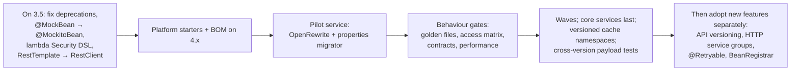

# Appendix E · Spring Boot 3.5 vs 4.x Matrix

A consolidated view of the "Boot 3 vs 4" sections from every chapter, for planning an upgrade (Chapter 42) or answering "what changed?" quickly.

!!! warning "Verify before acting"
    Boot 4 and the Spring portfolio released alongside it (Framework 7, Security 7, Data, Batch, Cloud, AI) continued to evolve after much of this handbook was written. Items marked **(verify)** in the chapters are marked here too. Treat this matrix as a **map of where to look**, and confirm exact class names, packages, properties and defaults in the official migration guide and release notes for the versions you target.

## E.1 Platform baseline

| Area | Boot 3.5 | Boot 4.x | Upgrade impact | Ch |
|---|---|---|---|---|
| Java | 17 minimum; 21/25 common | 17 minimum; **25 recommended** | Test on 25 early | 01, 42 |
| Spring Framework | 6.2 | **7.0** | Removed deprecations, new features | all |
| Jakarta EE | 10 | **11** (Servlet 6.1) | Container versions | 08, 42 |
| Kotlin | 1.9/2.x | 2.x | Build plugins | 01 |
| Build | Gradle 8.x / Maven 3.9 | Gradle 9 supported | Plugin versions | 01 |
| Auto-configuration packaging | Mostly `spring-boot-autoconfigure` | **Modularized per technology** | Imports in starters and tests may move (verify) | 05, 41 |
| Nullness | Spring's own annotations | **JSpecify** annotations | New warnings in strict builds | 42 |

## E.2 Core container and configuration

| Topic | 3.5 | 4.x | Notes | Ch |
|---|---|---|---|---|
| DI, lifecycle, events | Stable | Stable | Deprecated APIs removed | 02, 03 |
| Programmatic bean registration | `BeanDefinitionRegistryPostProcessor` | **`BeanRegistrar`** API (verify) | Optional adoption | 03 |
| AOP | Stable | Stable | — | 04 |
| `@ConfigurationProperties`, config trees | Stable | Stable | Some property renames (use the migrator) | 06 |
| Properties migrator | Available | Available | Remove after upgrade | 42 |
| Structured logging | ECS/GELF/Logstash formats (3.4+) | Same | — | 07 |

## E.3 Web

| Topic | 3.5 | 4.x | Notes | Ch |
|---|---|---|---|---|
| Spring MVC | Framework 6.2 | Framework 7 | Path matching defaults — retest | 08 |
| **API versioning** | Manual (path/header) | **Built-in** `ApiVersionConfigurer`, `version` attribute (verify) | Adopt after upgrading, separately | 20 |
| Problem details | `ProblemDetail` | Same | — | 10 |
| Validation | Hibernate Validator 8 | Hibernate Validator 9 (verify) | Retest custom constraints | 09 |
| JSON | **Jackson 2** (`com.fasterxml.jackson`) | **Jackson 3** (`tools.jackson`) (verify) | Package changes, defaults, **cross-version payloads** | 11 |
| `@JsonComponent` / mixins | Boot annotations | Renamed equivalents (verify) | Mechanical | 11 |
| HTTP clients | `RestClient`, manual HTTP interface proxies | **`@ImportHttpServices`** groups (verify) | Optional adoption | 19 |
| Request factory config | `ClientHttpRequestFactoryBuilder` (3.4+) | Same; helper classes changed across versions | Recheck timeouts | 19 |
| `RestTemplate` | Maintenance | Maintenance | Migrate to `RestClient` | 19 |
| WebFlux | Stable | Stable | — | 31 |
| GraphQL | Spring for GraphQL 1.3/1.4 | Next version (verify) | Instrumentation APIs | 32 |
| gRPC | Community starter | **Spring gRPC** (verify) | Dependency strategy | 32 |
| WebSocket/STOMP | Stable | Stable | Converters with Jackson 3 | 32 |

## E.4 Data

| Topic | 3.5 | 4.x | Notes | Ch |
|---|---|---|---|---|
| JDBC / `JdbcClient` | Stable | Stable | — | 12 |
| HikariCP | 5/6 | Current | Pool settings unchanged | 12 |
| JPA / Hibernate | **Hibernate 6.6** | **Hibernate 7** (verify) | Queries, mappings, multi-tenancy APIs | 13, 38 |
| Flyway / Liquibase | Current | Current (verify DB support modules) | — | 14 |
| Transactions | Stable | Stable | Retest propagation/rollback | 16 |
| Spring Data Redis / Mongo / Elasticsearch | 3.x / 4.x / 5.x | Next majors (verify) | Serializers (Jackson 3) | 21, 22 |
| Cache abstraction | Stable | Stable | **Version cache key prefixes** during rollout | 21 |
| R2DBC | Spring Data R2DBC 3.x | Next major (verify) | — | 31 |
| Spring Batch | **5.x** | **6.x** (verify) | Job repository schema; drain jobs first | 33 |
| Spring Modulith | 1.x | Aligned version (verify) | Publication registry schema | 37 |

## E.5 Security

| Topic | 3.5 / Security 6.5 | 4.x / Security 7 | Notes | Ch |
|---|---|---|---|---|
| Filter chain DSL | Lambda recommended | **Lambda only** | Remove non-lambda calls on 3.5 first | 17 |
| Request matchers | `requestMatchers`; Ant matcher deprecated | **`PathPatternRequestMatcher`**; Ant removed (verify) | Retest every rule — access matrix | 17 |
| CSRF for SPAs | 6.x recipe | Changed again (verify) | Re-verify SPA flows | 17 |
| Resource server | JWT, audience property (3.4+) | Same | Verify validators still apply | 18 |
| Authorization Server | 1.x | 2.x (verify) | Upgrade separately | 18 |
| Passkeys / one-time tokens | 6.4+ | Available, evolving | — | 18 |
| OAuth2 client for `RestClient` | 6.4+ interceptor | Same (verify package) | — | 19 |
| Actuator `EndpointRequest` | Actuator autoconfigure package | Moved (verify) | Security matchers | 17, 27 |

## E.6 Messaging and integration

| Topic | 3.5 | 4.x | Notes | Ch |
|---|---|---|---|---|
| Spring for Apache Kafka | 3.x | 4.x (verify) | — | 23 |
| Kafka clients | 3.x/4.x | 4.x — **KRaft only** | Brokers on KRaft first | 23 |
| JSON serializers / trusted packages | Jackson 2 | Jackson 3 | Cross-version produce/consume tests | 23 |
| Spring AMQP / RabbitMQ | 3.x; RabbitMQ 3.13/4 | 4.x (verify); RabbitMQ 4 removes classic mirrored queues | Migrate to quorum queues | 24 |
| Spring Pulsar | 1.x | Next (verify) | — | 24 |
| Spring Cloud Stream | 4.x train | Aligned train (verify) | Release train gates the upgrade | 24, 35 |
| Spring Integration | 6.x | 7.x (verify) | DSL/adapter packages | 33 |

## E.7 Concurrency, resilience, observability

| Topic | 3.5 | 4.x | Notes | Ch |
|---|---|---|---|---|
| Virtual threads | `spring.threads.virtual.enabled` | Same | Pinning gone on JDK 24+ for `synchronized` | 25 |
| Scoped values | Preview | **Final in Java 25** | Alternative to `ThreadLocal` | 25, 38 |
| Structured concurrency | Preview | Still preview (verify) | — | 25 |
| **Core resilience** | Spring Retry / Resilience4j | Framework 7 **`@Retryable`, `@ConcurrencyLimit`** (`@EnableResilientMethods`) (verify) | Don't mix two retry implementations | 26 |
| Resilience4j | `resilience4j-spring-boot3` | Aligned version (verify) | Aspect ordering | 26 |
| Micrometer / Observation | 1.14/1.15 | 1.15+ (verify) | **Metric names used by alerts** | 27 |
| Tracing | Micrometer Tracing bridges | Same; OpenTelemetry starter (verify) | Propagation end to end | 27 |

## E.8 Testing

| Topic | 3.5 | 4.x | Notes | Ch |
|---|---|---|---|---|
| `@MockBean` / `@SpyBean` | **Deprecated** | **Removed** → `@MockitoBean` / `@MockitoSpyBean` | Mechanical, do it on 3.5 | 15 |
| Test slices (`@WebMvcTest`, `@DataJpaTest`…) | `boot.test.autoconfigure.*` | Moved to technology test modules (verify) | Largest mechanical change | 15, 28 |
| `MockMvcTester` (AssertJ) | 3.4+ | Available | Preferred style | 15 |
| Testcontainers + `@ServiceConnection` | Stable | Stable (verify module names) | — | 15, 28 |
| JUnit | 5 | Newer JUnit line (verify) | Check Pact/SCC compatibility | 28 |

## E.9 Packaging and runtime

| Topic | 3.5 | 4.x | Notes | Ch |
|---|---|---|---|---|
| Layer extraction | `jarmode=tools` (3.3+) | `jarmode=tools` | Replace `layertools` in Dockerfiles | 29 |
| CDS | Supported (3.3+) | Supported + **JDK AOT cache** integration (verify) | Regenerate on any JDK/classpath change | 29 |
| Spring AOT / GraalVM native | Mature | Mature; hints stable | Rerun `nativeTest` | 29 |
| Buildpacks | `bootBuildImage` | Same (verify env vars) | — | 29 |
| Probes, graceful shutdown | Graceful default since 3.4 | Same | Recheck timings | 30 |

## E.10 Platform and ecosystem

| Topic | 3.5 | 4.x | Notes | Ch |
|---|---|---|---|---|
| Spring Cloud | Train for 3.5 | **Train for 4.x** — must match | Upgrade gate | 35 |
| Spring Cloud Gateway | Reactive + MVC variant | Same (verify artifacts) | Upgrade the gateway first | 35 |
| OpenFeign | Maintenance | Maintenance | Migrate to HTTP interfaces | 19, 35 |
| Spring AI | 1.0.x | Aligned version (verify) | Pin model versions; run evals | 40 |
| Custom starters | Imports file, `@AutoConfiguration` | Same; referenced Boot classes may move | Compile platform libs first | 41 |

## E.11 The upgrade order that works

The left-most box is where most of the work belongs: **everything that can be done on 3.5 should be done on 3.5**, so the version change itself is small, mechanical and easy to review.

## E.12 Highest-risk changes, ranked

| Rank | Change | Why it's risky | Guard |
|---|---|---|---|
| 1 | Jackson 2 → 3 | Silent format changes; cross-version payloads in caches and topics | Golden files; cross-version tests; cache namespaces |
| 2 | Security 7 matcher semantics | Rules silently change meaning | Access-matrix tests |
| 3 | Hibernate 7 | Query and mapping edge cases | Repository integration tests on real PostgreSQL |
| 4 | Modularized auto-configuration | Missing beans, moved imports | `/actuator/conditions`; compile platform libs first |
| 5 | Batch 6 repository schema | In-flight jobs across versions | Drain jobs; migration via Flyway |
| 6 | Spring Cloud train alignment | Blocks the whole platform | Check availability before planning |
| 7 | Test slice package moves | Noisy but mechanical | OpenRewrite |

---

[:material-arrow-left: D Properties Cheat Sheet](d-properties-cheat-sheet.md) · [F Troubleshooting Playbook :material-arrow-right:](f-troubleshooting-playbook.md)
