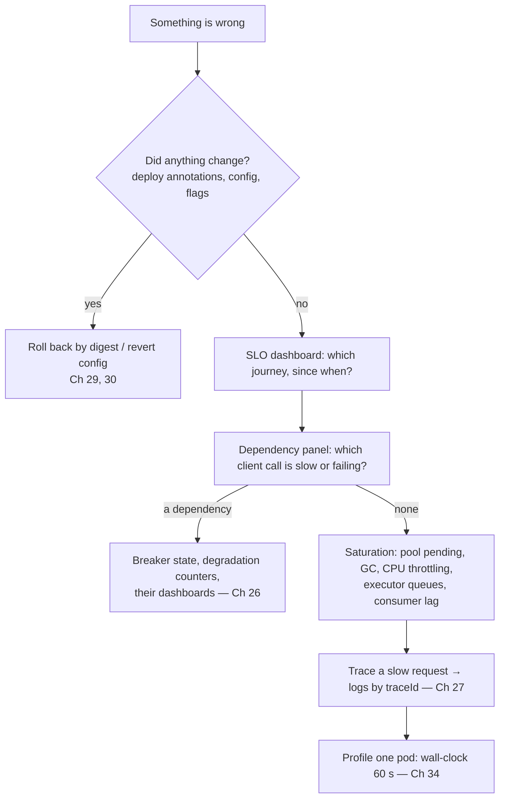

# Appendix F · Troubleshooting Playbook

Symptom → likely cause → first check → fix, consolidated from every chapter's troubleshooting table. Organized by **what you observe**, because that's how incidents start.

## F.0 First two minutes of any incident

**Restore first, understand second.** Most regressions are changes; rollback is faster than diagnosis (Chapter 43).

## F.1 Startup failures

| Symptom | Likely cause | First check | Fix | Ch |
|---|---|---|---|---|
| `NoSuchBeanDefinitionException` | Missing dependency, condition not met, wrong package scan | `--debug` / `/actuator/conditions` | Add dependency, fix condition or package | 05, 41 |
| `NoUniqueBeanDefinitionException` | Two candidates | Stack trace names both | `@Primary` or `@Qualifier` | 02 |
| `BeanCurrentlyInCreationException` | Circular dependency | Dependency cycle in message | Break the cycle; don't use `@Lazy` as a fix | 02 |
| Property binding failure | Wrong type, missing required value | Failure analyzer output | Fix config; add `@Validated` defaults | 06 |
| `Flyway validation failed` | Edited applied migration, checksum mismatch | `flyway_schema_history` | Never edit applied migrations; add a new one | 14 |
| `Schema-validation: missing column` | Entity ahead of migrations | Migration order | Expand/contract; migrate first | 14 |
| Starter "does nothing" | Missing `AutoConfiguration.imports` | Jar contents | Add the file; test it | 41 |
| CrashLoopBackOff | Liveness fires during slow startup | Pod events | `startupProbe` | 30 |
| Startup slow | Heavy beans, eager work, runners | `/actuator/startup` | Lazy/async warm-up; CDS/AOT | 03, 29 |
| Native binary fails at runtime | Missing reflection/resource hints | Error names the class/resource | `RuntimeHints`, `nativeTest` | 29 |

## F.2 HTTP and API behaviour

| Symptom | Likely cause | First check | Fix | Ch |
|---|---|---|---|---|
| 404 for paths that worked before upgrade | Trailing-slash matching disabled (Boot 3) | Request path | Fix clients; temporary gateway rewrite | 42 |
| 415 / 406 | Content-Type / Accept mismatch | Request headers | Correct headers; `produces`/`consumes` | 08 |
| 400 without field details | Missing `@Valid` or advice | Handler code | `@Valid` + central advice | 09, 10 |
| Error bodies differ between endpoints | No central handler; filter exceptions | Compare responses | `@RestControllerAdvice`; filter delegation | 10 |
| Stack traces in responses | `server.error.include-stacktrace` | Config | `never` | 10, 39 |
| Mobile app crashes after deploy | Removed/renamed field; new enum value | Golden-file diff | Revert; additive changes only | 11, 20 |
| Dates/money format changed | Jackson defaults (esp. Jackson 3) | Golden files | Explicit mapper config | 11, 42 |
| Duplicate orders on retry | No idempotency key | Order table | `@Idempotent` | 04 |
| Lost updates | No optimistic concurrency | Concurrent test | ETag + `If-Match` + `@Version` | 08, 16 |
| 428 / 412 spikes | Clients not sending `If-Match` / stale | Client versions | Client fix; retry on 412 with re-read | 08 |

## F.3 Database and transactions

| Symptom | Likely cause | First check | Fix | Ch |
|---|---|---|---|---|
| p99 high, p50 fine | Pool waits, GC, a slow query | `hikaricp.connections.pending` | Fix query/transaction scope; size pool | 12, 34 |
| `Connection is not available, request timed out` | Pool exhaustion | Pending + active + long transactions | Shorten transactions; remove remote calls; size | 12, 16 |
| Many queries per request | N+1 | Query count / SQL log | `@EntityGraph`, projections, test | 13 |
| `LazyInitializationException` | Accessing lazy data outside transaction | Stack trace | Fetch what you need; DTOs; no open-in-view | 13 |
| `UnexpectedRollbackException` | Inner `REQUIRED` method failed, outer caught | Call chain | `REQUIRES_NEW` or let it propagate | 16 |
| Changes not rolled back | Checked exception, self-invocation, private method | Annotation placement | `rollbackFor`; restructure | 04, 16 |
| Deadlocks | Inconsistent lock order, god aggregate | DB deadlock logs | Consistent ordering; smaller aggregates | 16, 37 |
| `OptimisticLockException` spikes | Hot row contention | Which entity | Reduce contention; retry with re-read | 16 |
| Migration locks table for minutes | Non-concurrent DDL on a large table | `pg_locks` | `CONCURRENTLY`, expand/contract, rehearsal | 14, 28 |
| DB CPU pegged | Missing index, seq scans | `pg_stat_statements` | Index; verify with `EXPLAIN (ANALYZE, BUFFERS)` | 12, 34 |
| Connection errors after scale-out | `pods × pool > max_connections` | Replica count | Cap `maxReplicas`; PgBouncer | 12, 30 |
| DB disk filling | Stalled CDC replication slot | `pg_replication_slots` lag | Restart connector; `max_slot_wal_keep_size` | 36 |

## F.4 Security

| Symptom | Likely cause | First check | Fix | Ch |
|---|---|---|---|---|
| Everything 401 after adding Security | Default chain | Filter chain beans | Define `SecurityFilterChain` | 17 |
| 403 on every POST from SPA | CSRF without token | CSRF config | Correct CSRF setup or stateless tokens | 17 |
| CORS preflight fails | CORS not configured through Security | `OPTIONS` response | `http.cors(...)` | 17 |
| `invalid_token` in production only | Issuer/audience/clock/JWKS mismatch | Decoded token vs config | Align `iss`/`aud`; NTP; JWKS URL | 18 |
| Random 401s after key rotation | Old `kid` removed too early | JWKS contents | Keep old keys for max token lifetime | 18 |
| Webhooks always rejected | Trailing newline in secret, re-serialized body | Raw bytes vs signature | Trim secret; verify raw bytes | 18 |
| User sees another user's data | Missing ownership check or cache key dimension | Access-matrix test | Owner-scoped queries; key fix | 17, 21 |
| Tenant sees another tenant's data | Native query, unforced RLS, context leak | Leak suite | `FORCE ROW LEVEL SECURITY`; propagation | 38 |
| Access matrix changed after upgrade | Security 7 matcher semantics | Matrix test | Review every rule | 17, 42 |

## F.5 HTTP clients and dependencies

| Symptom | Likely cause | First check | Fix | Ch |
|---|---|---|---|---|
| Service down when a dependency is slow | No timeouts | Client config | Connect/read/lease timeouts | 19 |
| `Read timed out` | Dependency slow | Their p99 | Budget, breaker, degradation | 19, 26 |
| `Connection reset` after idle | Stale pooled connections | Idle time vs LB timeout | Validate-after-inactivity, TTL | 19 |
| Latency spike, no errors | HTTP pool exhaustion | Lease wait time | Raise per-route limit deliberately; bulkhead | 19 |
| Retries multiply load | Retries at several layers | Gateway, mesh, client configs | One retry layer; budget | 26 |
| Breaker never opens | Wrong recorded exceptions, high minimum calls | Breaker metrics | Tune; time-based window | 26 |
| Breaker opens on legitimate traffic | Business exceptions counted | `ignoreExceptions` | Ignore domain exceptions | 26 |
| Traces stop at a client | Client not built from Boot's builder | Client construction | Inject the builder | 19, 27 |

## F.6 Caching and NoSQL

| Symptom | Likely cause | First check | Fix | Ch |
|---|---|---|---|---|
| Cache has no effect | No `@EnableCaching`; self-invocation | Hit/miss metrics | Enable; restructure | 21 |
| Hit rate near zero | Key includes a unique value | Key expression | Fix key | 21 |
| Stale data after update | Evict before commit; local caches; missed events | Eviction timing | After-commit eviction; Redis; shorter TTL | 21 |
| DB spike every N minutes | Synchronized TTL expiry | TTL config | Jitter; refresh-ahead | 21 |
| DB spike after every deploy | Cold cache | Hit rate after rollout | Warm-up; namespace strategy | 21, 29 |
| Requests fail when Redis is slow | No `CacheErrorHandler` | Stack traces | Fail open; meter | 21 |
| `SerializationException` during rollout | Cross-version cache values | Key prefix | Versioned prefix per major | 21, 42 |
| Redis memory full | Missing TTLs, big keys | `--bigkeys` | TTLs; `maxmemory-policy` | 22 |
| Search returns nothing for a valid term | Analyzer mismatch, `keyword` vs `text` | `_analyze` API | Fix mapping; reindex; alias rollback | 22 |
| Search misses new products | Indexer lag or stuck consumer | Index lag metric | Consumer health; DLT replay | 22 |

## F.7 Messaging

| Symptom | Likely cause | First check | Fix | Ch |
|---|---|---|---|---|
| Consumer lag grows | Too few partitions/consumers; slow handler | Lag per partition | Scale partitions + consumers; batch; profile | 23 |
| Partition stuck | Poison pill retried forever | Error logs, offsets | `ErrorHandlingDeserializer`, DLT | 23 |
| Duplicate side effects | Redelivery without idempotency | Inbox table | Inbox / conditional updates | 23 |
| Frequent rebalances | Processing exceeds `max.poll.interval.ms` | Rebalance metrics | Smaller batches; cooperative sticky; static membership | 23 |
| Events out of order | Wrong key; retry topics | Keys | Key by aggregate id; blocking retries for ordered flows | 23 |
| Events never arrive | Dual write lost them; relay stopped | Outbox pending | Outbox; relay alerting | 36 |
| RabbitMQ messages vanish | Unroutable, no `mandatory` | Returns callback | `mandatory` + alert | 24 |
| RabbitMQ consumer at 100% CPU | Poison requeue loop | Redelivery rate | `default-requeue-rejected: false`, DLX | 24 |
| WebSocket messages lost across pods | Simple broker | Broker config | STOMP broker relay | 32 |

## F.8 Async, scheduling, virtual threads

| Symptom | Likely cause | First check | Fix | Ch |
|---|---|---|---|---|
| Memory grows; tasks delayed | Unbounded executor queue | `executor.queued` | Bound; `CallerRunsPolicy` | 25 |
| `@Async` runs synchronously | Self-invocation; no `@EnableAsync` | Call site | Restructure | 25 |
| Async exceptions vanish | `void` method without handler | Logs | `AsyncUncaughtExceptionHandler` | 25 |
| Job runs N times | No cluster lock | Logs from multiple pods | ShedLock / CronJob | 25 |
| Job fires at the wrong hour | No `zone` | Cron config | `zone = "Asia/Kolkata"` | 25 |
| Scheduled jobs delayed | Scheduler pool of 1 | Pool size | Size the pool | 25 |
| High latency, low CPU with virtual threads | Downstream saturation | Pool pending, HTTP lease waits | Bulkheads; sizing | 25, 26 |
| Carrier threads blocked | Pinning (JDK < 24 `synchronized`, native) | JFR pinning events | `ReentrantLock`; upgrade JDK | 25 |
| `anonymousUser` in audit from async code | Security context not propagated | Executor config | `DelegatingSecurityContextExecutor` | 17, 25 |
| Missing `traceId` in async logs | Context not propagated | Task decorator | `ContextPropagatingTaskDecorator` | 07, 25 |

## F.9 Kubernetes and deployment

| Symptom | Likely cause | First check | Fix | Ch |
|---|---|---|---|---|
| 502s during every deploy | No preStop; short grace; `maxUnavailable > 0` | Rollout strategy | preStop sleep; grace > drain; `maxUnavailable: 0` | 30 |
| All pods restart during a DB blip | Dependencies in liveness | Health groups | Liveness internal only | 30 |
| All pods unready during a DB blip | Dependencies in readiness | Readiness group | Minimal readiness; degrade | 26, 30 |
| OOMKilled with small heap | Non-heap growth | RSS vs heap; NMT | Lower `MaxRAMPercentage`; cap threads | 29 |
| p99 spikes, CPU looks fine | CFS throttling | Throttling metric | Remove/raise CPU limits | 30 |
| Config change ignored | No rollout on ConfigMap change | Pod start time | Config hash annotation | 06, 30 |
| Everything broke after NetworkPolicy | DNS egress blocked | Policy rules | Allow `kube-dns` | 30 |
| Consumer lag despite scale-out | More pods than partitions | Partition count | Scale partitions | 23, 30 |
| Rollback deploys the wrong build | Mutable tags | Image reference | Deploy by digest | 29 |
| Pushes and pulls are huge | Unlayered image | Image layers | Extract layers | 29 |

## F.10 Performance and memory

| Symptom | Likely cause | First check | Fix | Ch |
|---|---|---|---|---|
| Throughput plateaus below target | A bounded resource | Little's law against pools | Find and raise/relieve the bound | 34 |
| Latency grows over hours | Leak or unbounded growth | Heap after full GC | Heap dump; cap caches | 34 |
| CPU low, latency high | Waiting on I/O, locks, dependencies | Wall-clock profile | Fix the wide frame | 34 |
| Frequent young GCs | High allocation rate | Allocation profile | Reduce garbage (logging, boxing) | 34 |
| Slow only after deploy | Cold caches, JIT warm-up | Hit rate; first minutes | Warm-up; CDS/AOT | 21, 29 |
| Fast in staging, slow in production | Data volume differences | Row counts | Production-sized test data | 28, 34 |
| Load test looks great, production doesn't | Coordinated omission | Test executor | Open model | 34 |

## F.11 Distributed consistency

| Symptom | Likely cause | First check | Fix | Ch |
|---|---|---|---|---|
| Stock reserved for cancelled orders | Missing/failed compensation | Saga state | Compensation retries; reconciliation | 36 |
| Sagas accumulate in one state | Missing event; no timeout | Per-state age | Timeout sweeper; consumer health | 36 |
| Double compensation / double refund | Non-idempotent compensation | Commands emitted | Guarded transitions; idempotent commands | 36 |
| Customers charged for cancelled orders | Late event applied after compensation | Event timing | Guard terminal states; auto-void | 36 |
| "I don't see my order" | Reading a projection after a write | Read path | Return write result; version tokens | 36 |
| Finance finds drift | No reconciliation | — | Two-directional hourly jobs | 36 |
| Module events lost on crash | No publication registry | `event_publication` table | Enable registry; monitor | 37 |

## F.12 Batch and scheduled processing

| Symptom | Likely cause | First check | Fix | Ch |
|---|---|---|---|---|
| Restart reprocesses everything | Identifying parameters changed | Job parameters | Keep them stable | 33 |
| Duplicates after restart | Non-idempotent writes | Row counts | Natural keys, upserts | 33 |
| Rows missing with paging reader | No unique sort key | Reader config | Unique sort key | 33 |
| Job didn't run | CronJob misconfiguration, timezone | Job history | Missed-run alert; `timeZone` | 33 |
| Silent skips | No skip listener | Skip count | Rejects file + alert | 33 |
| Wrong payout amounts | No reconciliation step | Totals vs last week | Reconcile before producing artifacts | 33 |

## F.13 AI features

| Symptom | Likely cause | First check | Fix | Ch |
|---|---|---|---|---|
| Confident wrong answers | Irrelevant retrieval; no threshold | Retrieved chunks | Threshold; empty-context handoff | 40 |
| Cites outdated policies | Re-ingestion appended | Chunks by source | Delete-by-source before ingest | 40 |
| Another customer's data in an answer | Tool not session-scoped | Tool audit log | Identity from session; ownership check | 40 |
| Cost spike | Long context, memory growth, no cache | Token metrics | Caps, memory window, caching, routing | 40 |
| Quality dropped without a deploy | Unpinned model version | Model identifier | Pin; evaluation gate | 40 |

## F.14 Upgrades

| Symptom | Likely cause | First check | Fix | Ch |
|---|---|---|---|---|
| Errors only during rollout | Cross-version payloads, caches, sessions | Timing vs rollout | Tolerant readers; versioned namespaces | 42 |
| Bean missing after upgrade | Moved auto-configuration; changed condition | Conditions report | Fix imports; explicit config | 41, 42 |
| Tests green, production different | ConfigMaps not migrated | Migrator against prod config | Update ConfigMaps | 42 |
| Metrics missing after upgrade | Renamed meters | Observability contract test | Update dashboards/alerts | 27, 42 |
| Upgrade blocked for months | Third-party library | Readiness scorecard | Replace, isolate or fork early | 42 |

---

[:material-arrow-left: E Boot 3 vs 4 Matrix](e-boot-3-vs-4-matrix.md) · [G Glossary :material-arrow-right:](g-glossary.md)
