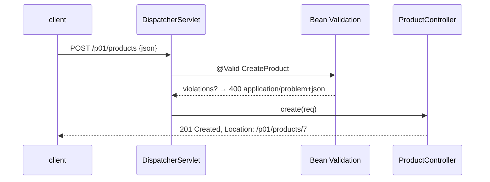

# 1. REST CRUD with Validation

<span class="level l1">L1</span> ★☆☆ · `@Valid` record DTOs, 201 + `Location`, 404, idempotent DELETE

## Problem

> Build `/products` with create, read, list, replace and delete. Validate input (name required, price positive, SKU format), return
> the **right status codes**, a `Location` header on create, and RFC 9457 errors for bad input and missing products.

## Key idea

Bind requests to **record DTOs** annotated with Bean Validation and mark them `@Valid`. Spring returns a 400 `ProblemDetail`
automatically when `spring.mvc.problemdetails.enabled=true`. Use `ResponseEntity.created(uri)` for **201 + Location**,
`ResponseStatusException` for 404, and `@ResponseStatus(NO_CONTENT)` for DELETE. DELETE is idempotent: deleting twice is still 204.



## Solution

```java title="ProductController.java"
--8<-- "coding-interview/src/main/java/com/playbook/interview/p01/ProductController.java"
```

```java title="ProductControllerTest.java"
--8<-- "coding-interview/src/test/java/com/playbook/interview/p01/ProductControllerTest.java"
```

## Walkthrough

| Code | Why |
|---|---|
| `record CreateProduct(@NotBlank @Size(max = 80) String name, @NotNull @Positive Long priceCents, @Pattern(...) String sku)` | A separate request DTO: clients can't set `id` or other server-owned fields (mass assignment), and the constraints document the API. |
| `ResponseEntity.created(location).body(p)` | 201 plus a `Location` header built from the current request URI. This is what REST reviewers check first. |
| `throw new ResponseStatusException(HttpStatus.NOT_FOUND, "product " + id + " not found")` | Rendered as a ProblemDetail with `detail` set to the message. For real domains, prefer custom exceptions plus advice (problem 2). |
| `@ResponseStatus(HttpStatus.NO_CONTENT) void delete(...)` | 204 with no body, and it doesn't fail for a missing id, so retried DELETEs are safe. |
| `malformedJson_returns400_notA500` | Spring maps `HttpMessageNotReadableException` to 400. The test makes sure it stays that way. |

## Complexity

| Approach | Time | Space |
|---|---|---|
| each request | O(1) map ops (O(n log n) list sort) | O(products) |

## Run it

```bash
cd coding-interview && mvn -q test -Dtest=ProductControllerTest
```

```text
--8<-- "coding-interview/outputs/ProductControllerTest.txt"
```

## Common mistakes

* Binding the request straight onto the persistence entity, which lets clients set ids, audit fields and roles.
* Returning 200 for create, or 404 for a successful DELETE of something already deleted.
* Forgetting `@Valid`, so the annotations on the DTO silently do nothing.
* Using `Long priceCents` without `@NotNull`. `@Positive` ignores null, so a missing price is accepted.

## Follow-up questions

??? question "PUT vs PATCH?"
    PUT replaces the whole resource and is idempotent, so the client sends every field. PATCH applies a partial change, either as JSON Merge Patch (`application/merge-patch+json`) or JSON Patch operations. Validate the *result* of applying the patch, not the patch document.

??? question "How do you version this API?"
    With a URI prefix (`/v1/products`) for simplicity, or a media type or header for purists. Spring Framework 7 has first-class API versioning (`spring.mvc.apiversion.*` and `@GetMapping(version = "1.1")`). Never break existing clients; add fields instead of changing them.
