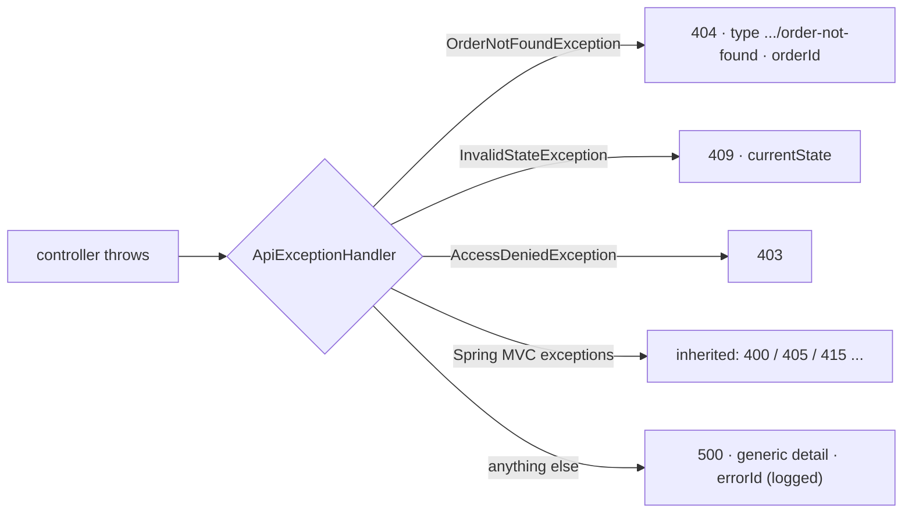

# 2. Global Error Handling with ProblemDetail

<span class="level l2">L2</span> ★★☆ · `@RestControllerAdvice`, `ResponseEntityExceptionHandler`, RFC 9457, no leaks

## Problem

> Controllers throw domain exceptions (`OrderNotFoundException`, `InvalidStateException`). Map them to consistent
> **RFC 9457** responses with `type`, `title`, `detail`, `instance` and custom fields. Unexpected errors must return 500
> **without leaking internals**, and Spring's own errors (405, 415, validation) must use the same format.

## Key idea

Put one `@RestControllerAdvice` in charge of the error vocabulary. **Extend `ResponseEntityExceptionHandler`** so the framework's
exceptions are rendered as `ProblemDetail` too. Each domain exception gets a handler that adds a stable `type` URI and useful
properties. A **catch-all** logs the stack trace with a correlation id and returns a generic message.



## Solution

```java title="ApiExceptionHandler.java"
--8<-- "coding-interview/src/main/java/com/playbook/interview/p02/ApiExceptionHandler.java"
```

```java title="OrderController.java"
--8<-- "coding-interview/src/main/java/com/playbook/interview/p02/OrderController.java"
```

```java title="ApiExceptionHandlerTest.java"
--8<-- "coding-interview/src/test/java/com/playbook/interview/p02/ApiExceptionHandlerTest.java"
```

## Walkthrough

| Code | Why |
|---|---|
| `class ApiExceptionHandler extends ResponseEntityExceptionHandler` | Inherits handlers for about 20 Spring MVC exceptions, all producing `ProblemDetail`. The 405 test proves the format is consistent. |
| `pd.setType(URI.create("https://errors.example.com/order-not-found"))` | `type` is the machine-readable error code that clients switch on. `title` stays constant per type; `detail` is per occurrence. |
| `pd.setProperty("orderId", e.orderId)` | Extension members carry structured data, so clients don't have to parse messages. |
| `log.error("unhandled error {}", errorId, e); ... "Reference: " + errorId` | Log everything, return nothing sensitive. Support can find the log entry from the id the user quotes. |
| `@ExceptionHandler(AccessDeniedException.class)` | This is needed because the catch-all would otherwise turn method-security denials into 500s (see problem 12). |

## Complexity

| Approach | Time | Space |
|---|---|---|
| per error | O(1) | O(1) |

## Run it

```bash
cd coding-interview && mvn -q test -Dtest=ApiExceptionHandlerTest
```

```text
--8<-- "coding-interview/outputs/ApiExceptionHandlerTest.txt"
```

## Common mistakes

* Returning `e.getMessage()` from the catch-all. The test checks that "hunter2" never reaches the client.
* A catch-all `Exception` handler that also catches security or `ResponseStatusException` errors and returns 500 for them.
* Different error shapes per controller. Clients then need a parser per endpoint.
* Using HTTP 200 with `{"error": ...}` bodies.

## Follow-up questions

??? question "Where do errors from filters (before the DispatcherServlet) go?"
    `@RestControllerAdvice` only sees exceptions raised inside Spring MVC handlers. Filter and Security errors go through `ExceptionTranslationFilter`, `AuthenticationEntryPoint` or `AccessDeniedHandler`, or Boot's `/error` endpoint. Configure those to write ProblemDetail as well.

??? question "400 vs 422 for validation errors?"
    400 means "I couldn't process the request syntax or shape". 422 means "well-formed, but semantically invalid". Spring uses 400 for Bean Validation. Many APIs use 422 for business-rule violations. Pick one convention and document it.
