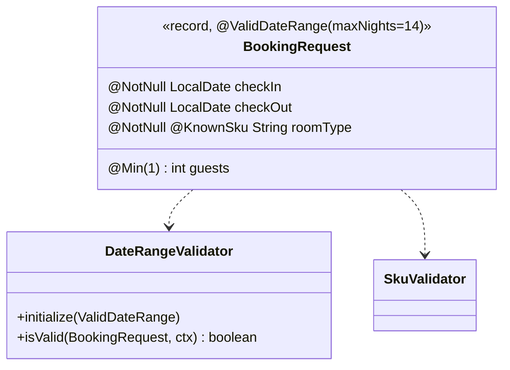

# 3. Custom Cross-Field Validator

<span class="level l2">L2</span> ★★☆ · `@Constraint`, `ConstraintValidator`, class-level constraints, property nodes

## Problem

> A booking needs `checkOut` after `checkIn` and at most **N nights** (N configurable in the annotation), plus a **known room type**.
> Write reusable custom constraints. The cross-field error must point at the `checkOut` field so a UI can highlight it.

## Key idea

A field-level constraint (`@KnownSku`) validates one value. A **class-level** constraint (`@ValidDateRange` on the record) sees the
whole object, which a rule involving two fields needs. Annotation attributes (`maxNights`) parameterise the validator through
`initialize`. `buildConstraintViolationWithTemplate(...).addPropertyNode("checkOut")` attaches the error to a specific field.



## Solution

```java title="ValidDateRange.java"
--8<-- "coding-interview/src/main/java/com/playbook/interview/p03/ValidDateRange.java"
```

```java title="DateRangeValidator.java"
--8<-- "coding-interview/src/main/java/com/playbook/interview/p03/DateRangeValidator.java"
```

```java title="KnownSku.java"
--8<-- "coding-interview/src/main/java/com/playbook/interview/p03/KnownSku.java"
```

```java title="SkuValidator.java"
--8<-- "coding-interview/src/main/java/com/playbook/interview/p03/SkuValidator.java"
```

```java title="BookingRequest.java"
--8<-- "coding-interview/src/main/java/com/playbook/interview/p03/BookingRequest.java"
```

```java title="BookingValidationTest.java"
--8<-- "coding-interview/src/test/java/com/playbook/interview/p03/BookingValidationTest.java"
```

## Walkthrough

| Code | Why |
|---|---|
| `@Target(ElementType.TYPE) ... @Constraint(validatedBy = DateRangeValidator.class)` | A class-level constraint. `message`, `groups` and `payload` are required by the Bean Validation spec. |
| `if (r.checkIn() == null \|\| r.checkOut() == null) return true;` | Let `@NotNull` report nulls. Each constraint has one job, which avoids duplicate or confusing errors. |
| `ctx.disableDefaultConstraintViolation(); ... .addPropertyNode("checkOut")` | Moves the violation from the object to the `checkOut` field. The unit test asserts the property path. |
| `message = "... at most {maxNights} nights"` | Message interpolation reads annotation attributes, so the test sees "14 nights". |
| `@Target({FIELD, PARAMETER, RECORD_COMPONENT})` | `RECORD_COMPONENT` lets the annotation sit on record components. It propagates to the accessor and field. |

## Complexity

| Approach | Time | Space |
|---|---|---|
| validate | O(constraints) | O(1) |

## Run it

```bash
cd coding-interview && mvn -q test -Dtest=BookingValidationTest
```

```text
--8<-- "coding-interview/outputs/BookingValidationTest.txt"
```

## Common mistakes

* Validating cross-field rules in the controller with `if` statements, which isn't reusable and gives inconsistent error format.
* Returning `false` for null inputs in custom validators, which doubles up with `@NotNull`.
* Doing database lookups in a validator on every request without caching. Validators can be Spring beans with dependencies injected, but keep them fast.

## Follow-up questions

??? question "Can a ConstraintValidator use Spring beans?"
    Yes. Spring's `LocalValidatorFactoryBean` creates validators through the application context, so constructor injection works. For example, `SkuValidator` could inject a `RoomTypeRepository`.

??? question "What are validation groups for?"
    To apply different rules in different situations (`OnCreate` vs `OnUpdate`) using `@Validated(OnCreate.class)`. Records with separate DTOs per operation are often clearer than groups.
