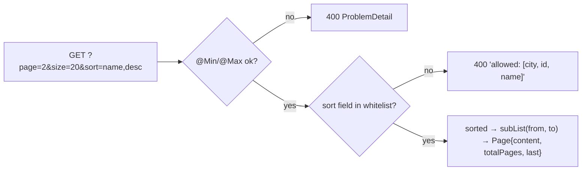

# 4. Pagination & Safe Sorting

<span class="level l2">L2</span> ★★☆ · Page metadata, max page size, sort whitelist, built-in method validation

## Problem

> `GET /customers?page=&size=&sort=field,dir` must return a page plus metadata (total elements, total pages, last). It must **cap the page
> size at 100** and **reject unknown sort fields**, because user input must never reach `ORDER BY`.

## Key idea

Validate `page` and `size` with `@Min`/`@Max` directly on the parameters. Spring MVC 6.1+ validates handler method parameters
**without a class-level `@Validated`** and renders violations as 400 `ProblemDetail`. Map the sort field through a **whitelist**
(`Map<String, Comparator>` here; with Spring Data, a set of allowed property names) and return a clear error that lists the allowed fields.



## Solution

```java title="CustomerController.java"
--8<-- "coding-interview/src/main/java/com/playbook/interview/p04/CustomerController.java"
```

```java title="PaginationTest.java"
--8<-- "coding-interview/src/test/java/com/playbook/interview/p04/PaginationTest.java"
```

## Walkthrough

| Code | Why |
|---|---|
| `@RequestParam(defaultValue = "20") @Min(1) @Max(100) int size` | A hard cap stops `size=1000000` from becoming a denial of service. Spring Data offers `spring.data.web.pageable.max-page-size` for the same thing. |
| `Map<String, Comparator<Customer>> SORTABLE` | The whitelist. Only known, indexed fields can be sorted, and the test sends `name; DROP TABLE customer` to prove it's rejected. |
| `Comparator.comparing(Customer::city).thenComparing(Customer::name)` | A stable secondary order matters for pagination: with ties and no tie-breaker, rows can move between pages. |
| `record Page<T>(content, page, size, totalElements, totalPages, last)` | Return explicit page metadata, not just a list. (Spring Data's `PagedModel` has the same shape.) |
| `(removed) @Validated on the class` | We hit this while building it: a class-level `@Validated` switches to the AOP `MethodValidationPostProcessor`, which throws `ConstraintViolationException`. That surfaced as a 500 until it was removed. |

## Complexity

| Approach | Time | Space |
|---|---|---|
| offset pagination | O(n log n) sort here; O(offset + size) in a DB | O(size) |
| keyset pagination | O(log n + size) with an index | O(size) |

## Run it

```bash
cd coding-interview && mvn -q test -Dtest=PaginationTest
```

```text
--8<-- "coding-interview/outputs/PaginationTest.txt"
```

## Common mistakes

* Passing `sort` straight into a query string, which is SQL injection, or sorting by an unindexed column.
* Allowing unbounded `size`.
* Offset pagination on huge tables: `OFFSET 1000000` scans a million rows. Use keyset or cursor pagination (`WHERE id > :lastId ORDER BY id LIMIT 20`).
* Running `COUNT(*)` on every page request for millions of rows. Use a `Slice` (no total count) when the UI only needs next/previous.

## Follow-up questions

??? question "Offset vs keyset (cursor) pagination?"
    Offset is simple and allows jumping to any page, but it gets slower deep into the result set and rows shift when data changes between requests. Keyset uses the last row's sort key as an opaque cursor: constant cost, stable under inserts, but no random page access. Infinite-scroll feeds use keyset.

??? question "How would you do this with Spring Data JPA?"
    Accept a `Pageable` parameter (with `@PageableDefault(size = 20)`), validate `pageable.getSort()` against allowed properties, and return `PagedModel<Dto>` (`@EnableSpringDataWebSupport(pageSerializationMode = VIA_DTO)`) so the JSON shape is stable.
