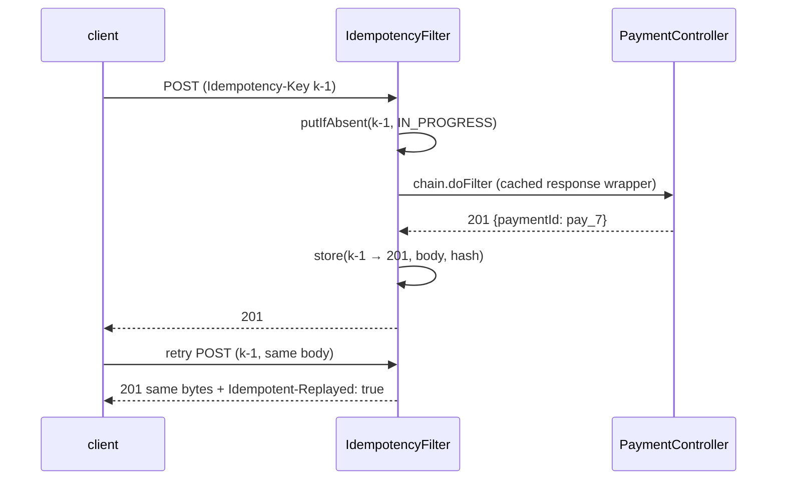

# 5. Idempotency-Key Servlet Filter

<span class="level l3">L3</span> ★★★ · `OncePerRequestFilter`, request body replay, response caching, 409 / 422

## Problem

> Make `POST /payments` safe to retry. The same `Idempotency-Key` with the same body **replays the original response** without charging
> again. The same key with a **different body** gets 422. A missing key gets 400. A request still in progress gets 409.

## Key idea

It's a cross-cutting HTTP concern, so put it in a **filter** in front of the controllers. Read and hash the body, **atomically claim** the key,
run the chain with a **response-caching wrapper**, and store status, content type and body. Later requests with the key replay those
exact bytes and add an `Idempotent-Replayed: true` header. 5xx results release the key so the client can retry.



## Solution

```java title="IdempotencyFilter.java"
--8<-- "coding-interview/src/main/java/com/playbook/interview/p05/IdempotencyFilter.java"
```

```java title="PaymentController.java"
--8<-- "coding-interview/src/main/java/com/playbook/interview/p05/PaymentController.java"
```

```java title="IdempotencyFilterTest.java"
--8<-- "coding-interview/src/test/java/com/playbook/interview/p05/IdempotencyFilterTest.java"
```

## Walkthrough

| Code | Why |
|---|---|
| `protected boolean shouldNotFilter(...) { ... POST && /p05/ }` | Scope the filter to the endpoints that need it. Other filters and GET requests pay nothing. |
| `byte[] requestBody = req.getInputStream().readAllBytes(); ... new ReplayableRequest(req, requestBody)` | The body stream can be read only once. After hashing, wrap the request so the controller can read the body again. |
| `store.putIfAbsent(key, IN_PROGRESS)` | An atomic claim. Two concurrent duplicates can't both reach the controller. |
| `new ContentCachingResponseWrapper(res) ... cachedResponse.copyBodyToResponse()` | Capture what the controller wrote so it can be stored, then **copy it to the real response**. Forgetting that line sends an empty body. |
| `if (cachedResponse.getStatus() >= 500) store.remove(key)` | Don't make a transient failure permanent. |

## Complexity

| Approach | Time | Space |
|---|---|---|
| per POST | O(body size) hashing + O(1) store | O(stored responses), with a TTL in production |

## Run it

```bash
cd coding-interview && mvn -q test -Dtest=IdempotencyFilterTest
```

```text
--8<-- "coding-interview/outputs/IdempotencyFilterTest.txt"
```

## Common mistakes

* Using `ContentCachingRequestWrapper` and expecting the body to be readable *before* the chain runs. It only caches what downstream code reads.
* Forgetting `copyBodyToResponse()`, so the client receives an empty body.
* Storing responses forever. Use Redis with a TTL (for example 24 hours) or a DB table with expiry.
* Keys that aren't scoped per client. Prefix them with the authenticated client id so two clients can't collide.

## Follow-up questions

??? question "Filter vs HandlerInterceptor vs AOP for this?"
    A filter sees the raw request and response bytes (needed for replay) and runs before Spring MVC. An interceptor runs around handler selection but can't easily replace the response body. AOP sees method arguments and return values rather than HTTP. For idempotency, a filter fits best.

??? question "How do you make this work across 10 instances?"
    Use a shared store: Redis `SET key value NX PX ttl` for the claim and a hash for the stored response. Or a DB table with a unique key on the idempotency key, written in the **same transaction** as the payment, so the claim and the side effect commit together.
