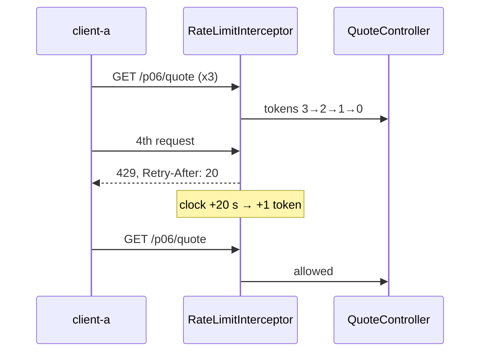

# 6. Rate Limiting with a HandlerInterceptor

<span class="level l2">L2</span> ★★☆ · Token bucket per client, 429 + `Retry-After`, injectable `Clock`

## Problem

> Limit each API client (by `X-Api-Key`) to **3 requests per minute** on `/p06/**` only. Exceeding the limit returns **429** with
> `Retry-After` and `RateLimit-*` headers. Tokens refill over time, and each client is limited independently.

## Key idea

A `HandlerInterceptor.preHandle` returning `false` stops the request before the controller runs. Each client gets a **token bucket**
refilled lazily from elapsed time. Time comes from an injected **`Clock`**, so the test can move time forward 20 seconds instead of sleeping.
The interceptor is registered **only for `/p06/**`**.



## Solution

```java title="RateLimitInterceptor.java"
--8<-- "coding-interview/src/main/java/com/playbook/interview/p06/RateLimitInterceptor.java"
```

```java title="WebConfig.java"
--8<-- "coding-interview/src/main/java/com/playbook/interview/p06/WebConfig.java"
```

```java title="RateLimitInterceptorTest.java"
--8<-- "coding-interview/src/test/java/com/playbook/interview/p06/RateLimitInterceptorTest.java"
```

## Walkthrough

| Code | Why |
|---|---|
| `registry.addInterceptor(rateLimit).addPathPatterns("/p06/**")` | Scope matters: the test `otherEndpoints_areNotLimited` sends 10 requests to another API with no 429. |
| `buckets.computeIfAbsent(client, ...); synchronized (b) { ... }` | One lock per client, so busy clients don't contend with each other. |
| `b.tokens = Math.min(capacity, b.tokens + (now - b.lastRefillMillis) * refillPerMilli)` | Lazy refill: no background timer, just the elapsed time multiplied by the rate, capped at capacity. |
| `long retryAfterSeconds = (long) Math.ceil((1 - b.tokens) / refillPerMilli / 1000)` | Tell clients exactly when to retry. At 3/minute, that's 20 s from empty. |
| `RateLimitInterceptor(..., Clock clock) + @Primary MutableClock in tests` | Injectable time. A real bug hit while building this: defining the `Clock` bean inside the same `WebConfig` that injects the interceptor created a circular dependency, so the bean moved to the application class. |

## Complexity

| Approach | Time | Space |
|---|---|---|
| preHandle | O(1) | O(clients) |

## Run it

```bash
cd coding-interview && mvn -q test -Dtest=RateLimitInterceptorTest
```

```text
--8<-- "coding-interview/outputs/RateLimitInterceptorTest.txt"
```

## Common mistakes

* An in-memory limiter behind a load balancer: each of N instances allows the full limit. Use Redis (a Lua script or Bucket4j's Redis backend) for a global limit.
* Keying on `getRemoteAddr()` behind a proxy, which is the proxy's IP. Use `X-Forwarded-For` only from trusted proxies (`server.forward-headers-strategy`).
* Unbounded `buckets` maps. Evict idle clients, for example with a Caffeine cache and `expireAfterAccess`.
* Sleeping in the request thread to "smooth" traffic instead of rejecting.

## Follow-up questions

??? question "Where should rate limiting live: gateway or service?"
    Coarse, per-client limits belong at the edge (API gateway, Envoy, Spring Cloud Gateway's `RequestRateLimiter`) so abusive traffic never reaches services. Fine-grained business limits ("5 OTPs per hour per phone") belong in the service, next to the rule.

??? question "How would you use Bucket4j instead?"
    Create a `Bandwidth.builder().capacity(3).refillGreedy(3, Duration.ofMinutes(1))` per key, store buckets in a `ProxyManager` backed by Redis or Hazelcast, and call `tryConsumeAndReturnRemaining(1)` to fill the `RateLimit-Remaining` and `Retry-After` headers.
