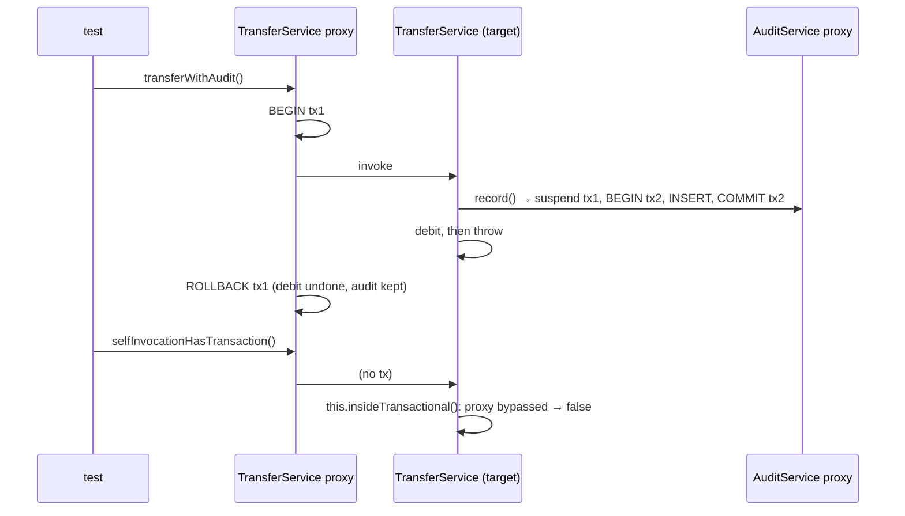

# 7. @Transactional: The Three Traps

<span class="level l3">L3</span> ★★★ · Rollback rules, self-invocation, `REQUIRES_NEW` audit

## Problem

> A money transfer debits one account and credits another. Prove with tests: (1) a **checked exception** doesn't roll back by
> default; (2) calling a `@Transactional` method on **`this`** doesn't start a transaction; (3) an **audit row** written with
> `REQUIRES_NEW` survives the outer rollback.

## Key idea

`@Transactional` is applied by a **proxy around the bean**. Three consequences follow. Rollback happens only for **unchecked**
exceptions unless you set `rollbackFor`. Calls from **inside** the bean skip the proxy, so they get no transaction. **Propagation**
decides whether an inner call joins the caller's transaction (`REQUIRED`) or suspends it and commits on its own (`REQUIRES_NEW`).



## Solution

```java title="TransferService.java"
--8<-- "coding-interview/src/main/java/com/playbook/interview/p07/TransferService.java"
```

```java title="TransferServiceTest.java"
--8<-- "coding-interview/src/test/java/com/playbook/interview/p07/TransferServiceTest.java"
```

## Walkthrough

| Code | Why |
|---|---|
| `@Transactional public void transferDefaultRollback(...) throws InsufficientFundsException` | The trap. The checked exception propagates but the transaction **commits**, and the test shows ana at −4000. |
| `@Transactional(rollbackFor = InsufficientFundsException.class)` | The fix. Another option is to make domain exceptions extend `RuntimeException`. |
| `return this.insideTransactional();` | Self-invocation calls the target directly, so the annotation is ignored. `isActualTransactionActive()` returns false. |
| `@Transactional(propagation = Propagation.REQUIRES_NEW) public void record(...)` | Lives in a **separate bean** (`AuditService`) so the call goes through a proxy. It commits independently of the caller. |
| `@BeforeEach reset() with DELETE/INSERT` | Tests share one H2 database, so each one resets its rows. `@Transactional` on the test would roll back automatically, but it would also hide trap 1. |

## Complexity

| Approach | Time | Space |
|---|---|---|
| transfer | 3 SQL statements | O(1) |

## Run it

```bash
cd coding-interview && mvn -q test -Dtest=TransferServiceTest
```

```text
--8<-- "coding-interview/outputs/TransferServiceTest.txt"
```

## Common mistakes

* Putting `@Transactional` on `private` methods or calling annotated methods via `this`. Neither goes through the proxy.
* Catching an exception inside the transactional method and swallowing it. The transaction then commits partial work. And if an inner `REQUIRED` call already marked the transaction rollback-only, the commit fails with `UnexpectedRollbackException`.
* Long transactions that include HTTP calls, which hold DB connections and locks while waiting on the network.
* Annotating controllers. Transaction boundaries belong on application or service methods.

## Follow-up questions

??? question "REQUIRED vs REQUIRES_NEW vs NESTED?"
    `REQUIRED` joins an existing transaction or starts one, so everything commits or rolls back together. `REQUIRES_NEW` suspends the caller's transaction and runs its own, which uses a second DB connection, so watch pool size. `NESTED` uses a savepoint inside the same transaction: an inner rollback undoes only the inner work. It needs JDBC savepoint support.

??? question "Does readOnly = true do anything?"
    Yes. It hints the driver (some route reads to replicas), lets Hibernate skip dirty checking and flushing, and documents intent. It isn't a security boundary: writes may still succeed, depending on the database.
