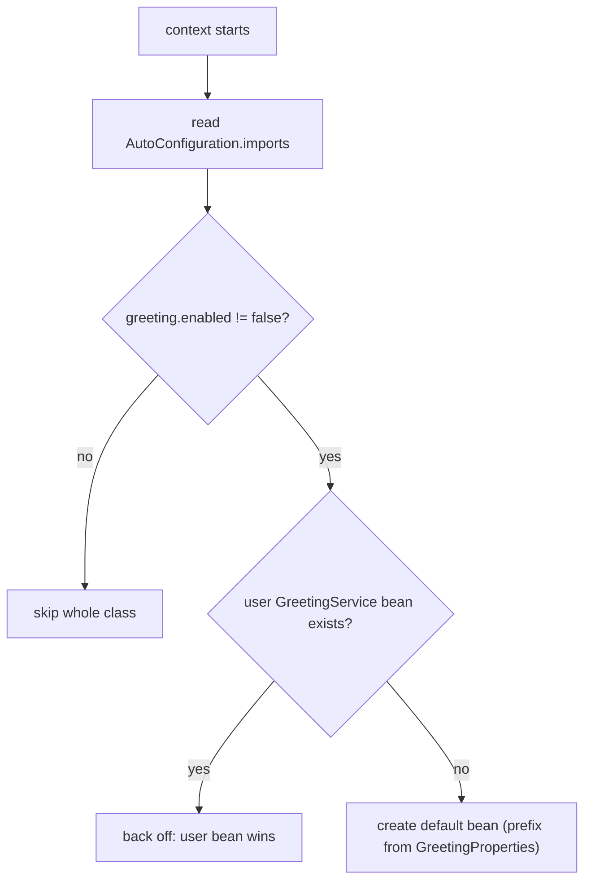

# 8. Write a Custom Auto-Configuration (Starter)

<span class="level l3">L3</span> ★★★ · `@AutoConfiguration`, `@ConditionalOnMissingBean`, `@ConditionalOnProperty`, `ApplicationContextRunner`

## Problem

> Package a reusable `GreetingService` as a Spring Boot starter. It must be **on by default**, configurable via `greeting.prefix`,
> **switchable off** via `greeting.enabled=false`, and it must **back off** when the application defines its own bean. Test every
> scenario in milliseconds.

## Key idea

An auto-configuration is a `@AutoConfiguration` class listed in
`META-INF/spring/org.springframework.boot.autoconfigure.AutoConfiguration.imports`. **Conditions** decide whether it applies:
`@ConditionalOnProperty` for the switch and `@ConditionalOnMissingBean` so user beans win. `ApplicationContextRunner` starts tiny
contexts per scenario without booting the whole application.



## Solution

```java title="GreetingAutoConfiguration.java"
--8<-- "coding-interview/src/main/java/com/playbook/interview/p08/GreetingAutoConfiguration.java"
```

```java title="GreetingProperties.java"
--8<-- "coding-interview/src/main/java/com/playbook/interview/p08/GreetingProperties.java"
```

```text title="org.springframework.boot.autoconfigure.AutoConfiguration.imports"
--8<-- "coding-interview/src/main/resources/META-INF/spring/org.springframework.boot.autoconfigure.AutoConfiguration.imports"
```

```java title="GreetingAutoConfigurationTest.java"
--8<-- "coding-interview/src/test/java/com/playbook/interview/p08/GreetingAutoConfigurationTest.java"
```

## Walkthrough

| Code | Why |
|---|---|
| `@ConditionalOnProperty(prefix = "greeting", name = "enabled", havingValue = "true", matchIfMissing = true)` | On by default (`matchIfMissing`) and off with one property. |
| `@Bean @ConditionalOnMissingBean GreetingService greetingService(...)` | The core contract of a good starter: never override what the user defined. Auto-configurations are processed **after** user configuration, which is what makes this condition reliable. |
| `AutoConfiguration.imports file` | Registration replaces the old `spring.factories` key. Classes listed here are also excluded from component scanning, so the conditions aren't bypassed. |
| `new ApplicationContextRunner().withConfiguration(AutoConfigurations.of(...))` | Each test builds a context with exactly the configuration, user beans and properties it needs, then asserts with `assertThat(ctx).hasSingleBean(...)`. |

## Complexity

| Approach | Time | Space |
|---|---|---|
| context startup per test | milliseconds | tiny context |

## Run it

```bash
cd coding-interview && mvn -q test -Dtest=GreetingAutoConfigurationTest
```

```text
--8<-- "coding-interview/outputs/GreetingAutoConfigurationTest.txt"
```

## Common mistakes

* Putting `@ConditionalOnMissingBean` on a bean in a regular `@Configuration` class. Ordering isn't guaranteed there, so the condition may be evaluated before the user's bean is registered.
* Letting component scanning pick up the auto-configuration package, which bypasses the conditions.
* Starters that pull in heavy dependencies unconditionally. Use `@ConditionalOnClass` together with `optional` dependencies.

## Follow-up questions

??? question "How do you debug why an auto-configuration did or didn't apply?"
    Run with `--debug` or `debug=true` to print the **condition evaluation report**, or call the Actuator `/actuator/conditions` endpoint. In tests, `ApplicationContextRunner` failures include the report.

??? question "How do you order auto-configurations?"
    Use `@AutoConfiguration(after = DataSourceAutoConfiguration.class)` (or `before`). Don't use `@Order` for this; it doesn't order auto-configuration classes.
