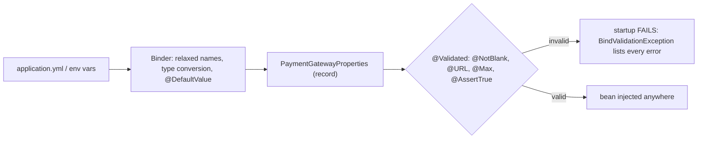

# 9. Validated @ConfigurationProperties

<span class="level l2">L2</span> ★★☆ · Immutable record binding, `@DefaultValue`, `Duration` parsing, fail-fast startup

## Problem

> Bind payment-gateway settings (URL, API key, timeouts, retries, currencies) into a **type-safe, immutable** object with defaults.
> **Invalid configuration must stop the application at startup**, including a cross-field rule (read timeout ≥ connect timeout).

## Key idea

Use a **record** annotated `@ConfigurationProperties("payments.gateway")` and `@Validated`. Constructor binding is automatic for records.
`@DefaultValue` supplies defaults, `Duration` fields accept `750ms`/`2s`/`PT5S`, and relaxed binding maps `connect-timeout`,
`connectTimeout` and `PAYMENTS_GATEWAY_CONNECTTIMEOUT` to the same property. An `@AssertTrue` method expresses the cross-field rule.



## Solution

```java title="PaymentGatewayProperties.java"
--8<-- "coding-interview/src/main/java/com/playbook/interview/p09/PaymentGatewayProperties.java"
```

```java title="PaymentGatewayPropertiesTest.java"
--8<-- "coding-interview/src/test/java/com/playbook/interview/p09/PaymentGatewayPropertiesTest.java"
```

## Walkthrough

| Code | Why |
|---|---|
| `@Validated @ConfigurationProperties("payments.gateway") public record PaymentGatewayProperties(...)` | Immutable, typed, and validated before any bean that uses it is created. |
| `@DefaultValue("5s") Duration readTimeout` | Defaults live with the type, not scattered across `@Value("${...:5s}")` strings. |
| `List<@Pattern(regexp = "[A-Z]{3}") String> currencies` | Constraints on container elements validate each currency code. |
| `@AssertTrue public boolean isTimeoutsConsistent()` | A cross-field rule that is reported alongside the field errors. The test asserts that both messages appear. |
| `assertThat(ctx).hasFailed().getFailure().rootCause().hasMessageContaining("apiKey")` | Proves the fail-fast behaviour: a missing secret is caught at deploy time, not on the first payment. |

## Complexity

| Approach | Time | Space |
|---|---|---|
| binding | once at startup | O(properties) |

## Run it

```bash
cd coding-interview && mvn -q test -Dtest=PaymentGatewayPropertiesTest
```

```text
--8<-- "coding-interview/outputs/PaymentGatewayPropertiesTest.txt"
```

## Common mistakes

* Scattering `@Value("${payments.gateway.timeout}")` across classes. There's no validation, no types and no single place to look.
* Forgetting `@Validated`, so the constraints are ignored.
* Mutable `@Data` properties classes that code can change at runtime.
* Putting secrets in `application.yml`. Bind them from environment variables, Vault or Secrets Manager. The binding code stays the same.

## Follow-up questions

??? question "@Value vs @ConfigurationProperties?"
    `@Value` suits one-off values and SpEL expressions. `@ConfigurationProperties` is for groups of settings: typed, validated, documented with `spring-boot-configuration-processor` metadata (IDE completion), and relaxed-bound. Prefer it for anything beyond a single flag.

??? question "How do you register a properties class?"
    `@EnableConfigurationProperties(X.class)` on a configuration class (as the test does), `@ConfigurationPropertiesScan` on the application, or as an auto-configuration's properties. Don't annotate it with `@Component`, because records need constructor binding.
