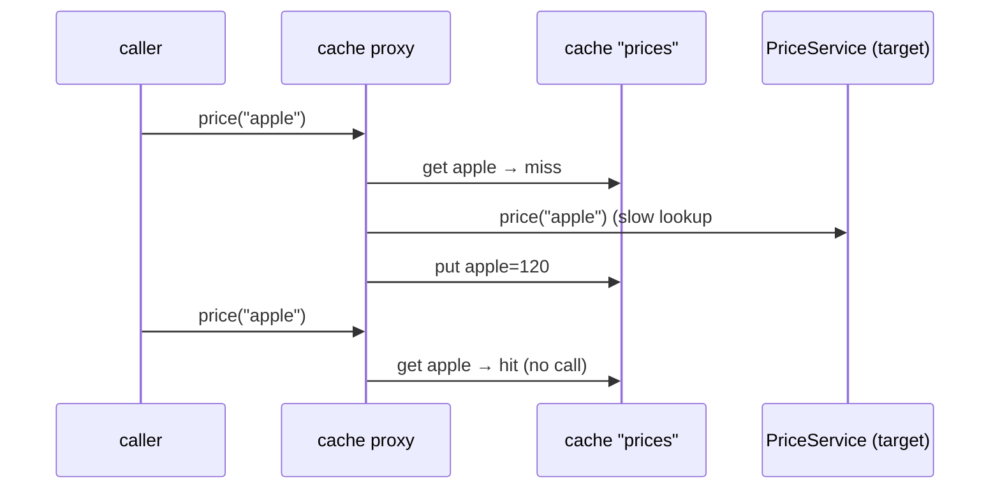

# 10. Caching: @Cacheable, @CachePut, @CacheEvict

<span class="level l2">L2</span> ★★☆ · Read-through, write-through, eviction, `unless`, proxy pitfalls

## Problem

> A slow price lookup should be **cached**. Updates must refresh the cache **without** another slow lookup, deletes must **evict**, and
> "not found" results must **not** be cached. Prove each behaviour by counting the slow lookups.

## Key idea

`@EnableCaching` wraps the bean in a **caching proxy**. `@Cacheable` checks the cache before invoking the method (read-through),
`@CachePut` always invokes and stores the result (write-through), and `@CacheEvict` removes entries. `unless = "#result == null"`
skips caching misses. Boot auto-configures a `ConcurrentMapCacheManager`; in production use Caffeine (local) or Redis (shared), with TTLs.



## Solution

```java title="PriceService.java"
--8<-- "coding-interview/src/main/java/com/playbook/interview/p10/PriceService.java"
```

```java title="CacheConfig.java"
--8<-- "coding-interview/src/main/java/com/playbook/interview/p10/CacheConfig.java"
```

```java title="PriceServiceCachingTest.java"
--8<-- "coding-interview/src/test/java/com/playbook/interview/p10/PriceServiceCachingTest.java"
```

## Walkthrough

| Code | Why |
|---|---|
| `@Cacheable(cacheNames = "prices", key = "#sku", unless = "#result == null")` | Key by SKU and don't cache misses. Whether to cache negatives depends on the domain; caching them protects the DB from repeated misses. |
| `@CachePut(cacheNames = "prices", key = "#sku") public Long updatePrice(...)` | Write-through: the method's return value becomes the cached value, so the next read is a hit. |
| `@CacheEvict(cacheNames = "prices", allEntries = true) public void clearAll()` | Bulk eviction, used here by tests to start clean. |
| `public int slowLookups() (not a public field)` | A real bug while building this: the test read a public field through the CGLIB proxy and got the proxy's own `null` field. Proxies only intercept **methods**. |

## Complexity

| Approach | Time | Space |
|---|---|---|
| cache hit | O(1) | O(entries) |
| cache miss | cost of the lookup | - |

## Run it

```bash
cd coding-interview && mvn -q test -Dtest=PriceServiceCachingTest
```

```text
--8<-- "coding-interview/outputs/PriceServiceCachingTest.txt"
```

## Common mistakes

* Self-invocation (`this.price(sku)`) inside the same class, which bypasses the cache, exactly like `@Transactional`.
* No TTL or size bound, so the cache grows forever and serves stale data. Configure Caffeine with `maximumSize` and `expireAfterWrite`.
* Caching mutable objects and then changing them. Every caller sees the change.
* Using a local in-memory cache across several instances where data must be consistent. Updates on one node leave others stale, so use Redis or short TTLs.

## Follow-up questions

??? question "How do you prevent a cache stampede on a hot key?"
    `@Cacheable(sync = true)` makes concurrent misses for the same key wait for one computation, on providers that support it. Add jittered TTLs so hot keys don't all expire together, and consider refresh-ahead (Caffeine's `refreshAfterWrite`).

??? question "Cache-aside vs read-through vs write-behind?"
    Cache-aside: the application checks the cache, loads from the DB and populates the cache (this is what `@Cacheable` does). Read-through: the cache itself loads on a miss. Write-behind: writes go to the cache and are flushed to the DB asynchronously, which is fast but risks data loss.
