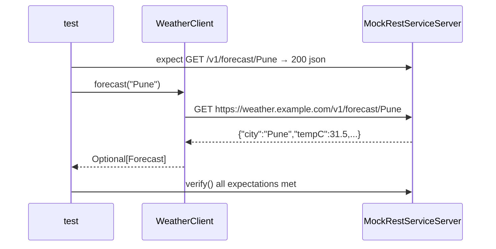

# 11. RestClient with Error Mapping, Tested

<span class="level l2">L2</span> ★★☆ · `RestClient`, `onStatus`, URI templates, `@RestClientTest` + `MockRestServiceServer`

## Problem

> Write a client for a weather API. A 200 maps to a typed record, a **404** becomes `Optional.empty()`, a **5xx** becomes a domain exception,
> and path variables are URL-encoded. Test it **without any network**.

## Key idea

Inject Boot's `RestClient.Builder`, which is pre-configured with message converters, observability and the test hook, and set a base URL.
Use **URI templates** (`/v1/forecast/{city}`) so values are encoded. Map 5xx with `onStatus`, and catch
`HttpClientErrorException.NotFound` for 404. `@RestClientTest` builds only the client plus Jackson, and binds a
`MockRestServiceServer` to the builder.



## Solution

```java title="WeatherClient.java"
--8<-- "coding-interview/src/main/java/com/playbook/interview/p11/WeatherClient.java"
```

```java title="WeatherClientTest.java"
--8<-- "coding-interview/src/test/java/com/playbook/interview/p11/WeatherClientTest.java"
```

## Walkthrough

| Code | Why |
|---|---|
| `public WeatherClient(RestClient.Builder builder) { this.http = builder.baseUrl(...).build(); }` | Use the Boot-managed builder rather than `RestClient.create()`. You get JSON converters, metrics and tracing, and `@RestClientTest` can intercept it. |
| `.uri("/v1/forecast/{city}", city)` | Template expansion encodes `New York` as `New%20York`, which the last test checks. Never concatenate strings into URLs. |
| `.onStatus(HttpStatusCode::is5xxServerError, (req, res) -> { throw new WeatherUnavailableException(...); })` | Translate vendor failures into your vocabulary so callers can retry or fall back without knowing HTTP. |
| `catch (HttpClientErrorException.NotFound e) { return Optional.empty(); }` | "Not found" is a normal outcome for lookups, not an error. |
| `server.verify()` | Fails if an expected request was never made. Use it to catch clients that silently skip calls. |

## Complexity

| Approach | Time | Space |
|---|---|---|
| per call | 1 HTTP round trip | response size |

## Run it

```bash
cd coding-interview && mvn -q test -Dtest=WeatherClientTest
```

```text
--8<-- "coding-interview/outputs/WeatherClientTest.txt"
```

## Common mistakes

* No timeouts. The default can be infinite. Set connect and read timeouts via `ClientHttpRequestFactorySettings` or `spring.http.clients.*` properties.
* Creating a new client (and connection pool) per request instead of one per downstream service.
* Mocking `RestClient` with Mockito's fluent mocks. It's brittle; `MockRestServiceServer` tests the real HTTP mapping.
* Letting `RestClientResponseException` leak into the domain layer.

## Follow-up questions

??? question "RestClient vs WebClient vs RestTemplate vs HTTP interfaces?"
    `RestTemplate` is in maintenance mode. `RestClient` is the modern synchronous fluent client, ideal with virtual threads. `WebClient` is for reactive stacks. **HTTP interfaces** (`@HttpExchange` on an interface, backed by RestClient) give declarative clients, the built-in alternative to Feign.

??? question "How do you add retries and a circuit breaker?"
    Wrap the client method with Resilience4j (`@Retry`, `@CircuitBreaker` with a fallback), retrying only idempotent calls and transient errors (5xx, timeouts). Spring Framework 7 also has `@Retryable` and `@ConcurrencyLimit` in core.
