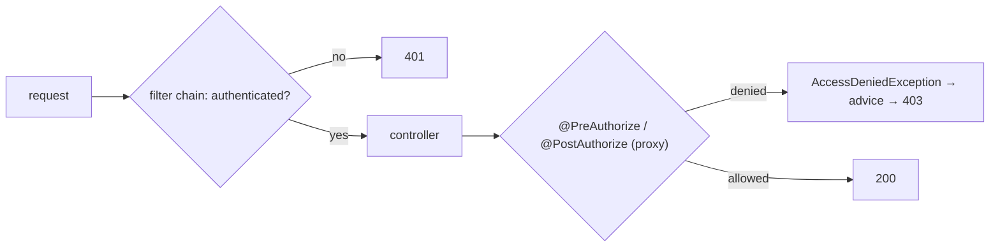

# 12. Method Security: Roles & Ownership

<span class="level l3">L3</span> ★★★ · `@PreAuthorize`, `@PostAuthorize`, SpEL on arguments/results, 401 vs 403

## Problem

> Documents belong to users. Anyone **unauthenticated** gets 401. A user can read **only their own** documents, an **admin** can read all
> and purge them, and a user can count documents only for **themselves**. Enforce this in the **service layer** and test it with mock users.

## Key idea

URL rules in the `SecurityFilterChain` handle **authentication** (`/p12/** authenticated()` gives 401). **Method security** handles
fine-grained **authorization** where the data lives. `@PreAuthorize` checks arguments before the call (`#owner == authentication.name`).
`@PostAuthorize` checks the **returned object** (`returnObject.owner == authentication.name`). Denials throw `AccessDeniedException`,
which becomes a 403.



## Solution

```java title="DocumentService.java"
--8<-- "coding-interview/src/main/java/com/playbook/interview/p12/DocumentService.java"
```

```java title="SecurityConfig.java"
--8<-- "coding-interview/src/main/java/com/playbook/interview/SecurityConfig.java"
```

```java title="MethodSecurityTest.java"
--8<-- "coding-interview/src/test/java/com/playbook/interview/p12/MethodSecurityTest.java"
```

## Walkthrough

| Code | Why |
|---|---|
| `@EnableMethodSecurity (in SecurityConfig)` | Turns on the `@PreAuthorize` and `@PostAuthorize` proxies. It's off by default. |
| `@PostAuthorize("returnObject.owner == authentication.name or hasRole('ADMIN')")` | An ownership check that needs the loaded entity. The method runs, then the result is checked, so use it only for side-effect-free reads. |
| `@PreAuthorize("#owner == authentication.name or hasRole('ADMIN')")` | SpEL can reference method parameters by name (`-parameters` is on by default with Boot's Maven plugin). |
| `.requestMatchers("/p12/**").authenticated()` | Coarse rules at the edge, fine rules in the service. The anonymous test gets 401 from the filter, never reaching the controller. |
| `@WithMockUser(username = "ana") / (roles = "ADMIN")` | Puts a test `Authentication` in the `SecurityContext`, so there's no login flow in the tests. |

## Complexity

| Approach | Time | Space |
|---|---|---|
| per call | O(1) SpEL evaluation | - |

## Run it

```bash
cd coding-interview && mvn -q test -Dtest=MethodSecurityTest
```

```text
--8<-- "coding-interview/outputs/MethodSecurityTest.txt"
```

## Common mistakes

* A catch-all `@ExceptionHandler(Exception.class)` that turns `AccessDeniedException` into 500. This happened while building the solution and is fixed in problem 2's advice.
* Checking ownership only in the UI or controller. Other callers (messaging, batch) of the same service bypass it.
* Using `@PostAuthorize` on methods with side effects. The side effect happens before the check fails.
* Mixing up 401 (who are you?) and 403 (I know you, and the answer is no).

## Follow-up questions

??? question "How do you avoid loading data the user can't see in list queries?"
    Filter in the query itself (`WHERE owner = :currentUser`). Spring Data can use `?#{principal.username}` in `@Query`, or you can pass the user explicitly. `@PostFilter` on collections works but loads everything first, which doesn't scale.

??? question "Where do roles come from in a real system?"
    From the JWT's claims (`scope`, `roles`) mapped to `GrantedAuthority` via `JwtAuthenticationConverter` in an OAuth2 resource server. Keycloak, Cognito or Okta issue them, and the service never stores passwords.
