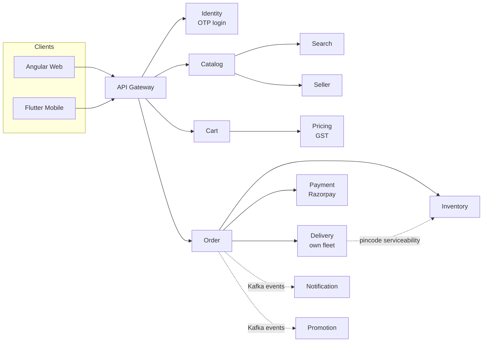
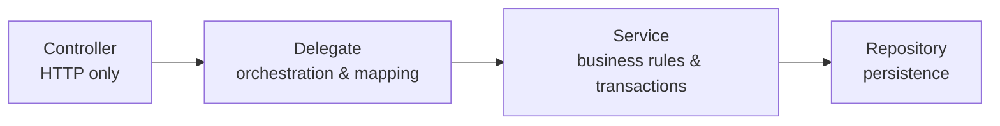

# Spring Boot 3 & 4 Enterprise Handbook

> From your first `@RestController` to defending a 26-service architecture in a principal-engineer interview.

:material-file-pdf-box: **[Download the whole handbook as a PDF](downloads/spring-boot-enterprise-handbook.pdf)** (~20 MB)

This handbook covers **Spring Boot 3.5.x** and **Spring Boot 4.x** side by side, for engineers from **0 to 15+ years** of experience. Every concept is taught through one consistent, realistic system: a **multi-vendor grocery marketplace for India**.

## What makes this handbook different

| Feature | What you get |
|---|---|
| **Two versions, one page** | Wherever Boot 3.5 and 4.x differ, you get side-by-side tabs |
| **Four code levels per chapter** | Beginner → Intermediate → Advanced → Production |
| **Internals, not just usage** | Class names, call flows and Mermaid diagrams of what Spring does under the hood |
| **Interview-ready** | 20+ Q&As in every chapter across five experience bands (the capstone uses system-design questions instead), plus a 341-question bank with system design and rapid fire |
| **One domain throughout** | Catalog, cart, order, payment, delivery — examples build on each other |

## Spring Boot 3.5 vs 4.x at a glance

| Area | Spring Boot 3.5 | Spring Boot 4.x |
|---|---|---|
| Spring Framework | 6.2 | 7.0 |
| Java baseline | 17 (we use 21) | 17 (we use 25) |
| Jakarta EE | 10 (Servlet 6.0) | 11 (Servlet 6.1) |
| Jackson | 2.x (`com.fasterxml.jackson`) | 3.x (`tools.jackson`) by default |
| Hibernate | 6.6 | 7.x |
| Spring Security | 6.5 | 7.0 |
| Null-safety | Spring's own `@Nullable` | JSpecify (`@NullMarked`, `@Nullable`) |
| Auto-configuration | One large `spring-boot-autoconfigure` jar | Modularized into focused modules |
| Embedded servers | Tomcat, Jetty, Undertow | Tomcat, Jetty (Undertow removed) |
| Test mocks | `@MockBean` deprecated → `@MockitoBean` | `@MockBean` removed |
| API versioning | Hand-rolled | Built into Spring MVC / WebFlux |
| HTTP clients | `RestClient`, HTTP interfaces | + HTTP service client groups (`@ImportHttpServices`) |
| Resilience | Resilience4j / Spring Retry | + core `@Retryable`, `@ConcurrencyLimit` in Framework 7 |

!!! warning "Verify"
    Spring Boot 4.x is evolving quickly. Always confirm version-specific details against the official
    **Spring Boot 4.0 Release Notes** and **Migration Guide** on the Spring Boot GitHub wiki before relying on them in production.

## The grocery marketplace domain

Every service follows the same **four-layer pattern**:

## How to use this handbook

1. Pick your **[reading path](reading-paths.md)** by experience band.
2. Set up your machine with **[Setup](getting-started/setup.md)**.
3. Inside each chapter, the "Who should read which section" table tells you where to focus.
4. Before interviews, use **Part 9 of each chapter** and **Appendix A**.
5. Put it together with the **[capstone](part-3-enterprise/44-capstone-grocery-marketplace.md)** milestones and the **[coding exercises](appendices/b-coding-exercises.md)**.
6. Use the **[Annotations](annotations/index.md)** tab to look up any annotation with an example, and its [Outdated → Replacement](annotations/deprecated.md) list when reading older code.
7. Keep the **[troubleshooting playbook](appendices/f-troubleshooting-playbook.md)** and **[properties cheat sheet](appendices/d-properties-cheat-sheet.md)** close when operating services.
