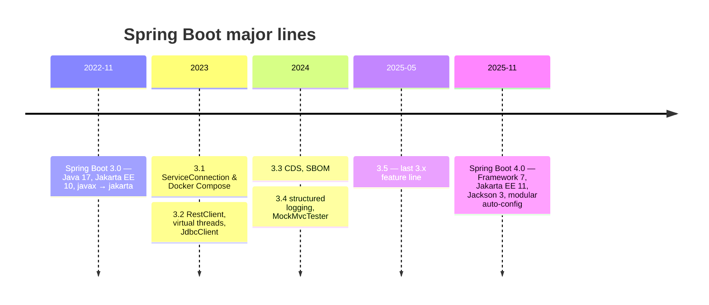

# 00 · Handbook Overview

## Structure

| Part | Chapters | Audience | Theme |
|---|---|---|---|
| 1 · Foundations | 01–15 | 0–5 yrs | Core container, Boot, web, data, testing |
| 2 · Production | 16–34 | 3–8 yrs | Transactions, security, messaging, observability, deployment, performance |
| 3 · Enterprise | 35–44 | 8–15+ yrs | Distributed architecture, security architecture, AI, internals, migration, leadership |
| Appendices | A–H | All | Interview bank, exercises, cheat sheets, troubleshooting |

## Every chapter has the same nine parts

1. **Introduction & Why It Matters**
2. **Core Concepts**
3. **How It Works Internally**
4. **Hands-On Code — Level 1 (Beginner)**
5. **Hands-On Code — Level 2 (Intermediate) & Level 3 (Advanced)**
6. **Hands-On Code — Level 4 (Expert / Production)**
7. **Spring Boot 3 vs 4 & Migration**
8. **Production Playbook**
9. **Interview Questions & Answers**

## Conventions

| Convention | Rule |
|---|---|
| Package root | `in.grocery.<service>` |
| Layers | Controller → Delegate → Service → Repository |
| Money | `BigDecimal`, INR, wrapped in a `Money` record |
| Time | `Instant` for storage, `Asia/Kolkata` for display |
| Kafka topics | `grocery.<domain>.<event>.v1` |
| DTOs & config | Java records |
| Injection | Constructor only |
| Build | Gradle 9 Kotlin DSL (Maven in tabs) |

## Version timeline

!!! info "Support windows"
    Check the official **Spring Boot Support** page for current OSS and commercial end-of-support dates for 3.5 and 4.x before planning upgrades.

---

[:material-arrow-left: Setup](../getting-started/setup.md) · [01 Java & Build Prerequisites :material-arrow-right:](../part-1-foundations/01-java-and-build-prerequisites.md)
