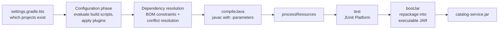
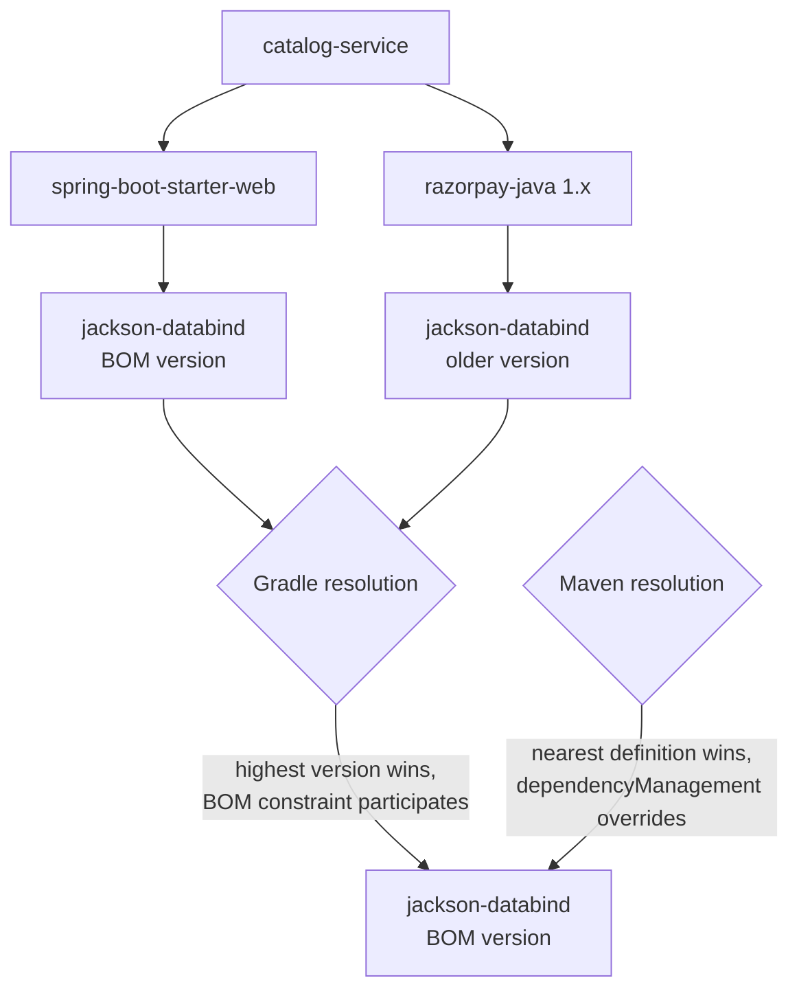

# 01 · Java & Build Prerequisites for Spring

## 1. Introduction & Why It Matters

Spring Boot is not a separate language — it is a set of libraries running on the JVM and assembled by a build tool. Most "Spring problems" in real teams are actually **Java-version problems** or **build problems** in disguise:

- `ClassNotFoundException: javax.servlet.Filter` after an upgrade — a dependency still on Java EE, not Jakarta EE.
- `NoSuchMethodError` at startup — two versions of the same library on the classpath because someone overrode a version the Spring Boot BOM already manages.
- `Parameter name information not available` — code compiled without the `-parameters` flag, which Spring Framework 6.1+ requires for name-based binding.
- A build that works on one laptop and fails in CI — different JDKs, no toolchain, no locked dependencies.

In the grocery marketplace we run 26 services in one Gradle monorepo. If every service declared its own versions, plugins and compiler flags, upgrading from Boot 3.5 to 4.x would mean editing 26 build files by hand. This chapter sets up the foundation that makes the rest of the handbook — and that upgrade — boring.

### Who should read which section

| Band | Focus |
|---|---|
| B1 · 0–2 yrs | Parts 1, 2, 4 — Java features, Gradle basics, first app |
| B2 · 2–5 yrs | Parts 2, 5 — BOM, version catalog, multi-module |
| B3 · 5–8 yrs | Parts 3, 6 — dependency resolution internals, convention plugins |
| B4 · 8–12 yrs | Parts 6, 7, 8 — reproducibility, upgrade strategy, supply chain |
| B5 · 12–15+ yrs | Parts 7, 8, 9 — platform standards and governance |

---

## 2. Core Concepts

### 2.1 Java features Spring relies on

Spring Boot 3.x and 4.x both have a **Java 17 baseline**. Everything in Java 17 is fair game in framework code, and newer features are used when available.

| Feature | Java | Why it matters in Spring code |
|---|---|---|
| Records | 16 | DTOs, `@ConfigurationProperties`, projections, events — immutable and concise |
| Sealed classes/interfaces | 17 | Closed domain hierarchies (`PaymentResult`), exhaustive `switch` |
| Pattern matching for `instanceof` | 16 | Cleaner exception handlers and converters |
| Text blocks | 15 | Native SQL in `@Query`, JSON in tests, prompts in Spring AI |
| Switch expressions | 14 | Mapping enums/status codes |
| Pattern matching for `switch` + record patterns | 21 | Exhaustive handling of sealed results |
| Virtual threads | 21 | `spring.threads.virtual.enabled=true` — cheap blocking I/O |
| `SequencedCollection` | 21 | `getFirst()`/`getLast()` on lists and ordered sets |
| Stream gatherers | 24 | Custom intermediate stream operations |
| Scoped values | 25 (final) | Immutable per-request context, alternative to `ThreadLocal` |
| Flexible constructor bodies | 25 | Validate arguments before `super(...)` |
| Module import declarations, compact source files | 25 | Scripts and small tools, rarely in services |
| Structured concurrency | Preview in 25 | Fan-out calls (price + stock + delivery ETA) with one lifetime |

!!! note "Why records are everywhere in this handbook"
    A record gives you a canonical constructor, `equals`, `hashCode` and `toString` with no boilerplate, and it cannot be mutated. Spring binds `@ConfigurationProperties` to records through their constructor, Jackson serializes them out of the box, and Spring Data can project query results into them.

### 2.2 Build tools: Gradle and Maven

A build tool does four jobs: **resolve dependencies**, **compile**, **test**, and **package**. Spring Boot adds a plugin to each tool that repackages your application into an **executable JAR** and applies Spring's dependency management.

| | Gradle 9 (Kotlin DSL) | Maven 3.9+ |
|---|---|---|
| Build file | `build.gradle.kts` (code) | `pom.xml` (declarative XML) |
| Speed | Incremental builds, build cache, configuration cache | Slower on large repos |
| Multi-module | `settings.gradle.kts` + convention plugins | Parent POM + modules |
| Spring Boot plugin | `org.springframework.boot` | `spring-boot-maven-plugin` |
| Version management | Version catalog + BOM platform | `spring-boot-starter-parent` or imported BOM |

This handbook uses **Gradle 9 Kotlin DSL** as primary with Maven in tabs.

### 2.3 BOM and dependency management

A **Bill of Materials (BOM)** is a POM that lists tested, compatible versions for hundreds of libraries without adding them to your build. `spring-boot-dependencies` is Spring Boot's BOM. When you import it, you write:

```kotlin title="build.gradle.kts"
implementation("com.fasterxml.jackson.core:jackson-databind") // no version
```

and the BOM fills in the version Spring Boot was tested with.

!!! danger "Rule #1 of Spring builds"
    Never hard-code a version for a library the Spring Boot BOM already manages, unless you have a documented reason (CVE fix before the next Boot patch). Override through the BOM's property instead, so the whole family moves together.

### 2.4 Version catalogs

A **version catalog** (`gradle/libs.versions.toml`) is a single file that names every dependency and plugin used in the repo. Build files then refer to `libs.spring.boot.starter.web` instead of string coordinates. It gives you one place to upgrade, IDE auto-completion, and type safety.

### 2.5 Multi-module monorepo

One Git repository, many Gradle projects:

- `libs/*` — shared libraries (plain JARs, no Spring Boot plugin).
- `services/*` — deployable Spring Boot applications (executable JARs).
- `build-logic` — **convention plugins**: reusable build scripts that encode "how every Java module is built" and "how every Spring service is built".

### 2.6 Spring Initializr

[start.spring.io](https://start.spring.io) (also built into IntelliJ and VS Code) generates a starter project: build file, wrapper, main class, test and `application.properties`. Good for learning; in a monorepo you will create services from your own template instead.

### 2.7 The wrapper

`gradlew` / `mvnw` scripts plus a small JAR pin the exact build-tool version in the repo. Everyone — developers and CI — runs the same version. **Always commit the wrapper and always use it.**

### 2.8 Reproducible builds

A build is **reproducible** when the same source produces byte-identical output on any machine. Ingredients: pinned JDK (toolchain), pinned build tool (wrapper), pinned dependencies (BOM + locking), and archives without timestamps or filesystem ordering.

---

## 3. How It Works Internally

### 3.1 From source to executable JAR



Gradle runs in three phases: **initialization** (read `settings.gradle.kts`, decide which projects exist), **configuration** (run every build script, build the task graph), and **execution** (run only the tasks needed, skipping up-to-date ones).

### 3.2 How the Spring Boot plugin reacts to other plugins

The `org.springframework.boot` Gradle plugin does little on its own; it **reacts** when other plugins are applied:

| When you apply | Spring Boot plugin adds |
|---|---|
| `java` | `bootJar` task, `bootRun` task, configures `jar` with `-plain` classifier, adds `-parameters` to `JavaCompile` |
| `io.spring.dependency-management` | Imports the `spring-boot-dependencies` BOM automatically |
| `application` | `bootStartScripts`, `bootDistZip` |
| `org.graalvm.buildtools.native` | AOT processing tasks and `nativeCompile` |

!!! info "Two ways to apply the BOM in Gradle"
    1. **`io.spring.dependency-management` plugin** — Maven-like behaviour, supports overriding via properties (`extra["jackson.version"]`).
    2. **Gradle native platform** — `implementation(platform(SpringBootPlugin.BOM_COORDINATES))`. Faster and more "Gradle-native", but you override versions with constraints or by resolving a different BOM.

    This handbook uses the **native platform** in convention plugins, which works well with version catalogs.

### 3.3 Dependency conflict resolution



- **Gradle** picks the **highest** requested version among all paths; platforms add constraints that participate in that decision. `enforcedPlatform` forces BOM versions even downward.
- **Maven** picks the **nearest** declaration in the tree, but `<dependencyManagement>` (which the BOM populates) overrides transitive versions.

Diagnose with:

```bash title="Terminal"
./gradlew :services:catalog-service:dependencyInsight --dependency jackson-databind --configuration runtimeClasspath
mvn dependency:tree -Dincludes=com.fasterxml.jackson.core
```

### 3.4 Inside the executable JAR

```text title="catalog-service.jar (layout)"
META-INF/MANIFEST.MF          Main-Class: org.springframework.boot.loader.launch.JarLauncher
                              Start-Class: in.grocery.catalog.CatalogApplication
org/springframework/boot/loader/...   the launcher classes
BOOT-INF/classes/             your compiled code and resources
BOOT-INF/lib/                 every dependency JAR, unpacked is NOT required
BOOT-INF/classpath.idx        classpath order
BOOT-INF/layers.idx           layers for Docker images (Chapter 29)
```

`java -jar` starts `JarLauncher`, which builds a class loader able to read nested JARs from `BOOT-INF/lib`, then invokes your `Start-Class` `main` method.

!!! note "Loader package changed in Boot 3.2"
    Since Spring Boot 3.2 the launcher lives in `org.springframework.boot.loader.launch`. If you have custom Dockerfiles that reference `org.springframework.boot.loader.JarLauncher`, update them.

### 3.5 Why `-parameters` matters

Spring binds constructor and method arguments by name: `@PathVariable Long id`, `@RequestParam String pincode`, constructor-bound `@ConfigurationProperties`, `@Cacheable(key = "#sku")`. The name must be present in bytecode.

Spring Framework 6.1 **removed** `LocalVariableTableParameterNameDiscoverer` (which read debug info). Parameter names now come only from the `-parameters` compiler flag. The Spring Boot Gradle plugin and `spring-boot-starter-parent` add it automatically — but if you configure `javac` yourself in a library module (no Boot plugin), **you must add it**.

---

## 4. Hands-On Code — Level 1 (Beginner)

Goal: a single Spring Boot service that starts and answers one HTTP request.

### 4.1 Project files

=== "Spring Boot 4.x (Gradle)"

    ```kotlin title="settings.gradle.kts"
    rootProject.name = "catalog-service"
    ```

    ```kotlin title="build.gradle.kts"
    plugins {
        java
        id("org.springframework.boot") version "4.0.0"          // (1)!
        id("io.spring.dependency-management") version "1.1.7"   // (2)!
    }

    group = "in.grocery"
    version = "0.0.1-SNAPSHOT"

    java {
        toolchain {
            languageVersion = JavaLanguageVersion.of(25)          // (3)!
        }
    }

    repositories {
        mavenCentral()
    }

    dependencies {
        implementation("org.springframework.boot:spring-boot-starter-webmvc") // (4)!
        testImplementation("org.springframework.boot:spring-boot-starter-webmvc-test")
        testRuntimeOnly("org.junit.platform:junit-platform-launcher")
    }

    tasks.withType<Test> {
        useJUnitPlatform()
    }
    ```

    1. Use the latest 4.x patch release.
    2. Imports the Spring Boot BOM so dependencies need no versions.
    3. Gradle downloads/uses JDK 25 regardless of the JDK in your shell.
    4. Boot 4 introduced focused starters. `spring-boot-starter-web` still works for transition — see the Verify note below.

=== "Spring Boot 3.5 (Gradle)"

    ```kotlin title="build.gradle.kts"
    plugins {
        java
        id("org.springframework.boot") version "3.5.0"   // latest 3.5.x patch
        id("io.spring.dependency-management") version "1.1.7"
    }

    group = "in.grocery"
    version = "0.0.1-SNAPSHOT"

    java {
        toolchain {
            languageVersion = JavaLanguageVersion.of(21)
        }
    }

    repositories { mavenCentral() }

    dependencies {
        implementation("org.springframework.boot:spring-boot-starter-web")
        testImplementation("org.springframework.boot:spring-boot-starter-test")
        testRuntimeOnly("org.junit.platform:junit-platform-launcher")
    }

    tasks.withType<Test> { useJUnitPlatform() }
    ```

=== "Maven"

    ```xml title="pom.xml"
    <project xmlns="http://maven.apache.org/POM/4.0.0">
      <modelVersion>4.0.0</modelVersion>

      <parent>
        <groupId>org.springframework.boot</groupId>
        <artifactId>spring-boot-starter-parent</artifactId>
        <version>4.0.0</version> <!-- or 3.5.x -->
        <relativePath/>
      </parent>

      <groupId>in.grocery</groupId>
      <artifactId>catalog-service</artifactId>
      <version>0.0.1-SNAPSHOT</version>

      <properties>
        <java.version>25</java.version> <!-- 21 for Boot 3.5 -->
      </properties>

      <dependencies>
        <dependency>
          <groupId>org.springframework.boot</groupId>
          <artifactId>spring-boot-starter-webmvc</artifactId> <!-- starter-web on 3.5 -->
        </dependency>
        <dependency>
          <groupId>org.springframework.boot</groupId>
          <artifactId>spring-boot-starter-webmvc-test</artifactId> <!-- starter-test on 3.5 -->
          <scope>test</scope>
        </dependency>
      </dependencies>

      <build>
        <plugins>
          <plugin>
            <groupId>org.springframework.boot</groupId>
            <artifactId>spring-boot-maven-plugin</artifactId>
          </plugin>
        </plugins>
      </build>
    </project>
    ```

!!! warning "Verify — Boot 4 starter names"
    Spring Boot 4 split auto-configuration into focused modules and introduced matching starters (for example `spring-boot-starter-webmvc` and per-technology test starters). Transitional "classic" starters exist to ease migration. Confirm exact starter names for your 4.x version in the **Spring Boot 4.0 Migration Guide** before copying coordinates.

### 4.2 Application code

```java title="src/main/java/in/grocery/catalog/CatalogApplication.java"
package in.grocery.catalog;

import org.springframework.boot.SpringApplication;
import org.springframework.boot.autoconfigure.SpringBootApplication;

@SpringBootApplication // (1)!
public class CatalogApplication {

    public static void main(String[] args) {
        SpringApplication.run(CatalogApplication.class, args); // (2)!
    }
}
```

1. Combines `@Configuration`, `@EnableAutoConfiguration` and `@ComponentScan` on package `in.grocery.catalog` and below.
2. Creates the `ApplicationContext`, starts embedded Tomcat on port 8080.

```java title="src/main/java/in/grocery/catalog/web/PingController.java"
package in.grocery.catalog.web;

import java.time.Instant;
import org.springframework.web.bind.annotation.GetMapping;
import org.springframework.web.bind.annotation.RestController;

@RestController
public class PingController {

    public record Ping(String service, String status, Instant at) {} // (1)!

    @GetMapping("/ping")
    public Ping ping() {
        return new Ping("catalog-service", "UP", Instant.now());
    }
}
```

1. A record — Jackson turns it into JSON automatically.

### 4.3 Test

```java title="src/test/java/in/grocery/catalog/web/PingControllerTest.java"
package in.grocery.catalog.web;

import static org.assertj.core.api.Assertions.assertThat;

import org.junit.jupiter.api.Test;
import org.springframework.beans.factory.annotation.Autowired;
import org.springframework.boot.test.autoconfigure.web.servlet.WebMvcTest;
import org.springframework.test.web.servlet.assertj.MockMvcTester;

@WebMvcTest(PingController.class)
class PingControllerTest {

    @Autowired
    MockMvcTester mvc; // (1)!

    @Test
    void pingReturnsUp() {
        assertThat(mvc.get().uri("/ping"))
                .hasStatusOk()
                .bodyJson()
                .extractingPath("$.status")
                .isEqualTo("UP");
    }
}
```

1. AssertJ-style MockMvc, available since Spring Framework 6.2 / Boot 3.4.

!!! warning "Verify — test annotation packages in Boot 4"
    With modularization, some test auto-configuration annotations (such as `@WebMvcTest`) moved to technology-specific modules and packages in Boot 4. If an import does not resolve, check the migration guide for the new package.

### 4.4 Run it

```bash title="Terminal"
./gradlew bootRun
curl -s localhost:8080/ping
```

```json title="Expected output"
{"service":"catalog-service","status":"UP","at":"2026-09-22T05:30:00.123Z"}
```

```bash title="Terminal"
./gradlew bootJar
java -jar build/libs/catalog-service-0.0.1-SNAPSHOT.jar
```

---

## 5. Hands-On Code — Level 2 (Intermediate) & Level 3 (Advanced)

### 5.1 Level 2 — Multi-module monorepo with a version catalog

```text title="Example"
grocery-handbook/
├── settings.gradle.kts
├── gradle/libs.versions.toml
├── libs/grocery-common/build.gradle.kts
└── services/catalog-service/build.gradle.kts
```

```toml title="gradle/libs.versions.toml"
[versions]
java = "25"
spring-boot = "4.0.0"            # bump to latest 4.x patch
dependency-management = "1.1.7"
archunit = "1.4.1"

[libraries]
spring-boot-bom = { module = "org.springframework.boot:spring-boot-dependencies", version.ref = "spring-boot" }
spring-boot-starter-webmvc = { module = "org.springframework.boot:spring-boot-starter-webmvc" }
spring-boot-starter-validation = { module = "org.springframework.boot:spring-boot-starter-validation" }
spring-boot-starter-actuator = { module = "org.springframework.boot:spring-boot-starter-actuator" }
spring-boot-starter-webmvc-test = { module = "org.springframework.boot:spring-boot-starter-webmvc-test" }
junit-platform-launcher = { module = "org.junit.platform:junit-platform-launcher" }
archunit-junit5 = { module = "com.tngtech.archunit:archunit-junit5", version.ref = "archunit" }

[plugins]
spring-boot = { id = "org.springframework.boot", version.ref = "spring-boot" }
```

```kotlin title="settings.gradle.kts"
rootProject.name = "grocery-handbook"

dependencyResolutionManagement {
    repositoriesMode = RepositoriesMode.FAIL_ON_PROJECT_REPOS // (1)!
    repositories { mavenCentral() }
}

include(
    "libs:grocery-common",
    "services:catalog-service",
)
```

1. Repositories are declared once, centrally. A module that tries to add its own fails the build.

```kotlin title="libs/grocery-common/build.gradle.kts"
plugins {
    `java-library`
}

java { toolchain { languageVersion = JavaLanguageVersion.of(25) } }

dependencies {
    api(platform(libs.spring.boot.bom))                  // (1)!
    compileOnly("org.jspecify:jspecify")                 // null-safety annotations
    testImplementation("org.junit.jupiter:junit-jupiter")
    testImplementation("org.assertj:assertj-core")
    testRuntimeOnly(libs.junit.platform.launcher)
}

tasks.withType<JavaCompile>().configureEach {
    options.compilerArgs.add("-parameters")              // (2)!
}

tasks.test { useJUnitPlatform() }
```

1. A plain library gets versions from the BOM too, without the Boot plugin.
2. No Boot plugin here, so we add `-parameters` ourselves.

```java title="libs/grocery-common/src/main/java/in/grocery/common/money/Money.java"
package in.grocery.common.money;

import java.math.BigDecimal;
import java.math.RoundingMode;
import java.util.Objects;

/** Money in INR with paise precision. Immutable. */
public record Money(BigDecimal amount) implements Comparable<Money> {

    public static final Money ZERO = new Money(BigDecimal.ZERO);

    public Money {                                         // (1)!
        Objects.requireNonNull(amount, "amount");
        if (amount.signum() < 0) {
            throw new IllegalArgumentException("Money cannot be negative: " + amount);
        }
        amount = amount.setScale(2, RoundingMode.HALF_UP);
    }

    public static Money ofRupees(String value) {
        return new Money(new BigDecimal(value));
    }

    public Money plus(Money other) {
        return new Money(amount.add(other.amount));
    }

    public Money times(int quantity) {
        return new Money(amount.multiply(BigDecimal.valueOf(quantity)));
    }

    public Money percent(BigDecimal rate) {
        return new Money(amount.multiply(rate).divide(BigDecimal.valueOf(100), 2, RoundingMode.HALF_UP));
    }

    @Override
    public int compareTo(Money o) {
        return amount.compareTo(o.amount);
    }
}
```

1. Compact constructor — validation and normalization run before fields are assigned.

```kotlin title="services/catalog-service/build.gradle.kts"
plugins {
    java
    alias(libs.plugins.spring.boot)
}

java { toolchain { languageVersion = JavaLanguageVersion.of(25) } }

dependencies {
    implementation(platform(libs.spring.boot.bom))
    implementation(project(":libs:grocery-common"))
    implementation(libs.spring.boot.starter.webmvc)
    implementation(libs.spring.boot.starter.validation)
    testImplementation(libs.spring.boot.starter.webmvc.test)
    testRuntimeOnly(libs.junit.platform.launcher)
}

tasks.test { useJUnitPlatform() }
```

```bash title="Terminal"
./gradlew :services:catalog-service:bootRun
./gradlew build                    # builds and tests everything
./gradlew :libs:grocery-common:test
```

### 5.2 Level 3 — Modern Java in the domain

The pricing module needs to express "a payment either succeeded, failed or is pending" with no other possibilities, and GST depends on whether seller and buyer are in the same state.

```java title="in/grocery/common/payment/PaymentResult.java"
package in.grocery.common.payment;

import in.grocery.common.money.Money;
import java.time.Instant;

public sealed interface PaymentResult
        permits PaymentResult.Captured, PaymentResult.Failed, PaymentResult.Pending {

    record Captured(String razorpayPaymentId, Money amount, Instant capturedAt) implements PaymentResult {}

    record Failed(String code, String reason, boolean retryable) implements PaymentResult {}

    record Pending(String razorpayOrderId, Instant expiresAt) implements PaymentResult {}
}
```

```java title="in/grocery/common/payment/PaymentMessages.java"
package in.grocery.common.payment;

public final class PaymentMessages {

    private PaymentMessages() {}

    public static String describe(PaymentResult result) {
        return switch (result) {                                            // (1)!
            case PaymentResult.Captured(var id, var amount, var at) ->
                    "Paid ₹%s (ref %s)".formatted(amount.amount(), id);
            case PaymentResult.Failed(var code, var reason, var retryable) when retryable ->
                    "Payment failed (%s). Please try again.".formatted(reason);
            case PaymentResult.Failed f ->
                    "Payment declined: " + f.reason();
            case PaymentResult.Pending p ->
                    "Waiting for payment until " + p.expiresAt();
        };                                                                  // (2)!
    }
}
```

1. Record deconstruction patterns and a guarded case (`when`) — Java 21.
2. No `default` branch: the compiler proves the switch is exhaustive because the interface is sealed. Add a fourth result type and this stops compiling — exactly what you want.

```java title="in/grocery/common/tax/GstCalculator.java"
package in.grocery.common.tax;

import in.grocery.common.money.Money;
import java.math.BigDecimal;

public final class GstCalculator {

    public sealed interface GstBreakup permits IntraState, InterState {}
    public record IntraState(Money cgst, Money sgst) implements GstBreakup {}
    public record InterState(Money igst) implements GstBreakup {}

    public GstBreakup calculate(Money taxable, BigDecimal ratePercent,
                                String sellerStateCode, String buyerStateCode) {
        if (sellerStateCode.equals(buyerStateCode)) {
            BigDecimal half = ratePercent.divide(BigDecimal.TWO);
            return new IntraState(taxable.percent(half), taxable.percent(half));
        }
        return new InterState(taxable.percent(ratePercent));
    }
}
```

```java title="in/grocery/common/tax/GstCalculatorTest.java"
package in.grocery.common.tax;

import static org.assertj.core.api.Assertions.assertThat;

import in.grocery.common.money.Money;
import java.math.BigDecimal;
import org.junit.jupiter.api.Test;

class GstCalculatorTest {

    private final GstCalculator calculator = new GstCalculator();

    @Test
    void sameStateSplitsIntoCgstAndSgst() {
        var result = calculator.calculate(Money.ofRupees("1000"), new BigDecimal("5"), "29", "29");
        assertThat(result).isEqualTo(new GstCalculator.IntraState(
                Money.ofRupees("25.00"), Money.ofRupees("25.00")));
    }

    @Test
    void differentStateIsIgst() {
        var result = calculator.calculate(Money.ofRupees("1000"), new BigDecimal("18"), "29", "27");
        assertThat(result).isEqualTo(new GstCalculator.InterState(Money.ofRupees("180.00")));
    }
}
```

**Virtual threads and `SequencedCollection`** — fetching price, stock and delivery ETA for a product page:

```java title="in/grocery/catalog/product/ProductPageAssembler.java"
package in.grocery.catalog.product;

import java.util.List;
import java.util.concurrent.ExecutionException;
import java.util.concurrent.Executors;
import java.util.concurrent.Future;

public class ProductPageAssembler {

    public record ProductPage(String sku, String price, int stock, String eta) {}

    interface PriceClient { String priceFor(String sku, String pincode); }
    interface StockClient { int stockFor(String sku, String pincode); }
    interface EtaClient { String etaFor(String pincode); }

    private final PriceClient prices;
    private final StockClient stock;
    private final EtaClient eta;

    public ProductPageAssembler(PriceClient prices, StockClient stock, EtaClient eta) {
        this.prices = prices;
        this.stock = stock;
        this.eta = eta;
    }

    public ProductPage assemble(String sku, String pincode) throws InterruptedException, ExecutionException {
        try (var executor = Executors.newVirtualThreadPerTaskExecutor()) {   // (1)!
            Future<String> price = executor.submit(() -> prices.priceFor(sku, pincode));
            Future<Integer> qty = executor.submit(() -> stock.stockFor(sku, pincode));
            Future<String> when = executor.submit(() -> eta.etaFor(pincode));
            return new ProductPage(sku, price.get(), qty.get(), when.get());
        }                                                                     // (2)!
    }

    public static String cheapestFirstLabel(List<String> sortedLabels) {
        return sortedLabels.getFirst();                                       // (3)!
    }
}
```

1. One cheap virtual thread per blocking call. Three calls run in parallel.
2. `ExecutorService` is `AutoCloseable` since Java 19: `close()` waits for tasks.
3. `SequencedCollection.getFirst()` (Java 21) instead of `get(0)`.

!!! tip "Preview: structured concurrency"
    Java 25 has `StructuredTaskScope` as a **preview** API. It cancels sibling tasks if one fails, which the code above does not. Chapter 25 covers it; don't use preview APIs in production services without `--enable-preview` governance.

---

## 6. Hands-On Code — Level 4 (Expert / Production)

In a 26-service monorepo, build logic must live in **one place**. We use **convention plugins** in an included build.

### 6.1 Included build for conventions

```kotlin title="settings.gradle.kts (root)"
pluginManagement {
    includeBuild("build-logic")                                   // (1)!
}

plugins {
    id("org.gradle.toolchains.foojay-resolver-convention") version "1.0.0" // (2)!
}

rootProject.name = "grocery-handbook"

dependencyResolutionManagement {
    repositoriesMode = RepositoriesMode.FAIL_ON_PROJECT_REPOS
    repositories { mavenCentral() }
}

include("libs:grocery-common")
file("services").listFiles { f -> f.isDirectory && f.resolve("build.gradle.kts").exists() }
    ?.forEach { include("services:${it.name}") }                  // (3)!
```

1. Convention plugins become available by id to every module.
2. Lets toolchains auto-download JDKs in CI.
3. New service folders are picked up automatically.

```kotlin title="build-logic/settings.gradle.kts"
dependencyResolutionManagement {
    repositories { gradlePluginPortal(); mavenCentral() }
    versionCatalogs { create("libs") { from(files("../gradle/libs.versions.toml")) } }
}
rootProject.name = "build-logic"
```

```kotlin title="build-logic/build.gradle.kts"
plugins { `kotlin-dsl` }

dependencies {
    implementation("org.springframework.boot:spring-boot-gradle-plugin:${libs.versions.spring.boot.get()}")
    implementation("org.cyclonedx:cyclonedx-gradle-plugin:2.3.0")   // SBOM
}
```

### 6.2 Java conventions (every module)

```kotlin title="build-logic/src/main/kotlin/grocery.java-conventions.gradle.kts"
plugins {
    `java-library`
    jacoco
}

val libs = the<VersionCatalogsExtension>().named("libs")

java {
    toolchain {
        languageVersion = JavaLanguageVersion.of(libs.findVersion("java").get().requiredVersion.toInt())
        vendor = JvmVendorSpec.ADOPTIUM
    }
    withSourcesJar()
}

dependencies {
    "implementation"(platform(libs.findLibrary("spring-boot-bom").get()))
    "compileOnly"("org.jspecify:jspecify")
    "testImplementation"("org.junit.jupiter:junit-jupiter")
    "testImplementation"("org.assertj:assertj-core")
    "testImplementation"("org.mockito:mockito-junit-jupiter")
    "testRuntimeOnly"("org.junit.platform:junit-platform-launcher")
}

dependencyLocking {
    lockAllConfigurations()                                     // (1)!
}

tasks.withType<JavaCompile>().configureEach {
    options.encoding = "UTF-8"
    options.release = java.toolchain.languageVersion.get().asInt()
    options.compilerArgs.addAll(listOf("-parameters", "-Xlint:all,-processing", "-Werror")) // (2)!
}

tasks.withType<Test>().configureEach {
    useJUnitPlatform()
    maxParallelForks = (Runtime.getRuntime().availableProcessors() / 2).coerceAtLeast(1)
    jvmArgs("-XX:+EnableDynamicAgentLoading")                   // (3)!
    testLogging { events("failed", "skipped"); exceptionFormat = org.gradle.api.tasks.testing.logging.TestExceptionFormat.FULL }
    finalizedBy(tasks.named("jacocoTestReport"))
}

tasks.withType<AbstractArchiveTask>().configureEach {
    isPreserveFileTimestamps = false                            // (4)!
    isReproducibleFileOrder = true
}
```

1. Writes `gradle.lockfile` per module (`./gradlew dependencies --write-locks`); CI fails if resolution drifts.
2. Warnings as errors keeps deprecation debt visible before the next major upgrade.
3. Mockito's inline mock maker attaches an agent dynamically; recent JDKs warn about this. Chapter 15 shows the cleaner `-javaagent` setup.
4. Byte-for-byte reproducible archives.

### 6.3 Spring service conventions (every deployable)

```kotlin title="build-logic/src/main/kotlin/grocery.spring-service.gradle.kts"
plugins {
    id("grocery.java-conventions")
    id("org.springframework.boot")
    id("org.cyclonedx.bom")
}

val libs = the<VersionCatalogsExtension>().named("libs")

dependencies {
    "implementation"(project(":libs:grocery-common"))
    "implementation"(libs.findLibrary("spring-boot-starter-actuator").get())
    "testImplementation"(libs.findLibrary("archunit-junit5").get())
}

springBoot {
    buildInfo {                                                 // (1)!
        excludes = setOf("time")                                // keep builds reproducible
    }
}

tasks.named<org.springframework.boot.gradle.tasks.bundling.BootJar>("bootJar") {
    archiveFileName = "${project.name}.jar"                     // stable name for Docker
}

tasks.named<Jar>("jar") { enabled = false }                     // (2)!
```

1. Generates `META-INF/build-info.properties`; Actuator's `/actuator/info` shows version, artifact and group.
2. Services ship only the executable JAR; the plain JAR just confuses Docker `COPY` globs.

!!! note "SBOM in Actuator"
    Since Spring Boot 3.3, when a CycloneDX SBOM is packaged into the JAR, Actuator's `/actuator/sbom` endpoint exposes it. Security scanners can then query running services for their exact dependencies.

### 6.4 A service build file is now three lines

```kotlin title="services/order-service/build.gradle.kts"
plugins { id("grocery.spring-service") }

dependencies {
    implementation(libs.spring.boot.starter.webmvc)
    implementation(libs.spring.boot.starter.validation)
    testImplementation(libs.spring.boot.starter.webmvc.test)
}
```

### 6.5 Architecture rule enforced at build time

```java title="services/order-service/src/test/java/in/grocery/order/LayeringRulesTest.java"
package in.grocery.order;

import static com.tngtech.archunit.library.Architectures.layeredArchitecture;

import com.tngtech.archunit.core.importer.ImportOption;
import com.tngtech.archunit.junit.AnalyzeClasses;
import com.tngtech.archunit.junit.ArchTest;
import com.tngtech.archunit.lang.ArchRule;

@AnalyzeClasses(packages = "in.grocery.order", importOptions = ImportOption.DoNotIncludeTests.class)
class LayeringRulesTest {

    @ArchTest
    static final ArchRule fourLayers = layeredArchitecture()
            .consideringOnlyDependenciesInLayers()
            .layer("Controller").definedBy("..web..")
            .layer("Delegate").definedBy("..delegate..")
            .layer("Service").definedBy("..service..")
            .layer("Repository").definedBy("..repository..")
            .whereLayer("Controller").mayNotBeAccessedByAnyLayer()
            .whereLayer("Delegate").mayOnlyBeAccessedByLayers("Controller")
            .whereLayer("Service").mayOnlyBeAccessedByLayers("Delegate")
            .whereLayer("Repository").mayOnlyBeAccessedByLayers("Service");
}
```

### 6.6 CI command set

```bash title="Terminal"
./gradlew --configuration-cache build            # compile, test, coverage, SBOM
./gradlew dependencies --write-locks             # after intentional upgrades only
./gradlew :services:order-service:bootJar
./gradlew javaToolchains                          # which JDKs Gradle sees
```

---

## 7. Spring Boot 3 vs 4 & Migration

| Aspect | Spring Boot 3.5 | Spring Boot 4.x |
|---|---|---|
| Java baseline | 17 | 17 (Java 25 recommended in this handbook) |
| Framework | 6.2 | 7.0 |
| Gradle support | Gradle 7.6.4+ / 8.x (Gradle 9 support in later 3.5 patches — verify) | Gradle 8.14+ and 9.x |
| Maven | 3.6.3+ | 3.6.3+ (verify) |
| Starters | Broad starters (`starter-web`, `starter-test`) | Focused modular starters + transitional classic starters |
| Jackson | 2.x | 3.x default (group `tools.jackson.core`) |
| Null-safety annotations | `org.springframework.lang.Nullable` | JSpecify `org.jspecify.annotations.Nullable` |
| Kotlin | 1.9 / 2.x | 2.2+ |

=== "Spring Boot 3.5"

    ```kotlin title="build.gradle.kts"
    dependencies {
        implementation("org.springframework.boot:spring-boot-starter-web")
        implementation("com.fasterxml.jackson.datatype:jackson-datatype-jsr310")
        testImplementation("org.springframework.boot:spring-boot-starter-test")
    }
    ```

=== "Spring Boot 4.x"

    ```kotlin title="build.gradle.kts"
    dependencies {
        implementation("org.springframework.boot:spring-boot-starter-webmvc")
        // Java time support is built into Jackson 3 — no separate jsr310 module
        testImplementation("org.springframework.boot:spring-boot-starter-webmvc-test")
    }
    ```

### Migration checklist (build level)

- [ ] Upgrade to the latest **3.5.x** first and fix every deprecation warning (`-Werror` helps).
- [ ] Upgrade Gradle wrapper to 9.x: `./gradlew wrapper --gradle-version 9.x`.
- [ ] Move JDK toolchain to 21 or 25 (17 still works).
- [ ] Bump the Boot version in the version catalog — one line for all 26 services.
- [ ] Replace starters with Boot 4 names (or use classic starters temporarily).
- [ ] Add `spring-boot-properties-migrator` as `runtimeOnly` for one release to report renamed properties.
- [ ] Run OpenRewrite's Spring Boot 4 migration recipe (check the current recipe name in the OpenRewrite catalog).
- [ ] Regenerate lock files and SBOMs; review the diff.
- [ ] Update custom Dockerfiles referencing launcher classes.

---

## 8. Production Playbook

### Best practices

1. **One version source.** Boot version lives in `libs.versions.toml`; nothing else declares Spring-managed versions.
2. **Toolchains, not `JAVA_HOME`.** The build declares its JDK.
3. **Convention plugins over `subprojects {}`.** Cross-project configuration in the root script breaks configuration cache and hides logic.
4. **Lock and scan.** Dependency locking + SBOM + SCA scanner in CI.
5. **Warnings are errors.** Deprecations are future upgrade breakages.
6. **`api` vs `implementation` discipline** in libraries: expose only what consumers must compile against.

### Anti-patterns

❌ **Overriding a BOM-managed version inline**

```kotlin title="build.gradle.kts"
implementation("com.fasterxml.jackson.core:jackson-databind:2.13.0") // drifts from other Jackson modules
```

✅ **Override the whole family through the BOM (when truly needed)**

```kotlin title="Kotlin"
// with io.spring.dependency-management
extra["jackson-bom.version"] = "2.19.x"
// or with native platforms: import the newer jackson-bom platform AFTER the Spring Boot BOM
```

❌ **Root-level `subprojects {}` configuration**

```kotlin title="build.gradle.kts"
subprojects {
    apply(plugin = "java")
    dependencies { "implementation"("org.springframework.boot:spring-boot-starter-web") } // libraries get web too!
}
```

✅ **Explicit convention plugins** — `plugins { id("grocery.spring-service") }` only in services.

❌ **Fat shared "common" library** pulling Spring Web, JPA and Kafka into every service.

✅ Small, focused libraries (`grocery-common` holds only domain value types) — heavy integrations become starters (Chapter 41).

### Troubleshooting

| Symptom | Likely cause | Fix |
|---|---|---|
| `NoSuchMethodError` / `NoClassDefFoundError` at startup | Mixed library versions | `dependencyInsight`; remove inline versions; align via BOM |
| `ClassNotFoundException: javax.*` | Dependency not migrated to Jakarta EE | Upgrade library or find Jakarta variant |
| `Parameter name information not available` | Missing `-parameters` | Add compiler flag (automatic with Boot plugin) |
| `Unsupported class file major version 69` | Tool (old Gradle/ASM) doesn't understand Java 25 bytecode | Upgrade Gradle/plugins; use toolchain |
| CI resolves different versions than local | No locking, dynamic versions | Dependency locking, no `+` versions |
| Duplicate/plain JAR in Docker image | Both `jar` and `bootJar` produced | Disable `jar` task in services |
| Slow builds | No build cache / configuration cache | `org.gradle.caching=true`, `--configuration-cache` |

### Production checklist

- [ ] Wrapper committed and checksum-verified (`distributionSha256Sum`)
- [ ] Toolchain declared; CI and local use same JDK vendor/version
- [ ] Single BOM import; no inline versions for managed libraries
- [ ] Dependency locking enabled
- [ ] SBOM generated and exposed
- [ ] `-parameters` present in all modules
- [ ] `build-info` generated for `/actuator/info`
- [ ] Architecture tests in every service

---

## 9. Interview Questions & Answers

### B1 · 0–2 years

??? question "B1 · What is the difference between Spring Framework and Spring Boot?"
    **Short answer:** Spring Framework provides the core features — dependency injection, MVC, transactions, data access. Spring Boot sits on top and removes setup work: starters, auto-configuration, embedded server, executable JARs and production features like Actuator.

    **Deep answer:** Boot doesn't replace any Spring feature; it configures them for you based on what's on the classpath and in your properties, and it lets you override any default by defining your own bean.

    **Follow-ups:** What is a starter? What does `@SpringBootApplication` contain?

    **Red flags:** "Spring Boot is a different framework from Spring."

??? question "B1 · What is a Spring Boot starter?"
    **Short answer:** A dependency descriptor that pulls in a coherent set of libraries for one capability, e.g. `spring-boot-starter-webmvc` brings Spring MVC, Jackson and embedded Tomcat.

    **Deep answer:** A starter usually contains no code — just a POM listing dependencies. Auto-configuration classes in Boot's modules then detect those libraries and configure beans.

    **Follow-ups:** How would you create your own starter? (Chapter 41)

    **Red flags:** Thinking starters contain the configuration code themselves.

??? question "B1 · Why do we not write versions for Spring dependencies in the build file?"
    **Short answer:** The Spring Boot BOM (`spring-boot-dependencies`) manages them. Importing it gives tested, compatible versions.

    **Follow-ups:** How do you override one? What is a BOM?

    **Red flags:** "Gradle picks the latest version automatically."

??? question "B1 · What is the Gradle/Maven wrapper and why commit it?"
    **Short answer:** Scripts (`gradlew`, `mvnw`) that download and run a pinned build-tool version so every developer and CI uses the same one.

    **Red flags:** Installing Gradle globally and running `gradle build` in CI.

??? question "B1 · What Java version does Spring Boot 3 / 4 require?"
    **Short answer:** Both require Java 17 as the minimum. Boot 4 supports newer versions including Java 25.

    **Follow-ups:** Name Java 17+ features you use in Spring code.

??? question "B1 · Why use a record for a DTO?"
    **Short answer:** Immutable, concise, auto-generated `equals`/`hashCode`/`toString`, and Jackson and Spring binding support them.

    **Follow-ups:** Can a JPA entity be a record? (No — entities need a no-arg constructor and mutable state for proxies.)

??? question "B1 · What happens when you run `java -jar app.jar` on a Spring Boot JAR?"
    **Short answer:** The manifest's `Main-Class` is Spring Boot's `JarLauncher`, which sets up a class loader for nested JARs in `BOOT-INF/lib` and then calls your application's `main` method (the `Start-Class`).

    **Red flags:** "The JVM directly runs my main class."

### B2 · 2–5 years

??? question "B2 · Explain `implementation` vs `api` vs `compileOnly` vs `runtimeOnly` in Gradle."
    **Short answer:** `implementation` — needed to compile and run, not exposed to consumers. `api` — exposed transitively to consumers' compile classpath (only in `java-library`). `compileOnly` — compile time only (annotations, provided APIs). `runtimeOnly` — only at runtime (JDBC drivers, `properties-migrator`).

    **Deep answer:** Using `implementation` by default reduces recompilation and prevents consumers from depending on your internals.

    **Follow-ups:** Where would you put `jspecify`? A JDBC driver?

??? question "B2 · How does Gradle resolve version conflicts vs Maven?"
    **Short answer:** Gradle chooses the highest version across the graph (constraints and platforms participate). Maven chooses the nearest declaration but `dependencyManagement` overrides transitive versions.

    **Follow-ups:** How do you diagnose? (`dependencyInsight`, `mvn dependency:tree`) What is `enforcedPlatform`?

    **Red flags:** Not knowing the difference and just adding exclusions until it works.

??? question "B2 · What is a version catalog and why use it?"
    **Short answer:** A TOML file declaring all dependency and plugin coordinates with aliases. Single upgrade point, type-safe accessors, shared across modules and `build-logic`.

??? question "B2 · Your app fails with `Parameter name information not available`. Why?"
    **Short answer:** Code compiled without `-parameters`. Spring 6.1+ no longer reads debug info for parameter names.

    **Deep answer:** Happens typically in a library module built without the Boot plugin, or custom `javac` config. Fix: add the flag or use explicit names (`@PathVariable("id")`).

??? question "B2 · How would you structure a monorepo with shared code and many services?"
    **Short answer:** `libs/` for small focused libraries, `services/` for deployables, `build-logic/` convention plugins, central version catalog, repositories declared once in settings.

    **Follow-ups:** What goes into a shared library and what must not?

    **Red flags:** A giant `common` module with every dependency.

??? question "B2 · Sealed interfaces — how do they help in a Spring codebase?"
    **Short answer:** They model closed result hierarchies (payment results, validation outcomes). Combined with pattern-matching `switch`, the compiler enforces that every case is handled.

### B3 · 5–8 years

??? question "B3 · The Spring Boot Gradle plugin 'reacts' to other plugins. What does that mean?"
    **Short answer:** It registers callbacks via `plugins.withType(...)`. Applying `java` adds `bootJar`/`bootRun` and `-parameters`; applying `io.spring.dependency-management` imports the BOM; applying GraalVM's plugin adds AOT tasks.

    **Follow-ups:** Why does `jar` produce a `-plain` JAR?

??? question "B3 · `io.spring.dependency-management` plugin vs `platform(...)` — which do you choose?"
    **Short answer:** The plugin gives Maven-style semantics and easy property overrides but adds its own resolution logic. Native platforms are faster, align with Gradle's model and version catalogs. For large monorepos I prefer native platforms in convention plugins.

    **Follow-ups:** How do you override a single library with native platforms? (Constraint, or import a newer family BOM after Boot's.)

??? question "B3 · How do you make a Spring Boot build reproducible?"
    **Short answer:** Toolchain + wrapper with checksum + BOM + dependency locking + reproducible archive settings + `build-info` without timestamps.

    **Follow-ups:** How do you verify it? (Build twice, compare checksums.)

??? question "B3 · Explain the executable JAR's structure and why it matters for Docker."
    **Short answer:** Classes in `BOOT-INF/classes`, libs in `BOOT-INF/lib`, launcher at root, `layers.idx` groups files by change frequency. Layered extraction lets Docker cache dependency layers so only your code layer changes per build.

### B4 · 8–12 years

??? question "B4 · How would you roll out a Spring Boot major upgrade across 26 services?"
    **Short answer:** Centralize versions (catalog + conventions) first. Upgrade to latest 3.5.x, eliminate deprecations with `-Werror`. Then switch the catalog to 4.x on a branch, apply OpenRewrite, fix shared libraries first, then services in dependency order behind CI. Release services incrementally; they communicate over HTTP/Kafka so mixed versions are fine.

    **Deep answer:** Key risks: shared libraries compiled against Jackson 2 used by Boot 4 services; custom auto-configurations; Security DSL changes. Use a compatibility matrix and canary deployments with SLO monitoring.

    **Follow-ups:** How do you handle a shared library used by both 3.5 and 4.x services during transition?

    **Red flags:** Big-bang upgrade with no incremental release plan.

??? question "B4 · A transitive dependency has a critical CVE and Boot's next patch is two weeks away. What do you do?"
    **Short answer:** Override that library family's version through the BOM mechanism (property or a newer family BOM), add a comment with the CVE and a removal ticket, run full tests, ship. Remove the override when Boot's patch arrives.

    **Follow-ups:** How do you find every service affected? (SBOMs / `/actuator/sbom`, SCA dashboards.)

### B5 · 12–15+ years

??? question "B5 · What build standards would you set for an engineering org of 100+ Java engineers?"
    **Short answer:** Golden-path templates, convention plugins published internally, central version governance, mandatory SBOM + SCA + license checks, reproducible builds, architecture tests, build performance SLOs (remote build cache), and a documented override process via ADRs.

    **Follow-ups:** How do you balance team autonomy with standardization?

??? question "B5 · Monorepo vs polyrepo for a 26-service platform — defend your choice."
    **Short answer:** Monorepo for a single product team structure: atomic cross-service changes, one version catalog, easy refactoring, consistent tooling. Costs: build performance at scale (needs build cache, affected-module CI), access control, and blast radius. Polyrepo when teams/products are independent and release cadence varies widely.

    **Red flags:** Dogmatic answer without costs.

### Scenario questions

??? example "Scenario · After adding the Razorpay SDK, order-service fails at startup with `NoSuchMethodError` in Jackson."
    Run `./gradlew :services:order-service:dependencyInsight --dependency jackson`. The SDK likely brings an old `jackson-databind` or a different Jackson module version. With Gradle, highest wins — so if the SDK requests a *newer* module than Boot's BOM, modules can become misaligned. Fix by aligning the Jackson family through its BOM, excluding the SDK's transitive Jackson, and adding a test that starts the context.

??? example "Scenario · Builds pass locally but CI produces a JAR with a different Netty version."
    Dynamic version or unlocked transitive resolution plus a newly published artifact. Enable dependency locking, commit lockfiles, fail CI on lock drift, and forbid `+`/`latest.release` versions.

### Coding exercise

!!! example "Exercise · Pincode value type"
    Create a record `Pincode` in `grocery-common` that accepts exactly six digits, first digit 1–9, and exposes `region()` returning the first digit as the postal region. Include tests.

??? success "Solution"
    ```java title="Pincode.java"
    package in.grocery.common.address;

    import java.util.Objects;
    import java.util.regex.Pattern;

    public record Pincode(String value) {

        private static final Pattern FORMAT = Pattern.compile("[1-9][0-9]{5}");

        public Pincode {
            Objects.requireNonNull(value, "pincode");
            value = value.strip();
            if (!FORMAT.matcher(value).matches()) {
                throw new IllegalArgumentException("Invalid pincode: " + value);
            }
        }

        public int region() {
            return value.charAt(0) - '0';
        }
    }
    ```

    ```java title="PincodeTest.java"
    package in.grocery.common.address;

    import static org.assertj.core.api.Assertions.assertThat;
    import static org.assertj.core.api.Assertions.assertThatIllegalArgumentException;

    import org.junit.jupiter.api.Test;
    import org.junit.jupiter.params.ParameterizedTest;
    import org.junit.jupiter.params.provider.ValueSource;

    class PincodeTest {

        @Test
        void acceptsValidPincode() {
            assertThat(new Pincode(" 560001 ").region()).isEqualTo(5);
        }

        @ParameterizedTest
        @ValueSource(strings = {"056001", "56001", "5600011", "56000A", ""})
        void rejectsInvalid(String raw) {
            assertThatIllegalArgumentException().isThrownBy(() -> new Pincode(raw));
        }
    }
    ```

---

## Key Takeaways

- Spring Boot 3 and 4 both need **Java 17+**; this handbook uses 21 for 3.5 and 25 for 4.x.
- The **Spring Boot BOM** is the single source of truth for versions — never fight it with inline versions.
- **Version catalog + convention plugins** make a 26-service upgrade a one-line change.
- **`-parameters`** is mandatory since Framework 6.1; the Boot plugin adds it, plain libraries must add it themselves.
- **Toolchains, wrapper, locking and reproducible archives** make builds identical everywhere.
- Boot 4 introduces **modular starters** and **Jackson 3** — plan build changes before code changes.
- **Records and sealed types** are the foundation of clean domain code in every later chapter.

## Further Reading

- Spring Boot Reference — *Build Systems*, *Gradle Plugin*, *Maven Plugin*, *Executable Jars*
- Spring Boot 4.0 Release Notes and Migration Guide (Spring Boot GitHub wiki)
- Gradle User Manual — *Version Catalogs*, *Toolchains*, *Dependency Locking*, *Sharing Build Logic*
- JDK release notes for Java 21 and 25

---

[:material-arrow-left: 00 Handbook Overview](../part-0-orientation/00-handbook-overview.md) · [02 IoC & Dependency Injection :material-arrow-right:](02-ioc-and-dependency-injection.md)
