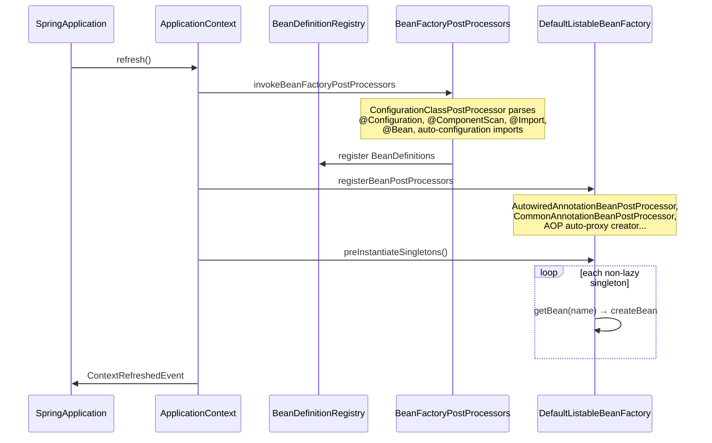
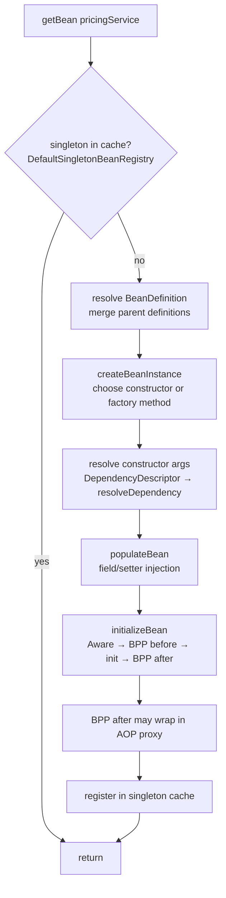
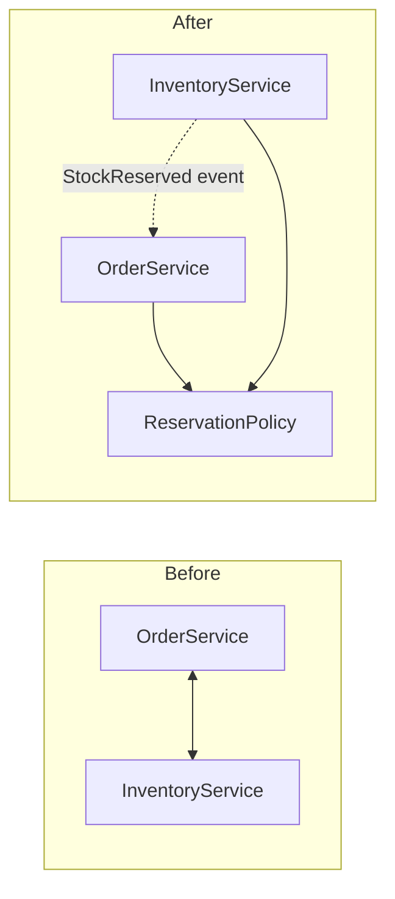

# 02 · Spring Framework Core — IoC & Dependency Injection

## 1. Introduction & Why It Matters

Every other chapter in this handbook — web, data, security, messaging, AI — is just **beans managed by a container**. If you understand how the container finds, creates, wires and scopes beans, you can reason about almost any Spring behaviour: why `@Transactional` sometimes does nothing, why a test loads the wrong implementation, why startup fails with "expected single matching bean but found 2".

In the grocery marketplace, the cart service needs a `PricingService`, which needs a `GstCalculator`, a `PromotionEngine` and a `PriceRepository`. Without a container, the `main` method would construct all of that by hand, in the right order, and every test would repeat it. Swapping Razorpay for a mock gateway in local development would mean editing code. **Inversion of Control** moves that responsibility into Spring: you describe *what* you need, the container decides *how* and *when* to build it.

### Who should read which section

| Band | Focus |
|---|---|
| B1 · 0–2 yrs | Parts 1, 2, 4 — beans, injection, stereotypes |
| B2 · 2–5 yrs | Parts 2, 5 — qualifiers, scopes, `ObjectProvider`, conditional wiring |
| B3 · 5–8 yrs | Parts 3, 5 — bean definitions, full vs lite `@Configuration`, circular references |
| B4 · 8–12 yrs | Parts 3, 6, 7 — programmatic registration, null-safety, startup design |
| B5 · 12–15+ yrs | Parts 7, 8, 9 — container design trade-offs, governance |

---

## 2. Core Concepts

### 2.1 Inversion of Control and Dependency Injection

**Inversion of Control (IoC)** — objects don't create their collaborators; something outside gives them collaborators. **Dependency Injection (DI)** is the technique: dependencies are passed in (usually via the constructor).

> Analogy: a restaurant kitchen. The chef (your class) doesn't grow vegetables or buy knives. The kitchen manager (container) makes sure the right ingredients and tools are at the station before service starts.

Benefits: loose coupling, testability (pass a fake in tests), configurability (choose implementation by profile/property), and centralized lifecycle management.

### 2.2 Bean

A **bean** is an object whose lifecycle is managed by the Spring container. Not every object is a bean: entities, DTOs, value objects like `Money` are created with `new` or by frameworks — they are *data*, not *services*.

### 2.3 BeanFactory vs ApplicationContext

| | `BeanFactory` | `ApplicationContext` |
|---|---|---|
| Role | Core DI container | BeanFactory + enterprise features |
| Instantiation | Lazy by default | Eagerly pre-instantiates singletons at refresh |
| Events | No | `ApplicationEventPublisher` |
| i18n | No | `MessageSource` |
| Resources | Basic | `ResourceLoader`/`ResourcePatternResolver` |
| Environment/profiles | No | `Environment` |
| Post-processors | Must register manually | Detected and applied automatically |

In practice you always use an `ApplicationContext`. Spring Boot creates `AnnotationConfigServletWebServerApplicationContext` for servlet apps (the exact class names vary slightly between Boot 3 and 4).

### 2.4 Bean definitions

Before any object exists, Spring builds a **`BeanDefinition`** — metadata: class, scope, lazy flag, constructor arguments, init/destroy methods, primary flag, dependencies. Definitions come from component scanning, `@Bean` methods, `@Import`, auto-configuration, or programmatic registration.

### 2.5 Ways to declare beans

| Mechanism | Use when |
|---|---|
| `@Component`, `@Service`, `@Repository`, `@Controller`/`@RestController` | Your own classes |
| `@Bean` method in `@Configuration` | Third-party classes, or construction needs logic |
| `@Import` | Pull in configuration explicitly (libraries, starters) |
| Auto-configuration | Boot's conditional defaults |
| `BeanRegistrar` (Framework 7) / `BeanDefinitionRegistryPostProcessor` | Programmatic, dynamic registration |

**Stereotypes:** `@Service` and `@Controller` are semantic `@Component`s. `@Repository` additionally enables **persistence exception translation** (via `PersistenceExceptionTranslationPostProcessor`) — vendor exceptions become `DataAccessException`s.

### 2.6 `@Configuration` full mode vs lite mode

- **Full mode:** `@Configuration` classes (with `proxyBeanMethods = true`, the default) are CGLIB-subclassed. Calling one `@Bean` method from another returns the **same singleton** from the container.
- **Lite mode:** `@Bean` methods in a `@Component` class, or `@Configuration(proxyBeanMethods = false)`. Inter-bean method calls are plain Java calls and create **new instances**.

Spring Boot's own auto-configurations use `proxyBeanMethods = false` for faster startup and smaller footprint, and inject dependencies as method parameters instead.

### 2.7 Injection styles

| Style | Verdict |
|---|---|
| **Constructor** | ✅ Default. Immutable (`final`), mandatory deps explicit, easy to test, fails fast |
| Setter | Optional dependencies or reconfigurable beans only |
| Field (`@Autowired` on field) | ❌ Hidden dependencies, no `final`, needs reflection in tests |

Since Spring 4.3, a class with a **single constructor** doesn't need `@Autowired`.

### 2.8 Resolving ambiguity

When more than one bean matches a type:

| Tool | Meaning |
|---|---|
| `@Qualifier("name")` | Pick by qualifier/bean name at the injection point |
| Custom qualifier annotation | Type-safe qualifier (`@Gateway(RAZORPAY)`) |
| `@Primary` | Default choice when not otherwise specified |
| `@Fallback` (6.2+) | Use only if no other candidate exists — the inverse of `@Primary` |
| Parameter name matching bean name | Last-resort match (requires `-parameters`) |
| Inject `List<T>` / `Map<String,T>` | Take all candidates |

### 2.9 `ObjectProvider<T>`

A lazy, optional handle to beans: `getIfAvailable()`, `getIfUnique()`, `stream()`, `orderedStream()`, `getObject(args)`. Use it for optional dependencies, prototype lookup from singletons, and breaking eager initialization chains.

### 2.10 Scopes

| Scope | Instances | Typical use |
|---|---|---|
| `singleton` (default) | One per container | Stateless services |
| `prototype` | New per request to container | Stateful helpers, builders |
| `request` | One per HTTP request | Request-scoped context |
| `session` | One per HTTP session | Rare in stateless APIs |
| `application` | One per `ServletContext` | Rare |
| `websocket` | One per WebSocket session | STOMP apps |
| Custom (`thread`, tenant) | You define | Multi-tenancy (Chapter 38) |

Injecting a shorter-lived bean into a singleton requires a **scoped proxy** (`proxyMode = ScopedProxyMode.TARGET_CLASS`) or `ObjectProvider`.

### 2.11 Lazy initialization

`@Lazy` (per bean or injection point) or `spring.main.lazy-initialization=true` (global). Faster startup, but configuration errors surface on first request instead of at startup.

### 2.12 Circular dependencies

A → B → A. Spring Boot **forbids** them by default since 2.6 (`spring.main.allow-circular-references=false`). Constructor-injection cycles can never be resolved without proxies. A cycle is a design smell: usually a missing third component or a misplaced responsibility.

### 2.13 `@DependsOn`

Forces initialization order when there is no direct reference (e.g. a Flyway migration must run before a cache warmer). Prefer real dependencies or lifecycle phases (Chapter 03).

### 2.14 Programmatic registration — `BeanRegistrar` (Framework 7)

Framework 7 adds a first-class API for registering beans programmatically with a functional style, designed to be AOT- and native-friendly. Useful when the number or type of beans depends on configuration (e.g. one client bean per configured payment gateway).

### 2.15 Null-safety with JSpecify

Framework 7 / Boot 4 adopt **JSpecify** annotations: `@NullMarked` on a package means "everything is non-null unless marked `@Nullable`". Tools like NullAway and IDEs then flag null misuse at compile time. Framework 6.x uses Spring's own `org.springframework.lang.Nullable`.

---

## 3. How It Works Internally

### 3.1 Container refresh — where beans come from



Key class: **`ConfigurationClassPostProcessor`** — a `BeanDefinitionRegistryPostProcessor` that turns annotations into bean definitions. Nothing is instantiated while definitions are being collected.

### 3.2 Creating one bean



Main methods live in **`AbstractAutowireCapableBeanFactory`**: `createBean` → `doCreateBean` → `createBeanInstance` → `populateBean` → `initializeBean`. Dependency resolution is **`DefaultListableBeanFactory.resolveDependency`**, which:

1. Finds candidates by type (`findAutowireCandidates`).
2. Filters by qualifiers (`QualifierAnnotationAutowireCandidateResolver`).
3. If still multiple: prefers `@Primary`, then non-`@Fallback`, then highest `@Priority`, then name match with the parameter/field name.
4. Throws `NoUniqueBeanDefinitionException` if still ambiguous, or `NoSuchBeanDefinitionException` if none and required.

### 3.3 Singleton caches and circular references

`DefaultSingletonBeanRegistry` keeps three maps:

| Cache | Holds |
|---|---|
| `singletonObjects` | Fully initialized beans |
| `earlySingletonObjects` | Early references already handed out |
| `singletonFactories` | Factories that can produce an early reference (possibly proxied) |

For **setter/field** cycles, Spring can expose an early reference to A while B is being created. For **constructor** cycles this is impossible — A's constructor can't run until B exists. Boot disables early-reference cycles entirely by default, so both fail fast with `BeanCurrentlyInCreationException`.

### 3.4 Full-mode `@Configuration` proxy

```java title="AppConfig.java"
@Configuration
class AppConfig {
    @Bean GstCalculator gst() { return new GstCalculator(); }
    @Bean PricingService pricing() { return new PricingService(gst()); } // (1)!
}
```

1. In full mode, `AppConfig` is a CGLIB subclass whose `gst()` override calls `beanFactory.getBean("gst")` — you get the singleton, not a new object. In lite mode this is a plain call and creates a second `GstCalculator` that the container doesn't manage.

### 3.5 Scoped proxies

A request-scoped `RequestContext` injected into a singleton `CartDelegate` is actually a **proxy** created at startup. Every method call on the proxy looks up the real instance for the current request from `RequestContextHolder`. Outside a request, calls throw `ScopeNotActiveException` (older versions: `IllegalStateException`).

---

## 4. Hands-On Code — Level 1 (Beginner)

Goal: see DI working with constructor injection, and understand what happens without Spring.

### 4.1 Without a container

```java title="in/grocery/cart/manual/ManualWiring.java"
package in.grocery.cart.manual;

public class ManualWiring {

    interface PriceRepository { String priceOf(String sku); }

    static class InMemoryPriceRepository implements PriceRepository {
        public String priceOf(String sku) { return "49.00"; }
    }

    static class PricingService {
        private final PriceRepository repository;
        PricingService(PriceRepository repository) { this.repository = repository; }
        String quote(String sku) { return "₹" + repository.priceOf(sku); }
    }

    public static void main(String[] args) {
        PriceRepository repo = new InMemoryPriceRepository();   // (1)!
        PricingService pricing = new PricingService(repo);
        System.out.println(pricing.quote("ATTA-5KG"));
    }
}
```

1. *You* decide implementations and construction order. Fine for three classes, painful for three hundred.

### 4.2 With Spring

```java title="in/grocery/cart/pricing/PriceRepository.java"
package in.grocery.cart.pricing;

import java.math.BigDecimal;

public interface PriceRepository {
    BigDecimal priceOf(String sku);
}
```

```java title="in/grocery/cart/pricing/InMemoryPriceRepository.java"
package in.grocery.cart.pricing;

import java.math.BigDecimal;
import java.util.Map;
import org.springframework.stereotype.Repository;

@Repository                                            // (1)!
public class InMemoryPriceRepository implements PriceRepository {

    private final Map<String, BigDecimal> prices = Map.of(
            "ATTA-5KG", new BigDecimal("289.00"),
            "MILK-1L", new BigDecimal("66.00"));

    @Override
    public BigDecimal priceOf(String sku) {
        BigDecimal price = prices.get(sku);
        if (price == null) {
            throw new IllegalArgumentException("Unknown SKU: " + sku);
        }
        return price;
    }
}
```

1. Detected by component scanning because it's under the application's package.

```java title="in/grocery/cart/pricing/PricingService.java"
package in.grocery.cart.pricing;

import java.math.BigDecimal;
import org.springframework.stereotype.Service;

@Service
public class PricingService {

    private final PriceRepository repository;            // (1)!

    public PricingService(PriceRepository repository) {  // (2)!
        this.repository = repository;
    }

    public BigDecimal lineTotal(String sku, int quantity) {
        return repository.priceOf(sku).multiply(BigDecimal.valueOf(quantity));
    }
}
```

1. `final` — cannot be forgotten or changed later.
2. Single constructor → no `@Autowired` needed. Spring finds the one `PriceRepository` bean and passes it.

```java title="in/grocery/cart/CartApplication.java"
package in.grocery.cart;

import in.grocery.cart.pricing.PricingService;
import org.springframework.boot.ApplicationRunner;
import org.springframework.boot.SpringApplication;
import org.springframework.boot.autoconfigure.SpringBootApplication;
import org.springframework.context.annotation.Bean;

@SpringBootApplication
public class CartApplication {

    public static void main(String[] args) {
        SpringApplication.run(CartApplication.class, args);
    }

    @Bean
    ApplicationRunner demo(PricingService pricing) {     // (1)!
        return args -> System.out.println("2 x ATTA-5KG = ₹" + pricing.lineTotal("ATTA-5KG", 2));
    }
}
```

1. `@Bean` method parameters are injected too.

```text title="Expected output"
2 x ATTA-5KG = ₹578.00
```

### 4.3 Unit test — no Spring needed

```java title="in/grocery/cart/pricing/PricingServiceTest.java"
package in.grocery.cart.pricing;

import static org.assertj.core.api.Assertions.assertThat;

import java.math.BigDecimal;
import org.junit.jupiter.api.Test;

class PricingServiceTest {

    @Test
    void multipliesPriceByQuantity() {
        PriceRepository fake = sku -> new BigDecimal("10.00");   // (1)!
        var service = new PricingService(fake);

        assertThat(service.lineTotal("ANY", 3)).isEqualByComparingTo("30.00");
    }
}
```

1. Constructor injection makes the class trivially testable — a lambda is enough.

---

## 5. Hands-On Code — Level 2 (Intermediate) & Level 3 (Advanced)

### 5.1 Level 2 — Multiple implementations: payment gateways

The payment service supports Razorpay in production and a fake gateway locally, and can refund through a secondary gateway.

```java title="in/grocery/payment/gateway/PaymentGateway.java"
package in.grocery.payment.gateway;

import java.math.BigDecimal;

public interface PaymentGateway {
    String code();
    String createOrder(String orderId, BigDecimal amountInRupees);
}
```

```java title="in/grocery/payment/gateway/RazorpayGateway.java"
package in.grocery.payment.gateway;

import java.math.BigDecimal;
import org.springframework.context.annotation.Primary;
import org.springframework.stereotype.Component;

@Component
@Primary                                                   // (1)!
public class RazorpayGateway implements PaymentGateway {
    public String code() { return "RAZORPAY"; }
    public String createOrder(String orderId, BigDecimal amount) {
        return "order_rzp_" + orderId;                     // real HTTP call in Chapter 19
    }
}
```

1. Default choice when a single `PaymentGateway` is requested.

```java title="in/grocery/payment/gateway/CashfreeGateway.java"
package in.grocery.payment.gateway;

import java.math.BigDecimal;
import org.springframework.beans.factory.annotation.Qualifier;
import org.springframework.stereotype.Component;

@Component
@Qualifier("secondary")
public class CashfreeGateway implements PaymentGateway {
    public String code() { return "CASHFREE"; }
    public String createOrder(String orderId, BigDecimal amount) {
        return "cf_" + orderId;
    }
}
```

```java title="in/grocery/payment/gateway/NoOpGateway.java"
package in.grocery.payment.gateway;

import java.math.BigDecimal;
import org.springframework.context.annotation.Fallback;
import org.springframework.stereotype.Component;

@Component
@Fallback                                                   // (1)!
public class NoOpGateway implements PaymentGateway {
    public String code() { return "NOOP"; }
    public String createOrder(String orderId, BigDecimal amount) { return "noop_" + orderId; }
}
```

1. Spring Framework 6.2+: chosen only if no other non-fallback candidate remains.

```java title="in/grocery/payment/service/PaymentService.java"
package in.grocery.payment.service;

import in.grocery.payment.gateway.PaymentGateway;
import java.math.BigDecimal;
import java.util.List;
import java.util.Map;
import java.util.function.Function;
import java.util.stream.Collectors;
import org.springframework.beans.factory.annotation.Qualifier;
import org.springframework.stereotype.Service;

@Service
public class PaymentService {

    private final PaymentGateway primary;
    private final PaymentGateway secondary;
    private final Map<String, PaymentGateway> byCode;

    public PaymentService(PaymentGateway primary,                          // (1)!
                          @Qualifier("secondary") PaymentGateway secondary, // (2)!
                          List<PaymentGateway> all) {                      // (3)!
        this.primary = primary;
        this.secondary = secondary;
        this.byCode = all.stream().collect(Collectors.toUnmodifiableMap(PaymentGateway::code, Function.identity()));
    }

    public String startPayment(String orderId, BigDecimal amount) {
        return primary.createOrder(orderId, amount);
    }

    public String startWith(String gatewayCode, String orderId, BigDecimal amount) {
        PaymentGateway gateway = byCode.get(gatewayCode);
        if (gateway == null) throw new IllegalArgumentException("Unsupported gateway " + gatewayCode);
        return gateway.createOrder(orderId, amount);
    }

    public String failover(String orderId, BigDecimal amount) {
        return secondary.createOrder(orderId, amount);
    }
}
```

1. `@Primary` resolves this to Razorpay.
2. Qualifier picks Cashfree.
3. All three implementations, ordered by `@Order`/`Ordered` if present.

### 5.2 Level 2 — Full vs lite `@Configuration`

```java title="in/grocery/cart/config/PricingConfig.java"
package in.grocery.cart.config;

import in.grocery.common.tax.GstCalculator;
import org.springframework.context.annotation.Bean;
import org.springframework.context.annotation.Configuration;

@Configuration(proxyBeanMethods = false)                   // (1)!
public class PricingConfig {

    @Bean
    GstCalculator gstCalculator() {
        return new GstCalculator();
    }

    @Bean
    CartTotals cartTotals(GstCalculator gst) {              // (2)!
        return new CartTotals(gst);
    }

    public record CartTotals(GstCalculator gst) {}
}
```

1. Lite mode — no CGLIB subclass. Faster startup, and required style for native images and auto-configurations.
2. Take dependencies as **parameters**, never by calling `gstCalculator()` directly in lite mode.

A test that proves the difference:

```java title="ConfigModesTest.java"
package in.grocery.cart.config;

import static org.assertj.core.api.Assertions.assertThat;

import org.junit.jupiter.api.Test;
import org.springframework.context.annotation.AnnotationConfigApplicationContext;
import org.springframework.context.annotation.Bean;
import org.springframework.context.annotation.Configuration;

class ConfigModesTest {

    static class Thing {}
    record Holder(Thing thing) {}

    @Configuration                                           // full mode
    static class Full {
        @Bean Thing thing() { return new Thing(); }
        @Bean Holder holder() { return new Holder(thing()); }
    }

    @Configuration(proxyBeanMethods = false)                 // lite mode
    static class Lite {
        @Bean Thing thing() { return new Thing(); }
        @Bean Holder holder() { return new Holder(thing()); } // anti-pattern in lite mode
    }

    @Test
    void fullModeReturnsContainerSingleton() {
        try (var ctx = new AnnotationConfigApplicationContext(Full.class)) {
            assertThat(ctx.getBean(Holder.class).thing()).isSameAs(ctx.getBean(Thing.class));
        }
    }

    @Test
    void liteModeCreatesSecondInstance() {
        try (var ctx = new AnnotationConfigApplicationContext(Lite.class)) {
            assertThat(ctx.getBean(Holder.class).thing()).isNotSameAs(ctx.getBean(Thing.class));
        }
    }
}
```

### 5.3 Level 3 — Scopes: request context and prototype builders

```java title="in/grocery/common/web/RequestContext.java"
package in.grocery.common.web;

import org.springframework.context.annotation.Scope;
import org.springframework.context.annotation.ScopedProxyMode;
import org.springframework.stereotype.Component;
import org.springframework.web.context.WebApplicationContext;

@Component
@Scope(value = WebApplicationContext.SCOPE_REQUEST, proxyMode = ScopedProxyMode.TARGET_CLASS) // (1)!
public class RequestContext {

    private String pincode;
    private String customerId;

    public String pincode() { return pincode; }
    public String customerId() { return customerId; }

    public void populate(String pincode, String customerId) {
        this.pincode = pincode;
        this.customerId = customerId;
    }
}
```

1. The singleton that injects this gets a proxy; each HTTP request sees its own instance.

```java title="in/grocery/common/web/GroceryRequestContextFilter.java"
package in.grocery.common.web;

import jakarta.servlet.FilterChain;
import jakarta.servlet.ServletException;
import jakarta.servlet.http.HttpServletRequest;
import jakarta.servlet.http.HttpServletResponse;
import java.io.IOException;
import org.springframework.stereotype.Component;
import org.springframework.web.filter.OncePerRequestFilter;

@Component
public class GroceryRequestContextFilter extends OncePerRequestFilter {

    private final RequestContext context;

    public GroceryRequestContextFilter(RequestContext context) {
        this.context = context;
    }

    @Override
    protected void doFilterInternal(HttpServletRequest req, HttpServletResponse res, FilterChain chain)
            throws ServletException, IOException {
        context.populate(req.getHeader("X-Pincode"), req.getHeader("X-Customer-Id"));
        chain.doFilter(req, res);
    }
}
```

!!! tip "Prefer explicit parameters"
    Request-scoped beans are convenient but hide data flow. In the four-layer pattern, the **Delegate** usually extracts context from the request and passes it explicitly to the Service. Use request scope for cross-cutting context (tenant, locale) — not business inputs. Java 25's **scoped values** are an alternative for immutable per-request data (Chapter 25).

**Prototype from singleton via `ObjectProvider`:**

```java title="in/grocery/cart/service/InvoiceBuilder.java"
package in.grocery.cart.service;

import java.util.ArrayList;
import java.util.List;
import org.springframework.beans.factory.config.ConfigurableBeanFactory;
import org.springframework.context.annotation.Scope;
import org.springframework.stereotype.Component;

@Component
@Scope(ConfigurableBeanFactory.SCOPE_PROTOTYPE)       // stateful — must not be shared
public class InvoiceBuilder {
    private final List<String> lines = new ArrayList<>();
    public InvoiceBuilder line(String l) { lines.add(l); return this; }
    public List<String> build() { return List.copyOf(lines); }
}
```

```java title="in/grocery/cart/service/InvoiceService.java"
package in.grocery.cart.service;

import java.util.List;
import org.springframework.beans.factory.ObjectProvider;
import org.springframework.stereotype.Service;

@Service
public class InvoiceService {

    private final ObjectProvider<InvoiceBuilder> builders;

    public InvoiceService(ObjectProvider<InvoiceBuilder> builders) {
        this.builders = builders;
    }

    public List<String> invoiceFor(List<String> skus) {
        InvoiceBuilder builder = builders.getObject();          // (1)!
        skus.forEach(builder::line);
        return builder.build();
    }
}
```

1. New prototype on every call. Injecting `InvoiceBuilder` directly would give the singleton **one** builder forever — a classic bug.

### 5.4 Level 3 — Optional dependencies and conditional wiring

```java title="in/grocery/order/service/OrderNotifier.java"
package in.grocery.order.service;

import org.springframework.beans.factory.ObjectProvider;
import org.springframework.stereotype.Service;

@Service
public class OrderNotifier {

    public interface SmsSender { void send(String mobile, String text); }

    private final ObjectProvider<SmsSender> sms;

    public OrderNotifier(ObjectProvider<SmsSender> sms) {
        this.sms = sms;
    }

    public void orderPlaced(String mobile, String orderId) {
        sms.ifAvailable(s -> s.send(mobile, "Order " + orderId + " placed")); // (1)!
    }
}
```

1. Works whether or not an `SmsSender` bean exists (e.g. disabled in local profile).

```java title="in/grocery/order/config/SmsConfig.java"
package in.grocery.order.config;

import in.grocery.order.service.OrderNotifier.SmsSender;
import org.springframework.boot.autoconfigure.condition.ConditionalOnProperty;
import org.springframework.context.annotation.Bean;
import org.springframework.context.annotation.Configuration;
import org.springframework.context.annotation.Profile;

@Configuration(proxyBeanMethods = false)
class SmsConfig {

    @Bean
    @ConditionalOnProperty(name = "grocery.sms.enabled", havingValue = "true")
    SmsSender msg91Sender() {
        return (mobile, text) -> { /* call MSG91 API */ };
    }

    @Bean
    @Profile("local")
    SmsSender consoleSender() {
        return (mobile, text) -> System.out.printf("SMS to %s: %s%n", mobile, text);
    }
}
```

### 5.5 Level 3 — Diagnosing a circular dependency

```java title="OrderService.java"
@Service class OrderService { OrderService(InventoryService inv) {} }
@Service class InventoryService { InventoryService(OrderService orders) {} }  // ❌ cycle
```

```text title="Startup failure"
The dependencies of some of the beans in the application context form a cycle:
┌─────┐
|  orderService defined in file [.../OrderService.class]
↑     ↓
|  inventoryService defined in file [.../InventoryService.class]
└─────┘
Action: Relying upon circular references is discouraged and they are prohibited by default.
```

✅ Fix by design: inventory shouldn't call back into orders. It publishes an event (`StockReserved`) or the shared logic moves to a third component (`ReservationPolicy`) that both depend on.



---

## 6. Hands-On Code — Level 4 (Expert / Production)

### 6.1 Type-safe qualifier + configuration-driven gateway registry

Qualifier strings are typo-prone. A custom annotation makes them compile-checked.

```java title="in/grocery/payment/gateway/Gateway.java"
package in.grocery.payment.gateway;

import java.lang.annotation.Documented;
import java.lang.annotation.ElementType;
import java.lang.annotation.Retention;
import java.lang.annotation.RetentionPolicy;
import java.lang.annotation.Target;
import org.springframework.beans.factory.annotation.Qualifier;

@Qualifier                                                 // (1)!
@Documented
@Retention(RetentionPolicy.RUNTIME)
@Target({ElementType.TYPE, ElementType.METHOD, ElementType.PARAMETER, ElementType.FIELD})
public @interface Gateway {
    Provider value();

    enum Provider { RAZORPAY, CASHFREE }
}
```

1. Meta-annotated with `@Qualifier`, so Spring treats it (and its attribute) as a qualifier.

```java title="in/grocery/payment/config/PaymentProperties.java"
package in.grocery.payment.config;

import in.grocery.payment.gateway.Gateway.Provider;
import jakarta.validation.constraints.NotNull;
import java.time.Duration;
import org.springframework.boot.context.properties.ConfigurationProperties;
import org.springframework.validation.annotation.Validated;

@Validated
@ConfigurationProperties("grocery.payment")
public record PaymentProperties(
        @NotNull Provider primary,
        Provider secondary,
        @NotNull Duration timeout) {}
```

```yaml title="application.yml"
grocery:
  payment:
    primary: RAZORPAY
    secondary: CASHFREE
    timeout: 3s
```

```java title="in/grocery/payment/gateway/GatewayRegistry.java"
package in.grocery.payment.gateway;

import in.grocery.payment.config.PaymentProperties;
import in.grocery.payment.gateway.Gateway.Provider;
import java.util.EnumMap;
import java.util.List;
import java.util.Map;
import java.util.Optional;
import org.jspecify.annotations.Nullable;
import org.springframework.core.annotation.AnnotationUtils;
import org.springframework.stereotype.Component;
import org.springframework.aop.support.AopUtils;

@Component
public class GatewayRegistry {

    private final Map<Provider, PaymentGateway> gateways = new EnumMap<>(Provider.class);
    private final Provider primary;
    private final @Nullable Provider secondary;               // (1)!

    public GatewayRegistry(List<PaymentGateway> all, PaymentProperties props) {
        for (PaymentGateway g : all) {
            Gateway ann = AnnotationUtils.findAnnotation(AopUtils.getTargetClass(g), Gateway.class); // (2)!
            if (ann != null && gateways.putIfAbsent(ann.value(), g) != null) {
                throw new IllegalStateException("Duplicate gateway for " + ann.value());
            }
        }
        if (!gateways.containsKey(props.primary())) {
            throw new IllegalStateException("Primary gateway " + props.primary() + " is not registered"); // (3)!
        }
        this.primary = props.primary();
        this.secondary = props.secondary();
    }

    public PaymentGateway primary() {
        return gateways.get(primary);
    }

    public Optional<PaymentGateway> secondary() {
        return Optional.ofNullable(secondary).map(gateways::get);
    }
}
```

1. JSpecify: explicit about what can be null. With `@NullMarked` on the package, everything else is non-null.
2. `AopUtils.getTargetClass` — beans may be AOP proxies (metrics, retries); annotations live on the target class.
3. Fail at **startup**, not on the first payment at 2 a.m.

```java title="in/grocery/payment/package-info.java"
@NullMarked
package in.grocery.payment;

import org.jspecify.annotations.NullMarked;
```

!!! note "`@NullMarked` scope"
    `@NullMarked` on a package applies to that package only, not sub-packages. Add a `package-info.java` to each package, or place it on a module declaration.

```java title="in/grocery/payment/gateway/RazorpayGateway.java (production shape)"
package in.grocery.payment.gateway;

import java.math.BigDecimal;
import org.springframework.stereotype.Component;

@Component
@Gateway(Gateway.Provider.RAZORPAY)
public class RazorpayGateway implements PaymentGateway {
    public String code() { return "RAZORPAY"; }
    public String createOrder(String orderId, BigDecimal amount) { return "order_rzp_" + orderId; }
}
```

Injection points can also use the qualifier directly:

```java title="Type-safe qualifier + configuration-driven gateway registry (snippet)"
public RefundService(@Gateway(Gateway.Provider.CASHFREE) PaymentGateway refunds) { ... }
```

### 6.2 Programmatic registration with `BeanRegistrar` (Spring Framework 7)

Sellers can be onboarded with per-seller webhook signing keys. One `WebhookVerifier` bean per configured seller group:

=== "Spring Boot 4.x (Framework 7)"

    ```java title="in/grocery/seller/config/WebhookVerifierRegistrar.java"
    package in.grocery.seller.config;

    import java.util.List;
    import org.springframework.beans.factory.BeanRegistrar;
    import org.springframework.beans.factory.BeanRegistry;
    import org.springframework.boot.context.properties.bind.Binder;
    import org.springframework.boot.context.properties.bind.Bindable;
    import org.springframework.core.env.Environment;

    public class WebhookVerifierRegistrar implements BeanRegistrar {

        public record WebhookVerifier(String group, String secretRef) {}

        @Override
        public void register(BeanRegistry registry, Environment env) {
            List<String> groups = Binder.get(env)
                    .bind("grocery.seller.webhook-groups", Bindable.listOf(String.class))
                    .orElse(List.of());

            for (String group : groups) {
                registry.registerBean("webhookVerifier-" + group, WebhookVerifier.class,
                        spec -> spec.supplier(ctx -> new WebhookVerifier(group, "vault:seller/" + group)));
            }
        }
    }
    ```

    ```java title="in/grocery/seller/config/SellerConfig.java"
    package in.grocery.seller.config;

    import org.springframework.context.annotation.Configuration;
    import org.springframework.context.annotation.Import;

    @Configuration(proxyBeanMethods = false)
    @Import(WebhookVerifierRegistrar.class)
    class SellerConfig {}
    ```

=== "Spring Boot 3.5 (Framework 6.2)"

    ```java title="in/grocery/seller/config/WebhookVerifierRegistrar.java"
    package in.grocery.seller.config;

    import java.util.List;
    import org.springframework.beans.BeansException;
    import org.springframework.beans.factory.support.BeanDefinitionRegistry;
    import org.springframework.beans.factory.support.BeanDefinitionRegistryPostProcessor;
    import org.springframework.beans.factory.support.RootBeanDefinition;
    import org.springframework.boot.context.properties.bind.Bindable;
    import org.springframework.boot.context.properties.bind.Binder;
    import org.springframework.context.EnvironmentAware;
    import org.springframework.core.env.Environment;

    public class WebhookVerifierRegistrar implements BeanDefinitionRegistryPostProcessor, EnvironmentAware {

        public record WebhookVerifier(String group, String secretRef) {}

        private Environment env;

        @Override
        public void setEnvironment(Environment environment) { this.env = environment; }

        @Override
        public void postProcessBeanDefinitionRegistry(BeanDefinitionRegistry registry) throws BeansException {
            List<String> groups = Binder.get(env)
                    .bind("grocery.seller.webhook-groups", Bindable.listOf(String.class))
                    .orElse(List.of());
            for (String group : groups) {
                var def = new RootBeanDefinition(WebhookVerifier.class,
                        () -> new WebhookVerifier(group, "vault:seller/" + group));
                registry.registerBeanDefinition("webhookVerifier-" + group, def);
            }
        }
    }
    ```

    Register it with a **`static`** `@Bean` method so it's created before regular beans:

    ```java title="Programmatic registration with BeanRegistrar (Spring Framework 7) (snippet)"
    @Bean
    static WebhookVerifierRegistrar webhookVerifierRegistrar() { return new WebhookVerifierRegistrar(); }
    ```

!!! warning "Verify"
    `BeanRegistrar` is new in Spring Framework 7. Confirm the exact `BeanRegistry` / spec method names (`supplier`, `prototype`, `lazyInit`, `description`) against the Framework 7 reference — *Core Technologies › Programmatic Bean Registration*.

### 6.3 Production test: context wiring is correct

```java title="in/grocery/payment/gateway/GatewayRegistryTest.java"
package in.grocery.payment.gateway;

import static org.assertj.core.api.Assertions.assertThat;

import in.grocery.payment.config.PaymentProperties;
import org.junit.jupiter.api.Test;
import org.springframework.boot.context.properties.EnableConfigurationProperties;
import org.springframework.boot.test.context.runner.ApplicationContextRunner;
import org.springframework.context.annotation.Configuration;
import org.springframework.context.annotation.Import;

class GatewayRegistryTest {

    @Configuration(proxyBeanMethods = false)
    @EnableConfigurationProperties(PaymentProperties.class)
    @Import({RazorpayGateway.class, CashfreeGateway.class, GatewayRegistry.class})
    static class TestConfig {}

    private final ApplicationContextRunner runner = new ApplicationContextRunner()   // (1)!
            .withUserConfiguration(TestConfig.class);

    @Test
    void resolvesPrimaryAndSecondary() {
        runner.withPropertyValues(
                        "grocery.payment.primary=RAZORPAY",
                        "grocery.payment.secondary=CASHFREE",
                        "grocery.payment.timeout=3s")
                .run(ctx -> {
                    var registry = ctx.getBean(GatewayRegistry.class);
                    assertThat(registry.primary().code()).isEqualTo("RAZORPAY");
                    assertThat(registry.secondary()).get().extracting(PaymentGateway::code).isEqualTo("CASHFREE");
                });
    }

    @Test
    void failsFastWhenPrimaryMissingFromContext() {
        new ApplicationContextRunner()
                .withUserConfiguration(OnlyCashfree.class)
                .withPropertyValues("grocery.payment.primary=RAZORPAY", "grocery.payment.timeout=3s")
                .run(ctx -> assertThat(ctx).hasFailed()
                        .getFailure().hasRootCauseMessage("Primary gateway RAZORPAY is not registered"));
    }

    @Configuration(proxyBeanMethods = false)
    @EnableConfigurationProperties(PaymentProperties.class)
    @Import({CashfreeGateway.class, GatewayRegistry.class})
    static class OnlyCashfree {}
}
```

1. `ApplicationContextRunner` starts a tiny context in milliseconds — ideal for testing wiring rules without a web server. (Here `CashfreeGateway` is assumed annotated `@Gateway(CASHFREE)` in the production shape.)

### 6.4 Startup-time guardrails

```yaml title="application.yml"
spring:
  main:
    allow-circular-references: false     # default; keep it explicit
    allow-bean-definition-overriding: false
    lazy-initialization: false           # eager in prod: fail fast
```

```java title="in/grocery/common/startup/StartupReport.java"
package in.grocery.common.startup;

import org.springframework.boot.context.metrics.buffering.BufferingApplicationStartup;

public final class StartupReport {
    private StartupReport() {}

    /** Use in main(): app.setApplicationStartup(StartupReport.buffering()); then GET /actuator/startup */
    public static BufferingApplicationStartup buffering() {
        return new BufferingApplicationStartup(4096);   // (1)!
    }
}
```

1. Records bean-creation steps with timings; Actuator's `startup` endpoint shows the slowest beans.

---

## 7. Spring Boot 3 vs 4 & Migration

| Topic | Boot 3.5 / Framework 6.2 | Boot 4.x / Framework 7 |
|---|---|---|
| `@Fallback` | Available (6.2+) | Available |
| Programmatic registration | `BeanDefinitionRegistryPostProcessor`, `GenericApplicationContext.registerBean` | + `BeanRegistrar` / `BeanRegistry` |
| Null-safety | `org.springframework.lang.@Nullable` | JSpecify `@Nullable` / `@NullMarked` |
| Circular refs | Prohibited by default | Prohibited by default |
| `@MockBean` in tests | Deprecated → `@MockitoBean` | Removed; use `@MockitoBean` |
| Auto-config style | `proxyBeanMethods = false` | Same, plus modular packages |

=== "Spring Boot 3.5"

    ```java title="Spring Boot 3.5 (snippet)"
    import org.springframework.lang.Nullable;

    public Optional<PaymentGateway> find(@Nullable String code) { ... }
    ```

=== "Spring Boot 4.x"

    ```java title="Spring Boot 4.x (snippet)"
    import org.jspecify.annotations.Nullable;

    public Optional<PaymentGateway> find(@Nullable String code) { ... }
    ```

### Migration checklist

- [ ] Replace `org.springframework.lang.Nullable`/`NonNull` with JSpecify equivalents; add `@NullMarked` package by package.
- [ ] Replace `@MockBean`/`@SpyBean` with `@MockitoBean`/`@MockitoSpyBean` (do it on 3.5 first).
- [ ] Review custom `BeanDefinitionRegistryPostProcessor`s — consider `BeanRegistrar` for AOT friendliness.
- [ ] Remove any `allow-circular-references: true` by fixing cycles before upgrading.
- [ ] Remove `allow-bean-definition-overriding: true`; use `@ConditionalOnMissingBean` or `@Primary`.

---

## 8. Production Playbook

### Best practices

1. **Constructor injection, `final` fields**, no `@Autowired` on single constructors.
2. **Program to interfaces** at integration boundaries (gateways, clients, repositories); concrete classes are fine for internal services.
3. **Keep beans stateless.** Singletons are shared across all request threads.
4. **Fail at startup:** validate configuration and wiring in constructors or `@PostConstruct`.
5. **`proxyBeanMethods = false`** for your `@Configuration` classes; inject via parameters.
6. **Type-safe qualifiers** over strings.
7. **No cycles** — treat `BeanCurrentlyInCreationException` as a design review trigger.
8. **Too many constructor parameters (> 5–6)** means the class does too much. Split it.

### Anti-patterns

❌ **Field injection**

```java title="CartService.java"
@Service
public class CartService {
    @Autowired private PricingService pricing;   // hidden, mutable, reflection-only in tests
}
```

✅ **Constructor injection**

```java title="CartService.java"
@Service
public class CartService {
    private final PricingService pricing;
    public CartService(PricingService pricing) { this.pricing = pricing; }
}
```

❌ **Mutable state in a singleton**

```java title="CheckoutService.java"
@Service
public class CheckoutService {
    private Cart currentCart;                    // shared across ALL users — data leak
}
```

✅ Pass state as method arguments or use a request/prototype scope deliberately.

❌ **Service locator**

```java title="Anti-patterns (snippet)"
PricingService p = applicationContext.getBean(PricingService.class); // hides dependencies
```

✅ Inject it, or `ObjectProvider<PricingService>` if it's truly optional/lazy.

❌ **Calling a `@Bean` method in lite mode**

✅ Declare the dependency as a `@Bean` method parameter.

### Troubleshooting

| Symptom | Cause | Fix |
|---|---|---|
| `NoSuchBeanDefinitionException` | Class not scanned (outside base package), missing starter, condition not met | Move package, `@Import`, check `--debug` condition report |
| `NoUniqueBeanDefinitionException` | Multiple candidates | `@Primary`, `@Qualifier`, `@Fallback`, or inject `List` |
| `BeanCurrentlyInCreationException` / cycle report | Circular dependency | Redesign; events; extract component |
| Prototype bean behaves like singleton | Injected directly into singleton | `ObjectProvider` or scoped proxy |
| `ScopeNotActiveException` | Request-scoped bean used outside request (async, scheduler) | Pass data explicitly; don't use request scope in async code |
| Annotation not found on bean | Bean is a proxy | `AopUtils.getTargetClass`, `AnnotationUtils.findAnnotation` |
| Slow startup | Heavy constructors, eager remote calls | Move I/O to `ApplicationRunner`/`SmartLifecycle`; use `/actuator/startup` |

### Production checklist

- [ ] No field injection (enforce with ArchUnit)
- [ ] Circular references and bean overriding disabled
- [ ] Configuration validated at startup
- [ ] Qualifiers are type-safe
- [ ] `@NullMarked` on packages (Boot 4)
- [ ] Startup time measured and budgeted
- [ ] Wiring tests with `ApplicationContextRunner` for conditional beans

---

## 9. Interview Questions & Answers

### B1 · 0–2 years

??? question "B1 · What is Inversion of Control?"
    **Short answer:** Objects don't create their dependencies; an external container provides them. Control over object creation and wiring is inverted from the class to Spring.

    **Follow-ups:** What's the difference between IoC and DI?

    **Red flags:** Confusing IoC with "Spring calls my methods" only.

??? question "B1 · What are the types of dependency injection? Which is preferred?"
    **Short answer:** Constructor, setter and field. Constructor injection is preferred — immutable, explicit, testable, fails fast.

    **Red flags:** "Field injection because it's shorter."

??? question "B1 · Difference between `@Component`, `@Service`, `@Repository`, `@Controller`?"
    **Short answer:** All register beans via scanning. `@Service`/`@Controller` are semantic. `@Repository` adds persistence exception translation. `@Controller` is also detected by Spring MVC as a handler.

??? question "B1 · What is the default bean scope?"
    **Short answer:** Singleton — one instance per application context.

    **Follow-ups:** Is a Spring singleton the same as the GoF Singleton pattern? (No — one per container, not per JVM/class loader.)

??? question "B1 · Do you need `@Autowired` on a constructor?"
    **Short answer:** Not if the class has exactly one constructor (since Spring 4.3). With multiple constructors, mark the one to use.

??? question "B1 · What is `@Bean` and when do you use it instead of `@Component`?"
    **Short answer:** A method-level annotation in a configuration class that returns an object to register as a bean. Use it for third-party classes you can't annotate, or when construction needs logic.

??? question "B1 · What happens if two beans implement the same interface and you inject the interface?"
    **Short answer:** Startup fails with `NoUniqueBeanDefinitionException` unless you use `@Primary`, `@Qualifier`, `@Fallback`, a matching parameter name, or inject a `List`.

### B2 · 2–5 years

??? question "B2 · Explain `@Primary` vs `@Qualifier` vs `@Fallback`."
    **Short answer:** `@Qualifier` selects explicitly at the injection point and wins over everything. `@Primary` marks the default candidate. `@Fallback` (6.2) marks a candidate used only if no other remains.

    **Follow-ups:** Two `@Primary` beans of the same type? (Ambiguity error.)

??? question "B2 · How do you inject a prototype bean into a singleton correctly?"
    **Short answer:** Inject `ObjectProvider<T>` (or `Provider<T>`) and call `getObject()` each time, use a scoped proxy, or a `@Lookup` method. Direct injection gives one instance forever.

??? question "B2 · What is `ObjectProvider` and when do you use it?"
    **Short answer:** A lazy/optional handle for beans: `getIfAvailable`, `ifAvailable`, `getIfUnique`, `stream`. Used for optional dependencies, prototypes, and lazy lookup without `ApplicationContext`.

??? question "B2 · Full vs lite `@Configuration` — what's the difference?"
    **Short answer:** Full mode (`proxyBeanMethods = true`) CGLIB-proxies the class so calling a `@Bean` method returns the container singleton. Lite mode doesn't proxy; calls create new objects. Lite mode is faster and native-friendly; inject dependencies via method parameters.

    **Red flags:** Not knowing inter-bean calls can create duplicate instances.

??? question "B2 · How do you inject a request-scoped bean into a singleton?"
    **Short answer:** Use `proxyMode = ScopedProxyMode.TARGET_CLASS` (or `INTERFACES`). The singleton holds a proxy that resolves the current request's instance on each call.

    **Follow-ups:** What happens in an `@Async` method? (Scope not active.)

??? question "B2 · Why does Spring Boot forbid circular dependencies by default?"
    **Short answer:** They indicate poor design, make initialization order fragile, and with constructor injection can't be resolved. Boot 2.6+ sets `allow-circular-references=false`.

### B3 · 5–8 years

??? question "B3 · Walk through how Spring creates a singleton bean."
    **Short answer:** `getBean` → check singleton cache → merge definition → `createBean` → `resolveBeforeInstantiation` (BPPs can short-circuit) → `createBeanInstance` (constructor resolution) → `populateBean` → `initializeBean` (Aware, BPP before, init methods, BPP after — proxies created here) → register singleton.

    **Follow-ups:** Where does `@Autowired` field injection happen? (`AutowiredAnnotationBeanPostProcessor.postProcessProperties` during `populateBean`.)

??? question "B3 · How does Spring resolve which bean to inject when multiple match?"
    **Short answer:** `DefaultListableBeanFactory.resolveDependency` → candidates by type → qualifier filtering → primary → non-fallback → `@Priority` → name match → else exception.

??? question "B3 · Explain the three-level singleton cache."
    **Short answer:** `singletonObjects` (complete), `earlySingletonObjects` (early references handed out), `singletonFactories` (produce early refs, possibly wrapped by `SmartInstantiationAwareBeanPostProcessor.getEarlyBeanReference` so the early ref is already the proxy). Enables setter/field cycles; not constructor cycles.

??? question "B3 · What is a `BeanDefinition` and who creates it?"
    **Short answer:** Metadata describing how to create a bean. Created by `ConfigurationClassPostProcessor` (scan, `@Bean`, `@Import`), by auto-configuration processing, or programmatically. Definitions can be modified by `BeanFactoryPostProcessor`s before any bean exists.

??? question "B3 · Why might an annotation lookup on an injected bean return null?"
    **Short answer:** The bean is a proxy (CGLIB subclass or JDK proxy). Use `AopUtils.getTargetClass` and `AnnotationUtils.findAnnotation`/`MergedAnnotations`.

### B4 · 8–12 years

??? question "B4 · When would you register beans programmatically, and how in Framework 6 vs 7?"
    **Short answer:** When bean count/type depends on configuration (tenants, gateways, per-region clients). Framework 6: `BeanDefinitionRegistryPostProcessor` (static `@Bean`) or `GenericApplicationContext.registerBean`. Framework 7: `BeanRegistrar` imported via `@Import`, designed for AOT/native.

    **Follow-ups:** Why must a `BeanDefinitionRegistryPostProcessor` `@Bean` method be static?

??? question "B4 · How do you keep a 26-service platform's startup time under control?"
    **Short answer:** Measure with `BufferingApplicationStartup` + `/actuator/startup`, avoid I/O in constructors, lite-mode configs, trim auto-configurations and starters, CDS/AOT cache (Chapter 29), lazy init only where safe, and budget startup in CI.

??? question "B4 · What's your view on JSpecify null-safety adoption in a large codebase?"
    **Short answer:** Adopt package by package with `@NullMarked`, enforce with NullAway in CI as warnings then errors, start at API boundaries (DTOs, service interfaces). It turns runtime NPEs into compile-time errors and aligns with Framework 7's own annotations.

### B5 · 12–15+ years

??? question "B5 · Is DI still worth it with records, functional style and virtual threads? Defend."
    **Short answer:** Yes for lifecycle, configuration and cross-cutting concerns (transactions, security, observability via proxies) that the container applies uniformly. But keep the domain core framework-free: pure Java values and functions, with Spring at the edges. DI is plumbing, not architecture.

    **Follow-ups:** How would you test the domain without Spring?

??? question "B5 · What container rules would you enforce org-wide and how?"
    **Short answer:** Constructor injection only, no cycles, no overriding, no `ApplicationContext` lookups in business code, type-safe qualifiers, `@NullMarked`. Enforced with ArchUnit rules in a shared test library, Boot properties in the golden-path template, and review checklists — documented in an ADR.

### Scenario questions

??? example "Scenario · Local profile sends real SMS to customers"
    A developer runs with `spring.profiles.active=local` but also has `grocery.sms.enabled=true` inherited from a shared `application.yml`. Both `msg91Sender` and `consoleSender` are created. `ObjectProvider.ifAvailable` throws `NoUniqueBeanDefinitionException` when more than one candidate exists — so either startup-time wiring picked the wrong one elsewhere, or someone "fixed" the error by marking `msg91Sender` `@Primary`, and real SMS went out.

    **Fix:** make the conditions mutually exclusive — `msg91Sender` gets `@Profile("!local")` in addition to the property condition; set `grocery.sms.enabled=false` in `application-local.yml`. Add an `ApplicationContextRunner` test per profile asserting exactly which `SmsSender` exists.

??? example "Scenario · After adding metrics AOP, the gateway registry fails with 'Primary gateway not registered'"
    The registry reads `@Gateway` via `g.getClass()`, which is now a CGLIB proxy class. Use `AopUtils.getTargetClass(g)` with `AnnotationUtils.findAnnotation`, or put the provider on the interface method (`code()`) instead of relying on annotations.

### Coding exercise

!!! example "Exercise · Pincode-based delivery partner selection"
    Delivery uses different `DeliveryPartner` beans per region: `OwnFleetPartner` for metro pincodes (region digits 1–6 in this exercise) and `ThirdPartyPartner` elsewhere. Write a `DeliveryRouter` that receives all partners via constructor injection and selects by `Pincode.region()` (from Chapter 01's exercise), failing at startup if any region 1–9 is uncovered.

??? success "Solution"
    ```java title="DeliveryPartner.java"
    package in.grocery.delivery;

    import java.util.Set;

    public interface DeliveryPartner {
        Set<Integer> regions();
        String book(String orderId);
    }
    ```

    ```java title="DeliveryRouter.java"
    package in.grocery.delivery;

    import in.grocery.common.address.Pincode;
    import java.util.HashMap;
    import java.util.List;
    import java.util.Map;
    import java.util.stream.IntStream;
    import org.springframework.stereotype.Component;

    @Component
    public class DeliveryRouter {

        private final Map<Integer, DeliveryPartner> byRegion = new HashMap<>();

        public DeliveryRouter(List<DeliveryPartner> partners) {
            for (DeliveryPartner p : partners) {
                for (int region : p.regions()) {
                    DeliveryPartner existing = byRegion.putIfAbsent(region, p);
                    if (existing != null) {
                        throw new IllegalStateException("Region " + region + " covered twice");
                    }
                }
            }
            List<Integer> missing = IntStream.rangeClosed(1, 9).boxed()
                    .filter(r -> !byRegion.containsKey(r)).toList();
            if (!missing.isEmpty()) {
                throw new IllegalStateException("Uncovered regions: " + missing);
            }
        }

        public String book(String orderId, Pincode pincode) {
            return byRegion.get(pincode.region()).book(orderId);
        }
    }
    ```

    ```java title="DeliveryRouterTest.java"
    package in.grocery.delivery;

    import static org.assertj.core.api.Assertions.assertThat;
    import static org.assertj.core.api.Assertions.assertThatIllegalStateException;

    import in.grocery.common.address.Pincode;
    import java.util.List;
    import java.util.Set;
    import org.junit.jupiter.api.Test;

    class DeliveryRouterTest {

        record Partner(String name, Set<Integer> regions) implements DeliveryPartner {
            public String book(String orderId) { return name + ":" + orderId; }
        }

        @Test
        void routesByRegion() {
            var router = new DeliveryRouter(List.of(
                    new Partner("fleet", Set.of(1, 2, 3, 4, 5, 6)),
                    new Partner("3pl", Set.of(7, 8, 9))));
            assertThat(router.book("O1", new Pincode("560001"))).isEqualTo("fleet:O1");
            assertThat(router.book("O2", new Pincode("781001"))).isEqualTo("3pl:O2");
        }

        @Test
        void failsWhenRegionMissing() {
            assertThatIllegalStateException()
                    .isThrownBy(() -> new DeliveryRouter(List.of(new Partner("fleet", Set.of(1, 2)))))
                    .withMessageContaining("Uncovered regions");
        }
    }
    ```

---

## Key Takeaways

- IoC moves object creation and wiring into the container; DI is how dependencies arrive — **use constructors**.
- Spring first builds **bean definitions**, then instantiates singletons at refresh; `ConfigurationClassPostProcessor` and `AbstractAutowireCapableBeanFactory` are the core.
- Resolve ambiguity with **qualifiers → `@Primary` → `@Fallback`**, or inject all candidates.
- **Lite-mode `@Configuration`** with parameter injection is the modern default.
- Shorter-lived scopes in singletons need **`ObjectProvider` or scoped proxies**.
- **Circular dependencies are design bugs**, prohibited by default.
- Framework 7 adds **`BeanRegistrar`** and **JSpecify null-safety**.

## Further Reading

- Spring Framework Reference — *Core Technologies › The IoC Container* (bean overview, dependencies, scopes, Java-based configuration, programmatic registration)
- Spring Boot Reference — *Spring Beans and Dependency Injection*, *Testing › ApplicationContextRunner*
- JSpecify documentation — *User Guide*

---

[:material-arrow-left: 01 Java & Build Prerequisites](01-java-and-build-prerequisites.md) · [03 Bean Lifecycle, Events & Extension Points :material-arrow-right:](03-bean-lifecycle-events-extension-points.md)
