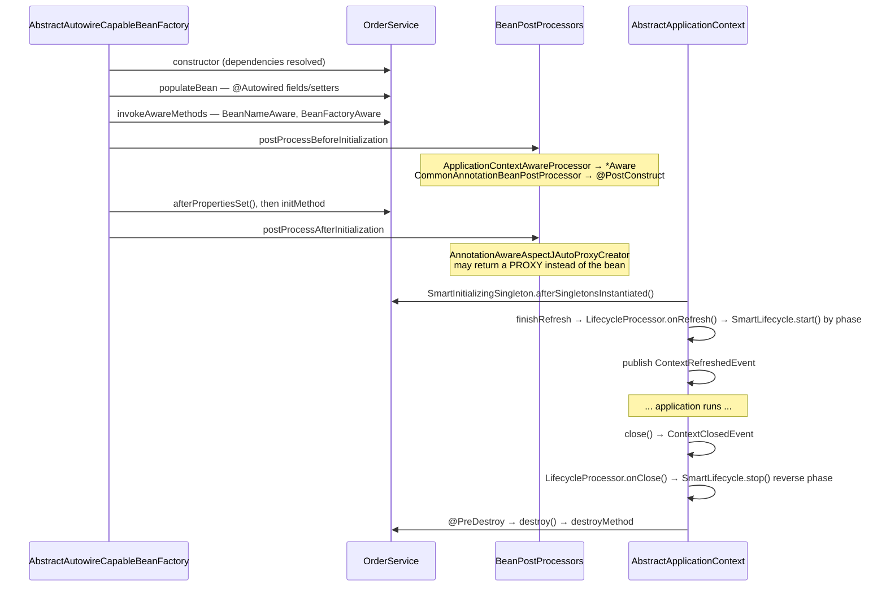
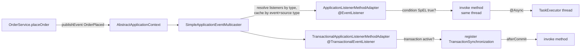
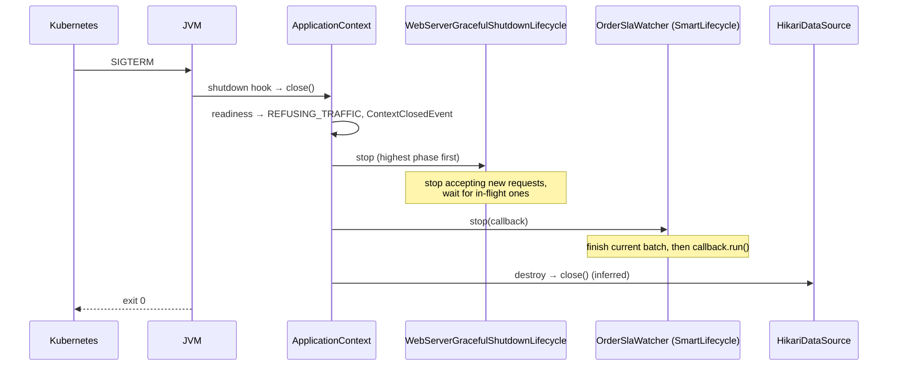

# 03 · Bean Lifecycle, Events & Extension Points

## 1. Introduction & Why It Matters

Chapter 02 showed *how* beans are wired. This chapter shows *when* things happen — and how to plug your own code into those moments.

Production incidents in Spring services often come down to timing:

- A cache warmer runs in a constructor, calls the pricing service before the DataSource is ready, and the pod crash-loops.
- A Kafka consumer keeps polling during shutdown, processes half an order, and the pod is killed mid-transaction.
- An "order placed" SMS is sent from an event listener, but the database transaction then rolls back. The customer gets an SMS for an order that doesn't exist.
- Kubernetes sends traffic to a pod that is "started" but whose catalog cache is still empty, so the first 2,000 requests hit the database at once.

Each of these has a precise fix in Spring's lifecycle model: `SmartLifecycle` phases, `@TransactionalEventListener`, readiness states, and the right extension point.

In the grocery marketplace, events are also how services stay decoupled *inside* a service: `OrderService` publishes `OrderPlaced`, and notification, loyalty, analytics and inventory reservation react without `OrderService` knowing they exist. That same idea scales up to Kafka in Chapter 23 and Spring Modulith in Chapter 37.

### Who should read which section

| Band | Focus |
|---|---|
| B1 · 0–2 yrs | Parts 1, 2, 4 — `@PostConstruct`, `@PreDestroy`, `@EventListener`, profiles |
| B2 · 2–5 yrs | Parts 2, 5 — transactional events, async listeners, conditions, SpEL |
| B3 · 5–8 yrs | Parts 3, 5, 6 — post-processors, `SmartLifecycle`, graceful shutdown |
| B4 · 8–12 yrs | Parts 6, 7, 8 — readiness, `EnvironmentPostProcessor`, platform extension design |
| B5 · 12–15+ yrs | Parts 8, 9 — event-driven design inside and across services |

---

## 2. Core Concepts

### 2.1 The bean lifecycle in one sentence per phase

1. **Instantiate** — constructor runs (constructor injection happens here).
2. **Populate** — field and setter injection.
3. **Aware callbacks** — the bean is told its name, class loader, bean factory, application context.
4. **Before-init post-processing** — `BeanPostProcessor.postProcessBeforeInitialization`; `@PostConstruct` runs here.
5. **Init callbacks** — `InitializingBean.afterPropertiesSet()`, then a custom init method.
6. **After-init post-processing** — `postProcessAfterInitialization`; **AOP proxies are created here**.
7. **Ready** — bean is in the singleton cache and used.
8. **Destroy** — on context close: `@PreDestroy`, `DisposableBean.destroy()`, custom destroy method.

### 2.2 Initialization callbacks

| Mechanism | Coupling to Spring | Recommendation |
|---|---|---|
| `@PostConstruct` (`jakarta.annotation`) | None (Jakarta standard) | ✅ Default choice |
| `InitializingBean.afterPropertiesSet()` | Spring interface | Framework/library code |
| `@Bean(initMethod = "start")` | None in the class | Third-party classes |

**Order when several exist:** `@PostConstruct` → `afterPropertiesSet()` → `initMethod`.

!!! warning "Initialization is not the place for heavy work"
    `@PostConstruct` runs while the context is still being built. Other beans may not be ready, AOP proxies around *this* bean don't exist yet (so `@Transactional` on the same bean won't apply), and failures abort startup. Use it for **validation and cheap setup** only. Warm-up and I/O belong in `ApplicationRunner` or `SmartLifecycle`.

### 2.3 Destruction callbacks

| Mechanism | Notes |
|---|---|
| `@PreDestroy` | Default choice |
| `DisposableBean.destroy()` | Spring interface |
| `@Bean(destroyMethod = "...")` | Default is **inferred**: a public `close()` or `shutdown()` method is called automatically |

Order: `@PreDestroy` → `destroy()` → `destroyMethod`. **Prototype beans are never destroyed by the container** — whoever gets them owns cleanup.

### 2.4 Aware interfaces

`BeanNameAware`, `BeanClassLoaderAware`, `BeanFactoryAware`, `EnvironmentAware`, `ResourceLoaderAware`, `ApplicationEventPublisherAware`, `MessageSourceAware`, `ApplicationContextAware`. They exist mainly for framework code. In application code, **inject what you need** (`Environment`, `ApplicationEventPublisher`) through the constructor instead.

### 2.5 Container extension points

| Extension point | Operates on | Runs | Typical use |
|---|---|---|---|
| `BeanDefinitionRegistryPostProcessor` | Registry of definitions | First | Add/remove bean definitions |
| `BeanFactoryPostProcessor` | Bean definitions | Before any bean instantiated | Modify definitions (placeholders, scopes, validation rules) |
| `BeanPostProcessor` | Bean **instances** | Around each bean's init | Wrap in proxies, inject, validate |
| `InstantiationAwareBeanPostProcessor` | Before/after instantiation | Per bean | Short-circuit creation, custom injection |
| `SmartInitializingSingleton` | One bean | After **all** singletons created | Cross-bean validation, registry building |
| `SmartLifecycle` | Components with start/stop | After refresh / on close, by phase | Consumers, schedulers, servers |
| `ApplicationContextInitializer` | The context, before refresh | Very early | Add property sources, set profiles |
| `EnvironmentPostProcessor` (Boot) | `Environment` | Before context creation | Load config from custom sources |

### 2.6 `Lifecycle` and `SmartLifecycle`

`Lifecycle` gives `start()`, `stop()`, `isRunning()`. `SmartLifecycle` adds:

- **`isAutoStartup()`** — start automatically after refresh.
- **`getPhase()`** — lower phases start first and stop last. Default phase is `Integer.MAX_VALUE` (starts last, stops first).
- **`stop(Runnable callback)`** — asynchronous stop; call the callback when done. The container waits up to `spring.lifecycle.timeout-per-shutdown-phase` (default 30s) per phase.

The embedded web server itself is a `SmartLifecycle` — that's how Boot orders "stop accepting HTTP" before "close DataSource".

### 2.7 Application events

- **Publishing:** inject `ApplicationEventPublisher` and call `publishEvent(Object)`. Any object works (it's wrapped in a `PayloadApplicationEvent`); records are ideal.
- **Listening:** annotate a method with `@EventListener`. The parameter type selects the event. Supports generics, `condition` (SpEL), `@Order`, `@Async`.
- **Synchronous by default:** listeners run on the publisher's thread, inside the publisher's transaction, and an exception propagates back to the publisher.
- **Returning a value** from a listener publishes it as a new event (chaining).

### 2.8 Transactional events

`@TransactionalEventListener` defers the listener until a transaction phase:

| Phase | Runs | Use |
|---|---|---|
| `AFTER_COMMIT` (default) | After successful commit | Notifications, outbound messages, cache eviction |
| `AFTER_ROLLBACK` | After rollback | Compensation, alerting |
| `AFTER_COMPLETION` | After commit or rollback | Cleanup |
| `BEFORE_COMMIT` | Just before commit, still in transaction | Last validations, flushing aggregates |

If no transaction is active, the event is **dropped** unless `fallbackExecution = true`.

!!! danger "The AFTER_COMMIT trap"
    In `AFTER_COMMIT`, the transaction is committed but its resources are still bound to the thread. Database writes in the listener will **not** be committed unless the listener starts a new transaction (`@Transactional(propagation = REQUIRES_NEW)`). Since Spring Framework 6.1, putting `@Transactional` on a `@TransactionalEventListener` with any propagation other than `REQUIRES_NEW` or `NOT_SUPPORTED` fails at startup — exactly to prevent this bug.

### 2.9 Spring Boot application events

Boot publishes events across the whole startup, not just the context refresh:

| Event | When | Can use beans? |
|---|---|---|
| `ApplicationStartingEvent` | Start of `run()` | No |
| `ApplicationEnvironmentPreparedEvent` | `Environment` ready, no context | No |
| `ApplicationContextInitializedEvent` | Context created, initializers run | No |
| `ApplicationPreparedEvent` | Definitions loaded, before refresh | No |
| `ContextRefreshedEvent` | Refresh completed | Yes |
| `WebServerInitializedEvent` | Server started, port known | Yes |
| `ApplicationStartedEvent` | Context refreshed, before runners | Yes |
| `AvailabilityChangeEvent` (Liveness `CORRECT`) | Right after started | Yes |
| *Runners execute* | `ApplicationRunner`, `CommandLineRunner` | Yes |
| `ApplicationReadyEvent` | After runners | Yes |
| `AvailabilityChangeEvent` (Readiness `ACCEPTING_TRAFFIC`) | Right after ready | Yes |
| `ApplicationFailedEvent` | Startup failed | Maybe |

Events before the context exists can't be received by `@EventListener` beans — register those listeners with `SpringApplication.addListeners(...)` or in `META-INF/spring.factories`.

### 2.10 Availability: liveness and readiness

- **Liveness** — "is the process healthy or should it be restarted?" (`CORRECT` / `BROKEN`)
- **Readiness** — "should it receive traffic?" (`ACCEPTING_TRAFFIC` / `REFUSING_TRAFFIC`)

Boot exposes them as `/actuator/health/liveness` and `/actuator/health/readiness`. Readiness becomes `ACCEPTING_TRAFFIC` only after runners finish — so **warm-up in an `ApplicationRunner` naturally delays traffic**. Your code can change state with `AvailabilityChangeEvent.publish(...)`.

### 2.11 SpEL — Spring Expression Language

| Syntax | Meaning | Example |
|---|---|---|
| `${...}` | Property placeholder (resolved from `Environment`) | `@Value("${grocery.cart.max-items:50}")` |
| `#{...}` | SpEL expression (evaluated) | `@Value("#{${grocery.cart.max-items} * 2}")` |

SpEL appears in `@Value`, `@EventListener(condition)`, `@Cacheable(key)`, `@PreAuthorize`, `@ConditionalOnExpression`, Spring Integration and more. It can call methods, reference beans (`@beanName`), use `#root`, method arguments (`#order`, `#p0`), safe navigation (`?.`), Elvis (`?:`), collection selection (`.?[...]`) and projection (`.![...]`).

!!! danger "Never evaluate user input as SpEL"
    `StandardEvaluationContext` can call arbitrary methods and types — evaluating a user-supplied string is remote code execution. For expressions from untrusted sources use `SimpleEvaluationContext` (read-only data binding) or, better, don't use SpEL.

### 2.12 `Environment`, property sources and profiles

`Environment` = **active profiles** + an ordered list of **`PropertySource`s** (command-line args, env vars, `application.yml` files, config server...). The first source containing a key wins. Chapter 06 covers the full order.

**Profiles** switch bean sets and configuration:

- `@Profile("local")`, `@Profile("!prod")`, expressions like `@Profile("prod & india")`.
- Activate with `spring.profiles.active`, group with `spring.profiles.group.*`.
- Profile-specific files: `application-local.yml`.

### 2.13 Conditions

`@Conditional(MyCondition.class)` registers a bean only if `MyCondition.matches(...)` returns true. Spring Boot adds a family built on `SpringBootCondition`: `@ConditionalOnProperty`, `@ConditionalOnClass`, `@ConditionalOnMissingBean`, `@ConditionalOnBean`, `@ConditionalOnWebApplication`, `@ConditionalOnExpression`, `@ConditionalOnResource`, `@ConditionalOnCloudPlatform`, `@ConditionalOnThreading` (virtual threads), and more. Profiles themselves are implemented as a condition (`ProfileCondition`).

---

## 3. How It Works Internally

### 3.1 Full lifecycle of a singleton



Key classes:

- `AbstractAutowireCapableBeanFactory.initializeBean()` — Aware, BPP before, init methods, BPP after.
- `InitDestroyAnnotationBeanPostProcessor` (superclass of `CommonAnnotationBeanPostProcessor`) — finds `@PostConstruct` / `@PreDestroy`.
- `DisposableBeanAdapter` — unifies all destroy styles, including inferred `close()`.
- `DefaultLifecycleProcessor` — starts and stops `Lifecycle` beans grouped by phase.
- `AbstractApplicationContext.refresh()` — the master sequence: `prepareRefresh`, `obtainFreshBeanFactory`, `invokeBeanFactoryPostProcessors`, `registerBeanPostProcessors`, `initMessageSource`, `initApplicationEventMulticaster`, `onRefresh` (web server created here), `registerListeners`, `finishBeanFactoryInitialization`, `finishRefresh`.

### 3.2 Why post-processors themselves are special

`BeanFactoryPostProcessor`s and `BeanPostProcessor`s are instantiated **very early**, before regular beans. Consequences:

- Declare their `@Bean` methods **`static`** so the enclosing `@Configuration` class doesn't have to be instantiated early.
- Beans they depend on are created early too and **miss post-processing** (no AOP, no `@Transactional`). Spring logs `Bean 'x' ... is not eligible for getting processed by all BeanPostProcessors`. Treat that INFO log as a warning.

### 3.3 Event publishing path



- `EventListenerMethodProcessor` (a `SmartInitializingSingleton`) scans beans for `@EventListener` methods after all singletons exist and registers an `ApplicationListenerMethodAdapter` for each.
- `SimpleApplicationEventMulticaster` invokes listeners synchronously unless it has a `TaskExecutor` (don't set one globally — use `@Async` per listener).
- `@TransactionalEventListener` adapters register a `TransactionSynchronization` with `TransactionSynchronizationManager`; the transaction manager calls it at the right phase.

### 3.4 Graceful shutdown sequence



Since Spring Boot 3.4, `server.shutdown=graceful` is the default. Each phase waits up to `spring.lifecycle.timeout-per-shutdown-phase`.

### 3.5 Condition evaluation

`ConditionEvaluator.shouldSkip()` is called by `ConfigurationClassParser` and `ConfigurationClassBeanDefinitionReader` for each `@Configuration` class, `@Bean` method and scanned component. Conditions run in two phases — `PARSE_CONFIGURATION` and `REGISTER_BEAN` — which is why `@ConditionalOnBean` only sees beans **already registered**. It is reliable in auto-configuration (ordered) but fragile in your own configuration classes.

Run the app with `--debug` (or `debug=true`) to print the **condition evaluation report**, or look at `/actuator/conditions`.

---

## 4. Hands-On Code — Level 1 (Beginner)

### 4.1 See the lifecycle happen

```java title="in/grocery/catalog/demo/LifecycleLogger.java"
package in.grocery.catalog.demo;

import jakarta.annotation.PostConstruct;
import jakarta.annotation.PreDestroy;
import org.slf4j.Logger;
import org.slf4j.LoggerFactory;
import org.springframework.beans.factory.BeanNameAware;
import org.springframework.beans.factory.DisposableBean;
import org.springframework.beans.factory.InitializingBean;
import org.springframework.stereotype.Component;

@Component
public class LifecycleLogger implements BeanNameAware, InitializingBean, DisposableBean {

    private static final Logger log = LoggerFactory.getLogger(LifecycleLogger.class);

    public LifecycleLogger() {
        log.info("1. constructor");
    }

    @Override
    public void setBeanName(String name) {
        log.info("2. BeanNameAware → {}", name);
    }

    @PostConstruct
    void postConstruct() {
        log.info("3. @PostConstruct");
    }

    @Override
    public void afterPropertiesSet() {
        log.info("4. afterPropertiesSet");
    }

    @PreDestroy
    void preDestroy() {
        log.info("5. @PreDestroy");
    }

    @Override
    public void destroy() {
        log.info("6. DisposableBean.destroy");
    }
}
```

```text title="Output (start, then Ctrl+C)"
1. constructor
2. BeanNameAware → lifecycleLogger
3. @PostConstruct
4. afterPropertiesSet
... Started CatalogApplication in 1.9 seconds
5. @PreDestroy
6. DisposableBean.destroy
```

!!! tip "In real code"
    Use only `@PostConstruct`/`@PreDestroy` and constructor injection. The interfaces are shown to make the order visible.

### 4.2 Your first event

```java title="in/grocery/order/event/OrderPlaced.java"
package in.grocery.order.event;

import java.math.BigDecimal;

public record OrderPlaced(String orderId, String customerId, BigDecimal total) {}
```

```java title="in/grocery/order/service/OrderService.java"
package in.grocery.order.service;

import in.grocery.order.event.OrderPlaced;
import java.math.BigDecimal;
import java.util.UUID;
import org.springframework.context.ApplicationEventPublisher;
import org.springframework.stereotype.Service;

@Service
public class OrderService {

    private final ApplicationEventPublisher events;

    public OrderService(ApplicationEventPublisher events) {
        this.events = events;
    }

    public String placeOrder(String customerId, BigDecimal total) {
        String orderId = "ORD-" + UUID.randomUUID().toString().substring(0, 8);
        // save the order (Chapter 13)
        events.publishEvent(new OrderPlaced(orderId, customerId, total));   // (1)!
        return orderId;
    }
}
```

1. `OrderService` doesn't know who listens.

```java title="in/grocery/order/listener/WelcomeMessageListener.java"
package in.grocery.order.listener;

import in.grocery.order.event.OrderPlaced;
import org.slf4j.Logger;
import org.slf4j.LoggerFactory;
import org.springframework.context.event.EventListener;
import org.springframework.stereotype.Component;

@Component
public class WelcomeMessageListener {

    private static final Logger log = LoggerFactory.getLogger(WelcomeMessageListener.class);

    @EventListener
    public void on(OrderPlaced event) {
        log.info("Thank you {}! Order {} for ₹{} is placed.", event.customerId(), event.orderId(), event.total());
    }
}
```

### 4.3 Test that the event is published

```java title="in/grocery/order/service/OrderServiceEventsTest.java"
package in.grocery.order.service;

import static org.assertj.core.api.Assertions.assertThat;

import in.grocery.order.event.OrderPlaced;
import java.math.BigDecimal;
import org.junit.jupiter.api.Test;
import org.springframework.beans.factory.annotation.Autowired;
import org.springframework.test.context.event.ApplicationEvents;
import org.springframework.test.context.event.RecordApplicationEvents;
import org.springframework.test.context.junit.jupiter.SpringJUnitConfig;

@SpringJUnitConfig(OrderService.class)
@RecordApplicationEvents                                    // (1)!
class OrderServiceEventsTest {

    @Autowired OrderService orders;
    @Autowired ApplicationEvents events;

    @Test
    void publishesOrderPlaced() {
        String id = orders.placeOrder("C-42", new BigDecimal("499.00"));

        assertThat(events.stream(OrderPlaced.class))
                .singleElement()
                .satisfies(e -> {
                    assertThat(e.orderId()).isEqualTo(id);
                    assertThat(e.total()).isEqualByComparingTo("499.00");
                });
    }
}
```

1. Records every event published during the test method.

### 4.4 Profiles in two minutes

```java title="in/grocery/order/config/ClockConfig.java"
package in.grocery.order.config;

import java.time.Clock;
import java.time.Instant;
import java.time.ZoneId;
import org.springframework.context.annotation.Bean;
import org.springframework.context.annotation.Configuration;
import org.springframework.context.annotation.Profile;

@Configuration(proxyBeanMethods = false)
class ClockConfig {

    @Bean
    @Profile("!demo")
    Clock systemClock() {
        return Clock.system(ZoneId.of("Asia/Kolkata"));
    }

    @Bean
    @Profile("demo")                                         // (1)!
    Clock fixedDiwaliClock() {
        return Clock.fixed(Instant.parse("2026-11-08T04:30:00Z"), ZoneId.of("Asia/Kolkata"));
    }
}
```

1. `--spring.profiles.active=demo` freezes time at a Diwali-sale morning — handy for demos of time-based promotions.

---

## 5. Hands-On Code — Level 2 (Intermediate) & Level 3 (Advanced)

### 5.1 Level 2 — Transactional, ordered, conditional and async listeners

```java title="in/grocery/order/listener/OrderPlacedListeners.java"
package in.grocery.order.listener;

import in.grocery.order.event.OrderPlaced;
import java.math.BigDecimal;
import org.slf4j.Logger;
import org.slf4j.LoggerFactory;
import org.springframework.context.event.EventListener;
import org.springframework.core.annotation.Order;
import org.springframework.scheduling.annotation.Async;
import org.springframework.stereotype.Component;
import org.springframework.transaction.event.TransactionPhase;
import org.springframework.transaction.event.TransactionalEventListener;

@Component
public class OrderPlacedListeners {

    private static final Logger log = LoggerFactory.getLogger(OrderPlacedListeners.class);

    public record FraudCheckRequested(String orderId) {}

    @EventListener
    @Order(1)                                                              // (1)!
    public void validateBeforeCommit(OrderPlaced e) {
        log.debug("sync listener, inside the transaction: {}", e.orderId());
    }

    @EventListener(condition = "#e.total().compareTo(T(java.math.BigDecimal).valueOf(20000)) > 0") // (2)!
    public FraudCheckRequested highValue(OrderPlaced e) {
        return new FraudCheckRequested(e.orderId());                       // (3)!
    }

    @Async                                                                 // (4)!
    @TransactionalEventListener                                            // (5)!
    public void sendSms(OrderPlaced e) {
        log.info("SMS: order {} confirmed", e.orderId());
    }

    @TransactionalEventListener(phase = TransactionPhase.AFTER_ROLLBACK)
    public void onRollback(OrderPlaced e) {
        log.warn("Order {} rolled back — releasing soft stock holds", e.orderId());
    }
}
```

1. Among synchronous listeners for the same event, lower order runs first.
2. SpEL condition; `#e` is the parameter name (needs `-parameters`, or use `#p0`). Records expose accessor *methods*, so call `total()` explicitly.
3. Returning an event publishes it — `FraudCheckRequested` is handled by another listener.
4. Runs on a task executor; requires `@EnableAsync` (Chapter 25).
5. Default phase `AFTER_COMMIT`: the SMS is only sent if the order actually committed.

```java title="in/grocery/order/service/OrderService.java (transactional)"
@Transactional
public String placeOrder(String customerId, BigDecimal total) {
    Order order = repository.save(Order.create(customerId, total));
    events.publishEvent(new OrderPlaced(order.id(), customerId, total));
    if (total.signum() <= 0) {
        throw new IllegalArgumentException("Empty order");   // rollback → no SMS, onRollback fires
    }
    return order.id();
}
```

### 5.2 Level 2 — Listener that writes to the database after commit

```java title="in/grocery/loyalty/LoyaltyPointsListener.java"
package in.grocery.loyalty;

import in.grocery.order.event.OrderPlaced;
import java.math.RoundingMode;
import org.springframework.stereotype.Component;
import org.springframework.transaction.annotation.Propagation;
import org.springframework.transaction.annotation.Transactional;
import org.springframework.transaction.event.TransactionalEventListener;

@Component
class LoyaltyPointsListener {

    private final LoyaltyRepository repository;

    LoyaltyPointsListener(LoyaltyRepository repository) {
        this.repository = repository;
    }

    @TransactionalEventListener
    @Transactional(propagation = Propagation.REQUIRES_NEW)                 // (1)!
    void award(OrderPlaced e) {
        int points = e.total().divide(java.math.BigDecimal.valueOf(100), 0, RoundingMode.DOWN).intValue();
        repository.addPoints(e.customerId(), points);
    }
}
```

1. Mandatory for writes after commit. Anything else fails at startup on Framework 6.1+.

!!! warning "In-process events are not durable"
    If the JVM crashes between commit and `award(...)`, the points are lost. For must-not-lose side effects use the **transactional outbox** (Chapter 36) or **Spring Modulith's event publication registry** (Chapter 37), which persists events in the same transaction.

### 5.3 Level 2 — Custom condition: feature flags

```java title="in/grocery/common/feature/ConditionalOnFeature.java"
package in.grocery.common.feature;

import java.lang.annotation.Documented;
import java.lang.annotation.ElementType;
import java.lang.annotation.Retention;
import java.lang.annotation.RetentionPolicy;
import java.lang.annotation.Target;
import org.springframework.context.annotation.Conditional;

@Documented
@Retention(RetentionPolicy.RUNTIME)
@Target({ElementType.TYPE, ElementType.METHOD})
@Conditional(OnFeatureCondition.class)
public @interface ConditionalOnFeature {
    String value();
}
```

```java title="in/grocery/common/feature/OnFeatureCondition.java"
package in.grocery.common.feature;

import java.util.List;
import java.util.Map;
import org.springframework.boot.autoconfigure.condition.ConditionOutcome;
import org.springframework.boot.autoconfigure.condition.SpringBootCondition;
import org.springframework.boot.context.properties.bind.Bindable;
import org.springframework.boot.context.properties.bind.Binder;
import org.springframework.context.annotation.ConditionContext;
import org.springframework.core.type.AnnotatedTypeMetadata;

class OnFeatureCondition extends SpringBootCondition {                     // (1)!

    @Override
    public ConditionOutcome getMatchOutcome(ConditionContext context, AnnotatedTypeMetadata metadata) {
        Map<String, Object> attrs = metadata.getAnnotationAttributes(ConditionalOnFeature.class.getName());
        String feature = (String) attrs.get("value");

        List<String> enabled = Binder.get(context.getEnvironment())
                .bind("grocery.features.enabled", Bindable.listOf(String.class))
                .orElse(List.of());

        return enabled.contains(feature)
                ? ConditionOutcome.match("feature '" + feature + "' enabled")
                : ConditionOutcome.noMatch("feature '" + feature + "' not in grocery.features.enabled");
    }
}
```

1. Extending `SpringBootCondition` makes the outcome appear in the condition evaluation report and `/actuator/conditions`.

```java title="in/grocery/delivery/express/ExpressDeliveryConfig.java"
@Configuration(proxyBeanMethods = false)
@ConditionalOnFeature("express-delivery")
class ExpressDeliveryConfig {
    @Bean ExpressSlotAllocator expressSlotAllocator() { return new ExpressSlotAllocator(); }
}
```

```yaml title="application-prod.yml"
grocery:
  features:
    enabled: [express-delivery, upi-autopay]
```

!!! note "Startup flags vs runtime flags"
    Conditions decide at **startup**. Flipping a flag requires a restart. For runtime toggles (percentage rollouts, per-seller) use a feature-flag service and check at request time (Chapter 43).

### 5.4 Level 3 — `BeanFactoryPostProcessor` enforcing platform rules

Platform rule: grocery services are stateless — no `session`-scoped beans, and no `@Lazy` beans in production (lazy beans hide startup failures).

```java title="in/grocery/common/platform/StatelessPlatformRules.java"
package in.grocery.common.platform;

import java.util.ArrayList;
import java.util.Arrays;
import java.util.List;
import org.springframework.beans.BeansException;
import org.springframework.beans.factory.config.BeanDefinition;
import org.springframework.beans.factory.config.BeanFactoryPostProcessor;
import org.springframework.beans.factory.config.ConfigurableListableBeanFactory;
import org.springframework.context.EnvironmentAware;
import org.springframework.core.env.Environment;
import org.springframework.core.env.Profiles;

public class StatelessPlatformRules implements BeanFactoryPostProcessor, EnvironmentAware {

    private Environment environment;

    @Override
    public void setEnvironment(Environment environment) {       // (1)!
        this.environment = environment;
    }

    @Override
    public void postProcessBeanFactory(ConfigurableListableBeanFactory factory) throws BeansException {
        boolean prod = environment.acceptsProfiles(Profiles.of("prod"));
        List<String> violations = new ArrayList<>();

        Arrays.stream(factory.getBeanDefinitionNames()).forEach(name -> {
            BeanDefinition def = factory.getBeanDefinition(name);
            String className = def.getBeanClassName();
            if (className == null || !className.startsWith("in.grocery.")) return;   // (2)!

            if ("session".equals(def.getScope())) {
                violations.add(name + " is session-scoped");
            }
            if (prod && def.isLazyInit()) {
                violations.add(name + " is lazy in prod");
            }
        });

        if (!violations.isEmpty()) {
            throw new IllegalStateException("Platform rule violations: " + violations);
        }
    }
}
```

1. `EnvironmentAware` instead of injection: BFPPs run before normal injection is possible.
2. Only our code; don't police framework beans.

```java title="in/grocery/common/platform/PlatformRulesConfig.java"
@Configuration(proxyBeanMethods = false)
class PlatformRulesConfig {
    @Bean
    static StatelessPlatformRules statelessPlatformRules() {   // (1)!
        return new StatelessPlatformRules();
    }
}
```

1. **`static`** — BFPPs must be created before the configuration class instance.

### 5.5 Level 3 — `BeanPostProcessor` timing outbound clients

Every bean annotated `@ExternalClient` (Razorpay, SMS, maps API) gets latency logging. This is a hand-made proxy — Chapter 04 shows how AOP does it declaratively.

```java title="in/grocery/common/client/ExternalClient.java"
package in.grocery.common.client;

import java.lang.annotation.ElementType;
import java.lang.annotation.Retention;
import java.lang.annotation.RetentionPolicy;
import java.lang.annotation.Target;

@Retention(RetentionPolicy.RUNTIME)
@Target(ElementType.TYPE)
public @interface ExternalClient {
    String value();   // logical name, e.g. "razorpay"
}
```

```java title="in/grocery/common/client/ExternalClientTimingPostProcessor.java"
package in.grocery.common.client;

import org.aopalliance.intercept.MethodInterceptor;
import org.slf4j.Logger;
import org.slf4j.LoggerFactory;
import org.springframework.aop.framework.ProxyFactory;
import org.springframework.beans.factory.config.BeanPostProcessor;
import org.springframework.core.annotation.AnnotationUtils;

public class ExternalClientTimingPostProcessor implements BeanPostProcessor {

    private static final Logger log = LoggerFactory.getLogger("external-clients");

    @Override
    public Object postProcessAfterInitialization(Object bean, String beanName) {        // (1)!
        ExternalClient ann = AnnotationUtils.findAnnotation(bean.getClass(), ExternalClient.class);
        if (ann == null) {
            return bean;
        }
        ProxyFactory factory = new ProxyFactory(bean);
        factory.setProxyTargetClass(true);                                               // (2)!
        factory.addAdvice((MethodInterceptor) invocation -> {
            long start = System.nanoTime();
            try {
                return invocation.proceed();
            } finally {
                long ms = (System.nanoTime() - start) / 1_000_000;
                log.info("{}.{} took {} ms", ann.value(), invocation.getMethod().getName(), ms);
            }
        });
        return factory.getProxy();                                                       // (3)!
    }
}
```

1. After init — the bean is fully configured.
2. CGLIB subclass so callers injecting the concrete class still work.
3. Returning a different object replaces the bean in the container.

Register with a `static @Bean`, same as above. Test it:

```java title="ExternalClientTimingPostProcessorTest.java"
package in.grocery.common.client;

import static org.assertj.core.api.Assertions.assertThat;

import org.junit.jupiter.api.Test;
import org.springframework.aop.support.AopUtils;
import org.springframework.boot.test.context.runner.ApplicationContextRunner;
import org.springframework.context.annotation.Bean;
import org.springframework.context.annotation.Configuration;

class ExternalClientTimingPostProcessorTest {

    @ExternalClient("maps")
    static class MapsClient {
        public int distanceKm(String from, String to) { return 7; }
    }

    @Configuration(proxyBeanMethods = false)
    static class Cfg {
        @Bean static ExternalClientTimingPostProcessor bpp() { return new ExternalClientTimingPostProcessor(); }
        @Bean MapsClient mapsClient() { return new MapsClient(); }
    }

    @Test
    void wrapsAnnotatedBeansInProxy() {
        new ApplicationContextRunner().withUserConfiguration(Cfg.class).run(ctx -> {
            MapsClient client = ctx.getBean(MapsClient.class);
            assertThat(AopUtils.isAopProxy(client)).isTrue();
            assertThat(client.distanceKm("560001", "560034")).isEqualTo(7);
        });
    }
}
```

### 5.6 Level 3 — `SmartInitializingSingleton` for cross-bean validation

```java title="in/grocery/order/state/TransitionRegistryValidator.java"
package in.grocery.order.state;

import java.util.EnumSet;
import java.util.List;
import java.util.Set;
import org.springframework.beans.factory.SmartInitializingSingleton;
import org.springframework.stereotype.Component;

@Component
class TransitionRegistryValidator implements SmartInitializingSingleton {

    enum OrderStatus { PLACED, PAID, PACKED, OUT_FOR_DELIVERY, DELIVERED, CANCELLED }

    interface TransitionHandler { OrderStatus from(); }

    private final List<TransitionHandler> handlers;

    TransitionRegistryValidator(List<TransitionHandler> handlers) {
        this.handlers = handlers;
    }

    @Override
    public void afterSingletonsInstantiated() {                                 // (1)!
        Set<OrderStatus> covered = EnumSet.noneOf(OrderStatus.class);
        handlers.forEach(h -> covered.add(h.from()));
        Set<OrderStatus> terminal = EnumSet.of(OrderStatus.DELIVERED, OrderStatus.CANCELLED);
        Set<OrderStatus> missing = EnumSet.complementOf(EnumSet.copyOf(covered));
        missing.removeAll(terminal);
        if (!missing.isEmpty()) {
            throw new IllegalStateException("No transition handler for " + missing);
        }
    }
}
```

1. Called once, after every non-lazy singleton exists — safe to inspect the whole graph.

### 5.7 Level 3 — SpEL beyond `@Value`

```java title="in/grocery/promotion/PromotionRules.java"
package in.grocery.promotion;

import java.math.BigDecimal;
import java.util.List;
import org.springframework.expression.Expression;
import org.springframework.expression.ExpressionParser;
import org.springframework.expression.spel.standard.SpelExpressionParser;
import org.springframework.expression.spel.support.SimpleEvaluationContext;

public class PromotionRules {

    public record CartView(BigDecimal subtotal, List<String> categories, String pincode) {}

    private final ExpressionParser parser = new SpelExpressionParser();

    /** Rules are authored by the internal promotions team and stored in the database. */
    public boolean eligible(String rule, CartView cart) {
        Expression expression = parser.parseExpression(rule);
        var context = SimpleEvaluationContext                                   // (1)!
                .forReadOnlyDataBinding()
                .withInstanceMethods()
                .withRootObject(cart)
                .build();
        return Boolean.TRUE.equals(expression.getValue(context, Boolean.class));
    }
}
```

```java title="PromotionRulesTest.java"
@Test
void evaluatesBusinessRule() {
    var cart = new PromotionRules.CartView(new BigDecimal("1200"), List.of("dairy", "fruits"), "560034");
    String rule = "subtotal().compareTo(new java.math.BigDecimal('999')) > 0";

    // 'new' and type references are NOT allowed in SimpleEvaluationContext:
    assertThatThrownBy(() -> rules.eligible(rule, cart)).isInstanceOf(SpelEvaluationException.class);

    String safeRule = "subtotal().intValue() > 999 and categories().contains('dairy') and pincode().startsWith('560')";
    assertThat(rules.eligible(safeRule, cart)).isTrue();
}
```

1. No type references (`T(...)`), no constructors, no bean references. Even though rules come from an internal team, stored expressions are an attack surface — keep them in a sandbox.

---

## 6. Hands-On Code — Level 4 (Expert / Production)

Scenario: the **catalog-service** must (a) load configuration from a file-mounted secrets directory before anything else, (b) warm the price cache before receiving traffic, (c) run a background SLA watcher that stops cleanly on shutdown, and (d) flip readiness to `REFUSING_TRAFFIC` if the price feed goes stale.

### 6.1 `EnvironmentPostProcessor` — secrets before the context exists

```java title="in/grocery/common/env/MountedSecretsEnvironmentPostProcessor.java"
package in.grocery.common.env;

import java.io.IOException;
import java.io.UncheckedIOException;
import java.nio.file.Files;
import java.nio.file.Path;
import java.util.HashMap;
import java.util.Map;
import java.util.stream.Stream;
import org.springframework.boot.SpringApplication;
import org.springframework.boot.env.EnvironmentPostProcessor;
import org.springframework.core.Ordered;
import org.springframework.core.env.ConfigurableEnvironment;
import org.springframework.core.env.MapPropertySource;

/**
 * Reads /var/run/secrets/grocery/<key> files (one value per file) into a property source.
 * File name "razorpay.key-secret" becomes property "grocery.secrets.razorpay.key-secret".
 */
public class MountedSecretsEnvironmentPostProcessor implements EnvironmentPostProcessor, Ordered {

    static final String DIR_PROPERTY = "grocery.secrets.dir";
    static final String DEFAULT_DIR = "/var/run/secrets/grocery";

    @Override
    public void postProcessEnvironment(ConfigurableEnvironment env, SpringApplication app) {
        Path dir = Path.of(env.getProperty(DIR_PROPERTY, DEFAULT_DIR));
        if (!Files.isDirectory(dir)) {
            return;                                                            // (1)!
        }
        Map<String, Object> values = new HashMap<>();
        try (Stream<Path> files = Files.list(dir)) {
            files.filter(Files::isRegularFile).forEach(f -> {
                try {
                    values.put("grocery.secrets." + f.getFileName(), Files.readString(f).strip());
                } catch (IOException e) {
                    throw new UncheckedIOException(e);
                }
            });
        } catch (IOException e) {
            throw new UncheckedIOException("Cannot read secrets from " + dir, e);
        }
        env.getPropertySources().addLast(new MapPropertySource("mountedSecrets", values)); // (2)!
    }

    @Override
    public int getOrder() {
        return Ordered.LOWEST_PRECEDENCE;
    }
}
```

1. Local development has no mounted directory — skip silently.
2. `addLast` — env vars and `application.yml` can still override for local testing. Use `addFirst` if secrets must win.

```properties title="src/main/resources/META-INF/spring.factories"
org.springframework.boot.env.EnvironmentPostProcessor=\
in.grocery.common.env.MountedSecretsEnvironmentPostProcessor
```

!!! warning "Verify — package in Boot 4"
    Spring Boot 4 relocated `EnvironmentPostProcessor` to the `org.springframework.boot` package (the old type is deprecated). Check the 4.0 migration guide and update both the import and the `spring.factories` key.

!!! tip "Built-in alternative"
    Boot already supports mounted directories via **config trees**: `spring.config.import=configtree:/var/run/secrets/grocery/`. Write an `EnvironmentPostProcessor` only when you need custom logic (decryption, naming conventions, an external API). Chapter 06 compares both.

### 6.2 Warm-up that holds back readiness

```java title="in/grocery/catalog/startup/PriceCacheWarmer.java"
package in.grocery.catalog.startup;

import io.micrometer.core.instrument.MeterRegistry;
import io.micrometer.core.instrument.Timer;
import org.slf4j.Logger;
import org.slf4j.LoggerFactory;
import org.springframework.boot.ApplicationArguments;
import org.springframework.boot.ApplicationRunner;
import org.springframework.core.annotation.Order;
import org.springframework.stereotype.Component;

@Component
@Order(10)
class PriceCacheWarmer implements ApplicationRunner {                            // (1)!

    private static final Logger log = LoggerFactory.getLogger(PriceCacheWarmer.class);

    interface PriceCache { int warmTopSkus(int limit); }

    private final PriceCache cache;
    private final Timer timer;

    PriceCacheWarmer(PriceCache cache, MeterRegistry registry) {
        this.cache = cache;
        this.timer = Timer.builder("grocery.startup.cache.warm").tag("cache", "price").register(registry);
    }

    @Override
    public void run(ApplicationArguments args) {
        int loaded = timer.record(() -> cache.warmTopSkus(5_000));
        log.info("Price cache warmed with {} SKUs", loaded);
    }
}
```

1. Runners execute before `ApplicationReadyEvent`, and readiness only becomes `ACCEPTING_TRAFFIC` after that event. Kubernetes' readiness probe therefore keeps the pod out of the Service until warm-up completes — no custom code needed. If warm-up throws, startup fails and the pod restarts.

### 6.3 `SmartLifecycle` background worker with graceful stop

```java title="in/grocery/order/sla/OrderSlaWatcher.java"
package in.grocery.order.sla;

import java.time.Duration;
import java.util.concurrent.ExecutorService;
import java.util.concurrent.Executors;
import java.util.concurrent.atomic.AtomicBoolean;
import org.slf4j.Logger;
import org.slf4j.LoggerFactory;
import org.springframework.context.SmartLifecycle;
import org.springframework.stereotype.Component;

@Component
public class OrderSlaWatcher implements SmartLifecycle {

    private static final Logger log = LoggerFactory.getLogger(OrderSlaWatcher.class);

    public interface SlaChecker { int flagLateOrders(); }                   // returns count processed

    private final SlaChecker checker;
    private final Duration interval = Duration.ofSeconds(15);
    private final AtomicBoolean running = new AtomicBoolean(false);
    private ExecutorService executor;

    public OrderSlaWatcher(SlaChecker checker) {
        this.checker = checker;
    }

    @Override
    public void start() {
        if (!running.compareAndSet(false, true)) return;
        executor = Executors.newSingleThreadExecutor(Thread.ofVirtual().name("sla-watcher").factory());
        executor.submit(this::loop);
        log.info("SLA watcher started");
    }

    private void loop() {
        while (running.get()) {
            try {
                int flagged = checker.flagLateOrders();                     // one bounded batch
                if (flagged > 0) log.info("Flagged {} late orders", flagged);
                Thread.sleep(interval);
            } catch (InterruptedException e) {
                Thread.currentThread().interrupt();
                return;
            } catch (RuntimeException e) {
                log.error("SLA check failed, will retry", e);               // never kill the loop
            }
        }
    }

    @Override
    public void stop(Runnable callback) {                                    // (1)!
        running.set(false);
        executor.shutdown();
        Thread.ofVirtual().start(() -> {
            try {
                if (!executor.awaitTermination(20, java.util.concurrent.TimeUnit.SECONDS)) {
                    executor.shutdownNow();
                }
            } catch (InterruptedException e) {
                executor.shutdownNow();
                Thread.currentThread().interrupt();
            } finally {
                log.info("SLA watcher stopped");
                callback.run();                                              // (2)!
            }
        });
    }

    @Override
    public void stop() {
        throw new UnsupportedOperationException("Use stop(Runnable)");
    }

    @Override
    public boolean isRunning() {
        return running.get();
    }

    @Override
    public int getPhase() {
        return SmartLifecycle.DEFAULT_PHASE - 4096;                          // (3)!
    }
}
```

1. Async stop: the container can stop other components in the same phase in parallel.
2. Must always be called, or shutdown waits for the full phase timeout.
3. Lower phases start first and stop last. Boot's web-server lifecycles use `DEFAULT_PHASE - 1024` (graceful drain) and `DEFAULT_PHASE - 2048` (start/stop). Choosing a lower phase means: HTTP drains and stops first, then this watcher stops, then destroy callbacks close the DataSource.

```yaml title="application.yml"
server:
  shutdown: graceful                       # default since Boot 3.4 — explicit for readers
spring:
  lifecycle:
    timeout-per-shutdown-phase: 25s        # keep below K8s terminationGracePeriodSeconds (30s)
management:
  endpoint:
    health:
      probes:
        enabled: true                      # /actuator/health/liveness and /readiness
```

### 6.4 Changing readiness at runtime

```java title="in/grocery/catalog/feed/PriceFeedHealthWatcher.java"
package in.grocery.catalog.feed;

import java.time.Clock;
import java.time.Duration;
import java.time.Instant;
import java.util.concurrent.atomic.AtomicReference;
import org.springframework.boot.availability.AvailabilityChangeEvent;
import org.springframework.boot.availability.ReadinessState;
import org.springframework.context.ApplicationEventPublisher;
import org.springframework.scheduling.annotation.Scheduled;
import org.springframework.stereotype.Component;

@Component
class PriceFeedHealthWatcher {

    private static final Duration MAX_STALENESS = Duration.ofMinutes(10);

    private final ApplicationEventPublisher publisher;
    private final Clock clock;
    private final AtomicReference<Instant> lastFeedAt;
    private volatile ReadinessState current = ReadinessState.ACCEPTING_TRAFFIC;

    PriceFeedHealthWatcher(ApplicationEventPublisher publisher, Clock clock) {
        this.publisher = publisher;
        this.clock = clock;
        this.lastFeedAt = new AtomicReference<>(clock.instant());
    }

    void onFeedReceived() {
        lastFeedAt.set(clock.instant());
    }

    @Scheduled(fixedDelay = 30_000)
    void check() {
        boolean stale = Duration.between(lastFeedAt.get(), clock.instant()).compareTo(MAX_STALENESS) > 0;
        ReadinessState desired = stale ? ReadinessState.REFUSING_TRAFFIC : ReadinessState.ACCEPTING_TRAFFIC;
        if (desired != current) {
            current = desired;
            AvailabilityChangeEvent.publish(publisher, this, desired);         // (1)!
        }
    }
}
```

1. Readiness probe fails → Kubernetes removes this pod from load balancing without restarting it.

!!! danger "Readiness vs liveness"
    Never mark **liveness** `BROKEN` because a *dependency* is down — every pod would restart simultaneously and make the outage worse. Liveness is only for the pod's own unrecoverable state (deadlock, corrupted memory state). Chapter 30 covers probe design in depth.

### 6.5 Lifecycle integration test

```java title="OrderSlaWatcherTest.java"
package in.grocery.order.sla;

import static org.assertj.core.api.Assertions.assertThat;
import static org.awaitility.Awaitility.await;

import java.time.Duration;
import java.util.concurrent.atomic.AtomicInteger;
import org.junit.jupiter.api.Test;
import org.springframework.boot.test.context.runner.ApplicationContextRunner;

class OrderSlaWatcherTest {

    @Test
    void startsOnRefreshAndStopsOnClose() {
        AtomicInteger calls = new AtomicInteger();
        new ApplicationContextRunner()
                .withBean(OrderSlaWatcher.SlaChecker.class, () -> calls::incrementAndGet)
                .withBean(OrderSlaWatcher.class)
                .run(ctx -> {
                    OrderSlaWatcher watcher = ctx.getBean(OrderSlaWatcher.class);
                    assertThat(watcher.isRunning()).isTrue();
                    await().atMost(Duration.ofSeconds(2)).until(() -> calls.get() >= 1);
                    ctx.close();                                              // triggers stop(callback)
                    assertThat(watcher.isRunning()).isFalse();
                });
    }
}
```

---

## 7. Spring Boot 3 vs 4 & Migration

The lifecycle model is stable across both lines. Differences are mostly packaging and stricter defaults.

| Topic | Boot 3.5 / Framework 6.2 | Boot 4.x / Framework 7 |
|---|---|---|
| `@PostConstruct` / `@PreDestroy` | `jakarta.annotation` | `jakarta.annotation` (unchanged) |
| Graceful shutdown | Default since 3.4 | Default |
| `@Transactional` on `@TransactionalEventListener` | Only `REQUIRES_NEW` / `NOT_SUPPORTED` (6.1+) | Same |
| `EnvironmentPostProcessor` package | `org.springframework.boot.env` | Relocated to `org.springframework.boot` (verify) |
| Null-safety on callbacks | Spring `@Nullable` | JSpecify |
| Boolean property condition | `@ConditionalOnBooleanProperty` added in 3.5 | Available |
| CRaC checkpoint/restore | Supported (3.2+) | Supported — Chapter 29 |

=== "Spring Boot 3.5"

    ```java title="Spring Boot 3.5 (snippet)"
    import org.springframework.boot.env.EnvironmentPostProcessor;
    ```

    ```properties title="META-INF/spring.factories"
    org.springframework.boot.env.EnvironmentPostProcessor=in.grocery.common.env.MountedSecretsEnvironmentPostProcessor
    ```

=== "Spring Boot 4.x"

    ```java title="Spring Boot 4.x (snippet)"
    import org.springframework.boot.EnvironmentPostProcessor;   // verify exact package in your 4.x version
    ```

    ```properties title="META-INF/spring.factories"
    org.springframework.boot.EnvironmentPostProcessor=in.grocery.common.env.MountedSecretsEnvironmentPostProcessor
    ```

### Migration checklist

- [ ] Replace any remaining `javax.annotation.PostConstruct` with `jakarta.annotation.PostConstruct` (Boot 2 → 3).
- [ ] Find `@TransactionalEventListener` + `@Transactional` combinations; switch to `REQUIRES_NEW`.
- [ ] Check custom `EnvironmentPostProcessor`s, `ApplicationContextInitializer`s and `spring.factories` keys against the 4.x migration guide.
- [ ] Make `@Bean` methods for BFPPs/BPPs `static`.
- [ ] Verify `spring.lifecycle.timeout-per-shutdown-phase` < Kubernetes `terminationGracePeriodSeconds`.
- [ ] Replace `@ConditionalOnProperty(havingValue = "true")` for booleans with `@ConditionalOnBooleanProperty` (optional clean-up).

---

## 8. Production Playbook

### Best practices

1. **Constructors for wiring, `@PostConstruct` for validation, runners/lifecycle for work.**
2. **Side effects after commit:** `@TransactionalEventListener` for notifications; outbox for anything that must not be lost.
3. **Async listeners use a bounded, named executor** with metrics — never the default unbounded one.
4. **Events are records**, named in past tense (`OrderPlaced`, `PaymentCaptured`), carrying IDs and the minimum data listeners need.
5. **`static` `@Bean` methods** for post-processors; keep their dependencies minimal.
6. **Graceful shutdown tuned end-to-end:** preStop hook delay + phase timeout + termination grace period (Chapter 30).
7. **Readiness reflects "can I serve?"**, liveness reflects "am I broken?".
8. **Conditions extend `SpringBootCondition`** so they show up in reports.

### Anti-patterns

❌ **I/O in `@PostConstruct`**

```java title="Anti-patterns (snippet)"
@PostConstruct
void init() {
    prices = pricingClient.fetchAll();   // remote call during context build; slow, fragile, no proxies yet
}
```

✅ **`ApplicationRunner` (blocks readiness, not context creation)** — see 6.2.

❌ **Sending notifications in a plain `@EventListener` inside a transaction**

```java title="Anti-patterns (snippet)"
@EventListener
void sms(OrderPlaced e) { smsClient.send(...); }   // sent even if the transaction rolls back
```

✅ `@TransactionalEventListener` (+ `@Async` if slow).

❌ **Writing to DB in `AFTER_COMMIT` without a new transaction** — silently not committed (and rejected at startup on 6.1+ if annotated `REQUIRED`).

❌ **Business logic in `BeanPostProcessor`s** — they run for every bean and are invisible to readers. Keep them for cross-cutting infrastructure.

❌ **Ignoring the stop callback** — shutdown hangs for the full timeout, Kubernetes sends SIGKILL, in-flight work is lost.

### Troubleshooting

| Symptom | Cause | Fix |
|---|---|---|
| `@Transactional` ignored in `@PostConstruct` | Proxy not created yet / self-call | Move work to a runner or another bean |
| `@EventListener` not called | Listener bean not scanned, event type mismatch, condition false, event published before listener registration | Check scan, types, `--debug`; for early Boot events register via `spring.factories` |
| Transactional listener never fires | No active transaction | `fallbackExecution = true` or publish inside `@Transactional` |
| Listener writes lost after commit | No `REQUIRES_NEW` | Add it; consider outbox |
| "is not eligible for getting processed by all BeanPostProcessors" | Bean created early by a BPP/BFPP dependency | `static` `@Bean`, lazy lookup, reduce BPP dependencies |
| Shutdown takes exactly 30s | Stop callback not invoked / blocking task | Always call callback; interruptible loops |
| Pod receives traffic before cache warm | Warm-up in `ApplicationReadyEvent` listener run async, or readiness probe not enabled | Warm up in `ApplicationRunner`; enable probes |
| All pods restart during DB outage | Liveness tied to DB health | Remove external checks from liveness group |

### Production checklist

- [ ] No remote calls in constructors or `@PostConstruct`
- [ ] Notifications use `@TransactionalEventListener`
- [ ] Durable side effects use outbox / Modulith registry
- [ ] Async listener executor bounded and instrumented
- [ ] BFPP/BPP `@Bean` methods are `static`
- [ ] Graceful shutdown verified in a staging kill test
- [ ] Liveness and readiness groups configured deliberately
- [ ] Custom conditions visible in `/actuator/conditions`

---

## 9. Interview Questions & Answers

### B1 · 0–2 years

??? question "B1 · Describe the Spring bean lifecycle."
    **Short answer:** Instantiate → inject dependencies → Aware callbacks → `BeanPostProcessor` before-init (`@PostConstruct`) → `afterPropertiesSet`/init method → `BeanPostProcessor` after-init (proxies) → in use → on close `@PreDestroy` → `destroy()` → destroy method.

    **Follow-ups:** Where are AOP proxies created? What happens to prototype beans on shutdown?

    **Red flags:** Putting `@PostConstruct` before dependency injection.

??? question "B1 · What is `@PostConstruct` used for?"
    **Short answer:** To run code once after the bean is constructed and its dependencies injected — validation, cheap initialization.

    **Red flags:** "To call external APIs and load data at startup."

??? question "B1 · Which package do `@PostConstruct` and `@PreDestroy` come from in Boot 3/4?"
    **Short answer:** `jakarta.annotation` (Jakarta Annotations). They were `javax.annotation` in Boot 2.

??? question "B1 · How do you publish and listen to an event in Spring?"
    **Short answer:** Inject `ApplicationEventPublisher`, call `publishEvent(new OrderPlaced(...))`. Listen with a method annotated `@EventListener` taking `OrderPlaced`.

    **Follow-ups:** Is the listener synchronous? (Yes by default.)

??? question "B1 · What is a Spring profile?"
    **Short answer:** A named set of beans and configuration activated by `spring.profiles.active`. Used for environment differences like local vs prod.

??? question "B1 · Difference between `${...}` and `#{...}`?"
    **Short answer:** `${}` is a property placeholder resolved from the Environment; `#{}` is a SpEL expression that is evaluated.

### B2 · 2–5 years

??? question "B2 · Why use `@TransactionalEventListener` instead of `@EventListener` for sending an SMS?"
    **Short answer:** `@EventListener` runs immediately inside the transaction; if it later rolls back, the SMS was sent for an order that doesn't exist. `@TransactionalEventListener` (default `AFTER_COMMIT`) runs only after a successful commit.

    **Follow-ups:** What if there's no transaction? (Dropped unless `fallbackExecution = true`.)

??? question "B2 · A listener in AFTER_COMMIT saves an entity but nothing is persisted. Why?"
    **Short answer:** The original transaction is already committed; the listener participates in it and nothing commits again. Use `@Transactional(propagation = REQUIRES_NEW)`. Framework 6.1+ fails fast if you use the default propagation.

??? question "B2 · Are Spring events synchronous or asynchronous? How do you make them async?"
    **Short answer:** Synchronous, same thread and transaction. Add `@Async` on the listener (with `@EnableAsync` and a configured executor). Avoid setting an executor on the multicaster globally.

    **Follow-ups:** What happens to exceptions in async listeners? (Go to `AsyncUncaughtExceptionHandler`, not the publisher.)

??? question "B2 · How do you order multiple listeners for the same event?"
    **Short answer:** `@Order` on the listener methods (lower first). Only meaningful for synchronous listeners.

??? question "B2 · How would you write a custom condition?"
    **Short answer:** Implement `Condition` (or extend `SpringBootCondition` for reporting), wrap it in an annotation meta-annotated with `@Conditional`, read the Environment via `ConditionContext`.

??? question "B2 · What's the order of Spring Boot startup events?"
    **Short answer:** Starting → EnvironmentPrepared → ContextInitialized → Prepared → ContextRefreshed → (WebServerInitialized) → Started → liveness CORRECT → runners → Ready → readiness ACCEPTING_TRAFFIC. `ApplicationFailedEvent` on failure.

### B3 · 5–8 years

??? question "B3 · Difference between `BeanFactoryPostProcessor` and `BeanPostProcessor`?"
    **Short answer:** BFPP modifies **bean definitions** before any bean exists (e.g. placeholder resolution). BPP modifies or wraps **bean instances** around initialization (e.g. AOP proxies, `@Autowired`).

    **Follow-ups:** Why declare them with `static` `@Bean` methods?

??? question "B3 · Why should `BeanPostProcessor` `@Bean` methods be static?"
    **Short answer:** Post-processors are created before regular beans. A non-static method forces early instantiation of the whole `@Configuration` class and its dependencies, which then miss post-processing (no proxies). Spring logs "not eligible for getting processed by all BeanPostProcessors".

??? question "B3 · How does `SmartLifecycle` phase ordering work?"
    **Short answer:** Lower phase starts first and stops last. Default is `Integer.MAX_VALUE`. `stop(Runnable)` is async; the container waits up to `timeout-per-shutdown-phase` for callbacks per phase.

    **Follow-ups:** Where does the web server's graceful shutdown sit? How do you make a consumer stop after HTTP but before DB?

??? question "B3 · How does graceful shutdown work in Spring Boot?"
    **Short answer:** SIGTERM → shutdown hook → context close → readiness REFUSING → lifecycle stop by phase: web server stops accepting and drains in-flight requests, then other lifecycle beans, then destroy callbacks (pools closed). Controlled by `server.shutdown=graceful` and `spring.lifecycle.timeout-per-shutdown-phase`.

??? question "B3 · Where would you put cache warm-up and why?"
    **Short answer:** In an `ApplicationRunner`: context is fully built (proxies, transactions work) and readiness isn't `ACCEPTING_TRAFFIC` until runners complete, so probes hold traffic back. Not in `@PostConstruct` (context incomplete) and not async in `ApplicationReadyEvent` (traffic arrives before warm-up ends).

??? question "B3 · How does `@EventListener` get registered internally?"
    **Short answer:** `EventListenerMethodProcessor` (a `SmartInitializingSingleton` + BFPP) scans beans after all singletons are created and registers `ApplicationListenerMethodAdapter`s (or transactional variants via `TransactionalEventListenerFactory`) with the multicaster.

### B4 · 8–12 years

??? question "B4 · In-process events vs Kafka vs outbox — when to use which?"
    **Short answer:** In-process events decouple components inside a service but aren't durable. Kafka decouples services but publishing isn't atomic with the DB commit (dual write). The transactional outbox (or Modulith's publication registry) writes the event in the same transaction and relays it later — use it whenever losing the side effect is unacceptable.

    **Follow-ups:** How do you make the relay idempotent? (Chapter 36)

??? question "B4 · How do you design liveness and readiness for a service depending on DB, Redis and Razorpay?"
    **Short answer:** Liveness: internal only (no dependency checks). Readiness: include DB and Redis if the service can't serve without them; exclude Razorpay (degrade instead, circuit breaker). Custom readiness changes for staleness conditions. Avoid synchronized restarts.

??? question "B4 · How would you load secrets from a vault before the context starts?"
    **Short answer:** Config data import (`spring.config.import=vault://` with Spring Cloud Vault, or `configtree:` for mounted files). For custom sources, an `EnvironmentPostProcessor` registered in `spring.factories`. Never fetch secrets in beans — auto-configured DataSources need them before beans exist.

### B5 · 12–15+ years

??? question "B5 · How do you prevent event-driven code inside a service from becoming untraceable?"
    **Short answer:** Event catalog with owners, past-tense record events in a dedicated package, ArchUnit rules on who may publish/listen, observability (Micrometer observations around listeners), Spring Modulith documentation and event publication registry, and a rule that cross-module events are the only coupling.

??? question "B5 · What startup and shutdown standards would you mandate for a 26-service platform?"
    **Short answer:** Budgets (startup < X s measured via `/actuator/startup`), no I/O in constructors, warm-up in runners, probes enabled and reviewed, graceful shutdown timeouts aligned with K8s, kill tests in staging, consumers as `SmartLifecycle` with explicit phases, all encoded in the golden-path template and ADRs.

### Scenario questions

??? example "Scenario · During deployments, some customers get 'order failed' though the order exists"
    The order-service pod receives SIGTERM, the web server drains, but the Kafka-based payment-confirmation consumer (default phase) is stopped at the same time the DataSource closes; in-flight confirmation processing fails midway. Fix: consumer as `SmartLifecycle` with a phase lower than the web server's shutdown phase but stopping before pools close, idempotent processing, commit offsets only after DB commit, and `timeout-per-shutdown-phase` aligned with the grace period.

??? example "Scenario · After adding a custom `BeanPostProcessor`, `@Transactional` stopped working on `PriceRepositoryImpl`"
    The BPP's `@Bean` method wasn't static and the BPP injected `PriceRepositoryImpl` to build a lookup. That forced early creation before the auto-proxy creator was registered, so the repository never got a transactional proxy. Make the method static and resolve dependencies lazily via `ObjectProvider`.

### Coding exercise

!!! example "Exercise · Stock-low alert"
    Inventory publishes `StockChanged(sku, pincodeHub, available)` inside a transaction. Write listeners so that (1) after commit, if `available < 10`, an async `StockLow` alert is logged; (2) the alert fires at most once per SKU+hub per hour. Include a test.

??? success "Solution"
    ```java title="StockAlertListener.java"
    package in.grocery.inventory.alert;

    import java.time.Clock;
    import java.time.Duration;
    import java.time.Instant;
    import java.util.concurrent.ConcurrentHashMap;
    import java.util.concurrent.ConcurrentMap;
    import org.springframework.context.ApplicationEventPublisher;
    import org.springframework.stereotype.Component;
    import org.springframework.transaction.event.TransactionalEventListener;

    @Component
    public class StockAlertListener {

        public record StockChanged(String sku, String hub, int available) {}
        public record StockLow(String sku, String hub, int available) {}

        private static final Duration COOLDOWN = Duration.ofHours(1);

        private final ApplicationEventPublisher publisher;
        private final Clock clock;
        private final ConcurrentMap<String, Instant> lastAlert = new ConcurrentHashMap<>();

        public StockAlertListener(ApplicationEventPublisher publisher, Clock clock) {
            this.publisher = publisher;
            this.clock = clock;
        }

        @TransactionalEventListener(condition = "#e.available() < 10")
        public void onStockChanged(StockChanged e) {
            String key = e.sku() + "@" + e.hub();
            Instant now = clock.instant();
            boolean[] fire = {false};
            lastAlert.compute(key, (k, prev) -> {
                if (prev == null || prev.plus(COOLDOWN).isBefore(now)) {
                    fire[0] = true;
                    return now;
                }
                return prev;
            });
            if (fire[0]) {
                publisher.publishEvent(new StockLow(e.sku(), e.hub(), e.available()));
            }
        }
    }
    ```

    ```java title="StockAlertListenerTest.java"
    package in.grocery.inventory.alert;

    import static org.assertj.core.api.Assertions.assertThat;

    import in.grocery.inventory.alert.StockAlertListener.StockChanged;
    import in.grocery.inventory.alert.StockAlertListener.StockLow;
    import java.time.Clock;
    import java.time.Instant;
    import java.time.ZoneOffset;
    import java.util.ArrayList;
    import java.util.List;
    import org.junit.jupiter.api.Test;

    class StockAlertListenerTest {

        @Test
        void alertsOncePerCooldown() {
            List<Object> published = new ArrayList<>();
            var clock = Clock.fixed(Instant.parse("2026-09-22T05:00:00Z"), ZoneOffset.UTC);
            var listener = new StockAlertListener(published::add, clock);

            listener.onStockChanged(new StockChanged("MILK-1L", "BLR-HSR", 4));
            listener.onStockChanged(new StockChanged("MILK-1L", "BLR-HSR", 3));

            assertThat(published).containsExactly(new StockLow("MILK-1L", "BLR-HSR", 4));
        }
    }
    ```

    The SpEL condition is applied by the container; the unit test calls the method directly, so it only exercises the cooldown logic. Add an integration test with `TransactionTemplate` + `@RecordApplicationEvents` to cover the condition and commit phase. For multiple pods, move the cooldown map to Redis (`SET key NX EX 3600`, Chapter 22).

---

## Key Takeaways

- Lifecycle order: **construct → inject → Aware → `@PostConstruct` → init → proxy → use → `@PreDestroy` → destroy**.
- **Proxies are created after initialization** — `@PostConstruct` can't rely on `@Transactional` of its own bean.
- **BFPPs change definitions; BPPs change instances.** Declare both with `static` `@Bean` methods.
- **`SmartLifecycle` phases** control start/stop order; always invoke the stop callback.
- **`@TransactionalEventListener(AFTER_COMMIT)`** for side effects; `REQUIRES_NEW` for DB writes; outbox for durability.
- **Warm up in `ApplicationRunner`** — readiness waits for runners.
- **Liveness ≠ readiness**; never tie liveness to dependencies.
- **Never evaluate untrusted SpEL**; use `SimpleEvaluationContext` for stored rules.

## Further Reading

- Spring Framework Reference — *Core › Customizing the Nature of a Bean*, *Container Extension Points*, *Standard and Custom Events*, *Spring Expression Language*
- Spring Framework Reference — *Data Access › Transaction-bound Events*
- Spring Boot Reference — *SpringApplication › Application Events and Listeners*, *Application Availability*, *Graceful Shutdown*, *Creating Your Own Auto-configuration › Condition Annotations*

---

[:material-arrow-left: 02 IoC & Dependency Injection](02-ioc-and-dependency-injection.md) · [04 AOP :material-arrow-right:](04-aop.md)
