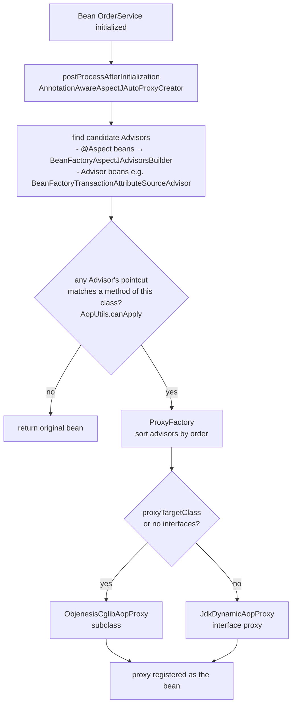
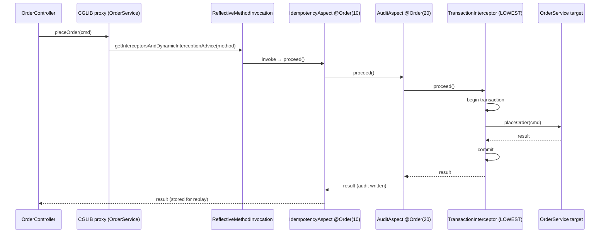
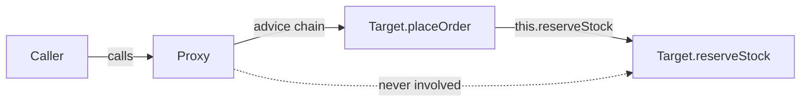
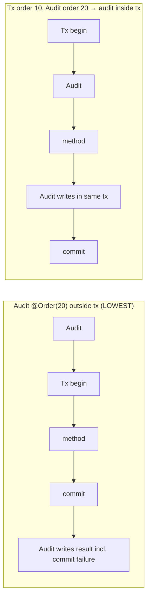
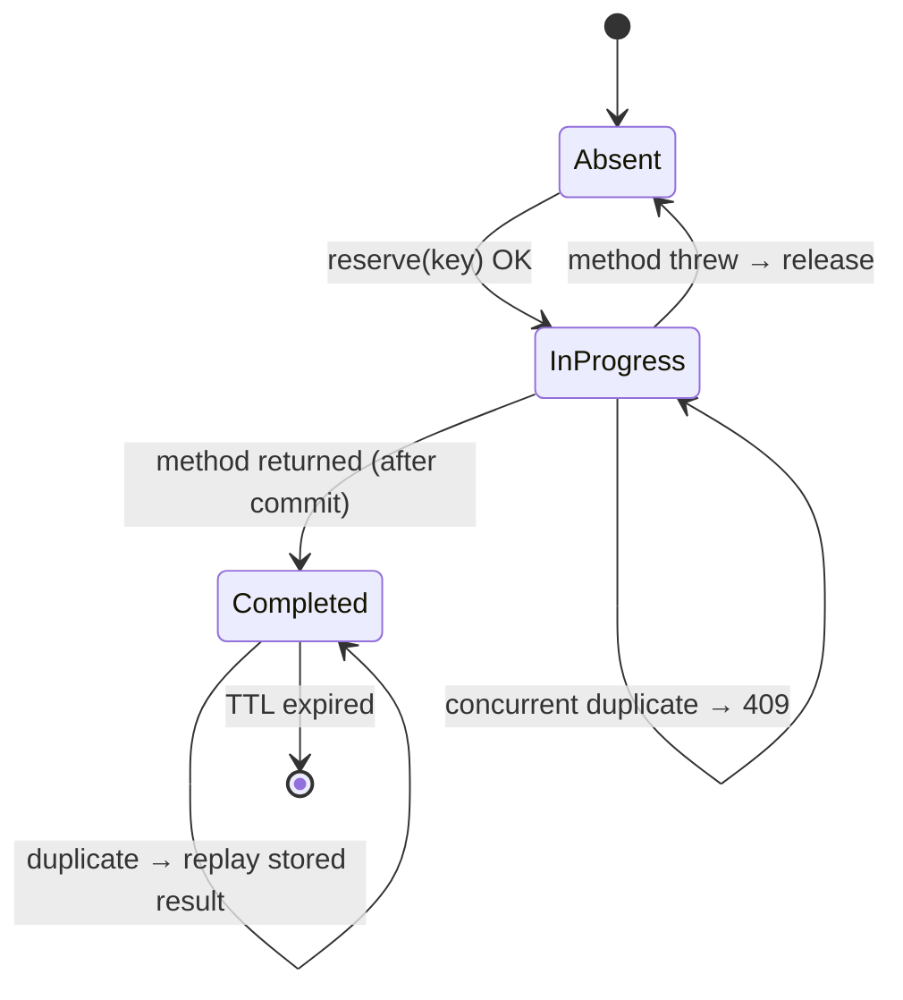

# 04 · AOP — Aspect-Oriented Programming

## 1. Introduction & Why It Matters

Some requirements cut across every layer: log how long each service call takes, write an audit record whenever an order is cancelled, reject duplicate "place order" requests, start a transaction, check permissions, retry a flaky call. Written by hand, that code gets copy-pasted into hundreds of methods, drowns the business logic, and is forgotten in the one method where it mattered.

**Aspect-Oriented Programming (AOP)** lets you write such a concern once and declare *where* it applies. You already use it every day, often without noticing:

| You write | Spring applies via AOP |
|---|---|
| `@Transactional` | `TransactionInterceptor` |
| `@Cacheable` | `CacheInterceptor` |
| `@Async` | `AsyncExecutionInterceptor` |
| `@PreAuthorize` | `AuthorizationManagerBeforeMethodInterceptor` |
| `@Validated` on a class | `MethodValidationInterceptor` |
| `@Retryable` (Framework 7) | Retry interceptor from core resilience |
| `@Observed`, `@Timed` | Micrometer `ObservedAspect`, `TimedAspect` |

So understanding AOP is not optional: it explains the most common "Spring bug" of all — **"my `@Transactional` doesn't work"** — and it gives you a clean tool for your own platform concerns.

In the grocery marketplace we'll build three aspects: service timing, an **audit trail** for sensitive operations (order cancellation, refunds, price overrides), and an **idempotency guard** so a customer double-tapping "Pay ₹1,249" on a slow 4G connection doesn't create two orders.

### Who should read which section

| Band | Focus |
|---|---|
| B1 · 0–2 yrs | Parts 1, 2, 4 — vocabulary, a first aspect |
| B2 · 2–5 yrs | Parts 2, 5 — pointcuts, custom annotations, ordering, self-invocation |
| B3 · 5–8 yrs | Parts 3, 5 — proxy creation internals, JDK vs CGLIB, interceptor chain |
| B4 · 8–12 yrs | Parts 6, 8 — production aspects, ordering with transactions, performance |
| B5 · 12–15+ yrs | Parts 8, 9 — when AOP is the wrong tool, governance |

---

## 2. Core Concepts

### 2.1 Vocabulary

| Term | Meaning | Grocery example |
|---|---|---|
| **Cross-cutting concern** | Behaviour needed in many places, unrelated to the business rule | Auditing |
| **Aspect** | Module that encapsulates a concern | `AuditAspect` |
| **Join point** | A point in execution where advice can run. In Spring AOP: **method execution** only | `OrderService.cancel(...)` running |
| **Pointcut** | Predicate selecting join points | "methods annotated `@Audited`" |
| **Advice** | Code that runs at selected join points | "write audit row after return" |
| **Advisor** | Pointcut + advice (Spring's internal pairing) | — |
| **Target** | The original object | `OrderService` instance |
| **Proxy** | Object wrapping the target that applies advice | CGLIB subclass of `OrderService` |
| **Weaving** | Linking aspects with targets | Spring: at runtime via proxies |
| **Introduction** | Adding interfaces/methods to existing types | `@DeclareParents` (rare) |

### 2.2 Spring AOP vs AspectJ

| | Spring AOP | AspectJ (full) |
|---|---|---|
| Weaving | Runtime, proxy-based | Compile-time, post-compile, or load-time |
| Join points | Public (and protected/package with CGLIB) **method execution** on Spring beans | Method call/execution, field access, constructors, static init, any object |
| Self-invocation | ❌ Not advised | ✅ Advised |
| Private/final methods | ❌ | ✅ |
| Setup | Nothing extra | `ajc` compiler or `-javaagent` |
| Syntax | Uses AspectJ annotations and pointcut language | Same + native `.aj` syntax |

Spring AOP uses AspectJ's *annotations and expression parser* but not its weaver. For 95% of enterprise needs, Spring AOP is enough.

### 2.3 Proxies: JDK dynamic vs CGLIB

| | JDK dynamic proxy | CGLIB proxy |
|---|---|---|
| Mechanism | Implements the target's interfaces | Generates a subclass of the target |
| Requires | At least one interface | Non-final class, non-final methods |
| Injectable as | Interface type only | Interface **or** concrete class |
| Spring Boot default | — | ✅ (`spring.aop.proxy-target-class=true`) |

Consequences of subclass proxies:

- **`final` classes can't be proxied** — including **records**, which are implicitly final. Don't put `@Transactional` or `@Cacheable` on a record bean.
- **`final`, `private` and `static` methods are never advised.**
- Kotlin classes are final by default — the `kotlin-spring` (all-open) compiler plugin opens Spring-annotated classes.
- Spring uses **Objenesis** to create the proxy instance without calling your constructor a second time.

### 2.4 Advice types

| Annotation | Runs | Can change flow? |
|---|---|---|
| `@Before` | Before the method | Only by throwing |
| `@AfterReturning(returning = "r")` | After normal return | Can read the result |
| `@AfterThrowing(throwing = "ex")` | After an exception | Can't swallow it (can rethrow a different one) |
| `@After` | Always (like `finally`) | No |
| `@Around` | Wraps the call; you call `proceed()` | ✅ Full control: skip, retry, change args/result |

**Rule of thumb:** use the least powerful advice that works. `@Around` is easy to get wrong (forgetting `proceed()`, swallowing exceptions, returning the wrong type).

### 2.5 Pointcut designators supported by Spring AOP

| Designator | Matches | Example |
|---|---|---|
| `execution(...)` | Method signature | `execution(* in.grocery..service.*Service.*(..))` |
| `within(...)` | Types/packages | `within(in.grocery.order..*)` |
| `this(T)` | Proxy is instance of `T` | `this(in.grocery.common.Auditable)` |
| `target(T)` | Target is instance of `T` | `target(in.grocery.payment.gateway.PaymentGateway)` |
| `args(...)` | Runtime argument types, also binds | `args(orderId, ..)` |
| `@annotation(A)` | Method has annotation | `@annotation(in.grocery.common.audit.Audited)` |
| `@within(A)` | Declaring type has annotation | `@within(org.springframework.stereotype.Service)` |
| `@target(A)` | Runtime target class has annotation | `@target(in.grocery.common.client.ExternalClient)` |
| `@args(A)` | Runtime args carry annotation | rarely used |
| `bean(name)` | Spring-specific: bean name pattern | `bean(*Gateway)` |

**`execution` syntax:** `execution(modifiers? returnType declaringType? name(params) throws?)`

- `*` — any one element; `..` in a package — any sub-packages; `(..)` — any parameters; `(*)` — exactly one; `(String, ..)` — first is `String`.
- Combine with `&&`, `||`, `!`. Reuse via named `@Pointcut` methods.

!!! tip "Prefer annotations over package patterns"
    `@annotation(Audited)` is explicit — readers see `@Audited` on the method. `execution(* in.grocery..*.*(..))` is invisible magic that silently starts matching new classes. Use package pointcuts only for truly universal concerns (timing, tracing).

### 2.6 Ordering

- **Across aspects:** `@Order` (or `Ordered`) on the aspect class. **Lower value = higher precedence = outermost** — runs first on the way in, last on the way out.
- **Within one aspect:** by advice type — `@Around`, `@Before`, `@After`, `@AfterReturning`, `@AfterThrowing` precedence; `@After` effectively runs after `@AfterReturning`/`@AfterThrowing` of the same aspect. Split concerns into separate aspects if order matters.
- **Spring's own interceptors** (`@Transactional`, `@Cacheable`, `@Async`) default to `Ordered.LOWEST_PRECEDENCE`. Their order is configurable on the `@Enable...` annotations (e.g. `@EnableTransactionManagement(order = ...)`).

### 2.7 The self-invocation problem

```java title="OrderService.java"
@Service
public class OrderService {
    public void placeOrder(...) {
        reserveStock(...);          // this.reserveStock — NOT through the proxy
    }
    @Transactional(propagation = REQUIRES_NEW)
    public void reserveStock(...) { ... }   // transaction never starts
}
```

The caller holds the **proxy**; the proxy delegates to the **target**; inside the target, `this` is the target, not the proxy. Any advice on `reserveStock` is bypassed. This applies to **every** annotation implemented with AOP.

### 2.8 Real-world uses — and misuses

✅ Good fits: observability (timing, tracing), auditing, idempotency, security checks, retries, tenant/context propagation, feature-flag gates, method-level validation.

❌ Poor fits: business rules ("apply GST"), conditional logic that readers need to see, anything whose order relative to other aspects is fragile and unobvious.

---

## 3. How It Works Internally

### 3.1 Proxy creation



Key classes:

- **`AnnotationAwareAspectJAutoProxyCreator`** — a `SmartInstantiationAwareBeanPostProcessor` registered by `@EnableAspectJAutoProxy` (auto-configured by Boot's `AopAutoConfiguration`).
- **`ReflectiveAspectJAdvisorFactory`** — turns each advice method of an `@Aspect` into an `InstantiationModelAwarePointcutAdvisor`.
- **`AspectJExpressionPointcut`** — parses and matches pointcut expressions (class filter + method matcher; runtime matching only for `args`/`this`/`target` binding).
- **`ProxyFactory` / `DefaultAopProxyFactory`** — decides JDK vs CGLIB.
- The same auto-proxy creator also handles `Advisor` beans from `@EnableTransactionManagement`, `@EnableCaching`, method security, etc. — **one proxy per bean** holding all advisors.

### 3.2 Invocation: the interceptor chain



- The advisor chain for each method is computed once and **cached** (`AdvisedSupport.getInterceptorsAndDynamicInterceptionAdvice`).
- Each `proceed()` moves to the next interceptor; the last one invokes the target via reflection (JDK) or a generated fast-path (CGLIB).
- For methods matched by **no** advisor, the CGLIB proxy dispatches directly to the target — the overhead is a single extra call.

### 3.3 Why self-invocation bypasses advice



The proxy only sees calls that go **through** it. Fixes, in order of preference:

1. **Move the method to another bean** (usually the right design anyway).
2. **Inject the proxy of yourself** lazily (`@Lazy` self-reference or `ObjectProvider<OrderService>`) — works, but smells.
3. **`AopContext.currentProxy()`** with `@EnableAspectJAutoProxy(exposeProxy = true)` — couples code to Spring AOP.
4. **Programmatic API** (`TransactionTemplate`) instead of the annotation.
5. **AspectJ weaving** — advises self-calls, at the cost of build/runtime complexity.

### 3.4 Proxy creation for `@Configuration` classes is different

`@Configuration` full-mode CGLIB enhancement (Chapter 02) is **not** AOP — it's done by `ConfigurationClassEnhancer` for `@Bean` method interception. Don't confuse the two.

---

## 4. Hands-On Code — Level 1 (Beginner)

### 4.1 Dependency

=== "Spring Boot 3.5"

    ```kotlin title="build.gradle.kts"
    implementation("org.springframework.boot:spring-boot-starter-aop")
    ```

=== "Spring Boot 4.x"

    ```kotlin title="build.gradle.kts"
    implementation("org.springframework.boot:spring-boot-starter-aspectj")
    ```

!!! warning "Verify"
    Spring Boot 4 renamed the AOP starter to `spring-boot-starter-aspectj`. Confirm in the 4.0 migration guide. Note that Spring AOP itself (`spring-aop`) comes with many starters; the starter adds **AspectJ's `aspectjweaver`**, which is needed for `@Aspect` support.

### 4.2 A timing aspect

```java title="in/grocery/common/aop/ServiceTimingAspect.java"
package in.grocery.common.aop;

import org.aspectj.lang.ProceedingJoinPoint;
import org.aspectj.lang.annotation.Around;
import org.aspectj.lang.annotation.Aspect;
import org.slf4j.Logger;
import org.slf4j.LoggerFactory;
import org.springframework.stereotype.Component;

@Aspect                                                                         // (1)!
@Component                                                                      // (2)!
public class ServiceTimingAspect {

    private static final Logger log = LoggerFactory.getLogger(ServiceTimingAspect.class);

    @Around("within(in.grocery..service..*)")                                   // (3)!
    public Object time(ProceedingJoinPoint pjp) throws Throwable {
        long start = System.nanoTime();
        try {
            return pjp.proceed();                                               // (4)!
        } finally {
            long ms = (System.nanoTime() - start) / 1_000_000;
            log.info("{} took {} ms", pjp.getSignature().toShortString(), ms);
        }
    }
}
```

1. Marks the class as an aspect (AspectJ annotation).
2. `@Aspect` alone does **not** make it a bean — it must also be registered.
3. Every method of every class in any `service` package under `in.grocery`.
4. Calls the next interceptor or the target. Always return its result and let exceptions propagate.

```java title="in/grocery/cart/service/CartService.java"
package in.grocery.cart.service;

import java.math.BigDecimal;
import org.springframework.stereotype.Service;

@Service
public class CartService {
    public BigDecimal subtotal(String cartId) {
        return new BigDecimal("578.00");
    }
}
```

```text title="Log output"
CartService.subtotal(..) took 0 ms
```

### 4.3 Test the aspect is applied

```java title="in/grocery/common/aop/ServiceTimingAspectTest.java"
package in.grocery.common.aop;

import static org.assertj.core.api.Assertions.assertThat;

import in.grocery.cart.service.CartService;
import org.junit.jupiter.api.Test;
import org.springframework.aop.support.AopUtils;
import org.springframework.beans.factory.annotation.Autowired;
import org.springframework.boot.autoconfigure.aop.AopAutoConfiguration;
import org.springframework.boot.test.context.SpringBootTest;

@SpringBootTest(classes = {AopAutoConfiguration.class, ServiceTimingAspect.class, CartService.class})
class ServiceTimingAspectTest {

    @Autowired CartService cartService;

    @Test
    void serviceIsProxied() {
        assertThat(AopUtils.isCglibProxy(cartService)).isTrue();
        assertThat(cartService.subtotal("C1")).isEqualByComparingTo("578.00");
    }
}
```

!!! warning "Verify — `AopAutoConfiguration` package in Boot 4"
    With Boot 4's modular auto-configuration, the package of `AopAutoConfiguration` may differ. Alternatively, put `@EnableAspectJAutoProxy` on a small test configuration class.

---

## 5. Hands-On Code — Level 2 (Intermediate) & Level 3 (Advanced)

### 5.1 Level 2 — `@Audited` with argument binding

Requirement: every sensitive operation writes an audit record: who, what action, which entity, outcome, duration. Annotations make the requirement visible at the call site.

```java title="in/grocery/common/audit/Audited.java"
package in.grocery.common.audit;

import java.lang.annotation.Documented;
import java.lang.annotation.ElementType;
import java.lang.annotation.Retention;
import java.lang.annotation.RetentionPolicy;
import java.lang.annotation.Target;

@Documented
@Retention(RetentionPolicy.RUNTIME)
@Target(ElementType.METHOD)
public @interface Audited {
    String action();                 // e.g. ORDER_CANCEL
    String entityIdArg() default ""; // parameter name holding the entity id
}
```

```java title="in/grocery/common/audit/AuditRecord.java"
package in.grocery.common.audit;

import java.time.Instant;

public record AuditRecord(
        String action, String entityId, String actor,
        Outcome outcome, String error, long durationMs, Instant at) {

    public enum Outcome { SUCCESS, FAILURE }
}
```

```java title="in/grocery/common/audit/AuditSink.java"
package in.grocery.common.audit;

public interface AuditSink {
    void write(AuditRecord record);  // DB table, Kafka topic grocery.audit.recorded.v1, ...
}
```

```java title="in/grocery/common/audit/AuditAspect.java"
package in.grocery.common.audit;

import java.time.Clock;
import java.time.Instant;
import java.util.function.Supplier;
import org.aspectj.lang.ProceedingJoinPoint;
import org.aspectj.lang.annotation.Around;
import org.aspectj.lang.annotation.Aspect;
import org.aspectj.lang.reflect.CodeSignature;
import org.springframework.core.annotation.Order;
import org.springframework.stereotype.Component;

@Aspect
@Component
@Order(20)
public class AuditAspect {

    private final AuditSink sink;
    private final Supplier<String> currentActor;   // from security context in Chapter 17
    private final Clock clock;

    public AuditAspect(AuditSink sink, Supplier<String> currentActor, Clock clock) {
        this.sink = sink;
        this.currentActor = currentActor;
        this.clock = clock;
    }

    @Around("@annotation(audited)")                                             // (1)!
    public Object audit(ProceedingJoinPoint pjp, Audited audited) throws Throwable {
        Instant start = clock.instant();
        String entityId = resolveEntityId(pjp, audited.entityIdArg());
        try {
            Object result = pjp.proceed();
            sink.write(record(audited, entityId, AuditRecord.Outcome.SUCCESS, null, start));
            return result;
        } catch (Throwable ex) {
            sink.write(record(audited, entityId, AuditRecord.Outcome.FAILURE, ex.getClass().getSimpleName(), start));
            throw ex;                                                           // (2)!
        }
    }

    private AuditRecord record(Audited a, String entityId, AuditRecord.Outcome outcome, String error, Instant start) {
        Instant end = clock.instant();
        return new AuditRecord(a.action(), entityId, currentActor.get(), outcome, error,
                end.toEpochMilli() - start.toEpochMilli(), end);
    }

    private static String resolveEntityId(ProceedingJoinPoint pjp, String argName) {
        if (argName.isEmpty()) return "n/a";
        String[] names = ((CodeSignature) pjp.getSignature()).getParameterNames();  // (3)!
        Object[] args = pjp.getArgs();
        for (int i = 0; i < names.length; i++) {
            if (names[i].equals(argName)) return String.valueOf(args[i]);
        }
        throw new IllegalStateException("@Audited entityIdArg '" + argName + "' not found on " + pjp.getSignature());
    }
}
```

1. **Annotation binding:** the parameter name `audited` in the expression binds the actual annotation instance into the advice parameter.
2. Record the failure, then rethrow the *same* exception — never swallow.
3. Parameter names require `-parameters` (Chapter 01).

```java title="in/grocery/order/service/OrderCancellationService.java"
package in.grocery.order.service;

import in.grocery.common.audit.Audited;
import org.springframework.stereotype.Service;
import org.springframework.transaction.annotation.Transactional;

@Service
public class OrderCancellationService {

    @Audited(action = "ORDER_CANCEL", entityIdArg = "orderId")
    @Transactional
    public void cancel(String orderId, String reason) {
        // load order, check status allows cancel, mark cancelled, publish OrderCancelled
    }
}
```

### 5.2 Level 2 — `@Before`, `@AfterReturning`, `@AfterThrowing` with binding

```java title="in/grocery/payment/aop/PaymentGatewayMonitoringAspect.java"
package in.grocery.payment.aop;

import in.grocery.payment.gateway.PaymentGateway;
import io.micrometer.core.instrument.MeterRegistry;
import java.math.BigDecimal;
import org.aspectj.lang.annotation.AfterReturning;
import org.aspectj.lang.annotation.AfterThrowing;
import org.aspectj.lang.annotation.Aspect;
import org.aspectj.lang.annotation.Before;
import org.aspectj.lang.annotation.Pointcut;
import org.springframework.stereotype.Component;

@Aspect
@Component
public class PaymentGatewayMonitoringAspect {

    private final MeterRegistry meters;

    public PaymentGatewayMonitoringAspect(MeterRegistry meters) {
        this.meters = meters;
    }

    @Pointcut("execution(String in.grocery.payment.gateway.PaymentGateway+.createOrder(String, java.math.BigDecimal))" +
              " && target(gateway) && args(orderId, amount)")                  // (1)!
    void createOrder(PaymentGateway gateway, String orderId, BigDecimal amount) {}

    @Before(value = "createOrder(gateway, orderId, amount)", argNames = "gateway,orderId,amount")
    public void validate(PaymentGateway gateway, String orderId, BigDecimal amount) {
        if (amount.signum() <= 0) {
            throw new IllegalArgumentException("Amount must be positive for order " + orderId);
        }
    }

    @AfterReturning(pointcut = "createOrder(gateway, orderId, amount)", returning = "gatewayOrderId",
                    argNames = "gateway,orderId,amount,gatewayOrderId")
    public void success(PaymentGateway gateway, String orderId, BigDecimal amount, String gatewayOrderId) {
        meters.counter("grocery.payment.create", "gateway", gateway.code(), "outcome", "success").increment();
    }

    @AfterThrowing(pointcut = "createOrder(gateway, orderId, amount)", throwing = "ex",
                   argNames = "gateway,orderId,amount,ex")
    public void failure(PaymentGateway gateway, String orderId, BigDecimal amount, RuntimeException ex) { // (2)!
        meters.counter("grocery.payment.create", "gateway", gateway.code(),
                "outcome", "failure", "exception", ex.getClass().getSimpleName()).increment();
    }
}
```

1. `PaymentGateway+` — the type **and its subtypes**. `target(gateway)` binds the target object, `args(...)` binds arguments.
2. The `throwing` parameter type also filters: this advice runs only for `RuntimeException`s.

!!! tip "`argNames`"
    With `-parameters` Spring can discover binding names itself. Supplying `argNames` makes the aspect robust even when compiled without it.

### 5.3 Level 2 — Named pointcuts as architecture vocabulary

```java title="in/grocery/common/aop/GroceryPointcuts.java"
package in.grocery.common.aop;

import org.aspectj.lang.annotation.Pointcut;

public final class GroceryPointcuts {

    private GroceryPointcuts() {}

    @Pointcut("within(in.grocery..web..*)")
    public static void controllerLayer() {}

    @Pointcut("within(in.grocery..delegate..*)")
    public static void delegateLayer() {}

    @Pointcut("within(in.grocery..service..*)")
    public static void serviceLayer() {}

    @Pointcut("within(in.grocery..repository..*)")
    public static void repositoryLayer() {}

    @Pointcut("execution(public * *(..))")
    public static void publicMethod() {}

    @Pointcut("serviceLayer() && publicMethod()")
    public static void publicServiceOperation() {}
}
```

Referenced from other aspects with the fully qualified name:

```java title="Named pointcuts as architecture vocabulary (snippet)"
@Around("in.grocery.common.aop.GroceryPointcuts.publicServiceOperation()")
```

### 5.4 Level 3 — Self-invocation: demonstrate and fix

```java title="in/grocery/order/service/SelfInvocationDemo.java"
package in.grocery.order.service;

import org.springframework.stereotype.Service;
import org.springframework.transaction.annotation.Propagation;
import org.springframework.transaction.annotation.Transactional;
import org.springframework.transaction.support.TransactionSynchronizationManager;

@Service
public class SelfInvocationDemo {

    @Transactional
    public boolean outer() {
        return inner();                                       // ❌ this.inner()
    }

    @Transactional(propagation = Propagation.REQUIRES_NEW)
    public boolean inner() {
        // true only if a *new* transaction was started for inner()
        return TransactionSynchronizationManager.getCurrentTransactionName()
                .endsWith("SelfInvocationDemo.inner");
    }
}
```

```java title="SelfInvocationDemoTest.java"
@Test
void selfCallBypassesProxy() {
    assertThat(demo.outer()).isFalse();   // inner ran inside outer's transaction: REQUIRES_NEW ignored
    assertThat(demo.inner()).isTrue();    // called through the proxy: new transaction named after inner
}
```

**Fix 1 — split responsibilities (preferred):**

```java title="in/grocery/order/service/StockReservationService.java"
@Service
class StockReservationService {
    @Transactional(propagation = Propagation.REQUIRES_NEW)
    public void reserve(String orderId) { ... }
}

@Service
class OrderPlacementService {
    private final StockReservationService reservations;
    OrderPlacementService(StockReservationService reservations) { this.reservations = reservations; }

    @Transactional
    public void place(String orderId) {
        reservations.reserve(orderId);   // ✅ through the proxy
    }
}
```

**Fix 2 — programmatic transaction:**

```java title="Self-invocation: demonstrate and fix (snippet)"
public void place(String orderId) {
    requiresNewTx.executeWithoutResult(status -> reserveStock(orderId));   // TransactionTemplate, Chapter 16
}
```

### 5.5 Level 3 — Building proxies programmatically

Understanding `ProxyFactory` demystifies everything the container does, and it's the fastest way to unit-test an aspect.

```java title="in/grocery/common/audit/AuditAspectTest.java"
package in.grocery.common.audit;

import static org.assertj.core.api.Assertions.assertThat;
import static org.assertj.core.api.Assertions.assertThatIllegalStateException;

import java.time.Clock;
import java.time.Instant;
import java.time.ZoneOffset;
import java.util.ArrayList;
import java.util.List;
import org.junit.jupiter.api.Test;
import org.springframework.aop.aspectj.annotation.AspectJProxyFactory;

class AuditAspectTest {

    static class RefundService {
        @Audited(action = "REFUND", entityIdArg = "paymentId")
        public String refund(String paymentId, int amountPaise) {
            if (amountPaise <= 0) throw new IllegalStateException("bad amount");
            return "rfnd_" + paymentId;
        }
    }

    private final List<AuditRecord> written = new ArrayList<>();
    private final AuditAspect aspect = new AuditAspect(
            written::add, () -> "ops@grocery.in",
            Clock.fixed(Instant.parse("2026-09-22T06:00:00Z"), ZoneOffset.UTC));

    private RefundService proxied() {
        AspectJProxyFactory factory = new AspectJProxyFactory(new RefundService());   // (1)!
        factory.addAspect(aspect);
        return factory.getProxy();
    }

    @Test
    void writesSuccessRecord() {
        assertThat(proxied().refund("pay_123", 5000)).isEqualTo("rfnd_pay_123");
        assertThat(written).singleElement().satisfies(r -> {
            assertThat(r.action()).isEqualTo("REFUND");
            assertThat(r.entityId()).isEqualTo("pay_123");
            assertThat(r.outcome()).isEqualTo(AuditRecord.Outcome.SUCCESS);
        });
    }

    @Test
    void writesFailureRecordAndRethrows() {
        assertThatIllegalStateException().isThrownBy(() -> proxied().refund("pay_9", 0));
        assertThat(written).singleElement()
                .extracting(AuditRecord::outcome).isEqualTo(AuditRecord.Outcome.FAILURE);
    }
}
```

1. No Spring context at all — millisecond-fast tests of pointcuts and advice.

### 5.6 Level 3 — Ordering aspects relative to `@Transactional`

Question: should the audit record be written **inside** the business transaction (atomic with the change) or **outside** (records failures caused by commit, e.g. constraint violations at flush)?



```java title="in/grocery/common/tx/TransactionOrderConfig.java"
@Configuration(proxyBeanMethods = false)
@EnableTransactionManagement(order = 10)          // (1)!
class TransactionOrderConfig {}
```

1. Transaction interceptor now wraps **outside** `AuditAspect` (order 20), so the audit insert joins the business transaction and rolls back with it. Choose deliberately — and document it in an ADR, because it's invisible in code.

!!! warning "Verify"
    Boot auto-configures transaction management. Declaring `@EnableTransactionManagement` yourself is allowed and takes precedence, but confirm with `/actuator/conditions` that you haven't disabled other defaults (e.g. proxy-target-class). Set `proxyTargetClass = true` if your code injects concrete classes.

---

## 6. Hands-On Code — Level 4 (Expert / Production)

### Idempotency guard for order placement

Problem: mobile clients retry `POST /orders` on timeouts. Without protection, a slow Razorpay response on a festival day produces duplicate orders and double charges.

Design:

- Client sends `Idempotency-Key` header (UUID) — Controller copies it into the command.
- `@Idempotent(key = "...")` on the Delegate method, evaluated with SpEL.
- Store states: **absent → IN_PROGRESS → COMPLETED(result)**, TTL 24h.
- Concurrent duplicate while in progress → `409 Conflict`. Duplicate after completion → **replay** the stored result.
- Failure → release the key so the client can retry.
- The aspect wraps **outside** the transaction so a result is stored only after commit.



```java title="in/grocery/common/idempotency/Idempotent.java"
package in.grocery.common.idempotency;

import java.lang.annotation.Documented;
import java.lang.annotation.ElementType;
import java.lang.annotation.Retention;
import java.lang.annotation.RetentionPolicy;
import java.lang.annotation.Target;

@Documented
@Retention(RetentionPolicy.RUNTIME)
@Target(ElementType.METHOD)
public @interface Idempotent {
    /** SpEL evaluated against method arguments, e.g. "#command.idempotencyKey()". */
    String key();
    /** Logical operation, part of the stored key. */
    String scope();
    /** ISO-8601 duration. */
    String ttl() default "PT24H";
}
```

```java title="in/grocery/common/idempotency/IdempotencyStore.java"
package in.grocery.common.idempotency;

import java.time.Duration;
import java.util.Optional;

public interface IdempotencyStore {

    sealed interface Entry permits InProgress, Completed {}
    record InProgress() implements Entry {}
    record Completed(Object result) implements Entry {}

    /** Atomically create IN_PROGRESS if absent. Returns the existing entry otherwise. */
    Optional<Entry> reserve(String key, Duration ttl);

    void complete(String key, Object result, Duration ttl);

    void release(String key);
}
```

```java title="in/grocery/common/idempotency/InMemoryIdempotencyStore.java"
package in.grocery.common.idempotency;

import java.time.Clock;
import java.time.Duration;
import java.time.Instant;
import java.util.Optional;
import java.util.concurrent.ConcurrentHashMap;
import java.util.concurrent.ConcurrentMap;

/** Single-instance store for tests and local profile. Production uses Redis SET NX PX (Chapter 22). */
public class InMemoryIdempotencyStore implements IdempotencyStore {

    private record Slot(Entry entry, Instant expiresAt) {}

    private final ConcurrentMap<String, Slot> slots = new ConcurrentHashMap<>();
    private final Clock clock;

    public InMemoryIdempotencyStore(Clock clock) {
        this.clock = clock;
    }

    @Override
    public Optional<Entry> reserve(String key, Duration ttl) {
        Instant now = clock.instant();
        Slot[] existing = new Slot[1];
        slots.compute(key, (k, slot) -> {
            if (slot != null && slot.expiresAt().isAfter(now)) {
                existing[0] = slot;
                return slot;
            }
            return new Slot(new InProgress(), now.plus(ttl));
        });
        return Optional.ofNullable(existing[0]).map(Slot::entry);
    }

    @Override
    public void complete(String key, Object result, Duration ttl) {
        slots.put(key, new Slot(new Completed(result), clock.instant().plus(ttl)));
    }

    @Override
    public void release(String key) {
        slots.remove(key);
    }
}
```

```java title="in/grocery/common/idempotency/IdempotencyConflictException.java"
package in.grocery.common.idempotency;

import org.springframework.http.HttpStatus;
import org.springframework.web.server.ResponseStatusException;

public class IdempotencyConflictException extends ResponseStatusException {
    public IdempotencyConflictException(String key) {
        super(HttpStatus.CONFLICT, "A request with Idempotency-Key " + key + " is already in progress");
    }
}
```

```java title="in/grocery/common/idempotency/IdempotencyAspect.java"
package in.grocery.common.idempotency;

import io.micrometer.core.instrument.Counter;
import io.micrometer.core.instrument.MeterRegistry;
import java.lang.reflect.Method;
import java.time.Duration;
import java.util.Map;
import java.util.Optional;
import java.util.concurrent.ConcurrentHashMap;
import org.aspectj.lang.ProceedingJoinPoint;
import org.aspectj.lang.annotation.Around;
import org.aspectj.lang.annotation.Aspect;
import org.aspectj.lang.reflect.MethodSignature;
import org.springframework.context.expression.MethodBasedEvaluationContext;
import org.springframework.core.DefaultParameterNameDiscoverer;
import org.springframework.core.Ordered;
import org.springframework.core.ParameterNameDiscoverer;
import org.springframework.core.annotation.Order;
import org.springframework.expression.Expression;
import org.springframework.expression.spel.standard.SpelExpressionParser;
import org.springframework.util.StringUtils;

@Aspect
@Order(Ordered.HIGHEST_PRECEDENCE + 10)                                          // (1)!
public class IdempotencyAspect {

    private final IdempotencyStore store;
    private final SpelExpressionParser parser = new SpelExpressionParser();
    private final ParameterNameDiscoverer names = new DefaultParameterNameDiscoverer();
    private final Map<String, Expression> expressions = new ConcurrentHashMap<>(); // (2)!
    private final Counter replays;
    private final Counter conflicts;

    public IdempotencyAspect(IdempotencyStore store, MeterRegistry meters) {
        this.store = store;
        this.replays = meters.counter("grocery.idempotency", "result", "replay");
        this.conflicts = meters.counter("grocery.idempotency", "result", "conflict");
    }

    @Around("@annotation(idempotent)")
    public Object guard(ProceedingJoinPoint pjp, Idempotent idempotent) throws Throwable {
        Method method = ((MethodSignature) pjp.getSignature()).getMethod();
        String clientKey = evaluateKey(idempotent.key(), method, pjp.getArgs());
        if (!StringUtils.hasText(clientKey)) {
            throw new IllegalArgumentException("Idempotency-Key is required");
        }
        String key = idempotent.scope() + ":" + clientKey;
        Duration ttl = Duration.parse(idempotent.ttl());

        Optional<IdempotencyStore.Entry> existing = store.reserve(key, ttl);
        if (existing.isPresent()) {
            return switch (existing.get()) {                                    // (3)!
                case IdempotencyStore.Completed(Object result) -> {
                    replays.increment();
                    yield result;
                }
                case IdempotencyStore.InProgress p -> {
                    conflicts.increment();
                    throw new IdempotencyConflictException(clientKey);
                }
            };
        }

        try {
            Object result = pjp.proceed();                                      // (4)!
            store.complete(key, result, ttl);
            return result;
        } catch (Throwable ex) {
            store.release(key);                                                 // (5)!
            throw ex;
        }
    }

    private String evaluateKey(String spel, Method method, Object[] args) {
        Expression expression = expressions.computeIfAbsent(spel, parser::parseExpression);
        var context = new MethodBasedEvaluationContext(null, method, args, names);  // (6)!
        Object value = expression.getValue(context);
        return value == null ? null : value.toString();
    }
}
```

1. Outermost: wraps validation, auditing and the transaction, so `complete(...)` only runs after a successful commit.
2. Parse each expression once.
3. Pattern matching over the sealed `Entry` type — exhaustive, no `default`.
4. The whole business operation, including commit.
5. On failure the key is freed so the client's retry can proceed. (For payments, a failed-but-charged state needs reconciliation — Chapter 36.)
6. Expressions come from annotations in our code, never from requests, so the standard evaluation context is acceptable here.

```java title="in/grocery/common/idempotency/IdempotencyConfig.java"
package in.grocery.common.idempotency;

import io.micrometer.core.instrument.MeterRegistry;
import java.time.Clock;
import org.springframework.boot.autoconfigure.condition.ConditionalOnMissingBean;
import org.springframework.context.annotation.Bean;
import org.springframework.context.annotation.Configuration;

@Configuration(proxyBeanMethods = false)
public class IdempotencyConfig {

    @Bean
    @ConditionalOnMissingBean(IdempotencyStore.class)
    IdempotencyStore inMemoryIdempotencyStore(Clock clock) {
        return new InMemoryIdempotencyStore(clock);
    }

    @Bean
    IdempotencyAspect idempotencyAspect(IdempotencyStore store, MeterRegistry meters) {
        return new IdempotencyAspect(store, meters);
    }
}
```

**Using it in the four-layer order service:**

```java title="in/grocery/order/web/OrderController.java"
package in.grocery.order.web;

import in.grocery.order.delegate.OrderDelegate;
import in.grocery.order.delegate.PlaceOrderCommand;
import in.grocery.order.delegate.OrderView;
import jakarta.validation.Valid;
import org.springframework.http.ResponseEntity;
import org.springframework.web.bind.annotation.PostMapping;
import org.springframework.web.bind.annotation.RequestBody;
import org.springframework.web.bind.annotation.RequestHeader;
import org.springframework.web.bind.annotation.RequestMapping;
import org.springframework.web.bind.annotation.RestController;

@RestController
@RequestMapping("/api/orders")
class OrderController {

    private final OrderDelegate delegate;

    OrderController(OrderDelegate delegate) {
        this.delegate = delegate;
    }

    record PlaceOrderRequest(@jakarta.validation.constraints.NotBlank String cartId) {}

    @PostMapping
    ResponseEntity<OrderView> place(@RequestHeader("Idempotency-Key") String idempotencyKey,
                                    @Valid @RequestBody PlaceOrderRequest request) {
        OrderView view = delegate.place(new PlaceOrderCommand(idempotencyKey, request.cartId()));
        return ResponseEntity.status(201).body(view);
    }
}
```

```java title="in/grocery/order/delegate/OrderDelegate.java"
package in.grocery.order.delegate;

import in.grocery.common.idempotency.Idempotent;
import in.grocery.order.service.OrderPlacementService;
import org.springframework.stereotype.Component;

@Component
public class OrderDelegate {

    private final OrderPlacementService service;

    public OrderDelegate(OrderPlacementService service) {
        this.service = service;
    }

    @Idempotent(key = "#command.idempotencyKey()", scope = "order-place")
    public OrderView place(PlaceOrderCommand command) {
        return OrderView.from(service.place(command.cartId()));  // service method is @Transactional
    }
}
```

!!! note "Why the Delegate, not the Service?"
    The Delegate is the orchestration boundary: it owns the "one request = one operation" contract. The Service stays pure business logic with its transaction. With the aspect outermost, the stored result is the DTO the client received — replaying it is exactly correct.

**Production test, including concurrency:**

```java title="in/grocery/common/idempotency/IdempotencyAspectTest.java"
package in.grocery.common.idempotency;

import static org.assertj.core.api.Assertions.assertThat;
import static org.assertj.core.api.Assertions.assertThatThrownBy;

import io.micrometer.core.instrument.simple.SimpleMeterRegistry;
import java.time.Clock;
import java.util.ArrayList;
import java.util.List;
import java.util.concurrent.CountDownLatch;
import java.util.concurrent.Executors;
import java.util.concurrent.Future;
import java.util.concurrent.atomic.AtomicInteger;
import org.junit.jupiter.api.Test;
import org.springframework.aop.aspectj.annotation.AspectJProxyFactory;

class IdempotencyAspectTest {

    record Cmd(String idempotencyKey, String cartId) {}

    static class Placement {
        final AtomicInteger calls = new AtomicInteger();
        volatile CountDownLatch gate = new CountDownLatch(0);

        @Idempotent(key = "#cmd.idempotencyKey()", scope = "order-place")
        public String place(Cmd cmd) throws InterruptedException {
            calls.incrementAndGet();
            gate.await();
            return "ORD-" + cmd.cartId();
        }
    }

    private final SimpleMeterRegistry meters = new SimpleMeterRegistry();
    private final Placement target = new Placement();
    private final Placement proxy = proxy(target);

    private Placement proxy(Placement t) {
        var factory = new AspectJProxyFactory(t);
        factory.setProxyTargetClass(true);
        factory.addAspect(new IdempotencyAspect(new InMemoryIdempotencyStore(Clock.systemUTC()), meters));
        return factory.getProxy();
    }

    @Test
    void replaysCompletedResult() throws Exception {
        assertThat(proxy.place(new Cmd("k-1", "C1"))).isEqualTo("ORD-C1");
        assertThat(proxy.place(new Cmd("k-1", "C1"))).isEqualTo("ORD-C1");
        assertThat(target.calls).hasValue(1);
        assertThat(meters.counter("grocery.idempotency", "result", "replay").count()).isEqualTo(1.0);
    }

    @Test
    void concurrentDuplicateGetsConflict() throws Exception {
        target.gate = new CountDownLatch(1);
        try (var pool = Executors.newVirtualThreadPerTaskExecutor()) {
            Future<String> first = pool.submit(() -> proxy.place(new Cmd("k-2", "C2")));
            while (target.calls.get() == 0) Thread.onSpinWait();               // first is inside the method

            assertThatThrownBy(() -> proxy.place(new Cmd("k-2", "C2")))
                    .isInstanceOf(IdempotencyConflictException.class);

            target.gate.countDown();
            assertThat(first.get()).isEqualTo("ORD-C2");
        }
        assertThat(target.calls).hasValue(1);
    }

    static class FailingPlacement extends Placement {
        @Override
        @Idempotent(key = "#cmd.idempotencyKey()", scope = "order-place")
        public String place(Cmd cmd) {
            calls.incrementAndGet();
            throw new IllegalStateException("out of stock");
        }
    }

    @Test
    void failureReleasesKey() {
        var failing = new FailingPlacement();
        Placement p = proxy(failing);
        List<Throwable> errors = new ArrayList<>();
        for (int i = 0; i < 2; i++) {
            try { p.place(new Cmd("k-3", "C3")); } catch (Throwable t) { errors.add(t); }
        }
        assertThat(errors).hasSize(2).allMatch(IllegalStateException.class::isInstance); // retry allowed, not 409
        assertThat(failing.calls).hasValue(2);
    }
}
```

!!! warning "Replay must be the same request"
    A client reusing a key with a **different** body is a bug or an attack. Production stores a hash of the request (e.g. SHA-256 of the canonical command) with the key and returns `422 Unprocessable Content` on mismatch. Add a `fingerprint` SpEL attribute to `@Idempotent` as an exercise.

### Micrometer annotations — AOP you don't have to write

```yaml title="application.yml"
management:
  observations:
    annotations:
      enabled: true      # Boot 3.2+: auto-configures ObservedAspect, TimedAspect, CountedAspect
```

```java title="Micrometer annotations — AOP you don't have to write (snippet)"
@Observed(name = "grocery.pricing.quote", contextualName = "quote-cart")
public CartQuote quote(String cartId) { ... }   // metrics + trace span, Chapter 27
```

---

## 7. Spring Boot 3 vs 4 & Migration

| Topic | Boot 3.5 / Framework 6.2 | Boot 4.x / Framework 7 |
|---|---|---|
| Starter | `spring-boot-starter-aop` | `spring-boot-starter-aspectj` (verify) |
| Default proxy type | CGLIB (`spring.aop.proxy-target-class=true`) | CGLIB |
| Retry via AOP | Spring Retry (`@EnableRetry`) or Resilience4j | + core `@Retryable`, `@ConcurrencyLimit` with `@EnableResilientMethods` |
| Observation annotations | `management.observations.annotations.enabled` | Same (verify property after modularization) |
| Null-safety | Spring `@Nullable` | JSpecify |

=== "Spring Boot 3.5 — Spring Retry"

    ```java title="RetryConfig.java"
    @EnableRetry
    @Configuration(proxyBeanMethods = false)
    class RetryConfig {}

    @Retryable(retryFor = RazorpayTimeoutException.class, maxAttempts = 3,
               backoff = @Backoff(delay = 200, multiplier = 2))
    public String createOrder(...) { ... }
    ```

=== "Spring Boot 4.x — Framework 7 core resilience"

    ```java title="ResilienceConfig.java"
    @EnableResilientMethods
    @Configuration(proxyBeanMethods = false)
    class ResilienceConfig {}

    @Retryable(includes = RazorpayTimeoutException.class, maxRetries = 2, delay = 200, multiplier = 2)
    public String createOrder(...) { ... }
    ```

!!! warning "Verify"
    Attribute names of Framework 7's `org.springframework.resilience.annotation.Retryable` differ from Spring Retry's. Check the Framework 7 reference (*Core › Resilience Features*) before migrating. Chapter 26 compares both in depth.

### Migration checklist

- [ ] Rename AOP starter for Boot 4.
- [ ] Search for aspects on `final` classes/records (they were silently not proxied, or fail) — fix design.
- [ ] Decide whether to keep Spring Retry or move to core `@Retryable`; don't mix both on one method.
- [ ] Re-run aspect tests with `AspectJProxyFactory`; pointcut syntax is unchanged.
- [ ] Verify ordering of custom aspects vs transaction/caching interceptors still matches your ADR.

---

## 8. Production Playbook

### Best practices

1. **Annotation-driven pointcuts** for business-visible concerns (`@Audited`, `@Idempotent`).
2. **Explicit `@Order` on every custom aspect**, with a documented ordering table for the platform:

    | Order | Aspect | Why |
    |---|---|---|
    | `HIGHEST + 10` | Idempotency | Outermost; stores post-commit result |
    | `HIGHEST + 20` | Security (method) | Reject before any work |
    | 20 | Audit | Record outcome including commit failures |
    | `LOWEST` | Transaction, cache | Framework defaults |

3. **Never swallow exceptions** in `@Around`/`@AfterThrowing`.
4. **Keep advice cheap** — it runs on every matched call. No blocking I/O in timing aspects.
5. **Test aspects in isolation** with `AspectJProxyFactory`, plus one integration test proving wiring.
6. **Prefer existing aspects** — Micrometer `@Observed`, method security, core `@Retryable` — over custom ones.
7. **Document** each custom aspect: what it matches, order, failure behaviour.

### Anti-patterns

❌ **Broad pointcut with side effects**

```java title="Anti-patterns (snippet)"
@Before("execution(* in.grocery..*.*(..))")      // matches everything: config, filters, repositories...
public void log(JoinPoint jp) { log.info("args={}", jp.getArgs()); } // leaks PII (mobile numbers, addresses)
```

✅ Narrow, annotation-based pointcuts; log IDs, not payloads.

❌ **Forgetting to return `proceed()`'s result**

```java title="Anti-patterns (snippet)"
@Around("@annotation(Timed)")
public void time(ProceedingJoinPoint pjp) throws Throwable { pjp.proceed(); }  // caller always gets null
```

✅ `public Object time(...) { return pjp.proceed(); }`

❌ **Business logic in aspects** — "apply 10% discount on Diwali" inside an aspect makes pricing untraceable.

❌ **`@Transactional` on private methods or self-calls** — silently ignored.

❌ **Aspect depending on beans that it advises** — can create early-initialization problems and cycles.

### Troubleshooting

| Symptom | Cause | Fix |
|---|---|---|
| Advice never runs | Aspect not a bean; pointcut doesn't match; self-invocation; method `private`/`final`; class is a record | Add `@Component`; test pointcut with `AspectJProxyFactory`; move method to another bean |
| `BeanNotOfRequiredTypeException` | JDK proxy but injecting concrete class | Keep CGLIB default or inject interface |
| `Cannot subclass final class` | CGLIB on final class | Remove `final`, or don't advise it |
| Wrong order (audit rolled back / missing) | Aspect order vs transaction interceptor | Set explicit orders; document |
| `error Type referred to is not an annotation type` | Pointcut refers to annotation by simple name without binding / wrong FQN | Use FQN or bind as parameter |
| `0 formal unbound in pointcut` | Advice parameter not bound in expression | Match names in `args()`/`@annotation()`; add `argNames` |
| High CPU in profiler under `AspectJExpressionPointcut` | Runtime-matching pointcuts (`args`, `this`) on hot paths | Prefer static `execution`/`@annotation` |
| Replayed response differs from original | Result mutated after storing | Store immutable DTOs (records) |

### Production checklist

- [ ] Every custom aspect has explicit order and a test
- [ ] No aspect logs request bodies or PII
- [ ] Pointcuts are annotation-based or narrowly scoped
- [ ] Aspect ordering documented in an ADR
- [ ] Idempotency on all non-idempotent public POST endpoints that create money-moving entities
- [ ] Self-invocation checked in code review (ArchUnit or IDE inspections)

---

## 9. Interview Questions & Answers

### B1 · 0–2 years

??? question "B1 · What is AOP and why use it?"
    **Short answer:** A way to modularize cross-cutting concerns (logging, transactions, security) in aspects applied to many methods declaratively, instead of repeating that code in each method.

    **Follow-ups:** Name Spring features built on AOP.

??? question "B1 · Define aspect, advice, pointcut and join point."
    **Short answer:** Aspect — module of a concern. Advice — the code that runs. Pointcut — expression choosing where. Join point — a point in execution (in Spring, a method execution).

??? question "B1 · What advice types exist?"
    **Short answer:** `@Before`, `@AfterReturning`, `@AfterThrowing`, `@After` (finally), `@Around` (wraps and controls the call).

??? question "B1 · Why doesn't my aspect run even though it has `@Aspect`?"
    **Short answer:** `@Aspect` doesn't register a bean. Add `@Component` or a `@Bean` method, and ensure the AspectJ starter is on the classpath.

??? question "B1 · Which Spring annotations are implemented using AOP?"
    **Short answer:** `@Transactional`, `@Cacheable`/`@CacheEvict`, `@Async`, `@PreAuthorize`, `@Validated` (method validation), `@Retryable`, Micrometer `@Observed`/`@Timed`.

### B2 · 2–5 years

??? question "B2 · Explain the self-invocation problem and how to fix it."
    **Short answer:** Spring AOP is proxy-based; a call from one method to another in the same object uses `this`, not the proxy, so advice (e.g. `@Transactional`) is skipped. Fix by moving the method to another bean, using a programmatic API (`TransactionTemplate`), self-injecting the proxy, `AopContext.currentProxy()`, or AspectJ weaving.

    **Red flags:** "Make the method public" (necessary but not sufficient).

??? question "B2 · JDK dynamic proxy vs CGLIB proxy?"
    **Short answer:** JDK proxies implement interfaces; CGLIB subclasses the class. Spring Boot defaults to CGLIB. CGLIB can't proxy final classes/methods; JDK proxies can only be injected as the interface type.

??? question "B2 · Can you apply `@Transactional` to a private method?"
    **Short answer:** No effect with Spring AOP — private methods aren't overridable or visible to the proxy. (Framework 6 CGLIB proxies can advise protected and package-private methods, but not private.)

??? question "B2 · How do you control the order of multiple aspects?"
    **Short answer:** `@Order` or `Ordered` on the aspect class; lower value is higher precedence (outermost). Within one aspect, order by advice type — split into separate aspects if order matters.

??? question "B2 · How do you get the annotation instance inside advice?"
    **Short answer:** Bind it: `@Around("@annotation(audited)") public Object x(ProceedingJoinPoint pjp, Audited audited)`.

??? question "B2 · Why are records a problem for AOP-based annotations?"
    **Short answer:** Records are implicitly final; CGLIB can't subclass them. Use records for data, classes for services.

### B3 · 5–8 years

??? question "B3 · How does Spring create AOP proxies internally?"
    **Short answer:** `AnnotationAwareAspectJAutoProxyCreator` (a BPP) in `postProcessAfterInitialization` collects advisors (from `@Aspect` beans and `Advisor` beans), checks if any pointcut matches the bean's class/methods, then builds a proxy via `ProxyFactory` — `ObjenesisCglibAopProxy` or `JdkDynamicAopProxy`. The proxy replaces the bean in the container.

??? question "B3 · How is a method call executed through a proxy with several advisors?"
    **Short answer:** The proxy gets the cached interceptor chain for that method and creates a `ReflectiveMethodInvocation` (or `CglibMethodInvocation`); each interceptor calls `proceed()` to pass control to the next; the last invokes the target.

??? question "B3 · Difference between `this()` and `target()` pointcut designators?"
    **Short answer:** `this` matches the proxy's type; `target` matches the target object's type. With JDK proxies, `this(ConcreteClass)` doesn't match because the proxy only implements interfaces.

??? question "B3 · What's the performance cost of Spring AOP?"
    **Short answer:** Proxy creation at startup (pointcut matching per bean) and a small per-call overhead for advised methods (interceptor chain). Negligible compared to I/O. Watch runtime-matching pointcuts (`args` with binding) on hot paths and heavy work inside advice.

??? question "B3 · Is `@Configuration` CGLIB enhancement the same as AOP?"
    **Short answer:** No. `ConfigurationClassEnhancer` subclasses `@Configuration` classes to intercept `@Bean` method calls and return container singletons. It's unrelated to advisors and `@Aspect`.

### B4 · 8–12 years

??? question "B4 · Should an audit aspect run inside or outside the transaction? Defend."
    **Short answer:** Inside (transaction outermost) → audit is atomic with the change, but a rollback erases evidence of the attempt. Outside (audit outermost) → captures commit failures and attempts, but audit write is a separate transaction (needs its own, and can fail independently). Regulatory audit of *attempts* favours outside with a separate `REQUIRES_NEW` or async sink; audit of *changes* favours inside or CDC. Make it explicit via orders and an ADR.

??? question "B4 · How would you implement API idempotency in Spring?"
    **Short answer:** `Idempotency-Key` header, atomic reserve in Redis (`SET NX PX`) with IN_PROGRESS/COMPLETED states, aspect outermost so the result is stored post-commit, replay stored response, 409 for concurrent duplicates, request fingerprint to detect key reuse with a different body, TTL 24h, and metrics. For payments add reconciliation with the gateway.

??? question "B4 · When would you choose AspectJ weaving over Spring AOP?"
    **Short answer:** When you need advice on self-calls, non-Spring objects (entities), field access, constructors, or very hot paths where proxies hurt. Cost: build plugin or `-javaagent`, harder debugging, team familiarity. Rare in typical services.

### B5 · 12–15+ years

??? question "B5 · AOP makes behaviour invisible. How do you govern it in a large codebase?"
    **Short answer:** Only platform-owned aspects in shared libraries, annotation-based opt-in, a documented ordering table, ArchUnit rules forbidding package-wide pointcuts outside the platform module, observability of aspect behaviour (metrics), and review checklists for self-invocation. Business logic stays out of aspects.

??? question "B5 · Is AOP still relevant with virtual threads, records and functional style?"
    **Short answer:** Yes — the container still applies transactions, security, observability and resilience uniformly through proxies. But functional composition (decorators, `TransactionTemplate`, higher-order functions) is often clearer for local concerns. Use AOP where uniformity across hundreds of methods matters; use explicit composition where readability matters.

### Scenario questions

??? example "Scenario · Customers charged twice during Big Billion-style sale"
    Timeline: `POST /orders` takes 12s during a Razorpay slowdown; the app retries after 10s; the load balancer also retries on 504. Two orders are created and both captured. Fix: idempotency aspect on the order delegate with Redis store, client-generated keys persisted across app retries, gateway-side idempotency (Razorpay order receipt IDs), LB retry disabled for non-idempotent methods, and a nightly reconciliation job to auto-refund duplicates.

??? example "Scenario · `@Cacheable` on `PriceService.priceFor` returns stale prices only for bulk quotes"
    `quoteCart()` in the same class loops and calls `this.priceFor(sku)` — self-invocation bypasses the cache proxy, so bulk quotes hit the DB (not stale!) while single lookups hit the cache (stale after a price change without eviction). Two problems: self-invocation (move lookup to `PriceLookup` bean) and missing `@CacheEvict` on price updates.

### Coding exercise

!!! example "Exercise · `@SlowCallAlert(thresholdMs = 500)`"
    Write an aspect that logs a WARN with method name and duration when an annotated method exceeds its threshold, and increments a Micrometer counter `grocery.slow.calls{method=...}`. Test it with `AspectJProxyFactory` and a fake slow method.

??? success "Solution"
    ```java title="SlowCallAlert.java"
    package in.grocery.common.aop;

    import java.lang.annotation.ElementType;
    import java.lang.annotation.Retention;
    import java.lang.annotation.RetentionPolicy;
    import java.lang.annotation.Target;

    @Retention(RetentionPolicy.RUNTIME)
    @Target(ElementType.METHOD)
    public @interface SlowCallAlert {
        long thresholdMs();
    }
    ```

    ```java title="SlowCallAlertAspect.java"
    package in.grocery.common.aop;

    import io.micrometer.core.instrument.MeterRegistry;
    import org.aspectj.lang.ProceedingJoinPoint;
    import org.aspectj.lang.annotation.Around;
    import org.aspectj.lang.annotation.Aspect;
    import org.slf4j.Logger;
    import org.slf4j.LoggerFactory;

    @Aspect
    public class SlowCallAlertAspect {

        private static final Logger log = LoggerFactory.getLogger(SlowCallAlertAspect.class);
        private final MeterRegistry meters;

        public SlowCallAlertAspect(MeterRegistry meters) {
            this.meters = meters;
        }

        @Around("@annotation(alert)")
        public Object watch(ProceedingJoinPoint pjp, SlowCallAlert alert) throws Throwable {
            long start = System.nanoTime();
            try {
                return pjp.proceed();
            } finally {
                long ms = (System.nanoTime() - start) / 1_000_000;
                if (ms > alert.thresholdMs()) {
                    String method = pjp.getSignature().toShortString();
                    log.warn("Slow call {} took {} ms (threshold {} ms)", method, ms, alert.thresholdMs());
                    meters.counter("grocery.slow.calls", "method", method).increment();
                }
            }
        }
    }
    ```

    ```java title="SlowCallAlertAspectTest.java"
    package in.grocery.common.aop;

    import static org.assertj.core.api.Assertions.assertThat;

    import io.micrometer.core.instrument.simple.SimpleMeterRegistry;
    import org.junit.jupiter.api.Test;
    import org.springframework.aop.aspectj.annotation.AspectJProxyFactory;

    class SlowCallAlertAspectTest {

        static class SearchService {
            @SlowCallAlert(thresholdMs = 50)
            public void search(long sleepMs) throws InterruptedException { Thread.sleep(sleepMs); }
        }

        @Test
        void countsOnlySlowCalls() throws Exception {
            var meters = new SimpleMeterRegistry();
            var factory = new AspectJProxyFactory(new SearchService());
            factory.addAspect(new SlowCallAlertAspect(meters));
            SearchService proxy = factory.getProxy();

            proxy.search(0);
            proxy.search(80);

            assertThat(meters.get("grocery.slow.calls").counter().count()).isEqualTo(1.0);
        }
    }
    ```

    In production prefer a Micrometer `Timer` with SLO buckets and alert in Prometheus; this aspect is for teams without that yet, or for targeted diagnostics.

---

## Key Takeaways

- Spring AOP = **runtime proxies** applying **advisors** (pointcut + advice) to **method executions** of beans.
- Boot defaults to **CGLIB**: no `final` classes/methods, no records, no private methods.
- **Self-invocation bypasses every proxy-based annotation** — split beans or use programmatic APIs.
- `AnnotationAwareAspectJAutoProxyCreator` builds **one proxy per bean** combining your aspects with `@Transactional`, `@Cacheable`, security, etc.
- **Order is explicit and important** — especially relative to transactions.
- Prefer **annotation-based pointcuts**, cheap advice, and never swallow exceptions.
- **Idempotency, auditing and observability** are excellent aspect use cases; business rules are not.
- Test aspects fast with **`AspectJProxyFactory`**.

## Further Reading

- Spring Framework Reference — *Core › Aspect Oriented Programming with Spring* (AOP concepts, @AspectJ support, proxying mechanisms, Spring AOP APIs)
- Spring Framework Reference — *Core › Resilience Features* (Framework 7)
- Spring Boot Reference — *Observability › Annotations* ; *AOP auto-configuration properties*
- AspectJ Programming Guide — *Pointcuts*

---

[:material-arrow-left: 03 Bean Lifecycle, Events & Extension Points](03-bean-lifecycle-events-extension-points.md) · [05 Spring Boot Fundamentals :material-arrow-right:](05-spring-boot-fundamentals.md)
