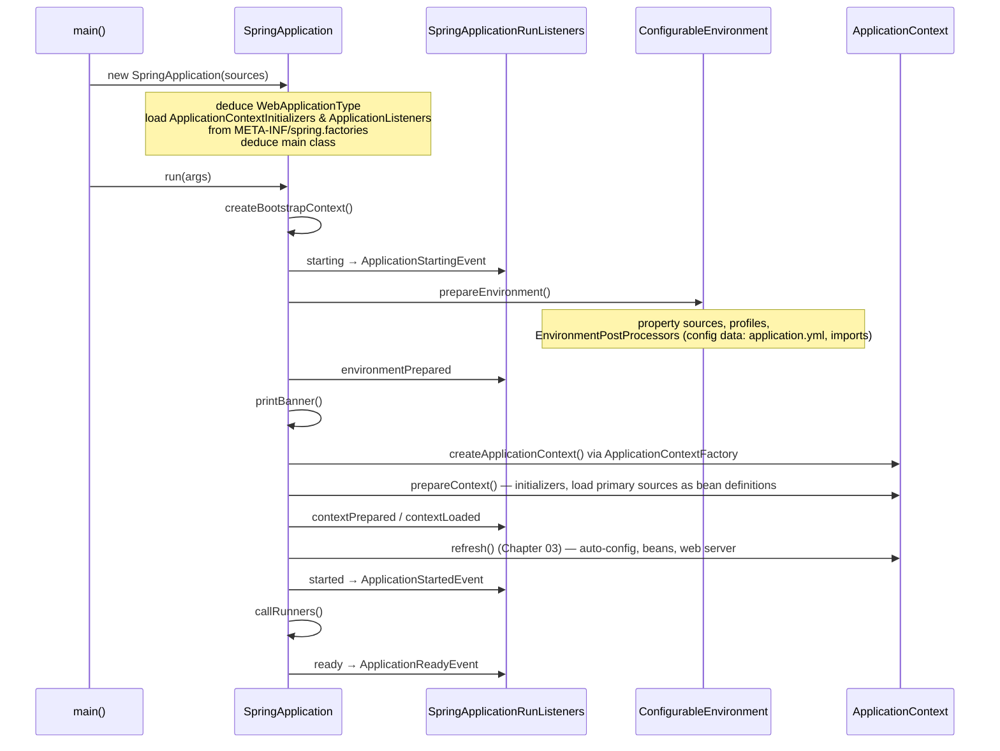
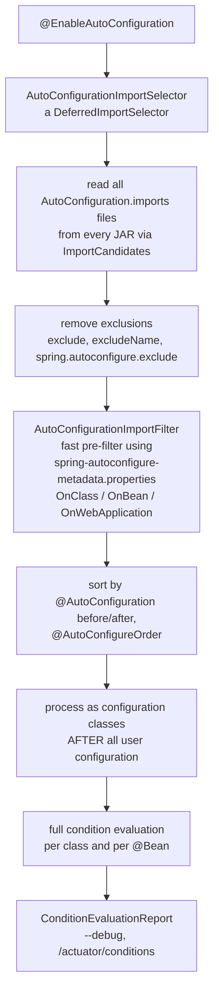
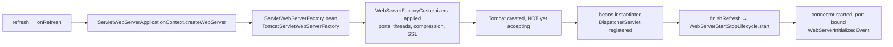
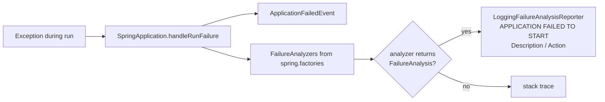

# 05 · Spring Boot Fundamentals

## 1. Introduction & Why It Matters

Chapters 02–04 were Spring **Framework**. This chapter is about what Spring **Boot** adds on top: starters, auto-configuration, the `SpringApplication` bootstrap, embedded servers and the developer experience around them.

Boot's promise is *"opinionated defaults that get out of your way"*. Add `spring-boot-starter-data-jpa` and a PostgreSQL driver, set a URL, and you get a pooled `DataSource`, an `EntityManagerFactory`, a transaction manager, repositories, health checks and metrics — no configuration class written.

That magic becomes a liability when you don't understand it:

- "Why is there a second `ObjectMapper` and my date format is ignored?" — you defined one and Boot's backed off, but a library created another.
- "Why did the service start on port 8080 with an H2 database in production?" — H2 was on the runtime classpath through a test utility module.
- "Why did the Boot 4 upgrade break our shared library?" — it relied on an auto-configuration class in a package that moved during modularization.

For the grocery platform we'll also build a small **platform auto-configuration** so every one of the 26 services gets the same clock, request-context handling and failure diagnostics simply by adding one dependency. (Chapter 41 turns it into a full starter.)

### Who should read which section

| Band | Focus |
|---|---|
| B1 · 0–2 yrs | Parts 1, 2, 4 — starters, `@SpringBootApplication`, runners, DevTools |
| B2 · 2–5 yrs | Parts 2, 5 — overriding defaults, excluding auto-configs, condition report, embedded server tuning |
| B3 · 5–8 yrs | Parts 3, 5, 6 — `SpringApplication.run` internals, auto-configuration ordering, failure analyzers |
| B4 · 8–12 yrs | Parts 6, 7 — platform auto-configuration, Boot 4 modularization strategy |
| B5 · 12–15+ yrs | Parts 7, 8, 9 — opinionated platforms, when to fight or embrace Boot defaults |

---

## 2. Core Concepts

### 2.1 What Spring Boot adds

| Capability | What it gives you |
|---|---|
| **Starters** | Curated dependency sets per capability |
| **Auto-configuration** | Conditional default beans based on classpath, properties and existing beans |
| **`SpringApplication`** | Opinionated bootstrap: environment, profiles, banner, context type, runners, events |
| **Externalized configuration** | Layered properties from files, env, args, secrets (Chapter 06) |
| **Embedded servers** | Tomcat or Jetty inside your JAR |
| **Executable JARs** | `java -jar` deployment (Chapter 01, 29) |
| **Production features** | Actuator: health, metrics, info (Chapter 27) |
| **Developer tools** | DevTools restart, Docker Compose and Testcontainers integration |
| **Testing support** | Slices, `ApplicationContextRunner`, service connections (Chapters 15, 28) |

### 2.2 `@SpringBootApplication`

```java title="SpringBootApplication.java"
@SpringBootConfiguration      // a @Configuration, marks the primary configuration
@EnableAutoConfiguration      // import auto-configurations
@ComponentScan(excludeFilters = { ... TypeExcludeFilter, AutoConfigurationExcludeFilter ... })
public @interface SpringBootApplication { ... }
```

**Place the main class in the root package** (`in.grocery.order`) — scanning starts from its package, and several Boot features (JPA entity scanning, `@ConfigurationPropertiesScan`) use it as the default base package.

### 2.3 Starters

A starter is a POM with dependencies and (usually) no code.

| Starter (Boot 3.5 name) | Brings |
|---|---|
| `spring-boot-starter` | Core, logging (Logback), YAML (SnakeYAML) |
| `spring-boot-starter-web` | Spring MVC, Jackson, embedded Tomcat |
| `spring-boot-starter-webflux` | WebFlux, Reactor Netty |
| `spring-boot-starter-data-jpa` | Hibernate, Spring Data JPA, HikariCP |
| `spring-boot-starter-jdbc` | `JdbcClient`/`JdbcTemplate`, HikariCP |
| `spring-boot-starter-validation` | Hibernate Validator |
| `spring-boot-starter-security` | Spring Security |
| `spring-boot-starter-actuator` | Actuator, Micrometer |
| `spring-boot-starter-test` | JUnit Jupiter, AssertJ, Mockito, Spring Test, JSONassert, Awaitility, ... |

Swap technologies by excluding and adding starters (e.g. Tomcat → Jetty).

### 2.4 Auto-configuration

An **auto-configuration** is a `@Configuration` class annotated with `@AutoConfiguration` and listed in:

```text title="Example"
META-INF/spring/org.springframework.boot.autoconfigure.AutoConfiguration.imports
```

Each one is guarded by **conditions** (Chapter 03) — typically:

```java title="JdbcTemplateAutoConfiguration.java"
@AutoConfiguration(after = DataSourceAutoConfiguration.class)
@ConditionalOnClass(JdbcTemplate.class)            // library present?
@ConditionalOnSingleCandidate(DataSource.class)    // exactly one DataSource?
public class JdbcTemplateAutoConfiguration {

    @Bean
    @ConditionalOnMissingBean(JdbcOperations.class) // did the user define one? then back off
    JdbcTemplate jdbcTemplate(DataSource ds, JdbcProperties props) { ... }
}
```

The golden rule: **your beans win**. Auto-configurations are processed **after** user configuration, and `@ConditionalOnMissingBean` makes them back off.

### 2.5 Customizing defaults — the ladder

From least to most invasive:

1. **Properties** — `spring.jackson.default-property-inclusion=non_null`
2. **Customizer beans** — `Jackson2ObjectMapperBuilderCustomizer` / `JsonMapperBuilderCustomizer`, `WebServerFactoryCustomizer`, `RestClientCustomizer`, `HikariConfig` via properties
3. **Replace a bean** — define your own `ObjectMapper`; Boot backs off (you lose Boot's customizations)
4. **Exclude an auto-configuration** — `spring.autoconfigure.exclude=...` or `@SpringBootApplication(exclude = ...)`
5. **Write your own auto-configuration**

Always start at the top of the ladder.

### 2.6 `SpringApplication`

Beyond `SpringApplication.run(App.class, args)` you can configure:

| Setting | Code / property |
|---|---|
| Web application type | `setWebApplicationType(WebApplicationType.NONE)` / `spring.main.web-application-type=none` |
| Banner | `banner.txt`, `spring.main.banner-mode=off` |
| Lazy initialization | `spring.main.lazy-initialization=true` |
| Additional profiles | `setAdditionalProfiles("india")` |
| Default properties | `setDefaultProperties(...)` (lowest precedence) |
| Startup metrics | `setApplicationStartup(new BufferingApplicationStartup(n))` |
| Listeners/initializers | `addListeners`, `addInitializers` |
| Fluent builder / hierarchies | `SpringApplicationBuilder` |

**Web application type deduction:** `SERVLET` if Spring MVC and a servlet API are present; `REACTIVE` if WebFlux is present and MVC isn't; otherwise `NONE`.

### 2.7 Runners

`ApplicationRunner` (parsed `ApplicationArguments`) and `CommandLineRunner` (raw `String[]`) run **once**, after the context is started and before `ApplicationReadyEvent`. Order them with `@Order`. An exception in a runner fails startup. Uses: warm-up, one-off maintenance, CLI tools built with Boot.

### 2.8 Failure analyzers

When startup fails, Boot tries registered `FailureAnalyzer`s to turn a stack trace into a human message with **Description** and **Action** — e.g. "Port 8080 was already in use" or "Failed to configure a DataSource: 'url' attribute is not specified". You can add your own.

### 2.9 Embedded servers

| Server | Boot 3.5 | Boot 4.x | Notes |
|---|---|---|---|
| Tomcat | ✅ default | ✅ default | Most common |
| Jetty | ✅ | ✅ (Jetty 12) | Lower memory, good HTTP/2 |
| Undertow | ✅ | ❌ removed | Not compatible with Servlet 6.1 |
| Reactor Netty | WebFlux default | WebFlux default | Non-servlet |

Key properties: `server.port`, `server.shutdown`, `server.tomcat.threads.max`, `server.tomcat.max-connections`, `server.tomcat.accept-count`, `server.max-http-request-header-size`, `server.http2.enabled`, `server.compression.enabled`, `server.ssl.*` / SSL bundles.

**Virtual threads:** `spring.threads.virtual.enabled=true` (Java 21+) makes Tomcat/Jetty handle requests on virtual threads and switches several executors (`@Async`, scheduling, Kafka listener containers) to virtual threads.

### 2.10 DevTools

`spring-boot-devtools` (as `developmentOnly`) provides:

- **Automatic restart** when classes change — two class loaders: a *base* loader for third-party JARs (unchanged) and a *restart* loader for your code (thrown away on restart), so restarts are fast.
- **Development property defaults** — caching off for templates, extra web logging.
- **Global settings** in `~/.config/spring-boot/`.

DevTools **disables itself** when running from a fully packaged JAR (`java -jar`), and is excluded from the executable archive by default. Never ship it.

### 2.11 Boot 4 modularization

In Boot 3.x, nearly all auto-configurations live in one large `spring-boot-autoconfigure` JAR, and `spring-boot-starter-test` pulls every test utility. Boot 4 splits this into **focused modules per technology** (web MVC, JDBC, JPA, Kafka, …), each with its own auto-configuration, properties and test support, with starters to match. Benefits: smaller classpaths, faster startup and condition evaluation, clearer ownership, fewer "surprise" auto-configurations. For migration, Boot 4 ships **classic starters** that reproduce the old all-in-one arrangement.

!!! warning "Verify"
    Module, package and starter names in Boot 4 are defined in the **Spring Boot 4.0 Migration Guide**. Code that imports auto-configuration classes directly (tests, `@ImportAutoConfiguration`, `exclude = ...`) is where most breakage appears.

---

## 3. How It Works Internally

### 3.1 `SpringApplication.run(...)`



`SpringApplication` itself uses Spring's `SpringFactoriesLoader` to find `ApplicationContextInitializer`, `ApplicationListener`, `EnvironmentPostProcessor`, `FailureAnalyzer` and `SpringApplicationRunListener` implementations in `META-INF/spring.factories` — which is how libraries hook in before any bean exists.

### 3.2 How auto-configurations are selected



Details that matter:

- **Deferred:** `DeferredImportSelector` guarantees auto-configurations are processed after your `@Configuration` classes, which is why `@ConditionalOnMissingBean` sees your beans.
- **Pre-filtering:** the annotation processor `spring-boot-autoconfigure-processor` writes `META-INF/spring-autoconfigure-metadata.properties` so classes whose `@ConditionalOnClass` fails are skipped **without loading them** — a big startup win with hundreds of candidates.
- **Ordering:** only affects auto-configurations relative to each other. Never use `@AutoConfigureAfter` on a normal `@Configuration` — it has no effect.
- **Don't component-scan auto-configurations.** `AutoConfigurationExcludeFilter` in `@SpringBootApplication` prevents it, but a custom `@ComponentScan` elsewhere can accidentally pick them up and bypass ordering.

### 3.3 Embedded server startup



The server is created early (so servlet-context-aware beans can use it) but **starts accepting connections only after all singletons exist**, via a `SmartLifecycle`. That's why the app never receives a request while half-initialized.

### 3.4 Failure analysis



`AbstractFailureAnalyzer<T>` walks the cause chain and matches the first exception of type `T`.

---

## 4. Hands-On Code — Level 1 (Beginner)

### 4.1 A service with zero configuration classes

```kotlin title="services/catalog-service/build.gradle.kts"
plugins { id("grocery.spring-service") }

dependencies {
    implementation(libs.spring.boot.starter.webmvc)          // Boot 3.5: starter-web
    implementation(libs.spring.boot.starter.jdbc)
    runtimeOnly("org.postgresql:postgresql")
    developmentOnly("org.springframework.boot:spring-boot-devtools")   // (1)!
    testImplementation(libs.spring.boot.starter.webmvc.test)
}
```

1. `developmentOnly` — on the classpath for `bootRun`, excluded from `bootJar`.

```yaml title="src/main/resources/application.yml"
spring:
  application:
    name: catalog-service
  datasource:
    url: jdbc:postgresql://localhost:5432/catalog
    username: catalog
    password: catalog
server:
  port: 8081
```

```java title="in/grocery/catalog/CatalogApplication.java"
package in.grocery.catalog;

import org.springframework.boot.SpringApplication;
import org.springframework.boot.autoconfigure.SpringBootApplication;

@SpringBootApplication
public class CatalogApplication {
    public static void main(String[] args) {
        SpringApplication.run(CatalogApplication.class, args);
    }
}
```

```java title="in/grocery/catalog/web/CategoryController.java"
package in.grocery.catalog.web;

import java.util.List;
import org.springframework.jdbc.core.simple.JdbcClient;
import org.springframework.web.bind.annotation.GetMapping;
import org.springframework.web.bind.annotation.RestController;

@RestController
class CategoryController {

    record Category(long id, String name) {}

    private final JdbcClient jdbc;                                   // (1)!

    CategoryController(JdbcClient jdbc) {
        this.jdbc = jdbc;
    }

    @GetMapping("/categories")
    List<Category> all() {
        return jdbc.sql("select id, name from category order by name").query(Category.class).list();
    }
}
```

1. We never defined a `DataSource` or `JdbcClient`. `DataSourceAutoConfiguration` created a HikariCP pool from `spring.datasource.*`; `JdbcClientAutoConfiguration` created the client. (Controller talks to JDBC directly only in this Level 1 demo — real services use the four layers.)

### 4.2 See what Boot configured

```bash title="Terminal"
./gradlew bootRun --args='--debug'
```

```text title="Condition evaluation report (excerpt)"
============================
CONDITIONS EVALUATION REPORT
============================

Positive matches:
-----------------
   DataSourceAutoConfiguration matched:
      - @ConditionalOnClass found required classes 'javax.sql.DataSource', ... (OnClassCondition)

   JdbcClientAutoConfiguration matched:
      - @ConditionalOnSingleCandidate (types: org.springframework.jdbc.core.namedparam.NamedParameterJdbcTemplate; SearchStrategy: all) found a single bean ...

Negative matches:
-----------------
   MongoAutoConfiguration:
      Did not match:
         - @ConditionalOnClass did not find required class 'com.mongodb.client.MongoClient' (OnClassCondition)
```

With Actuator: `GET /actuator/conditions` and `GET /actuator/beans`.

### 4.3 A runner and a banner

```java title="in/grocery/catalog/startup/StartupSummary.java"
package in.grocery.catalog.startup;

import org.slf4j.Logger;
import org.slf4j.LoggerFactory;
import org.springframework.boot.ApplicationArguments;
import org.springframework.boot.ApplicationRunner;
import org.springframework.core.env.Environment;
import org.springframework.stereotype.Component;

@Component
class StartupSummary implements ApplicationRunner {

    private static final Logger log = LoggerFactory.getLogger(StartupSummary.class);
    private final Environment env;

    StartupSummary(Environment env) {
        this.env = env;
    }

    @Override
    public void run(ApplicationArguments args) {
        log.info("Profiles={} port={} options={}",
                String.join(",", env.getActiveProfiles()),
                env.getProperty("local.server.port"),                 // (1)!
                args.getOptionNames());
    }
}
```

1. The actual bound port (useful with `server.port=0` in tests).

```text title="src/main/resources/banner.txt"
  ___  ___  ___   ___ ___ _____   __
 / __|| _ \/ _ \ / __| __| _ \ \ / /   ${spring.application.name}
| (_ ||   / (_) | (__| _||   /\ V /    Spring Boot ${spring-boot.version}
 \___||_|_\\___/ \___|___|_|_\ |_|     Java ${java.version}
```

### 4.4 Override a default the right way

Boot's Jackson default serializes `null` fields. The platform wants them omitted:

```yaml title="application.yml"
spring:
  jackson:
    default-property-inclusion: non_null      # rung 1: a property
```

No `ObjectMapper` bean written — and all of Boot's other Jackson customizations (Java time module, `@JsonComponent`s, mixins) still apply. Chapter 11 covers the Jackson 3 changes in Boot 4.

---

## 5. Hands-On Code — Level 2 (Intermediate) & Level 3 (Advanced)

### 5.1 Level 2 — Customizers instead of replacements

```java title="in/grocery/catalog/config/WebServerConfig.java"
package in.grocery.catalog.config;

import org.springframework.boot.web.embedded.tomcat.TomcatServletWebServerFactory;
import org.springframework.boot.web.server.WebServerFactoryCustomizer;
import org.springframework.context.annotation.Bean;
import org.springframework.context.annotation.Configuration;

@Configuration(proxyBeanMethods = false)
class WebServerConfig {

    @Bean
    WebServerFactoryCustomizer<TomcatServletWebServerFactory> groceryTomcat() {        // (1)!
        return factory -> factory.addConnectorCustomizers(connector -> {
            connector.setProperty("relaxedQueryChars", "[]|{}");                      // (2)!
        });
    }
}
```

1. Rung 2 of the ladder: adjust Boot's factory rather than defining a new one.
2. Legacy seller integrations send raw brackets in filter query strings. Tomcat rejects them by default.

!!! warning "Verify — package names in Boot 4"
    Embedded-server classes such as `TomcatServletWebServerFactory` moved to technology-specific modules in Boot 4 (for example a `...boot.tomcat...` package). Update imports per the migration guide. Prefer properties (`server.tomcat.*`) where one exists — they survive such moves.

### 5.2 Level 2 — Swap Tomcat for Jetty

=== "Spring Boot 3.5"

    ```kotlin title="build.gradle.kts"
    implementation(libs.spring.boot.starter.web) {
        exclude(group = "org.springframework.boot", module = "spring-boot-starter-tomcat")
    }
    implementation("org.springframework.boot:spring-boot-starter-jetty")
    ```

=== "Spring Boot 4.x"

    ```kotlin title="build.gradle.kts"
    implementation(libs.spring.boot.starter.webmvc) {
        exclude(group = "org.springframework.boot", module = "spring-boot-starter-tomcat")
    }
    implementation("org.springframework.boot:spring-boot-starter-jetty")
    ```

Boot detects Jetty on the classpath and the `ServletWebServerFactoryAutoConfiguration` picks `JettyServletWebServerFactory`. No code changes.

### 5.3 Level 2 — Excluding an auto-configuration

The **notification-service** has `spring-boot-starter-jdbc` on the classpath (a shared library pulls it) but no database. Startup fails: *"Failed to configure a DataSource: 'url' attribute is not specified"*.

```yaml title="application.yml — notification-service"
spring:
  autoconfigure:
    exclude:
      - org.springframework.boot.autoconfigure.jdbc.DataSourceAutoConfiguration   # Boot 3.5 FQN
```

!!! tip "Better fix"
    Exclusion treats the symptom. The real fix is to stop the shared library from exporting JDBC (`implementation` instead of `api`, or split the library). Unwanted auto-configuration is almost always a dependency hygiene problem.

!!! warning "Verify — Boot 4 FQNs"
    Fully qualified auto-configuration class names changed with modularization. Property-based exclusions with old FQNs are silently ignored if the class no longer exists — check `/actuator/conditions` after upgrading.

### 5.4 Level 2 — Virtual threads and server tuning

```yaml title="application.yml — order-service"
spring:
  threads:
    virtual:
      enabled: true                 # Tomcat request handling on virtual threads
server:
  tomcat:
    max-connections: 10000          # sockets accepted and held
    accept-count: 200               # OS backlog when max-connections reached
    connection-timeout: 5s
    keep-alive-timeout: 20s
  max-http-request-header-size: 16KB
  compression:
    enabled: true
    mime-types: application/json
    min-response-size: 2KB
```

With virtual threads, `server.tomcat.threads.max` no longer bounds concurrency — **your downstream limits do** (Hikari pool size, HTTP client pools). Chapter 25 covers pinning and bounding.

### 5.5 Level 3 — `SpringApplicationBuilder` and a CLI tool

Operations needs a one-off command to re-index a seller's catalog. Same code, no web server:

```java title="in/grocery/catalog/tools/ReindexCli.java"
package in.grocery.catalog.tools;

import in.grocery.catalog.CatalogApplication;
import org.springframework.boot.Banner;
import org.springframework.boot.WebApplicationType;
import org.springframework.boot.builder.SpringApplicationBuilder;
import org.springframework.context.ConfigurableApplicationContext;

public final class ReindexCli {

    public static void main(String[] args) {
        ConfigurableApplicationContext ctx = new SpringApplicationBuilder(CatalogApplication.class)
                .web(WebApplicationType.NONE)                                  // (1)!
                .bannerMode(Banner.Mode.OFF)
                .profiles("cli")
                .properties("spring.main.lazy-initialization=true")           // (2)!
                .run(args);
        int exit = org.springframework.boot.SpringApplication.exit(ctx);       // (3)!
        System.exit(exit);
    }
}
```

1. No Tomcat; runs as a batch process (e.g. a Kubernetes Job).
2. Lazy is fine for a short-lived tool that uses a few beans.
3. `SpringApplication.exit` closes the context and aggregates `ExitCodeGenerator` beans.

```java title="in/grocery/catalog/tools/ReindexRunner.java"
package in.grocery.catalog.tools;

import org.springframework.boot.ApplicationArguments;
import org.springframework.boot.ApplicationRunner;
import org.springframework.boot.ExitCodeGenerator;
import org.springframework.context.annotation.Profile;
import org.springframework.stereotype.Component;

@Component
@Profile("cli")
class ReindexRunner implements ApplicationRunner, ExitCodeGenerator {

    interface CatalogIndexer { int reindexSeller(String sellerId); }

    private final CatalogIndexer indexer;
    private int exitCode = 0;

    ReindexRunner(CatalogIndexer indexer) {
        this.indexer = indexer;
    }

    @Override
    public void run(ApplicationArguments args) {
        var sellers = args.getOptionValues("seller");
        if (sellers == null || sellers.isEmpty()) {
            System.err.println("Usage: --seller=<id> [--seller=<id>...]");
            exitCode = 2;
            return;
        }
        sellers.forEach(s -> System.out.printf("Seller %s: %d products indexed%n", s, indexer.reindexSeller(s)));
    }

    @Override
    public int getExitCode() {
        return exitCode;
    }
}
```

### 5.6 Level 3 — Your own failure analyzer

Missing Razorpay credentials currently produce a 60-line stack trace. Make it one clear message.

```java title="in/grocery/payment/config/MissingGatewayCredentialsException.java"
package in.grocery.payment.config;

public class MissingGatewayCredentialsException extends RuntimeException {
    private final String gateway;
    private final String property;

    public MissingGatewayCredentialsException(String gateway, String property) {
        super("Missing credentials for " + gateway + ": " + property);
        this.gateway = gateway;
        this.property = property;
    }

    public String gateway() { return gateway; }
    public String property() { return property; }
}
```

```java title="in/grocery/payment/config/MissingGatewayCredentialsFailureAnalyzer.java"
package in.grocery.payment.config;

import org.springframework.boot.diagnostics.AbstractFailureAnalyzer;
import org.springframework.boot.diagnostics.FailureAnalysis;

class MissingGatewayCredentialsFailureAnalyzer extends AbstractFailureAnalyzer<MissingGatewayCredentialsException> {

    @Override
    protected FailureAnalysis analyze(Throwable rootFailure, MissingGatewayCredentialsException cause) {
        return new FailureAnalysis(
                "The %s payment gateway is enabled but '%s' is not set.".formatted(cause.gateway(), cause.property()),
                """
                Provide the credential in one of these ways:
                  • Kubernetes: mount the secret at /var/run/secrets/grocery/ (configtree import)
                  • Local: export %s
                  • Or disable the gateway: grocery.payment.%s.enabled=false
                """.formatted(cause.property().toUpperCase().replace('.', '_').replace('-', '_'),
                              cause.gateway().toLowerCase()),
                cause);
    }
}
```

```properties title="src/main/resources/META-INF/spring.factories"
org.springframework.boot.diagnostics.FailureAnalyzer=\
in.grocery.payment.config.MissingGatewayCredentialsFailureAnalyzer
```

```text title="Output"
***************************
APPLICATION FAILED TO START
***************************

Description:

The RAZORPAY payment gateway is enabled but 'grocery.payment.razorpay.key-secret' is not set.

Action:

Provide the credential in one of these ways:
  • Kubernetes: mount the secret at /var/run/secrets/grocery/ (configtree import)
  • Local: export GROCERY_PAYMENT_RAZORPAY_KEY_SECRET
  • Or disable the gateway: grocery.payment.razorpay.enabled=false
```

---

## 6. Hands-On Code — Level 4 (Expert / Production)

### Platform auto-configuration shared by all 26 services

Goal: add `implementation(project(":libs:grocery-platform"))` and every service gets:

- An `Asia/Kolkata` `Clock` bean (overridable in tests).
- A request-correlation filter (`X-Request-Id`) — only in servlet web apps.
- A default `IdempotencyStore` (in-memory) that backs off when Redis provides one.
- A startup `InfoContributor` exposing platform version.
- Everything overridable, everything visible in the condition report.

```text title="libs/grocery-platform/src/main/resources/META-INF/spring/org.springframework.boot.autoconfigure.AutoConfiguration.imports"
in.grocery.platform.autoconfigure.GroceryCoreAutoConfiguration
in.grocery.platform.autoconfigure.GroceryWebAutoConfiguration
in.grocery.platform.autoconfigure.GroceryIdempotencyAutoConfiguration
```

```java title="in/grocery/platform/autoconfigure/GroceryPlatformProperties.java"
package in.grocery.platform.autoconfigure;

import java.time.ZoneId;
import org.springframework.boot.context.properties.ConfigurationProperties;
import org.springframework.boot.context.properties.bind.DefaultValue;

@ConfigurationProperties("grocery.platform")
public record GroceryPlatformProperties(
        @DefaultValue("Asia/Kolkata") ZoneId zone,
        @DefaultValue("X-Request-Id") String requestIdHeader,
        @DefaultValue("true") boolean correlationEnabled) {}
```

```java title="in/grocery/platform/autoconfigure/GroceryCoreAutoConfiguration.java"
package in.grocery.platform.autoconfigure;

import java.time.Clock;
import org.springframework.boot.actuate.info.InfoContributor;
import org.springframework.boot.autoconfigure.AutoConfiguration;
import org.springframework.boot.autoconfigure.condition.ConditionalOnClass;
import org.springframework.boot.autoconfigure.condition.ConditionalOnMissingBean;
import org.springframework.boot.context.properties.EnableConfigurationProperties;
import org.springframework.context.annotation.Bean;
import org.springframework.context.annotation.Configuration;

@AutoConfiguration
@EnableConfigurationProperties(GroceryPlatformProperties.class)
public class GroceryCoreAutoConfiguration {

    @Bean
    @ConditionalOnMissingBean                                                // (1)!
    Clock groceryClock(GroceryPlatformProperties props) {
        return Clock.system(props.zone());
    }

    @Configuration(proxyBeanMethods = false)
    @ConditionalOnClass(InfoContributor.class)                               // (2)!
    static class InfoConfiguration {
        @Bean
        InfoContributor groceryPlatformInfo() {
            String version = GroceryCoreAutoConfiguration.class.getPackage().getImplementationVersion();
            return builder -> builder.withDetail("groceryPlatform", java.util.Map.of(
                    "version", version == null ? "dev" : version));
        }
    }
}
```

1. A test or service defining its own `Clock` wins.
2. Nested configuration so the outer class never references Actuator types — safe when Actuator isn't on the classpath.

```java title="in/grocery/platform/autoconfigure/GroceryWebAutoConfiguration.java"
package in.grocery.platform.autoconfigure;

import in.grocery.platform.web.CorrelationIdFilter;
import org.springframework.boot.autoconfigure.AutoConfiguration;
import org.springframework.boot.autoconfigure.condition.ConditionalOnBooleanProperty;
import org.springframework.boot.autoconfigure.condition.ConditionalOnMissingBean;
import org.springframework.boot.autoconfigure.condition.ConditionalOnWebApplication;
import org.springframework.boot.web.servlet.FilterRegistrationBean;
import org.springframework.context.annotation.Bean;
import org.springframework.core.Ordered;

@AutoConfiguration(after = GroceryCoreAutoConfiguration.class)
@ConditionalOnWebApplication(type = ConditionalOnWebApplication.Type.SERVLET)
@ConditionalOnBooleanProperty(name = "grocery.platform.correlation-enabled", matchIfMissing = true) // (1)!
public class GroceryWebAutoConfiguration {

    @Bean
    @ConditionalOnMissingBean(name = "correlationIdFilter")
    FilterRegistrationBean<CorrelationIdFilter> correlationIdFilter(GroceryPlatformProperties props) {
        var registration = new FilterRegistrationBean<>(new CorrelationIdFilter(props.requestIdHeader()));
        registration.setOrder(Ordered.HIGHEST_PRECEDENCE + 5);               // (2)!
        registration.addUrlPatterns("/*");
        return registration;
    }
}
```

1. `@ConditionalOnBooleanProperty` is new in Boot 3.5. On older versions use `@ConditionalOnProperty(..., havingValue = "true", matchIfMissing = true)`.
2. Early, so every log line (including security filter logs) carries the ID.

```java title="in/grocery/platform/web/CorrelationIdFilter.java"
package in.grocery.platform.web;

import jakarta.servlet.FilterChain;
import jakarta.servlet.ServletException;
import jakarta.servlet.http.HttpServletRequest;
import jakarta.servlet.http.HttpServletResponse;
import java.io.IOException;
import java.util.UUID;
import java.util.regex.Pattern;
import org.slf4j.MDC;
import org.springframework.web.filter.OncePerRequestFilter;

public class CorrelationIdFilter extends OncePerRequestFilter {

    private static final Pattern SAFE = Pattern.compile("[A-Za-z0-9-]{8,64}");   // (1)!
    private final String header;

    public CorrelationIdFilter(String header) {
        this.header = header;
    }

    @Override
    protected void doFilterInternal(HttpServletRequest req, HttpServletResponse res, FilterChain chain)
            throws ServletException, IOException {
        String incoming = req.getHeader(header);
        String id = incoming != null && SAFE.matcher(incoming).matches() ? incoming : UUID.randomUUID().toString();
        MDC.put("requestId", id);
        res.setHeader(header, id);
        try {
            chain.doFilter(req, res);
        } finally {
            MDC.remove("requestId");                                             // (2)!
        }
    }
}
```

1. Never trust client headers verbatim into logs — log injection.
2. Threads (platform or virtual) are reused/pooled; always clean the MDC. Chapter 27 replaces this with tracing-based correlation.

```java title="in/grocery/platform/autoconfigure/GroceryIdempotencyAutoConfiguration.java"
package in.grocery.platform.autoconfigure;

import in.grocery.common.idempotency.IdempotencyAspect;
import in.grocery.common.idempotency.IdempotencyStore;
import in.grocery.common.idempotency.InMemoryIdempotencyStore;
import io.micrometer.core.instrument.MeterRegistry;
import java.time.Clock;
import org.aspectj.lang.annotation.Aspect;
import org.springframework.boot.autoconfigure.AutoConfiguration;
import org.springframework.boot.autoconfigure.condition.ConditionalOnBean;
import org.springframework.boot.autoconfigure.condition.ConditionalOnClass;
import org.springframework.boot.autoconfigure.condition.ConditionalOnMissingBean;
import org.springframework.context.annotation.Bean;

@AutoConfiguration(after = GroceryCoreAutoConfiguration.class,
                   afterName = "in.grocery.platform.redis.GroceryRedisIdempotencyAutoConfiguration") // (1)!
@ConditionalOnClass(Aspect.class)
public class GroceryIdempotencyAutoConfiguration {

    @Bean
    @ConditionalOnMissingBean
    IdempotencyStore inMemoryIdempotencyStore(Clock clock) {
        return new InMemoryIdempotencyStore(clock);
    }

    @Bean
    @ConditionalOnMissingBean
    @ConditionalOnBean(MeterRegistry.class)
    IdempotencyAspect idempotencyAspect(IdempotencyStore store, MeterRegistry meters) {
        return new IdempotencyAspect(store, meters);
    }
}
```

1. `afterName` lets us order after an optional auto-configuration without a compile-time dependency on it. The Redis one registers a store first, so `@ConditionalOnMissingBean` backs off. `@ConditionalOnBean(MeterRegistry.class)` is reliable here only because the metrics auto-configuration is ordered earlier — in production, add it to `after` explicitly.

```kotlin title="libs/grocery-platform/build.gradle.kts"
plugins { id("grocery.java-conventions") }

dependencies {
    api(project(":libs:grocery-common"))
    implementation("org.springframework.boot:spring-boot-autoconfigure")
    compileOnly("org.springframework.boot:spring-boot-actuator")          // (1)!
    compileOnly("org.springframework:spring-webmvc")
    compileOnly("jakarta.servlet:jakarta.servlet-api")
    compileOnly("org.aspectj:aspectjweaver")
    compileOnly("io.micrometer:micrometer-core")
    annotationProcessor("org.springframework.boot:spring-boot-autoconfigure-processor")   // (2)!
    annotationProcessor("org.springframework.boot:spring-boot-configuration-processor")
    testImplementation("org.springframework.boot:spring-boot-starter-test")
    testImplementation("org.springframework.boot:spring-boot-starter-actuator")
}
```

1. Optional integrations are `compileOnly`: the service decides whether Actuator/web/AOP exist.
2. Generates the metadata that lets Boot skip non-matching auto-configurations without loading them.

### Testing auto-configuration behaviour

```java title="in/grocery/platform/autoconfigure/GroceryPlatformAutoConfigurationTest.java"
package in.grocery.platform.autoconfigure;

import static org.assertj.core.api.Assertions.assertThat;

import java.time.Clock;
import java.time.ZoneId;
import java.time.ZoneOffset;
import java.time.Instant;
import org.junit.jupiter.api.Test;
import org.springframework.boot.autoconfigure.AutoConfigurations;
import org.springframework.boot.test.context.FilteredClassLoader;
import org.springframework.boot.test.context.runner.ApplicationContextRunner;
import org.springframework.boot.test.context.runner.WebApplicationContextRunner;
import org.springframework.boot.web.servlet.FilterRegistrationBean;

class GroceryPlatformAutoConfigurationTest {

    private final ApplicationContextRunner runner = new ApplicationContextRunner()
            .withConfiguration(AutoConfigurations.of(GroceryCoreAutoConfiguration.class));

    @Test
    void providesIndiaClockByDefault() {
        runner.run(ctx -> assertThat(ctx.getBean(Clock.class).getZone()).isEqualTo(ZoneId.of("Asia/Kolkata")));
    }

    @Test
    void backsOffWhenUserDefinesClock() {
        Clock fixed = Clock.fixed(Instant.EPOCH, ZoneOffset.UTC);
        runner.withBean(Clock.class, () -> fixed)
              .run(ctx -> assertThat(ctx).getBean(Clock.class).isSameAs(fixed));
    }

    @Test
    void worksWithoutActuatorOnClasspath() {
        runner.withClassLoader(new FilteredClassLoader("org.springframework.boot.actuate"))   // (1)!
              .run(ctx -> assertThat(ctx).hasNotFailed().doesNotHaveBean("groceryPlatformInfo"));
    }

    @Test
    void correlationFilterOnlyInServletApps() {
        var auto = AutoConfigurations.of(GroceryCoreAutoConfiguration.class, GroceryWebAutoConfiguration.class);
        new WebApplicationContextRunner().withConfiguration(auto)
                .run(ctx -> assertThat(ctx).hasBean("correlationIdFilter"));
        new ApplicationContextRunner().withConfiguration(auto)
                .run(ctx -> assertThat(ctx).doesNotHaveBean(FilterRegistrationBean.class));
    }

    @Test
    void correlationCanBeDisabled() {
        new WebApplicationContextRunner()
                .withConfiguration(AutoConfigurations.of(GroceryCoreAutoConfiguration.class, GroceryWebAutoConfiguration.class))
                .withPropertyValues("grocery.platform.correlation-enabled=false")
                .run(ctx -> assertThat(ctx).doesNotHaveBean("correlationIdFilter"));
    }
}
```

1. Simulates a service that doesn't include Actuator — proves the optional integration is really optional.

### Startup diagnostics runbook

| Question | Tool |
|---|---|
| Which auto-configurations applied and why? | `--debug`, `/actuator/conditions` |
| Which beans exist and their dependencies? | `/actuator/beans` |
| What's slow at startup? | `BufferingApplicationStartup` + `/actuator/startup` |
| Which properties are active and from where? | `/actuator/env`, `/actuator/configprops` (Chapter 06) |
| Why did it fail? | Failure analyzer output; `--debug` for full report |

---

## 7. Spring Boot 3 vs 4 & Migration

| Topic | Boot 3.5 | Boot 4.x |
|---|---|---|
| Auto-config packaging | Mostly one `spring-boot-autoconfigure` JAR | Split into technology modules |
| Starters | Broad (`starter-web`, `starter-test`) | Focused (`starter-webmvc`, per-technology test starters) + classic starters for transition |
| Registration file | `AutoConfiguration.imports` | Same mechanism |
| Embedded servers | Tomcat, Jetty, Undertow | Tomcat, Jetty (Undertow removed) |
| Server factory packages | `org.springframework.boot.web.embedded.*` | Moved into server-specific modules (verify) |
| `@ConditionalOnBooleanProperty` | New in 3.5 | Available |
| Java | 17+ | 17+ (25 recommended here) |
| Virtual threads property | `spring.threads.virtual.enabled` | Same |

=== "Spring Boot 3.5"

    ```java title="Spring Boot 3.5 (snippet)"
    import org.springframework.boot.autoconfigure.jdbc.DataSourceAutoConfiguration;

    @SpringBootApplication(exclude = DataSourceAutoConfiguration.class)
    ```

=== "Spring Boot 4.x"

    ```java title="Spring Boot 4.x (snippet)"
    // The class moved into the JDBC module; check the new FQN in the migration guide.
    // Prefer excludeName or the property so a wrong import fails loudly in review:
    @SpringBootApplication(excludeName = "<new FQN of DataSourceAutoConfiguration>")
    ```

### Migration checklist

- [ ] Upgrade to latest 3.5.x; fix all deprecations.
- [ ] Move Undertow services to Tomcat or Jetty **before** the Boot 4 upgrade; load-test.
- [ ] Start with **classic starters** to get compiling, then move service by service to focused starters.
- [ ] Grep for imports of `org.springframework.boot.autoconfigure.*` and `org.springframework.boot.web.embedded.*` in main and test code.
- [ ] Re-check `spring.autoconfigure.exclude` entries — stale FQNs are silently ignored.
- [ ] Rebuild platform auto-configurations against Boot 4; run `ApplicationContextRunner` tests.
- [ ] Compare `/actuator/conditions` before and after upgrade in staging.

---

## 8. Production Playbook

### Best practices

1. **Main class in the root package**; don't add extra `@ComponentScan`s.
2. **Customize via the ladder**: properties → customizers → replace → exclude → write your own.
3. **Dependency hygiene is configuration** — every JAR on the runtime classpath can activate behaviour.
4. **Keep an eye on the condition report** in CI for unexpected positive matches (H2, embedded Kafka in prod).
5. **Platform auto-configurations** for cross-service defaults, with `@ConditionalOnMissingBean` everywhere and tests with `ApplicationContextRunner` + `FilteredClassLoader`.
6. **Failure analyzers** for every platform-level misconfiguration you've seen twice.
7. **Never ship DevTools**; never enable remote DevTools in shared environments.

### Anti-patterns

❌ **Replacing `ObjectMapper` to change one setting**

```java title="Anti-patterns (snippet)"
@Bean ObjectMapper objectMapper() {
    return new ObjectMapper().setSerializationInclusion(JsonInclude.Include.NON_NULL); // loses JavaTimeModule, Boot mixins, etc.
}
```

✅ `spring.jackson.default-property-inclusion=non_null` or a builder customizer.

❌ **`@ComponentScan("in.grocery")` in a library** — scans every service's packages and auto-configurations.

✅ Libraries expose auto-configurations; services scan only themselves.

❌ **`@AutoConfigureAfter` on a regular `@Configuration`** — ignored.

❌ **Test utilities (`h2`, embedded brokers) in `implementation`** — they auto-configure in production.

❌ **`spring.main.allow-bean-definition-overriding=true` to "fix" duplicate beans** — hides which one wins.

### Troubleshooting

| Symptom | Cause | Fix |
|---|---|---|
| `Failed to configure a DataSource` | JDBC on classpath, no URL | Add URL, remove dependency, or exclude |
| My bean ignored, Boot's used (or vice versa) | Name/type mismatch in `@ConditionalOnMissingBean`; bean defined in auto-config ordered earlier | Check condition report; match type |
| `Web server failed to start. Port 8080 was already in use.` | Port conflict | `server.port`, kill process, `server.port=0` in tests |
| App starts as non-web and exits immediately | No servlet/reactive stack on classpath | Add web starter or set type explicitly |
| Surprising H2 in production | H2 on runtime classpath | Move to `testRuntimeOnly` |
| Slow startup with many auto-configs | Missing autoconfigure-processor metadata in own libs | Add `spring-boot-autoconfigure-processor` |
| DevTools restarts loop | Output dirs of another module watched / generated files | `spring.devtools.restart.exclude` |
| Class loading issues only with DevTools | Library caching classes across restart loaders | `META-INF/spring-devtools.properties` include/exclude JARs |

### Production checklist

- [ ] `/actuator/conditions` reviewed for every service in staging
- [ ] No DevTools, H2 or embedded brokers in runtime classpath
- [ ] Platform auto-configurations tested with context runners
- [ ] Failure analyzers for platform misconfigurations
- [ ] Web server type and thread model deliberate (virtual threads + bounded downstream pools)
- [ ] No Undertow before Boot 4
- [ ] Startup time budget monitored

---

## 9. Interview Questions & Answers

### B1 · 0–2 years

??? question "B1 · What does `@SpringBootApplication` do?"
    **Short answer:** Combines `@SpringBootConfiguration`, `@EnableAutoConfiguration` and `@ComponentScan` — marks the main configuration, turns on auto-configuration, and scans the main class's package and sub-packages.

    **Follow-ups:** Why should the main class be in the root package?

??? question "B1 · What is auto-configuration?"
    **Short answer:** Boot's conditional `@Configuration` classes that create default beans based on the classpath, properties and existing beans, backing off when you define your own.

??? question "B1 · How do you change the server port?"
    **Short answer:** `server.port=8081` in `application.yml`/properties, env var `SERVER_PORT`, or `--server.port=8081`.

??? question "B1 · What is the difference between `CommandLineRunner` and `ApplicationRunner`?"
    **Short answer:** Both run once after startup. `CommandLineRunner` receives raw `String[]`; `ApplicationRunner` receives parsed `ApplicationArguments` (option vs non-option args).

??? question "B1 · What is Spring Boot DevTools?"
    **Short answer:** A development-only module providing fast automatic restart via two class loaders and development defaults. It disables itself in packaged JARs.

??? question "B1 · Which embedded servers does Spring Boot support?"
    **Short answer:** Tomcat (default) and Jetty for servlet apps; Undertow in Boot 3 but removed in Boot 4; Reactor Netty for WebFlux.

### B2 · 2–5 years

??? question "B2 · How do you see which auto-configurations were applied?"
    **Short answer:** Run with `--debug` for the condition evaluation report, or `/actuator/conditions` with Actuator.

??? question "B2 · How do you disable a specific auto-configuration?"
    **Short answer:** `@SpringBootApplication(exclude = X.class)`/`excludeName`, or `spring.autoconfigure.exclude`. Prefer fixing the dependency that triggers it.

??? question "B2 · You define your own `ObjectMapper` and suddenly `LocalDate` serializes as an array. Why?"
    **Short answer:** Boot's `JacksonAutoConfiguration` backed off, so its customizations (Java time handling via builder, date format settings) no longer apply. Use properties or a builder customizer instead.

??? question "B2 · How would you replace Tomcat with Jetty?"
    **Short answer:** Exclude `spring-boot-starter-tomcat` from the web starter and add `spring-boot-starter-jetty`. Boot auto-detects Jetty.

??? question "B2 · What does `spring.threads.virtual.enabled=true` change?"
    **Short answer:** Servlet request handling and several Boot-managed executors (task execution/scheduling, some messaging listener containers) use virtual threads. Concurrency is then bounded by downstream resources, not the thread pool.

??? question "B2 · What is a failure analyzer?"
    **Short answer:** A component that converts a startup exception into a "Description / Action" message. Register via `META-INF/spring.factories`; extend `AbstractFailureAnalyzer<T>`.

### B3 · 5–8 years

??? question "B3 · Walk through `SpringApplication.run()`."
    **Short answer:** Create bootstrap context → starting event → prepare Environment (property sources, config data, `EnvironmentPostProcessor`s) → banner → create context by web type → initializers, load sources → refresh (auto-config, beans, web server start) → started event → runners → ready event.

??? question "B3 · How does Boot find auto-configuration classes and why are they processed after user configuration?"
    **Short answer:** `AutoConfigurationImportSelector` (a `DeferredImportSelector`) reads `AutoConfiguration.imports` from all JARs, removes exclusions, pre-filters with generated metadata, orders them, and imports them after all user `@Configuration` classes are parsed — so `@ConditionalOnMissingBean` sees user beans.

??? question "B3 · Why is `@ConditionalOnBean` risky in your own configuration?"
    **Short answer:** Conditions evaluate against bean definitions registered *so far*. In user configuration, order of processing isn't guaranteed relative to other user configs. It's reliable in auto-configurations with explicit `after` ordering.

??? question "B3 · Why doesn't the embedded server accept requests before all beans are ready?"
    **Short answer:** The server is created in `onRefresh` but its connector is started by `WebServerStartStopLifecycle` (a `SmartLifecycle`) in `finishRefresh`, after all singletons are instantiated.

??? question "B3 · What is `spring-autoconfigure-metadata.properties`?"
    **Short answer:** Generated by `spring-boot-autoconfigure-processor`; lists conditions like `ConditionalOnClass` per auto-configuration so `AutoConfigurationImportFilter`s can skip them without loading the class — faster startup.

### B4 · 8–12 years

??? question "B4 · How would you design a platform auto-configuration for many services?"
    **Short answer:** Library with `AutoConfiguration.imports`, `@ConditionalOnMissingBean` on every bean, optional integrations isolated in nested `@ConditionalOnClass` configs with `compileOnly` dependencies, properties with metadata, explicit ordering via `after`/`afterName`, failure analyzers, and `ApplicationContextRunner` tests including `FilteredClassLoader` and web/non-web runners.

??? question "B4 · How do you plan the Boot 4 modularization migration for a monorepo?"
    **Short answer:** Update platform libraries first; switch services to classic starters to compile; fix direct imports of auto-config/embedded-server classes; replace Undertow; then move to focused starters service by service, comparing condition reports and startup metrics.

??? question "B4 · When would you exclude an auto-configuration vs remove a dependency?"
    **Short answer:** Remove the dependency whenever possible — the classpath is the contract. Exclude only when the library is needed for other reasons but its default integration conflicts (e.g. a library brings a JDBC driver used only in a separate process).

### B5 · 12–15+ years

??? question "B5 · Boot is opinionated. When do you fight its defaults?"
    **Short answer:** When a default conflicts with a platform requirement you can articulate (security, compliance, latency SLOs) — e.g. error response format, JSON inclusion, connection pools. Change it once, centrally, in platform auto-config with an ADR. Don't fight defaults per service or for taste.

??? question "B5 · How do you prevent 'auto-configuration surprises' across 26 services?"
    **Short answer:** Dependency governance (catalog, locking, SBOM review), condition-report diffing in CI, golden-path templates, platform tests, forbidding broad starters in libraries, and upgrade playbooks that compare `/actuator/conditions` and `/actuator/beans` before and after.

### Scenario questions

??? example "Scenario · A service started in production with an in-memory H2 database"
    A shared `test-fixtures` module was declared as `implementation` and brought H2. With no `spring.datasource.url` (a ConfigMap key typo), `DataSourceAutoConfiguration` created an embedded H2 database. Fixes: make fixtures `testImplementation`, fail fast with `spring.sql.init.mode=never` and a platform check that rejects embedded databases in `prod`, add a CI gate on the condition report, and validate required datasource properties.

??? example "Scenario · After adding Kafka to catalog-service, startup takes 20 seconds longer"
    The Kafka admin client tries to connect to `localhost:9092` at startup (default bootstrap servers) to create topics. Configure `spring.kafka.bootstrap-servers`, disable auto topic creation in services (`spring.kafka.admin.auto-create=false`, topics owned by platform), set admin fail-fast/timeouts, and measure with `/actuator/startup`.

### Coding exercise

!!! example "Exercise · `grocery.platform.forbid-embedded-databases`"
    Write an auto-configuration that, when the property is `true` (default in the `prod` profile), fails startup with a clear failure analysis if the `DataSource` is an embedded database (H2, HSQL, Derby). Test it.

??? success "Solution"
    ```java title="EmbeddedDatabaseForbiddenException.java"
    package in.grocery.platform.db;

    public class EmbeddedDatabaseForbiddenException extends RuntimeException {
        public EmbeddedDatabaseForbiddenException(String url) {
            super("Embedded database not allowed: " + url);
        }
    }
    ```

    ```java title="ForbidEmbeddedDatabaseAutoConfiguration.java"
    package in.grocery.platform.db;

    import java.sql.Connection;
    import javax.sql.DataSource;
    import org.springframework.beans.factory.SmartInitializingSingleton;
    import org.springframework.boot.autoconfigure.AutoConfiguration;
    import org.springframework.boot.autoconfigure.condition.ConditionalOnBean;
    import org.springframework.boot.autoconfigure.condition.ConditionalOnBooleanProperty;
    import org.springframework.context.annotation.Bean;

    @AutoConfiguration(afterName = "org.springframework.boot.autoconfigure.jdbc.DataSourceAutoConfiguration") // verify FQN on Boot 4
    @ConditionalOnBooleanProperty("grocery.platform.forbid-embedded-databases")
    @ConditionalOnBean(DataSource.class)
    public class ForbidEmbeddedDatabaseAutoConfiguration {

        @Bean
        SmartInitializingSingleton embeddedDatabaseGuard(DataSource dataSource) {
            return () -> {
                try (Connection c = dataSource.getConnection()) {
                    String url = c.getMetaData().getURL();
                    if (url.startsWith("jdbc:h2:mem") || url.startsWith("jdbc:hsqldb:mem") || url.startsWith("jdbc:derby:memory")) {
                        throw new EmbeddedDatabaseForbiddenException(url);
                    }
                } catch (java.sql.SQLException e) {
                    throw new IllegalStateException("Cannot inspect DataSource", e);
                }
            };
        }
    }
    ```

    ```java title="EmbeddedDatabaseForbiddenFailureAnalyzer.java"
    package in.grocery.platform.db;

    import org.springframework.boot.diagnostics.AbstractFailureAnalyzer;
    import org.springframework.boot.diagnostics.FailureAnalysis;

    class EmbeddedDatabaseForbiddenFailureAnalyzer extends AbstractFailureAnalyzer<EmbeddedDatabaseForbiddenException> {
        @Override
        protected FailureAnalysis analyze(Throwable root, EmbeddedDatabaseForbiddenException cause) {
            return new FailureAnalysis(cause.getMessage(),
                    "Set spring.datasource.url to the real database and remove embedded database drivers from the runtime classpath.",
                    cause);
        }
    }
    ```

    ```java title="ForbidEmbeddedDatabaseAutoConfigurationTest.java"
    package in.grocery.platform.db;

    import static org.assertj.core.api.Assertions.assertThat;

    import org.junit.jupiter.api.Test;
    import org.springframework.boot.autoconfigure.AutoConfigurations;
    import org.springframework.boot.test.context.runner.ApplicationContextRunner;
    import org.springframework.jdbc.datasource.embedded.EmbeddedDatabaseBuilder;
    import org.springframework.jdbc.datasource.embedded.EmbeddedDatabaseType;

    class ForbidEmbeddedDatabaseAutoConfigurationTest {

        private final ApplicationContextRunner runner = new ApplicationContextRunner()
                .withConfiguration(AutoConfigurations.of(ForbidEmbeddedDatabaseAutoConfiguration.class))
                .withBean(javax.sql.DataSource.class,
                        () -> new EmbeddedDatabaseBuilder().setType(EmbeddedDatabaseType.H2).build());

        @Test
        void failsWhenForbidden() {
            runner.withPropertyValues("grocery.platform.forbid-embedded-databases=true")
                  .run(ctx -> assertThat(ctx).hasFailed().getFailure()
                          .rootCause().isInstanceOf(EmbeddedDatabaseForbiddenException.class));
        }

        @Test
        void allowedByDefault() {
            runner.run(ctx -> assertThat(ctx).hasNotFailed());
        }
    }
    ```

    Register the auto-configuration in `AutoConfiguration.imports` and the analyzer in `spring.factories`; set the property to `true` in `application-prod.yml`.

---

## Key Takeaways

- Boot = **starters + conditional auto-configuration + opinionated bootstrap + embedded server + production features**.
- **User configuration first, auto-configuration after** (`DeferredImportSelector`) — that's why your beans win.
- Customize with the **ladder**: properties → customizers → replace → exclude → own auto-config.
- The **condition evaluation report** answers most "why is this bean here?" questions.
- The web server **starts accepting** only after all beans exist.
- **Failure analyzers** turn misconfiguration into actionable messages.
- **Boot 4 modularizes** auto-configuration and starters and removes Undertow — migrate via classic starters.
- A **platform auto-configuration** gives 26 services consistent defaults without copy-paste.

## Further Reading

- Spring Boot Reference — *Using Spring Boot* (Build Systems, Structuring Your Code, Auto-configuration, DevTools)
- Spring Boot Reference — *Core Features › SpringApplication*; *Web › Embedded Servers*
- Spring Boot Reference — *Creating Your Own Auto-configuration*
- Spring Boot 4.0 Migration Guide — *Modularization*, *Starters*, *Undertow removal*

---

[:material-arrow-left: 04 AOP](04-aop.md) · [06 Externalized Configuration :material-arrow-right:](06-externalized-configuration.md)
