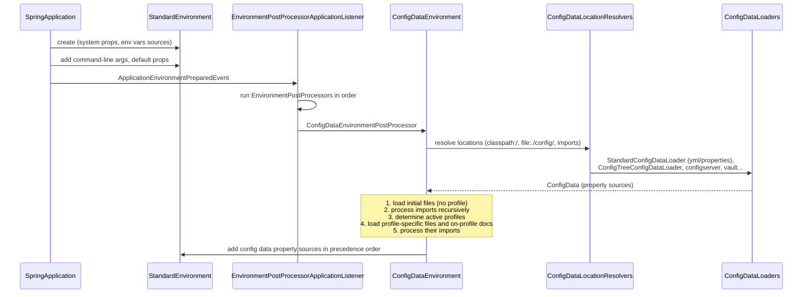
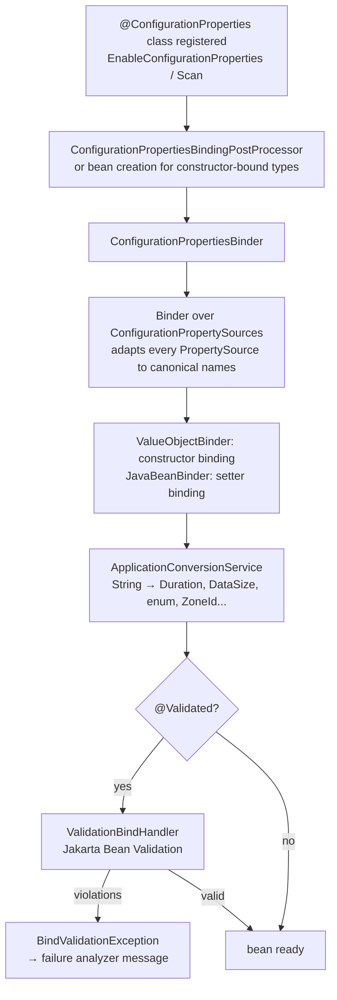
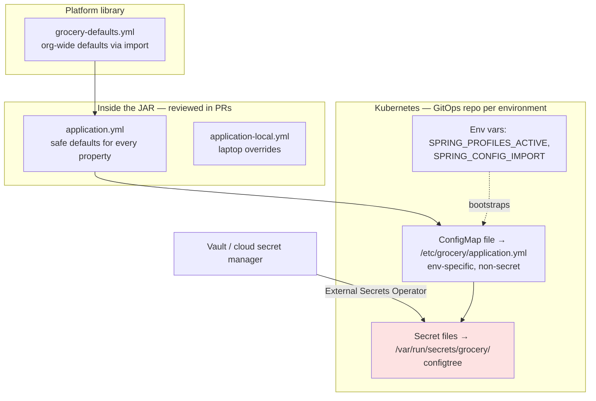

# 06 · Externalized Configuration

## 1. Introduction & Why It Matters

The same JAR must run on a developer's laptop, in CI, in staging and in three production regions — with different database URLs, Razorpay keys, delivery radius limits and feature switches. **Externalized configuration** is how Spring Boot lets one artifact adapt to each environment without rebuilding.

It's also where a surprising number of outages start:

- A ConfigMap key `SPRING_DATASOURCE_URl` (lowercase `l`) is silently ignored; the service falls back to a default and connects to the wrong database.
- A property is typed `3000` meaning milliseconds in one service and seconds in another.
- A secret ends up in `application-prod.yml`, committed to Git, and exposed via `/actuator/env`.
- An operator raises `grocery.cart.max-items` to `5000` to fix a complaint and brings down the pricing service with oversized requests — nothing validated the value.

This chapter teaches exactly **where properties come from, in what order, how they bind to typed Java objects, and how to validate and secure them**. For the grocery platform we'll design a configuration architecture: defaults in the JAR, environment specifics from Kubernetes ConfigMaps, secrets from mounted files or Vault — all bound to validated records that fail fast at startup.

### Who should read which section

| Band | Focus |
|---|---|
| B1 · 0–2 yrs | Parts 1, 2, 4 — `application.yml`, `@Value`, profiles |
| B2 · 2–5 yrs | Parts 2, 5 — `@ConfigurationProperties` records, validation, relaxed binding, env vars |
| B3 · 5–8 yrs | Parts 3, 5 — property source order, config data imports, config trees, Binder API |
| B4 · 8–12 yrs | Parts 6, 7 — configuration architecture, secrets, runtime refresh trade-offs |
| B5 · 12–15+ yrs | Parts 8, 9 — governance, config as a product, change safety |

---

## 2. Core Concepts

### 2.1 Property sources and precedence

Boot assembles the `Environment` from many **property sources**. When the same key exists in several, the **higher** source wins. From lowest to highest:

| # | Source |
|---|---|
| 1 | Default properties (`SpringApplication.setDefaultProperties`) |
| 2 | `@PropertySource` annotations on `@Configuration` classes |
| 3 | **Config data** — `application.properties`/`.yml` files and `spring.config.import`s |
| 4 | Random values (`random.*`) |
| 5 | OS environment variables |
| 6 | Java system properties (`-Dkey=value`) |
| 7 | JNDI attributes |
| 8 | `ServletContext` init parameters |
| 9 | `ServletConfig` init parameters |
| 10 | `SPRING_APPLICATION_JSON` (env var or system property with inline JSON) |
| 11 | Command-line arguments (`--key=value`) |
| 12 | `properties` attribute of tests (`@SpringBootTest(properties = ...)`) |
| 13 | `@DynamicPropertySource` in tests |
| 14 | `@TestPropertySource` |
| 15 | DevTools global settings (`~/.config/spring-boot`) when DevTools active |

!!! tip "Mental model"
    **The closer to the running process, the stronger.** Files in the JAR are weakest; env vars override them; command-line args override env vars; tests override everything.

!!! warning "`@PropertySource` is weak and late"
    It's added only when the configuration class is parsed — too late for properties that auto-configuration or logging needs early (`spring.main.*`, `logging.*`). Prefer `spring.config.import`.

### 2.2 Config data files and their order

Boot looks for `application.properties` / `application.yml` in these locations (later overrides earlier):

1. `classpath:/`
2. `classpath:/config/`
3. `file:./` (current directory)
4. `file:./config/`
5. `file:./config/*/` (immediate sub-directories)

Within the config data layer:

1. `application.yml` inside the JAR
2. `application-{profile}.yml` inside the JAR
3. `application.yml` outside the JAR
4. `application-{profile}.yml` outside the JAR

If `.properties` and `.yml` exist in the same location, `.properties` wins. **Pick one format per project.** This handbook uses YAML.

Override locations with `spring.config.location` (replaces defaults) or `spring.config.additional-location` (adds). Both must be set before config data loads — as env vars, system properties or command-line args.

### 2.3 Profiles

- Activate: `spring.profiles.active=prod` (env: `SPRING_PROFILES_ACTIVE=prod`).
- Profile-specific files: `application-prod.yml`.
- Documents inside one YAML file separated by `---`, activated with `spring.config.activate.on-profile`.
- **Profile groups:** `spring.profiles.group.prod=prod-db,prod-kafka,india`.
- **Include:** `spring.profiles.include` adds profiles (only in non-profile-specific documents).
- **Default profile:** `default`, used when none is active.
- Expressions in `@Profile` and `on-profile`: `prod & !mumbai`, `staging | perf`.

!!! warning "What profile-specific documents can't do"
    `spring.profiles.active`, `spring.profiles.include` and `spring.profiles.group` can't be set inside profile-specific files or `on-profile` documents — Boot fails at startup. Activation must come from outside the thing being activated.

### 2.4 Other activation conditions

`spring.config.activate.on-cloud-platform=kubernetes` activates a document only on a detected platform (Kubernetes, Cloud Foundry, Heroku, Azure App Service, ...).

### 2.5 `spring.config.import`

Pull more config data in, relative to the declaring file:

```yaml title="application.yml"
spring:
  config:
    import:
      - optional:file:./local-overrides.yml       # optional: don't fail if missing
      - classpath:grocery-defaults.yml
      - configtree:/var/run/secrets/grocery/       # one file per property
      - optional:configserver:                     # Spring Cloud Config
      - optional:vault://                          # Spring Cloud Vault
```

Imported files take precedence **over the file that imports them**. Import order matters: later imports win.

### 2.6 Config trees

Kubernetes mounts Secrets/ConfigMaps as **one file per key**. A config tree maps that to properties:

```text title="Example"
/var/run/secrets/grocery/
├── razorpay/
│   ├── key-id          → razorpay.key-id
│   └── key-secret      → razorpay.key-secret
└── db.password         → db.password
```

`configtree:/var/run/secrets/grocery/` — directory names become dot-separated prefixes. Values are read lazily and can be bound to `String`, `byte[]`, etc.

### 2.7 `@Value`

```java title="@Value (snippet)"
@Value("${grocery.cart.max-items:50}") int maxItems;
```

- `${key:default}` — placeholder with default.
- Works anywhere, including SpEL (`#{...}`).
- **Limited:** one value at a time, no validation, no metadata, weak relaxed binding (use canonical kebab-case names), string-typed errors at runtime.

Use `@Value` for one-offs; use `@ConfigurationProperties` for anything that is a *group* of settings.

### 2.8 `@ConfigurationProperties`

Binds a whole prefix to a typed object. Preferred style in Boot 3/4: **immutable records**.

```java title="CartProperties.java"
@ConfigurationProperties("grocery.cart")
public record CartProperties(
        @DefaultValue("50") int maxItems,
        @DefaultValue("30m") Duration reservationTtl) {}
```

Register with `@EnableConfigurationProperties(CartProperties.class)` or `@ConfigurationPropertiesScan` on the application class.

Features:

- **Constructor binding** for records/immutable classes (automatic when there is a single constructor).
- **Nested objects**, lists, maps, enums.
- **Units:** `Duration` (`10s`, `500ms`, `2h`, ISO `PT10S`), `Period` (`7d`), `DataSize` (`10MB`), with `@DurationUnit` / `@DataSizeUnit` for bare numbers.
- **Validation** with `@Validated` + Jakarta constraints — fails startup on invalid values.
- **Metadata** for IDE auto-completion via `spring-boot-configuration-processor`.
- **Third-party binding:** `@ConfigurationProperties` on a `@Bean` method binds onto an object you create.

### 2.9 Relaxed binding

`@ConfigurationProperties` matches names flexibly:

| Source | Form for `grocery.cart.maxItems` |
|---|---|
| Properties/YAML (recommended) | `grocery.cart.max-items` (kebab case) |
| Also accepted | `grocery.cart.maxItems`, `grocery.cart.max_items` |
| Environment variable | `GROCERY_CART_MAXITEMS` |
| List index in env var | `GROCERY_SELLERS_0_NAME` → `grocery.sellers[0].name` |

**Environment variable rules:** replace `.` with `_`, remove `-`, uppercase. Dashes are dropped, **not** turned into underscores — `max-items` → `MAXITEMS`.

Map keys with special characters need brackets: `grocery.gst-rates.[5.0]=...` keeps `5.0` as the key instead of treating `.` as nesting.

### 2.10 Random values

`${random.uuid}`, `${random.int}`, `${random.int(1000,2000)}`, `${random.long}`, `${random.value}` — useful for instance IDs or test ports. Not a secrets generator.

### 2.11 Secrets and encryption

Boot itself has **no built-in property encryption**. Options:

| Approach | Notes |
|---|---|
| Kubernetes Secrets as env vars | Simple; visible in `kubectl describe` to some roles; in process env |
| Kubernetes Secrets as files + `configtree:` | Better; not in env; supports rotation with restart |
| Spring Cloud Vault (`vault://`) | Dynamic secrets (DB credentials with leases), central audit |
| Cloud secret managers (AWS/Azure/GCP) | Via Spring Cloud AWS/Azure/GCP config data imports |
| External Secrets Operator / CSI driver | Syncs vault → K8s Secret files |
| Encrypted values (`{cipher}` in Spring Cloud Config) | Decrypted by config server or client |
| Jasypt (third-party) | Encrypted values in files; the key becomes the new secret |

**Never** commit secrets to Git, even in "prod-only" files.

### 2.12 Spring Cloud Config

A central server (backed by Git, Vault, JDBC, …) serving configuration per `application/profile/label`. Clients import it with `spring.config.import=configserver:http://config:8888`. Useful when many services share configuration and you want versioned, audited changes outside Kubernetes. With Kubernetes-native tooling (GitOps + ConfigMaps), many teams no longer need it.

### 2.13 Configuration metadata

`spring-boot-configuration-processor` (annotation processor) generates `META-INF/spring-configuration-metadata.json` from `@ConfigurationProperties` classes: names, types, defaults, Javadoc descriptions, deprecations. IDEs use it for completion and validation. `additional-spring-configuration-metadata.json` adds hints (allowed values) and deprecations manually.

---

## 3. How It Works Internally

### 3.1 Building the Environment



Key classes: `ConfigDataEnvironment`, `ConfigDataLocationResolver`, `ConfigDataLoader`, `StandardConfigDataLocationResolver`, `ConfigTreeConfigDataLoader`. Spring Cloud Config and Vault plug in by providing their own resolver/loader pairs (registered in `spring.factories`).

### 3.2 Binding a `@ConfigurationProperties` record



- **`ConfigurationPropertySource`** wraps each `PropertySource` and maps names to a canonical form (`grocery.cart.max-items`). Relaxed binding happens here — env var sources get a special mapper (`SystemEnvironmentPropertyMapper`).
- **`Binder`** is also a public API: `Binder.get(env).bind("grocery.cart", CartProperties.class)` — handy in `EnvironmentPostProcessor`s and conditions (Chapter 03).
- Binding failures produce clear failure-analyzer output listing property, value, origin and reason.

### 3.3 Origins — where did this value come from?

Every property value tracks its **origin** (`OriginTrackedValue`): file name and line, env var name, command-line arg. `/actuator/env/{name}` and binding error messages show it:

```text title="Example"
Property: grocery.cart.max-items
Value: "5000"
Origin: "GROCERY_CART_MAXITEMS" from property source "systemEnvironment"
Reason: must be less than or equal to 200
```

This is the single most useful debugging feature for configuration.

---

## 4. Hands-On Code — Level 1 (Beginner)

### 4.1 Your first `application.yml`

```yaml title="src/main/resources/application.yml"
spring:
  application:
    name: cart-service

server:
  port: 8082

grocery:
  cart:
    max-items: 50
    free-delivery-threshold: 499
    welcome-message: "Welcome to ${spring.application.name}!"   # (1)!
```

1. Placeholders can reference other properties.

### 4.2 Reading values with `@Value`

```java title="in/grocery/cart/web/CartInfoController.java"
package in.grocery.cart.web;

import java.math.BigDecimal;
import java.util.Map;
import org.springframework.beans.factory.annotation.Value;
import org.springframework.web.bind.annotation.GetMapping;
import org.springframework.web.bind.annotation.RestController;

@RestController
class CartInfoController {

    private final int maxItems;
    private final BigDecimal freeDeliveryThreshold;
    private final String welcome;

    CartInfoController(@Value("${grocery.cart.max-items}") int maxItems,                       // (1)!
                       @Value("${grocery.cart.free-delivery-threshold}") BigDecimal threshold,
                       @Value("${grocery.cart.welcome-message:Hello}") String welcome) {       // (2)!
        this.maxItems = maxItems;
        this.freeDeliveryThreshold = threshold;
        this.welcome = welcome;
    }

    @GetMapping("/cart/info")
    Map<String, Object> info() {
        return Map.of("maxItems", maxItems, "freeDeliveryAbove", freeDeliveryThreshold, "message", welcome);
    }
}
```

1. Constructor parameters — stays immutable and testable.
2. Default after the colon, used if the key is missing.

### 4.3 Profiles

```yaml title="src/main/resources/application-local.yml"
grocery:
  cart:
    max-items: 500           # generous limit for manual testing
logging:
  level:
    in.grocery: debug
```

```bash title="Terminal"
./gradlew bootRun --args='--spring.profiles.active=local'
curl localhost:8082/cart/info
# {"maxItems":500,"freeDeliveryAbove":499,"message":"Welcome to cart-service!"}
```

### 4.4 Overriding from outside

```bash title="Terminal"
# environment variable (relaxed binding: dots→underscores, dashes removed, uppercase)
GROCERY_CART_MAXITEMS=75 java -jar cart-service.jar

# system property
java -Dgrocery.cart.max-items=80 -jar cart-service.jar

# command-line argument (strongest of the three)
java -jar cart-service.jar --grocery.cart.max-items=90
```

!!! note "`@Value` and env vars"
    `@Value("${grocery.cart.max-items}")` still finds `GROCERY_CART_MAXITEMS` because Boot's env-var property source supports this mapping for canonical kebab-case names. It does **not** work for camelCase keys like `${grocery.cart.maxItems}` — another reason to use kebab case everywhere.

---

## 5. Hands-On Code — Level 2 (Intermediate) & Level 3 (Advanced)

### 5.1 Level 2 — Typed, validated configuration with a record

```java title="in/grocery/cart/config/CartProperties.java"
package in.grocery.cart.config;

import jakarta.validation.Valid;
import jakarta.validation.constraints.DecimalMin;
import jakarta.validation.constraints.Max;
import jakarta.validation.constraints.Min;
import jakarta.validation.constraints.NotEmpty;
import jakarta.validation.constraints.NotNull;
import java.math.BigDecimal;
import java.time.Duration;
import java.util.List;
import java.util.Map;
import org.springframework.boot.context.properties.ConfigurationProperties;
import org.springframework.boot.context.properties.bind.DefaultValue;
import org.springframework.util.unit.DataSize;
import org.springframework.validation.annotation.Validated;

/**
 * Cart behaviour for the grocery marketplace.
 *
 * @param maxItems maximum distinct line items in a cart
 * @param maxQuantityPerItem maximum units of a single SKU
 * @param reservationTtl how long stock is soft-reserved after add-to-cart
 * @param freeDelivery free delivery rules
 * @param maxPayloadSize maximum accepted cart update payload
 * @param restrictedCategories categories that need age verification
 * @param cityOverrides per-city overrides of the free delivery threshold, keyed by city code
 */
@Validated                                                                    // (1)!
@ConfigurationProperties("grocery.cart")
public record CartProperties(
        @DefaultValue("50") @Min(1) @Max(200) int maxItems,
        @DefaultValue("20") @Min(1) @Max(100) int maxQuantityPerItem,
        @DefaultValue("30m") @NotNull Duration reservationTtl,
        @Valid @NotNull FreeDelivery freeDelivery,                            // (2)!
        @DefaultValue("64KB") DataSize maxPayloadSize,
        @DefaultValue({"tobacco", "alcohol"}) @NotEmpty List<String> restrictedCategories,
        Map<String, BigDecimal> cityOverrides) {

    public record FreeDelivery(
            @NotNull @DecimalMin("0.00") BigDecimal threshold,
            @DefaultValue("true") boolean enabled) {}

    public CartProperties {                                                   // (3)!
        cityOverrides = cityOverrides == null ? Map.of() : Map.copyOf(cityOverrides);
        restrictedCategories = List.copyOf(restrictedCategories);
    }

    public BigDecimal freeDeliveryThresholdFor(String cityCode) {
        return cityOverrides.getOrDefault(cityCode, freeDelivery.threshold());
    }
}
```

1. Validation runs at startup; invalid config = the service doesn't start.
2. `@Valid` cascades validation into the nested record.
3. Compact constructor — normalize to immutable collections so nobody mutates config at runtime.

```yaml title="application.yml"
grocery:
  cart:
    max-items: 50
    reservation-ttl: 20m
    free-delivery:
      threshold: 499
    max-payload-size: 128KB
    city-overrides:
      BLR: 399
      MUM: 449
```

```java title="in/grocery/cart/CartApplication.java"
@SpringBootApplication
@ConfigurationPropertiesScan                                                  // (1)!
public class CartApplication {
    public static void main(String[] args) { SpringApplication.run(CartApplication.class, args); }
}
```

1. Finds all `@ConfigurationProperties` types under the application package.

```kotlin title="build.gradle.kts"
dependencies {
    implementation(libs.spring.boot.starter.validation)
    annotationProcessor("org.springframework.boot:spring-boot-configuration-processor")   // (1)!
}
```

1. IDE completion and documentation for `grocery.cart.*` — the Javadoc `@param` descriptions become property descriptions.

**What a bad value looks like:**

```text title="Example"
***************************
APPLICATION FAILED TO START
***************************

Description:

Binding to target in.grocery.cart.config.CartProperties failed:

    Property: grocery.cart.max-items
    Value: "5000"
    Origin: "GROCERY_CART_MAXITEMS" from property source "systemEnvironment"
    Reason: must be less than or equal to 200

Action:

Update your application's configuration
```

### 5.2 Level 2 — Testing configuration binding

```java title="in/grocery/cart/config/CartPropertiesTest.java"
package in.grocery.cart.config;

import static org.assertj.core.api.Assertions.assertThat;

import java.time.Duration;
import org.junit.jupiter.api.Test;
import org.springframework.boot.autoconfigure.AutoConfigurations;
import org.springframework.boot.autoconfigure.validation.ValidationAutoConfiguration;
import org.springframework.boot.context.properties.EnableConfigurationProperties;
import org.springframework.boot.test.context.runner.ApplicationContextRunner;
import org.springframework.context.annotation.Configuration;

class CartPropertiesTest {

    @Configuration(proxyBeanMethods = false)
    @EnableConfigurationProperties(CartProperties.class)
    static class Cfg {}

    private final ApplicationContextRunner runner = new ApplicationContextRunner()
            .withConfiguration(AutoConfigurations.of(ValidationAutoConfiguration.class)) // (1)!
            .withUserConfiguration(Cfg.class)
            .withPropertyValues("grocery.cart.free-delivery.threshold=499");

    @Test
    void appliesDefaults() {
        runner.run(ctx -> {
            CartProperties p = ctx.getBean(CartProperties.class);
            assertThat(p.maxItems()).isEqualTo(50);
            assertThat(p.reservationTtl()).isEqualTo(Duration.ofMinutes(30));
            assertThat(p.maxPayloadSize().toKilobytes()).isEqualTo(64);
            assertThat(p.freeDeliveryThresholdFor("DEL")).isEqualByComparingTo("499");
        });
    }

    @Test
    void cityOverrideWins() {
        runner.withPropertyValues("grocery.cart.city-overrides.BLR=399")
              .run(ctx -> assertThat(ctx.getBean(CartProperties.class).freeDeliveryThresholdFor("BLR"))
                      .isEqualByComparingTo("399"));
    }

    @Test
    void rejectsOutOfRangeMaxItems() {
        runner.withPropertyValues("grocery.cart.max-items=5000")
              .run(ctx -> assertThat(ctx).hasFailed()
                      .getFailure().hasMessageContaining("grocery.cart"));
    }

    @Test
    void rejectsMissingThreshold() {
        new ApplicationContextRunner()
                .withConfiguration(AutoConfigurations.of(ValidationAutoConfiguration.class))
                .withUserConfiguration(Cfg.class)
                .run(ctx -> assertThat(ctx).hasFailed());
    }
}
```

1. Provides the validator used by `@Validated` configuration properties. (Package may differ in Boot 4 — verify.)

### 5.3 Level 2 — Multi-document YAML and profile groups

```yaml title="application.yml — order-service"
spring:
  application:
    name: order-service
  profiles:
    group:
      prod: [prod-db, prod-kafka, india]          # (1)!
      staging: [staging-db, prod-kafka, india]

grocery:
  order:
    auto-cancel-unpaid-after: 15m

---
spring:
  config:
    activate:
      on-profile: india                           # (2)!
grocery:
  order:
    currency: INR
    timezone: Asia/Kolkata

---
spring:
  config:
    activate:
      on-profile: "prod-db"
  datasource:
    hikari:
      maximum-pool-size: 30

---
spring:
  config:
    activate:
      on-profile: "local | test"                   # (3)!
grocery:
  order:
    auto-cancel-unpaid-after: 2m
```

1. `SPRING_PROFILES_ACTIVE=prod` activates four profiles.
2. Documents are processed in order; later documents override earlier ones.
3. Profile expressions work in `on-profile`.

### 5.4 Level 3 — Environment variables in Kubernetes

```yaml title="k8s/order-service-configmap.yaml"
apiVersion: v1
kind: ConfigMap
metadata:
  name: order-service
data:
  SPRING_PROFILES_ACTIVE: "prod"
  SPRING_DATASOURCE_URL: "jdbc:postgresql://orders-db.prod:5432/orders"
  GROCERY_ORDER_AUTOCANCELUNPAIDAFTER: "20m"              # (1)!
  GROCERY_CART_CITYOVERRIDES_BLR: "399"                    # (2)!
  GROCERY_DELIVERY_HUBS_0_CODE: "BLR-HSR"                  # (3)!
  GROCERY_DELIVERY_HUBS_0_RADIUSKM: "6"
  GROCERY_DELIVERY_HUBS_1_CODE: "BLR-WHF"
  GROCERY_DELIVERY_HUBS_1_RADIUSKM: "8"
```

1. `auto-cancel-unpaid-after` → dashes removed → `AUTOCANCELUNPAIDAFTER`.
2. Map key via env var. Keys are lower-cased by the env mapping in some cases — **map keys with case sensitivity are unreliable through env vars**; prefer YAML via config file mounts for maps.
3. List element via `_0_`.

!!! tip "Env vars vs mounted config file"
    For more than a handful of properties, mount a ConfigMap as a file and import it: `spring.config.import=optional:file:/etc/grocery/application.yml`. YAML is reviewable, supports maps and lists naturally, and avoids env-var name mangling. Keep env vars for the few settings needed before config data loads (`SPRING_PROFILES_ACTIVE`, `SPRING_CONFIG_IMPORT`).

### 5.5 Level 3 — Secrets with config trees

```yaml title="k8s/payment-service-deployment.yaml (excerpt)"
spec:
  containers:
    - name: payment-service
      env:
        - name: SPRING_CONFIG_IMPORT
          value: "optional:configtree:/var/run/secrets/grocery/"
      volumeMounts:
        - name: razorpay
          mountPath: /var/run/secrets/grocery/grocery/payment/razorpay
          readOnly: true
  volumes:
    - name: razorpay
      secret:
        secretName: razorpay-credentials     # keys: key-id, key-secret, webhook-secret
```

Files `/var/run/secrets/grocery/grocery/payment/razorpay/key-secret` etc. become `grocery.payment.razorpay.key-secret`.

```java title="in/grocery/payment/config/RazorpayProperties.java"
package in.grocery.payment.config;

import jakarta.validation.constraints.NotBlank;
import jakarta.validation.constraints.Pattern;
import java.net.URI;
import java.time.Duration;
import org.springframework.boot.context.properties.ConfigurationProperties;
import org.springframework.boot.context.properties.bind.DefaultValue;
import org.springframework.validation.annotation.Validated;

@Validated
@ConfigurationProperties("grocery.payment.razorpay")
public record RazorpayProperties(
        @DefaultValue("true") boolean enabled,
        @DefaultValue("https://api.razorpay.com/v1") URI baseUrl,
        @Pattern(regexp = "rzp_(test|live)_[A-Za-z0-9]+") String keyId,
        String keySecret,
        String webhookSecret,
        @DefaultValue("3s") Duration timeout) {

    public RazorpayProperties {
        if (enabled && (isBlank(keySecret) || isBlank(webhookSecret) || isBlank(keyId))) {
            throw new MissingGatewayCredentialsException("RAZORPAY",
                    isBlank(keyId) ? "grocery.payment.razorpay.key-id"
                    : isBlank(keySecret) ? "grocery.payment.razorpay.key-secret"
                    : "grocery.payment.razorpay.webhook-secret");                        // (1)!
        }
    }

    private static boolean isBlank(String s) { return s == null || s.isBlank(); }

    @Override
    public String toString() {                                                        // (2)!
        return "RazorpayProperties[enabled=%s, baseUrl=%s, keyId=%s, keySecret=****, webhookSecret=****, timeout=%s]"
                .formatted(enabled, baseUrl, keyId, timeout);
    }
}
```

1. Conditional requirement ("required only if enabled") is easiest in the compact constructor; the failure analyzer from Chapter 05 formats the message.
2. Records print all components in `toString()` — override it so secrets never reach logs.

### 5.6 Level 3 — Binding third-party objects and using the Binder API

```java title="in/grocery/search/config/SearchClientConfig.java"
package in.grocery.search.config;

import java.time.Duration;
import org.springframework.boot.context.properties.ConfigurationProperties;
import org.springframework.context.annotation.Bean;
import org.springframework.context.annotation.Configuration;

@Configuration(proxyBeanMethods = false)
class SearchClientConfig {

    /** Mutable settings class from a vendor SDK (setters, no annotations). */
    public static class VendorSearchSettings {
        private String endpoint;
        private Duration readTimeout = Duration.ofSeconds(2);
        private int maxConnections = 50;
        public void setEndpoint(String endpoint) { this.endpoint = endpoint; }
        public void setReadTimeout(Duration readTimeout) { this.readTimeout = readTimeout; }
        public void setMaxConnections(int maxConnections) { this.maxConnections = maxConnections; }
        public String getEndpoint() { return endpoint; }
        public Duration getReadTimeout() { return readTimeout; }
        public int getMaxConnections() { return maxConnections; }
    }

    @Bean
    @ConfigurationProperties("grocery.search.vendor")                 // (1)!
    VendorSearchSettings vendorSearchSettings() {
        return new VendorSearchSettings();
    }
}
```

1. Boot binds `grocery.search.vendor.*` onto the returned object via setters.

**Binder API** — for code running before beans (conditions, `EnvironmentPostProcessor`s) or dynamic prefixes:

```java title="Binding third-party objects and using the Binder API (snippet)"
List<HubProperties> hubs = Binder.get(environment)
        .bind("grocery.delivery.hubs", Bindable.listOf(HubProperties.class))
        .orElse(List.of());
```

### 5.7 Level 3 — Map keys with special characters

```yaml title="application.yml"
grocery:
  tax:
    gst-rates:
      "[0.0]": [fresh-vegetables, fresh-fruits, milk]      # (1)!
      "[5.0]": [tea, edible-oil, packaged-atta]
      "[12.0]": [butter, ghee, dry-fruits]
      "[18.0]": [biscuits, soap, toothpaste]
```

```java title="TaxProperties.java"
@ConfigurationProperties("grocery.tax")
public record TaxProperties(Map<String, List<String>> gstRates) {}
```

1. Brackets (quoted in YAML) keep `5.0` as a single key. Without them, `5.0` would be interpreted as nested key `5` → `0`.

!!! note "GST rates are illustrative"
    Actual GST slabs and item classifications change by government notification. In production, rates come from a managed tax master (database with effective dates), not static configuration.

---

## 6. Hands-On Code — Level 4 (Expert / Production)

### 6.1 Configuration architecture for the grocery platform



Rules:

| Layer | Contains | Never contains |
|---|---|---|
| `application.yml` in JAR | Every property with a safe default | Secrets, environment URLs |
| Platform defaults | Org-wide timeouts, JSON, observability | Service-specific settings |
| ConfigMap file | Environment URLs, limits, feature switches | Secrets |
| Secret files | Credentials, signing keys | Anything else |
| Env vars | Bootstrap only (profile, import) | Bulk configuration |

```yaml title="services/payment-service/src/main/resources/application.yml"
spring:
  application:
    name: payment-service
  config:
    import:
      - classpath:grocery-defaults.yml                      # from grocery-platform library
      - optional:file:/etc/grocery/application.yml          # ConfigMap mount
      - optional:configtree:/var/run/secrets/grocery/       # Secret mount

grocery:
  payment:
    razorpay:
      enabled: true
      timeout: 3s
```

```yaml title="libs/grocery-platform/src/main/resources/grocery-defaults.yml"
server:
  shutdown: graceful
  max-http-request-header-size: 16KB
spring:
  lifecycle:
    timeout-per-shutdown-phase: 25s
  jackson:
    default-property-inclusion: non_null
  threads:
    virtual:
      enabled: true
management:
  endpoints:
    web:
      exposure:
        include: health,info,prometheus
  endpoint:
    env:
      show-values: never                                    # (1)!
    configprops:
      show-values: never
```

1. Since Boot 3, `/actuator/env` and `/actuator/configprops` mask **all** values by default; `when-authorized` shows them to users with the configured role. Keep production at `never` or `when-authorized` with a tight role.

### 6.2 Cross-field validation

Some rules involve several properties. Domain rule for the order service: a soft stock reservation must **outlive** the unpaid-order auto-cancel window — otherwise an order could lose its stock and still be paid a minute later.

```java title="in/grocery/order/config/OrderProperties.java"
package in.grocery.order.config;

import jakarta.validation.constraints.AssertTrue;
import jakarta.validation.constraints.NotNull;
import java.time.Duration;
import java.time.ZoneId;
import org.springframework.boot.context.properties.ConfigurationProperties;
import org.springframework.boot.context.properties.bind.DefaultValue;
import org.springframework.validation.annotation.Validated;

@Validated
@ConfigurationProperties("grocery.order")
public record OrderProperties(
        @DefaultValue("15m") @NotNull Duration autoCancelUnpaidAfter,
        @DefaultValue("20m") @NotNull Duration stockReservationTtl,
        @DefaultValue("Asia/Kolkata") ZoneId timezone,
        @DefaultValue("INR") String currency) {

    @AssertTrue(message = "stock-reservation-ttl must be longer than auto-cancel-unpaid-after")  // (1)!
    public boolean isReservationLongerThanAutoCancel() {
        return stockReservationTtl.compareTo(autoCancelUnpaidAfter) > 0;
    }
}
```

1. A boolean `is...` method is validated like a property — simple cross-field validation with standard Jakarta constraints. An operator who lowers the reservation TTL below the cancel window gets a startup failure instead of oversold stock.

!!! tip "Validation forces the domain conversation"
    Writing the constraint makes the team state the rule explicitly ("reservation must outlive auto-cancel"). Many configuration incidents are really undocumented domain rules.

### 6.3 Custom sanitizing for Actuator

When `show-values: when-authorized` is used for on-call engineers, still mask anything that looks like a secret:

```java title="in/grocery/platform/actuator/GrocerySanitizingConfig.java"
package in.grocery.platform.actuator;

import java.util.regex.Pattern;
import org.springframework.boot.actuate.endpoint.SanitizableData;
import org.springframework.boot.actuate.endpoint.SanitizingFunction;
import org.springframework.context.annotation.Bean;
import org.springframework.context.annotation.Configuration;

@Configuration(proxyBeanMethods = false)
class GrocerySanitizingConfig {

    private static final Pattern SENSITIVE =
            Pattern.compile(".*(secret|password|token|key|credential|otp|aadhaar|pan).*", Pattern.CASE_INSENSITIVE);

    @Bean
    SanitizingFunction groceryKeysSanitizer() {
        return data -> SENSITIVE.matcher(data.getKey()).matches()
                ? data.withValue(SanitizableData.SANITIZED_VALUE)
                : data;
    }

    @Bean
    SanitizingFunction secretFileSanitizer() {
        return data -> data.getPropertySource() != null
                && data.getPropertySource().getName().contains("configtree")      // (1)!
                ? data.withValue(SanitizableData.SANITIZED_VALUE)
                : data;
    }
}
```

1. Anything from mounted secrets is masked regardless of its name.

### 6.4 Startup configuration report (non-secret)

On-call engineers often need "what config is this pod running?" without Actuator access. Log a curated, safe summary once:

```java title="in/grocery/order/startup/EffectiveConfigLogger.java"
package in.grocery.order.startup;

import in.grocery.order.config.OrderProperties;
import org.slf4j.Logger;
import org.slf4j.LoggerFactory;
import org.springframework.boot.context.event.ApplicationReadyEvent;
import org.springframework.context.event.EventListener;
import org.springframework.core.env.Environment;
import org.springframework.stereotype.Component;

@Component
class EffectiveConfigLogger {

    private static final Logger log = LoggerFactory.getLogger("effective-config");

    private final OrderProperties order;
    private final Environment env;

    EffectiveConfigLogger(OrderProperties order, Environment env) {
        this.order = order;
        this.env = env;
    }

    @EventListener(ApplicationReadyEvent.class)
    void logSummary() {
        log.info("profiles={} autoCancel={} reservationTtl={} tz={} dbHost={}",
                String.join(",", env.getActiveProfiles()),
                order.autoCancelUnpaidAfter(),
                order.stockReservationTtl(),
                order.timezone(),
                hostOnly(env.getProperty("spring.datasource.url", "n/a")));          // (1)!
    }

    private static String hostOnly(String jdbcUrl) {
        return jdbcUrl.replaceAll("^jdbc:\\w+://([^/:]+).*$", "$1");
    }
}
```

1. Host only — URLs can embed credentials (`?password=`).

### 6.5 Runtime configuration changes — what's safe

| Mechanism | Changes | Risk |
|---|---|---|
| **Restart with new config** (rolling deploy) | Everything | Safest; auditable via GitOps |
| Spring Cloud `@RefreshScope` + `/actuator/refresh` | Beans in refresh scope re-created; `@ConfigurationProperties` rebound | Partial state; different pods at different values; hard to reason about |
| Spring Cloud Kubernetes config reload | Triggers refresh/restart on ConfigMap change | Same as above, automated |
| Feature-flag service | Per-request decisions | Designed for runtime change; the right tool for toggles |
| Database-backed settings with cache | Business parameters (promotions, tax master) | Needs versioning and audit |

!!! tip "Platform recommendation"
    **Configuration changes = deployments.** Use a rolling restart for config, a feature-flag service for toggles, and database-backed masters (with effective dates) for business parameters like GST rates and delivery charges. Avoid `@RefreshScope` on anything touching connection pools, security or thread pools.

### 6.6 Integration test: full config layering

```java title="in/grocery/payment/config/ConfigLayeringTest.java"
package in.grocery.payment.config;

import static org.assertj.core.api.Assertions.assertThat;

import java.nio.file.Files;
import java.nio.file.Path;
import org.junit.jupiter.api.Test;
import org.junit.jupiter.api.io.TempDir;
import org.springframework.boot.WebApplicationType;
import org.springframework.boot.builder.SpringApplicationBuilder;
import org.springframework.boot.context.properties.EnableConfigurationProperties;
import org.springframework.context.annotation.Configuration;

class ConfigLayeringTest {

    @Configuration(proxyBeanMethods = false)
    @EnableConfigurationProperties(RazorpayProperties.class)
    static class Cfg {}

    @Test
    void secretsFromConfigTreeAndOverridesFromFile(@TempDir Path tmp) throws Exception {
        Path secrets = Files.createDirectories(tmp.resolve("secrets/grocery/payment/razorpay"));
        Files.writeString(secrets.resolve("key-id"), "rzp_test_ABC123");
        Files.writeString(secrets.resolve("key-secret"), "s3cr3t\n");                 // trailing newline
        Files.writeString(secrets.resolve("webhook-secret"), "whk");

        Path overrides = tmp.resolve("application.yml");
        Files.writeString(overrides, "grocery.payment.razorpay.timeout: 5s\n");

        try (var ctx = new SpringApplicationBuilder(Cfg.class)
                .web(WebApplicationType.NONE)
                .properties("spring.config.import=optional:file:" + overrides + ",configtree:" + tmp.resolve("secrets") + "/")
                .run()) {
            RazorpayProperties p = ctx.getBean(RazorpayProperties.class);
            assertThat(p.keyId()).isEqualTo("rzp_test_ABC123");
            assertThat(p.keySecret()).isEqualTo("s3cr3t\n");                          // (1)!
            assertThat(p.timeout()).hasSeconds(5);
            assertThat(p.toString()).doesNotContain("s3cr3t");
        }
    }
}
```

1. **Gotcha found by the test:** config trees preserve file content exactly, including a trailing newline from `echo` or `kubectl create secret --from-file`. Trim in the compact constructor (`keySecret = keySecret == null ? null : keySecret.strip();`) — a classic cause of "invalid signature" errors with payment webhooks.

---

## 7. Spring Boot 3 vs 4 & Migration

| Topic | Boot 3.5 | Boot 4.x |
|---|---|---|
| Records + constructor binding | ✅ (`@ConstructorBinding` only needed with multiple constructors) | ✅ |
| Actuator value sanitization | All values masked by default (since 3.0) | Same |
| `env:` config import (properties from an env var) | Added in 3.5 (verify) | Available |
| Property renames | — | Some properties renamed/removed with modularization — use `spring-boot-properties-migrator` |
| Null-safety of properties classes | Spring `@Nullable` | JSpecify — mark optional components `@Nullable` |
| `@ConfigurationProperties` in auto-config modules | One module | Spread across technology modules; metadata per module |

=== "Spring Boot 3.5"

    ```java title="SearchProperties.java"
    import org.springframework.lang.Nullable;

    @ConfigurationProperties("grocery.search")
    public record SearchProperties(@Nullable URI fallbackEndpoint, @DefaultValue("2s") Duration timeout) {}
    ```

=== "Spring Boot 4.x"

    ```java title="SearchProperties.java"
    import org.jspecify.annotations.Nullable;

    @ConfigurationProperties("grocery.search")
    public record SearchProperties(@Nullable URI fallbackEndpoint, @DefaultValue("2s") Duration timeout) {}
    ```

### Properties migrator

```kotlin title="Kotlin"
runtimeOnly("org.springframework.boot:spring-boot-properties-migrator")   // one release only
```

At startup it reports renamed/removed properties with their origin and temporarily maps old names to new ones. **Remove it** once the report is clean.

### Migration checklist

- [ ] Add `spring-boot-properties-migrator`, run each service in staging, fix all reported keys, remove the migrator.
- [ ] Search ConfigMaps/Helm values (not just `src/main/resources`) for renamed properties — env-var forms included.
- [ ] Replace `@ConstructorBinding` on single-constructor types (no longer needed since 3.0).
- [ ] Switch nullable annotations to JSpecify on properties classes.
- [ ] Recheck `spring.autoconfigure.exclude` and any property keyed by class name.
- [ ] Verify Actuator `show-values` settings after upgrade.

---

## 8. Production Playbook

### Best practices

1. **Every property has a safe default in `application.yml`** — environments override only what differs.
2. **`@ConfigurationProperties` records + `@Validated`** for anything beyond a one-off value. Fail fast.
3. **Kebab-case everywhere** in files; document env-var forms in the service README.
4. **Units in the value** (`30s`, `64KB`), never unit-less numbers.
5. **Secrets only from secret stores** (config tree / Vault); override `toString()` on properties records holding secrets; trim values.
6. **Config changes = deployments** via GitOps; feature flags for runtime toggles.
7. **Metadata processor** in every module with properties.
8. **Know where a value came from** — use origins in `/actuator/env/{name}` (secured).

### Anti-patterns

❌ **Scattered `@Value` for a group of settings**

```java title="Anti-patterns (snippet)"
@Value("${grocery.delivery.radius-km}") int radius;
@Value("${grocery.delivery.slot-minutes}") int slot;
@Value("${grocery.delivery.max-orders-per-slot}") int maxOrders;   // no validation, no defaults doc, repeated in 4 classes
```

✅ One `DeliveryProperties` record injected where needed.

❌ **Unit-less durations**

```yaml title="Configuration"
grocery.payment.timeout: 3000     # ms? s? Depends on who wrote the code
```

✅ `grocery.payment.timeout: 3s` bound to `Duration`.

❌ **Secrets in YAML "just for prod"**, or `show-values: always` in production.

❌ **Profiles per environment containing *everything*** (`application-prod.yml` with 300 lines duplicated from staging) — drift guaranteed. Profiles should hold small deltas; environments differ through external config.

❌ **Using profiles as feature flags** (`@Profile("express-delivery")`) — mixes deployment environment with product behaviour. Use properties + conditions (Chapter 03) or a flag service.

❌ **Mutable `@ConfigurationProperties` beans modified at runtime** by application code.

### Troubleshooting

| Symptom | Cause | Fix |
|---|---|---|
| Env var ignored | Wrong mapping (dash turned into `_`, typo, lowercase) | `GROCERY_CART_MAXITEMS`; check `/actuator/env` |
| Value from wrong file | Precedence misunderstanding; `.properties` beats `.yml` in same location | Check origin in `/actuator/env/{key}` |
| `spring.profiles.active` in profile file fails startup | Not allowed in profile-specific docs | Set from env/args; use groups |
| `@PropertySource` values not seen by auto-config | Loaded too late | `spring.config.import` |
| Map key split into nested keys | Dots in key | Bracket notation `"[5.0]"` |
| Webhook signature mismatch | Trailing newline in mounted secret | Strip values |
| `Failed to bind properties ... No converter found` | Unsupported type or wrong format | Use supported types; register `@ConfigurationPropertiesBinding` converter |
| Record property always null | Name mismatch (camelCase vs kebab), missing registration | `@ConfigurationPropertiesScan`; check metadata |
| Secret visible in logs | Record `toString()` | Override `toString()` |

### Production checklist

- [ ] All settings grouped into validated `@ConfigurationProperties` records
- [ ] Safe defaults in the JAR; environment deltas only in ConfigMaps
- [ ] Secrets via config tree / Vault; none in Git; `toString()` masked; values trimmed
- [ ] Actuator `env`/`configprops` values `never` or `when-authorized`
- [ ] Custom `SanitizingFunction` for domain-sensitive keys
- [ ] Properties migrator run before each major upgrade
- [ ] Configuration metadata generated; README lists env-var forms
- [ ] Config changes flow through GitOps with review

---

## 9. Interview Questions & Answers

### B1 · 0–2 years

??? question "B1 · `application.properties` vs `application.yml`?"
    **Short answer:** Same content, different syntax. YAML is hierarchical and supports multiple documents with `---`. If both exist in the same location, `.properties` wins. Pick one.

??? question "B1 · How do you read a property in code?"
    **Short answer:** `@Value("${key:default}")` for single values, or a `@ConfigurationProperties` class/record for a group. Prefer the latter.

??? question "B1 · What is a Spring profile and how do you activate one?"
    **Short answer:** A named configuration set. Activate via `spring.profiles.active` (property, env var `SPRING_PROFILES_ACTIVE`, or `--spring.profiles.active=`). Files `application-{profile}.yml` load for active profiles.

??? question "B1 · How would you override a property without changing the JAR?"
    **Short answer:** Env var, system property (`-D`), command-line arg (`--key=value`), or an external `application.yml` in `./config/` or via `spring.config.import`.

??? question "B1 · What's the env var name for `grocery.cart.max-items`?"
    **Short answer:** `GROCERY_CART_MAXITEMS` — dots to underscores, dashes removed, uppercase.

    **Red flags:** `GROCERY_CART_MAX_ITEMS` (would map to `grocery.cart.max.items`).

### B2 · 2–5 years

??? question "B2 · Why prefer `@ConfigurationProperties` over `@Value`?"
    **Short answer:** Type safety, grouping, validation, relaxed binding, IDE metadata, immutability with records, easier testing, and one place to document settings.

??? question "B2 · How do you validate configuration at startup?"
    **Short answer:** `@Validated` on the properties class plus Jakarta constraints (`@Min`, `@NotBlank`, `@Valid` for nested), with `spring-boot-starter-validation`. Cross-field rules via `@AssertTrue` methods or compact-constructor checks.

??? question "B2 · How are `Duration` and `DataSize` properties written?"
    **Short answer:** With units: `30s`, `500ms`, `2h`, `7d` (Period) or ISO-8601 (`PT30S`); sizes `10MB`, `64KB`. Bare numbers default to ms/bytes unless `@DurationUnit`/`@DataSizeUnit` is set.

??? question "B2 · What are profile groups?"
    **Short answer:** `spring.profiles.group.prod=prod-db,prod-kafka` — activating `prod` activates the members. Lets you compose small focused profiles.

??? question "B2 · How do you bind a list or map from environment variables?"
    **Short answer:** Lists with index segments: `GROCERY_HUBS_0_CODE`. Maps with key segments, but case and special characters are unreliable — prefer mounted YAML for maps.

??? question "B2 · How do you test a `@ConfigurationProperties` record?"
    **Short answer:** `ApplicationContextRunner` with `withPropertyValues(...)`, asserting bound values and `hasFailed()` for invalid input — no full app context needed.

### B3 · 5–8 years

??? question "B3 · Explain property source precedence in Spring Boot."
    **Short answer:** Lowest: defaults, `@PropertySource`, config data files (JAR then external, generic then profile-specific), random; then env vars, system properties, JNDI/servlet params, `SPRING_APPLICATION_JSON`, command-line args; tests add properties, `@DynamicPropertySource`, `@TestPropertySource` on top.

??? question "B3 · How does `spring.config.import` work and what is a config tree?"
    **Short answer:** Imports additional config data (files, config trees, config server, Vault) resolved by `ConfigDataLocationResolver`/`ConfigDataLoader` pairs; imported sources override the importing file. A config tree maps a directory of files (one per key, e.g. Kubernetes Secret mounts) to properties.

??? question "B3 · Why is `@PropertySource` discouraged in Boot apps?"
    **Short answer:** It's added when configuration classes are parsed — after logging and some auto-configuration decisions — and has low precedence. `spring.config.import` loads during environment preparation.

??? question "B3 · What is the `Binder` API and when do you use it?"
    **Short answer:** Programmatic binding over `ConfigurationPropertySource`s — `Binder.get(env).bind(prefix, Bindable.of(T))`. Used in `EnvironmentPostProcessor`s, conditions, `BeanRegistrar`s — anywhere before or outside bean creation.

??? question "B3 · How does relaxed binding work for environment variables internally?"
    **Short answer:** `ConfigurationPropertySources` adapt the system environment source with `SystemEnvironmentPropertyMapper`, which maps `GROCERY_CART_MAXITEMS` to candidate canonical names (`grocery.cart.maxitems`) and matches against the canonical form of the target (`grocery.cart.max-items` → dashes ignored for comparison).

### B4 · 8–12 years

??? question "B4 · Design the configuration and secrets architecture for 26 services on Kubernetes."
    **Short answer:** Safe defaults in JARs; platform-wide defaults via an imported file from a shared library; per-environment non-secret config as ConfigMap files in a GitOps repo; secrets from Vault/cloud manager synced as files and imported as config trees; env vars only for bootstrap; validated records; Actuator sanitization; config changes deploy via rolling restart; feature flags for runtime toggles; business parameters in databases with audit.

??? question "B4 · Would you use `@RefreshScope`? When not?"
    **Short answer:** Rarely. It recreates beans lazily on refresh, so pods drift and partial state appears. Never for data sources, security, thread pools or clients with connection pools. Prefer restarts; use feature flags or DB-backed settings for runtime changes.

??? question "B4 · How do you rotate a database password with zero downtime?"
    **Short answer:** Dual credentials (old and new valid simultaneously), update secret, rolling restart so new pods use the new password, then revoke the old. With Vault dynamic secrets, leases rotate automatically and Hikari pools must be recreated (`max-lifetime` shorter than lease). Test in staging.

### B5 · 12–15+ years

??? question "B5 · Configuration caused 40% of last year's incidents. What do you change?"
    **Short answer:** Treat config as code: typed validated records, schema/metadata, GitOps review with owners, policy checks in CI (e.g. conftest/OPA on Helm values), staged rollouts of config like code, drift detection, config diff in deployment notes, startup summaries, and clear separation of config vs flags vs business data. Measure change failure rate for config changes separately.

??? question "B5 · Spring Cloud Config vs Kubernetes-native config — which would you pick?"
    **Short answer:** With Kubernetes and GitOps already in place, native ConfigMaps/Secrets + External Secrets usually win: fewer moving parts, same review workflow as manifests. Spring Cloud Config fits multi-runtime estates (VMs + K8s), central encryption needs, or teams without GitOps. Either way, avoid runtime refresh as the default change mechanism.

### Scenario questions

??? example "Scenario · After a ConfigMap change, some pods use the new delivery radius and some the old"
    The team used Spring Cloud Kubernetes reload with `@RefreshScope` on `DeliveryRadiusService`. Refresh events reached pods at different times, and one pod's refresh failed validation and kept old values silently. Fix: remove runtime reload for this setting, roll a restart through the Deployment (config hash annotation triggers rollout), and move per-hub radius to the delivery master data with an admin UI and audit.

??? example "Scenario · Razorpay webhooks fail signature verification only in production"
    The webhook secret was created with `kubectl create secret generic --from-file`, storing a trailing newline, and mounted as a config tree. Locally the env var had no newline. Fix: strip in the properties compact constructor, add a test (see 6.6), and document secret creation with `--from-literal` or `printf`.

### Coding exercise

!!! example "Exercise · Delivery hubs configuration"
    Bind this YAML to validated records. Rules: at least one hub; codes unique and matching `[A-Z]{3}-[A-Z]{3}`; radius 1–15 km; `pincode-prefixes` non-empty 3-digit strings. Provide a method `hubFor(String pincode)` returning the first hub whose prefix matches. Test valid and invalid cases.

    ```yaml title="application.yml"
    grocery:
      delivery:
        hubs:
          - code: BLR-HSR
            radius-km: 6
            pincode-prefixes: ["560"]
          - code: MUM-AND
            radius-km: 5
            pincode-prefixes: ["400"]
    ```

??? success "Solution"
    ```java title="DeliveryProperties.java"
    package in.grocery.delivery.config;

    import jakarta.validation.Valid;
    import jakarta.validation.constraints.AssertTrue;
    import jakarta.validation.constraints.Max;
    import jakarta.validation.constraints.Min;
    import jakarta.validation.constraints.NotEmpty;
    import jakarta.validation.constraints.Pattern;
    import java.util.List;
    import java.util.Optional;
    import org.springframework.boot.context.properties.ConfigurationProperties;
    import org.springframework.validation.annotation.Validated;

    @Validated
    @ConfigurationProperties("grocery.delivery")
    public record DeliveryProperties(@NotEmpty List<@Valid Hub> hubs) {

        public record Hub(
                @Pattern(regexp = "[A-Z]{3}-[A-Z]{3}") String code,
                @Min(1) @Max(15) int radiusKm,
                @NotEmpty List<@Pattern(regexp = "\\d{3}") String> pincodePrefixes) {}

        public DeliveryProperties {
            hubs = hubs == null ? List.of() : List.copyOf(hubs);
        }

        @AssertTrue(message = "hub codes must be unique")
        public boolean isHubCodesUnique() {
            return hubs.stream().map(Hub::code).distinct().count() == hubs.size();
        }

        public Optional<Hub> hubFor(String pincode) {
            return hubs.stream()
                    .filter(h -> h.pincodePrefixes().stream().anyMatch(pincode::startsWith))
                    .findFirst();
        }
    }
    ```

    ```java title="DeliveryPropertiesTest.java"
    package in.grocery.delivery.config;

    import static org.assertj.core.api.Assertions.assertThat;

    import org.junit.jupiter.api.Test;
    import org.springframework.boot.autoconfigure.AutoConfigurations;
    import org.springframework.boot.autoconfigure.validation.ValidationAutoConfiguration;
    import org.springframework.boot.context.properties.EnableConfigurationProperties;
    import org.springframework.boot.test.context.runner.ApplicationContextRunner;
    import org.springframework.context.annotation.Configuration;

    class DeliveryPropertiesTest {

        @Configuration(proxyBeanMethods = false)
        @EnableConfigurationProperties(DeliveryProperties.class)
        static class Cfg {}

        private final ApplicationContextRunner runner = new ApplicationContextRunner()
                .withConfiguration(AutoConfigurations.of(ValidationAutoConfiguration.class))
                .withUserConfiguration(Cfg.class);

        @Test
        void bindsAndRoutes() {
            runner.withPropertyValues(
                    "grocery.delivery.hubs[0].code=BLR-HSR",
                    "grocery.delivery.hubs[0].radius-km=6",
                    "grocery.delivery.hubs[0].pincode-prefixes[0]=560",
                    "grocery.delivery.hubs[1].code=MUM-AND",
                    "grocery.delivery.hubs[1].radius-km=5",
                    "grocery.delivery.hubs[1].pincode-prefixes[0]=400")
                  .run(ctx -> {
                      var p = ctx.getBean(DeliveryProperties.class);
                      assertThat(p.hubFor("560034")).get().extracting(DeliveryProperties.Hub::code).isEqualTo("BLR-HSR");
                      assertThat(p.hubFor("110001")).isEmpty();
                  });
        }

        @Test
        void rejectsDuplicateCodes() {
            runner.withPropertyValues(
                    "grocery.delivery.hubs[0].code=BLR-HSR", "grocery.delivery.hubs[0].radius-km=6",
                    "grocery.delivery.hubs[0].pincode-prefixes[0]=560",
                    "grocery.delivery.hubs[1].code=BLR-HSR", "grocery.delivery.hubs[1].radius-km=4",
                    "grocery.delivery.hubs[1].pincode-prefixes[0]=560")
                  .run(ctx -> assertThat(ctx).hasFailed());
        }

        @Test
        void rejectsRadiusOutOfRange() {
            runner.withPropertyValues(
                    "grocery.delivery.hubs[0].code=BLR-HSR", "grocery.delivery.hubs[0].radius-km=40",
                    "grocery.delivery.hubs[0].pincode-prefixes[0]=560")
                  .run(ctx -> assertThat(ctx).hasFailed());
        }
    }
    ```

---

## Key Takeaways

- The `Environment` is an **ordered stack of property sources**; closer to the process wins.
- Config data loads from **standard locations**, then **imports**, then **profile-specific** files — know the order and use **origins** to debug.
- **`@ConfigurationProperties` records + `@Validated`** give typed, immutable, fail-fast configuration; `@Value` is for one-offs.
- **Relaxed binding** maps `GROCERY_CART_MAXITEMS` to `grocery.cart.max-items`; use kebab case in files.
- **Secrets** come from config trees or Vault — mask `toString()`, trim values, sanitize Actuator.
- **Config changes are deployments**; runtime toggles belong in a flag service.
- Before Boot 4, run the **properties migrator**.

## Further Reading

- Spring Boot Reference — *Core Features › Externalized Configuration* (all subsections, especially *Config Data*, *Type-safe Configuration Properties*, *Relaxed Binding*, *Configuration Trees*)
- Spring Boot Reference — *Configuration Metadata*
- Spring Boot Reference — *Actuator › Sanitize Sensitive Values*
- Spring Cloud Config and Spring Cloud Vault reference documentation

---

[:material-arrow-left: 05 Spring Boot Fundamentals](05-spring-boot-fundamentals.md) · [07 Logging :material-arrow-right:](07-logging.md)
