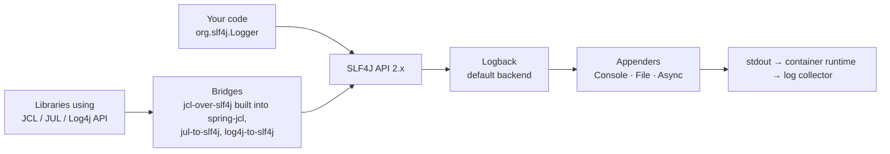
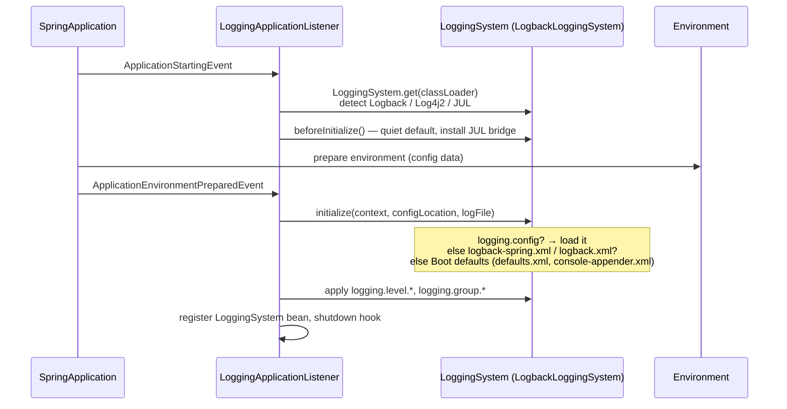
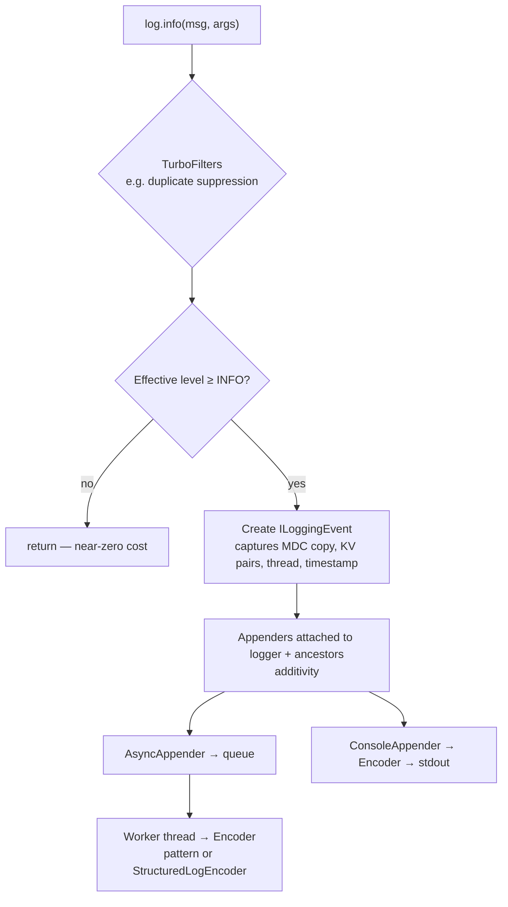
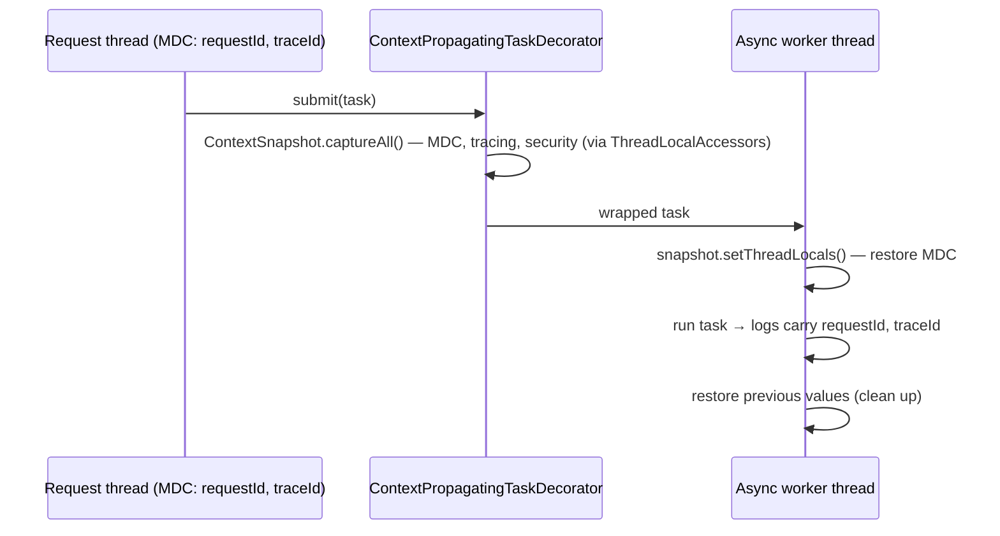

# 07 · Logging

## 1. Introduction & Why It Matters

At 9:40 p.m. on a Diwali sale night, customers in Pune report "payment done but order not placed". You have 26 services, 180 pods and one question: *what happened to order `ORD-7f3a91c2`?* The answer is only as good as your logs.

Good logging is not "more `log.info`". It is:

- **Structured** — JSON with consistent fields, so Loki/Elasticsearch/CloudWatch can filter by `orderId` instead of grepping text.
- **Correlated** — every line carries `traceId`/`requestId`, so one search shows the order's path through gateway → order → payment → inventory.
- **Leveled correctly** — `ERROR` pages someone; `DEBUG` is off in production but can be switched on for one package without a restart.
- **Safe** — no mobile numbers, OTPs, card data or Aadhaar numbers in logs (India's DPDP Act makes this a legal issue, not just a hygiene one).
- **Cheap** — asynchronous where needed, never blocking request threads on disk I/O, and not so voluminous that the log bill exceeds the compute bill.

Spring Boot gives you a solid default (SLF4J + Logback, sensible patterns), built-in **structured logging** since 3.4, runtime level changes via Actuator, and automatic trace correlation with Micrometer Tracing. This chapter turns those into a platform standard.

### Who should read which section

| Band | Focus |
|---|---|
| B1 · 0–2 yrs | Parts 1, 2, 4 — SLF4J, levels, parameterized messages |
| B2 · 2–5 yrs | Parts 2, 5 — log groups, files, `logback-spring.xml`, MDC |
| B3 · 5–8 yrs | Parts 3, 5, 6 — logging system bootstrap, structured logging, async appenders, context propagation |
| B4 · 8–12 yrs | Parts 6, 8 — platform logging standard, PII masking, cost control |
| B5 · 12–15+ yrs | Parts 8, 9 — logs vs metrics vs traces, compliance, observability strategy |

---

## 2. Core Concepts

### 2.1 The logging stack



- **SLF4J** is the API you code against. Never import Logback or Log4j classes in business code.
- **Logback** is Boot's default implementation (`spring-boot-starter-logging`, included by every starter).
- **Log4j2** is the alternative (`spring-boot-starter-log4j2`, excluding `spring-boot-starter-logging`).
- Bridges route other logging APIs (JUL, JCL, Log4j API) into SLF4J so everything ends up in one place.

### 2.2 Levels

| Level | Use for | Production default |
|---|---|---|
| `ERROR` | A request/operation failed and needs attention; typically alerts | On |
| `WARN` | Unexpected but handled (retry succeeded, fallback used, validation of external data failed) | On |
| `INFO` | Business milestones and lifecycle (order placed, service started) — sparingly | On |
| `DEBUG` | Diagnostic detail for developers | Off; enable per package on demand |
| `TRACE` | Very fine-grained (framework internals, payloads in dev) | Off |

Rule: **one ERROR per failure**, logged where it is *handled*, not at every layer it passes through.

### 2.3 Parameterized messages and the fluent API

```java title="Parameterized messages and the fluent API (snippet)"
log.info("Order {} placed for ₹{}", orderId, total);       // ✅ formatting only if INFO enabled
log.info("Order " + orderId + " placed");                  // ❌ string built even when disabled
log.error("Payment failed for order {}", orderId, ex);     // ✅ exception as last arg → stack trace
```

SLF4J 2's **fluent API** adds structured key-value pairs:

```java title="Parameterized messages and the fluent API (snippet)"
log.atInfo()
   .setMessage("Order placed")
   .addKeyValue("orderId", orderId)
   .addKeyValue("amount", total)
   .log();
```

With structured logging, key-value pairs become JSON fields — searchable without parsing the message.

### 2.4 Configuring through properties

| Property | Example | Meaning |
|---|---|---|
| `logging.level.<logger>` | `logging.level.in.grocery.payment: debug` | Level per package/class |
| `logging.level.root` | `warn` | Default for everything |
| `logging.group.<name>` | `logging.group.checkout: in.grocery.cart, in.grocery.order` | Named set of loggers |
| `logging.level.<group>` | `logging.level.checkout: debug` | Level for the whole group |
| `logging.pattern.console` | `%d %-5level [%thread] %logger - %msg%n` | Text pattern |
| `logging.file.name` | `/var/log/grocery/order.log` | Enable file output |
| `logging.logback.rollingpolicy.*` | `max-file-size: 50MB`, `max-history: 7` | Rolling for files |
| `logging.structured.format.console` | `ecs` | JSON to console (Boot 3.4+) |
| `logging.threshold.console` | `info` | Minimum level for an appender |

Built-in groups: **`web`** (Spring MVC, codecs, HTTP logging) and **`sql`** (JDBC, jOOQ, Hibernate SQL).

### 2.5 Custom configuration files

| File | Loaded by | Spring extensions (`<springProfile>`, `<springProperty>`) |
|---|---|---|
| `logback-spring.xml` | Spring Boot, after the Environment is ready | ✅ |
| `logback.xml` | Logback itself, very early | ❌ |
| `log4j2-spring.xml` | Spring Boot | ✅ (Spring lookups) |

Always use the **`-spring`** variants.

### 2.6 Structured logging (Boot 3.4+)

Built-in JSON formats:

| Format | For |
|---|---|
| `ecs` | Elastic Common Schema — Elasticsearch/OpenSearch/Kibana |
| `gelf` | Graylog Extended Log Format |
| `logstash` | Logstash JSON |
| Fully-qualified class name | Your own `StructuredLogFormatter` |

```yaml title="application.yml"
logging:
  structured:
    format:
      console: ecs
    ecs:
      service:
        name: order-service
        version: 1.4.2
        environment: prod
```

MDC entries and SLF4J key-value pairs are included in the JSON output.

### 2.7 MDC — Mapped Diagnostic Context

A per-thread map (`MDC.put("orderId", id)`) whose entries appear on every log line from that thread. Used for request IDs, customer IDs (hashed), tenant/seller IDs.

!!! warning "MDC is thread-local"
    It doesn't follow your work to another thread (`@Async`, `CompletableFuture`, virtual-thread executors, Reactor). Use **context propagation** (Micrometer's `context-propagation` library, `ContextPropagatingTaskDecorator`) or tracing, which handles this for you. And always **remove** entries in `finally` — pooled threads carry stale MDC into the next request.

### 2.8 Trace correlation

With Micrometer Tracing on the classpath (Chapter 27), Boot puts `traceId` and `spanId` into the MDC and the default console pattern includes them via `logging.pattern.correlation`. With structured logging, ECS output includes them automatically.

### 2.9 Runtime level changes

Actuator's `loggers` endpoint:

```bash title="Terminal"
curl -s localhost:8080/actuator/loggers/in.grocery.payment
curl -X POST localhost:8080/actuator/loggers/in.grocery.payment \
     -H 'Content-Type: application/json' -d '{"configuredLevel":"DEBUG"}'
```

Changes are per pod and lost on restart — which is usually what you want for diagnostics.

### 2.10 Logs, metrics, traces — know the difference

| Signal | Answers | Cost profile |
|---|---|---|
| **Logs** | What exactly happened in this case? | Grows with traffic × verbosity |
| **Metrics** | How much/how often/how fast, overall? | Grows with cardinality, not traffic |
| **Traces** | Where did time go across services for this request? | Sampled |

Don't use logs for things metrics answer ("count of orders per minute") — it's expensive and slow.

---

## 3. How It Works Internally

### 3.1 Logging system bootstrap



Key points:

- Logging initializes **after** the Environment is prepared, so `logging.*` properties from all sources (including config imports and profiles) apply.
- It initializes **before** the ApplicationContext — which is why logging can't be configured with beans, and why `@PropertySource` can't affect logging.
- `logback.xml` (non-spring) is picked up by Logback itself when the first logger is created — before Boot's properties exist.
- `LoggingSystemProperties` copies Boot properties (e.g. `logging.pattern.console`) into system properties like `CONSOLE_LOG_PATTERN` that Boot's Logback defaults reference.

### 3.2 A log call, end to end



- Level check first: disabled levels cost one comparison. **Argument evaluation still happens** — avoid expensive calls in log arguments (`log.debug("{}", toJson(order))`), or guard with `isDebugEnabled()` / use suppliers via the fluent API.
- **Additivity:** an event goes to the logger's appenders and all ancestors' appenders unless `additivity="false"` — the cause of duplicated log lines.
- **Structured logging** plugs in as Boot's `StructuredLogEncoder`, which delegates to the chosen `StructuredLogFormatter`.

### 3.3 Context propagation across threads



Boot auto-configures `ThreadPoolTaskExecutor`/`SimpleAsyncTaskExecutor` builders to apply a single `TaskDecorator` bean if one exists; define `ContextPropagatingTaskDecorator` as that bean.

---

## 4. Hands-On Code — Level 1 (Beginner)

### 4.1 Logging in a service

```java title="in/grocery/order/service/OrderService.java"
package in.grocery.order.service;

import java.math.BigDecimal;
import org.slf4j.Logger;
import org.slf4j.LoggerFactory;
import org.springframework.stereotype.Service;

@Service
public class OrderService {

    private static final Logger log = LoggerFactory.getLogger(OrderService.class);   // (1)!

    public String place(String customerId, BigDecimal total) {
        log.debug("Placing order for customer {} total {}", customerId, total);      // (2)!
        String orderId = "ORD-" + Long.toHexString(System.nanoTime());
        log.info("Order {} placed, total ₹{}", orderId, total);
        return orderId;
    }

    public void cancel(String orderId) {
        try {
            throw new IllegalStateException("Order already dispatched");
        } catch (IllegalStateException ex) {
            log.warn("Cancel rejected for order {}: {}", orderId, ex.getMessage());    // (3)!
            throw ex;
        }
    }
}
```

1. One `static final` logger per class, named after the class.
2. Parameterized — no string concatenation.
3. Expected business rejection → `WARN` with the message, no stack trace. The exception is re-thrown and turned into a 409 by the error handler (Chapter 10), which is where a *failure* would be logged.

### 4.2 Levels and groups in `application.yml`

```yaml title="application.yml"
logging:
  level:
    root: info
    in.grocery: info
    org.hibernate.SQL: warn
  group:
    checkout: in.grocery.cart, in.grocery.order, in.grocery.payment

---
spring.config.activate.on-profile: local
logging:
  level:
    checkout: debug            # whole group at once
    sql: debug                 # built-in group: shows SQL statements
```

### 4.3 Default console output

```text title="Output"
2026-09-22T11:05:14.231+05:30  INFO 48213 --- [order-service] [nio-8083-exec-1] [3f1c9a2e7b0d4c11-8a7e2f19c4d05b33] i.g.order.service.OrderService : Order ORD-1a2b3c placed, total ₹578.00
```

Timestamp, level, PID, application name, thread, **trace correlation** (when tracing is present), abbreviated logger, message.

### 4.4 Change a level at runtime

```yaml title="application.yml"
management:
  endpoints:
    web:
      exposure:
        include: health,info,loggers
```

```bash title="Terminal"
curl -X POST localhost:8083/actuator/loggers/in.grocery.order \
     -H 'Content-Type: application/json' -d '{"configuredLevel":"DEBUG"}'
# ... reproduce the issue ...
curl -X POST localhost:8083/actuator/loggers/in.grocery.order \
     -H 'Content-Type: application/json' -d '{"configuredLevel":null}'   # reset
```

!!! danger "Secure the loggers endpoint"
    Anyone who can POST to `/actuator/loggers` can turn on `TRACE` for everything and flood your disks or leak payloads. Expose it only on the management port behind authentication (Chapter 27).

---

## 5. Hands-On Code — Level 2 (Intermediate) & Level 3 (Advanced)

### 5.1 Level 2 — Structured JSON logs with built-in ECS

```yaml title="application.yml"
spring:
  application:
    name: order-service
logging:
  structured:
    format:
      console: ecs
    ecs:
      service:
        name: ${spring.application.name}
        version: "@project.version@"      # or from build-info
        environment: ${GROCERY_ENV:local}
```

```java title="Structured JSON logs with built-in ECS (snippet)"
log.atInfo()
   .setMessage("Order placed")
   .addKeyValue("orderId", orderId)
   .addKeyValue("amountPaise", total.movePointRight(2).longValueExact())
   .addKeyValue("pincode", pincode)
   .log();
```

```json title="Output (formatted for reading)"
{
  "@timestamp": "2026-09-22T05:35:14.231Z",
  "log.level": "INFO",
  "process.pid": 48213,
  "process.thread.name": "tomcat-handler-12",
  "service.name": "order-service",
  "service.version": "1.4.2",
  "service.environment": "prod",
  "log.logger": "in.grocery.order.service.OrderService",
  "message": "Order placed",
  "traceId": "3f1c9a2e7b0d4c11",
  "spanId": "8a7e2f19c4d05b33",
  "orderId": "ORD-1a2b3c",
  "amountPaise": 57800,
  "pincode": "411001",
  "ecs.version": "8.11"
}
```

!!! tip "Keep local pretty, prod JSON"
    JSON is unreadable in a terminal. Enable structured logging only outside the `local` profile (5.3).

!!! note "Verify — JSON field names"
    Exact field names (e.g. how MDC and key-value pairs are nested, `traceId` vs `trace.id`) depend on the Boot version and format. Check the output of your version before writing dashboards and alerts against it.

### 5.2 Level 2 — MDC for business context

```java title="in/grocery/order/web/OrderMdcInterceptor.java"
package in.grocery.order.web;

import jakarta.servlet.http.HttpServletRequest;
import jakarta.servlet.http.HttpServletResponse;
import java.util.Map;
import org.slf4j.MDC;
import org.springframework.stereotype.Component;
import org.springframework.web.servlet.HandlerInterceptor;
import org.springframework.web.servlet.HandlerMapping;

@Component
class OrderMdcInterceptor implements HandlerInterceptor {

    @Override
    public boolean preHandle(HttpServletRequest req, HttpServletResponse res, Object handler) {
        @SuppressWarnings("unchecked")
        Map<String, String> vars = (Map<String, String>) req.getAttribute(HandlerMapping.URI_TEMPLATE_VARIABLES_ATTRIBUTE);
        if (vars != null && vars.containsKey("orderId")) {
            MDC.put("orderId", vars.get("orderId"));                             // (1)!
        }
        String seller = req.getHeader("X-Seller-Id");
        if (seller != null && seller.matches("S-[0-9]{1,10}")) {
            MDC.put("sellerId", seller);
        }
        return true;
    }

    @Override
    public void afterCompletion(HttpServletRequest req, HttpServletResponse res, Object handler, Exception ex) {
        MDC.remove("orderId");                                                   // (2)!
        MDC.remove("sellerId");
    }
}
```

1. Every log line during `/orders/{orderId}/...` requests carries the order ID — no need to repeat it in each message.
2. `afterCompletion` runs even when the handler throws. Remove only your keys; don't `MDC.clear()` other components' entries.

Register it (Chapter 08 covers `WebMvcConfigurer` in detail):

```java title="WebConfig.java"
@Configuration(proxyBeanMethods = false)
class WebConfig implements WebMvcConfigurer {
    private final OrderMdcInterceptor mdc;
    WebConfig(OrderMdcInterceptor mdc) { this.mdc = mdc; }
    @Override public void addInterceptors(InterceptorRegistry registry) {
        registry.addInterceptor(mdc).addPathPatterns("/api/orders/**");
    }
}
```

### 5.3 Level 2 — `logback-spring.xml` with profiles

When you need more than properties offer — per-profile appenders, async wrapping, a separate audit file:

```xml title="src/main/resources/logback-spring.xml"
<configuration>
    <include resource="org/springframework/boot/logging/logback/defaults.xml"/>      <!-- (1) -->
    <springProperty name="APP" source="spring.application.name" defaultValue="grocery"/>

    <springProfile name="local | test">
        <include resource="org/springframework/boot/logging/logback/console-appender.xml"/>
        <root level="INFO">
            <appender-ref ref="CONSOLE"/>
        </root>
    </springProfile>

    <springProfile name="!(local | test)">
        <appender name="JSON" class="ch.qos.logback.core.ConsoleAppender">
            <encoder class="org.springframework.boot.logging.logback.StructuredLogEncoder">   <!-- (2) -->
                <format>ecs</format>
                <charset>UTF-8</charset>
            </encoder>
        </appender>

        <appender name="ASYNC_JSON" class="ch.qos.logback.classic.AsyncAppender">
            <queueSize>8192</queueSize>
            <discardingThreshold>20</discardingThreshold>                             <!-- (3) -->
            <neverBlock>true</neverBlock>                                              <!-- (4) -->
            <includeCallerData>false</includeCallerData>
            <appender-ref ref="JSON"/>
        </appender>

        <root level="INFO">
            <appender-ref ref="ASYNC_JSON"/>
        </root>
    </springProfile>
</configuration>
```

1. Reuse Boot's defaults (conversion rules, color converters, default patterns).
2. Boot's structured encoder, same formats as the properties.
3. When the queue is 80% full, drop `TRACE`/`DEBUG`/`INFO` events (keep WARN/ERROR).
4. Under extreme pressure, drop events rather than block request threads. Trade-off: you may lose logs during a spike — metrics must carry what you can't afford to lose.

!!! warning "Properties vs XML"
    Once `logback-spring.xml` exists, some `logging.*` properties (patterns, structured format) only apply if your XML references Boot's includes/properties. Levels (`logging.level.*`) always apply. Choose one primary mechanism and document it.

### 5.4 Level 3 — Context propagation to async code

```java title="in/grocery/platform/logging/ContextPropagationConfig.java"
package in.grocery.platform.logging;

import org.springframework.context.annotation.Bean;
import org.springframework.context.annotation.Configuration;
import org.springframework.core.task.support.ContextPropagatingTaskDecorator;

@Configuration(proxyBeanMethods = false)
class ContextPropagationConfig {

    @Bean
    ContextPropagatingTaskDecorator contextPropagatingTaskDecorator() {          // (1)!
        return new ContextPropagatingTaskDecorator();
    }
}
```

1. Boot applies a single `TaskDecorator` bean to its auto-configured task executor(s), so `@Async` methods and `@TransactionalEventListener` + `@Async` see the caller's MDC/trace context. Requires `io.micrometer:context-propagation` on the classpath (it comes with Micrometer Tracing). MDC itself needs a `ThreadLocalAccessor` registered — Micrometer Tracing registers one for trace context; for arbitrary MDC keys register `Slf4jThreadLocalAccessor`.

```java title="Registering MDC propagation"
import io.micrometer.context.ContextRegistry;
import io.micrometer.context.integration.Slf4jThreadLocalAccessor;

// e.g. in an ApplicationContextInitializer or a static block in the platform auto-configuration
ContextRegistry.getInstance().registerThreadLocalAccessor(new Slf4jThreadLocalAccessor("orderId", "sellerId"));
```

!!! warning "Verify"
    `Slf4jThreadLocalAccessor`'s package and constructor are part of the `context-propagation` library; confirm against the version your Boot BOM manages.

Test that it works:

```java title="MdcPropagationTest.java"
@SpringBootTest
class MdcPropagationTest {

    @Autowired AsyncProbe probe;

    @Test
    void asyncTaskSeesCallerMdc() throws Exception {
        MDC.put("orderId", "ORD-42");
        try {
            assertThat(probe.readOrderId().get(2, TimeUnit.SECONDS)).isEqualTo("ORD-42");
        } finally {
            MDC.remove("orderId");
        }
    }

    @Component
    static class AsyncProbe {
        @Async
        public CompletableFuture<String> readOrderId() {
            return CompletableFuture.completedFuture(MDC.get("orderId"));
        }
    }
}
```

### 5.5 Level 3 — Logging exceptions correctly

```java title="Anti-pattern: log-and-rethrow at every layer"
// Repository
catch (DataAccessException e) { log.error("DB failed", e); throw e; }
// Service
catch (DataAccessException e) { log.error("Could not save order", e); throw new OrderException(e); }
// Controller
catch (OrderException e) { log.error("Order API failed", e); throw e; }
// → three ERROR entries, three stack traces, three alerts for one failure
```

✅ **Log once, where handled.** Lower layers add context by wrapping (`new OrderPersistenceException("orderId=" + id, e)`) and rethrow; the global error handler (Chapter 10) logs `ERROR` once with the full cause chain for 5xx, and `WARN`/`INFO` without stack traces for 4xx.

### 5.6 Level 3 — HTTP request logging, safely

Framework's `CommonsRequestLoggingFilter` logs request URI/query/headers/payload at `DEBUG`. Use it only in lower environments, never with payloads in production:

```java title="HTTP request logging, safely (snippet)"
@Bean
@Profile("local | test")
CommonsRequestLoggingFilter requestLogging() {
    var f = new CommonsRequestLoggingFilter();
    f.setIncludeQueryString(true);
    f.setIncludePayload(true);
    f.setMaxPayloadLength(2_000);
    f.setHeaderPredicate(h -> !h.equalsIgnoreCase("authorization") && !h.equalsIgnoreCase("cookie"));
    return f;
}
```

```yaml title="Configuration"
logging.level.org.springframework.web.filter.CommonsRequestLoggingFilter: debug
```

Production access logs come from the gateway/ingress and from HTTP server metrics, not from application payload logging.

---

## 6. Hands-On Code — Level 4 (Expert / Production)

### Platform logging standard: JSON formatter with PII masking

Requirements for all grocery services:

1. JSON on stdout outside `local`, with a fixed schema: `ts, level, service, env, logger, thread, msg, traceId, spanId, requestId` plus key-value pairs.
2. **PII masking** of Indian mobile numbers, emails, UPI IDs, PAN, Aadhaar-like 12-digit numbers — in the message and in values.
3. Stack traces as one field, truncated to a maximum length.
4. No `ERROR` without a stack trace or error code (lint in review).

### 6.1 The masker

```java title="in/grocery/platform/logging/PiiMasker.java"
package in.grocery.platform.logging;

import java.util.List;
import java.util.regex.Matcher;
import java.util.regex.Pattern;

public final class PiiMasker {

    private record Rule(Pattern pattern, java.util.function.Function<Matcher, String> replacement) {}

    private static final List<Rule> RULES = List.of(
            // +91 / 0 prefixed or bare 10-digit Indian mobile starting 6-9
            new Rule(Pattern.compile("(?<![\\d])(?:\\+91[\\s-]?|0)?([6-9]\\d{5})(\\d{4})(?![\\d])"),
                    m -> "******" + m.group(2)),
            // email: keep first char and domain
            new Rule(Pattern.compile("([A-Za-z0-9._%+-])[A-Za-z0-9._%+-]*@([A-Za-z0-9.-]+\\.[A-Za-z]{2,})"),
                    m -> m.group(1) + "***@" + m.group(2)),
            // UPI VPA: name@bank
            new Rule(Pattern.compile("\\b([A-Za-z0-9._-]{2,})@([A-Za-z]{2,})\\b"),
                    m -> "***@" + m.group(2)),
            // PAN: AAAAA9999A
            new Rule(Pattern.compile("\\b[A-Z]{5}\\d{4}[A-Z]\\b"),
                    m -> "PAN-REDACTED"),
            // 12-digit Aadhaar-like numbers (with optional spaces)
            new Rule(Pattern.compile("(?<![\\d])\\d{4}\\s?\\d{4}\\s?(\\d{4})(?![\\d])"),
                    m -> "XXXX-XXXX-" + m.group(1)));

    private PiiMasker() {}

    public static String mask(String input) {
        if (input == null || input.isEmpty()) return input;
        String out = input;
        for (Rule rule : RULES) {
            Matcher m = rule.pattern().matcher(out);
            StringBuilder sb = new StringBuilder();
            while (m.find()) {
                m.appendReplacement(sb, Matcher.quoteReplacement(rule.replacement().apply(m)));
            }
            m.appendTail(sb);
            out = sb.toString();
        }
        return out;
    }
}
```

```java title="PiiMaskerTest.java"
package in.grocery.platform.logging;

import static org.assertj.core.api.Assertions.assertThat;

import org.junit.jupiter.params.ParameterizedTest;
import org.junit.jupiter.params.provider.CsvSource;

class PiiMaskerTest {

    @ParameterizedTest
    @CsvSource(delimiter = '|', value = {
            "OTP sent to 9876543210                | OTP sent to ******3210",
            "OTP sent to +91 9876543210            | OTP sent to ******3210",
            "Contact ravi.kumar@example.com        | Contact r***@example.com",
            "Refund to ravi@okaxis                 | Refund to ***@okaxis",
            "PAN ABCDE1234F verified               | PAN PAN-REDACTED verified",
            "Aadhaar 1234 5678 9012                | Aadhaar XXXX-XXXX-9012",
            "Order ORD-7f3a91c2 total 57800        | Order ORD-7f3a91c2 total 57800"
    })
    void masks(String in, String expected) {
        assertThat(PiiMasker.mask(in.strip())).isEqualTo(expected.strip());
    }
}
```

!!! warning "Masking is a safety net, not a strategy"
    Regexes miss things and cost CPU on every line. The primary control is **not logging PII**: log IDs (`customerId`), never names/phones/addresses; review log statements like you review SQL. The masker catches mistakes.

### 6.2 Custom structured formatter

```java title="in/grocery/platform/logging/GroceryJsonFormatter.java"
package in.grocery.platform.logging;

import ch.qos.logback.classic.spi.ILoggingEvent;
import ch.qos.logback.classic.spi.IThrowableProxy;
import ch.qos.logback.classic.spi.ThrowableProxyUtil;
import java.time.Instant;
import java.util.Map;
import org.slf4j.event.KeyValuePair;
import org.springframework.boot.logging.structured.StructuredLogFormatter;
import org.springframework.core.env.Environment;

/**
 * Activated with: logging.structured.format.console=in.grocery.platform.logging.GroceryJsonFormatter
 */
public class GroceryJsonFormatter implements StructuredLogFormatter<ILoggingEvent> {

    private static final int MAX_STACK = 8_000;

    private final String service;
    private final String env;

    public GroceryJsonFormatter(Environment environment) {                         // (1)!
        this.service = environment.getProperty("spring.application.name", "unknown");
        this.env = environment.getProperty("grocery.env", "local");
    }

    @Override
    public String format(ILoggingEvent event) {
        StringBuilder json = new StringBuilder(512).append('{');
        field(json, "ts", Instant.ofEpochMilli(event.getTimeStamp()).toString());
        field(json, "level", event.getLevel().toString());
        field(json, "service", service);
        field(json, "env", env);
        field(json, "logger", event.getLoggerName());
        field(json, "thread", event.getThreadName());
        field(json, "msg", PiiMasker.mask(event.getFormattedMessage()));

        Map<String, String> mdc = event.getMDCPropertyMap();
        for (String key : new String[] {"traceId", "spanId", "requestId", "orderId", "sellerId"}) {
            String v = mdc.get(key);
            if (v != null) field(json, key, v);
        }
        if (event.getKeyValuePairs() != null) {
            for (KeyValuePair kv : event.getKeyValuePairs()) {
                field(json, "kv." + kv.key, PiiMasker.mask(String.valueOf(kv.value)));    // (2)!
            }
        }
        IThrowableProxy tp = event.getThrowableProxy();
        if (tp != null) {
            field(json, "error.type", tp.getClassName());
            field(json, "error.message", PiiMasker.mask(tp.getMessage()));
            String stack = ThrowableProxyUtil.asString(tp);
            field(json, "error.stack", stack.length() > MAX_STACK ? stack.substring(0, MAX_STACK) + "...[truncated]" : stack);
        }
        json.setLength(json.length() - 1);                                         // drop trailing comma
        return json.append("}\n").toString();                                      // (3)!
    }

    private static void field(StringBuilder json, String name, String value) {
        json.append('"').append(name).append("\":\"");
        escape(json, value == null ? "" : value);
        json.append("\",");
    }

    private static void escape(StringBuilder out, String s) {
        for (int i = 0; i < s.length(); i++) {
            char c = s.charAt(i);
            switch (c) {
                case '"' -> out.append("\\\"");
                case '\\' -> out.append("\\\\");
                case '\n' -> out.append("\\n");
                case '\r' -> out.append("\\r");
                case '\t' -> out.append("\\t");
                default -> {
                    if (c < 0x20) out.append(String.format("\\u%04x", (int) c));
                    else out.append(c);
                }
            }
        }
    }
}
```

1. Boot instantiates custom formatters and can inject supported parameters such as `Environment` into the constructor.
2. Key-value pairs are prefixed to avoid colliding with core fields.
3. One JSON object per line (newline-delimited JSON) — what log shippers expect.

!!! tip "Why hand-written JSON?"
    It keeps the platform library dependency-free and the schema explicit. Boot also offers a `JsonWriter` utility used by its own formatters; if you adopt it, check its API for your Boot version. Either way, **unit-test the formatter** with a synthetic `LoggingEvent`.

```yaml title="grocery-defaults.yml (platform)"
logging:
  structured:
    format:
      console: in.grocery.platform.logging.GroceryJsonFormatter
---
spring.config.activate.on-profile: local
logging:
  structured:
    format:
      console: ""          # plain text locally (verify empty value disables structured output in your version)
```

### 6.3 Formatter test

```java title="GroceryJsonFormatterTest.java"
package in.grocery.platform.logging;

import static org.assertj.core.api.Assertions.assertThat;

import ch.qos.logback.classic.Level;
import ch.qos.logback.classic.LoggerContext;
import ch.qos.logback.classic.spi.LoggingEvent;
import com.fasterxml.jackson.databind.ObjectMapper;   // tools.jackson.databind on Boot 4
import java.util.Map;
import org.junit.jupiter.api.Test;
import org.springframework.mock.env.MockEnvironment;

class GroceryJsonFormatterTest {

    private final GroceryJsonFormatter formatter = new GroceryJsonFormatter(
            new MockEnvironment().withProperty("spring.application.name", "order-service")
                                 .withProperty("grocery.env", "prod"));

    @Test
    void producesMaskedSingleLineJson() throws Exception {
        LoggerContext ctx = new LoggerContext();
        LoggingEvent event = new LoggingEvent("fqcn", ctx.getLogger("in.grocery.Test"), Level.WARN,
                "OTP resend requested by {} for order \"{}\"", null, new Object[] {"9876543210", "ORD-1"});
        event.setMDCPropertyMap(Map.of("traceId", "abc123"));
        event.addKeyValuePair(new org.slf4j.event.KeyValuePair("pincode", "560034"));

        String line = formatter.format(event);

        assertThat(line).endsWith("}\n").doesNotContain("9876543210");
        Map<?, ?> json = new ObjectMapper().readValue(line, Map.class);
        assertThat(json.get("level")).isEqualTo("WARN");
        assertThat(json.get("service")).isEqualTo("order-service");
        assertThat(json.get("traceId")).isEqualTo("abc123");
        assertThat(json.get("kv.pincode")).isEqualTo("560034");
        assertThat((String) json.get("msg")).contains("******3210").contains("\"ORD-1\"");
    }
}
```

### 6.4 Cost and noise controls

| Control | How |
|---|---|
| Default level `INFO`, framework `WARN` | `logging.level.root=warn`, `in.grocery=info` |
| No per-item logs in loops | Log aggregates ("reserved 42 items") |
| Duplicate suppression | Logback `DuplicateMessageFilter` turbo filter for noisy retries |
| Sampling of repetitive WARNs | Rate-limit helper (log first N per minute, then count) |
| Async appender with `neverBlock` | Protect latency during spikes |
| Retention by level in the log backend | e.g. DEBUG 1 day, INFO 7 days, ERROR 30 days |
| Metrics for counts | `Counter` instead of `log.info("cache miss")` |

```java title="in/grocery/platform/logging/RateLimitedLog.java"
package in.grocery.platform.logging;

import java.time.Clock;
import java.time.Duration;
import java.util.concurrent.ConcurrentHashMap;
import java.util.concurrent.atomic.AtomicLong;
import org.slf4j.Logger;

/** Logs the first `limit` occurrences per key per window, then a single summary. */
public final class RateLimitedLog {

    private record Window(long startMillis, AtomicLong count) {}

    private final Logger log;
    private final int limit;
    private final Duration window;
    private final Clock clock;
    private final ConcurrentHashMap<String, Window> windows = new ConcurrentHashMap<>();

    public RateLimitedLog(Logger log, int limit, Duration window, Clock clock) {
        this.log = log;
        this.limit = limit;
        this.window = window;
        this.clock = clock;
    }

    public void warn(String key, String message, Object... args) {
        long now = clock.millis();
        Window w = windows.compute(key, (k, cur) ->
                cur == null || now - cur.startMillis() >= window.toMillis() ? new Window(now, new AtomicLong()) : cur);
        long n = w.count().incrementAndGet();
        if (n <= limit) {
            log.warn(message, args);
        } else if (n == limit + 1) {
            log.warn("Further '{}' warnings suppressed for {}", key, window);
        }
    }
}
```

---

## 7. Spring Boot 3 vs 4 & Migration

| Topic | Boot 3.5 | Boot 4.x |
|---|---|---|
| Default backend | Logback | Logback |
| Structured logging | Built-in since 3.4 (ECS, GELF, Logstash, custom) | Same, with further customization options |
| JSON member customization | `logging.structured.json.*` properties and customizer interface added in 3.5 (verify) | Available |
| Correlation pattern | `logging.pattern.correlation` (3.2+) | Same |
| Jackson in your own log tooling | Jackson 2 | Jackson 3 (`tools.jackson`) |
| Log4j2 support | `spring-boot-starter-log4j2` | Same (verify module names) |

=== "Spring Boot 3.5 — rename/exclude JSON members"

    ```yaml title="application.yml"
    logging:
      structured:
        format:
          console: ecs
        json:
          exclude: process.pid
          rename:
            process.thread.name: thread
          add:
            region: ap-south-1
    ```

=== "Spring Boot 4.x"

    ```yaml title="application.yml"
    # Same properties; confirm names against the 4.x reference — Logging › Structured Logging
    logging:
      structured:
        format:
          console: ecs
    ```

### Migration checklist

- [ ] Replace hand-rolled Logstash encoders (`logstash-logback-encoder`) with built-in structured logging where it meets requirements — one fewer dependency.
- [ ] Rename `logback.xml` → `logback-spring.xml`.
- [ ] Verify JSON field names after upgrading; update dashboards/alerts.
- [ ] Check custom formatters compile against Boot 4 (Jackson 3 if used).
- [ ] Confirm `ContextPropagatingTaskDecorator` wiring and MDC accessors still apply.

---

## 8. Production Playbook

### Best practices

1. **SLF4J API only** in application code; parameterized messages or the fluent API.
2. **JSON to stdout** in all deployed environments; human format locally.
3. **Correlate** via tracing IDs; add a small set of business keys via MDC (`orderId`, `sellerId`).
4. **Log once, where handled**; `ERROR` means action needed.
5. **No PII, no secrets** — log identifiers; masking as a safety net.
6. **Async appenders with bounded queues** in high-throughput services.
7. **Levels adjustable at runtime** via a secured Actuator endpoint.
8. **Metrics for counting, traces for latency, logs for detail.**

### Anti-patterns

❌ `System.out.println` / `e.printStackTrace()` — bypass levels, formatting and shipping.

❌ `log.error("Error: " + e)` — string concatenation, no stack trace, `e.toString()` only.

✅ `log.error("Payment capture failed for order {}", orderId, e)`

❌ Logging entire request/response bodies in production — PII, cost, latency.

❌ `log.debug("Cart: {}", objectMapper.writeValueAsString(cart))` — serialization runs even when DEBUG is off.

✅ `if (log.isDebugEnabled()) { ... }` or the fluent API with a supplier: `log.atDebug().addArgument(() -> toJson(cart)).log("Cart: {}")`.

❌ `MDC.put` without removal in pooled threads.

❌ Duplicate log lines from `additivity` in custom XML.

### Troubleshooting

| Symptom | Cause | Fix |
|---|---|---|
| `SLF4J: Class path contains multiple SLF4J providers` | Both Logback and Log4j2 (or `slf4j-simple`) present | Exclude one; `./gradlew dependencyInsight --dependency slf4j` |
| `<springProfile>` ignored | File named `logback.xml` | Rename to `logback-spring.xml` |
| Log level property has no effect | Wrong logger name; level set in XML overrides | Check `/actuator/loggers`; remove XML level |
| Duplicate lines | Appender on both logger and root with additivity | `additivity="false"` |
| Missing `traceId` in async logs | No context propagation | `ContextPropagatingTaskDecorator` |
| Wrong/stale `orderId` on unrelated requests | MDC not cleaned | Remove in `finally`/`afterCompletion` |
| Latency spikes with heavy logging | Synchronous appender on slow stdout/disk | Async appender, lower volume |
| Logs lost during spike | `neverBlock` dropping | Accept, or increase queue; rely on metrics |
| Log bill doubled | DEBUG left on / per-item logging | Level governance, retention tiers, sampling |

### Production checklist

- [ ] Structured JSON with documented schema; dashboards built on it
- [ ] `traceId`/`spanId` present on every line, including async work
- [ ] PII review in code review checklist; masker enabled
- [ ] `/actuator/loggers` secured on the management port
- [ ] Async appender configured for high-throughput services
- [ ] One ERROR per failure; alerting rules based on ERROR rate and error codes
- [ ] Retention and cost limits agreed with platform/security

---

## 9. Interview Questions & Answers

### B1 · 0–2 years

??? question "B1 · Why use SLF4J instead of Logback or Log4j directly?"
    **Short answer:** SLF4J is an API facade; the backend (Logback, Log4j2) can change without code changes, and all libraries' logs end up in one place.

??? question "B1 · What are the log levels and when do you use each?"
    **Short answer:** ERROR (failure needing attention), WARN (unexpected but handled), INFO (important milestones), DEBUG (diagnostics), TRACE (very detailed).

??? question "B1 · Why use `{}` placeholders instead of string concatenation?"
    **Short answer:** The message is only formatted if the level is enabled, saving CPU and allocations; it's also cleaner.

??? question "B1 · How do you change the log level for one package?"
    **Short answer:** `logging.level.in.grocery.payment=debug` in configuration, or at runtime via `/actuator/loggers`.

??? question "B1 · How do you log an exception with its stack trace?"
    **Short answer:** Pass it as the last argument: `log.error("Failed for {}", id, ex)`.

### B2 · 2–5 years

??? question "B2 · `logback.xml` vs `logback-spring.xml`?"
    **Short answer:** `logback.xml` is loaded by Logback directly and early; `logback-spring.xml` is loaded by Spring Boot after the Environment is prepared, enabling `<springProfile>` and `<springProperty>`. Use the `-spring` variant.

??? question "B2 · What is MDC and what's the main pitfall?"
    **Short answer:** A thread-local map whose entries appear in every log line from that thread. Pitfalls: not propagated to other threads, and leaking into later requests if not removed.

??? question "B2 · What are log groups?"
    **Short answer:** Named sets of loggers (`logging.group.checkout=...`) whose level you set together. Boot provides `web` and `sql`.

??? question "B2 · How do you get JSON logs in Spring Boot 3.4+?"
    **Short answer:** `logging.structured.format.console=ecs` (or `gelf`, `logstash`, or a custom formatter class name).

??? question "B2 · Why shouldn't you log and rethrow at every layer?"
    **Short answer:** Duplicate stack traces and alerts for one failure, noisy and expensive logs. Wrap with context and log once where the exception is handled.

### B3 · 5–8 years

??? question "B3 · When and how does Spring Boot initialize logging?"
    **Short answer:** `LoggingApplicationListener` detects the `LoggingSystem` on `ApplicationStartingEvent`, then initializes it on `ApplicationEnvironmentPreparedEvent` using `logging.*` properties and config files — before the ApplicationContext exists.

??? question "B3 · How do you propagate MDC and trace context to `@Async` methods?"
    **Short answer:** Register a `ContextPropagatingTaskDecorator` bean (Boot applies it to its executors) with Micrometer context-propagation; register thread-local accessors for MDC keys. Tracing context is handled by Micrometer Tracing.

??? question "B3 · What does an AsyncAppender trade off?"
    **Short answer:** Lower latency on request threads versus possible loss of events (queue full with `neverBlock`, or on crash) and loss of caller data. Tune queue size and discarding threshold.

??? question "B3 · Why does `log.debug("{}", expensive())` still cost CPU when DEBUG is off?"
    **Short answer:** Arguments are evaluated before the call. Guard with `isDebugEnabled()` or pass a supplier via the fluent API.

??? question "B3 · How does trace correlation appear in logs?"
    **Short answer:** Micrometer Tracing puts `traceId`/`spanId` into MDC; Boot's default pattern includes them via `logging.pattern.correlation`, and structured formats include them as fields.

### B4 · 8–12 years

??? question "B4 · Design a logging standard for 26 services."
    **Short answer:** Platform library with JSON formatter and schema, trace correlation, curated MDC keys, PII masking, async appenders, level governance, secured runtime changes, retention tiers, error-code conventions, dashboards and alerts built on fields, and code-review checklist for PII.

??? question "B4 · How do you comply with data-protection rules (e.g. DPDP Act) in logs?"
    **Short answer:** Don't log personal data; log pseudonymous IDs. Mask as a safety net. Restrict access to logs, set retention limits, support deletion requests through ID-based data (not free text in logs), and audit logging practices.

??? question "B4 · Logs are 30% of cloud cost. What do you do?"
    **Short answer:** Measure volume per service/logger, remove per-item and DEBUG logs, replace counting logs with metrics, sample repetitive warnings, shorter retention for low levels, drop noisy framework logs at the collector, and set budgets per team.

### B5 · 12–15+ years

??? question "B5 · How do you decide between logs, metrics and traces for a new requirement?"
    **Short answer:** Aggregate questions (rates, latencies, saturation) → metrics; cross-service latency and causality → traces; case-specific forensic detail → logs; regulatory evidence → audit trail (separate, durable, not logs). Define SLOs on metrics, debug with traces, confirm with logs.

??? question "B5 · Should audit events go to application logs?"
    **Short answer:** No. Audit needs durability, integrity and retention guarantees logs don't give (async drops, sampling, retention policies). Use a dedicated audit store/topic (Chapter 04's `AuditSink`), possibly also logging a reference.

### Scenario questions

??? example "Scenario · Customer phone numbers found in production logs during a security review"
    Source: `log.info("OTP sent to {}", mobile)` in identity-service and exception messages including request bodies. Actions: hotfix to log `customerId` instead; enable platform masker; purge affected log indices per policy; add a CI rule (grep/ArchUnit/custom Checkstyle) flagging logs with parameters named `mobile|phone|email`; add PII to review checklist; notify DPO per incident process.

??? example "Scenario · Traces show payment calls but logs from the async notification step lack traceId"
    `@Async` executor lacked a context-propagating decorator because the team defined its own `ThreadPoolTaskExecutor` bean without applying the `TaskDecorator`. Fix: build executors via Boot's `ThreadPoolTaskExecutorBuilder` (which applies the decorator) or set it explicitly; add the propagation test from 5.4.

### Coding exercise

!!! example "Exercise · Log a Razorpay webhook safely"
    Write a method `logWebhook(String eventType, String paymentId, String payloadJson)` that logs at INFO with key-value pairs `event`, `paymentId`, and the payload **only** at DEBUG, masked, truncated to 1,000 chars, without serializing or masking when DEBUG is off. Test that the payload isn't processed when DEBUG is disabled.

??? success "Solution"
    ```java title="WebhookLogger.java"
    package in.grocery.payment.webhook;

    import in.grocery.platform.logging.PiiMasker;
    import java.util.function.UnaryOperator;
    import org.slf4j.Logger;

    public class WebhookLogger {

        private final Logger log;
        private final UnaryOperator<String> masker;

        public WebhookLogger(Logger log) {
            this(log, PiiMasker::mask);
        }

        WebhookLogger(Logger log, UnaryOperator<String> masker) {
            this.log = log;
            this.masker = masker;
        }

        public void logWebhook(String eventType, String paymentId, String payloadJson) {
            log.atInfo().setMessage("Razorpay webhook received")
               .addKeyValue("event", eventType)
               .addKeyValue("paymentId", paymentId)
               .log();
            if (log.isDebugEnabled()) {
                String masked = masker.apply(payloadJson);
                log.debug("Webhook payload: {}", masked.length() > 1000 ? masked.substring(0, 1000) + "…" : masked);
            }
        }
    }
    ```

    ```java title="WebhookLoggerTest.java"
    package in.grocery.payment.webhook;

    import static org.assertj.core.api.Assertions.assertThat;

    import ch.qos.logback.classic.Level;
    import ch.qos.logback.classic.Logger;
    import ch.qos.logback.classic.LoggerContext;
    import java.util.concurrent.atomic.AtomicInteger;
    import org.junit.jupiter.api.Test;

    class WebhookLoggerTest {

        @Test
        void doesNotMaskPayloadWhenDebugDisabled() {
            Logger logger = new LoggerContext().getLogger("webhook");
            logger.setLevel(Level.INFO);
            AtomicInteger maskCalls = new AtomicInteger();

            new WebhookLogger(logger, s -> { maskCalls.incrementAndGet(); return s; })
                    .logWebhook("payment.captured", "pay_1", "{\"contact\":\"9876543210\"}");

            assertThat(maskCalls).hasValue(0);
        }

        @Test
        void masksPayloadWhenDebugEnabled() {
            Logger logger = new LoggerContext().getLogger("webhook");
            logger.setLevel(Level.DEBUG);
            AtomicInteger maskCalls = new AtomicInteger();

            new WebhookLogger(logger, s -> { maskCalls.incrementAndGet(); return s; })
                    .logWebhook("payment.captured", "pay_1", "{}");

            assertThat(maskCalls).hasValue(1);
        }
    }
    ```

---

## Key Takeaways

- **SLF4J API + Logback** by default; bridges funnel all libraries into one pipeline.
- Boot initializes logging **after the Environment, before the context** — configure with `logging.*` and `logback-spring.xml`.
- **Structured logging** (ECS/GELF/Logstash/custom) is built in since Boot 3.4 — use JSON everywhere except local.
- **Correlation** comes from tracing + MDC; propagate context to async work.
- **Log once where handled**; ERROR means action.
- **No PII** — mask as a safety net, not the plan.
- Protect latency with **async appenders**; control cost with levels, sampling and metrics.

## Further Reading

- Spring Boot Reference — *Core Features › Logging* (log groups, file output, custom configuration, structured logging)
- Spring Boot Reference — *Actuator › Loggers endpoint*; *Observability › Tracing › Logging correlation*
- Logback manual — *Appenders* (AsyncAppender), *Filters*
- SLF4J manual — *Fluent logging API*
- Micrometer Context Propagation documentation

---

[:material-arrow-left: 06 Externalized Configuration](06-externalized-configuration.md) · [08 REST APIs with Spring MVC :material-arrow-right:](08-rest-apis-spring-mvc.md)
