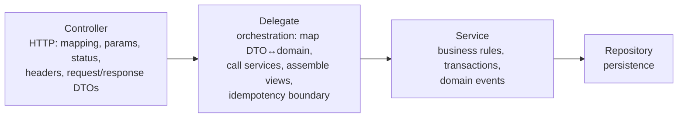
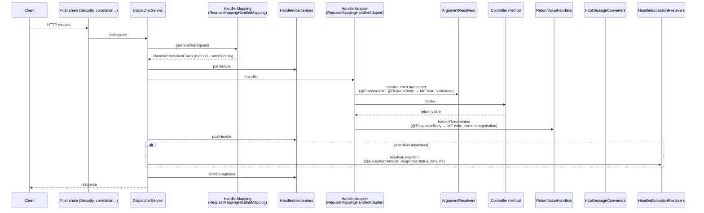
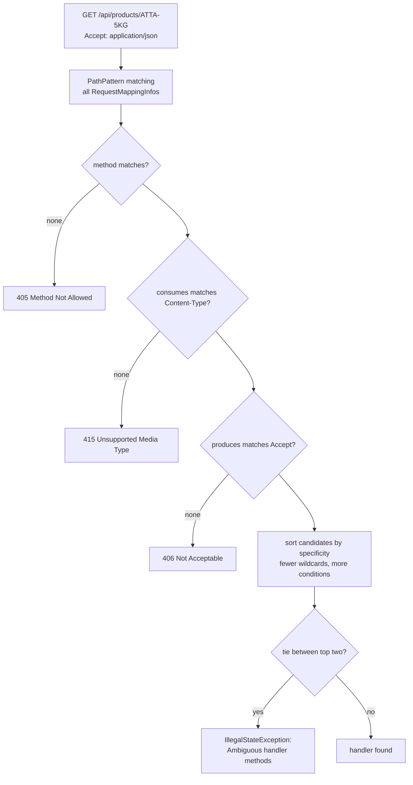
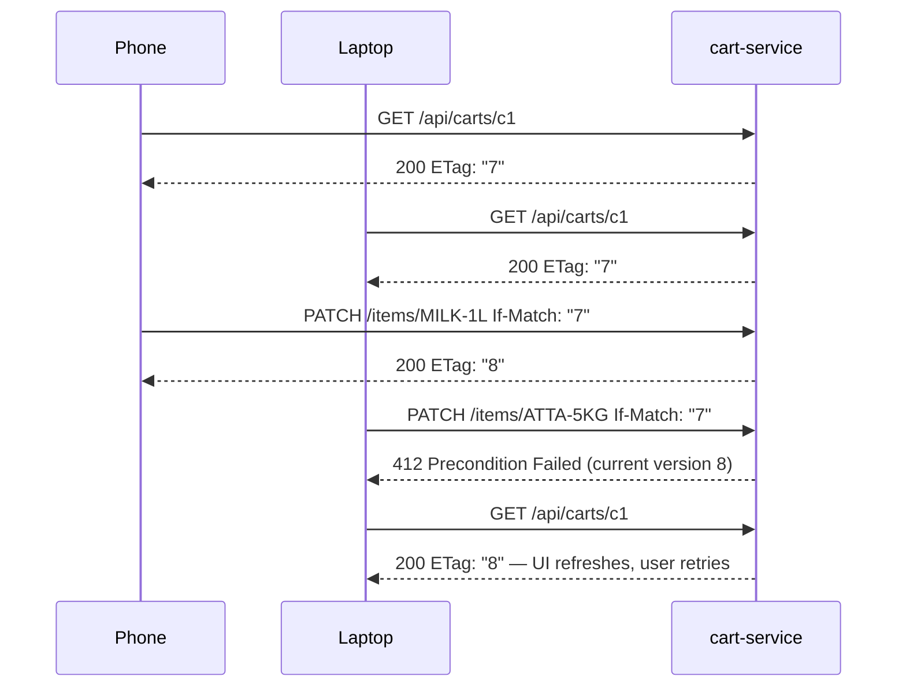

# 08 · Building REST APIs with Spring MVC

## 1. Introduction & Why It Matters

Almost every grocery service exposes HTTP: the Angular web app and Flutter mobile app call the gateway, sellers upload catalogs, delivery partners update statuses, Razorpay calls our webhooks. Spring MVC is the servlet-based web framework that turns those HTTP requests into method calls — and it's still the default choice for Boot services, especially now that **virtual threads** remove most of the scalability argument for reactive stacks.

Getting REST APIs right matters beyond "it returns JSON":

- **Correct semantics** (status codes, methods, headers) let clients, proxies and caches behave correctly — e.g. a `POST` that returns `201 Created` with a `Location`, or `409 Conflict` when a cart was modified on another device.
- **Stable contracts** — DTOs separate from entities, so a JPA refactor doesn't break the mobile app still installed on 2 million phones.
- **Performance and safety** — pagination limits, upload size limits, streaming for large files.
- **Clean layering** — controllers do HTTP only; the four-layer pattern keeps business logic testable.

This chapter builds the **cart-service API** end to end: product listing with pagination and filters, cart operations with optimistic concurrency via ETags, a custom argument resolver for the current customer, a pincode serviceability interceptor, CORS for the web app, seller CSV upload and invoice download streaming. Validation (Chapter 09), error handling (Chapter 10), JSON (Chapter 11) and API versioning/design (Chapter 20) build on it.

### Who should read which section

| Band | Focus |
|---|---|
| B1 · 0–2 yrs | Parts 1, 2, 4 — controllers, mappings, parameters, status codes |
| B2 · 2–5 yrs | Parts 2, 5 — `ResponseEntity`, pagination, upload/download, CORS, interceptors vs filters |
| B3 · 5–8 yrs | Parts 3, 5, 6 — `DispatcherServlet` internals, argument resolvers, message converters, streaming |
| B4 · 8–12 yrs | Parts 6, 7, 8 — API standards, concurrency control, performance, Boot 4 changes |
| B5 · 12–15+ yrs | Parts 8, 9 — API governance and platform conventions |

---

## 2. Core Concepts

### 2.1 REST in one table

| Method | Semantics | Safe | Idempotent | Typical success status |
|---|---|---|---|---|
| `GET` | Read | ✅ | ✅ | 200 |
| `HEAD` | Read headers only | ✅ | ✅ | 200 |
| `POST` | Create / non-idempotent action | ❌ | ❌ | 201 (+ `Location`), 202, 200 |
| `PUT` | Replace full resource | ❌ | ✅ | 200 or 204 |
| `PATCH` | Partial update | ❌ | Not necessarily | 200 or 204 |
| `DELETE` | Remove | ❌ | ✅ | 204 |
| `OPTIONS` | Capabilities (CORS preflight) | ✅ | ✅ | 200/204 |

Common error statuses: `400` (malformed/invalid), `401` (not authenticated), `403` (not allowed), `404` (not found), `405` (method not allowed), `406` (can't produce requested type), `409` (state conflict), `412` (precondition failed — ETag mismatch), `413` (payload too large), `415` (unsupported media type), `422` (semantically invalid), `428` (precondition required), `429` (rate limited), `500`, `502/503/504`.

### 2.2 Controllers

- `@RestController` = `@Controller` + `@ResponseBody` on every method: return values are written to the response body via message converters.
- `@Controller` without `@ResponseBody` returns view names (server-side rendering — rare in API services).

### 2.3 Request mapping

| Annotation | Example |
|---|---|
| `@RequestMapping` (class level) | `@RequestMapping("/api/carts")` |
| `@GetMapping`, `@PostMapping`, `@PutMapping`, `@PatchMapping`, `@DeleteMapping` | `@GetMapping("/{cartId}")` |
| Narrowing attributes | `consumes`, `produces`, `params`, `headers` |

Path patterns (Spring's `PathPatternParser`, the default since Boot 2.6):

| Pattern | Matches |
|---|---|
| `/products/{sku}` | One segment captured as `sku` |
| `/products/{sku:[A-Z0-9-]+}` | With regex |
| `/files/{*path}` | Captures the rest of the path |
| `/static/**` | Any sub-path (only at the end) |

!!! note "Trailing slashes"
    Since Spring Framework 6, `/api/carts/` does **not** match `/api/carts` by default. Clients must be exact, or you handle it at the gateway/with a filter.

### 2.4 Reading request data

| Annotation | Source | Example |
|---|---|---|
| `@PathVariable` | URI template | `@PathVariable String cartId` |
| `@RequestParam` | Query string / form | `@RequestParam(defaultValue = "20") int size` |
| `@RequestHeader` | Header | `@RequestHeader("X-Pincode") String pincode` |
| `@CookieValue` | Cookie | `@CookieValue("session") String s` |
| `@RequestBody` | Body via message converter | `@RequestBody AddItemRequest req` |
| `@ModelAttribute` (implicit for non-simple types) | Query/form params bound to an object | `ProductFilter filter` |
| `@RequestPart` | Multipart part | `@RequestPart MultipartFile file` |
| `@MatrixVariable` | `;key=value` in path | rare |
| Special types | `HttpServletRequest`, `Principal`, `Locale`, `UriComponentsBuilder`, `Pageable` | — |

**Records as query objects:** `ProductFilter(String category, BigDecimal maxPrice)` binds `?category=dairy&maxPrice=100` through its constructor.

### 2.5 Responses

| Return type | Behaviour |
|---|---|
| Any object/record | Serialized with status 200 (or `@ResponseStatus`) |
| `ResponseEntity<T>` | Full control: status, headers, body |
| `void` + `@ResponseStatus(NO_CONTENT)` | Empty body |
| `ProblemDetail` / `ErrorResponse` | RFC 9457 error body (Chapter 10) |
| `StreamingResponseBody` | Write directly to the output stream asynchronously |
| `ResponseEntity<Resource>` | File download |
| `SseEmitter`, `ResponseBodyEmitter` | Server-sent events / streaming (Chapter 32) |
| `Callable`, `DeferredResult`, `CompletableFuture` | Async processing (less needed with virtual threads) |

### 2.6 Content negotiation and message converters

`HttpMessageConverter`s turn bodies into objects and back: Jackson for JSON, String, byte arrays, resources, form data, XML (if Jackson XML present). The chosen converter depends on:

- **Request:** `Content-Type` header → which converter can read → `415` if none.
- **Response:** `Accept` header ∩ `produces` ∩ converters that can write the return type → `406` if none.

### 2.7 Pagination, sorting, filtering

- Spring Data's `Pageable` resolves `?page=0&size=20&sort=price,asc` automatically.
- **Don't serialize `Page`/`PageImpl` directly** — its JSON structure isn't a stable contract (Spring Data warns about it). Return your own `PageResponse<T>` record, or enable Spring Data's DTO-based serialization (`@EnableSpringDataWebSupport(pageSerializationMode = VIA_DTO)`).
- Always cap page size (`spring.data.web.pageable.max-page-size`).
- For deep/infinite scrolling, prefer **keyset (cursor) pagination** (Chapter 13) over large offsets.

### 2.8 Filters vs interceptors vs argument resolvers vs advice

| Mechanism | Level | Sees | Use for |
|---|---|---|---|
| **Servlet `Filter`** | Servlet container, before Spring MVC | Raw request/response | Security, correlation IDs, compression, request logging |
| **`HandlerInterceptor`** | Spring MVC, around handler | Request + chosen handler method | Per-endpoint cross-cutting checks (pincode serviceability, MDC) |
| **`HandlerMethodArgumentResolver`** | Spring MVC, per parameter | Request + parameter metadata | Custom parameter types (`@CurrentCustomer`) |
| **`@ControllerAdvice` / `ResponseBodyAdvice`** | Spring MVC | Exceptions / response bodies | Error mapping, response wrapping |
| **AOP** (Chapter 04) | Any bean | Method invocation | Business-level concerns (idempotency, audit) |

### 2.9 CORS

Browsers block cross-origin calls (Angular on `https://www.grocery.in` → API on `https://api.grocery.in`) unless the server returns CORS headers. Configure globally via `WebMvcConfigurer.addCorsMappings` (or with Spring Security's `CorsConfigurationSource` when Security is present — Chapter 17), or per controller with `@CrossOrigin`. Mobile apps aren't subject to CORS.

### 2.10 The four-layer pattern in web code



Rules: controllers never touch repositories or entities; services never see HTTP types; delegates never contain business rules.

---

## 3. How It Works Internally

### 3.1 `DispatcherServlet` request flow



Key classes:

- **`DispatcherServlet`** — front controller registered by Boot at `/`.
- **`RequestMappingHandlerMapping`** — at startup scans `@RequestMapping` methods into `RequestMappingInfo`s; at runtime matches path, method, params, headers, consumes, produces, and picks the most specific.
- **`RequestMappingHandlerAdapter`** — invokes the method via `ServletInvocableHandlerMethod`, using argument resolvers and return value handlers.
- **`RequestResponseBodyMethodProcessor`** — handles `@RequestBody`/`@ResponseBody` with message converters and `RequestBodyAdvice`/`ResponseBodyAdvice`.
- **`HandlerExceptionResolverComposite`** — `ExceptionHandlerExceptionResolver` (`@ExceptionHandler`), `ResponseStatusExceptionResolver`, `DefaultHandlerExceptionResolver`.

### 3.2 Choosing the handler method



### 3.3 Where virtual threads fit

With `spring.threads.virtual.enabled=true`, Tomcat dispatches each request on a new virtual thread. Blocking calls (JDBC, `RestClient`) unmount the virtual thread instead of blocking a platform thread. The MVC programming model is unchanged — that's the point. Watch for **pinning** (long `synchronized` blocks around I/O in older libraries) and bound concurrency at downstream pools (Chapter 25).

---

## 4. Hands-On Code — Level 1 (Beginner)

### 4.1 A product catalog controller

```java title="in/grocery/catalog/web/ProductController.java"
package in.grocery.catalog.web;

import java.math.BigDecimal;
import java.net.URI;
import java.util.List;
import java.util.Map;
import java.util.concurrent.ConcurrentHashMap;
import org.springframework.http.HttpStatus;
import org.springframework.http.ResponseEntity;
import org.springframework.web.bind.annotation.DeleteMapping;
import org.springframework.web.bind.annotation.GetMapping;
import org.springframework.web.bind.annotation.PathVariable;
import org.springframework.web.bind.annotation.PostMapping;
import org.springframework.web.bind.annotation.RequestBody;
import org.springframework.web.bind.annotation.RequestMapping;
import org.springframework.web.bind.annotation.RequestParam;
import org.springframework.web.bind.annotation.ResponseStatus;
import org.springframework.web.bind.annotation.RestController;
import org.springframework.web.server.ResponseStatusException;

@RestController
@RequestMapping("/api/products")                                            // (1)!
class ProductController {

    record Product(String sku, String name, String category, BigDecimal price) {}

    private final Map<String, Product> products = new ConcurrentHashMap<>(Map.of(   // demo storage only
            "ATTA-5KG", new Product("ATTA-5KG", "Whole Wheat Atta 5kg", "staples", new BigDecimal("289.00")),
            "MILK-1L", new Product("MILK-1L", "Toned Milk 1L", "dairy", new BigDecimal("66.00"))));

    @GetMapping
    List<Product> list(@RequestParam(required = false) String category) {    // (2)!
        return products.values().stream()
                .filter(p -> category == null || p.category().equalsIgnoreCase(category))
                .toList();
    }

    @GetMapping("/{sku}")
    Product get(@PathVariable String sku) {                                  // (3)!
        Product p = products.get(sku);
        if (p == null) {
            throw new ResponseStatusException(HttpStatus.NOT_FOUND, "Product " + sku + " not found"); // (4)!
        }
        return p;
    }

    @PostMapping
    ResponseEntity<Product> create(@RequestBody Product product) {
        products.put(product.sku(), product);
        return ResponseEntity.created(URI.create("/api/products/" + product.sku())).body(product);  // (5)!
    }

    @DeleteMapping("/{sku}")
    @ResponseStatus(HttpStatus.NO_CONTENT)
    void delete(@PathVariable String sku) {
        products.remove(sku);                                                // idempotent: 204 even if absent
    }
}
```

1. Common prefix for all methods.
2. Optional query parameter: `GET /api/products?category=dairy`.
3. Parameter name matches `{sku}` (needs `-parameters`, Chapter 01).
4. Quick way to return a status with a message; Chapter 10 replaces this with domain exceptions and `ProblemDetail`.
5. `201 Created` with `Location` header — the correct response to a create.

```bash title="Terminal"
curl -s localhost:8081/api/products?category=dairy
curl -si localhost:8081/api/products/NOPE          # HTTP/1.1 404
curl -si -X POST localhost:8081/api/products -H 'Content-Type: application/json' \
     -d '{"sku":"TEA-250G","name":"Assam Tea 250g","category":"beverages","price":145.00}'
# HTTP/1.1 201
# Location: /api/products/TEA-250G
```

### 4.2 Testing the controller

```java title="in/grocery/catalog/web/ProductControllerTest.java"
package in.grocery.catalog.web;

import static org.assertj.core.api.Assertions.assertThat;

import org.junit.jupiter.api.Test;
import org.springframework.beans.factory.annotation.Autowired;
import org.springframework.boot.test.autoconfigure.web.servlet.WebMvcTest;
import org.springframework.http.HttpStatus;
import org.springframework.http.MediaType;
import org.springframework.test.web.servlet.assertj.MockMvcTester;

@WebMvcTest(ProductController.class)                    // verify package on Boot 4
class ProductControllerTest {

    @Autowired MockMvcTester mvc;

    @Test
    void filtersByCategory() {
        assertThat(mvc.get().uri("/api/products").param("category", "dairy"))
                .hasStatusOk()
                .bodyJson().extractingPath("$[*].sku").asArray().containsExactly("MILK-1L");
    }

    @Test
    void unknownSkuIs404() {
        assertThat(mvc.get().uri("/api/products/NOPE")).hasStatus(HttpStatus.NOT_FOUND);
    }

    @Test
    void createReturns201WithLocation() {
        assertThat(mvc.post().uri("/api/products")
                .contentType(MediaType.APPLICATION_JSON)
                .content("""
                        {"sku":"TEA-250G","name":"Assam Tea 250g","category":"beverages","price":145.00}
                        """))
                .hasStatus(HttpStatus.CREATED)
                .hasHeader("Location", "/api/products/TEA-250G");
    }

    @Test
    void wrongMethodIs405() {
        assertThat(mvc.put().uri("/api/products")).hasStatus(HttpStatus.METHOD_NOT_ALLOWED);
    }
}
```

---

## 5. Hands-On Code — Level 2 (Intermediate) & Level 3 (Advanced)

From here on the cart-service uses the four layers. Packages: `web`, `delegate`, `service`, `repository`.

### 5.1 Level 2 — DTOs and the four layers

```java title="in/grocery/cart/web/dto/CartDtos.java"
package in.grocery.cart.web.dto;

import java.math.BigDecimal;
import java.util.List;

public final class CartDtos {
    private CartDtos() {}

    public record AddItemRequest(String sku, int quantity) {}

    public record UpdateQuantityRequest(int quantity) {}

    public record CartLineView(String sku, String name, int quantity, BigDecimal unitPrice, BigDecimal lineTotal) {}

    public record CartView(String cartId, List<CartLineView> lines, BigDecimal subtotal,
                           BigDecimal deliveryFee, BigDecimal total, long version) {}
}
```

```java title="in/grocery/cart/web/CartController.java"
package in.grocery.cart.web;

import in.grocery.cart.delegate.CartDelegate;
import in.grocery.cart.web.dto.CartDtos.AddItemRequest;
import in.grocery.cart.web.dto.CartDtos.CartView;
import in.grocery.cart.web.dto.CartDtos.UpdateQuantityRequest;
import org.springframework.http.ResponseEntity;
import org.springframework.web.bind.annotation.DeleteMapping;
import org.springframework.web.bind.annotation.GetMapping;
import org.springframework.web.bind.annotation.PatchMapping;
import org.springframework.web.bind.annotation.PathVariable;
import org.springframework.web.bind.annotation.PostMapping;
import org.springframework.web.bind.annotation.RequestBody;
import org.springframework.web.bind.annotation.RequestHeader;
import org.springframework.web.bind.annotation.RequestMapping;
import org.springframework.web.bind.annotation.RestController;
import org.springframework.web.util.UriComponentsBuilder;

@RestController
@RequestMapping("/api/carts")
class CartController {

    private final CartDelegate delegate;

    CartController(CartDelegate delegate) {
        this.delegate = delegate;
    }

    @PostMapping
    ResponseEntity<CartView> create(@RequestHeader("X-Customer-Id") String customerId,
                                    UriComponentsBuilder uri) {                            // (1)!
        CartView cart = delegate.createCart(customerId);
        return ResponseEntity.created(uri.path("/api/carts/{id}").buildAndExpand(cart.cartId()).toUri())
                .eTag(etag(cart))
                .body(cart);
    }

    @GetMapping("/{cartId}")
    ResponseEntity<CartView> get(@PathVariable String cartId) {
        CartView cart = delegate.getCart(cartId);
        return ResponseEntity.ok().eTag(etag(cart)).body(cart);
    }

    @PostMapping("/{cartId}/items")
    ResponseEntity<CartView> addItem(@PathVariable String cartId, @RequestBody AddItemRequest request) {
        CartView cart = delegate.addItem(cartId, request);
        return ResponseEntity.ok().eTag(etag(cart)).body(cart);
    }

    @PatchMapping("/{cartId}/items/{sku}")
    ResponseEntity<CartView> updateQuantity(@PathVariable String cartId, @PathVariable String sku,
                                            @RequestBody UpdateQuantityRequest request) {
        CartView cart = delegate.updateQuantity(cartId, sku, request.quantity());
        return ResponseEntity.ok().eTag(etag(cart)).body(cart);
    }

    @DeleteMapping("/{cartId}/items/{sku}")
    ResponseEntity<CartView> removeItem(@PathVariable String cartId, @PathVariable String sku) {
        CartView cart = delegate.removeItem(cartId, sku);
        return ResponseEntity.ok().eTag(etag(cart)).body(cart);
    }

    private static String etag(CartView cart) {
        return "\"" + cart.version() + "\"";                                             // (2)!
    }
}
```

1. `UriComponentsBuilder` argument is pre-populated with scheme/host/context path — correct `Location` behind proxies (with `server.forward-headers-strategy` configured).
2. The cart version doubles as a strong ETag — used for optimistic concurrency in Level 4.

```java title="in/grocery/cart/delegate/CartDelegate.java"
package in.grocery.cart.delegate;

import in.grocery.cart.service.Cart;
import in.grocery.cart.service.CartService;
import in.grocery.cart.service.PricedCart;
import in.grocery.cart.web.dto.CartDtos.AddItemRequest;
import in.grocery.cart.web.dto.CartDtos.CartLineView;
import in.grocery.cart.web.dto.CartDtos.CartView;
import org.springframework.stereotype.Component;

@Component
public class CartDelegate {

    private final CartService carts;

    public CartDelegate(CartService carts) {
        this.carts = carts;
    }

    public CartView createCart(String customerId) {
        return toView(carts.price(carts.create(customerId)));
    }

    public CartView getCart(String cartId) {
        return toView(carts.price(carts.get(cartId)));
    }

    public CartView addItem(String cartId, AddItemRequest req) {
        return toView(carts.price(carts.addItem(cartId, req.sku(), req.quantity())));
    }

    public CartView updateQuantity(String cartId, String sku, int qty) {
        return toView(carts.price(carts.updateQuantity(cartId, sku, qty)));
    }

    public CartView removeItem(String cartId, String sku) {
        return toView(carts.price(carts.removeItem(cartId, sku)));
    }

    private static CartView toView(PricedCart priced) {                                  // (1)!
        Cart cart = priced.cart();
        var lines = priced.lines().stream()
                .map(l -> new CartLineView(l.sku(), l.name(), l.quantity(), l.unitPrice(), l.lineTotal()))
                .toList();
        return new CartView(cart.id(), lines, priced.subtotal(), priced.deliveryFee(), priced.total(), cart.version());
    }
}
```

1. Mapping domain → view lives in the delegate. The controller never sees `Cart`.

```java title="in/grocery/cart/service/Cart.java"
package in.grocery.cart.service;

import java.util.LinkedHashMap;
import java.util.Map;

/** Aggregate: immutable snapshot, each change produces a new version. */
public record Cart(String id, String customerId, Map<String, Integer> quantities, long version) {

    public Cart {
        quantities = Map.copyOf(quantities);
    }

    public Cart withQuantity(String sku, int qty) {
        var copy = new LinkedHashMap<>(quantities);
        if (qty == 0) copy.remove(sku); else copy.put(sku, qty);
        return new Cart(id, customerId, copy, version + 1);
    }
}
```

```java title="in/grocery/cart/service/PricedCart.java"
package in.grocery.cart.service;

import java.math.BigDecimal;
import java.util.List;

public record PricedCart(Cart cart, List<Line> lines, BigDecimal subtotal, BigDecimal deliveryFee, BigDecimal total) {
    public record Line(String sku, String name, int quantity, BigDecimal unitPrice, BigDecimal lineTotal) {}
}
```

```java title="in/grocery/cart/service/CartService.java"
package in.grocery.cart.service;

import in.grocery.cart.config.CartProperties;
import in.grocery.cart.repository.CartRepository;
import in.grocery.cart.repository.CatalogLookup;
import java.math.BigDecimal;
import java.util.UUID;
import org.springframework.stereotype.Service;

@Service
public class CartService {

    private final CartRepository repository;
    private final CatalogLookup catalog;
    private final CartProperties props;

    public CartService(CartRepository repository, CatalogLookup catalog, CartProperties props) {
        this.repository = repository;
        this.catalog = catalog;
        this.props = props;
    }

    public Cart create(String customerId) {
        return repository.insert(new Cart(UUID.randomUUID().toString(), customerId, java.util.Map.of(), 0));
    }

    public Cart get(String cartId) {
        return repository.find(cartId).orElseThrow(() -> new CartNotFoundException(cartId));
    }

    public Cart addItem(String cartId, String sku, int qty) {
        Cart cart = get(cartId);
        int newQty = cart.quantities().getOrDefault(sku, 0) + qty;
        return save(cart, sku, newQty);
    }

    public Cart updateQuantity(String cartId, String sku, int qty) {
        return save(get(cartId), sku, qty);
    }

    public Cart removeItem(String cartId, String sku) {
        return save(get(cartId), sku, 0);
    }

    private Cart save(Cart cart, String sku, int qty) {
        if (qty < 0 || qty > props.maxQuantityPerItem()) {
            throw new CartRuleViolation("Quantity for " + sku + " must be 0.." + props.maxQuantityPerItem());
        }
        catalog.require(sku);
        Cart updated = cart.withQuantity(sku, qty);
        if (updated.quantities().size() > props.maxItems()) {
            throw new CartRuleViolation("Cart cannot have more than " + props.maxItems() + " items");
        }
        return repository.update(updated, cart.version());                              // (1)!
    }

    public PricedCart price(Cart cart) {
        var lines = cart.quantities().entrySet().stream().map(e -> {
            var item = catalog.require(e.getKey());
            BigDecimal lineTotal = item.price().multiply(BigDecimal.valueOf(e.getValue()));
            return new PricedCart.Line(item.sku(), item.name(), e.getValue(), item.price(), lineTotal);
        }).toList();
        BigDecimal subtotal = lines.stream().map(PricedCart.Line::lineTotal).reduce(BigDecimal.ZERO, BigDecimal::add);
        BigDecimal fee = subtotal.compareTo(props.freeDelivery().threshold()) >= 0 || lines.isEmpty()
                ? BigDecimal.ZERO : new BigDecimal("35.00");
        return new PricedCart(cart, lines, subtotal, fee, subtotal.add(fee));
    }
}
```

1. The repository performs a **compare-and-set on version** — if someone else updated the cart meanwhile, it throws `CartVersionConflict`. This protects against the "two devices" race.

```java title="in/grocery/cart/service/CartExceptions.java"
package in.grocery.cart.service;

// Each in its own file in real code; shown together for brevity.
public class CartNotFoundException extends RuntimeException {
    public CartNotFoundException(String id) { super("Cart " + id + " not found"); }
}
```

```java title="CartRuleViolation.java"
public class CartRuleViolation extends RuntimeException {
    public CartRuleViolation(String msg) { super(msg); }
}

public class CartVersionConflict extends RuntimeException {
    public CartVersionConflict(String id, long expected) { super("Cart " + id + " is not at version " + expected); }
}
```

```java title="in/grocery/cart/repository/InMemoryCartRepository.java"
package in.grocery.cart.repository;

import in.grocery.cart.service.Cart;
import in.grocery.cart.service.CartVersionConflict;
import java.util.Optional;
import java.util.concurrent.ConcurrentHashMap;
import java.util.concurrent.ConcurrentMap;
import org.springframework.stereotype.Repository;

@Repository
class InMemoryCartRepository implements CartRepository {       // JDBC version in Chapter 12

    private final ConcurrentMap<String, Cart> carts = new ConcurrentHashMap<>();

    public Cart insert(Cart cart) {
        carts.put(cart.id(), cart);
        return cart;
    }

    public Optional<Cart> find(String id) {
        return Optional.ofNullable(carts.get(id));
    }

    public Cart update(Cart updated, long expectedVersion) {
        Cart result = carts.computeIfPresent(updated.id(), (id, current) -> {
            if (current.version() != expectedVersion) throw new CartVersionConflict(id, expectedVersion);
            return updated;
        });
        if (result == null) throw new in.grocery.cart.service.CartNotFoundException(updated.id());
        return result;
    }
}
```

Temporary exception mapping (Chapter 10 replaces it with a platform-wide `ProblemDetail` handler):

```java title="in/grocery/cart/web/CartExceptionHandler.java"
package in.grocery.cart.web;

import in.grocery.cart.service.CartNotFoundException;
import in.grocery.cart.service.CartRuleViolation;
import in.grocery.cart.service.CartVersionConflict;
import org.springframework.http.HttpStatus;
import org.springframework.http.ProblemDetail;
import org.springframework.web.bind.annotation.ExceptionHandler;
import org.springframework.web.bind.annotation.RestControllerAdvice;

@RestControllerAdvice(basePackages = "in.grocery.cart.web")
class CartExceptionHandler {

    @ExceptionHandler
    ProblemDetail notFound(CartNotFoundException ex) {
        return ProblemDetail.forStatusAndDetail(HttpStatus.NOT_FOUND, ex.getMessage());
    }

    @ExceptionHandler
    ProblemDetail rule(CartRuleViolation ex) {
        return ProblemDetail.forStatusAndDetail(HttpStatus.UNPROCESSABLE_ENTITY, ex.getMessage());
    }

    @ExceptionHandler
    ProblemDetail conflict(CartVersionConflict ex) {
        return ProblemDetail.forStatusAndDetail(HttpStatus.PRECONDITION_FAILED, ex.getMessage());
    }
}
```

### 5.2 Level 2 — Pagination, sorting and filtering

```java title="in/grocery/catalog/web/dto/PageResponse.java"
package in.grocery.catalog.web.dto;

import java.util.List;
import java.util.function.Function;
import org.springframework.data.domain.Page;

/** Stable, documented page contract — independent of Spring Data's internal JSON. */
public record PageResponse<T>(List<T> items, int page, int size, long totalItems, int totalPages, boolean hasNext) {

    public static <E, T> PageResponse<T> of(Page<E> page, Function<E, T> mapper) {
        return new PageResponse<>(page.map(mapper).getContent(), page.getNumber(), page.getSize(),
                page.getTotalElements(), page.getTotalPages(), page.hasNext());
    }
}
```

```java title="in/grocery/catalog/web/ProductSearchController.java"
package in.grocery.catalog.web;

import in.grocery.catalog.delegate.ProductDelegate;
import in.grocery.catalog.web.dto.PageResponse;
import in.grocery.catalog.web.dto.ProductSummary;
import java.math.BigDecimal;
import org.springframework.data.domain.Pageable;
import org.springframework.data.domain.Sort;
import org.springframework.data.web.PageableDefault;
import org.springframework.web.bind.annotation.GetMapping;
import org.springframework.web.bind.annotation.RequestMapping;
import org.springframework.web.bind.annotation.RestController;

@RestController
@RequestMapping("/api/catalog")
class ProductSearchController {

    record ProductFilter(String category, BigDecimal minPrice, BigDecimal maxPrice, Boolean inStock, String q) {}  // (1)!

    private final ProductDelegate delegate;

    ProductSearchController(ProductDelegate delegate) {
        this.delegate = delegate;
    }

    @GetMapping("/products")
    PageResponse<ProductSummary> search(ProductFilter filter,
                                        @PageableDefault(size = 20, sort = "name", direction = Sort.Direction.ASC)
                                        Pageable pageable) {                                                    // (2)!
        return delegate.search(filter.category(), filter.minPrice(), filter.maxPrice(),
                filter.inStock(), filter.q(), pageable);
    }
}
```

1. Record bound from query params: `?category=dairy&maxPrice=100&inStock=true&q=paneer`.
2. `?page=1&size=40&sort=price,desc` — resolved by Spring Data's `PageableHandlerMethodArgumentResolver`.

```yaml title="application.yml"
spring:
  data:
    web:
      pageable:
        max-page-size: 100            # clients can't request 1,000,000 rows
        one-indexed-parameters: false
```

!!! warning "Sort injection"
    `sort=` takes property names from the client. Spring Data validates them against the entity, but a clever `sort` on an unindexed column is a cheap DoS. Whitelist sortable fields in the delegate (e.g. `name`, `price`, `rating`) and reject others with `400`.

### 5.3 Level 2 — File upload and download

```yaml title="application.yml — seller-service"
spring:
  servlet:
    multipart:
      max-file-size: 10MB
      max-request-size: 11MB
      file-size-threshold: 1MB        # beyond this, parts are written to disk
```

```java title="in/grocery/seller/web/CatalogUploadController.java"
package in.grocery.seller.web;

import in.grocery.seller.delegate.CatalogImportDelegate;
import in.grocery.seller.delegate.ImportReport;
import java.io.IOException;
import org.springframework.http.MediaType;
import org.springframework.http.ResponseEntity;
import org.springframework.web.bind.annotation.PathVariable;
import org.springframework.web.bind.annotation.PostMapping;
import org.springframework.web.bind.annotation.RequestMapping;
import org.springframework.web.bind.annotation.RequestPart;
import org.springframework.web.bind.annotation.RestController;
import org.springframework.web.multipart.MultipartFile;

@RestController
@RequestMapping("/api/sellers/{sellerId}/catalog")
class CatalogUploadController {

    private final CatalogImportDelegate delegate;

    CatalogUploadController(CatalogImportDelegate delegate) {
        this.delegate = delegate;
    }

    @PostMapping(path = "/imports", consumes = MediaType.MULTIPART_FORM_DATA_VALUE)
    ResponseEntity<ImportReport> upload(@PathVariable String sellerId,
                                        @RequestPart("file") MultipartFile file) throws IOException {
        if (file.isEmpty() || !"text/csv".equals(file.getContentType())) {                  // (1)!
            return ResponseEntity.badRequest().build();
        }
        try (var in = file.getInputStream()) {                                             // (2)!
            ImportReport report = delegate.importCsv(sellerId, in);
            return ResponseEntity.accepted().body(report);                                 // (3)!
        }
    }
}
```

1. Content type is client-supplied and can lie — the delegate still validates CSV structure.
2. Stream it; never `file.getBytes()` for large files.
3. `202 Accepted` if processing continues asynchronously (the report contains a job ID).

```java title="in/grocery/order/web/InvoiceController.java"
package in.grocery.order.web;

import in.grocery.order.delegate.InvoiceDelegate;
import org.springframework.http.ContentDisposition;
import org.springframework.http.HttpHeaders;
import org.springframework.http.MediaType;
import org.springframework.http.ResponseEntity;
import org.springframework.web.bind.annotation.GetMapping;
import org.springframework.web.bind.annotation.PathVariable;
import org.springframework.web.bind.annotation.RestController;
import org.springframework.web.servlet.mvc.method.annotation.StreamingResponseBody;

@RestController
class InvoiceController {

    private final InvoiceDelegate delegate;

    InvoiceController(InvoiceDelegate delegate) {
        this.delegate = delegate;
    }

    @GetMapping("/api/orders/{orderId}/invoice")
    ResponseEntity<StreamingResponseBody> invoice(@PathVariable String orderId) {
        var meta = delegate.invoiceMeta(orderId);                                          // checks ownership, exists
        StreamingResponseBody body = out -> delegate.writeInvoicePdf(orderId, out);        // (1)!
        return ResponseEntity.ok()
                .contentType(MediaType.APPLICATION_PDF)
                .header(HttpHeaders.CONTENT_DISPOSITION,
                        ContentDisposition.attachment().filename("invoice-" + meta.invoiceNumber() + ".pdf").build().toString())
                .body(body);
    }
}
```

1. Written directly to the response stream on an async thread — no full PDF in memory. Configure `spring.mvc.async.request-timeout` and an async executor (Boot's task executor is used).

### 5.4 Level 3 — Custom argument resolver: `@CurrentCustomer`

Until Chapter 17 introduces JWTs, customer identity arrives in a gateway-set header. Controllers shouldn't parse headers repeatedly.

```java title="in/grocery/platform/web/CurrentCustomer.java"
package in.grocery.platform.web;

import java.lang.annotation.ElementType;
import java.lang.annotation.Retention;
import java.lang.annotation.RetentionPolicy;
import java.lang.annotation.Target;

@Target(ElementType.PARAMETER)
@Retention(RetentionPolicy.RUNTIME)
public @interface CurrentCustomer {}
```

```java title="in/grocery/platform/web/CustomerContext.java"
package in.grocery.platform.web;

public record CustomerContext(String customerId, String pincode, String channel) {}
```

```java title="in/grocery/platform/web/CurrentCustomerArgumentResolver.java"
package in.grocery.platform.web;

import java.util.regex.Pattern;
import org.springframework.core.MethodParameter;
import org.springframework.http.HttpStatus;
import org.springframework.web.bind.support.WebDataBinderFactory;
import org.springframework.web.context.request.NativeWebRequest;
import org.springframework.web.method.support.HandlerMethodArgumentResolver;
import org.springframework.web.method.support.ModelAndViewContainer;
import org.springframework.web.server.ResponseStatusException;

public class CurrentCustomerArgumentResolver implements HandlerMethodArgumentResolver {

    private static final Pattern CUSTOMER = Pattern.compile("C-[0-9]{1,12}");
    private static final Pattern PINCODE = Pattern.compile("[1-9][0-9]{5}");

    @Override
    public boolean supportsParameter(MethodParameter parameter) {                           // (1)!
        return parameter.hasParameterAnnotation(CurrentCustomer.class)
                && parameter.getParameterType().equals(CustomerContext.class);
    }

    @Override
    public Object resolveArgument(MethodParameter parameter, ModelAndViewContainer mav,
                                  NativeWebRequest request, WebDataBinderFactory binderFactory) {
        String id = request.getHeader("X-Customer-Id");
        if (id == null || !CUSTOMER.matcher(id).matches()) {
            throw new ResponseStatusException(HttpStatus.UNAUTHORIZED, "Missing or invalid customer identity");
        }
        String pincode = request.getHeader("X-Pincode");
        if (pincode != null && !PINCODE.matcher(pincode).matches()) {
            throw new ResponseStatusException(HttpStatus.BAD_REQUEST, "Invalid X-Pincode");
        }
        String channel = request.getHeader("X-Channel");
        return new CustomerContext(id, pincode, channel == null ? "web" : channel);
    }
}
```

1. Result of `supportsParameter` is cached per parameter — keep it cheap and deterministic.

```java title="in/grocery/platform/web/GroceryWebMvcConfig.java"
package in.grocery.platform.web;

import java.util.List;
import org.springframework.context.annotation.Configuration;
import org.springframework.web.method.support.HandlerMethodArgumentResolver;
import org.springframework.web.servlet.config.annotation.WebMvcConfigurer;

@Configuration(proxyBeanMethods = false)
public class GroceryWebMvcConfig implements WebMvcConfigurer {                               // (1)!

    @Override
    public void addArgumentResolvers(List<HandlerMethodArgumentResolver> resolvers) {
        resolvers.add(new CurrentCustomerArgumentResolver());
    }
}
```

1. **Implement `WebMvcConfigurer`, don't add `@EnableWebMvc`** — `@EnableWebMvc` switches off Boot's MVC auto-configuration (message converters, static resources, formatting defaults).

```java title="Custom argument resolver: @CurrentCustomer (snippet)"
@PostMapping
ResponseEntity<CartView> create(@CurrentCustomer CustomerContext customer, UriComponentsBuilder uri) { ... }
```

### 5.5 Level 3 — Interceptor: pincode serviceability

Only some endpoints need a serviceable pincode (add-to-cart, checkout). An interceptor can inspect the **handler method's annotations**, which a filter can't.

```java title="in/grocery/platform/web/RequiresServiceablePincode.java"
package in.grocery.platform.web;

import java.lang.annotation.ElementType;
import java.lang.annotation.Retention;
import java.lang.annotation.RetentionPolicy;
import java.lang.annotation.Target;

@Target({ElementType.METHOD, ElementType.TYPE})
@Retention(RetentionPolicy.RUNTIME)
public @interface RequiresServiceablePincode {}
```

```java title="in/grocery/platform/web/ServiceabilityInterceptor.java"
package in.grocery.platform.web;

import jakarta.servlet.http.HttpServletRequest;
import jakarta.servlet.http.HttpServletResponse;
import org.springframework.core.annotation.AnnotatedElementUtils;
import org.springframework.http.HttpStatus;
import org.springframework.web.method.HandlerMethod;
import org.springframework.web.server.ResponseStatusException;
import org.springframework.web.servlet.HandlerInterceptor;

public class ServiceabilityInterceptor implements HandlerInterceptor {

    public interface ServiceabilityChecker { boolean isServiceable(String pincode); }  // cached lookup, Chapter 21

    private final ServiceabilityChecker checker;

    public ServiceabilityInterceptor(ServiceabilityChecker checker) {
        this.checker = checker;
    }

    @Override
    public boolean preHandle(HttpServletRequest req, HttpServletResponse res, Object handler) {
        if (!(handler instanceof HandlerMethod hm)) return true;                               // (1)!
        boolean required = hm.hasMethodAnnotation(RequiresServiceablePincode.class)
                || AnnotatedElementUtils.hasAnnotation(hm.getBeanType(), RequiresServiceablePincode.class);
        if (!required) return true;

        String pincode = req.getHeader("X-Pincode");
        if (pincode == null) {
            throw new ResponseStatusException(HttpStatus.PRECONDITION_REQUIRED, "X-Pincode header is required");
        }
        if (!checker.isServiceable(pincode)) {
            throw new ResponseStatusException(HttpStatus.UNPROCESSABLE_ENTITY,
                    "We don't deliver to " + pincode + " yet");
        }
        return true;
    }
}
```

1. Static resources and other handler types pass through.

```java title="GroceryWebMvcConfig.java (continued)"
@Override
public void addInterceptors(InterceptorRegistry registry) {
    registry.addInterceptor(new ServiceabilityInterceptor(checker))
            .addPathPatterns("/api/**")
            .excludePathPatterns("/api/public/**");
}
```

```java title="Interceptor: pincode serviceability (snippet)"
@PostMapping("/{cartId}/items")
@RequiresServiceablePincode
ResponseEntity<CartView> addItem(...) { ... }
```

### 5.6 Level 3 — CORS for the Angular app

```yaml title="application.yml"
grocery:
  web:
    cors:
      allowed-origins:
        - https://www.grocery.in
        - https://seller.grocery.in
```

```java title="GroceryWebMvcConfig.java (continued)"
@Override
public void addCorsMappings(CorsRegistry registry) {
    registry.addMapping("/api/**")
            .allowedOrigins(corsProps.allowedOrigins().toArray(String[]::new))    // (1)!
            .allowedMethods("GET", "POST", "PUT", "PATCH", "DELETE")
            .allowedHeaders("Content-Type", "Authorization", "X-Pincode", "Idempotency-Key", "If-Match")
            .exposedHeaders("ETag", "Location", "X-Request-Id")                   // (2)!
            .allowCredentials(true)
            .maxAge(3600);
}
```

1. Explicit origins. Never `*` together with credentials (browsers reject it) — and never reflect arbitrary `Origin` values.
2. Without `exposedHeaders`, Angular can't read `ETag` from the response — a common cause of "concurrency doesn't work in the browser".

!!! note "With Spring Security"
    Once Spring Security is added (Chapter 17), configure CORS through `http.cors(...)` and a `CorsConfigurationSource` bean so preflight requests are handled before authentication.

### 5.7 Level 3 — Filters for raw HTTP concerns

```java title="in/grocery/platform/web/ApiResponseHeadersFilter.java"
package in.grocery.platform.web;

import jakarta.servlet.FilterChain;
import jakarta.servlet.ServletException;
import jakarta.servlet.http.HttpServletRequest;
import jakarta.servlet.http.HttpServletResponse;
import java.io.IOException;
import org.springframework.web.filter.OncePerRequestFilter;

/** Security and caching headers for all API responses. */
public class ApiResponseHeadersFilter extends OncePerRequestFilter {

    @Override
    protected void doFilterInternal(HttpServletRequest req, HttpServletResponse res, FilterChain chain)
            throws ServletException, IOException {
        res.setHeader("X-Content-Type-Options", "nosniff");
        res.setHeader("Cache-Control", "no-store");                 // API responses with personal data
        chain.doFilter(req, res);
    }

    @Override
    protected boolean shouldNotFilter(HttpServletRequest request) {
        return !request.getRequestURI().startsWith("/api/");
    }
}
```

Registered via `FilterRegistrationBean` with an explicit order (as in Chapter 05). Spring Security adds similar headers by default once present.

---

## 6. Hands-On Code — Level 4 (Expert / Production)

### Optimistic concurrency with ETag / If-Match

A customer edits their cart on the phone and the laptop simultaneously. Without protection, the last write silently wins and items disappear. HTTP has a standard answer: **conditional requests**.



```java title="in/grocery/cart/web/CartCommandController.java"
package in.grocery.cart.web;

import in.grocery.cart.delegate.CartDelegate;
import in.grocery.cart.web.dto.CartDtos.CartView;
import in.grocery.cart.web.dto.CartDtos.UpdateQuantityRequest;
import in.grocery.platform.web.CurrentCustomer;
import in.grocery.platform.web.CustomerContext;
import in.grocery.platform.web.RequiresServiceablePincode;
import java.util.regex.Matcher;
import java.util.regex.Pattern;
import org.springframework.http.HttpStatus;
import org.springframework.http.ResponseEntity;
import org.springframework.web.bind.annotation.GetMapping;
import org.springframework.web.bind.annotation.PatchMapping;
import org.springframework.web.bind.annotation.PathVariable;
import org.springframework.web.bind.annotation.RequestBody;
import org.springframework.web.bind.annotation.RequestHeader;
import org.springframework.web.bind.annotation.RequestMapping;
import org.springframework.web.bind.annotation.RestController;
import org.springframework.web.server.ResponseStatusException;

@RestController
@RequestMapping("/api/v1/carts")
class CartCommandController {

    private static final Pattern STRONG_ETAG = Pattern.compile("^\"(\\d{1,18})\"$");

    private final CartDelegate delegate;

    CartCommandController(CartDelegate delegate) {
        this.delegate = delegate;
    }

    @GetMapping("/{cartId}")
    ResponseEntity<CartView> get(@PathVariable String cartId, @CurrentCustomer CustomerContext customer) {
        CartView cart = delegate.getCartFor(customer.customerId(), cartId);                    // (1)!
        return ResponseEntity.ok().eTag(etag(cart.version())).body(cart);                      // (2)!
    }

    @PatchMapping("/{cartId}/items/{sku}")
    @RequiresServiceablePincode
    ResponseEntity<CartView> updateQuantity(@PathVariable String cartId,
                                            @PathVariable String sku,
                                            @RequestHeader(value = "If-Match", required = false) String ifMatch,
                                            @RequestBody UpdateQuantityRequest body,
                                            @CurrentCustomer CustomerContext customer) {
        long expectedVersion = parseIfMatch(ifMatch);                                          // (3)!
        CartView cart = delegate.updateQuantityFor(customer.customerId(), cartId, sku, body.quantity(), expectedVersion);
        return ResponseEntity.ok().eTag(etag(cart.version())).body(cart);
    }

    static long parseIfMatch(String ifMatch) {
        if (ifMatch == null) {
            throw new ResponseStatusException(HttpStatus.PRECONDITION_REQUIRED, "If-Match header is required"); // 428
        }
        Matcher m = STRONG_ETAG.matcher(ifMatch.strip());
        if (!m.matches()) {
            throw new ResponseStatusException(HttpStatus.BAD_REQUEST, "If-Match must be a strong ETag like \"7\"");
        }
        return Long.parseLong(m.group(1));
    }

    private static String etag(long version) {
        return "\"" + version + "\"";
    }
}
```

1. Delegate checks the cart belongs to the customer — return **404, not 403**, for other customers' carts to avoid confirming existence.
2. For `GET` requests returning a `ResponseEntity` with an `ETag`, Spring's `HttpEntityMethodProcessor` compares it with `If-None-Match` and sends `304 Not Modified` without a body automatically — saves mobile data on polling. (For other return types, use `WebRequest.checkNotModified(etag)`.)
3. Requiring `If-Match` (`428`) on mutations forces clients to participate in concurrency control. Weak ETags (`W/"7"`) are rejected.

```java title="in/grocery/cart/delegate/CartDelegate.java (additions)"
public CartView getCartFor(String customerId, String cartId) {
    Cart cart = carts.get(cartId);
    if (!cart.customerId().equals(customerId)) throw new CartNotFoundException(cartId);
    return toView(carts.price(cart));
}

public CartView updateQuantityFor(String customerId, String cartId, String sku, int qty, long expectedVersion) {
    Cart cart = carts.get(cartId);
    if (!cart.customerId().equals(customerId)) throw new CartNotFoundException(cartId);
    if (cart.version() != expectedVersion) throw new CartVersionConflict(cartId, expectedVersion); // → 412
    return toView(carts.price(carts.updateQuantity(cartId, sku, qty)));                           // repo CAS covers races
}
```

### Final platform MVC configuration

```java title="in/grocery/platform/web/GroceryWebMvcConfig.java"
package in.grocery.platform.web;

import java.util.List;
import org.springframework.boot.context.properties.ConfigurationProperties;
import org.springframework.boot.context.properties.EnableConfigurationProperties;
import org.springframework.context.annotation.Configuration;
import org.springframework.web.method.support.HandlerMethodArgumentResolver;
import org.springframework.web.servlet.config.annotation.CorsRegistry;
import org.springframework.web.servlet.config.annotation.InterceptorRegistry;
import org.springframework.web.servlet.config.annotation.WebMvcConfigurer;

@Configuration(proxyBeanMethods = false)
@EnableConfigurationProperties(GroceryWebMvcConfig.CorsProperties.class)
public class GroceryWebMvcConfig implements WebMvcConfigurer {

    @ConfigurationProperties("grocery.web.cors")
    public record CorsProperties(List<String> allowedOrigins) {
        public CorsProperties {
            allowedOrigins = allowedOrigins == null ? List.of() : List.copyOf(allowedOrigins);
        }
    }

    private final ServiceabilityInterceptor.ServiceabilityChecker checker;
    private final CorsProperties cors;

    public GroceryWebMvcConfig(ServiceabilityInterceptor.ServiceabilityChecker checker, CorsProperties cors) {
        this.checker = checker;
        this.cors = cors;
    }

    @Override
    public void addArgumentResolvers(List<HandlerMethodArgumentResolver> resolvers) {
        resolvers.add(new CurrentCustomerArgumentResolver());
    }

    @Override
    public void addInterceptors(InterceptorRegistry registry) {
        registry.addInterceptor(new ServiceabilityInterceptor(checker))
                .addPathPatterns("/api/**")
                .excludePathPatterns("/api/public/**");
    }

    @Override
    public void addCorsMappings(CorsRegistry registry) {
        if (cors.allowedOrigins().isEmpty()) return;          // no browser clients configured
        registry.addMapping("/api/**")
                .allowedOrigins(cors.allowedOrigins().toArray(String[]::new))
                .allowedMethods("GET", "POST", "PUT", "PATCH", "DELETE")
                .allowedHeaders("Content-Type", "Authorization", "X-Pincode", "Idempotency-Key", "If-Match", "If-None-Match")
                .exposedHeaders("ETag", "Location", "X-Request-Id")
                .allowCredentials(true)
                .maxAge(3600);
    }
}
```

### Production-grade web test

```java title="in/grocery/cart/web/CartCommandControllerTest.java"
package in.grocery.cart.web;

import static org.assertj.core.api.Assertions.assertThat;
import static org.mockito.ArgumentMatchers.anyLong;
import static org.mockito.ArgumentMatchers.eq;
import static org.mockito.BDDMockito.given;

import in.grocery.cart.delegate.CartDelegate;
import in.grocery.cart.service.CartVersionConflict;
import in.grocery.cart.web.dto.CartDtos.CartView;
import in.grocery.platform.web.GroceryWebMvcConfig;
import in.grocery.platform.web.ServiceabilityInterceptor.ServiceabilityChecker;
import java.math.BigDecimal;
import java.util.List;
import org.junit.jupiter.api.Test;
import org.springframework.beans.factory.annotation.Autowired;
import org.springframework.boot.test.autoconfigure.web.servlet.WebMvcTest;
import org.springframework.context.annotation.Import;
import org.springframework.http.HttpStatus;
import org.springframework.http.MediaType;
import org.springframework.test.context.bean.override.mockito.MockitoBean;
import org.springframework.test.web.servlet.assertj.MockMvcTester;

@WebMvcTest(CartCommandController.class)
@Import({GroceryWebMvcConfig.class, CartExceptionHandler.class})
class CartCommandControllerTest {

    @Autowired MockMvcTester mvc;
    @MockitoBean CartDelegate delegate;                                                        // (1)!
    @MockitoBean ServiceabilityChecker serviceability;

    private static CartView cart(long version) {
        return new CartView("c1", List.of(), BigDecimal.ZERO, BigDecimal.ZERO, BigDecimal.ZERO, version);
    }

    @Test
    void getReturnsEtagAnd304WhenUnchanged() {
        given(delegate.getCartFor("C-1", "c1")).willReturn(cart(7));

        assertThat(mvc.get().uri("/api/v1/carts/c1").header("X-Customer-Id", "C-1"))
                .hasStatusOk().hasHeader("ETag", "\"7\"");

        assertThat(mvc.get().uri("/api/v1/carts/c1").header("X-Customer-Id", "C-1").header("If-None-Match", "\"7\""))
                .hasStatus(HttpStatus.NOT_MODIFIED);
    }

    @Test
    void patchWithoutIfMatchIs428() {
        given(serviceability.isServiceable("560034")).willReturn(true);

        assertThat(mvc.patch().uri("/api/v1/carts/c1/items/MILK-1L")
                .header("X-Customer-Id", "C-1").header("X-Pincode", "560034")
                .contentType(MediaType.APPLICATION_JSON).content("{\"quantity\":2}"))
                .hasStatus(HttpStatus.PRECONDITION_REQUIRED);
    }

    @Test
    void stalePatchIs412() {
        given(serviceability.isServiceable("560034")).willReturn(true);
        given(delegate.updateQuantityFor(eq("C-1"), eq("c1"), eq("MILK-1L"), eq(2), anyLong()))
                .willThrow(new CartVersionConflict("c1", 7));

        assertThat(mvc.patch().uri("/api/v1/carts/c1/items/MILK-1L")
                .header("X-Customer-Id", "C-1").header("X-Pincode", "560034").header("If-Match", "\"7\"")
                .contentType(MediaType.APPLICATION_JSON).content("{\"quantity\":2}"))
                .hasStatus(HttpStatus.PRECONDITION_FAILED);
    }

    @Test
    void unserviceablePincodeIs422() {
        given(serviceability.isServiceable("744101")).willReturn(false);

        assertThat(mvc.patch().uri("/api/v1/carts/c1/items/MILK-1L")
                .header("X-Customer-Id", "C-1").header("X-Pincode", "744101").header("If-Match", "\"7\"")
                .contentType(MediaType.APPLICATION_JSON).content("{\"quantity\":2}"))
                .hasStatus(HttpStatus.UNPROCESSABLE_ENTITY);
    }

    @Test
    void missingCustomerIs401() {
        assertThat(mvc.get().uri("/api/v1/carts/c1")).hasStatus(HttpStatus.UNAUTHORIZED);
    }
}
```

1. `@MockitoBean` (Framework 6.2+) replaces Boot's deprecated/removed `@MockBean`. `GroceryWebMvcConfig` (final version below) receives the `ServiceabilityChecker` from the context, so the mock is picked up by the interceptor.

### Production web configuration

```yaml title="application.yml — web defaults (platform)"
server:
  forward-headers-strategy: framework        # honour X-Forwarded-* from the ingress for Location/redirects
  error:
    include-stacktrace: never
    include-message: never                   # ProblemDetail handler controls messages (Chapter 10)
spring:
  mvc:
    problemdetails:
      enabled: true
    async:
      request-timeout: 30s
  servlet:
    multipart:
      max-file-size: 10MB
      max-request-size: 11MB
  data:
    web:
      pageable:
        max-page-size: 100
```

---

## 7. Spring Boot 3 vs 4 & Migration

| Topic | Boot 3.5 / Framework 6.2 | Boot 4.x / Framework 7 |
|---|---|---|
| Starter | `spring-boot-starter-web` | `spring-boot-starter-webmvc` (verify) |
| Servlet | 6.0 (Jakarta EE 10) | 6.1 (Jakarta EE 11) |
| JSON converter | Jackson 2 `MappingJackson2HttpMessageConverter` | Jackson 3 converter by default (Chapter 11) |
| API versioning | Custom (path/header conventions) | Built-in: `ApiVersionConfigurer`, `@RequestMapping(version = ...)` (Chapter 20) |
| Test annotations | `@WebMvcTest` in `boot.test.autoconfigure.web.servlet` | Moved with web MVC test module (verify package) |
| `@MockBean` | Deprecated → `@MockitoBean` | Removed |
| HTTP clients in tests | `MockMvc`, `MockMvcTester`, `TestRestTemplate` | + `RestTestClient` |
| Path matching | `PathPatternParser` | Same; legacy `AntPathMatcher` options further deprecated |

=== "Spring Boot 3.5 — versioning by convention"

    ```java title="CartControllerV1.java"
    @RestController
    @RequestMapping("/api/v1/carts")
    class CartControllerV1 { ... }
    ```

=== "Spring Boot 4.x — built-in API versioning"

    ```java title="ApiVersionConfig.java"
    @Configuration(proxyBeanMethods = false)
    class ApiVersionConfig implements WebMvcConfigurer {
        @Override
        public void configureApiVersioning(ApiVersionConfigurer configurer) {
            configurer.useRequestHeader("API-Version");          // or path segment, query param, media type
        }
    }

    @RestController
    @RequestMapping("/api/carts")
    class CartController {
        @GetMapping(path = "/{cartId}", version = "1")
        CartViewV1 getV1(@PathVariable String cartId) { ... }

        @GetMapping(path = "/{cartId}", version = "2")
        CartViewV2 getV2(@PathVariable String cartId) { ... }
    }
    ```

!!! warning "Verify"
    Framework 7's API versioning (configuration methods, `version` attribute, deprecation handling) is covered in the Framework 7 reference *Web MVC › API Versioning*. Boot 4 may also expose `spring.mvc.apiversion.*` properties — check before hand-coding configuration. Chapter 20 covers versioning strategy.

### Migration checklist

- [ ] Switch starter names; fix `@WebMvcTest`/`MockMvc` imports.
- [ ] Replace `@MockBean` with `@MockitoBean` (do it on 3.5 first).
- [ ] Remove any `@EnableWebMvc` that crept in (it disables Boot's MVC setup in both versions).
- [ ] Test all endpoints' JSON with Jackson 3 (date formats, nulls, enums) — contract tests (Chapter 28).
- [ ] Decide whether to adopt built-in API versioning or keep path-based `/v1/`.
- [ ] Check Servlet 6.1 behaviour changes for filters dealing with request/response wrappers.

---

## 8. Production Playbook

### Best practices

1. **Controllers do HTTP only**; four-layer pattern everywhere.
2. **Request/response DTOs as records**, never entities.
3. **Correct status codes and headers**: `201` + `Location`, `204`, `409`/`412`/`428`, `ETag`.
4. **Bound everything**: page size, upload size, request header size, request timeouts.
5. **Stream large payloads** (`StreamingResponseBody`, `InputStream`), never buffer.
6. **`WebMvcConfigurer`, not `@EnableWebMvc`**.
7. **Interceptors for handler-aware checks; filters for raw HTTP concerns; argument resolvers for context objects.**
8. **Stable page contract** (`PageResponse`) and whitelisted sort fields.
9. **Explicit CORS origins** and exposed headers.
10. **Return 404 for resources the caller isn't allowed to see** where existence itself is sensitive.

### Anti-patterns

❌ **Returning JPA entities**

```java title="Anti-patterns (snippet)"
@GetMapping("/{id}") Order get(@PathVariable Long id) { return orderRepository.findById(id).orElseThrow(); }
// lazy-loading exceptions, infinite recursion, leaks internal fields, couples API to schema
```

✅ Delegate maps to an `OrderView` record.

❌ **Business logic in controllers** (`if (total > 499) fee = 0`) — untestable without HTTP, duplicated across endpoints.

❌ **`200 OK` with `{"success": false}`** — breaks every HTTP-aware tool.

❌ **`@RequestParam Map<String,String>` for everything** — no contract, no validation.

❌ **`@EnableWebMvc` on a config class** to "customize MVC" — loses Boot's defaults.

❌ **Unbounded `?size=`** or offset pagination for infinite scroll on huge tables.

### Troubleshooting

| Symptom | Cause | Fix |
|---|---|---|
| 404 for an endpoint that exists | Controller outside scanned package; trailing slash; context path | Check package, exact path, `server.servlet.context-path` |
| 405 | Wrong HTTP method or mapping collision | Check mappings (`/actuator/mappings`) |
| 415 | Missing/wrong `Content-Type` | Send `application/json`; check `consumes` |
| 406 | `Accept` not producible (e.g. XML requested) | Fix client `Accept` or add converter |
| `HttpMessageNotReadableException` | Malformed JSON / type mismatch | Map to 400 with details (Chapter 10) |
| Ambiguous handler methods | Two mappings equally specific | Narrow with params/headers/produces or restructure |
| `Location` shows `http://` or internal host | Proxy headers ignored | `server.forward-headers-strategy` + trusted proxies |
| Angular can't read `ETag` | CORS `exposedHeaders` missing | Expose headers |
| `MaxUploadSizeExceededException` | Multipart limits | Tune limits; map to 413 |
| Streaming download times out | Async request timeout | `spring.mvc.async.request-timeout` |
| Argument resolver never called | Registered after a built-in resolver that claims the type | Use a dedicated type/annotation; check order |

### Production checklist

- [ ] All endpoints use DTO records; no entities in responses
- [ ] Status codes and headers reviewed (create, delete, conflict, precondition)
- [ ] Pagination capped; sort fields whitelisted
- [ ] Upload/header/body limits set; large responses streamed
- [ ] CORS explicit; exposed headers set
- [ ] Forward headers configured behind ingress
- [ ] `/actuator/mappings` reviewed for unintended endpoints
- [ ] Web slice tests for each controller (happy path + error statuses)

---

## 9. Interview Questions & Answers

### B1 · 0–2 years

??? question "B1 · `@Controller` vs `@RestController`?"
    **Short answer:** `@RestController` = `@Controller` + `@ResponseBody`; return values are serialized to the body. `@Controller` returns view names unless methods use `@ResponseBody`.

??? question "B1 · `@PathVariable` vs `@RequestParam`?"
    **Short answer:** Path variables come from the URI path (`/products/{sku}`); request params from the query string or form (`?category=dairy`).

??? question "B1 · What status code should a successful POST that creates a resource return?"
    **Short answer:** `201 Created` with a `Location` header pointing to the new resource.

??? question "B1 · What is `ResponseEntity`?"
    **Short answer:** A return type giving full control over status, headers and body.

??? question "B1 · PUT vs PATCH?"
    **Short answer:** PUT replaces the whole resource and is idempotent; PATCH applies a partial update.

??? question "B1 · Why not return JPA entities from controllers?"
    **Short answer:** Couples API to schema, risks lazy-loading exceptions and recursion, exposes internal fields. Use DTOs.

### B2 · 2–5 years

??? question "B2 · Filter vs interceptor — when to use which?"
    **Short answer:** Filters run in the servlet container before MVC, for raw HTTP concerns (security, correlation, headers). Interceptors run inside MVC and know the handler method — use them for handler-aware checks.

??? question "B2 · How does content negotiation work?"
    **Short answer:** Spring matches the `Accept` header and `produces` against converters that can write the return type; the request `Content-Type` selects the reader. Failures yield 406/415.

??? question "B2 · How do you implement pagination in Spring MVC?"
    **Short answer:** Accept `Pageable` (Spring Data) with defaults and a max page size, return a stable page DTO, whitelist sort fields, and use keyset pagination for deep scrolling.

??? question "B2 · How do you handle large file uploads and downloads?"
    **Short answer:** Multipart limits, stream `MultipartFile.getInputStream()`, validate content, process asynchronously if heavy (202). For downloads use `StreamingResponseBody` or `Resource` with proper `Content-Disposition`.

??? question "B2 · How do you configure CORS for an Angular app?"
    **Short answer:** `WebMvcConfigurer.addCorsMappings` with explicit origins, methods, allowed/exposed headers, credentials, max age — or via Spring Security's CORS config when Security is present.

??? question "B2 · Why is `@EnableWebMvc` usually a mistake in Boot?"
    **Short answer:** It imports `DelegatingWebMvcConfiguration`, which makes Boot's `WebMvcAutoConfiguration` back off — you lose Boot's converters, formatting, static resource handling and properties.

### B3 · 5–8 years

??? question "B3 · Walk through the DispatcherServlet request lifecycle."
    **Short answer:** Filters → `DispatcherServlet.doDispatch` → `HandlerMapping` finds handler + interceptors → `preHandle` → `HandlerAdapter` resolves arguments (message converters, validation), invokes method, handles return value (converters, content negotiation) → `postHandle` → exception resolvers if needed → `afterCompletion`.

??? question "B3 · How does `RequestMappingHandlerMapping` pick among multiple matching methods?"
    **Short answer:** Builds `RequestMappingInfo`s at startup; at request time filters by pattern, method, params, headers, consumes, produces; sorts by specificity; throws if the top two are equally specific.

??? question "B3 · How would you add a custom controller parameter type?"
    **Short answer:** Implement `HandlerMethodArgumentResolver`, register via `WebMvcConfigurer.addArgumentResolvers`. Keep `supportsParameter` cheap; custom resolvers run after built-ins for most types, so use a dedicated type or annotation.

??? question "B3 · How do ETags and conditional requests work in Spring MVC?"
    **Short answer:** Set `ETag` on responses; `WebRequest.checkNotModified(etag)` handles `If-None-Match` → 304. For updates, compare `If-Match` with the current version → 412 on mismatch, 428 if required and missing. `ShallowEtagHeaderFilter` computes ETags from body hashes but saves only bandwidth, not server work.

??? question "B3 · What changes for Spring MVC with virtual threads?"
    **Short answer:** Each request runs on a virtual thread; blocking I/O is cheap; thread pool size stops being the bottleneck — downstream pools become it. Watch pinning, ThreadLocal-heavy libraries, and unbounded concurrency hitting databases.

### B4 · 8–12 years

??? question "B4 · How do you prevent lost updates in a REST API?"
    **Short answer:** Versioned resources with optimistic locking, exposed as strong ETags; require `If-Match` on mutations (428 if missing, 412 on mismatch); repository does compare-and-set; clients refetch and retry. For money-moving operations, add idempotency keys (Chapter 04).

??? question "B4 · What web standards would you enforce across 26 services?"
    **Short answer:** Resource naming, versioning, error format (RFC 9457), pagination contract, idempotency keys for creates, ETags for mutable resources, header conventions, limits, CORS policy, OpenAPI specs with linting, contract tests, and a platform web library with resolvers/interceptors.

??? question "B4 · Spring MVC or WebFlux for a new grocery service in 2026?"
    **Short answer:** MVC with virtual threads by default — simpler code, debugging, and ecosystem (JPA, JDBC). WebFlux where streaming/backpressure is intrinsic (live tracking feeds, very high fan-out gateways) or with a reactive data stack end-to-end. (Chapter 31.)

### B5 · 12–15+ years

??? question "B5 · How do you evolve APIs used by mobile apps you can't force-upgrade?"
    **Short answer:** Additive changes by default, tolerant readers, explicit versioning for breaking changes, sunset headers and telemetry on version usage, BFF/gateway adaptation, minimum supported app version enforced gracefully, and contract tests against recorded client expectations.

??? question "B5 · Where should cross-cutting HTTP concerns live: gateway, platform library, or each service?"
    **Short answer:** Edge concerns (TLS, rate limiting, WAF, coarse auth, routing) at the gateway; request-context, error format, correlation, fine-grained authorization in a platform library; business rules in services. Avoid duplicating the same check in all three.

### Scenario questions

??? example "Scenario · Customers report items vanishing from carts"
    Logs show concurrent `PUT /carts/{id}` from app and web, each sending the full cart. Last write wins. Fix: move to item-level PATCH endpoints, version the cart, require `If-Match`, return 412 with the current cart, update clients to refetch-and-merge, and add a metric for 412 rate.

??? example "Scenario · `Location` headers point to `http://cart-service:8080/...` in production"
    The service is behind an ingress terminating TLS. Without `server.forward-headers-strategy`, `UriComponentsBuilder` uses the internal host/scheme. Configure `framework` (or `native`) and trust the ingress's forwarded headers only.

### Coding exercise

!!! example "Exercise · Delivery slot API"
    Implement `GET /api/delivery/slots?pincode=560034&date=2026-10-20` returning available slots, and `POST /api/delivery/slots/{slotId}/holds` that holds a slot for a cart, returning `201` with `Location`, `409` if full. Use a record for query params, the four layers (in-memory service is fine), and write `@WebMvcTest` tests for 200, 201, 409 and 400 (invalid date).

??? success "Solution"
    ```java title="DeliverySlotController.java"
    package in.grocery.delivery.web;

    import in.grocery.delivery.delegate.SlotDelegate;
    import in.grocery.delivery.delegate.SlotView;
    import java.time.LocalDate;
    import java.util.List;
    import org.springframework.format.annotation.DateTimeFormat;
    import org.springframework.http.ResponseEntity;
    import org.springframework.web.bind.annotation.GetMapping;
    import org.springframework.web.bind.annotation.PathVariable;
    import org.springframework.web.bind.annotation.PostMapping;
    import org.springframework.web.bind.annotation.RequestBody;
    import org.springframework.web.bind.annotation.RequestMapping;
    import org.springframework.web.bind.annotation.RestController;
    import org.springframework.web.util.UriComponentsBuilder;

    @RestController
    @RequestMapping("/api/delivery/slots")
    class DeliverySlotController {

        record SlotQuery(String pincode, @DateTimeFormat(iso = DateTimeFormat.ISO.DATE) LocalDate date) {}
        record HoldRequest(String cartId) {}
        record HoldView(String holdId, String slotId, String cartId) {}

        private final SlotDelegate delegate;

        DeliverySlotController(SlotDelegate delegate) {
            this.delegate = delegate;
        }

        @GetMapping
        List<SlotView> available(SlotQuery query) {
            return delegate.available(query.pincode(), query.date());
        }

        @PostMapping("/{slotId}/holds")
        ResponseEntity<HoldView> hold(@PathVariable String slotId, @RequestBody HoldRequest req, UriComponentsBuilder uri) {
            String holdId = delegate.hold(slotId, req.cartId());
            return ResponseEntity.created(uri.path("/api/delivery/slots/{slotId}/holds/{holdId}")
                            .buildAndExpand(slotId, holdId).toUri())
                    .body(new HoldView(holdId, slotId, req.cartId()));
        }
    }
    ```

    ```java title="SlotDelegate.java (interface for brevity)"
    package in.grocery.delivery.delegate;

    import java.time.LocalDate;
    import java.util.List;

    public interface SlotDelegate {
        List<SlotView> available(String pincode, LocalDate date);
        String hold(String slotId, String cartId);    // throws SlotFullException
    }
    ```

    ```java title="SlotView.java / SlotFullException.java"
    public record SlotView(String slotId, String window, int remaining) {}

    public class SlotFullException extends RuntimeException {
        public SlotFullException(String slotId) { super("Slot " + slotId + " is full"); }
    }
    ```

    ```java title="SlotExceptionHandler.java"
    @RestControllerAdvice(assignableTypes = DeliverySlotController.class)
    class SlotExceptionHandler {
        @ExceptionHandler
        ProblemDetail full(SlotFullException ex) {
            return ProblemDetail.forStatusAndDetail(HttpStatus.CONFLICT, ex.getMessage());
        }
    }
    ```

    ```java title="DeliverySlotControllerTest.java"
    package in.grocery.delivery.web;

    import static org.assertj.core.api.Assertions.assertThat;
    import static org.mockito.BDDMockito.given;

    import in.grocery.delivery.delegate.SlotDelegate;
    import in.grocery.delivery.delegate.SlotFullException;
    import in.grocery.delivery.delegate.SlotView;
    import java.time.LocalDate;
    import java.util.List;
    import org.junit.jupiter.api.Test;
    import org.springframework.beans.factory.annotation.Autowired;
    import org.springframework.boot.test.autoconfigure.web.servlet.WebMvcTest;
    import org.springframework.context.annotation.Import;
    import org.springframework.http.HttpStatus;
    import org.springframework.http.MediaType;
    import org.springframework.test.context.bean.override.mockito.MockitoBean;
    import org.springframework.test.web.servlet.assertj.MockMvcTester;

    @WebMvcTest(DeliverySlotController.class)
    @Import(SlotExceptionHandler.class)
    class DeliverySlotControllerTest {

        @Autowired MockMvcTester mvc;
        @MockitoBean SlotDelegate delegate;

        @Test
        void listsSlots() {
            given(delegate.available("560034", LocalDate.parse("2026-10-20")))
                    .willReturn(List.of(new SlotView("S1", "07:00-09:00", 12)));
            assertThat(mvc.get().uri("/api/delivery/slots?pincode=560034&date=2026-10-20"))
                    .hasStatusOk().bodyJson().extractingPath("$[0].slotId").isEqualTo("S1");
        }

        @Test
        void holdReturns201() {
            given(delegate.hold("S1", "c1")).willReturn("H9");
            assertThat(mvc.post().uri("/api/delivery/slots/S1/holds")
                    .contentType(MediaType.APPLICATION_JSON).content("{\"cartId\":\"c1\"}"))
                    .hasStatus(HttpStatus.CREATED)
                    .hasHeader("Location", "http://localhost/api/delivery/slots/S1/holds/H9");
        }

        @Test
        void fullSlotIs409() {
            given(delegate.hold("S1", "c1")).willThrow(new SlotFullException("S1"));
            assertThat(mvc.post().uri("/api/delivery/slots/S1/holds")
                    .contentType(MediaType.APPLICATION_JSON).content("{\"cartId\":\"c1\"}"))
                    .hasStatus(HttpStatus.CONFLICT);
        }

        @Test
        void invalidDateIs400() {
            assertThat(mvc.get().uri("/api/delivery/slots?pincode=560034&date=20-10-2026"))
                    .hasStatus(HttpStatus.BAD_REQUEST);
        }
    }
    ```

    Chapter 09 adds `@Valid` constraints to `SlotQuery` (pincode format, date not in the past).

---

## Key Takeaways

- Spring MVC = **`DispatcherServlet` + handler mappings + adapters + argument resolvers + message converters + exception resolvers**.
- Use **correct HTTP semantics**: statuses, `Location`, `ETag`, conditional requests.
- **Controllers speak HTTP; delegates orchestrate; services decide; repositories persist.**
- **Records for DTOs and query objects**; stable page contracts; capped sizes; whitelisted sorts.
- Pick the right hook: **filter** (raw HTTP), **interceptor** (handler-aware), **argument resolver** (context objects), **advice** (errors/bodies).
- **`WebMvcConfigurer`, never `@EnableWebMvc`** in Boot apps.
- **Virtual threads** make blocking MVC scale; bound downstream resources.
- Boot 4 brings **Jackson 3, Servlet 6.1 and built-in API versioning**.

## Further Reading

- Spring Framework Reference — *Web on Servlet Stack › Spring Web MVC* (DispatcherServlet, Annotated Controllers, Functional Endpoints, CORS, HTTP Caching)
- Spring Framework 7 Reference — *API Versioning*
- Spring Boot Reference — *Web › Servlet Web Applications*; *Embedded Servers*
- Spring Data Commons Reference — *Web Support* (Pageable, page serialization)
- RFC 9110 (HTTP Semantics), RFC 9457 (Problem Details)

---

[:material-arrow-left: 07 Logging](07-logging.md) · [09 Validation :material-arrow-right:](09-validation.md)
