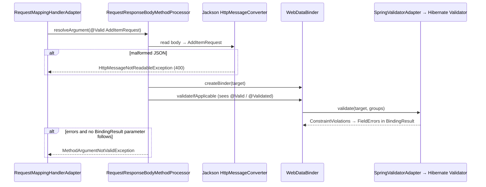
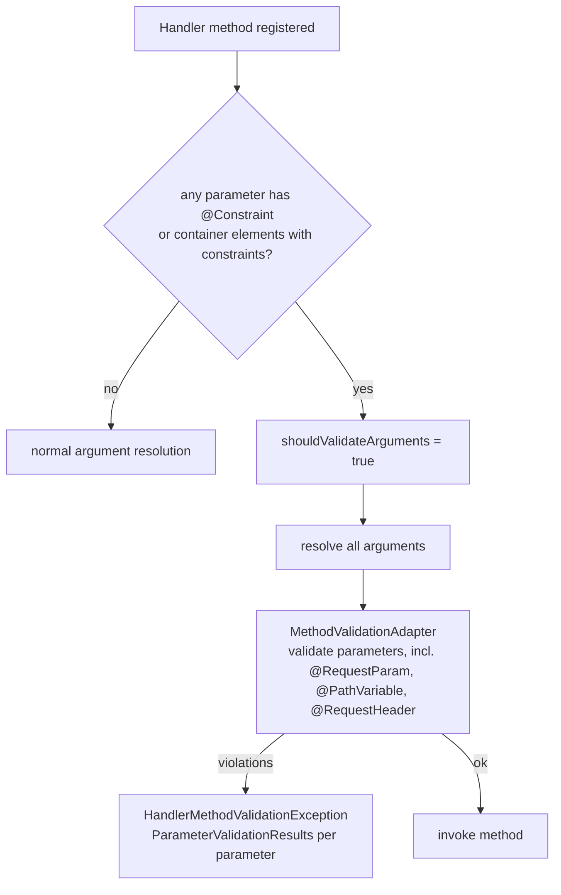
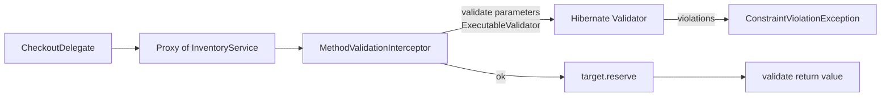

# 09 · Validation

## 1. Introduction & Why It Matters

Every value that enters the grocery platform from outside — a quantity typed into the app, a pincode from a delivery form, a GSTIN on a seller's registration, a CSV row from a catalog upload, a Razorpay webhook — is untrusted. Validation is the first line of defence for **correctness** ("quantity can't be −3"), **security** (oversized strings, injection payloads, mass assignment) and **user experience** (clear, field-level messages the Angular form can show next to the right input).

Spring integrates **Jakarta Bean Validation** (implemented by Hibernate Validator) at every layer:

| Where | How |
|---|---|
| HTTP request bodies | `@Valid @RequestBody` |
| Path/query/header parameters | Constraints directly on controller parameters (built-in method validation since Framework 6.1) |
| Service methods | `@Validated` class + constraints on parameters/return values |
| Configuration properties | `@Validated @ConfigurationProperties` (Chapter 06) |
| JPA entities | Validation on persist/update (optional) |
| Programmatic | Inject `Validator` and call it (CSV rows, Kafka messages) |

This chapter builds validation for cart, checkout and seller onboarding: built-in and **custom Indian constraints** (pincode, mobile, GSTIN with checksum), nested and collection validation, groups for create vs update, cross-field rules, method validation in services, localized messages in English and Hindi, and a batch validator for seller CSV uploads. Chapter 10 turns every validation failure into one consistent `ProblemDetail` response.

### Who should read which section

| Band | Focus |
|---|---|
| B1 · 0–2 yrs | Parts 1, 2, 4 — `@Valid`, built-in constraints |
| B2 · 2–5 yrs | Parts 2, 5 — nested, collections, groups, custom constraints, messages |
| B3 · 5–8 yrs | Parts 3, 5, 6 — method validation internals, `@Valid` vs `@Validated`, exception types |
| B4 · 8–12 yrs | Parts 6, 8 — validation strategy across layers, batch validation, performance |
| B5 · 12–15+ yrs | Parts 8, 9 — where rules belong: validation vs domain invariants vs business rules |

---

## 2. Core Concepts

### 2.1 Jakarta Bean Validation in one paragraph

You annotate fields, record components, parameters or return values with **constraints** (`@NotBlank`, `@Size`, `@Pattern`...). A **`Validator`** checks an object graph against them and returns a set of **`ConstraintViolation`s** (property path, invalid value, message). Implementation: **Hibernate Validator**, added by `spring-boot-starter-validation`.

### 2.2 Built-in constraints

| Constraint | Applies to | Notes |
|---|---|---|
| `@NotNull` | Any | Null fails |
| `@NotEmpty` | String, Collection, Map, array | Null or empty fails |
| `@NotBlank` | String | Null, empty or whitespace fails |
| `@Size(min, max)` | String, Collection, Map, array | Null is valid |
| `@Min`, `@Max` | Numbers | Long bounds |
| `@DecimalMin`, `@DecimalMax` | Numbers, numeric strings | String bounds, `inclusive` flag |
| `@Positive`, `@PositiveOrZero`, `@Negative`, `@NegativeOrZero` | Numbers | |
| `@Digits(integer, fraction)` | Numbers | e.g. money: `integer = 8, fraction = 2` |
| `@Pattern(regexp)` | String | Whole-string match |
| `@Email` | String | Lenient syntax check |
| `@Past`, `@PastOrPresent`, `@Future`, `@FutureOrPresent` | Date/time | Uses the validator's clock |
| `@AssertTrue`, `@AssertFalse` | boolean | Useful for cross-field checks |
| `@Null` | Any | Must be null (e.g. id on create) |

!!! tip "Null is usually valid"
    Every constraint except the `@Not*`/`@Null` family treats `null` as valid. Combine: `@NotNull @Size(max = 100)`. This composability is deliberate — a constraint checks one thing.

Hibernate Validator adds extras: `@Length`, `@Range`, `@URL`, `@UUID`, `@CreditCardNumber`, `@ISBN`, `@CodePointLength`...

### 2.3 Where constraints go

| Target | Example |
|---|---|
| Record component / field | `record AddItemRequest(@NotBlank String sku, @Min(1) int quantity)` |
| Type argument (container element) | `List<@NotBlank String> tags`, `Map<@Pattern(...) String, @Positive Integer>` |
| Method parameter | `void reserve(@NotBlank String sku, @Positive int qty)` |
| Return value | `@NotNull Cart get(String id)` |
| Class (class-level constraint) | `@ValidDeliveryWindow class SlotRequest` |

### 2.4 Cascading with `@Valid`

Constraints on nested objects are only checked if the reference is marked `@Valid`:

```java title="CheckoutRequest.java"
record CheckoutRequest(@Valid @NotNull Address address, List<@Valid LineItem> items) {}
```

### 2.5 `@Valid` vs `@Validated`

| | `@Valid` (Jakarta) | `@Validated` (Spring) |
|---|---|---|
| Cascade into nested objects | ✅ | ❌ |
| Trigger validation of `@RequestBody`/`@ModelAttribute` | ✅ | ✅ (and supports groups) |
| Validation groups | ❌ | ✅ `@Validated(OnCreate.class)` |
| Enable method validation on a bean (class level) | ❌ | ✅ |
| Validate `@ConfigurationProperties` | ❌ | ✅ |

### 2.6 Groups

Groups let the same DTO validate differently per use case: `id` must be **null on create** but **present on update**.

```java title="OnCreate.java"
public interface OnCreate {}
public interface OnUpdate {}

record SellerRequest(@Null(groups = OnCreate.class) @NotNull(groups = OnUpdate.class) Long id, ...) {}
```

Constraints without `groups` belong to `Default`. `@Validated(OnCreate.class)` validates **only** `OnCreate` unless the group extends `Default` (`interface OnCreate extends Default {}`) — a very common surprise. `@GroupSequence` orders groups so expensive checks run only if cheap ones pass.

### 2.7 Custom constraints

Two parts: an **annotation** meta-annotated with `@Constraint`, and a **`ConstraintValidator`**. Spring's `LocalValidatorFactoryBean` creates validators through Spring, so they can **inject beans** (e.g. a pincode directory). Constraints can also be **composed** from existing ones without writing a validator.

### 2.8 Cross-field validation

- `@AssertTrue` method on the object (simple, local).
- Class-level custom constraint (reusable, can target a specific property node for the error).

### 2.9 Method validation

Validates parameters and return values of **any Spring bean method**:

- **In controllers (Framework 6.1+)**: if a handler method has constraint annotations directly on parameters (`@RequestParam @Pattern(...) String pincode`) or `@Valid` on container elements, Spring MVC applies **built-in method validation** and raises `HandlerMethodValidationException`. No `@Validated` needed on the controller.
- **In other beans**: annotate the class with `@Validated`; Boot's `MethodValidationPostProcessor` wraps it in an AOP proxy (Chapter 04 rules apply — no self-invocation) and raises `ConstraintViolationException`.

### 2.10 Exception types you'll see

| Exception | When | Default status |
|---|---|---|
| `MethodArgumentNotValidException` | `@Valid @RequestBody`/`@ModelAttribute` fails | 400 |
| `HandlerMethodValidationException` | Built-in controller method validation fails (6.1+) | 400 (or 500 for return values) |
| `ConstraintViolationException` | AOP method validation (`@Validated` beans) fails | 500 unless mapped! |
| `BindException` / `MethodArgumentNotValidException` | Type conversion/binding errors for model attributes | 400 |
| `MethodArgumentTypeMismatchException` | `?quantity=abc` for an `int` param | 400 |
| `HttpMessageNotReadableException` | Malformed JSON, wrong type in body | 400 |

!!! warning "The 500 trap"
    A `ConstraintViolationException` from a service is **not** mapped to 400 by default — it becomes a 500. Chapter 10 maps it deliberately. Decide per case whether a service-level violation is a client error (400/422) or a programming error (500).

### 2.11 Messages and i18n

Messages come from interpolated templates: `{jakarta.validation.constraints.Size.message}` → "size must be between {min} and {max}". Override with the `message` attribute or keys in `ValidationMessages.properties`. With Spring, validator messages can also resolve from the app's `MessageSource` (`messages.properties`) — Boot wires this — so validation and other UI texts share one set of bundles, localized by `Accept-Language`.

### 2.12 Validation vs business rules

| Kind | Example | Where |
|---|---|---|
| **Input validation** (syntax, shape) | pincode is 6 digits, quantity 1–20 | DTO constraints at the edge |
| **Domain invariants** (always true for a valid object) | `Money` never negative | Constructors / value objects |
| **Business rules** (need state or other data) | pincode is serviceable, item in stock, coupon valid for this cart | Services, returning domain errors |

Don't put database lookups for business rules in constraint validators unless the rule is truly "input validity" and cheap (cached).

---

## 3. How It Works Internally

### 3.1 `@Valid @RequestBody` path



The validator is Boot's `LocalValidatorFactoryBean` (from `ValidationAutoConfiguration`), wrapped by the MVC `WebDataBinder`. Violations become Spring `FieldError`s with message codes like `NotBlank.addItemRequest.sku`, `NotBlank.sku`, `NotBlank.java.lang.String`, `NotBlank` — resolvable through `MessageSource`.

### 3.2 Built-in controller method validation (Framework 6.1+)



- If a `@RequestBody`/`@ModelAttribute` parameter has only `@Valid`, it's validated the classic way (`MethodArgumentNotValidException`). If *other* parameters also have constraints, all are validated together and everything is reported via `HandlerMethodValidationException`.
- Putting `@Validated` on the controller class **also** triggers AOP method validation → parameters could be validated twice and throw a different exception. **Don't use class-level `@Validated` on controllers** in Framework 6.1+.

### 3.3 AOP method validation for services



`MethodValidationPostProcessor` (a `BeanPostProcessor` from Boot's `ValidationAutoConfiguration`) proxies every bean annotated `@Validated`. Self-invocation skips validation, like any AOP.

### 3.4 Validator bootstrap and injection into validators

`LocalValidatorFactoryBean` configures Hibernate Validator with a `SpringConstraintValidatorFactory` — constraint validator instances are created via `AutowireCapableBeanFactory`, so constructor injection works. Validators are cached per constraint annotation instance and **must be thread-safe**.

---

## 4. Hands-On Code — Level 1 (Beginner)

### 4.1 Dependency

```kotlin title="build.gradle.kts"
implementation(libs.spring.boot.starter.validation)
```

Without it there's no validator — `@Valid` silently does nothing (Boot logs nothing about it).

### 4.2 Validating a request body

```java title="in/grocery/cart/web/dto/AddItemRequest.java"
package in.grocery.cart.web.dto;

import jakarta.validation.constraints.Max;
import jakarta.validation.constraints.Min;
import jakarta.validation.constraints.NotBlank;
import jakarta.validation.constraints.Pattern;

public record AddItemRequest(
        @NotBlank
        @Pattern(regexp = "[A-Z0-9-]{3,40}", message = "SKU must be 3-40 uppercase letters, digits or dashes")
        String sku,

        @Min(1) @Max(20)
        int quantity) {}
```

```java title="in/grocery/cart/web/CartItemController.java"
package in.grocery.cart.web;

import in.grocery.cart.delegate.CartDelegate;
import in.grocery.cart.web.dto.AddItemRequest;
import in.grocery.cart.web.dto.CartDtos.CartView;
import jakarta.validation.Valid;
import org.springframework.web.bind.annotation.PathVariable;
import org.springframework.web.bind.annotation.PostMapping;
import org.springframework.web.bind.annotation.RequestBody;
import org.springframework.web.bind.annotation.RestController;

@RestController
class CartItemController {

    private final CartDelegate delegate;

    CartItemController(CartDelegate delegate) {
        this.delegate = delegate;
    }

    @PostMapping("/api/carts/{cartId}/items")
    CartView add(@PathVariable String cartId, @Valid @RequestBody AddItemRequest request) {    // (1)!
        return delegate.addItem(cartId, request);
    }
}
```

1. `@Valid` triggers validation after JSON deserialization; failures → `400` via `MethodArgumentNotValidException` before the method runs.

```bash title="Terminal"
curl -s -X POST localhost:8082/api/carts/c1/items -H 'Content-Type: application/json' \
     -d '{"sku":"atta 5kg","quantity":0}'
```

```json title="Response with spring.mvc.problemdetails.enabled=true (Chapter 10 improves it)"
{
  "type": "about:blank",
  "title": "Bad Request",
  "status": 400,
  "detail": "Invalid request content.",
  "instance": "/api/carts/c1/items"
}
```

The field details are missing by default — Chapter 10 adds an `errors` array.

### 4.3 Validating path and query parameters

```java title="in/grocery/delivery/web/ServiceabilityController.java"
package in.grocery.delivery.web;

import jakarta.validation.constraints.Pattern;
import java.util.Map;
import org.springframework.web.bind.annotation.GetMapping;
import org.springframework.web.bind.annotation.PathVariable;
import org.springframework.web.bind.annotation.RestController;

@RestController
class ServiceabilityController {

    @GetMapping("/api/public/serviceability/{pincode}")
    Map<String, Object> check(@PathVariable @Pattern(regexp = "[1-9][0-9]{5}") String pincode) {   // (1)!
        return Map.of("pincode", pincode, "serviceable", pincode.startsWith("560"));
    }
}
```

1. Constraint directly on the parameter → built-in method validation (Framework 6.1+). No `@Validated` on the class.

### 4.4 Unit-testing constraints without Spring

```java title="in/grocery/cart/web/dto/AddItemRequestTest.java"
package in.grocery.cart.web.dto;

import static org.assertj.core.api.Assertions.assertThat;

import jakarta.validation.ConstraintViolation;
import jakarta.validation.Validation;
import jakarta.validation.Validator;
import jakarta.validation.ValidatorFactory;
import java.util.Set;
import org.junit.jupiter.api.AfterAll;
import org.junit.jupiter.api.BeforeAll;
import org.junit.jupiter.api.Test;

class AddItemRequestTest {

    private static ValidatorFactory factory;
    private static Validator validator;

    @BeforeAll
    static void setUp() {
        factory = Validation.buildDefaultValidatorFactory();
        validator = factory.getValidator();
    }

    @AfterAll
    static void tearDown() {
        factory.close();
    }

    @Test
    void validRequestHasNoViolations() {
        assertThat(validator.validate(new AddItemRequest("ATTA-5KG", 2))).isEmpty();
    }

    @Test
    void reportsEachInvalidField() {
        Set<ConstraintViolation<AddItemRequest>> v = validator.validate(new AddItemRequest("atta 5kg", 0));
        assertThat(v).extracting(cv -> cv.getPropertyPath().toString())
                     .containsExactlyInAnyOrder("sku", "quantity");
    }
}
```

---

## 5. Hands-On Code — Level 2 (Intermediate) & Level 3 (Advanced)

### 5.1 Level 2 — Nested objects and collections: checkout

```java title="in/grocery/order/web/dto/CheckoutRequest.java"
package in.grocery.order.web.dto;

import in.grocery.platform.validation.IndianMobile;
import in.grocery.platform.validation.Pincode;
import jakarta.validation.Valid;
import jakarta.validation.constraints.Future;
import jakarta.validation.constraints.Max;
import jakarta.validation.constraints.Min;
import jakarta.validation.constraints.NotBlank;
import jakarta.validation.constraints.NotEmpty;
import jakarta.validation.constraints.NotNull;
import jakarta.validation.constraints.Pattern;
import jakarta.validation.constraints.Size;
import java.time.OffsetDateTime;
import java.util.List;

public record CheckoutRequest(
        @NotBlank String cartId,
        @Valid @NotNull DeliveryAddress address,                                       // (1)!
        @NotEmpty @Size(max = 50) List<@Valid @NotNull LineItem> items,                // (2)!
        @NotNull @Future OffsetDateTime slotStart,
        @Size(max = 5) List<@NotBlank @Pattern(regexp = "[A-Z0-9]{4,15}") String> couponCodes,  // (3)!
        @NotNull PaymentMethod paymentMethod) {

    public record DeliveryAddress(
            @NotBlank @Size(max = 80) String name,
            @IndianMobile String mobile,
            @NotBlank @Size(max = 200) String line1,
            @Size(max = 200) String line2,
            @NotBlank @Size(max = 60) String city,
            @Pincode String pincode) {}

    public record LineItem(
            @NotBlank String sku,
            @Min(1) @Max(20) int quantity) {}

    public enum PaymentMethod { UPI, CARD, NETBANKING, COD }
}
```

1. `@Valid` cascades into the address; `@NotNull` ensures it's present.
2. `@Valid` on the type argument validates each element; `@Size(max = 50)` bounds the list itself — never accept unbounded collections.
3. Container element constraints: each coupon code is checked.

Violations carry paths like `items[2].quantity`, `address.pincode`, `couponCodes[0].<list element>` — exactly what the Angular form needs to highlight fields.

### 5.2 Level 2 — Custom constraints for India

**Composed constraint (no validator class needed):**

```java title="in/grocery/platform/validation/Pincode.java"
package in.grocery.platform.validation;

import jakarta.validation.Constraint;
import jakarta.validation.Payload;
import jakarta.validation.ReportAsSingleViolation;
import jakarta.validation.constraints.NotNull;
import jakarta.validation.constraints.Pattern;
import java.lang.annotation.Documented;
import java.lang.annotation.ElementType;
import java.lang.annotation.Retention;
import java.lang.annotation.RetentionPolicy;
import java.lang.annotation.Target;

@Documented
@NotNull
@Pattern(regexp = "[1-9][0-9]{5}")
@ReportAsSingleViolation                                                              // (1)!
@Constraint(validatedBy = {})                                                         // (2)!
@Target({ElementType.FIELD, ElementType.PARAMETER, ElementType.RECORD_COMPONENT, ElementType.TYPE_USE})
@Retention(RetentionPolicy.RUNTIME)
public @interface Pincode {
    String message() default "{grocery.validation.pincode}";
    Class<?>[] groups() default {};
    Class<? extends Payload>[] payload() default {};
}
```

1. One clear message instead of separate "must not be null" + "must match pattern".
2. Composition only — the meta-constraints do the work.

```java title="in/grocery/platform/validation/IndianMobile.java"
package in.grocery.platform.validation;

import jakarta.validation.Constraint;
import jakarta.validation.Payload;
import jakarta.validation.ReportAsSingleViolation;
import jakarta.validation.constraints.NotNull;
import jakarta.validation.constraints.Pattern;
import java.lang.annotation.Documented;
import java.lang.annotation.ElementType;
import java.lang.annotation.Retention;
import java.lang.annotation.RetentionPolicy;
import java.lang.annotation.Target;

/** 10-digit Indian mobile number starting 6–9, without country code or spaces. */
@Documented
@NotNull
@Pattern(regexp = "[6-9][0-9]{9}")
@ReportAsSingleViolation
@Constraint(validatedBy = {})
@Target({ElementType.FIELD, ElementType.PARAMETER, ElementType.RECORD_COMPONENT, ElementType.TYPE_USE})
@Retention(RetentionPolicy.RUNTIME)
public @interface IndianMobile {
    String message() default "{grocery.validation.mobile}";
    Class<?>[] groups() default {};
    Class<? extends Payload>[] payload() default {};
}
```

**Constraint with a validator — GSTIN with checksum:**

A GSTIN has 15 characters: 2-digit state code, 10-character PAN, entity number, `Z`, and a check character computed with a weighted mod-36 algorithm.

```java title="in/grocery/platform/validation/Gstin.java"
package in.grocery.platform.validation;

import jakarta.validation.Constraint;
import jakarta.validation.Payload;
import java.lang.annotation.Documented;
import java.lang.annotation.ElementType;
import java.lang.annotation.Retention;
import java.lang.annotation.RetentionPolicy;
import java.lang.annotation.Target;

@Documented
@Constraint(validatedBy = GstinValidator.class)
@Target({ElementType.FIELD, ElementType.PARAMETER, ElementType.RECORD_COMPONENT, ElementType.TYPE_USE})
@Retention(RetentionPolicy.RUNTIME)
public @interface Gstin {
    String message() default "{grocery.validation.gstin}";
    Class<?>[] groups() default {};
    Class<? extends Payload>[] payload() default {};
}
```

```java title="in/grocery/platform/validation/GstinValidator.java"
package in.grocery.platform.validation;

import jakarta.validation.ConstraintValidator;
import jakarta.validation.ConstraintValidatorContext;
import java.util.regex.Pattern;

public class GstinValidator implements ConstraintValidator<Gstin, String> {

    private static final Pattern FORMAT =
            Pattern.compile("(0[1-9]|[1-3][0-9])[A-Z]{5}[0-9]{4}[A-Z][1-9A-Z]Z[0-9A-Z]");     // (1)!
    private static final String CHARS = "0123456789ABCDEFGHIJKLMNOPQRSTUVWXYZ";

    @Override
    public boolean isValid(String value, ConstraintValidatorContext ctx) {
        if (value == null) return true;                                                        // (2)!
        if (!FORMAT.matcher(value).matches()) return false;
        return checkChar(value) == value.charAt(14);
    }

    static char checkChar(String gstin) {
        int sum = 0;
        for (int i = 0; i < 14; i++) {
            int product = CHARS.indexOf(gstin.charAt(i)) * (i % 2 == 0 ? 1 : 2);
            sum += product / 36 + product % 36;
        }
        return CHARS.charAt((36 - sum % 36) % 36);
    }
}
```

1. Format: state code, PAN (5 letters, 4 digits, letter), entity number, literal `Z`, check character. State code range is kept loose (01–39); the tax master decides actual validity.
2. Null is valid — combine with `@NotNull` where required (constraint composability).

```java title="GstinValidatorTest.java"
package in.grocery.platform.validation;

import static org.assertj.core.api.Assertions.assertThat;

import org.junit.jupiter.params.ParameterizedTest;
import org.junit.jupiter.params.provider.ValueSource;

class GstinValidatorTest {

    private final GstinValidator validator = new GstinValidator();

    @ParameterizedTest
    @ValueSource(strings = {"27AAPFU0939F1ZV", "29AAGCB7383J1Z4"})
    void acceptsValidGstins(String gstin) {
        assertThat(validator.isValid(gstin, null)).isTrue();
    }

    @ParameterizedTest
    @ValueSource(strings = {
            "27AAPFU0939F1ZX",   // wrong check character
            "27AAPFU0939F1YV",   // 14th char must be Z
            "27aapfu0939f1zv",   // lowercase
            "99AAPFU0939F1ZV",   // invalid state code pattern
            "27AAPFU0939F1Z"     // too short
    })
    void rejectsInvalidGstins(String gstin) {
        assertThat(validator.isValid(gstin, null)).isFalse();
    }
}
```

### 5.3 Level 2 — Messages and localization

```properties title="src/main/resources/messages.properties"
grocery.validation.pincode=Enter a valid 6-digit pincode
grocery.validation.mobile=Enter a valid 10-digit mobile number
grocery.validation.gstin=Enter a valid 15-character GSTIN
jakarta.validation.constraints.Max.message=must be at most {value}
```

```properties title="src/main/resources/messages_hi.properties"
grocery.validation.pincode=कृपया 6 अंकों का सही पिनकोड दर्ज करें
grocery.validation.mobile=कृपया 10 अंकों का सही मोबाइल नंबर दर्ज करें
grocery.validation.gstin=कृपया 15 अक्षरों का सही GSTIN दर्ज करें
```

```yaml title="application.yml"
spring:
  messages:
    basename: messages
    encoding: UTF-8
    fallback-to-system-locale: false      # predictable: default bundle, not the server's locale
```

Boot's `ValidationAutoConfiguration` configures the validator to resolve `{...}` keys through the application `MessageSource`, and Spring MVC picks the locale from `Accept-Language` (`AcceptHeaderLocaleResolver`). Request with `Accept-Language: hi-IN` → Hindi messages.

!!! warning "Verify"
    Boot's integration of the application `MessageSource` into Bean Validation message interpolation has evolved across 3.x versions. If `{grocery.validation.pincode}` shows up literally, check that `ValidationMessages.properties` or `MessageSource` integration is configured for your version (Boot reference *Validation*).

### 5.4 Level 2 — Groups: create vs update

```java title="in/grocery/seller/web/dto/SellerRequest.java"
package in.grocery.seller.web.dto;

import in.grocery.platform.validation.Gstin;
import in.grocery.platform.validation.IndianMobile;
import in.grocery.platform.validation.Pincode;
import jakarta.validation.constraints.Email;
import jakarta.validation.constraints.NotBlank;
import jakarta.validation.constraints.NotNull;
import jakarta.validation.constraints.Null;
import jakarta.validation.constraints.Size;
import jakarta.validation.groups.Default;

public record SellerRequest(
        @Null(groups = OnCreate.class) @NotNull(groups = OnUpdate.class) Long id,
        @NotBlank @Size(max = 120) String legalName,
        @NotNull @Gstin String gstin,
        @IndianMobile String contactMobile,
        @NotBlank @Email String contactEmail,
        @Pincode String warehousePincode) {

    public interface OnCreate extends Default {}                                           // (1)!
    public interface OnUpdate extends Default {}
}
```

1. Extending `Default` means `@Validated(OnCreate.class)` also runs all ungrouped constraints. Without it, only the `id` rule would run.

```java title="in/grocery/seller/web/SellerController.java"
@PostMapping("/api/sellers")
ResponseEntity<SellerView> register(@Validated(SellerRequest.OnCreate.class) @RequestBody SellerRequest req) { ... }

@PutMapping("/api/sellers/{id}")
SellerView update(@PathVariable long id, @Validated(SellerRequest.OnUpdate.class) @RequestBody SellerRequest req) { ... }
```

!!! tip "Separate DTOs are often clearer"
    Groups are powerful but make one class hard to read. If create and update differ in more than one or two fields, use `CreateSellerRequest` and `UpdateSellerRequest`.

### 5.5 Level 3 — Cross-field validation with a class-level constraint

Delivery slot requests: `slotEnd` after `slotStart`, same day, slot length 1–3 hours.

```java title="in/grocery/platform/validation/ValidTimeWindow.java"
package in.grocery.platform.validation;

import jakarta.validation.Constraint;
import jakarta.validation.Payload;
import java.lang.annotation.Documented;
import java.lang.annotation.ElementType;
import java.lang.annotation.Retention;
import java.lang.annotation.RetentionPolicy;
import java.lang.annotation.Target;

@Documented
@Constraint(validatedBy = TimeWindowValidator.class)
@Target(ElementType.TYPE)
@Retention(RetentionPolicy.RUNTIME)
public @interface ValidTimeWindow {
    String message() default "{grocery.validation.time-window}";
    int minMinutes() default 60;
    int maxMinutes() default 180;
    Class<?>[] groups() default {};
    Class<? extends Payload>[] payload() default {};
}
```

```java title="in/grocery/platform/validation/TimeWindow.java"
package in.grocery.platform.validation;

import java.time.OffsetDateTime;

/** Implemented by any DTO with a start/end pair. */
public interface TimeWindow {
    OffsetDateTime start();
    OffsetDateTime end();
}
```

```java title="in/grocery/platform/validation/TimeWindowValidator.java"
package in.grocery.platform.validation;

import jakarta.validation.ConstraintValidator;
import jakarta.validation.ConstraintValidatorContext;
import java.time.Duration;

public class TimeWindowValidator implements ConstraintValidator<ValidTimeWindow, TimeWindow> {

    private Duration min;
    private Duration max;

    @Override
    public void initialize(ValidTimeWindow annotation) {
        this.min = Duration.ofMinutes(annotation.minMinutes());
        this.max = Duration.ofMinutes(annotation.maxMinutes());
    }

    @Override
    public boolean isValid(TimeWindow w, ConstraintValidatorContext ctx) {
        if (w == null || w.start() == null || w.end() == null) return true;               // @NotNull handles nulls
        Duration length = Duration.between(w.start(), w.end());
        boolean sameDay = w.start().toLocalDate().equals(w.end().toLocalDate());
        if (!length.isNegative() && sameDay && length.compareTo(min) >= 0 && length.compareTo(max) <= 0) {
            return true;
        }
        ctx.disableDefaultConstraintViolation();                                            // (1)!
        ctx.buildConstraintViolationWithTemplate(ctx.getDefaultConstraintMessageTemplate())
           .addPropertyNode("end")
           .addConstraintViolation();
        return false;
    }
}
```

1. Attach the error to the `end` field so the UI highlights the right input rather than the whole form.

```java title="in/grocery/delivery/web/dto/SlotBookingRequest.java"
@ValidTimeWindow
public record SlotBookingRequest(
        @NotNull @Future OffsetDateTime start,
        @NotNull OffsetDateTime end,
        @Pincode String pincode) implements TimeWindow {}
```

### 5.6 Level 3 — Validators that use Spring beans

Pincode *format* is input validation; *existence* in India Post's directory is also input validation (it's reference data, cheap if cached) — unlike serviceability, which is a business rule.

```java title="in/grocery/platform/validation/KnownPincodeValidator.java"
package in.grocery.platform.validation;

import jakarta.validation.ConstraintValidator;
import jakarta.validation.ConstraintValidatorContext;

public class KnownPincodeValidator implements ConstraintValidator<KnownPincode, String> {

    public interface PincodeDirectory { boolean exists(String pincode); }   // in-memory, loaded at startup

    private final PincodeDirectory directory;

    public KnownPincodeValidator(PincodeDirectory directory) {             // (1)!
        this.directory = directory;
    }

    @Override
    public boolean isValid(String value, ConstraintValidatorContext ctx) {
        return value == null || directory.exists(value);
    }
}
```

1. Constructor injection works because Spring's `LocalValidatorFactoryBean` creates validators through the bean factory. The validator is shared across threads — keep it stateless.

!!! warning "Validators outside Spring"
    `Validation.buildDefaultValidatorFactory()` (like the unit test in 4.4) can't inject beans and will fail to instantiate this validator. Test it by constructing it directly with a fake directory, or with a Spring-configured validator.

### 5.7 Level 3 — Method validation in services

```java title="in/grocery/inventory/service/InventoryService.java"
package in.grocery.inventory.service;

import jakarta.validation.Valid;
import jakarta.validation.constraints.Max;
import jakarta.validation.constraints.NotBlank;
import jakarta.validation.constraints.NotEmpty;
import jakarta.validation.constraints.NotNull;
import jakarta.validation.constraints.Positive;
import java.util.List;
import org.springframework.stereotype.Service;
import org.springframework.validation.annotation.Validated;

@Service
@Validated                                                                                  // (1)!
public class InventoryService {

    public record Reservation(@NotBlank String sku, @Positive @Max(100) int quantity) {}

    public @NotNull String reserve(@NotBlank String hubCode,
                                   @NotEmpty List<@Valid Reservation> reservations) {       // (2)!
        return "RSV-" + hubCode + "-" + reservations.size();
    }
}
```

1. Enables AOP method validation for this bean.
2. Violations throw `ConstraintViolationException` with paths like `reserve.reservations[0].quantity`.

This protects the service contract when called from Kafka consumers, schedulers or other delegates — not just from HTTP. Map `ConstraintViolationException` explicitly in Chapter 10.

---

## 6. Hands-On Code — Level 4 (Expert / Production)

### Validating seller catalog CSV uploads

Sellers upload catalogs with 5,000–50,000 rows. Requirements:

- Validate every row with the same constraints as the single-product API.
- Report **all** errors with row numbers (not fail on the first), capped at 500 errors.
- Stream — don't hold the whole file in memory.
- Reject the file early if the header is wrong.
- Keep valid rows for import only if the error rate is below 2%.

```java title="in/grocery/seller/catalog/ProductRow.java"
package in.grocery.seller.catalog;

import jakarta.validation.constraints.DecimalMax;
import jakarta.validation.constraints.DecimalMin;
import jakarta.validation.constraints.Digits;
import jakarta.validation.constraints.Min;
import jakarta.validation.constraints.NotBlank;
import jakarta.validation.constraints.NotNull;
import jakarta.validation.constraints.Pattern;
import jakarta.validation.constraints.Size;
import java.math.BigDecimal;

public record ProductRow(
        @NotBlank @Pattern(regexp = "[A-Z0-9-]{3,40}") String sku,
        @NotBlank @Size(max = 150) String name,
        @NotBlank @Pattern(regexp = "[a-z-]{2,40}") String category,
        @NotNull @DecimalMin("0.01") @DecimalMax("999999.99") @Digits(integer = 6, fraction = 2) BigDecimal mrp,
        @NotNull @DecimalMin("0.01") @Digits(integer = 6, fraction = 2) BigDecimal sellingPrice,
        @NotNull @Pattern(regexp = "\\d{4}|\\d{6}|\\d{8}") String hsnCode,
        @NotNull @Min(0) Integer stock) {

    @jakarta.validation.constraints.AssertTrue(message = "selling price must not exceed MRP")
    public boolean isPriceWithinMrp() {                                                     // (1)!
        return mrp == null || sellingPrice == null || sellingPrice.compareTo(mrp) <= 0;
    }
}
```

1. Legal requirement in India: selling price can't exceed MRP. The check lives with the data it needs.

```java title="in/grocery/seller/catalog/CatalogCsvValidator.java"
package in.grocery.seller.catalog;

import jakarta.validation.ConstraintViolation;
import jakarta.validation.Validator;
import java.io.BufferedReader;
import java.io.IOException;
import java.io.InputStream;
import java.io.InputStreamReader;
import java.math.BigDecimal;
import java.nio.charset.StandardCharsets;
import java.util.ArrayList;
import java.util.Comparator;
import java.util.List;
import java.util.function.Consumer;
import org.springframework.stereotype.Component;

@Component
public class CatalogCsvValidator {

    public static final List<String> HEADER =
            List.of("sku", "name", "category", "mrp", "selling_price", "hsn_code", "stock");
    static final int MAX_ERRORS = 500;

    public record RowError(long row, String field, String message, String rejectedValue) {}

    public record Result(long totalRows, long validRows, List<RowError> errors, boolean truncated) {
        public double errorRate() {
            return totalRows == 0 ? 0 : (double) (totalRows - validRows) / totalRows;
        }
        public boolean acceptable() {
            return totalRows > 0 && errorRate() <= 0.02;
        }
    }

    public static class InvalidHeaderException extends RuntimeException {
        public InvalidHeaderException(List<String> actual) { super("Expected header " + HEADER + " but got " + actual); }
    }

    private final Validator validator;                                                       // (1)!

    public CatalogCsvValidator(Validator validator) {
        this.validator = validator;
    }

    public Result validate(InputStream csv, Consumer<ProductRow> validRowSink) throws IOException {
        var reader = new BufferedReader(new InputStreamReader(csv, StandardCharsets.UTF_8));
        String headerLine = reader.readLine();
        List<String> header = headerLine == null ? List.of() : split(stripBom(headerLine));
        if (!header.equals(HEADER)) throw new InvalidHeaderException(header);

        List<RowError> errors = new ArrayList<>();
        long rowNo = 1, total = 0, valid = 0;
        boolean truncated = false;
        String line;
        while ((line = reader.readLine()) != null) {                                          // (2)!
            rowNo++;
            if (line.isBlank()) continue;
            total++;
            List<String> cols = split(line);
            List<RowError> rowErrors = new ArrayList<>();
            ProductRow row = parse(rowNo, cols, rowErrors);
            if (row != null) {
                for (ConstraintViolation<ProductRow> v : validator.validate(row)) {
                    rowErrors.add(new RowError(rowNo, fieldName(v), v.getMessage(), String.valueOf(v.getInvalidValue())));
                }
            }
            if (rowErrors.isEmpty()) {
                valid++;
                validRowSink.accept(row);
            } else if (errors.size() < MAX_ERRORS) {
                rowErrors.sort(Comparator.comparing(RowError::field));                        // deterministic order
                errors.addAll(rowErrors.subList(0, Math.min(rowErrors.size(), MAX_ERRORS - errors.size())));
            } else {
                truncated = true;
            }
        }
        return new Result(total, valid, List.copyOf(errors), truncated);
    }

    private static ProductRow parse(long rowNo, List<String> c, List<RowError> errors) {
        if (c.size() != HEADER.size()) {
            errors.add(new RowError(rowNo, "*", "expected " + HEADER.size() + " columns but found " + c.size(), null));
            return null;
        }
        BigDecimal mrp = decimal(rowNo, "mrp", c.get(3), errors);
        BigDecimal price = decimal(rowNo, "selling_price", c.get(4), errors);
        Integer stock = integer(rowNo, "stock", c.get(6), errors);
        if (!errors.isEmpty()) return null;                                                  // (3)!
        return new ProductRow(c.get(0), c.get(1), c.get(2), mrp, price, c.get(5), stock);
    }

    private static BigDecimal decimal(long row, String field, String raw, List<RowError> errors) {
        try {
            return raw.isBlank() ? null : new BigDecimal(raw.strip());
        } catch (NumberFormatException e) {
            errors.add(new RowError(row, field, "must be a number", raw));
            return null;
        }
    }

    private static Integer integer(long row, String field, String raw, List<RowError> errors) {
        try {
            return raw.isBlank() ? null : Integer.valueOf(raw.strip());
        } catch (NumberFormatException e) {
            errors.add(new RowError(row, field, "must be a whole number", raw));
            return null;
        }
    }

    private static String fieldName(ConstraintViolation<?> v) {
        String path = v.getPropertyPath().toString();
        return switch (path) {
            case "sellingPrice" -> "selling_price";
            case "hsnCode" -> "hsn_code";
            case "priceWithinMrp" -> "selling_price";
            default -> path;
        };
    }

    /** Minimal CSV split supporting quoted fields with commas and doubled quotes. */
    static List<String> split(String line) {
        List<String> out = new ArrayList<>();
        StringBuilder cur = new StringBuilder();
        boolean quoted = false;
        for (int i = 0; i < line.length(); i++) {
            char ch = line.charAt(i);
            if (quoted) {
                if (ch == '"' && i + 1 < line.length() && line.charAt(i + 1) == '"') { cur.append('"'); i++; }
                else if (ch == '"') quoted = false;
                else cur.append(ch);
            } else if (ch == '"') quoted = true;
            else if (ch == ',') { out.add(cur.toString()); cur.setLength(0); }
            else cur.append(ch);
        }
        out.add(cur.toString());
        return out;
    }

    private static String stripBom(String s) {
        return s.startsWith("\uFEFF") ? s.substring(1) : s;                                   // (4)!
    }
}
```

1. Inject Spring's `Validator` (the Jakarta interface) — same configuration, messages and custom validators as the web layer.
2. Streaming, row by row — memory stays flat for 50,000 rows.
3. Type conversion errors are reported like validation errors; bean validation runs only on parseable rows.
4. Excel-exported CSVs often start with a UTF-8 byte-order mark — the header check would fail without this.

!!! tip "Use a real CSV library in production"
    The hand-written splitter keeps the example dependency-free. For production, use a mature parser (e.g. Apache Commons CSV or FastCSV) — CSV edge cases (multi-line fields, encodings) are endless.

```java title="CatalogCsvValidatorTest.java"
package in.grocery.seller.catalog;

import static org.assertj.core.api.Assertions.assertThat;
import static org.assertj.core.api.Assertions.assertThatThrownBy;

import jakarta.validation.Validation;
import java.io.ByteArrayInputStream;
import java.nio.charset.StandardCharsets;
import java.util.ArrayList;
import java.util.List;
import org.junit.jupiter.api.Test;

class CatalogCsvValidatorTest {

    private final CatalogCsvValidator validator =
            new CatalogCsvValidator(Validation.buildDefaultValidatorFactory().getValidator());

    private static ByteArrayInputStream csv(String s) {
        return new ByteArrayInputStream(s.getBytes(StandardCharsets.UTF_8));
    }

    @Test
    void reportsRowLevelErrorsAndKeepsValidRows() throws Exception {
        String data = """
                \uFEFFsku,name,category,mrp,selling_price,hsn_code,stock
                ATTA-5KG,"Atta, Whole Wheat 5kg",staples,320.00,289.00,1101,40
                MILK-1L,Toned Milk,dairy,60.00,66.00,0401,100
                ghee 1l,Ghee,dairy,abc,600.00,0405,-1
                """;
        List<ProductRow> valid = new ArrayList<>();

        var result = validator.validate(csv(data), valid::add);

        assertThat(result.totalRows()).isEqualTo(3);
        assertThat(valid).extracting(ProductRow::sku).containsExactly("ATTA-5KG");
        assertThat(result.errors()).extracting(CatalogCsvValidator.RowError::row, CatalogCsvValidator.RowError::field)
                .contains(
                        org.assertj.core.groups.Tuple.tuple(3L, "selling_price"),   // price above MRP
                        org.assertj.core.groups.Tuple.tuple(4L, "mrp"));            // not a number
        assertThat(result.acceptable()).isFalse();
    }

    @Test
    void rejectsWrongHeader() {
        assertThatThrownBy(() -> validator.validate(csv("sku,name\nA,B\n"), r -> {}))
                .isInstanceOf(CatalogCsvValidator.InvalidHeaderException.class);
    }
}
```

### Validation performance notes

| Concern | Guidance |
|---|---|
| Validator creation | Expensive — use the Spring-managed singleton, never `buildDefaultValidatorFactory()` per request |
| Regex constraints | `@Pattern` compiles once per constraint; avoid catastrophic backtracking patterns (`(a+)+`) — attackers can send inputs that take seconds |
| Collections | Always bound sizes before `@Valid` elements; 100,000-element lists validate slowly |
| Validators calling remote services | Avoid; use cached reference data |
| Fail-fast mode | Hibernate's `hibernate.validator.fail_fast=true` stops at first violation — cheaper, but worse UX; consider only for internal high-volume paths |

---

## 7. Spring Boot 3 vs 4 & Migration

| Topic | Boot 3.5 | Boot 4.x |
|---|---|---|
| Jakarta Validation | 3.0 (Jakarta EE 10) | 3.1 (Jakarta EE 11) — clarifies record support |
| Hibernate Validator | 8.x | 9.x (verify) |
| Built-in MVC method validation | Since Framework 6.1 | Same |
| `HandlerMethodValidationException` API | `getParameterValidationResults()` etc. (6.1/6.2) | Check for renamed/deprecated accessors in 7.0 |
| `ValidationAutoConfiguration` package | `org.springframework.boot.autoconfigure.validation` | Moved with validation module (verify) |
| Nullness | Spring `@Nullable` | JSpecify — don't confuse compile-time nullness with runtime `@NotNull` validation |

=== "Spring Boot 3.5 — controller parameter validation"

    ```java title="Spring Boot 3.5 — controller parameter validation (snippet)"
    @GetMapping("/api/public/serviceability/{pincode}")
    Map<String, Object> check(@PathVariable @Pincode String pincode) { ... }   // HandlerMethodValidationException on failure
    ```

=== "Spring Boot 4.x"

    ```java title="Spring Boot 4.x (snippet)"
    // Same code. Differences are in exception accessor APIs and packages — update Chapter 10's handler accordingly.
    @GetMapping("/api/public/serviceability/{pincode}")
    Map<String, Object> check(@PathVariable @Pincode String pincode) { ... }
    ```

!!! note "JSpecify `@Nullable` vs `@NotNull`"
    JSpecify annotations express **compile-time** nullness contracts for tools. Jakarta `@NotNull` is a **runtime** validation constraint on untrusted input. DTOs at the edge still need `@NotNull`; JSpecify doesn't validate JSON.

### Migration checklist

- [ ] Remove class-level `@Validated` from controllers (Framework 6.1+ double validation).
- [ ] Map `HandlerMethodValidationException` and `ConstraintViolationException` explicitly (Chapter 10).
- [ ] Re-run validation tests after Hibernate Validator upgrade (message texts may change — don't assert on default messages in contract tests).
- [ ] Check custom `ConstraintValidator`s for Jakarta namespace (Boot 2 → 3).
- [ ] Update imports of `ValidationAutoConfiguration` in tests for Boot 4.

---

## 8. Production Playbook

### Best practices

1. **Validate at the edge** — every DTO record has constraints; `@Valid` on every `@RequestBody`.
2. **Bound everything** — string lengths, collection sizes, numeric ranges.
3. **Custom constraints for domain formats** (pincode, mobile, GSTIN, HSN) in the platform library, shared by all services and the CSV validator.
4. **Stable error contract** — field paths and message keys (Chapter 10); don't make clients parse English text.
5. **Localize messages** via `MessageSource` keys.
6. **Service-level method validation** for contracts called from non-HTTP entry points.
7. **Value objects enforce invariants**; validation doesn't replace them.
8. **Business rules return domain errors** from services (e.g. `PincodeNotServiceable` → 422), not constraint violations.

### Anti-patterns

❌ **Manual `if` validation in controllers**

```java title="Anti-patterns (snippet)"
if (req.quantity() < 1 || req.quantity() > 20) return ResponseEntity.badRequest().body("bad qty");
```

✅ `@Min(1) @Max(20) int quantity` + global error handling.

❌ **Unbounded strings/lists** — `String description` with no `@Size` accepts 20 MB of text into your database.

❌ **`@Validated` on controller classes** in Framework 6.1+.

❌ **Remote calls in validators** — latency, failures turn into 500s during validation.

❌ **Validating entities as the API contract** — couples persistence to input rules.

❌ **Leaking internal paths** (`reserve.arg1[0].quantity`) — use `-parameters` so names are real, and map paths in the error handler.

### Troubleshooting

| Symptom | Cause | Fix |
|---|---|---|
| `@Valid` has no effect | No validation starter | Add `spring-boot-starter-validation` |
| Nested fields not validated | Missing `@Valid` on the nested reference / type argument | Add `@Valid` |
| Group validation skips normal constraints | Group doesn't extend `Default` | `interface OnCreate extends Default {}` |
| `ConstraintViolationException` → 500 | Not mapped | Map in global handler (Chapter 10) |
| Parameter validated twice / different exception types | `@Validated` on controller + 6.1 built-in validation | Remove class-level `@Validated` |
| Message shows `{grocery.validation.pincode}` | Key not found in bundle used by interpolator | Put key in `ValidationMessages.properties` or configure `MessageSource` integration |
| Validator with injected bean fails in tests | Built with `Validation.buildDefaultValidatorFactory()` | Use Spring's validator or construct manually |
| Service method validation ignored | Self-invocation / bean not `@Validated` | Call through proxy; annotate class |
| Slow requests with long inputs | Regex backtracking | Simplify patterns; bound length first with `@Size` |

### Production checklist

- [ ] Every request DTO has constraints and bounds
- [ ] Platform constraints (`@Pincode`, `@IndianMobile`, `@Gstin`, `@Hsn`) shared
- [ ] Validation exceptions mapped to one error format with field paths
- [ ] Messages externalized and localized
- [ ] No remote calls in validators
- [ ] Batch validators stream and cap error output
- [ ] Constraint tests for each custom validator (valid, invalid, null)

---

## 9. Interview Questions & Answers

### B1 · 0–2 years

??? question "B1 · How do you validate a request body in Spring Boot?"
    **Short answer:** Add `spring-boot-starter-validation`, put constraints on the DTO fields, and annotate the parameter with `@Valid @RequestBody`. Failures raise `MethodArgumentNotValidException` → 400.

??? question "B1 · `@NotNull` vs `@NotEmpty` vs `@NotBlank`?"
    **Short answer:** `@NotNull` rejects null. `@NotEmpty` rejects null or empty (strings, collections). `@NotBlank` rejects null, empty or whitespace-only strings.

??? question "B1 · Is `@Size(min = 1)` enough to make a field required?"
    **Short answer:** No — null is valid for `@Size`. Combine with `@NotNull` or use `@NotEmpty`.

??? question "B1 · How do you validate nested objects?"
    **Short answer:** Put `@Valid` on the nested field (or type argument for collection elements).

??? question "B1 · What happens if validation dependency is missing?"
    **Short answer:** No validator is available; `@Valid` is silently ignored and invalid data reaches your code.

### B2 · 2–5 years

??? question "B2 · `@Valid` vs `@Validated`?"
    **Short answer:** `@Valid` (Jakarta) cascades and triggers validation but has no groups. `@Validated` (Spring) supports groups, triggers validation of arguments, and at class level enables method validation on beans.

??? question "B2 · How do validation groups work and what's the common pitfall?"
    **Short answer:** Constraints tagged with groups run only when that group is requested. Pitfall: requesting `OnCreate` skips all `Default` constraints unless `OnCreate extends Default`.

??? question "B2 · How do you create a custom constraint?"
    **Short answer:** Annotation with `@Constraint(validatedBy = X.class)`, `message`/`groups`/`payload` attributes, plus a `ConstraintValidator` implementation. Or compose existing constraints with `validatedBy = {}` and `@ReportAsSingleViolation`.

??? question "B2 · How do you do cross-field validation?"
    **Short answer:** `@AssertTrue` method on the DTO for simple cases, or a class-level custom constraint that attaches the violation to a specific property node.

??? question "B2 · How are validation messages localized?"
    **Short answer:** Use message keys (`{grocery.validation.pincode}`) resolved from `ValidationMessages`/`MessageSource` bundles per locale (`messages_hi.properties`), with locale from `Accept-Language`.

??? question "B2 · How do you validate query and path parameters?"
    **Short answer:** Put constraints directly on the controller parameters. Framework 6.1+ validates them automatically (`HandlerMethodValidationException`).

### B3 · 5–8 years

??? question "B3 · Explain the difference between MethodArgumentNotValidException, HandlerMethodValidationException and ConstraintViolationException."
    **Short answer:** MANVE: `@Valid` body/model attribute validation via `WebDataBinder`. HMVE: Framework 6.1 built-in method validation of controller parameters. CVE: AOP method validation on `@Validated` beans (services), not mapped to 400 by default.

??? question "B3 · Why shouldn't you put `@Validated` on controller classes in Spring 6.1+?"
    **Short answer:** It adds the AOP method validation interceptor on top of built-in MVC method validation: parameters can be validated twice and failures surface as `ConstraintViolationException` instead of the MVC exception types your handler expects.

??? question "B3 · How can a `ConstraintValidator` use Spring beans?"
    **Short answer:** Spring's `LocalValidatorFactoryBean` uses `SpringConstraintValidatorFactory`, creating validators via the bean factory, so constructor injection works. Validators must be thread-safe.

??? question "B3 · How does method validation on a service work internally?"
    **Short answer:** `MethodValidationPostProcessor` proxies `@Validated` beans; `MethodValidationInterceptor` uses the `ExecutableValidator` to check parameters before and return values after invocation, throwing `ConstraintViolationException`. Subject to proxy limitations.

??? question "B3 · How do you validate a CSV of 50,000 rows efficiently?"
    **Short answer:** Stream rows, map to a record, validate with the shared singleton `Validator`, collect errors with row numbers up to a cap, handle conversion errors separately, and decide acceptance by error rate. Bound file size up front.

### B4 · 8–12 years

??? question "B4 · Where should different kinds of rules live?"
    **Short answer:** Input shape/format at the edge (constraints), invariants in value objects/aggregates, stateful business rules in services with domain errors, cross-service rules in orchestration/sagas. Keep validators free of remote calls.

??? question "B4 · How do you design a validation error contract for web and mobile clients?"
    **Short answer:** RFC 9457 problem details with a stable `code`, and an `errors` array of `{field, code, message}` where `field` is a JSON path matching the request and `code` a stable key clients can map; message localized server-side for display. Version it like the API.

??? question "B4 · What are the security aspects of validation?"
    **Short answer:** Bound sizes (DoS), safe regexes (ReDoS), whitelist enums/sort fields, prevent mass assignment by using dedicated DTOs, validate on the server regardless of client checks, and never interpolate user input into messages unsafely (Hibernate Validator EL expression injection in custom messages — don't put user input into message templates).

### B5 · 12–15+ years

??? question "B5 · How would you share validation rules between Angular, Flutter and Spring?"
    **Short answer:** Server is authoritative. Publish constraints via OpenAPI (patterns, lengths, enums) and generate client validators; keep India-specific formats in a shared spec; accept that complex rules live only server-side and return field-level errors clients render.

??? question "B5 · A team wants to validate stock availability in a `@InStock` constraint. Your view?"
    **Short answer:** No — it's a stateful business rule needing a remote/DB call, race-prone and not "input validity". It belongs in the reservation service with a domain error (409/422) and should be enforced at reservation time, not validation time.

### Scenario questions

??? example "Scenario · A mobile app release causes a spike of 500s on checkout"
    New app sends `couponCodes: null` → service-level `@Validated` rejects `@NotNull` on the list → `ConstraintViolationException` → unmapped → 500. Fixes: map CVE (400 for edge-origin data), make `couponCodes` optional in the DTO with a default empty list, contract tests with the app's payloads, and alert on 5xx caused by validation.

??? example "Scenario · A seller uploads a CSV and the API takes 40 seconds and times out"
    File had a `description` column with 100 KB HTML per row and a `@Pattern` with nested quantifiers → catastrophic backtracking. Fix: `@Size` limits before pattern constraints, safer regex, max file size, async import with job status, and per-row time limits.

### Coding exercise

!!! example "Exercise · `@HsnCode` and `@ValidCoupon`"
    1. Create `@HsnCode` (4, 6 or 8 digits) as a composed constraint.
    2. Create a class-level `@ValidCouponRequest` for `record CouponRequest(String code, BigDecimal cartTotal, BigDecimal minOrder)` requiring `cartTotal >= minOrder`, reporting the error on `cartTotal`. Test both.

??? success "Solution"
    ```java title="HsnCode.java"
    package in.grocery.platform.validation;

    import jakarta.validation.Constraint;
    import jakarta.validation.Payload;
    import jakarta.validation.ReportAsSingleViolation;
    import jakarta.validation.constraints.Pattern;
    import java.lang.annotation.ElementType;
    import java.lang.annotation.Retention;
    import java.lang.annotation.RetentionPolicy;
    import java.lang.annotation.Target;

    @Pattern(regexp = "\\d{4}|\\d{6}|\\d{8}")
    @ReportAsSingleViolation
    @Constraint(validatedBy = {})
    @Target({ElementType.FIELD, ElementType.PARAMETER, ElementType.RECORD_COMPONENT, ElementType.TYPE_USE})
    @Retention(RetentionPolicy.RUNTIME)
    public @interface HsnCode {
        String message() default "HSN code must have 4, 6 or 8 digits";
        Class<?>[] groups() default {};
        Class<? extends Payload>[] payload() default {};
    }
    ```

    ```java title="ValidCouponRequest.java + validator"
    package in.grocery.promotion.web;

    import jakarta.validation.Constraint;
    import jakarta.validation.ConstraintValidator;
    import jakarta.validation.ConstraintValidatorContext;
    import jakarta.validation.Payload;
    import java.lang.annotation.ElementType;
    import java.lang.annotation.Retention;
    import java.lang.annotation.RetentionPolicy;
    import java.lang.annotation.Target;
    import java.math.BigDecimal;

    @Constraint(validatedBy = ValidCouponRequest.Validator.class)
    @Target(ElementType.TYPE)
    @Retention(RetentionPolicy.RUNTIME)
    public @interface ValidCouponRequest {
        String message() default "cart total is below the coupon's minimum order value";
        Class<?>[] groups() default {};
        Class<? extends Payload>[] payload() default {};

        class Validator implements ConstraintValidator<ValidCouponRequest, CouponRequest> {
            @Override
            public boolean isValid(CouponRequest r, ConstraintValidatorContext ctx) {
                if (r == null || r.cartTotal() == null || r.minOrder() == null) return true;
                if (r.cartTotal().compareTo(r.minOrder()) >= 0) return true;
                ctx.disableDefaultConstraintViolation();
                ctx.buildConstraintViolationWithTemplate(ctx.getDefaultConstraintMessageTemplate())
                   .addPropertyNode("cartTotal").addConstraintViolation();
                return false;
            }
        }
    }

    @ValidCouponRequest
    record CouponRequest(@jakarta.validation.constraints.NotBlank String code,
                         @jakarta.validation.constraints.NotNull BigDecimal cartTotal,
                         @jakarta.validation.constraints.NotNull BigDecimal minOrder) {}
    ```

    ```java title="CouponValidationTest.java"
    package in.grocery.promotion.web;

    import static org.assertj.core.api.Assertions.assertThat;

    import in.grocery.platform.validation.HsnCode;
    import jakarta.validation.Validation;
    import jakarta.validation.Validator;
    import java.math.BigDecimal;
    import org.junit.jupiter.api.Test;

    class CouponValidationTest {

        private final Validator validator = Validation.buildDefaultValidatorFactory().getValidator();

        record Item(@HsnCode String hsn) {}

        @Test
        void hsnCode() {
            assertThat(validator.validate(new Item("0401"))).isEmpty();
            assertThat(validator.validate(new Item("04011"))).hasSize(1);
        }

        @Test
        void couponBelowMinimumReportedOnCartTotal() {
            var violations = validator.validate(new CouponRequest("DIWALI100", new BigDecimal("450"), new BigDecimal("499")));
            assertThat(violations).singleElement()
                    .extracting(v -> v.getPropertyPath().toString()).isEqualTo("cartTotal");
        }
    }
    ```

---

## Key Takeaways

- **Jakarta Bean Validation + Hibernate Validator**, enabled by `spring-boot-starter-validation`.
- Constraints on **records, type arguments, parameters, return values, classes**; `@Valid` to cascade.
- **Groups** need `extends Default` to include normal constraints — or use separate DTOs.
- **Custom constraints** (composed or with validators) for India-specific formats; validators can inject beans.
- Framework 6.1+ validates **controller parameters built-in** (`HandlerMethodValidationException`); don't add `@Validated` to controllers.
- **Service method validation** via `@Validated` beans throws `ConstraintViolationException` — map it deliberately.
- Keep **input validation, invariants and business rules** in their proper places.
- Batch validation: **stream, cap errors, handle conversion errors, reuse the singleton validator**.

## Further Reading

- Spring Framework Reference — *Core › Validation, Data Binding, and Type Conversion › Java Bean Validation*; *Web MVC › Validation*
- Spring Boot Reference — *IO › Validation*
- Jakarta Bean Validation 3.x specification; Hibernate Validator Reference Guide (custom constraints, groups, message interpolation)
- GST portal documentation on GSTIN structure

---

[:material-arrow-left: 08 REST APIs with Spring MVC](08-rest-apis-spring-mvc.md) · [10 Error Handling & Problem Details :material-arrow-right:](10-error-handling-problem-details.md)
