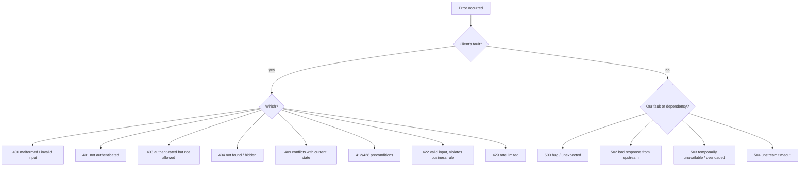
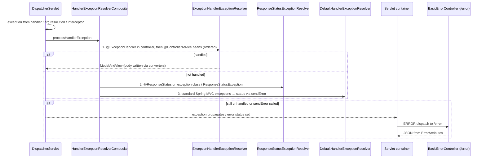

# 10 · Error Handling & Problem Details

## 1. Introduction & Why It Matters

When the checkout call fails, three audiences read the response:

- **The Angular and Flutter apps** need a **machine-readable code** to decide what to do: show "This pincode isn't serviceable yet", highlight the mobile field, refresh a stale cart, or retry later.
- **The customer** needs a **human, localized message** — in English or Hindi — not `NullPointerException at CartService.java:142`.
- **The on-call engineer** needs a **trace ID** that leads straight to logs and traces, and a clean split between "client did something wrong" (4xx, no alert) and "we broke" (5xx, alert).

Without a standard, every service invents its own error JSON: `{"error": "..."}` here, `{"message": ..., "status": ...}` there, HTML Whitelabel pages from filters, and stack traces leaking internal class names to attackers.

**RFC 9457 Problem Details** (successor of RFC 7807) is the IETF standard for HTTP API errors, and Spring supports it natively with `ProblemDetail`, `ErrorResponse` and `ErrorResponseException`. This chapter builds the grocery platform's **single error contract**: a domain exception hierarchy with an error-code catalog, one global handler covering validation, framework, domain and unexpected errors, consistent output even for errors in filters, localized messages, correct logging levels, and translation of downstream service errors.

### Who should read which section

| Band | Focus |
|---|---|
| B1 · 0–2 yrs | Parts 1, 2, 4 — `@ExceptionHandler`, `@RestControllerAdvice`, status codes |
| B2 · 2–5 yrs | Parts 2, 5 — `ProblemDetail`, validation errors, `ResponseEntityExceptionHandler` |
| B3 · 5–8 yrs | Parts 3, 5, 6 — exception resolver chain, `/error` fallback, filter errors, i18n |
| B4 · 8–12 yrs | Parts 6, 7, 8 — platform error contract, downstream error translation, observability |
| B5 · 12–15+ yrs | Parts 8, 9 — error design as API governance |

---

## 2. Core Concepts

### 2.1 RFC 9457 Problem Details

Media type `application/problem+json`. Standard members:

| Member | Meaning | Grocery example |
|---|---|---|
| `type` | URI identifying the problem type (documentation link) | `https://errors.grocery.in/pincode-not-serviceable` |
| `title` | Short, human summary of the type (stable) | `Pincode not serviceable` |
| `status` | HTTP status code | `422` |
| `detail` | Human explanation of this occurrence | `We don't deliver to 744101 yet` |
| `instance` | URI of this occurrence (usually request path) | `/api/checkout` |
| *Extensions* | Any extra members | `code`, `traceId`, `errors`, `retryAfter` |

`type` defaults to `about:blank` (meaning "the status code says it all").

### 2.2 Spring's building blocks

| Type | Role |
|---|---|
| `ProblemDetail` | The body object: type, title, status, detail, instance, `properties` map for extensions |
| `ErrorResponse` | Interface for exceptions that know their status, headers and `ProblemDetail`; supports message codes for i18n |
| `ErrorResponseException` | Base class implementing `ErrorResponse` — extend it for exceptions that carry their own problem |
| `ResponseStatusException` | Quick exception with status + reason (implements `ErrorResponse`) |
| `@ExceptionHandler` | Method handling specific exception types |
| `@ControllerAdvice` / `@RestControllerAdvice` | Global (or scoped) holder of exception handlers |
| `ResponseEntityExceptionHandler` | Base advice class handling all Spring MVC exceptions as `ProblemDetail` — extend and override |
| `spring.mvc.problemdetails.enabled` | Boot registers a `ResponseEntityExceptionHandler` advice for you |

All Spring MVC framework exceptions (`MethodArgumentNotValidException`, `HttpRequestMethodNotSupportedException`, `NoResourceFoundException`, `HttpMediaTypeNotSupportedException`, …) implement `ErrorResponse` in Framework 6+.

### 2.3 Where errors can originate — and who handles them

| Origin | Handled by |
|---|---|
| Controller / delegate / service / repository (during handler execution) | `@ExceptionHandler` in controller or advice → `HandlerExceptionResolver`s |
| Argument resolution / validation / message conversion | Same (inside `DispatcherServlet`) |
| Interceptors (`preHandle`) | Same |
| **Servlet filters** (before `DispatcherServlet`) | **Not** your `@ControllerAdvice` — container error dispatch to `/error` → Boot's `BasicErrorController` |
| Spring Security filters | Security's `AuthenticationEntryPoint` / `AccessDeniedHandler` (Chapter 17) |
| Async (`StreamingResponseBody`, `DeferredResult`) | Advice for async dispatch; partial responses can't be replaced once committed |
| Response already committed | Nothing can change the status — log and close |

### 2.4 Boot's `/error` fallback

When an exception escapes the DispatcherServlet (or `response.sendError(...)` is called), the servlet container forwards to `/error`. Boot's `BasicErrorController` renders JSON (or the Whitelabel HTML page for browsers) using `ErrorAttributes`. Relevant properties:

```yaml title="application.yml"
server:
  error:
    include-stacktrace: never     # never expose in production
    include-message: never        # exception messages can leak internals
    include-binding-errors: never
    include-exception: false
    whitelabel:
      enabled: false
```

### 2.5 Status code decisions



**4xx: don't alert, do measure. 5xx: alert.**

### 2.6 Error codes

HTTP status is too coarse ("422" could mean 20 different business failures). Each problem gets a **stable, documented code** in the `code` extension, e.g. `CART_ITEM_LIMIT_EXCEEDED`, `PINCODE_NOT_SERVICEABLE`, `PAYMENT_DECLINED`. Clients switch on `code`, never on `detail` text.

### 2.7 Internationalization

`ErrorResponse` exposes message codes Spring resolves through `MessageSource`:

| Code | Resolves |
|---|---|
| `problemDetail.type.<exception FQN>` | `type` |
| `problemDetail.title.<exception FQN>` | `title` |
| `problemDetail.<exception FQN>` | `detail` (with arguments) |

`ResponseEntityExceptionHandler` is `MessageSourceAware` and uses them. You can also resolve messages yourself in the handler from your error-code catalog.

---

## 3. How It Works Internally

### 3.1 The exception resolver chain



- **`ExceptionHandlerExceptionResolver`** finds the best-matching `@ExceptionHandler` by **exception type distance** (closest superclass wins). It checks the controller class first, then `@ControllerAdvice` beans in `@Order` order. It also matches **root causes** if the top-level exception doesn't match.
- Handler methods can return `ProblemDetail`, `ErrorResponse`, `ResponseEntity<ProblemDetail>` — written via message converters with `application/problem+json`.
- **`DefaultHandlerExceptionResolver`** calls `response.sendError(status)` — which triggers the container's `/error` dispatch. With problem details enabled (advice extending `ResponseEntityExceptionHandler`), those exceptions are handled earlier as `ProblemDetail` instead.

### 3.2 `ResponseEntityExceptionHandler`

A base class with one `@ExceptionHandler` method covering ~20 Spring MVC exception types. For each, it calls a protected `handleXxx(...)` method you can override, which by default builds the exception's `ProblemDetail` and calls `handleExceptionInternal(...)` → `createResponseEntity(...)`. **Override points:**

- `handleMethodArgumentNotValid` — add field errors.
- `handleHandlerMethodValidationException` — add parameter errors.
- `handleExceptionInternal` — add common extensions (trace ID, code) to every framework problem.

### 3.3 ProblemDetail serialization

Jackson serializes `ProblemDetail` with a mixin (`ProblemDetailJacksonMixin` in Spring Web) that **flattens `properties` into top-level members** — so `problem.setProperty("code", "X")` appears as `"code": "X"`, per the RFC. Boot 4's Jackson 3 support provides the equivalent mixin.

---

## 4. Hands-On Code — Level 1 (Beginner)

### 4.1 A local `@ExceptionHandler`

```java title="in/grocery/catalog/web/ProductLookupController.java"
package in.grocery.catalog.web;

import org.springframework.http.HttpStatus;
import org.springframework.http.ProblemDetail;
import org.springframework.web.bind.annotation.ExceptionHandler;
import org.springframework.web.bind.annotation.GetMapping;
import org.springframework.web.bind.annotation.PathVariable;
import org.springframework.web.bind.annotation.RestController;

@RestController
class ProductLookupController {

    static class ProductNotFoundException extends RuntimeException {
        ProductNotFoundException(String sku) { super("Product " + sku + " not found"); }
    }

    record Product(String sku, String name) {}

    @GetMapping("/api/products/{sku}")
    Product get(@PathVariable String sku) {
        if (!sku.equals("ATTA-5KG")) throw new ProductNotFoundException(sku);
        return new Product(sku, "Whole Wheat Atta 5kg");
    }

    @ExceptionHandler                                                           // (1)!
    ProblemDetail handle(ProductNotFoundException ex) {
        return ProblemDetail.forStatusAndDetail(HttpStatus.NOT_FOUND, ex.getMessage());
    }
}
```

1. Exception type inferred from the parameter. Applies only to this controller.

```bash title="Terminal"
curl -s localhost:8081/api/products/NOPE
```

```json title="JSON"
{
  "type": "about:blank",
  "title": "Not Found",
  "status": 404,
  "detail": "Product NOPE not found",
  "instance": "/api/products/NOPE"
}
```

`instance` is filled in by Spring from the request path; response `Content-Type` is `application/problem+json`.

### 4.2 Global handling with `@RestControllerAdvice`

```java title="in/grocery/catalog/web/GlobalErrors.java"
package in.grocery.catalog.web;

import org.springframework.http.HttpStatus;
import org.springframework.http.ProblemDetail;
import org.springframework.web.bind.annotation.ExceptionHandler;
import org.springframework.web.bind.annotation.RestControllerAdvice;

@RestControllerAdvice
class GlobalErrors {

    @ExceptionHandler(IllegalArgumentException.class)
    ProblemDetail badArgument(IllegalArgumentException ex) {
        return ProblemDetail.forStatusAndDetail(HttpStatus.BAD_REQUEST, ex.getMessage());
    }
}
```

### 4.3 Turn on problem details for framework errors

```yaml title="application.yml"
spring:
  mvc:
    problemdetails:
      enabled: true
```

Now a `405`, `415`, malformed JSON or validation failure also returns `application/problem+json` instead of Boot's default error JSON.

### 4.4 Exceptions that carry their own problem

```java title="in/grocery/cart/service/CartLimitExceededException.java"
package in.grocery.cart.service;

import java.net.URI;
import org.springframework.http.HttpStatus;
import org.springframework.http.ProblemDetail;
import org.springframework.web.ErrorResponseException;

public class CartLimitExceededException extends ErrorResponseException {

    public CartLimitExceededException(int max) {
        super(HttpStatus.UNPROCESSABLE_ENTITY, problem(max), null);
    }

    private static ProblemDetail problem(int max) {
        ProblemDetail pd = ProblemDetail.forStatusAndDetail(HttpStatus.UNPROCESSABLE_ENTITY,
                "A cart can hold at most " + max + " different items");
        pd.setType(URI.create("https://errors.grocery.in/cart-item-limit"));
        pd.setTitle("Cart item limit exceeded");
        pd.setProperty("code", "CART_ITEM_LIMIT_EXCEEDED");
        pd.setProperty("maxItems", max);
        return pd;
    }
}
```

No handler needed — Spring recognizes `ErrorResponse` exceptions.

!!! warning "Coupling"
    `ErrorResponseException` ties a **service-layer** exception to HTTP. Fine for small services; in the four-layer platform we keep domain exceptions HTTP-free and map them in one place (Level 4).

---

## 5. Hands-On Code — Level 2 (Intermediate) & Level 3 (Advanced)

### 5.1 Level 2 — Extending `ResponseEntityExceptionHandler` for field errors

```java title="in/grocery/platform/error/ValidationProblemHandler.java"
package in.grocery.platform.error;

import java.util.List;
import java.util.Map;
import org.springframework.context.support.DefaultMessageSourceResolvable;
import org.springframework.http.HttpHeaders;
import org.springframework.http.HttpStatusCode;
import org.springframework.http.ProblemDetail;
import org.springframework.http.ResponseEntity;
import org.springframework.validation.FieldError;
import org.springframework.web.bind.MethodArgumentNotValidException;
import org.springframework.web.bind.annotation.RestControllerAdvice;
import org.springframework.web.context.request.WebRequest;
import org.springframework.web.servlet.mvc.method.annotation.ResponseEntityExceptionHandler;

@RestControllerAdvice
class ValidationProblemHandler extends ResponseEntityExceptionHandler {

    @Override
    protected ResponseEntity<Object> handleMethodArgumentNotValid(MethodArgumentNotValidException ex,
                                                                  HttpHeaders headers,
                                                                  HttpStatusCode status,
                                                                  WebRequest request) {
        ProblemDetail pd = ex.getBody();                                                  // (1)!
        pd.setTitle("Validation failed");
        pd.setDetail("One or more fields are invalid");
        pd.setProperty("code", "VALIDATION_FAILED");
        List<Map<String, Object>> errors = ex.getBindingResult().getFieldErrors().stream()
                .map(fe -> Map.<String, Object>of(
                        "field", fe.getField(),                                          // (2)!
                        "code", fe.getCode() == null ? "Invalid" : fe.getCode(),
                        "message", messageFor(fe)))
                .toList();
        pd.setProperty("errors", errors);
        return handleExceptionInternal(ex, pd, headers, status, request);
    }

    private String messageFor(FieldError fe) {
        return getMessageSource() != null
                ? getMessageSource().getMessage(fe, org.springframework.context.i18n.LocaleContextHolder.getLocale())  // (3)!
                : fe.getDefaultMessage();
    }
}
```

1. Start from Spring's problem so `status`/`instance` stay consistent.
2. `address.pincode`, `items[2].quantity` — maps directly onto the client form.
3. Localized via `Accept-Language` (Chapter 09's bundles).

```json title="Result"
{
  "type": "about:blank",
  "title": "Validation failed",
  "status": 400,
  "detail": "One or more fields are invalid",
  "instance": "/api/checkout",
  "code": "VALIDATION_FAILED",
  "errors": [
    { "field": "address.pincode", "code": "Pincode", "message": "Enter a valid 6-digit pincode" },
    { "field": "items[0].quantity", "code": "Max", "message": "must be at most 20" }
  ]
}
```

!!! warning "One `ResponseEntityExceptionHandler` per application"
    If you extend it, disable Boot's own (`spring.mvc.problemdetails.enabled=false` or leave it on — Boot backs off when an advice extending `ResponseEntityExceptionHandler` exists). Two advices both handling the same framework exceptions leads to order-dependent behaviour.

### 5.2 Level 2 — Parameter validation and `ConstraintViolationException`

```java title="Additions to the handler"
@Override
protected ResponseEntity<Object> handleHandlerMethodValidationException(
        HandlerMethodValidationException ex, HttpHeaders headers, HttpStatusCode status, WebRequest request) {
    ProblemDetail pd = ex.getBody();
    pd.setTitle("Validation failed");
    pd.setProperty("code", "VALIDATION_FAILED");
    List<Map<String, Object>> errors = new ArrayList<>();
    ex.getParameterValidationResults().forEach(result ->                                  // (1)!
            result.getResolvableErrors().forEach(err -> errors.add(Map.of(
                    "field", result.getMethodParameter().getParameterName(),
                    "message", getMessageSource() != null
                            ? getMessageSource().getMessage(err, LocaleContextHolder.getLocale())
                            : String.valueOf(err.getDefaultMessage())))));
    pd.setProperty("errors", errors);
    return handleExceptionInternal(ex, pd, headers, status, request);
}

@ExceptionHandler(ConstraintViolationException.class)                                    // (2)!
ProblemDetail constraintViolation(ConstraintViolationException ex) {
    ProblemDetail pd = ProblemDetail.forStatusAndDetail(HttpStatus.BAD_REQUEST, "One or more values are invalid");
    pd.setTitle("Validation failed");
    pd.setProperty("code", "VALIDATION_FAILED");
    pd.setProperty("errors", ex.getConstraintViolations().stream()
            .map(v -> Map.of("field", leafPath(v.getPropertyPath().toString()), "message", v.getMessage()))
            .toList());
    return pd;
}

private static String leafPath(String path) {          // "reserve.reservations[0].quantity" → "reservations[0].quantity"
    int dot = path.indexOf('.');
    return dot < 0 ? path : path.substring(dot + 1);
}
```

1. One result per failing parameter; each has resolvable errors (message codes). `getParameterName()` needs `-parameters`.
2. From `@Validated` services (Chapter 09). Mapped to 400 here because in this platform services called from web requests validate client data; for internal-only callers, a violation is a bug — you may prefer 500 there.

!!! warning "Verify"
    Accessor names on `HandlerMethodValidationException` (`getParameterValidationResults`, `getAllValidationResults`, visitor API) evolved between Framework 6.1, 6.2 and 7.0. Check the Javadoc for your version.

### 5.3 Level 2 — Logging by severity

```java title="Logging by severity (snippet)"
@ExceptionHandler(Exception.class)
ProblemDetail unexpected(Exception ex, HttpServletRequest req) {
    log.error("Unhandled exception on {} {}", req.getMethod(), req.getRequestURI(), ex);   // stack trace, alerts
    ProblemDetail pd = ProblemDetail.forStatusAndDetail(HttpStatus.INTERNAL_SERVER_ERROR,
            "Something went wrong on our side. Please try again.");                         // never ex.getMessage()
    pd.setProperty("code", "INTERNAL_ERROR");
    return pd;
}
```

| Kind | Log level | Stack trace | Alert |
|---|---|---|---|
| Validation, not found, business rule (4xx) | `DEBUG`/`INFO` (or none) | No | No — watch rate metrics |
| Conflict/precondition (409/412) | `INFO` | No | No |
| Downstream unavailable (502/503/504) | `WARN` | Usually no (cause summary) | Yes, on rate |
| Unexpected (500) | `ERROR` | Yes | Yes |

### 5.4 Level 3 — Errors raised in filters

A request with an invalid `X-Request-Id` or a rejected API key fails in a filter — before the DispatcherServlet. Your advice never sees it; the container forwards to `/error` and Boot's `BasicErrorController` answers with a *different* JSON shape.

**Option A — delegate to the MVC exception resolvers from the filter:**

```java title="in/grocery/platform/web/ApiKeyFilter.java"
package in.grocery.platform.web;

import jakarta.servlet.FilterChain;
import jakarta.servlet.ServletException;
import jakarta.servlet.http.HttpServletRequest;
import jakarta.servlet.http.HttpServletResponse;
import java.io.IOException;
import org.springframework.http.HttpStatus;
import org.springframework.web.filter.OncePerRequestFilter;
import org.springframework.web.server.ResponseStatusException;
import org.springframework.web.servlet.HandlerExceptionResolver;

public class ApiKeyFilter extends OncePerRequestFilter {

    public interface ApiKeyChecker { boolean valid(String key); }

    private final ApiKeyChecker checker;
    private final HandlerExceptionResolver resolver;                                     // (1)!

    public ApiKeyFilter(ApiKeyChecker checker, HandlerExceptionResolver resolver) {
        this.checker = checker;
        this.resolver = resolver;
    }

    @Override
    protected void doFilterInternal(HttpServletRequest req, HttpServletResponse res, FilterChain chain)
            throws ServletException, IOException {
        String key = req.getHeader("X-Seller-Api-Key");
        if (key == null || !checker.valid(key)) {
            resolver.resolveException(req, res, null,
                    new ResponseStatusException(HttpStatus.UNAUTHORIZED, "Missing or invalid seller API key")); // (2)!
            return;
        }
        chain.doFilter(req, res);
    }

    @Override
    protected boolean shouldNotFilter(HttpServletRequest request) {
        return !request.getRequestURI().startsWith("/api/seller-integrations/");
    }
}
```

1. Inject the `handlerExceptionResolver` bean (qualifier `"handlerExceptionResolver"`) — the composite used by the DispatcherServlet, including your advice.
2. The same global handler formats the problem — one error contract everywhere.

**Option B — make `/error` produce the same shape** by providing a custom `ErrorAttributes` or your own `ErrorController` (Level 4 does this as a safety net).

### 5.5 Level 3 — Localized titles and details via message codes

```properties title="messages.properties"
problemDetail.title.in.grocery.cart.service.CartLimitExceededException=Cart item limit exceeded
problemDetail.in.grocery.cart.service.CartLimitExceededException=A cart can hold at most {0} different items
```

```properties title="messages_hi.properties"
problemDetail.title.in.grocery.cart.service.CartLimitExceededException=कार्ट आइटम सीमा पार हो गई
problemDetail.in.grocery.cart.service.CartLimitExceededException=एक कार्ट में अधिकतम {0} अलग-अलग आइटम हो सकते हैं
```

For an `ErrorResponseException`, pass `detailMessageArguments` (the `{0}`) via the constructor that accepts `messageDetailCode` and arguments, or override `getDetailMessageArguments()`. `ResponseEntityExceptionHandler` resolves them using the request locale. Level 4 uses the same idea with the error-code catalog instead of class names, which survives refactoring.

---

## 6. Hands-On Code — Level 4 (Expert / Production)

### The grocery platform error contract

```json title="Every error from every service"
{
  "type": "https://errors.grocery.in/pincode-not-serviceable",
  "title": "Pincode not serviceable",
  "status": 422,
  "detail": "We don't deliver to 744101 yet",
  "instance": "/api/checkout",
  "code": "PINCODE_NOT_SERVICEABLE",
  "traceId": "3f1c9a2e7b0d4c11",
  "timestamp": "2026-09-22T06:12:44.120Z",
  "errors": [],
  "retryable": false
}
```

### 6.1 Error-code catalog

```java title="in/grocery/platform/error/ErrorCode.java"
package in.grocery.platform.error;

import java.net.URI;
import java.util.Locale;
import org.springframework.http.HttpStatus;

public enum ErrorCode {

    // generic
    VALIDATION_FAILED(HttpStatus.BAD_REQUEST, false),
    MALFORMED_REQUEST(HttpStatus.BAD_REQUEST, false),
    NOT_FOUND(HttpStatus.NOT_FOUND, false),
    METHOD_NOT_ALLOWED(HttpStatus.METHOD_NOT_ALLOWED, false),
    UNSUPPORTED_MEDIA_TYPE(HttpStatus.UNSUPPORTED_MEDIA_TYPE, false),
    PRECONDITION_FAILED(HttpStatus.PRECONDITION_FAILED, false),
    PRECONDITION_REQUIRED(HttpStatus.PRECONDITION_REQUIRED, false),
    CONFLICT(HttpStatus.CONFLICT, false),
    RATE_LIMITED(HttpStatus.TOO_MANY_REQUESTS, true),
    INTERNAL_ERROR(HttpStatus.INTERNAL_SERVER_ERROR, true),
    DEPENDENCY_UNAVAILABLE(HttpStatus.SERVICE_UNAVAILABLE, true),
    DEPENDENCY_TIMEOUT(HttpStatus.GATEWAY_TIMEOUT, true),

    // domain
    CART_NOT_FOUND(HttpStatus.NOT_FOUND, false),
    CART_ITEM_LIMIT_EXCEEDED(HttpStatus.UNPROCESSABLE_ENTITY, false),
    CART_VERSION_CONFLICT(HttpStatus.PRECONDITION_FAILED, false),
    PINCODE_NOT_SERVICEABLE(HttpStatus.UNPROCESSABLE_ENTITY, false),
    OUT_OF_STOCK(HttpStatus.CONFLICT, false),
    PAYMENT_DECLINED(HttpStatus.UNPROCESSABLE_ENTITY, false),
    PAYMENT_GATEWAY_UNAVAILABLE(HttpStatus.SERVICE_UNAVAILABLE, true),
    SELLING_PRICE_ABOVE_MRP(HttpStatus.UNPROCESSABLE_ENTITY, false);

    private static final String BASE = "https://errors.grocery.in/";

    private final HttpStatus status;
    private final boolean retryable;

    ErrorCode(HttpStatus status, boolean retryable) {
        this.status = status;
        this.retryable = retryable;
    }

    public HttpStatus status() { return status; }
    public boolean retryable() { return retryable; }

    public URI type() {                                                                  // (1)!
        return URI.create(BASE + name().toLowerCase(Locale.ROOT).replace('_', '-'));
    }

    public String titleKey() { return "error." + name() + ".title"; }
    public String detailKey() { return "error." + name() + ".detail"; }
}
```

1. Each code has a documentation page (Chapter 20 generates it from this enum). `type` URIs are identifiers — they don't need to resolve, but it helps if they do.

```properties title="grocery-errors.properties (platform library)"
error.PINCODE_NOT_SERVICEABLE.title=Pincode not serviceable
error.PINCODE_NOT_SERVICEABLE.detail=We don''t deliver to {0} yet
error.OUT_OF_STOCK.title=Item out of stock
error.OUT_OF_STOCK.detail=Only {1} unit(s) of {0} available
error.CART_ITEM_LIMIT_EXCEEDED.title=Cart item limit exceeded
error.CART_ITEM_LIMIT_EXCEEDED.detail=A cart can hold at most {0} different items
error.CART_VERSION_CONFLICT.title=Cart changed
error.CART_VERSION_CONFLICT.detail=Your cart was updated on another device. Please refresh.
error.PAYMENT_DECLINED.title=Payment declined
error.PAYMENT_DECLINED.detail=Your payment was declined: {0}
error.INTERNAL_ERROR.title=Something went wrong
error.INTERNAL_ERROR.detail=Something went wrong on our side. Please try again.
```

(Note `''` — `MessageFormat` escaping for an apostrophe.) Hindi in `grocery-errors_hi.properties`. Add the bundle: `spring.messages.basename=messages,grocery-errors`.

### 6.2 Domain exceptions — HTTP-free

```java title="in/grocery/platform/error/DomainException.java"
package in.grocery.platform.error;

import java.util.Map;

/** Base for all business failures. No HTTP types here — mapping happens in the web layer. */
public abstract class DomainException extends RuntimeException {

    private final ErrorCode code;
    private final Object[] args;

    protected DomainException(ErrorCode code, String developerMessage, Object... args) {
        super(developerMessage, null, false, false);                                        // (1)!
        this.code = code;
        this.args = args.clone();
    }

    public ErrorCode code() { return code; }
    public Object[] args() { return args.clone(); }

    /** Extra, safe-to-expose problem members (e.g. availableQuantity). */
    public Map<String, Object> extensions() { return Map.of(); }
}
```

1. `writableStackTrace = false` — business rejections are expected control flow; filling stack traces for thousands of "out of stock" responses during a sale wastes CPU. Unexpected errors keep full traces.

```java title="Domain exceptions (one file each in real code)"
public final class PincodeNotServiceableException extends DomainException {
    public PincodeNotServiceableException(String pincode) {
        super(ErrorCode.PINCODE_NOT_SERVICEABLE, "pincode " + pincode + " not serviceable", pincode);
    }
}

public final class OutOfStockException extends DomainException {
    private final String sku;
    private final int available;
    public OutOfStockException(String sku, int available) {
        super(ErrorCode.OUT_OF_STOCK, "sku " + sku + " available " + available, sku, available);
        this.sku = sku;
        this.available = available;
    }
    @Override public Map<String, Object> extensions() { return Map.of("sku", sku, "availableQuantity", available); }
}

public final class CartVersionConflictException extends DomainException {
    private final long currentVersion;
    public CartVersionConflictException(String cartId, long currentVersion) {
        super(ErrorCode.CART_VERSION_CONFLICT, "cart " + cartId + " at version " + currentVersion);
        this.currentVersion = currentVersion;
    }
    @Override public Map<String, Object> extensions() { return Map.of("currentVersion", currentVersion); }
}
```

### 6.3 Downstream errors

When pricing-service or Razorpay fails, translate at the client boundary (Chapter 19) into a platform exception:

```java title="in/grocery/platform/error/DependencyException.java"
package in.grocery.platform.error;

public class DependencyException extends RuntimeException {

    private final String dependency;
    private final ErrorCode code;

    public DependencyException(String dependency, ErrorCode code, String message, Throwable cause) {
        super(message, cause);
        this.dependency = dependency;
        this.code = code;
    }

    public String dependency() { return dependency; }
    public ErrorCode code() { return code; }

    public static DependencyException timeout(String dependency, Throwable cause) {
        return new DependencyException(dependency, ErrorCode.DEPENDENCY_TIMEOUT, dependency + " timed out", cause);
    }

    public static DependencyException unavailable(String dependency, Throwable cause) {
        return new DependencyException(dependency, ErrorCode.DEPENDENCY_UNAVAILABLE, dependency + " unavailable", cause);
    }
}
```

!!! danger "Never proxy downstream error bodies"
    Passing pricing-service's problem (or Razorpay's error payload) straight to the customer leaks internals and couples clients to internal services. Translate: map *known* downstream codes to your own codes, everything else to `DEPENDENCY_UNAVAILABLE`.

### 6.4 The global handler

```java title="in/grocery/platform/error/GroceryProblemHandler.java"
package in.grocery.platform.error;

import io.micrometer.core.instrument.MeterRegistry;
import io.micrometer.tracing.Tracer;
import jakarta.servlet.http.HttpServletRequest;
import jakarta.validation.ConstraintViolationException;
import java.time.Clock;
import java.util.ArrayList;
import java.util.List;
import java.util.Locale;
import java.util.Map;
import org.slf4j.Logger;
import org.slf4j.LoggerFactory;
import org.springframework.beans.factory.ObjectProvider;
import org.springframework.context.MessageSource;
import org.springframework.context.i18n.LocaleContextHolder;
import org.springframework.core.Ordered;
import org.springframework.core.annotation.Order;
import org.springframework.http.HttpHeaders;
import org.springframework.http.HttpStatusCode;
import org.springframework.http.ProblemDetail;
import org.springframework.http.ResponseEntity;
import org.springframework.web.bind.MethodArgumentNotValidException;
import org.springframework.web.bind.annotation.ExceptionHandler;
import org.springframework.web.bind.annotation.RestControllerAdvice;
import org.springframework.web.context.request.ServletWebRequest;
import org.springframework.web.context.request.WebRequest;
import org.springframework.web.method.annotation.HandlerMethodValidationException;
import org.springframework.web.servlet.mvc.method.annotation.ResponseEntityExceptionHandler;

@RestControllerAdvice
@Order(Ordered.LOWEST_PRECEDENCE)                                                          // (1)!
public class GroceryProblemHandler extends ResponseEntityExceptionHandler {

    private static final Logger log = LoggerFactory.getLogger(GroceryProblemHandler.class);

    private final MessageSource messages;
    private final ObjectProvider<Tracer> tracer;
    private final MeterRegistry meters;
    private final Clock clock;

    public GroceryProblemHandler(MessageSource messages, ObjectProvider<Tracer> tracer,
                                 MeterRegistry meters, Clock clock) {
        this.messages = messages;
        this.tracer = tracer;
        this.meters = meters;
        this.clock = clock;
    }

    // ---------- domain ----------

    @ExceptionHandler
    ResponseEntity<ProblemDetail> domain(DomainException ex, HttpServletRequest req) {
        ProblemDetail pd = fromCode(ex.code(), ex.args(), req);
        ex.extensions().forEach(pd::setProperty);
        log.debug("Domain rejection {} on {}: {}", ex.code(), req.getRequestURI(), ex.getMessage());
        return respond(ex.code(), pd);
    }

    // ---------- dependencies ----------

    @ExceptionHandler
    ResponseEntity<ProblemDetail> dependency(DependencyException ex, HttpServletRequest req) {
        log.warn("Dependency {} failed on {}: {}", ex.dependency(), req.getRequestURI(), ex.getMessage());
        ProblemDetail pd = fromCode(ex.code(), new Object[0], req);
        ResponseEntity<ProblemDetail> response = respond(ex.code(), pd);
        return ResponseEntity.status(response.getStatusCode())
                .header(HttpHeaders.RETRY_AFTER, "5")                                            // (2)!
                .body(pd);
    }

    // ---------- validation from services ----------

    @ExceptionHandler
    ResponseEntity<ProblemDetail> constraintViolation(ConstraintViolationException ex, HttpServletRequest req) {
        ProblemDetail pd = fromCode(ErrorCode.VALIDATION_FAILED, new Object[0], req);
        pd.setProperty("errors", ex.getConstraintViolations().stream()
                .map(v -> Map.of("field", leaf(v.getPropertyPath().toString()), "message", v.getMessage()))
                .toList());
        return respond(ErrorCode.VALIDATION_FAILED, pd);
    }

    // ---------- everything else ----------

    @ExceptionHandler
    ResponseEntity<ProblemDetail> unexpected(Exception ex, HttpServletRequest req) {
        log.error("Unhandled exception on {} {}", req.getMethod(), req.getRequestURI(), ex);
        return respond(ErrorCode.INTERNAL_ERROR, fromCode(ErrorCode.INTERNAL_ERROR, new Object[0], req));
    }

    // ---------- Spring MVC exceptions (via ResponseEntityExceptionHandler) ----------

    @Override
    protected ResponseEntity<Object> handleMethodArgumentNotValid(MethodArgumentNotValidException ex, HttpHeaders headers,
                                                                  HttpStatusCode status, WebRequest request) {
        Locale locale = LocaleContextHolder.getLocale();
        List<Map<String, Object>> errors = new ArrayList<>();
        ex.getBindingResult().getFieldErrors().forEach(fe -> errors.add(Map.of(
                "field", fe.getField(),
                "code", String.valueOf(fe.getCode()),
                "message", messages.getMessage(fe, locale))));
        ex.getBindingResult().getGlobalErrors().forEach(ge -> errors.add(Map.of(
                "field", "", "code", String.valueOf(ge.getCode()), "message", messages.getMessage(ge, locale))));
        ProblemDetail pd = fromCode(ErrorCode.VALIDATION_FAILED, new Object[0], servletRequest(request));
        pd.setProperty("errors", errors);
        return handleExceptionInternal(ex, pd, headers, status, request);
    }

    @Override
    protected ResponseEntity<Object> handleHandlerMethodValidationException(HandlerMethodValidationException ex,
                                                                            HttpHeaders headers, HttpStatusCode status,
                                                                            WebRequest request) {
        Locale locale = LocaleContextHolder.getLocale();
        List<Map<String, Object>> errors = new ArrayList<>();
        ex.getParameterValidationResults().forEach(r -> r.getResolvableErrors().forEach(e -> errors.add(Map.of(
                "field", String.valueOf(r.getMethodParameter().getParameterName()),
                "message", messages.getMessage(e, locale)))));
        ProblemDetail pd = fromCode(ErrorCode.VALIDATION_FAILED, new Object[0], servletRequest(request));
        pd.setProperty("errors", errors);
        return handleExceptionInternal(ex, pd, headers, status, request);
    }

    @Override
    protected ResponseEntity<Object> handleExceptionInternal(Exception ex, Object body, HttpHeaders headers,
                                                             HttpStatusCode status, WebRequest request) {  // (3)!
        if (body instanceof ProblemDetail pd) {
            ErrorCode code = pd.getProperties() != null && pd.getProperties().get("code") instanceof String c
                    ? parse(c, status.value()) : codeForStatus(status.value());
            enrich(pd, code);
            count(code);
        }
        return super.handleExceptionInternal(ex, body, headers, status, request);
    }

    // ---------- helpers ----------

    private ProblemDetail fromCode(ErrorCode code, Object[] args, HttpServletRequest req) {
        Locale locale = LocaleContextHolder.getLocale();
        ProblemDetail pd = ProblemDetail.forStatus(code.status());
        pd.setType(code.type());
        pd.setTitle(messages.getMessage(code.titleKey(), null, code.status().getReasonPhrase(), locale));
        pd.setDetail(messages.getMessage(code.detailKey(), args, null, locale));
        if (req != null) pd.setInstance(java.net.URI.create(req.getRequestURI()));
        pd.setProperty("code", code.name());
        return pd;
    }

    private void enrich(ProblemDetail pd, ErrorCode code) {
        pd.setProperty("code", code.name());
        pd.setProperty("retryable", code.retryable());
        pd.setProperty("timestamp", clock.instant().toString());
        Tracer t = tracer.getIfAvailable();
        if (t != null && t.currentSpan() != null) {
            pd.setProperty("traceId", t.currentSpan().context().traceId());               // (4)!
        }
        if (pd.getProperties() == null || !pd.getProperties().containsKey("errors")) {
            pd.setProperty("errors", List.of());
        }
    }

    private ResponseEntity<ProblemDetail> respond(ErrorCode code, ProblemDetail pd) {
        enrich(pd, code);
        count(code);
        return ResponseEntity.status(code.status()).body(pd);
    }

    private void count(ErrorCode code) {
        meters.counter("grocery.http.errors", "code", code.name(),
                "class", code.status().is5xxServerError() ? "server" : "client").increment();      // (5)!
    }

    private static ErrorCode codeForStatus(int status) {
        return switch (status) {
            case 400 -> ErrorCode.MALFORMED_REQUEST;
            case 404 -> ErrorCode.NOT_FOUND;
            case 405 -> ErrorCode.METHOD_NOT_ALLOWED;
            case 412 -> ErrorCode.PRECONDITION_FAILED;
            case 415 -> ErrorCode.UNSUPPORTED_MEDIA_TYPE;
            case 428 -> ErrorCode.PRECONDITION_REQUIRED;
            case 409 -> ErrorCode.CONFLICT;
            case 429 -> ErrorCode.RATE_LIMITED;
            case 503 -> ErrorCode.DEPENDENCY_UNAVAILABLE;
            case 504 -> ErrorCode.DEPENDENCY_TIMEOUT;
            default -> status >= 500 ? ErrorCode.INTERNAL_ERROR : ErrorCode.MALFORMED_REQUEST;
        };
    }

    private static ErrorCode parse(String code, int status) {
        try {
            return ErrorCode.valueOf(code);
        } catch (IllegalArgumentException unknown) {                 // code set by a library/ErrorResponseException
            return codeForStatus(status);
        }
    }

    private static HttpServletRequest servletRequest(WebRequest request) {
        return request instanceof ServletWebRequest swr ? swr.getRequest() : null;
    }

    private static String leaf(String path) {
        int dot = path.indexOf('.');
        return dot < 0 ? path : path.substring(dot + 1);
    }
}
```

1. Lowest precedence — a service can add a more specific advice (higher precedence) for special cases without fighting the platform.
2. Tells well-behaved clients when to retry; mobile apps back off instead of hammering a failing dependency.
3. Single hook for all ~20 framework exceptions: they get `code`, `traceId`, `timestamp`, `retryable`, `errors` too.
4. Customers can quote the trace ID to support; engineers paste it into Grafana Tempo/Jaeger.
5. Error rates by code — dashboards and alerts without log parsing. Keep tag cardinality bounded (enum values only).

!!! note "`ResponseStatusException` and other `ErrorResponse`s"
    `ResponseEntityExceptionHandler` also handles `ErrorResponseException` (including `ResponseStatusException`) through `handleErrorResponseException`, which funnels into `handleExceptionInternal` — so they're enriched too.

### 6.5 Safety net: consistent `/error` output

Anything that still reaches `/error` (filters not using the resolver, container-level errors) should look the same:

```java title="in/grocery/platform/error/GroceryErrorController.java"
package in.grocery.platform.error;

import jakarta.servlet.RequestDispatcher;
import jakarta.servlet.http.HttpServletRequest;
import java.net.URI;
import java.time.Clock;
import org.springframework.boot.web.servlet.error.ErrorController;
import org.springframework.http.HttpStatus;
import org.springframework.http.MediaType;
import org.springframework.http.ProblemDetail;
import org.springframework.http.ResponseEntity;
import org.springframework.web.bind.annotation.RequestMapping;
import org.springframework.web.bind.annotation.RestController;

@RestController
public class GroceryErrorController implements ErrorController {                          // (1)!

    private final Clock clock;

    public GroceryErrorController(Clock clock) {
        this.clock = clock;
    }

    @RequestMapping("/error")
    ResponseEntity<ProblemDetail> error(HttpServletRequest request) {
        Object statusAttr = request.getAttribute(RequestDispatcher.ERROR_STATUS_CODE);
        HttpStatus status = statusAttr instanceof Integer s ? HttpStatus.resolve(s) : null;
        if (status == null) status = HttpStatus.INTERNAL_SERVER_ERROR;
        ErrorCode code = status.is5xxServerError() ? ErrorCode.INTERNAL_ERROR
                : status == HttpStatus.NOT_FOUND ? ErrorCode.NOT_FOUND : ErrorCode.MALFORMED_REQUEST;

        ProblemDetail pd = ProblemDetail.forStatus(status);
        pd.setType(code.type());
        pd.setTitle(status.getReasonPhrase());
        Object uri = request.getAttribute(RequestDispatcher.ERROR_REQUEST_URI);
        if (uri != null) pd.setInstance(URI.create(uri.toString()));
        pd.setProperty("code", code.name());
        pd.setProperty("retryable", code.retryable());
        pd.setProperty("timestamp", clock.instant().toString());
        pd.setProperty("errors", java.util.List.of());
        return ResponseEntity.status(status).contentType(MediaType.APPLICATION_PROBLEM_JSON).body(pd);
    }
}
```

1. Defining your own `ErrorController` makes Boot's `BasicErrorController` back off. The package of `ErrorController` may change in Boot 4 — verify.

### 6.6 Contract tests

```java title="in/grocery/platform/error/GroceryProblemHandlerTest.java"
package in.grocery.platform.error;

import static org.assertj.core.api.Assertions.assertThat;

import io.micrometer.core.instrument.MeterRegistry;
import io.micrometer.core.instrument.simple.SimpleMeterRegistry;
import java.time.Clock;
import java.time.Instant;
import java.time.ZoneOffset;
import org.junit.jupiter.api.Test;
import org.springframework.beans.factory.annotation.Autowired;
import org.springframework.boot.test.autoconfigure.web.servlet.WebMvcTest;
import org.springframework.boot.test.context.TestConfiguration;
import org.springframework.context.annotation.Bean;
import org.springframework.context.annotation.Import;
import org.springframework.context.support.ResourceBundleMessageSource;
import org.springframework.http.HttpStatus;
import org.springframework.http.MediaType;
import org.springframework.test.web.servlet.assertj.MockMvcTester;
import org.springframework.web.bind.annotation.GetMapping;
import org.springframework.web.bind.annotation.PathVariable;
import org.springframework.web.bind.annotation.PostMapping;
import org.springframework.web.bind.annotation.RequestBody;
import org.springframework.web.bind.annotation.RestController;

@WebMvcTest(GroceryProblemHandlerTest.TestController.class)
@Import({GroceryProblemHandler.class, GroceryProblemHandlerTest.Cfg.class})
class GroceryProblemHandlerTest {

    @RestController
    static class TestController {
        record Body(@jakarta.validation.constraints.Min(1) int quantity) {}

        @GetMapping("/t/pincode/{p}")
        void pincode(@PathVariable String p) { throw new PincodeNotServiceableException(p); }

        @GetMapping("/t/stock")
        void stock() { throw new OutOfStockException("MILK-1L", 2); }

        @GetMapping("/t/boom")
        void boom() { throw new IllegalStateException("db password is hunter2"); }

        @GetMapping("/t/dependency")
        void dependency() { throw DependencyException.timeout("pricing-service", null); }

        @PostMapping("/t/validate")
        void validate(@jakarta.validation.Valid @RequestBody Body body) {}
    }

    @TestConfiguration
    static class Cfg {
        @Bean Clock clock() { return Clock.fixed(Instant.parse("2026-09-22T06:12:44Z"), ZoneOffset.UTC); }
        @Bean MeterRegistry meterRegistry() { return new SimpleMeterRegistry(); }
        @Bean ResourceBundleMessageSource messageSource() {
            var ms = new ResourceBundleMessageSource();
            ms.setBasenames("messages", "grocery-errors");
            ms.setDefaultEncoding("UTF-8");
            ms.setFallbackToSystemLocale(false);
            return ms;
        }
    }

    @Autowired MockMvcTester mvc;

    @Test
    void domainErrorHasCodeTypeAndLocalizedDetail() {
        assertThat(mvc.get().uri("/t/pincode/744101"))
                .hasStatus(HttpStatus.UNPROCESSABLE_ENTITY)
                .hasContentType(MediaType.APPLICATION_PROBLEM_JSON)
                .bodyJson()
                .satisfies(json -> {
                    assertThat(json).extractingPath("$.code").isEqualTo("PINCODE_NOT_SERVICEABLE");
                    assertThat(json).extractingPath("$.type").isEqualTo("https://errors.grocery.in/pincode-not-serviceable");
                    assertThat(json).extractingPath("$.detail").isEqualTo("We don't deliver to 744101 yet");
                    assertThat(json).extractingPath("$.instance").isEqualTo("/t/pincode/744101");
                    assertThat(json).extractingPath("$.retryable").isEqualTo(false);
                });
    }

    @Test
    void extensionsAreFlattened() {
        assertThat(mvc.get().uri("/t/stock"))
                .hasStatus(HttpStatus.CONFLICT)
                .bodyJson().extractingPath("$.availableQuantity").isEqualTo(2);
    }

    @Test
    void unexpectedErrorsHideInternals() {
        assertThat(mvc.get().uri("/t/boom"))
                .hasStatus(HttpStatus.INTERNAL_SERVER_ERROR)
                .bodyJson()
                .satisfies(json -> {
                    assertThat(json).extractingPath("$.code").isEqualTo("INTERNAL_ERROR");
                    assertThat(json.getJson()).doesNotContain("hunter2").doesNotContain("IllegalStateException");
                });
    }

    @Test
    void dependencyTimeoutIs504WithRetryAfter() {
        assertThat(mvc.get().uri("/t/dependency"))
                .hasStatus(HttpStatus.GATEWAY_TIMEOUT)
                .hasHeader("Retry-After", "5");
    }

    @Test
    void validationErrorsListFields() {
        assertThat(mvc.post().uri("/t/validate").contentType(MediaType.APPLICATION_JSON).content("{\"quantity\":0}"))
                .hasStatus(HttpStatus.BAD_REQUEST)
                .bodyJson().extractingPath("$.errors[0].field").isEqualTo("quantity");
    }

    @Test
    void frameworkErrorsAreEnriched() {
        assertThat(mvc.put().uri("/t/stock"))
                .hasStatus(HttpStatus.METHOD_NOT_ALLOWED)
                .bodyJson().extractingPath("$.code").isEqualTo("METHOD_NOT_ALLOWED");
    }

    @Test
    void hindiLocale() {
        assertThat(mvc.get().uri("/t/pincode/744101").header("Accept-Language", "hi-IN"))
                .bodyJson().extractingPath("$.title").asString().isNotEqualTo("Pincode not serviceable");
    }
}
```

### 6.7 Documenting errors

Generate an **error catalog page** from `ErrorCode` + message bundles at build time and publish it at `https://errors.grocery.in/` (this handbook's appendix can include it). In OpenAPI (Chapter 20), declare `application/problem+json` responses with the shared `Problem` schema for each operation's possible codes.

---

## 7. Spring Boot 3 vs 4 & Migration

| Topic | Boot 3.5 / Framework 6.2 | Boot 4.x / Framework 7 |
|---|---|---|
| `ProblemDetail`, `ErrorResponse` | ✅ (since 6.0) | ✅ |
| RFC reference | RFC 9457 (7807 in early 6.0 docs) | RFC 9457 |
| Problem JSON serialization | Jackson 2 mixin | Jackson 3 support (verify custom serializers of `ProblemDetail`) |
| `spring.mvc.problemdetails.enabled` | ✅ | ✅ (verify property after modularization) |
| `HandlerMethodValidationException` accessors | 6.1/6.2 API | Check for deprecations/renames |
| `ErrorController`, `ErrorAttributes` packages | `org.springframework.boot.web.servlet.error` | Moved into web modules (verify) |
| `@MockBean` in error tests | Deprecated | Removed — use `@MockitoBean` |

=== "Spring Boot 3.5"

    ```java title="Spring Boot 3.5 (snippet)"
    import org.springframework.boot.web.servlet.error.ErrorController;
    import com.fasterxml.jackson.databind.ObjectMapper;   // in tests parsing problems
    ```

=== "Spring Boot 4.x"

    ```java title="Spring Boot 4.x (snippet)"
    // Verify the new package for ErrorController in the 4.0 migration guide.
    import tools.jackson.databind.ObjectMapper;            // Jackson 3
    ```

### Migration checklist

- [ ] One `ResponseEntityExceptionHandler` subclass per app; remove duplicates.
- [ ] Replace custom error JSON formats with `ProblemDetail` + extensions; version the contract for clients.
- [ ] Update handler code for `HandlerMethodValidationException` API changes.
- [ ] Re-run error contract tests after Jackson 3 upgrade (property flattening, date formats).
- [ ] Check custom `ErrorController`/`ErrorAttributes` imports.
- [ ] `server.error.include-*` settings reviewed.

---

## 8. Production Playbook

### Best practices

1. **One error format** (RFC 9457 + `code`, `traceId`, `timestamp`, `errors`, `retryable`) for every response, including filter and `/error` paths.
2. **Stable error-code catalog** as an enum with documentation; clients switch on `code`.
3. **HTTP-free domain exceptions**, mapped once in the platform handler.
4. **Never expose exception messages or stack traces** for 5xx; `detail` for 4xx comes from message bundles.
5. **Log by severity**: 5xx ERROR with stack, dependency WARN, 4xx DEBUG; count all via metrics.
6. **Translate downstream errors**; add `Retry-After` where retry makes sense.
7. **Localize titles/details** by `Accept-Language`.
8. **Contract tests** for the error format.

### Anti-patterns

❌ **`catch (Exception e) { return ResponseEntity.status(500).body(e.getMessage()); }`** in controllers — leaks internals, bypasses logging and format.

❌ **200 with error body** (`{"success": false}`) — breaks HTTP semantics, caches, monitoring.

❌ **Different error JSON per service** — clients write 26 parsers.

❌ **Exceptions for flow control with full stack traces in hot paths** — use lightweight domain exceptions.

❌ **Swallowing exceptions** (`catch (Exception e) {}`) or logging and returning null.

❌ **Leaking existence** — 403 for "cart belongs to someone else" confirms the cart exists; use 404.

❌ **Relying on `detail` text in clients** — it's localized and may change.

### Troubleshooting

| Symptom | Cause | Fix |
|---|---|---|
| Whitelabel HTML page or Boot default JSON | Error escaped MVC (filter) / `sendError` / problem details disabled | Resolver delegation in filters; custom `ErrorController`; enable problem details |
| Advice not applied | Advice outside scanned packages; scoped `basePackages`; another advice with higher precedence handles it | Check scanning and `@Order` |
| Wrong handler chosen | Handler for superclass in higher-precedence advice | Order advices; specific handlers in the same advice |
| `ConstraintViolationException` → 500 | Not mapped | Add handler |
| Validation errors missing field details | Default `ProblemDetail` of MANVE | Override `handleMethodArgumentNotValid` |
| `properties` nested instead of flattened | Custom `ObjectMapper` without Spring's problem mixin | Use Boot's mapper/customizers |
| Localized messages not applied | Bundle not in `spring.messages.basename`; wrong encoding | Configure basenames and UTF-8 |
| Status 200 with error body in streaming download | Response already committed | Validate before streaming; handle errors inside stream by aborting connection |

### Production checklist

- [ ] Platform handler registered in every service (via platform auto-configuration)
- [ ] `server.error.include-*` = never; Whitelabel disabled
- [ ] Filters delegate errors to `HandlerExceptionResolver`
- [ ] Error-code catalog documented and published
- [ ] `traceId` present in all problems
- [ ] Error metrics by code; alerts on 5xx rate and dependency error rate
- [ ] Contract tests for problem format, including i18n

---

## 9. Interview Questions & Answers

### B1 · 0–2 years

??? question "B1 · What does `@ExceptionHandler` do?"
    **Short answer:** Marks a method that handles a specific exception type thrown by controller methods, producing the response.

??? question "B1 · `@ControllerAdvice` vs `@RestControllerAdvice`?"
    **Short answer:** Both hold global handlers; `@RestControllerAdvice` adds `@ResponseBody`, so return values are serialized to the body.

??? question "B1 · What is RFC 9457 Problem Details?"
    **Short answer:** A standard JSON format (`application/problem+json`) for HTTP API errors with `type`, `title`, `status`, `detail`, `instance`, plus extensions.

??? question "B1 · Which status for a validation failure? For a missing resource? For an unexpected bug?"
    **Short answer:** 400 (or 422 for business-rule violations), 404, 500.

??? question "B1 · Why shouldn't you return exception messages to clients?"
    **Short answer:** They can leak internals (SQL, class names, secrets) and aren't user-friendly or localized.

### B2 · 2–5 years

??? question "B2 · How do you enable ProblemDetail responses for Spring MVC exceptions?"
    **Short answer:** `spring.mvc.problemdetails.enabled=true`, or register an advice extending `ResponseEntityExceptionHandler`.

??? question "B2 · How do you add field-level validation errors to the problem?"
    **Short answer:** Extend `ResponseEntityExceptionHandler`, override `handleMethodArgumentNotValid`, add an `errors` extension from the binding result.

??? question "B2 · What is `ErrorResponseException`?"
    **Short answer:** A base exception implementing `ErrorResponse` that carries its own status, headers and `ProblemDetail`; Spring renders it without a custom handler.

??? question "B2 · How are handlers matched when several could handle an exception?"
    **Short answer:** Controller-local handlers first, then advices by order; within an advice the closest exception type in the hierarchy wins; root causes are also considered.

??? question "B2 · What should be logged for 4xx vs 5xx?"
    **Short answer:** 4xx: little or nothing (debug), counted via metrics. 5xx: ERROR with stack trace, alerts.

### B3 · 5–8 years

??? question "B3 · Describe the HandlerExceptionResolver chain."
    **Short answer:** `ExceptionHandlerExceptionResolver` (`@ExceptionHandler`s in controller/advices), `ResponseStatusExceptionResolver` (`@ResponseStatus`, `ResponseStatusException`), `DefaultHandlerExceptionResolver` (standard exceptions via `sendError`). Unhandled → container error dispatch to `/error`.

??? question "B3 · Why don't exceptions thrown in filters reach `@ControllerAdvice`?"
    **Short answer:** Filters run before the DispatcherServlet; advices are part of MVC's exception resolution. Delegate to the `HandlerExceptionResolver` from the filter or customize `/error`.

??? question "B3 · How does Spring localize ProblemDetail fields?"
    **Short answer:** `ErrorResponse` exposes message codes (`problemDetail.type.*`, `problemDetail.title.*`, `problemDetail.*`) resolved via `MessageSource` by `ResponseEntityExceptionHandler`, using the request locale.

??? question "B3 · How are ProblemDetail properties serialized at top level?"
    **Short answer:** Spring registers a Jackson mixin that unwraps the `properties` map into top-level members.

??? question "B3 · When can't you change the error status?"
    **Short answer:** Once the response is committed (streaming, flushed buffer). Validate before streaming; on mid-stream failure, abort the connection and log.

### B4 · 8–12 years

??? question "B4 · Design an error contract for 26 services and two client apps."
    **Short answer:** RFC 9457 plus `code`, `traceId`, `timestamp`, `errors`, `retryable`; central `ErrorCode` catalog with docs and localized messages; HTTP-free domain exceptions; platform handler and `/error` controller; downstream translation; metrics; contract tests; versioned evolution (add codes, never change meaning).

??? question "B4 · How do you handle errors from downstream services?"
    **Short answer:** Translate at the client boundary into platform exceptions; map known codes to your own; treat unknown as dependency failure (502/503/504) with `Retry-After`; never proxy bodies; combine with timeouts, retries and circuit breakers (Chapter 26).

??? question "B4 · Why use lightweight exceptions for domain rejections?"
    **Short answer:** Stack trace capture is costly; under load (sale spikes with many out-of-stock rejections) it adds CPU and GC pressure. Business rejections don't need traces; unexpected errors do.

### B5 · 12–15+ years

??? question "B5 · How do error codes evolve without breaking clients?"
    **Short answer:** Codes are append-only; meanings never change; clients must handle unknown codes by status-class fallback; deprecate with documentation and telemetry; new specific codes can refine old generic ones only with client compatibility (e.g. keep status and add `subCode`).

??? question "B5 · How do errors connect to SLOs?"
    **Short answer:** Availability SLOs count 5xx (and sometimes 429/timeouts) as bad events; 4xx generally don't burn the budget, except client-visible failures caused by us (e.g. 409 from our own race conditions). Error codes let you classify precisely and alert on budget burn rate.

### Scenario questions

??? example "Scenario · The Flutter app shows 'Something went wrong' for out-of-stock items"
    order-service returned `409` with a legacy `{error: "OOS"}` body from a local handler that shadowed the platform handler (higher precedence advice). The app parses `code` and fell back to generic text. Fix: remove the local handler; throw `OutOfStockException`; add a contract test; lint for `@ExceptionHandler` outside the platform package.

??? example "Scenario · A security scan finds stack traces in API responses"
    Errors thrown in a custom rate-limit filter reached `/error`, and `server.error.include-stacktrace=on_param` let `?trace=true` expose traces. Fix: `include-stacktrace=never` in platform defaults, filter delegates to resolver, custom `ErrorController` safety net, and a test hitting a filter error.

### Coding exercise

!!! example "Exercise · Payment declined mapping"
    Razorpay returns declines with codes like `BAD_REQUEST_ERROR` and reasons like `payment_failed` / `insufficient_funds`. Create `PaymentDeclinedException(String reason)` mapping to `PAYMENT_DECLINED` (422) with detail "Your payment was declined: {reason}" and a `declineReason` extension; unknown gateway errors should become `PAYMENT_GATEWAY_UNAVAILABLE` (503). Write a translator method and tests.

??? success "Solution"
    ```java title="PaymentDeclinedException.java"
    package in.grocery.payment.service;

    import in.grocery.platform.error.DomainException;
    import in.grocery.platform.error.ErrorCode;
    import java.util.Map;

    public final class PaymentDeclinedException extends DomainException {
        private final String reason;

        public PaymentDeclinedException(String reason) {
            super(ErrorCode.PAYMENT_DECLINED, "declined: " + reason, humanize(reason));
            this.reason = reason;
        }

        @Override
        public Map<String, Object> extensions() {
            return Map.of("declineReason", reason);
        }

        private static String humanize(String reason) {
            return switch (reason) {
                case "insufficient_funds" -> "insufficient funds";
                case "payment_failed" -> "the bank could not process the payment";
                default -> "please try another payment method";
            };
        }
    }
    ```

    ```java title="RazorpayErrorTranslator.java"
    package in.grocery.payment.client;

    import in.grocery.payment.service.PaymentDeclinedException;
    import in.grocery.platform.error.DependencyException;
    import in.grocery.platform.error.ErrorCode;
    import java.util.Set;

    public final class RazorpayErrorTranslator {

        private static final Set<String> DECLINES = Set.of("payment_failed", "insufficient_funds", "card_declined");

        private RazorpayErrorTranslator() {}

        public static RuntimeException translate(int httpStatus, String errorCode, String reason) {
            if ("BAD_REQUEST_ERROR".equals(errorCode) && reason != null && DECLINES.contains(reason)) {
                return new PaymentDeclinedException(reason);
            }
            return new DependencyException("razorpay", ErrorCode.PAYMENT_GATEWAY_UNAVAILABLE,
                    "razorpay error status=" + httpStatus + " code=" + errorCode, null);
        }
    }
    ```

    ```java title="RazorpayErrorTranslatorTest.java"
    package in.grocery.payment.client;

    import static org.assertj.core.api.Assertions.assertThat;

    import in.grocery.payment.service.PaymentDeclinedException;
    import in.grocery.platform.error.DependencyException;
    import in.grocery.platform.error.ErrorCode;
    import org.junit.jupiter.api.Test;

    class RazorpayErrorTranslatorTest {

        @Test
        void knownDeclineBecomesDomainError() {
            var ex = RazorpayErrorTranslator.translate(400, "BAD_REQUEST_ERROR", "insufficient_funds");
            assertThat(ex).isInstanceOf(PaymentDeclinedException.class);
            assertThat(((PaymentDeclinedException) ex).extensions()).containsEntry("declineReason", "insufficient_funds");
        }

        @Test
        void unknownErrorBecomesDependencyFailure() {
            var ex = RazorpayErrorTranslator.translate(500, "SERVER_ERROR", null);
            assertThat(ex).isInstanceOf(DependencyException.class);
            assertThat(((DependencyException) ex).code()).isEqualTo(ErrorCode.PAYMENT_GATEWAY_UNAVAILABLE);
        }
    }
    ```

    `DependencyException` needs its `code` included in `respond(...)` → 503 with `Retry-After`. Add Hindi text for `error.PAYMENT_DECLINED.*`.

---

## Key Takeaways

- **RFC 9457 `ProblemDetail`** is Spring's native error body; extend it with `code`, `traceId`, `timestamp`, `errors`, `retryable`.
- **Resolver chain**: `@ExceptionHandler` (controller → advices) → `@ResponseStatus`/`ResponseStatusException` → defaults → `/error`.
- Extend **`ResponseEntityExceptionHandler` once**, and use `handleExceptionInternal` to enrich every framework error.
- **Filters and `/error`** need explicit handling to keep one format.
- **HTTP-free domain exceptions + error-code catalog + localized messages** = clean layers and stable client contracts.
- Log **5xx loudly, 4xx quietly**, count everything with metrics.
- **Translate downstream errors**; never proxy them.

## Further Reading

- RFC 9457 — *Problem Details for HTTP APIs*
- Spring Framework Reference — *Web MVC › Error Responses*; *Exceptions*; *Controller Advice*
- Spring Boot Reference — *Web › Servlet › Error Handling*
- Spring Framework Javadoc — `ResponseEntityExceptionHandler`, `ErrorResponse`, `HandlerMethodValidationException`

---

[:material-arrow-left: 09 Validation](09-validation.md) · [11 JSON & Serialization :material-arrow-right:](11-json-serialization.md)
