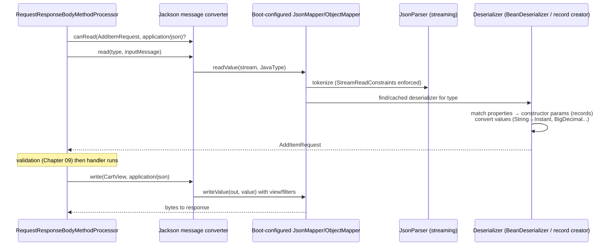
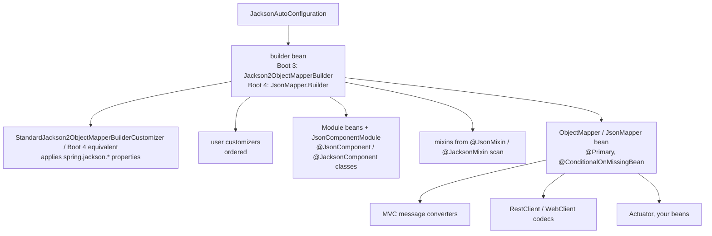
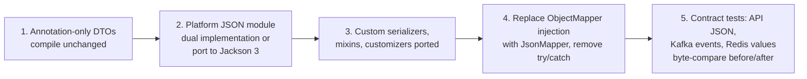

# 11 · JSON & Serialization

## 1. Introduction & Why It Matters

JSON is the wire format between every part of the grocery platform: Angular and Flutter clients, 26 services, Kafka events (Chapter 23), Redis caches (Chapter 21), Razorpay webhooks and seller integrations. Spring Boot uses **Jackson** for all of it, and most of the time it "just works" — until it doesn't:

- A price `289.00` arrives in the Angular app as `289` and the invoice shows "₹289" instead of "₹289.00"; worse, `0.1 + 0.2` rounding bugs appear when JavaScript sums line totals.
- A delivery slot starting at 7:00 a.m. IST is shown as 1:30 a.m. because the server serialized `LocalDateTime` without an offset and the app assumed UTC.
- Adding a new `OrderStatus.PACKED` enum value crashes every mobile app installed before the release, because their JSON parser rejects the unknown value.
- A seller-facing endpoint accidentally exposes `costPrice` because someone added a getter to a DTO.
- A payload with 100,000 nested arrays pins a CPU core — a denial of service in 2 KB.

And there's a version shift: **Spring Boot 4 moves to Jackson 3** — new Maven coordinates, new package names, immutable mappers, unchecked exceptions and some changed defaults.

This chapter covers Jackson in Spring Boot deeply: how Boot configures it, records and naming, dates and money, views and polymorphism, custom serializers, security limits, streaming, and a platform JSON module that works across Boot 3.5 and 4.x.

### Who should read which section

| Band | Focus |
|---|---|
| B1 · 0–2 yrs | Parts 1, 2, 4 — records to JSON, annotations, `spring.jackson.*` |
| B2 · 2–5 yrs | Parts 2, 5 — dates, money, enums, naming strategies, custom serializers, `@JsonTest` |
| B3 · 5–8 yrs | Parts 3, 5, 6 — how Boot builds the mapper, polymorphism, views, streaming |
| B4 · 8–12 yrs | Parts 6, 7, 8 — platform JSON contract, Jackson 3 migration, security constraints |
| B5 · 12–15+ yrs | Parts 8, 9 — schema evolution and compatibility across clients and events |

---

## 2. Core Concepts

### 2.1 Jackson building blocks

| Concept | Jackson 2 (Boot 3.5) | Jackson 3 (Boot 4.x) |
|---|---|---|
| Group ID (core, databind) | `com.fasterxml.jackson.core` | `tools.jackson.core` |
| Package | `com.fasterxml.jackson.databind` | `tools.jackson.databind` |
| Annotations | `com.fasterxml.jackson.annotation` | **unchanged** (`jackson-annotations` stays in the 2.x line) |
| Mapper | `ObjectMapper` (mutable, configurable after creation) | `JsonMapper` built via `JsonMapper.builder()`; immutable |
| Exceptions | `JsonProcessingException` (checked) | `JacksonException` (unchecked) |
| Java time, `Optional`, parameter names | Separate modules (`jsr310`, `jdk8`, `parameter-names`) | Built in |
| Serializer base types | `JsonSerializer`, `JsonDeserializer`, `SerializerProvider` | `ValueSerializer`, `ValueDeserializer`, `SerializationContext` |
| Dates default | Boot disables timestamp dates → ISO strings | ISO strings by default |

!!! tip "Annotations didn't move"
    `@JsonProperty`, `@JsonIgnore`, `@JsonInclude`, `@JsonTypeInfo` keep their `com.fasterxml.jackson.annotation` package in Jackson 3. DTOs that only use annotations usually compile unchanged. Custom serializers, modules and mapper configuration are what need migration.

!!! warning "Verify"
    Jackson 3 renamed many methods (e.g. generator "field" methods to "property"/"name" variants) and changed some default features. Check the Jackson 3 migration guide and the Spring Boot 4 *Jackson* section before porting custom code.

### 2.2 How Boot configures Jackson

Boot auto-configures **one shared mapper** used by Spring MVC message converters, `RestClient`/`WebClient`, Actuator and (by convention) your own code. It applies:

- `spring.jackson.*` properties.
- All registered `Module`s (beans), `@JsonComponent`/`@JacksonComponent` serializers and `@JsonMixin`/`@JacksonMixin` mixins.
- Customizer beans (`Jackson2ObjectMapperBuilderCustomizer` in Boot 3; `JsonMapperBuilderCustomizer` in Boot 4).
- Sensible defaults: **`FAIL_ON_UNKNOWN_PROPERTIES` disabled**, dates as ISO strings, default view inclusion disabled.

**Always inject the Boot-managed mapper**; never `new ObjectMapper()` in application code.

### 2.3 Common properties

| Property | Example | Effect |
|---|---|---|
| `spring.jackson.default-property-inclusion` | `non_null` | Omit null fields |
| `spring.jackson.serialization.*` | `indent_output: true` | `SerializationFeature`s |
| `spring.jackson.deserialization.*` | `fail_on_unknown_properties: false` | `DeserializationFeature`s |
| `spring.jackson.mapper.*` | `accept_case_insensitive_enums: true` | `MapperFeature`s |
| `spring.jackson.property-naming-strategy` | `SNAKE_CASE` | Global naming (rarely wise) |
| `spring.jackson.time-zone` | `Asia/Kolkata` | Zone for `java.util.Date`-style types |
| `spring.jackson.date-format` | — | For legacy `Date` only |

### 2.4 Records and naming

Records serialize by component name: `record CartLine(String sku, int quantity)` ↔ `{"sku": ..., "quantity": ...}`. Deserialization uses the canonical constructor (parameter names via `-parameters` or record metadata). Rename with `@JsonProperty("unit_price")` on the component.

**Naming strategy per DTO** (`@JsonNaming(SnakeCaseStrategy.class)`) is better than a global strategy: our API is camelCase, Razorpay's is snake_case.

### 2.5 Inclusion, ignoring, ordering

| Annotation | Use |
|---|---|
| `@JsonInclude(NON_NULL / NON_EMPTY / NON_ABSENT)` | Omit null/empty values |
| `@JsonIgnore` | Never (de)serialize a property |
| `@JsonIgnoreProperties(ignoreUnknown = true)` | Tolerate extra fields (Boot already does globally) |
| `@JsonProperty(access = READ_ONLY)` | Serialize but don't accept from input |
| `@JsonPropertyOrder` | Stable field order (helps diffs and signatures) |
| `@JsonUnwrapped` | Flatten nested object |
| `@JsonAnySetter` / `@JsonAnyGetter` | Dynamic properties |

### 2.6 Dates and times — the platform rules

| Java type | JSON | Use for |
|---|---|---|
| `Instant` | `"2026-09-22T05:35:14.231Z"` | Event/audit timestamps (always UTC) |
| `OffsetDateTime` | `"2026-10-20T07:00:00+05:30"` | Customer-facing times (slots) — offset is explicit |
| `LocalDate` | `"2026-10-20"` | Calendar dates (delivery date, date of birth) |
| `LocalTime` | `"07:00"` | Store opening hours |
| `Duration` | `"PT30M"` | Durations |
| `LocalDateTime` | ❌ avoid in APIs | Ambiguous — which zone? |
| `java.util.Date` | ❌ legacy | — |

### 2.7 Money

JSON numbers are IEEE-754 doubles in JavaScript: `0.1 + 0.2 = 0.30000000000000004`. For money, choose one:

| Option | Example | Notes |
|---|---|---|
| Decimal **string** | `"289.00"` | Exact, keeps scale; clients parse with a decimal library |
| Integer minor units | `28900` (paise) | Exact; Razorpay uses this |
| Plain JSON number | `289.00` → often `289` | ❌ scale lost; float math in JS |

The grocery API uses **decimal strings** for customer-facing money and **paise integers** for payment-gateway integrations.

### 2.8 Enums and forward compatibility

Clients and consumers must survive new enum values. On the reading side:

- `@JsonEnumDefaultValue` on an `UNKNOWN` constant + `READ_UNKNOWN_ENUM_VALUES_USING_DEFAULT_VALUE`, or
- `READ_UNKNOWN_ENUM_VALUES_AS_NULL`.

On the writing side, document that enums are **open** — clients must handle unknown values.

### 2.9 Views

`@JsonView(Views.Seller.class)` on properties + on the controller method = different projections of one class. Useful, but **separate DTOs are usually clearer and safer** — a forgotten `@JsonView` exposes data.

### 2.10 Polymorphism

`@JsonTypeInfo` + `@JsonSubTypes` (or sealed types) serialize a type discriminator. Use **logical names** (`use = Id.NAME`), never class names (`Id.CLASS`) for untrusted input.

!!! danger "Default typing is a remote-code-execution risk"
    `activateDefaultTyping(...)` / `enableDefaultTyping()` lets the payload choose which Java class to instantiate. Combined with "gadget" classes on the classpath, attackers get RCE — a long series of Jackson CVEs came from this. Never enable it for data from outside your trust boundary. If a cache needs it (e.g. `GenericJackson2JsonRedisSerializer`), use a strict `PolymorphicTypeValidator` — or typed serializers (Chapter 21).

### 2.11 Custom serializers and modules

- **Serializer/deserializer classes** registered via a `Module` or `@JsonComponent`/`@JacksonComponent`.
- **Mixins** — add annotations to classes you don't own (`@JsonMixin(ThirdPartyClass.class)`).
- **`@JsonValue` / `@JsonCreator`** — simplest way to make a value type serialize as a single value.

### 2.12 Read constraints

Jackson 2.15+ enforces `StreamReadConstraints` (max nesting depth, number length, string length, document length in newer versions). Tighten them for public endpoints; loosen only for trusted bulk imports.

### 2.13 Alternatives

Boot also supports **Gson** and **JSON-B** (Yasson) as message converters (`spring.mvc.converters.preferred-json-mapper`). Mixing mappers across services leads to subtle contract differences — standardize on Jackson.

---

## 3. How It Works Internally

### 3.1 From HTTP body to record and back



- Serializers/deserializers are **resolved once per type and cached** in the mapper — the reason a mapper must be shared, and why configuring it after first use (Jackson 2) is dangerous.
- Records are handled via their canonical constructor as a "properties-based creator".
- Errors: malformed JSON → `HttpMessageNotReadableException` (cause: `JsonParseException`, `MismatchedInputException`, `InvalidFormatException`) → 400 via Chapter 10's handler.

### 3.2 How Boot assembles the mapper



If you define your own `ObjectMapper` bean, Boot's backs off — and you lose all of the above unless you build yours from Boot's builder.

### 3.3 `ProblemDetail` and other framework types

Spring registers mixins for its own types (e.g. `ProblemDetail`'s flattened `properties`, Chapter 10). A hand-built mapper without them produces a different error JSON — another reason to use Boot's.

---

## 4. Hands-On Code — Level 1 (Beginner)

### 4.1 Records in, records out

```java title="in/grocery/catalog/web/dto/ProductView.java"
package in.grocery.catalog.web.dto;

import com.fasterxml.jackson.annotation.JsonInclude;
import com.fasterxml.jackson.annotation.JsonProperty;
import java.math.BigDecimal;
import java.time.Instant;
import java.util.List;

@JsonInclude(JsonInclude.Include.NON_NULL)                             // (1)!
public record ProductView(
        String sku,
        String name,
        String category,
        BigDecimal price,
        @JsonProperty("mrp") BigDecimal maximumRetailPrice,           // (2)!
        List<String> tags,
        String offerText,                                              // often null → omitted
        Instant updatedAt) {}
```

1. Omit nulls for this type only.
2. Rename in JSON while keeping a descriptive Java name.

```json title="JSON"
{
  "sku": "ATTA-5KG",
  "name": "Whole Wheat Atta 5kg",
  "category": "staples",
  "price": 289.00,
  "mrp": 320.00,
  "tags": ["bestseller"],
  "updatedAt": "2026-09-22T05:35:14.231Z"
}
```

`price` is still a JSON number here — Level 2 fixes money.

### 4.2 Global defaults via properties

```yaml title="application.yml"
spring:
  jackson:
    default-property-inclusion: non_null
    serialization:
      write-dates-as-timestamps: false      # Boot's default already; explicit for readers
    deserialization:
      fail-on-unknown-properties: false     # Boot's default: tolerate new fields from newer clients
```

### 4.3 Using the shared mapper in code

=== "Spring Boot 3.5 (Jackson 2)"

    ```java title="OrderSnapshotWriter.java"
    import com.fasterxml.jackson.core.JsonProcessingException;
    import com.fasterxml.jackson.databind.ObjectMapper;

    @Component
    class OrderSnapshotWriter {
        private final ObjectMapper mapper;                    // Boot's bean
        OrderSnapshotWriter(ObjectMapper mapper) { this.mapper = mapper; }

        String toJson(OrderSnapshot s) {
            try {
                return mapper.writeValueAsString(s);
            } catch (JsonProcessingException e) {            // checked
                throw new IllegalStateException("Cannot serialize order " + s.orderId(), e);
            }
        }
    }
    ```

=== "Spring Boot 4.x (Jackson 3)"

    ```java title="OrderSnapshotWriter.java"
    import tools.jackson.databind.json.JsonMapper;

    @Component
    class OrderSnapshotWriter {
        private final JsonMapper mapper;                      // Boot's bean
        OrderSnapshotWriter(JsonMapper mapper) { this.mapper = mapper; }

        String toJson(OrderSnapshot s) {
            return mapper.writeValueAsString(s);             // JacksonException is unchecked
        }
    }
    ```

### 4.4 Testing JSON with `@JsonTest`

```java title="in/grocery/catalog/web/dto/ProductViewJsonTest.java"
package in.grocery.catalog.web.dto;

import static org.assertj.core.api.Assertions.assertThat;

import java.math.BigDecimal;
import java.time.Instant;
import java.util.List;
import org.junit.jupiter.api.Test;
import org.springframework.beans.factory.annotation.Autowired;
import org.springframework.boot.test.autoconfigure.json.JsonTest;
import org.springframework.boot.test.json.JacksonTester;

@JsonTest                                                              // (1)!
class ProductViewJsonTest {

    @Autowired JacksonTester<ProductView> json;

    @Test
    void serializes() throws Exception {
        var view = new ProductView("ATTA-5KG", "Whole Wheat Atta 5kg", "staples",
                new BigDecimal("289.00"), new BigDecimal("320.00"), List.of("bestseller"), null,
                Instant.parse("2026-09-22T05:35:14Z"));

        assertThat(json.write(view))
                .hasJsonPathStringValue("$.sku", "ATTA-5KG")
                .hasJsonPathValue("$.mrp")
                .doesNotHaveJsonPath("$.offerText")
                .extractingJsonPathStringValue("$.updatedAt").isEqualTo("2026-09-22T05:35:14Z");
    }

    @Test
    void ignoresUnknownFields() throws Exception {
        String payload = """
                {"sku":"MILK-1L","name":"Toned Milk","category":"dairy","price":66.00,"mrp":68.00,
                 "tags":[],"updatedAt":"2026-09-22T05:35:14Z","newFieldFromFuture":true}
                """;
        assertThat(json.parseObject(payload).sku()).isEqualTo("MILK-1L");
    }
}
```

1. JSON slice: Boot's Jackson configuration, `@JsonComponent`s and mixins — no web layer. (Package may differ in Boot 4 — verify.)

---

## 5. Hands-On Code — Level 2 (Intermediate) & Level 3 (Advanced)

### 5.1 Level 2 — Money as a value type

The `Money` record from Chapter 01 should appear in JSON as `"289.00"`.

```java title="in/grocery/common/money/Money.java (JSON-aware)"
package in.grocery.common.money;

import com.fasterxml.jackson.annotation.JsonCreator;
import com.fasterxml.jackson.annotation.JsonValue;
import java.math.BigDecimal;
import java.math.RoundingMode;
import java.util.Objects;

public record Money(BigDecimal amount) implements Comparable<Money> {

    public Money {
        Objects.requireNonNull(amount, "amount");
        if (amount.signum() < 0) throw new IllegalArgumentException("Money cannot be negative: " + amount);
        amount = amount.setScale(2, RoundingMode.HALF_UP);
    }

    @JsonCreator                                                       // (1)!
    public static Money parse(String value) {
        return new Money(new BigDecimal(value.strip()));
    }

    @JsonValue                                                         // (2)!
    public String asString() {
        return amount.toPlainString();
    }

    public Money plus(Money other) { return new Money(amount.add(other.amount)); }

    @Override
    public int compareTo(Money o) { return amount.compareTo(o.amount); }
}
```

1. Delegating creator: JSON string → `Money`. Also accepts numbers written as strings.
2. Single-value serialization: `"289.00"` — scale always preserved, no exponent (`toPlainString`).

!!! note "Annotations in a shared library"
    Putting `@JsonValue`/`@JsonCreator` in `grocery-common` adds a dependency on `jackson-annotations` only (small, stable, and the **same** package in Jackson 2 and 3). If you want the domain completely framework-free, use a mixin (5.3) instead.

### 5.2 Level 2 — Time zones done right

```java title="in/grocery/delivery/web/dto/SlotView.java"
package in.grocery.delivery.web.dto;

import com.fasterxml.jackson.annotation.JsonFormat;
import java.time.LocalDate;
import java.time.OffsetDateTime;

public record SlotView(
        String slotId,
        LocalDate deliveryDate,                                          // "2026-10-20"
        OffsetDateTime start,                                            // "2026-10-20T07:00:00+05:30"
        OffsetDateTime end,
        @JsonFormat(shape = JsonFormat.Shape.STRING, pattern = "h:mm a")
        java.time.LocalTime displayStart,                                // "7:00 AM" — display helper only
        int remaining) {}
```

```java title="Building offset times in the delegate"
ZoneId ist = ZoneId.of("Asia/Kolkata");
OffsetDateTime start = slot.startInstant().atZone(ist).toOffsetDateTime();   // explicit +05:30
```

!!! warning "`ADJUST_DATES_TO_CONTEXT_TIME_ZONE`"
    Jackson may normalize `OffsetDateTime` to UTC on **deserialization** (`DeserializationFeature.ADJUST_DATES_TO_CONTEXT_TIME_ZONE`, enabled by default). The instant is the same, but the offset the client sent is lost. Compare with `isEqual()`, not `equals()`, or disable the feature if you must keep the client's offset.

### 5.3 Level 2 — Mixins for classes you don't own

A shared `Pincode` value class lives in `grocery-common`, and we want it as a plain string in JSON without adding annotations to the domain:

```java title="in/grocery/platform/json/PincodeMixin.java"
package in.grocery.platform.json;

import com.fasterxml.jackson.annotation.JsonCreator;
import com.fasterxml.jackson.annotation.JsonValue;
import in.grocery.common.address.Pincode;
import org.springframework.boot.jackson.JsonMixin;                       // Boot 4: @JacksonMixin (verify)

@JsonMixin(Pincode.class)                                              // (1)!
abstract class PincodeMixin {

    @JsonCreator
    PincodeMixin(String value) {}

    @JsonValue
    abstract String value();
}
```

1. Boot scans `@JsonMixin` classes in the application packages and registers them with the mapper.

### 5.4 Level 2 — Forward-compatible enums

```java title="in/grocery/order/api/OrderStatus.java"
package in.grocery.order.api;

import com.fasterxml.jackson.annotation.JsonEnumDefaultValue;

public enum OrderStatus {
    PLACED, PAID, PACKED, OUT_FOR_DELIVERY, DELIVERED, CANCELLED,
    @JsonEnumDefaultValue UNKNOWN                                       // (1)!
}
```

```yaml title="application.yml"
spring:
  jackson:
    deserialization:
      read-unknown-enum-values-using-default-value: true
```

1. A consumer on an older version receiving `"RETURNED"` gets `UNKNOWN` instead of failing the whole message. Consumers must then handle `UNKNOWN` sensibly (log, show generic state). Share the same rule with the Flutter/Angular teams.

### 5.5 Level 2 — Per-client naming: Razorpay's snake_case

```java title="in/grocery/payment/client/razorpay/RazorpayOrderRequest.java"
package in.grocery.payment.client.razorpay;

import com.fasterxml.jackson.databind.PropertyNamingStrategies;
import com.fasterxml.jackson.databind.annotation.JsonNaming;          // tools.jackson.databind.annotation in Jackson 3
import java.util.Map;

@JsonNaming(PropertyNamingStrategies.SnakeCaseStrategy.class)
public record RazorpayOrderRequest(
        long amount,                     // in paise
        String currency,
        String receipt,
        boolean partialPayment,          // → "partial_payment"
        Map<String, String> notes) {}
```

Only this DTO uses snake_case; the rest of the API stays camelCase.

### 5.6 Level 3 — Polymorphic webhook events

Razorpay sends events with a discriminator field `"event"`: `payment.captured`, `payment.failed`, `refund.processed`, and more over time.

```java title="in/grocery/payment/webhook/RazorpayWebhook.java"
package in.grocery.payment.webhook;

import com.fasterxml.jackson.annotation.JsonIgnoreProperties;
import com.fasterxml.jackson.annotation.JsonSubTypes;
import com.fasterxml.jackson.annotation.JsonTypeInfo;
import com.fasterxml.jackson.databind.PropertyNamingStrategies;
import com.fasterxml.jackson.databind.annotation.JsonNaming;

@JsonTypeInfo(
        use = JsonTypeInfo.Id.NAME,                                          // (1)!
        include = JsonTypeInfo.As.EXISTING_PROPERTY,
        property = "event",
        visible = true,
        defaultImpl = RazorpayWebhook.Unknown.class)                         // (2)!
@JsonSubTypes({
        @JsonSubTypes.Type(value = RazorpayWebhook.PaymentCaptured.class, name = "payment.captured"),
        @JsonSubTypes.Type(value = RazorpayWebhook.PaymentFailed.class, name = "payment.failed"),
        @JsonSubTypes.Type(value = RazorpayWebhook.RefundProcessed.class, name = "refund.processed")
})
@JsonIgnoreProperties(ignoreUnknown = true)
public sealed interface RazorpayWebhook {

    String event();

    @JsonNaming(PropertyNamingStrategies.SnakeCaseStrategy.class)
    record PaymentEntity(String id, String orderId, long amount, String currency, String status,
                         String method, String errorCode, String errorReason) {}

    @JsonNaming(PropertyNamingStrategies.SnakeCaseStrategy.class)
    record RefundEntity(String id, String paymentId, long amount, String status) {}

    record PaymentWrapper(PaymentEntity entity) {}
    record RefundWrapper(RefundEntity entity) {}

    record PaymentPayload(PaymentWrapper payment) {}
    record RefundPayload(RefundWrapper refund, PaymentWrapper payment) {}

    record PaymentCaptured(String event, PaymentPayload payload, long createdAt) implements RazorpayWebhook {}
    record PaymentFailed(String event, PaymentPayload payload, long createdAt) implements RazorpayWebhook {}
    record RefundProcessed(String event, RefundPayload payload, long createdAt) implements RazorpayWebhook {}
    record Unknown(String event) implements RazorpayWebhook {}
}
```

1. **Logical names**, a closed list of subtypes — safe polymorphism.
2. New event types (e.g. `payment.dispute.created`) map to `Unknown` instead of failing. We acknowledge them (so Razorpay stops retrying) and log for follow-up.

```java title="in/grocery/payment/webhook/WebhookDispatcher.java"
public WebhookOutcome dispatch(RazorpayWebhook hook) {
    return switch (hook) {                                                   // exhaustive over the sealed type
        case RazorpayWebhook.PaymentCaptured c -> payments.markCaptured(
                c.payload().payment().entity().orderId(), c.payload().payment().entity().id(),
                c.payload().payment().entity().amount());
        case RazorpayWebhook.PaymentFailed f -> payments.markFailed(
                f.payload().payment().entity().orderId(), f.payload().payment().entity().errorReason());
        case RazorpayWebhook.RefundProcessed r -> refunds.markProcessed(r.payload().refund().entity().id());
        case RazorpayWebhook.Unknown u -> WebhookOutcome.ignored(u.event());
    };
}
```

!!! warning "Verify the signature before parsing"
    Webhooks must be authenticated by verifying the `X-Razorpay-Signature` HMAC over the **raw request body bytes** *before* deserializing. Read the body as `byte[]`/`String`, verify, then parse with the mapper. Re-serializing a parsed object changes bytes and breaks the signature. (Chapter 18.)

### 5.7 Level 3 — JSON views vs separate DTOs

```java title="Views (shown for completeness)"
public final class Views {
    public interface Customer {}
    public interface Seller extends Customer {}
}

public record ProductDetail(
        @JsonView(Views.Customer.class) String sku,
        @JsonView(Views.Customer.class) Money price,
        @JsonView(Views.Seller.class) Money costPrice,          // hidden from customers
        @JsonView(Views.Seller.class) int stockOnHand) {}

@GetMapping("/api/products/{sku}")
@JsonView(Views.Customer.class)
ProductDetail forCustomers(@PathVariable String sku) { ... }
```

With Boot's default `DEFAULT_VIEW_INCLUSION = false`, properties **without** `@JsonView` are excluded from view-rendered responses — adding a new field without a view annotation silently hides it (the safe failure). But the reverse mistake — returning the class from an endpoint **without** `@JsonView` — exposes `costPrice`. The platform standard is therefore **separate records** (`CustomerProductView`, `SellerProductView`) built in delegates.

### 5.8 Level 3 — Streaming large JSON

Exporting 200,000 order lines for a seller's monthly report must not build a giant list in memory.

=== "Spring Boot 3.5 (Jackson 2)"

    ```java title="Streaming large JSON (snippet)"
    @GetMapping(value = "/api/sellers/{sellerId}/reports/orders", produces = MediaType.APPLICATION_JSON_VALUE)
    StreamingResponseBody export(@PathVariable String sellerId) {
        return out -> {
            try (JsonGenerator gen = mapper.getFactory().createGenerator(out);
                 Stream<OrderLineRow> rows = reports.streamOrderLines(sellerId)) {   // JDBC stream, Chapter 12
                gen.writeStartArray();
                rows.forEach(row -> {
                    try {
                        mapper.writeValue(gen, row);                                   // one object at a time
                    } catch (IOException e) {
                        throw new UncheckedIOException(e);
                    }
                });
                gen.writeEndArray();
            }
        };
    }
    ```

=== "Spring Boot 4.x (Jackson 3)"

    ```java title="Streaming large JSON (snippet)"
    @GetMapping(value = "/api/sellers/{sellerId}/reports/orders", produces = MediaType.APPLICATION_JSON_VALUE)
    StreamingResponseBody export(@PathVariable String sellerId) {
        return out -> {
            try (JsonGenerator gen = mapper.createGenerator(out);                      // tools.jackson.core.JsonGenerator
                 Stream<OrderLineRow> rows = reports.streamOrderLines(sellerId)) {
                gen.writeStartArray();
                rows.forEach(row -> mapper.writeValue(gen, row));                      // unchecked exceptions
                gen.writeEndArray();
            }
        };
    }
    ```

For machine consumers, **NDJSON** (`application/x-ndjson`, one object per line) is even simpler to produce and consume incrementally.

---

## 6. Hands-On Code — Level 4 (Expert / Production)

### Platform JSON module

Requirements for every grocery service:

1. `Money` as decimal strings; `Paise` (long) for gateway DTOs.
2. `@Sensitive` fields masked when serialized for **logs and audit** (not for API responses — a dedicated mapper).
3. Tight `StreamReadConstraints` for public APIs.
4. Unknown enum values → default; unknown properties tolerated.
5. The same behaviour on Boot 3.5 (Jackson 2) and Boot 4.x (Jackson 3).

### 6.1 `@Sensitive` masking annotation

```java title="in/grocery/platform/json/Sensitive.java"
package in.grocery.platform.json;

import com.fasterxml.jackson.annotation.JacksonAnnotationsInside;
import java.lang.annotation.ElementType;
import java.lang.annotation.Retention;
import java.lang.annotation.RetentionPolicy;
import java.lang.annotation.Target;

/** Marks PII. Masked by the "log mapper"; untouched by the API mapper. */
@Target({ElementType.FIELD, ElementType.METHOD, ElementType.RECORD_COMPONENT})
@Retention(RetentionPolicy.RUNTIME)
@JacksonAnnotationsInside
public @interface Sensitive {
    int keepLast() default 4;
}
```

=== "Spring Boot 3.5 (Jackson 2)"

    ```java title="in/grocery/platform/json/SensitiveMaskingModule.java"
    package in.grocery.platform.json;

    import com.fasterxml.jackson.core.JsonGenerator;
    import com.fasterxml.jackson.databind.BeanDescription;
    import com.fasterxml.jackson.databind.SerializationConfig;
    import com.fasterxml.jackson.databind.SerializerProvider;
    import com.fasterxml.jackson.databind.module.SimpleModule;
    import com.fasterxml.jackson.databind.ser.BeanPropertyWriter;
    import com.fasterxml.jackson.databind.ser.BeanSerializerModifier;
    import com.fasterxml.jackson.databind.JsonSerializer;
    import java.io.IOException;
    import java.util.List;

    public class SensitiveMaskingModule extends SimpleModule {

        public SensitiveMaskingModule() {
            super("grocery-sensitive-masking");
            setSerializerModifier(new BeanSerializerModifier() {
                @Override
                public List<BeanPropertyWriter> changeProperties(SerializationConfig config, BeanDescription desc,
                                                                 List<BeanPropertyWriter> props) {
                    for (BeanPropertyWriter w : props) {
                        Sensitive s = w.getAnnotation(Sensitive.class);
                        if (s != null) {
                            w.assignSerializer(new MaskingSerializer(s.keepLast()));   // (1)!
                        }
                    }
                    return props;
                }
            });
        }

        static final class MaskingSerializer extends JsonSerializer<Object> {
            private final int keepLast;
            MaskingSerializer(int keepLast) { this.keepLast = keepLast; }

            @Override
            public void serialize(Object value, JsonGenerator gen, SerializerProvider provider) throws IOException {
                String s = String.valueOf(value);
                int keep = Math.min(keepLast, s.length());
                gen.writeString("*".repeat(Math.max(0, s.length() - keep)) + s.substring(s.length() - keep));
            }
        }
    }
    ```

    1. Replaces the serializer for annotated properties only, at serializer-construction time — no per-call reflection.

=== "Spring Boot 4.x (Jackson 3)"

    ```java title="in/grocery/platform/json/SensitiveMaskingModule.java"
    package in.grocery.platform.json;

    import java.util.List;
    import tools.jackson.core.JsonGenerator;
    import tools.jackson.databind.BeanDescription;
    import tools.jackson.databind.SerializationConfig;
    import tools.jackson.databind.SerializationContext;
    import tools.jackson.databind.ValueSerializer;
    import tools.jackson.databind.module.SimpleModule;
    import tools.jackson.databind.ser.BeanPropertyWriter;
    import tools.jackson.databind.ser.ValueSerializerModifier;

    public class SensitiveMaskingModule extends SimpleModule {

        public SensitiveMaskingModule() {
            super("grocery-sensitive-masking");
            setSerializerModifier(new ValueSerializerModifier() {
                @Override
                public List<BeanPropertyWriter> changeProperties(SerializationConfig config,
                                                                 BeanDescription.Supplier desc,
                                                                 List<BeanPropertyWriter> props) {
                    for (BeanPropertyWriter w : props) {
                        Sensitive s = w.getAnnotation(Sensitive.class);
                        if (s != null) w.assignSerializer(new MaskingSerializer(s.keepLast()));
                    }
                    return props;
                }
            });
        }

        static final class MaskingSerializer extends ValueSerializer<Object> {
            private final int keepLast;
            MaskingSerializer(int keepLast) { this.keepLast = keepLast; }

            @Override
            public void serialize(Object value, JsonGenerator gen, SerializationContext ctx) {
                String s = String.valueOf(value);
                int keep = Math.min(keepLast, s.length());
                gen.writeString("*".repeat(Math.max(0, s.length() - keep)) + s.substring(s.length() - keep));
            }
        }
    }
    ```

    !!! warning "Verify"
        Jackson 3 type and method signatures (`ValueSerializerModifier`, the `BeanDescription` parameter type) must be checked against the exact Jackson 3.x version managed by your Boot 4 BOM.

### 6.2 Two mappers: API and log

```java title="in/grocery/platform/json/GroceryJsonConfiguration.java (Boot 3.5)"
package in.grocery.platform.json;

import com.fasterxml.jackson.core.StreamReadConstraints;
import com.fasterxml.jackson.databind.DeserializationFeature;
import com.fasterxml.jackson.databind.ObjectMapper;
import org.springframework.boot.autoconfigure.jackson.Jackson2ObjectMapperBuilderCustomizer;
import org.springframework.context.annotation.Bean;
import org.springframework.context.annotation.Configuration;
import org.springframework.http.converter.json.Jackson2ObjectMapperBuilder;

@Configuration(proxyBeanMethods = false)
public class GroceryJsonConfiguration {

    @Bean
    Jackson2ObjectMapperBuilderCustomizer groceryJsonDefaults() {                   // (1)!
        return builder -> builder
                .featuresToEnable(DeserializationFeature.READ_UNKNOWN_ENUM_VALUES_USING_DEFAULT_VALUE)
                .featuresToDisable(DeserializationFeature.FAIL_ON_UNKNOWN_PROPERTIES)
                .postConfigurer(mapper -> mapper.getFactory().setStreamReadConstraints(
                        StreamReadConstraints.builder()
                                .maxNestingDepth(64)                               // (2)!
                                .maxStringLength(1_000_000)
                                .maxNumberLength(64)
                                .build()));
    }

    @Bean
    LogJson logJson(Jackson2ObjectMapperBuilder builder) {                         // (3)!
        return new LogJson(builder.build().registerModule(new SensitiveMaskingModule()));
    }

    /** Wrapper type on purpose — see note (3). */
    public static final class LogJson {
        private final ObjectMapper mapper;

        LogJson(ObjectMapper mapper) {
            this.mapper = mapper;
        }

        public String write(Object value) {
            try {
                return mapper.writeValueAsString(value);
            } catch (com.fasterxml.jackson.core.JsonProcessingException e) {
                return "{\"serializationError\":\"" + value.getClass().getSimpleName() + "\"}";   // never fail logging
            }
        }
    }
}
```

1. Adjusts Boot's builder — the primary mapper keeps all Boot defaults.
2. Default nesting limit (1,000) is far beyond any legitimate grocery payload. `maxNumberLength` stops "a number with 100,000 digits" attacks on `BigDecimal` parsing.
3. A second mapper for logs/audit with masking, built from Boot's (prototype-scoped) builder so it shares all defaults. It is **wrapped in its own type** on purpose: registering a second `ObjectMapper` bean would make Boot's `@ConditionalOnMissingBean(ObjectMapper.class)` primary mapper back off entirely. The API mapper stays untouched, so customers still see their own phone number in their profile response.

!!! note "Boot 4.x"
    Use a `JsonMapperBuilderCustomizer` (verify name) and `JsonMapper.Builder` methods (`enable(...)`, `streamReadConstraints(...)` via the `JsonFactory` builder); derive the log mapper with `mapper.rebuild().addModule(new SensitiveMaskingModule()).build()` and keep it inside the `LogJson` wrapper for the same back-off reason. Jackson 3 mappers are immutable — "copy and modify" becomes "rebuild".

### 6.3 Usage and tests

```java title="in/grocery/identity/audit/OtpAuditEvent.java"
public record OtpAuditEvent(String customerId, @Sensitive(keepLast = 4) String mobile, String channel, Instant at) {}
```

```java title="in/grocery/platform/json/GroceryJsonConfigurationTest.java"
package in.grocery.platform.json;

import static org.assertj.core.api.Assertions.assertThat;
import static org.assertj.core.api.Assertions.assertThatThrownBy;

import com.fasterxml.jackson.databind.ObjectMapper;
import in.grocery.order.api.OrderStatus;
import java.time.Instant;
import org.junit.jupiter.api.Test;
import org.springframework.beans.factory.annotation.Autowired;
import org.springframework.boot.test.autoconfigure.json.JsonTest;
import org.springframework.context.annotation.Import;

@JsonTest
@Import(GroceryJsonConfiguration.class)
class GroceryJsonConfigurationTest {

    record Audit(String customerId, @Sensitive String mobile, Instant at) {}
    record StatusHolder(OrderStatus status) {}

    @Autowired ObjectMapper apiMapper;
    @Autowired GroceryJsonConfiguration.LogJson logJson;

    @Test
    void logMapperMasksButApiMapperDoesNot() throws Exception {
        var audit = new Audit("C-1", "9876543210", Instant.parse("2026-09-22T05:00:00Z"));
        assertThat(logJson.write(audit)).contains("\"mobile\":\"******3210\"");
        assertThat(apiMapper.writeValueAsString(audit)).contains("\"mobile\":\"9876543210\"");
    }

    @Test
    void unknownEnumBecomesDefault() throws Exception {
        assertThat(apiMapper.readValue("{\"status\":\"RETURNED\"}", StatusHolder.class).status())
                .isEqualTo(OrderStatus.UNKNOWN);
    }

    @Test
    void rejectsDeeplyNestedPayloads() {
        String deep = "[".repeat(200) + "]".repeat(200);
        assertThatThrownBy(() -> apiMapper.readTree(deep))
                .hasMessageContaining("nesting depth");                              // (1)!
    }

    @Test
    void moneyRoundTripsAsString() throws Exception {
        var m = in.grocery.common.money.Money.parse("289");
        String json = apiMapper.writeValueAsString(m);
        assertThat(json).isEqualTo("\"289.00\"");
        assertThat(apiMapper.readValue(json, in.grocery.common.money.Money.class)).isEqualTo(m);
    }
}
```

1. Exact exception message text varies by Jackson version — assert on type (`StreamConstraintsException`) if the message changes.

### 6.4 Webhook parsing test

```java title="RazorpayWebhookJsonTest.java"
@JsonTest
class RazorpayWebhookJsonTest {

    @Autowired ObjectMapper mapper;

    @Test
    void parsesCapturedAndUnknownEvents() throws Exception {
        String captured = """
                {"entity":"event","event":"payment.captured","created_at":1790000000,
                 "payload":{"payment":{"entity":{"id":"pay_29QQoUBi66xm2f","order_id":"order_9A33XWu170gUtm",
                 "amount":57800,"currency":"INR","status":"captured","method":"upi"}}},"contains":["payment"]}
                """;
        RazorpayWebhook hook = mapper.readValue(captured, RazorpayWebhook.class);
        assertThat(hook).isInstanceOfSatisfying(RazorpayWebhook.PaymentCaptured.class,
                c -> assertThat(c.payload().payment().entity().amount()).isEqualTo(57800));

        RazorpayWebhook unknown = mapper.readValue("{\"event\":\"payment.dispute.created\"}", RazorpayWebhook.class);
        assertThat(unknown).isInstanceOf(RazorpayWebhook.Unknown.class);
    }
}
```

!!! note "`created_at` vs `createdAt`"
    The webhook envelope uses snake_case too — annotate the envelope records with `@JsonNaming(SnakeCaseStrategy.class)` (or `@JsonProperty("created_at")`) as well, otherwise `createdAt` stays `0`. Tests like this catch it.

---

## 7. Spring Boot 3 vs 4 & Migration

| Topic | Boot 3.5 | Boot 4.x |
|---|---|---|
| Jackson line | 2.x | 3.x default (Jackson 2 support available but deprecated — verify module name) |
| Coordinates | `com.fasterxml.jackson.core:jackson-databind` | `tools.jackson.core:jackson-databind` |
| Annotations | `com.fasterxml.jackson.annotation` | Same |
| Mapper type to inject | `ObjectMapper` | `JsonMapper` (`ObjectMapper` subtype) |
| Customizer | `Jackson2ObjectMapperBuilderCustomizer` | `JsonMapperBuilderCustomizer` (verify) |
| Component/mixin annotations | `@JsonComponent`, `@JsonMixin` | `@JacksonComponent`, `@JacksonMixin` (verify) |
| Java time support | `jackson-datatype-jsr310` module (Boot adds it) | Built into databind |
| Checked exceptions | `JsonProcessingException` | Unchecked `JacksonException` |
| Serializer SPI | `JsonSerializer`/`JsonDeserializer` | `ValueSerializer`/`ValueDeserializer` |
| Message converter | `MappingJackson2HttpMessageConverter` | Jackson 3 converter (verify class name) |
| Properties | `spring.jackson.*` | `spring.jackson.*` (some keys may change — properties migrator) |

### Migration strategy for the monorepo



!!! danger "Persisted JSON is a contract too"
    Kafka events and Redis/DB JSON written by Boot 3.5 services will be read by Boot 4 services (and vice versa during rollout). Changed defaults (date formats, property ordering, `null` handling, enum handling) can break consumers. Record sample payloads from production and run them through both mappers in tests before upgrading.

### Migration checklist

- [ ] Inventory custom serializers, deserializers, modules, `ObjectMapper` beans and `new ObjectMapper()` calls.
- [ ] Remove explicit `jackson-datatype-jsr310`/`jdk8`/`parameter-names` dependencies for Boot 4.
- [ ] Port customizers and mixin/component annotations.
- [ ] Replace `JsonProcessingException` catches.
- [ ] Golden-file tests for API responses and event payloads under both versions.
- [ ] Check Redis serializers and Kafka `JsonSerializer`/`JsonDeserializer` configurations (Chapters 21, 23).

---

## 8. Production Playbook

### Best practices

1. **One Boot-managed mapper**, customized via properties/customizers; extra mappers derived from it.
2. **Records for DTOs**; per-DTO naming via `@JsonNaming`.
3. **Money as decimal strings** (or paise integers at gateway boundaries); never floats.
4. **`Instant`/`OffsetDateTime`/`LocalDate`**; no `LocalDateTime` in APIs.
5. **Tolerant readers**: ignore unknown properties, default unknown enums.
6. **Separate DTOs over `@JsonView`** for different audiences.
7. **Safe polymorphism**: logical names, closed subtype lists, default implementation.
8. **Stream large payloads**; set read constraints for public endpoints.
9. **Mask PII** in log/audit serialization.
10. **Golden-file tests** for public JSON contracts and events.

### Anti-patterns

❌ `new ObjectMapper()` in a service — misses Boot configuration, modules, and wastes CPU (mappers are expensive to create; caches per instance).

❌ `double price` in DTOs — `0.1 + 0.2` problems and lost scale.

❌ `LocalDateTime deliveryTime` — the app guesses the zone.

❌ `activateDefaultTyping` for convenience in caches or APIs.

❌ Returning entities with bidirectional relationships → infinite recursion (`@JsonManagedReference` band-aids); use DTOs.

❌ Global `SNAKE_CASE` strategy because one partner uses it.

❌ Strict unknown-property failure (`fail-on-unknown-properties: true`) on consumers — every producer addition becomes an outage.

### Troubleshooting

| Symptom | Cause | Fix |
|---|---|---|
| `InvalidDefinitionException: Java 8 date/time type not supported` | Hand-made mapper without JSR-310 module (Jackson 2) | Use Boot's mapper |
| Dates as arrays `[2026,9,22]` | `WRITE_DATES_AS_TIMESTAMPS` enabled in custom mapper | Use Boot's defaults |
| `Cannot construct instance ... no Creators` | Record/class without parameter names; missing `-parameters` | Compile with `-parameters`; `@JsonCreator` |
| `UnrecognizedPropertyException` | Strict mapper | Tolerate unknown properties |
| `InvalidFormatException` for enum | Unknown enum value | Default value strategy |
| Offset lost after round trip | `ADJUST_DATES_TO_CONTEXT_TIME_ZONE` | Compare instants or disable feature |
| Infinite recursion / `StackOverflowError` | Bidirectional entity graph | DTOs |
| `costPrice` visible to customers | Missing `@JsonView` on endpoint / shared DTO | Separate DTOs |
| Webhook signature mismatch | Verified re-serialized JSON instead of raw bytes | Verify raw body first |
| Slow responses with large lists | Building full list in memory | Stream |

### Production checklist

- [ ] No `new ObjectMapper()` outside tests (ArchUnit rule)
- [ ] Money and time types follow platform rules
- [ ] Enum forward compatibility enabled and documented to clients
- [ ] Read constraints configured for public endpoints
- [ ] No default typing anywhere processing external input
- [ ] Log/audit mapper masks `@Sensitive`
- [ ] Golden-file JSON tests for APIs and events
- [ ] Jackson 3 migration plan with cross-version payload tests

---

## 9. Interview Questions & Answers

### B1 · 0–2 years

??? question "B1 · Which library does Spring Boot use for JSON by default?"
    **Short answer:** Jackson — Jackson 2 in Boot 3.x, Jackson 3 in Boot 4.x — via the web starters.

??? question "B1 · How do you rename a JSON field?"
    **Short answer:** `@JsonProperty("mrp")` on the field or record component.

??? question "B1 · How do you exclude null fields?"
    **Short answer:** `@JsonInclude(NON_NULL)` on the class/field, or globally `spring.jackson.default-property-inclusion=non_null`.

??? question "B1 · How are Java records serialized?"
    **Short answer:** Components become JSON properties; deserialization uses the canonical constructor.

??? question "B1 · Why not use `double` for prices?"
    **Short answer:** Binary floating point can't represent decimals exactly; rounding errors in totals. Use `BigDecimal` (and send as string or minor units).

### B2 · 2–5 years

??? question "B2 · How do you customize Boot's ObjectMapper without replacing it?"
    **Short answer:** `spring.jackson.*` properties, or a builder customizer bean, `Module` beans, `@JsonComponent`/`@JsonMixin` (renamed in Boot 4).

??? question "B2 · How should dates be represented in APIs?"
    **Short answer:** ISO-8601 strings; `Instant` for timestamps (UTC), `OffsetDateTime` for zone-relevant times, `LocalDate` for dates; avoid `LocalDateTime`.

??? question "B2 · How do you make a value object serialize as a single string?"
    **Short answer:** `@JsonValue` on the accessor and `@JsonCreator` on a factory/constructor — or a mixin if you can't annotate the class.

??? question "B2 · How do you handle unknown enum values from newer producers?"
    **Short answer:** `@JsonEnumDefaultValue` with `READ_UNKNOWN_ENUM_VALUES_USING_DEFAULT_VALUE`, or read as null; handle the unknown case explicitly.

??? question "B2 · How do you test JSON serialization in isolation?"
    **Short answer:** `@JsonTest` with `JacksonTester`, which loads Boot's Jackson configuration only.

??? question "B2 · How do you call an API that uses snake_case while your API uses camelCase?"
    **Short answer:** `@JsonNaming(SnakeCaseStrategy.class)` on that client's DTOs, not a global naming strategy.

### B3 · 5–8 years

??? question "B3 · Why must the ObjectMapper be shared and not reconfigured at runtime?"
    **Short answer:** It caches serializers/deserializers per type; creation is expensive; reconfiguring after use gives inconsistent behaviour and isn't thread-safe. Jackson 3 enforces immutability.

??? question "B3 · How does Jackson handle polymorphic types safely?"
    **Short answer:** `@JsonTypeInfo(use = NAME)` with an explicit `@JsonSubTypes` list (closed set), optional `defaultImpl` for unknown types. Avoid `Id.CLASS` and default typing for untrusted data.

??? question "B3 · What are `StreamReadConstraints` and why tune them?"
    **Short answer:** Limits on nesting depth, number length, string length (and document size) enforced by the parser to prevent resource-exhaustion attacks. Defaults are generous; public APIs can use far tighter limits.

??? question "B3 · `@JsonView` vs separate DTOs?"
    **Short answer:** Views reuse one class for multiple projections but are easy to misuse (endpoint without view exposes everything). Separate DTOs are explicit and safer; views fit when projections are many and nearly identical.

??? question "B3 · How do you stream a large JSON array in Spring MVC?"
    **Short answer:** `StreamingResponseBody` with a `JsonGenerator` writing elements from a streamed source (JDBC stream), or NDJSON. Avoid building a full list.

### B4 · 8–12 years

??? question "B4 · What breaks when migrating from Jackson 2 to Jackson 3?"
    **Short answer:** Coordinates and packages of core/databind (annotations unchanged), immutable mappers and builder-based config, unchecked exceptions, renamed serializer SPI and generator methods, built-in date/time and changed defaults, Boot customizer and annotation renames, Spring converter classes. Persisted/evented JSON contracts need cross-version tests.

??? question "B4 · How would you mask PII in logs while keeping API responses unchanged?"
    **Short answer:** Annotation (`@Sensitive`) + serializer modifier registered only on a separate, derived "log mapper"; the primary mapper remains unmasked. Plus a text-level masker in the log formatter as a safety net (Chapter 07).

??? question "B4 · Design the JSON conventions for the platform's public API."
    **Short answer:** camelCase, ISO dates with explicit offsets, money as decimal strings with currency implied or explicit, open enums, nulls omitted, unknown fields ignored, stable ordering, RFC 9457 errors, documented in OpenAPI with examples and linted in CI.

### B5 · 12–15+ years

??? question "B5 · How do you evolve JSON contracts consumed by mobile apps, other services and data pipelines?"
    **Short answer:** Additive changes only by default; tolerant readers everywhere; schema registry or OpenAPI/AsyncAPI with compatibility checks in CI; consumer-driven contract tests; explicit versioning and dual publishing for breaking changes; deprecation telemetry.

??? question "B5 · JSON vs Protobuf/Avro for internal service-to-service and events?"
    **Short answer:** JSON: human-readable, universal, no codegen, larger and slower. Protobuf/Avro: compact, schema-enforced, evolution rules, faster — better for high-volume Kafka topics and gRPC. Many platforms use JSON at the edge and Avro/Protobuf internally with a schema registry.

### Scenario questions

??? example "Scenario · After Boot 4 upgrade of order-service, analytics jobs fail to parse order events"
    Jackson 3 changed a default (e.g. property ordering or date/number representation) and the analytics parser was order-/format-sensitive. Fix: pin explicit formats (`@JsonFormat`, `@JsonPropertyOrder`) for event DTOs, golden-file tests across versions, schema validation for events, and make consumers tolerant.

??? example "Scenario · Customers see ₹289 instead of ₹289.00 and totals off by a paisa"
    API returned `BigDecimal` as JSON numbers; JavaScript dropped trailing zeros and summed with floats. Fix: money as strings (`Money` with `@JsonValue`), totals computed server-side, client uses a decimal library for display only.

### Coding exercise

!!! example "Exercise · Paise type for gateway DTOs"
    Create `record Paise(long value)` that serializes as a JSON number, deserializes from number only (reject strings and decimals), and converts to/from `Money`. Test round trips and rejection of `"57800"` and `578.5`.

??? success "Solution"
    ```java title="Paise.java"
    package in.grocery.common.money;

    import com.fasterxml.jackson.annotation.JsonCreator;
    import com.fasterxml.jackson.annotation.JsonValue;
    import java.math.BigDecimal;

    public record Paise(long value) {

        public Paise {
            if (value < 0) throw new IllegalArgumentException("negative paise");
        }

        @JsonCreator(mode = JsonCreator.Mode.DELEGATING)
        public static Paise of(long value) {
            return new Paise(value);
        }

        @JsonValue
        public long value() {
            return value;
        }

        public static Paise from(Money money) {
            return new Paise(money.amount().movePointRight(2).longValueExact());
        }

        public Money toMoney() {
            return new Money(BigDecimal.valueOf(value).movePointLeft(2));
        }
    }
    ```

    ```java title="PaiseJsonTest.java"
    package in.grocery.common.money;

    import static org.assertj.core.api.Assertions.assertThat;
    import static org.assertj.core.api.Assertions.assertThatThrownBy;

    import com.fasterxml.jackson.databind.DeserializationFeature;
    import com.fasterxml.jackson.databind.ObjectMapper;
    import com.fasterxml.jackson.databind.cfg.CoercionAction;
    import com.fasterxml.jackson.databind.cfg.CoercionInputShape;
    import com.fasterxml.jackson.databind.type.LogicalType;
    import org.junit.jupiter.api.Test;

    class PaiseJsonTest {

        private final ObjectMapper mapper = strict();

        private static ObjectMapper strict() {
            ObjectMapper m = new ObjectMapper()
                    .disable(DeserializationFeature.ACCEPT_FLOAT_AS_INT);                 // reject 578.5
            m.coercionConfigFor(LogicalType.Integer)
             .setCoercion(CoercionInputShape.String, CoercionAction.Fail);                // reject "57800"
            return m;
        }

        @Test
        void roundTrip() throws Exception {
            assertThat(mapper.writeValueAsString(new Paise(57800))).isEqualTo("57800");
            assertThat(mapper.readValue("57800", Paise.class)).isEqualTo(new Paise(57800));
            assertThat(Paise.from(Money.parse("578.00")).toMoney()).isEqualTo(Money.parse("578.00"));
        }

        @Test
        void rejectsStringsAndDecimals() {
            assertThatThrownBy(() -> mapper.readValue("\"57800\"", Paise.class)).isNotNull();
            assertThatThrownBy(() -> mapper.readValue("578.5", Paise.class)).isNotNull();
        }
    }
    ```

    In production, apply these coercion settings in the **gateway client's** mapper (derived from Boot's), not globally. (The test builds a plain mapper only to keep the exercise self-contained.)

---

## Key Takeaways

- Boot configures **one shared Jackson mapper** — customize it, don't replace it.
- **Boot 4 = Jackson 3**: new packages for core/databind, same annotations, immutable mappers, unchecked exceptions, renamed SPI.
- **Records + per-DTO naming**; **money as strings/paise**; **explicit time types**.
- **Tolerant readers**: unknown properties ignored, unknown enums defaulted.
- **Safe polymorphism** with logical names; never default typing on untrusted input.
- **Separate DTOs** over `@JsonView`; **stream** large payloads; **tighten read constraints**.
- **Mask PII** with a dedicated log mapper; **golden-file tests** protect contracts across upgrades.

## Further Reading

- Spring Boot Reference — *Features › JSON › Jackson*; *Web › Servlet › HttpMessageConverters*
- Spring Boot 4.0 Migration Guide — *Jackson 3*
- Jackson 3 release notes and migration guide (FasterXML GitHub wiki)
- Jackson documentation — *Polymorphic Type Handling*, *StreamReadConstraints*, *Coercion configuration*

---

[:material-arrow-left: 10 Error Handling & Problem Details](10-error-handling-problem-details.md) · [12 Data Access — JDBC :material-arrow-right:](12-data-access-jdbc.md)
