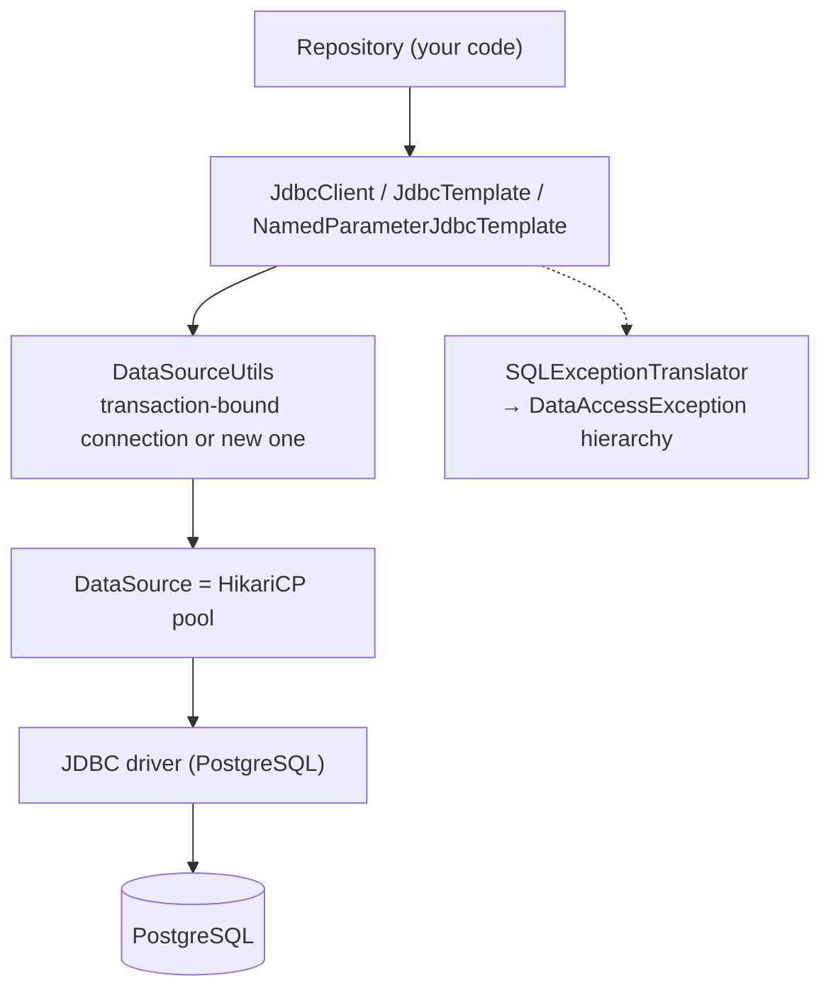
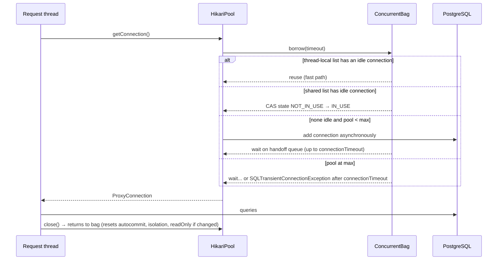
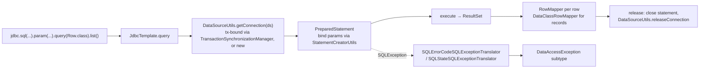
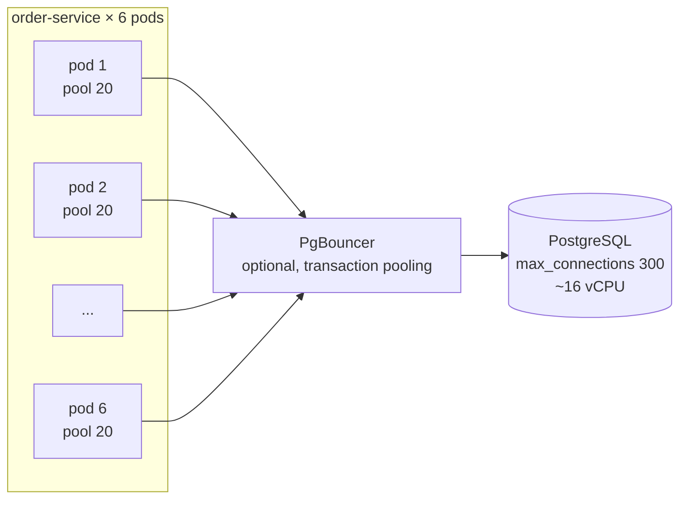

# 12 · Data Access Fundamentals — JDBC

## 1. Introduction & Why It Matters

Every grocery order, cart, price and stock count ends up in a relational database — PostgreSQL in our platform. Before reaching for JPA (Chapter 13), you need to understand the layer everything sits on: **JDBC, connection pools and Spring's data-access abstractions**. It matters because:

- **Most database incidents are pool incidents.** "Connection is not available, request timed out after 30000ms" during a flash sale is a HikariCP message, not a PostgreSQL one — caused by pool sizing, slow queries holding connections, leaks, or virtual threads flooding a pool of 10.
- **JDBC is often the right tool.** Stock reservations with `UPDATE ... WHERE available >= ?`, bulk price updates from a seller feed, reporting queries with window functions, streaming 200,000 rows for an export — plain SQL with `JdbcClient` is clearer and faster than an ORM for these.
- **Spring's exception translation** turns vendor error codes into a meaningful hierarchy (`DuplicateKeyException`, `CannotAcquireLockException`, transient vs non-transient) so retry and error-mapping logic doesn't depend on PostgreSQL's SQLState strings.
- **Read replicas and multiple databases** appear quickly at scale — catalog reads from a replica, reports from an analytics database.

This chapter builds the JDBC foundation of the platform: DataSource and HikariCP tuning, `JdbcClient` (Framework 6.1+) and `JdbcTemplate`, mapping to records, generated keys, batch updates, streaming, stored procedures, Spring Data JDBC, exception translation, integration tests with Testcontainers, the cart repository from Chapter 08 as a real SQL implementation with optimistic concurrency, and read/write routing to a replica.

### Who should read which section

| Band | Focus |
|---|---|
| B1 · 0–2 yrs | Parts 1, 2, 4 — DataSource, `JdbcClient` queries and updates |
| B2 · 2–5 yrs | Parts 2, 5 — named parameters, batching, generated keys, exception translation, Testcontainers |
| B3 · 5–8 yrs | Parts 3, 5, 6 — pool internals, connection binding, streaming, locking SQL patterns |
| B4 · 8–12 yrs | Parts 6, 7, 8 — pool sizing across pods, read replicas, multiple DataSources |
| B5 · 12–15+ yrs | Parts 8, 9 — database strategy, ORM vs SQL decisions |

---

## 2. Core Concepts

### 2.1 The stack



### 2.2 DataSource and connection pool

A **`DataSource`** hands out connections. Creating a physical connection (TCP + TLS + auth) takes milliseconds to tens of milliseconds, so production code always uses a **pool**. Boot's default pool is **HikariCP**, auto-configured from `spring.datasource.*` when a JDBC driver and `spring-boot-starter-jdbc` (or data-jpa) are present.

| Property | Default | Meaning |
|---|---|---|
| `spring.datasource.url` / `username` / `password` | — | Connection details |
| `spring.datasource.hikari.maximum-pool-size` | 10 | Max connections (idle + in use) |
| `spring.datasource.hikari.minimum-idle` | = max | Keep pool full (recommended: leave equal) |
| `spring.datasource.hikari.connection-timeout` | 30s | Wait for a free connection before failing |
| `spring.datasource.hikari.max-lifetime` | 30m | Retire connections before DB/proxy/firewall kills them |
| `spring.datasource.hikari.idle-timeout` | 10m | Only relevant if `minimum-idle` < max |
| `spring.datasource.hikari.keepalive-time` | (version-dependent) | Ping idle connections to keep NAT/proxies from dropping them |
| `spring.datasource.hikari.leak-detection-threshold` | 0 (off) | Log a stack trace if a connection is held longer than this |
| `spring.datasource.hikari.pool-name` | auto | Appears in metrics and logs |

### 2.3 Spring's JDBC APIs

| API | Since | Style | Use |
|---|---|---|---|
| **`JdbcClient`** | Framework 6.1 / Boot 3.2 | Fluent, named or positional params, maps to records | **Default for new code** |
| `JdbcTemplate` | Forever | Positional `?` params, callbacks | Batch operations, legacy code |
| `NamedParameterJdbcTemplate` | — | `:name` params | Batch with named params |
| `SimpleJdbcInsert` / `SimpleJdbcCall` | — | Metadata-driven insert / stored procedure call | Procedures, quick inserts |
| Spring Data JDBC | — | Repositories over aggregates, no lazy loading | Simple aggregate persistence |

All of them participate in Spring-managed transactions and translate exceptions.

### 2.4 Mapping rows

| Approach | Example |
|---|---|
| Record/class by column names | `.query(ProductRow.class)` — `sku` → `sku`, `selling_price` → `sellingPrice` (underscore mapping) |
| `RowMapper<T>` lambda | `(rs, n) -> new Product(rs.getString("sku"), ...)` — explicit, fast, type-safe |
| Single value | `.query(Integer.class).single()` |
| `Map` per row | `.query().listOfRows()` — for dynamic reports |
| `ResultSetExtractor` | Whole result set, e.g. building aggregates from joins |

### 2.5 Exception translation

JDBC throws checked `SQLException`s with vendor codes. Spring translates them into the unchecked **`DataAccessException`** hierarchy:

| Exception | Typical cause | Retry? |
|---|---|---|
| `DuplicateKeyException` | Unique constraint violated | No — business conflict |
| `DataIntegrityViolationException` | FK/NOT NULL/check violated | No |
| `EmptyResultDataAccessException` | `single()` found nothing | No |
| `IncorrectResultSizeDataAccessException` | `single()` found many | No — bug |
| `CannotAcquireLockException` / `PessimisticLockingFailureException` | Lock timeout, deadlock | Yes (with backoff) |
| `QueryTimeoutException` | Statement timeout | Maybe |
| `TransientDataAccessResourceException` | Connection dropped | Yes |
| `CannotGetJdbcConnectionException` | Pool exhausted / DB down | Maybe — careful, can amplify |
| `BadSqlGrammarException` | SQL error | No — bug |

Base types **`TransientDataAccessException`** vs **`NonTransientDataAccessException`** let resilience logic decide retries generically (Chapter 26).

### 2.6 Transactions — just enough for this chapter

With Spring-managed transactions (`@Transactional`, Chapter 16), all JDBC calls in one transaction on the same thread **share one connection**, bound to the thread by `DataSourceTransactionManager` (or `JpaTransactionManager`). Outside a transaction, each JDBC call borrows a connection and returns it immediately (auto-commit).

### 2.7 Schema initialization

- **Flyway/Liquibase** (Chapter 14) — the production way.
- `schema.sql` / `data.sql` with `spring.sql.init.mode=always` — only for demos and tests. Default `embedded` runs them only for embedded databases.

### 2.8 Spring Data JDBC

Repository interfaces (`CrudRepository`, `ListCrudRepository`) over **aggregates** mapped to tables, with **no lazy loading, no dirty checking, no session**: `save()` writes the whole aggregate; loading reads it fully. Simpler and more predictable than JPA; less powerful for complex object graphs. A good middle ground for small bounded contexts.

---

## 3. How It Works Internally

### 3.1 HikariCP borrowing and returning



- `ProxyConnection.close()` **returns** the connection; it doesn't close the socket.
- Hikari tracks state changes (autocommit, isolation, read-only, schema) and resets them on return.
- `max-lifetime` retires each connection (with jitter) and replaces it in the background.

### 3.2 `JdbcClient` → connection → translation



- **`DataClassRowMapper`** maps columns to record constructor parameters, converting `snake_case` to `camelCase`.
- **Connection release** outside a transaction returns the connection immediately after the statement — a loop of 100 queries borrows and returns 100 times (cheap with Hikari, but still a reason to use a transaction or batch for multi-statement work).
- **Translation** uses `sql-error-codes.xml` per database product (detected from connection metadata) and falls back to SQLState classes.

### 3.3 Streaming results

`queryForStream()` / `.stream()` keeps the `ResultSet` open while you consume. For PostgreSQL, the driver only streams (uses a cursor) when **auto-commit is off** (inside a transaction) and **fetch size > 0**; otherwise it loads everything into memory. The stream **must be closed** (try-with-resources) or the connection leaks.

---

## 4. Hands-On Code — Level 1 (Beginner)

### 4.1 Dependencies and configuration

```kotlin title="services/catalog-service/build.gradle.kts"
dependencies {
    implementation(libs.spring.boot.starter.jdbc)
    runtimeOnly("org.postgresql:postgresql")
    implementation("org.flywaydb:flyway-core")
    implementation("org.flywaydb:flyway-database-postgresql")
}
```

```yaml title="application.yml"
spring:
  datasource:
    url: jdbc:postgresql://localhost:5432/catalog
    username: catalog
    password: catalog
    hikari:
      pool-name: catalog-pool
```

```sql title="src/main/resources/db/migration/V1__products.sql"
create table product (
    sku            varchar(40) primary key,
    name           varchar(150) not null,
    category       varchar(40)  not null,
    mrp            numeric(10,2) not null check (mrp > 0),
    selling_price  numeric(10,2) not null check (selling_price > 0 and selling_price <= mrp),
    active         boolean not null default true,
    updated_at     timestamptz not null default now()
);
create index product_category_idx on product (category) where active;
```

### 4.2 A repository with `JdbcClient`

```java title="in/grocery/catalog/repository/ProductRepository.java"
package in.grocery.catalog.repository;

import java.math.BigDecimal;
import java.time.Instant;
import java.util.List;
import java.util.Optional;
import org.springframework.jdbc.core.simple.JdbcClient;
import org.springframework.stereotype.Repository;

@Repository
public class ProductRepository {

    public record ProductRow(String sku, String name, String category, BigDecimal mrp,
                             BigDecimal sellingPrice, boolean active, Instant updatedAt) {}   // (1)!

    private final JdbcClient jdbc;

    public ProductRepository(JdbcClient jdbc) {                                              // (2)!
        this.jdbc = jdbc;
    }

    public Optional<ProductRow> findBySku(String sku) {
        return jdbc.sql("""
                        select sku, name, category, mrp, selling_price, active, updated_at
                        from product where sku = :sku
                        """)
                .param("sku", sku)                                                           // (3)!
                .query(ProductRow.class)
                .optional();
    }

    public List<ProductRow> findActiveByCategory(String category) {
        return jdbc.sql("""
                        select sku, name, category, mrp, selling_price, active, updated_at
                        from product where category = :category and active
                        order by name
                        """)
                .param("category", category)
                .query(ProductRow.class)
                .list();
    }

    public int insert(ProductRow p) {
        return jdbc.sql("""
                        insert into product (sku, name, category, mrp, selling_price)
                        values (:sku, :name, :category, :mrp, :sellingPrice)
                        """)
                .paramSource(p)                                                              // (4)!
                .update();
    }

    public int updatePrice(String sku, BigDecimal sellingPrice) {
        return jdbc.sql("update product set selling_price = :price, updated_at = now() where sku = :sku")
                .param("price", sellingPrice)
                .param("sku", sku)
                .update();                                                                   // rows affected
    }

    public long countActive() {
        return jdbc.sql("select count(*) from product where active").query(Long.class).single();
    }
}
```

1. `selling_price` → `sellingPrice`, `updated_at` → `updatedAt` (via `DataClassRowMapper`); `timestamptz` → `Instant`.
2. Boot auto-configures `JdbcClient` (and `JdbcTemplate`) from the `DataSource`.
3. **Always bind parameters** — never concatenate values into SQL.
4. Named parameters taken from the record's accessors.

!!! danger "SQL injection"
    `jdbc.sql("select ... where sku = '" + sku + "'")` lets `sku = "x' or '1'='1"` read the whole table. Bind values with `:param`/`?`. For **identifiers** (sort columns, table names) you can't bind — use a whitelist (`Map.of("name", "name", "price", "selling_price")`).

### 4.3 First integration test with Testcontainers

```kotlin title="build.gradle.kts (test)"
testImplementation("org.springframework.boot:spring-boot-testcontainers")
testImplementation("org.testcontainers:junit-jupiter")
testImplementation("org.testcontainers:postgresql")
```

```java title="in/grocery/catalog/repository/ProductRepositoryTest.java"
package in.grocery.catalog.repository;

import static org.assertj.core.api.Assertions.assertThat;
import static org.assertj.core.api.Assertions.assertThatThrownBy;

import java.math.BigDecimal;
import org.junit.jupiter.api.Test;
import org.springframework.beans.factory.annotation.Autowired;
import org.springframework.boot.test.autoconfigure.flyway.AutoConfigureFlyway;
import org.springframework.boot.test.autoconfigure.jdbc.AutoConfigureTestDatabase;
import org.springframework.boot.test.autoconfigure.jdbc.JdbcTest;
import org.springframework.boot.testcontainers.service.connection.ServiceConnection;
import org.springframework.context.annotation.Import;
import org.springframework.dao.DataIntegrityViolationException;
import org.springframework.dao.DuplicateKeyException;
import org.testcontainers.containers.PostgreSQLContainer;
import org.testcontainers.junit.jupiter.Container;
import org.testcontainers.junit.jupiter.Testcontainers;

@JdbcTest                                                                                  // (1)!
@AutoConfigureTestDatabase(replace = AutoConfigureTestDatabase.Replace.NONE)               // (2)!
@AutoConfigureFlyway
@Testcontainers
@Import(ProductRepository.class)
class ProductRepositoryTest {

    @Container
    @ServiceConnection                                                                     // (3)!
    static PostgreSQLContainer<?> postgres = new PostgreSQLContainer<>("postgres:17-alpine");

    @Autowired ProductRepository products;

    private static ProductRepository.ProductRow atta() {
        return new ProductRepository.ProductRow("ATTA-5KG", "Whole Wheat Atta 5kg", "staples",
                new BigDecimal("320.00"), new BigDecimal("289.00"), true, null);
    }

    @Test
    void insertAndFind() {
        products.insert(atta());
        assertThat(products.findBySku("ATTA-5KG")).get()
                .extracting(ProductRepository.ProductRow::sellingPrice)
                .isEqualTo(new BigDecimal("289.00"));
    }

    @Test
    void duplicateSkuIsTranslated() {
        products.insert(atta());
        assertThatThrownBy(() -> products.insert(atta())).isInstanceOf(DuplicateKeyException.class);   // (4)!
    }

    @Test
    void checkConstraintProtectsMrp() {
        products.insert(atta());
        assertThatThrownBy(() -> products.updatePrice("ATTA-5KG", new BigDecimal("999.00")))
                .isInstanceOf(DataIntegrityViolationException.class);
    }
}
```

1. JDBC slice: `DataSource`, `JdbcClient`/`JdbcTemplate`, transaction manager; each test runs in a transaction that is **rolled back**.
2. Don't replace our DataSource with an embedded database — test against real PostgreSQL.
3. `@ServiceConnection` (Boot 3.1+) wires the container's URL/credentials into `spring.datasource.*` automatically.
4. PostgreSQL error `23505` translated to Spring's `DuplicateKeyException`.

!!! warning "Verify — Boot 4 test packages"
    `@JdbcTest`, `@AutoConfigureTestDatabase` and `@AutoConfigureFlyway` move to technology-specific test modules in Boot 4 (e.g. a JDBC test starter). Adjust imports and dependencies per the migration guide.

---

## 5. Hands-On Code — Level 2 (Intermediate) & Level 3 (Advanced)

### 5.1 Level 2 — Generated keys, IN clauses, explicit row mappers

```sql title="V2__orders.sql"
create table customer_order (
    id           bigint generated always as identity primary key,
    order_ref    varchar(20) not null unique,
    customer_id  varchar(20) not null,
    status       varchar(20) not null,
    total        numeric(12,2) not null,
    placed_at    timestamptz not null default now()
);
create table order_line (
    order_id   bigint not null references customer_order(id),
    line_no    int    not null,
    sku        varchar(40) not null,
    quantity   int not null check (quantity > 0),
    unit_price numeric(10,2) not null,
    primary key (order_id, line_no)
);
```

```java title="in/grocery/order/repository/OrderJdbcRepository.java"
package in.grocery.order.repository;

import java.math.BigDecimal;
import java.sql.ResultSet;
import java.sql.SQLException;
import java.time.Instant;
import java.util.Collection;
import java.util.List;
import org.springframework.jdbc.core.RowMapper;
import org.springframework.jdbc.core.simple.JdbcClient;
import org.springframework.jdbc.support.GeneratedKeyHolder;
import org.springframework.jdbc.support.KeyHolder;
import org.springframework.stereotype.Repository;

@Repository
public class OrderJdbcRepository {

    public record OrderSummary(long id, String orderRef, String customerId, String status,
                               BigDecimal total, Instant placedAt) {}

    private static final RowMapper<OrderSummary> SUMMARY = (ResultSet rs, int rowNum) -> new OrderSummary(  // (1)!
            rs.getLong("id"),
            rs.getString("order_ref"),
            rs.getString("customer_id"),
            rs.getString("status"),
            rs.getBigDecimal("total"),
            rs.getObject("placed_at", java.time.OffsetDateTime.class).toInstant());

    private final JdbcClient jdbc;

    public OrderJdbcRepository(JdbcClient jdbc) {
        this.jdbc = jdbc;
    }

    public long insert(String orderRef, String customerId, BigDecimal total) {
        KeyHolder keys = new GeneratedKeyHolder();
        jdbc.sql("insert into customer_order (order_ref, customer_id, status, total) values (?, ?, 'PLACED', ?)")
            .params(orderRef, customerId, total)                                                      // positional
            .update(keys, "id");                                                                      // (2)!
        return keys.getKeyAs(Long.class);
    }

    public List<OrderSummary> findByRefs(Collection<String> refs) {
        if (refs.isEmpty()) return List.of();                                                         // (3)!
        return jdbc.sql("select * from customer_order where order_ref in (:refs)")
                .param("refs", refs)                                                                  // expands to (?, ?, ?)
                .query(SUMMARY)
                .list();
    }

    public List<OrderSummary> recentForCustomer(String customerId, int limit) {
        return jdbc.sql("""
                        select id, order_ref, customer_id, status, total, placed_at
                        from customer_order where customer_id = :cid
                        order by placed_at desc limit :limit
                        """)
                .param("cid", customerId)
                .param("limit", Math.min(limit, 100))
                .query(SUMMARY)
                .list();
    }
}
```

1. Explicit mapper: no reflection, compile-time column/type decisions, and PostgreSQL `timestamptz` read as `OffsetDateTime` (JDBC 4.2 types).
2. Ask only for the `id` column — otherwise PostgreSQL returns all columns via `RETURNING *`.
3. `in ()` is invalid SQL. For large collections (> a few hundred), use `= any(:array)` with a SQL array, or a temp table — huge `IN` lists defeat plan caching.

### 5.2 Level 2 — Batch updates

Seller price feeds update thousands of SKUs:

```java title="in/grocery/catalog/repository/PriceBatchRepository.java"
package in.grocery.catalog.repository;

import java.math.BigDecimal;
import java.util.List;
import org.springframework.jdbc.core.namedparam.NamedParameterJdbcTemplate;
import org.springframework.jdbc.core.namedparam.SqlParameterSource;
import org.springframework.jdbc.core.namedparam.SqlParameterSourceUtils;
import org.springframework.stereotype.Repository;
import org.springframework.transaction.annotation.Transactional;

@Repository
public class PriceBatchRepository {

    public record PriceUpdate(String sku, BigDecimal sellingPrice) {}

    private final NamedParameterJdbcTemplate jdbc;

    public PriceBatchRepository(NamedParameterJdbcTemplate jdbc) {
        this.jdbc = jdbc;
    }

    @Transactional                                                                          // (1)!
    public int[] apply(List<PriceUpdate> updates) {
        SqlParameterSource[] batch = SqlParameterSourceUtils.createBatch(updates);           // from record accessors
        return jdbc.batchUpdate("""
                update product set selling_price = :sellingPrice, updated_at = now()
                where sku = :sku and :sellingPrice <= mrp
                """, batch);                                                                // (2)!
    }
}
```

1. One transaction, one connection, all-or-nothing.
2. Returns affected rows per statement: `0` means SKU unknown or price above MRP — the caller reports those rows back to the seller.

```yaml title="application.yml — make batches real batches"
spring:
  datasource:
    url: jdbc:postgresql://db:5432/catalog?reWriteBatchedInserts=true     # (1)!
```

1. PostgreSQL driver rewrites batched `INSERT`s into multi-row inserts — often 5–10× faster. (Updates are still sent as a pipelined batch.)

For very large loads (100k+ rows), split into chunks of 500–1,000 per batch and consider PostgreSQL `COPY` via the driver's `CopyManager`.

### 5.3 Level 2 — Stock reservation with a conditional update

The classic JDBC win: an atomic check-and-decrement without locks held in application code.

```java title="in/grocery/inventory/repository/StockRepository.java"
package in.grocery.inventory.repository;

import org.springframework.jdbc.core.simple.JdbcClient;
import org.springframework.stereotype.Repository;

@Repository
public class StockRepository {

    private final JdbcClient jdbc;

    public StockRepository(JdbcClient jdbc) {
        this.jdbc = jdbc;
    }

    /** @return true if reserved; false if insufficient stock. */
    public boolean reserve(String hub, String sku, int qty) {
        int rows = jdbc.sql("""
                        update stock set available = available - :qty, reserved = reserved + :qty
                        where hub_code = :hub and sku = :sku and available >= :qty
                        """)                                                                   // (1)!
                .param("qty", qty).param("hub", hub).param("sku", sku)
                .update();
        return rows == 1;
    }
}
```

1. The `WHERE available >= :qty` makes the check and update **one atomic statement** — no read-modify-write race between two customers buying the last packet of milk. Chapter 16 covers when you need explicit locking instead.

### 5.4 Level 3 — Streaming a large export

```java title="in/grocery/order/repository/OrderExportRepository.java"
package in.grocery.order.repository;

import java.math.BigDecimal;
import java.time.OffsetDateTime;
import java.util.function.Consumer;
import java.util.stream.Stream;
import org.springframework.jdbc.core.simple.JdbcClient;
import org.springframework.stereotype.Repository;
import org.springframework.transaction.annotation.Transactional;

@Repository
public class OrderExportRepository {

    public record OrderLineRow(String orderRef, OffsetDateTime placedAt, String sku, int quantity, BigDecimal unitPrice) {}

    private final JdbcClient jdbc;

    public OrderExportRepository(JdbcClient jdbc) {
        this.jdbc = jdbc;
    }

    @Transactional(readOnly = true)                                                        // (1)!
    public long forEachSellerLine(String sellerId, OffsetDateTime from, OffsetDateTime to, Consumer<OrderLineRow> sink) {
        try (Stream<OrderLineRow> rows = jdbc.sql("""
                        select o.order_ref, o.placed_at, l.sku, l.quantity, l.unit_price
                        from customer_order o join order_line l on l.order_id = o.id
                        join product p on p.sku = l.sku
                        where p.seller_id = :seller and o.placed_at >= :from and o.placed_at < :to
                        order by o.placed_at
                        """)
                .param("seller", sellerId).param("from", from).param("to", to)
                .withFetchSize(1_000)                                                        // (2)!
                .query(OrderLineRow.class)
                .stream()) {                                                                 // (3)!
            return rows.peek(sink).count();
        }
    }
}
```

1. PostgreSQL only uses a server-side cursor with auto-commit **off** — a (read-only) transaction does that.
2. Rows fetched 1,000 at a time; memory stays flat.
3. **try-with-resources** — an unclosed stream keeps the connection checked out.

!!! warning "Verify"
    Per-statement fetch size on `JdbcClient` (`withFetchSize`) is available in recent Framework versions; on older 6.1 builds, set `spring.jdbc.template.fetch-size` globally or use `JdbcTemplate` with `setFetchSize`.

### 5.5 Level 3 — Stored procedures and functions

The finance team owns a PostgreSQL function computing a seller's settlement:

```java title="in/grocery/seller/repository/SettlementRepository.java"
package in.grocery.seller.repository;

import java.math.BigDecimal;
import java.time.LocalDate;
import org.springframework.jdbc.core.simple.JdbcClient;
import org.springframework.stereotype.Repository;

@Repository
public class SettlementRepository {

    public record Settlement(BigDecimal gross, BigDecimal commission, BigDecimal tcs, BigDecimal net) {}

    private final JdbcClient jdbc;

    public SettlementRepository(JdbcClient jdbc) {
        this.jdbc = jdbc;
    }

    public Settlement compute(String sellerId, LocalDate periodStart, LocalDate periodEnd) {
        return jdbc.sql("select * from finance.compute_settlement(:seller, :from, :to)")   // (1)!
                .param("seller", sellerId).param("from", periodStart).param("to", periodEnd)
                .query(Settlement.class)
                .single();
    }
}
```

1. PostgreSQL functions returning a row/table are called with plain `SELECT` — simplest and works with `JdbcClient`. For procedures with `OUT` parameters (or other databases), use `SimpleJdbcCall`.

### 5.6 Level 3 — Exception translation in practice

```java title="in/grocery/order/service/OrderPlacementService.java (excerpt)"
try {
    long id = orders.insert(orderRef, customerId, total);
    ...
} catch (DuplicateKeyException e) {
    // order_ref collision: the client retried with the same idempotency key → return existing order
    return orders.findByRefs(List.of(orderRef)).getFirst().id();
} catch (CannotAcquireLockException | TransientDataAccessResourceException e) {
    throw DependencyException.unavailable("orders-db", e);         // 503 with Retry-After (Chapter 10)
}
```

Catch the **specific** Spring exception where it means something in the domain. Let everything else propagate to the platform error handler (500, logged once).

### 5.7 Level 3 — Spring Data JDBC for a small aggregate

The delivery-partner bounded context is simple: a partner with vehicle documents.

```java title="in/grocery/delivery/partner/DeliveryPartner.java"
package in.grocery.delivery.partner;

import java.time.LocalDate;
import java.util.Set;
import org.springframework.data.annotation.Id;
import org.springframework.data.annotation.Version;
import org.springframework.data.relational.core.mapping.MappedCollection;
import org.springframework.data.relational.core.mapping.Table;

@Table("delivery_partner")
public record DeliveryPartner(
        @Id Long id,
        String name,
        String mobile,
        String hubCode,
        @Version Integer version,                                           // (1)!
        @MappedCollection(idColumn = "partner_id") Set<VehicleDocument> documents) {   // (2)!

    @Table("vehicle_document")
    public record VehicleDocument(String type, String number, LocalDate validTill) {}
}
```

1. Optimistic locking built in: concurrent saves → `OptimisticLockingFailureException`.
2. Documents are part of the aggregate: saved and loaded with the partner (delete-and-reinsert on save).

```java title="DeliveryPartnerRepository.java"
public interface DeliveryPartnerRepository extends ListCrudRepository<DeliveryPartner, Long> {

    List<DeliveryPartner> findByHubCode(String hubCode);                         // derived query

    @Query("select * from delivery_partner where mobile = :mobile")
    Optional<DeliveryPartner> findByMobile(String mobile);
}
```

Add `spring-boot-starter-data-jdbc`. Chapter 13 compares JDBC, Spring Data JDBC and JPA in depth.

---

## 6. Hands-On Code — Level 4 (Expert / Production)

### 6.1 The cart repository in SQL, with optimistic concurrency

Chapter 08's in-memory `CartRepository` becomes PostgreSQL. The cart lines are stored as JSONB — the cart is always read and written as a whole, is short-lived, and never queried by line.

```sql title="V3__cart.sql"
create table cart (
    id           uuid primary key,
    customer_id  varchar(20) not null,
    quantities   jsonb not null default '{}'::jsonb,   -- {"MILK-1L": 2, "ATTA-5KG": 1}
    version      bigint not null,
    updated_at   timestamptz not null default now()
);
create index cart_customer_idx on cart (customer_id);
```

```java title="in/grocery/cart/repository/JdbcCartRepository.java"
package in.grocery.cart.repository;

import com.fasterxml.jackson.core.type.TypeReference;
import com.fasterxml.jackson.databind.ObjectMapper;       // JsonMapper / tools.jackson on Boot 4
import in.grocery.cart.service.Cart;
import in.grocery.cart.service.CartNotFoundException;
import in.grocery.cart.service.CartVersionConflict;
import java.util.Map;
import java.util.Optional;
import java.util.UUID;
import org.springframework.context.annotation.Primary;
import org.springframework.jdbc.core.simple.JdbcClient;
import org.springframework.stereotype.Repository;

@Repository
@Primary                                                                                     // replaces the in-memory one
class JdbcCartRepository implements CartRepository {

    private static final TypeReference<Map<String, Integer>> QUANTITIES = new TypeReference<>() {};

    private final JdbcClient jdbc;
    private final ObjectMapper json;

    JdbcCartRepository(JdbcClient jdbc, ObjectMapper json) {
        this.jdbc = jdbc;
        this.json = json;
    }

    @Override
    public Cart insert(Cart cart) {
        jdbc.sql("insert into cart (id, customer_id, quantities, version) values (:id, :customer, cast(:q as jsonb), :v)")
            .param("id", UUID.fromString(cart.id()))
            .param("customer", cart.customerId())
            .param("q", write(cart.quantities()))
            .param("v", cart.version())
            .update();
        return cart;
    }

    @Override
    public Optional<Cart> find(String id) {
        return jdbc.sql("select id, customer_id, quantities::text as q, version from cart where id = :id")
                .param("id", UUID.fromString(id))
                .query((rs, n) -> new Cart(rs.getString("id"), rs.getString("customer_id"),
                        read(rs.getString("q")), rs.getLong("version")))
                .optional();
    }

    @Override
    public Cart update(Cart updated, long expectedVersion) {
        int rows = jdbc.sql("""
                        update cart set quantities = cast(:q as jsonb), version = :newVersion, updated_at = now()
                        where id = :id and version = :expected
                        """)                                                                // (1)!
                .param("q", write(updated.quantities()))
                .param("newVersion", updated.version())
                .param("id", UUID.fromString(updated.id()))
                .param("expected", expectedVersion)
                .update();
        if (rows == 1) return updated;
        boolean exists = jdbc.sql("select count(*) from cart where id = :id")
                .param("id", UUID.fromString(updated.id())).query(Integer.class).single() > 0;
        if (!exists) throw new CartNotFoundException(updated.id());
        throw new CartVersionConflict(updated.id(), expectedVersion);                          // (2)!
    }

    private String write(Map<String, Integer> quantities) {
        try {
            return json.writeValueAsString(quantities);
        } catch (com.fasterxml.jackson.core.JsonProcessingException e) {
            throw new IllegalStateException(e);
        }
    }

    private Map<String, Integer> read(String q) {
        try {
            return json.readValue(q, QUANTITIES);
        } catch (com.fasterxml.jackson.core.JsonProcessingException e) {
            throw new IllegalStateException("Corrupt cart JSON", e);
        }
    }
}
```

1. **Compare-and-set** on `version`: a single statement, no locks held between read and write — the database-level half of Chapter 08's ETag/If-Match flow.
2. Distinguish "gone" (404) from "changed" (412) with a cheap follow-up query only on the failure path.

### 6.2 Pool sizing for virtual threads and many pods

With `spring.threads.virtual.enabled=true`, 2,000 concurrent requests may all try to borrow a connection. The pool becomes the concurrency limiter:



Rules of thumb:

| Rule | Why |
|---|---|
| Σ (pool size × pods × services) + admin headroom ≤ DB `max_connections` | Otherwise scale-out causes connection refusals |
| Start near `2 × DB cores` **total** across all clients, then measure | Past that, more connections = more contention, not throughput |
| Keep `minimum-idle = maximum-pool-size` | Fixed-size pool, no churn |
| `connection-timeout` 2–5s for request paths | Fail fast (503) instead of piling up waiting requests |
| `max-lifetime` a few minutes below DB/proxy idle kill | Avoid "connection reset" on dead sockets |
| Statement timeout in the DB (`options=-c statement_timeout=5s`) | A runaway query can't hold a connection forever |
| HPA max replicas bounded by the connection budget | Autoscaling can DoS your own database |

```yaml title="application-prod.yml — order-service"
spring:
  datasource:
    url: jdbc:postgresql://orders-db:5432/orders?reWriteBatchedInserts=true&options=-c%20statement_timeout=5000
    hikari:
      pool-name: orders-rw
      maximum-pool-size: 20
      minimum-idle: 20
      connection-timeout: 3s
      max-lifetime: 25m
      keepalive-time: 2m
      leak-detection-threshold: 20s          # log holders > 20s (tune; off in hot paths if noisy)
```

Metrics to watch (Micrometer, Chapter 27): `hikaricp.connections.active`, `.pending`, `.acquire` (timer), `.usage` (time held), `.timeout` (counter). **Pending > 0 sustained** or **acquire p99 rising** = the pool is the bottleneck.

### 6.3 Read replica routing

Catalog browsing and order history are read-heavy and tolerate a little replication lag. Send **read-only transactions** to the replica.

=== "Spring Framework 6.2+ (Boot 3.4+ / 4.x)"

    ```java title="in/grocery/platform/db/ReadReplicaDataSourceConfig.java"
    package in.grocery.platform.db;

    import com.zaxxer.hikari.HikariDataSource;
    import javax.sql.DataSource;
    import org.springframework.boot.autoconfigure.jdbc.DataSourceProperties;
    import org.springframework.boot.context.properties.ConfigurationProperties;
    import org.springframework.context.annotation.Bean;
    import org.springframework.context.annotation.Configuration;
    import org.springframework.context.annotation.Primary;
    import org.springframework.jdbc.datasource.LazyConnectionDataSourceProxy;

    @Configuration(proxyBeanMethods = false)
    class ReadReplicaDataSourceConfig {

        @Bean
        @ConfigurationProperties("grocery.datasource.primary")
        DataSourceProperties primaryProperties() { return new DataSourceProperties(); }

        @Bean
        @ConfigurationProperties("grocery.datasource.replica")
        DataSourceProperties replicaProperties() { return new DataSourceProperties(); }

        @Bean(defaultCandidate = false)                                                   // (1)!
        @ConfigurationProperties("grocery.datasource.primary.hikari")
        HikariDataSource primaryPool(DataSourceProperties primaryProperties) {
            return primaryProperties.initializeDataSourceBuilder().type(HikariDataSource.class).build();
        }

        @Bean(defaultCandidate = false)
        @ConfigurationProperties("grocery.datasource.replica.hikari")
        HikariDataSource replicaPool(DataSourceProperties replicaProperties) {
            HikariDataSource ds = replicaProperties.initializeDataSourceBuilder().type(HikariDataSource.class).build();
            ds.setReadOnly(true);                                                          // (2)!
            return ds;
        }

        @Bean
        @Primary
        DataSource dataSource(HikariDataSource primaryPool, HikariDataSource replicaPool) {
            LazyConnectionDataSourceProxy proxy = new LazyConnectionDataSourceProxy(primaryPool);  // (3)!
            proxy.setReadOnlyDataSource(replicaPool);                                              // (4)!
            return proxy;
        }
    }
    ```

    1. Framework 6.2's `defaultCandidate = false`: the pools exist as beans (metrics, health) but aren't candidates for plain `DataSource` injection — only the routing proxy is.
    2. Belt and braces: the replica pool refuses writes.
    3. The lazy proxy defers fetching a physical connection until the first statement — by then the transaction's read-only flag is known.
    4. **Framework 6.2+**: read-only transactions (`@Transactional(readOnly = true)`) use the replica pool automatically.

=== "Spring Framework 6.0/6.1 — AbstractRoutingDataSource"

    ```java title="ReadWriteRoutingDataSource.java"
    class ReadWriteRoutingDataSource extends AbstractRoutingDataSource {
        @Override
        protected Object determineCurrentLookupKey() {
            return TransactionSynchronizationManager.isCurrentTransactionReadOnly() ? "replica" : "primary";
        }
    }
    // wrap in LazyConnectionDataSourceProxy so the key is evaluated after the transaction starts
    ```

```yaml title="application-prod.yml — catalog-service"
grocery:
  datasource:
    primary:
      url: jdbc:postgresql://catalog-db-rw:5432/catalog
      username: ${CATALOG_DB_USER}
      password: ${CATALOG_DB_PASSWORD}
      hikari:
        pool-name: catalog-rw
        maximum-pool-size: 10
    replica:
      url: jdbc:postgresql://catalog-db-ro:5432/catalog
      username: ${CATALOG_DB_USER}
      password: ${CATALOG_DB_PASSWORD}
      hikari:
        pool-name: catalog-ro
        maximum-pool-size: 30
```

```java title="Usage"
@Transactional(readOnly = true)                  // → replica
public PageResponse<ProductSummary> browse(...) { ... }

@Transactional                                   // → primary
public void updatePrice(...) { ... }
```

!!! danger "Read-your-writes"
    After a customer places an order, "My Orders" served from a lagging replica may not show it. For flows that must see their own writes, read from the primary (a non-readOnly transaction or explicit primary routing for N seconds after a write), or pass the new data in the response. Monitor replica lag and fail over reads to the primary when lag exceeds a threshold.

!!! warning "Verify"
    Confirm `LazyConnectionDataSourceProxy#setReadOnlyDataSource` and `@Bean(defaultCandidate = false)` against your Framework version (both 6.2+). Declaring your own `DataSource` bean makes Boot's `DataSourceAutoConfiguration` back off — Flyway, health and metrics then use your `@Primary` proxy; make sure Flyway runs against the **primary** (use `spring.flyway.url`/credentials or a `FlywayDataSource`-qualified bean).

### 6.4 Test: routing really happens

```java title="ReadReplicaRoutingTest.java"
@SpringBootTest(classes = {ReadReplicaDataSourceConfig.class, ReadReplicaRoutingTest.Probe.class,
                           DataSourceTransactionManagerAutoConfiguration.class, TransactionAutoConfiguration.class})
@Testcontainers
class ReadReplicaRoutingTest {

    @Container static PostgreSQLContainer<?> primary = new PostgreSQLContainer<>("postgres:17-alpine");
    @Container static PostgreSQLContainer<?> replica = new PostgreSQLContainer<>("postgres:17-alpine")
            .withInitScript("replica-marker.sql");                               // (1)!

    @DynamicPropertySource
    static void props(DynamicPropertyRegistry r) {
        r.add("grocery.datasource.primary.url", primary::getJdbcUrl);
        r.add("grocery.datasource.primary.username", primary::getUsername);
        r.add("grocery.datasource.primary.password", primary::getPassword);
        r.add("grocery.datasource.replica.url", replica::getJdbcUrl);
        r.add("grocery.datasource.replica.username", replica::getUsername);
        r.add("grocery.datasource.replica.password", replica::getPassword);
    }

    @Component
    static class Probe {
        private static final String IS_REPLICA = "select to_regclass('replica_marker') is not null";
        private final JdbcTemplate jdbc;

        Probe(DataSource ds) { this.jdbc = new JdbcTemplate(ds); }

        @Transactional(readOnly = true)
        public Boolean readOnlyHitsReplica() { return jdbc.queryForObject(IS_REPLICA, Boolean.class); }

        @Transactional
        public Boolean readWriteHitsReplica() { return jdbc.queryForObject(IS_REPLICA, Boolean.class); }
    }

    @Autowired Probe probe;

    @Test
    void readOnlyTransactionsUseReplica() {
        assertThat(probe.readOnlyHitsReplica()).isTrue();
        assertThat(probe.readWriteHitsReplica()).isFalse();
    }
}
```

1. `src/test/resources/replica-marker.sql` contains `create table replica_marker (id int);` — only the replica has it, so the query tells us which database answered.

---

## 7. Spring Boot 3 vs 4 & Migration

| Topic | Boot 3.5 / Framework 6.2 | Boot 4.x / Framework 7 |
|---|---|---|
| `JdbcClient` | ✅ (since 3.2) | ✅ |
| HikariCP | 6.x (verify) | Current 6.x/7.x (verify) |
| `@Bean(defaultCandidate = false)` | ✅ (Framework 6.2) | ✅ |
| Read-only DataSource on `LazyConnectionDataSourceProxy` | ✅ (6.2) | ✅ |
| JDBC auto-config module | `spring-boot-autoconfigure` | JDBC module (`spring-boot-jdbc`, verify) |
| Test slice | `@JdbcTest` in `boot.test.autoconfigure.jdbc` | JDBC test module (verify package) |
| `@ServiceConnection` | ✅ | ✅ |
| Spring Data JDBC | 3.5 (2025.0 release train) | 4.0 (2025.1 train, verify) |
| Null-safety | Spring `@Nullable` | JSpecify annotations on JDBC APIs — nullable results explicit |

=== "Spring Boot 3.5"

    ```kotlin title="Kotlin"
    testImplementation("org.springframework.boot:spring-boot-starter-test")
    // @JdbcTest from org.springframework.boot.test.autoconfigure.jdbc
    ```

=== "Spring Boot 4.x"

    ```kotlin title="Kotlin"
    testImplementation("org.springframework.boot:spring-boot-starter-jdbc-test")   // verify starter name
    // @JdbcTest from the JDBC test module package (verify)
    ```

### Migration checklist

- [ ] Replace legacy `JdbcTemplate` query-callback code with `JdbcClient` where touched.
- [ ] Custom `DataSource` beans: move to `defaultCandidate = false` pattern where multiple pools exist.
- [ ] Update test slice imports and starters for Boot 4.
- [ ] Recheck Hikari property names and defaults after upgrades (keepalive, validation).
- [ ] JSpecify: handle `@Nullable` returns (`queryForObject` etc.) explicitly.

---

## 8. Production Playbook

### Best practices

1. **`JdbcClient` + records** for new SQL code; explicit `RowMapper`s on hot paths.
2. **Always bind parameters**; whitelist identifiers.
3. **Atomic SQL** (`UPDATE ... WHERE condition`) instead of read-modify-write in Java.
4. **Batch** bulk writes; chunk very large loads; `reWriteBatchedInserts`.
5. **Stream** large reads inside read-only transactions with a fetch size; close streams.
6. **Pool sizing is a platform budget** across pods and services; fail fast on acquisition.
7. **Statement timeouts** in the database; `leak-detection-threshold` in lower environments.
8. **Catch specific `DataAccessException`s** only where they carry domain meaning.
9. **Test against real PostgreSQL** with Testcontainers and `@ServiceConnection`.
10. **Read replicas** only for lag-tolerant reads; design read-your-writes explicitly.

### Anti-patterns

❌ **String concatenation in SQL** — injection.

❌ **N queries in a loop** (`for (sku : skus) findBySku(sku)`) — use `IN`/`any(:array)` or a join.

❌ **Remote calls while holding a connection** (inside a transaction) — Razorpay latency becomes pool exhaustion.

```java title="Anti-patterns (snippet)"
@Transactional
public void placeOrder(...) {
    orders.insert(...);
    razorpay.createOrder(...);     // ❌ 2–10s with a DB connection held
    orders.markPaymentPending(...);
}
```

✅ Commit, then call out; or outbox (Chapter 36).

❌ **Huge pools** ("set 200 to be safe") — more connections, more DB contention, lower throughput.

❌ **Unclosed `Stream`s** from `queryForStream` — leaked connections.

❌ **`select *`** in production queries — breaks record mapping on schema additions and fetches unneeded columns (fine only in tests/demos).

### Troubleshooting

| Symptom | Cause | Fix |
|---|---|---|
| `Connection is not available, request timed out after 30000ms` | Pool exhausted: slow queries, long transactions, leaks, too small pool | Check `hikaricp.connections.usage`, leak detection, remote calls in tx; tune |
| `Apparent connection leak detected` | Connection held beyond threshold | Stack trace shows borrower; close streams; shorten tx |
| `FATAL: sorry, too many clients already` | Σ pools > `max_connections` | Budget pools; PgBouncer; limit replicas |
| Stream loads all rows / OOM | Auto-commit on or fetch size 0 | Read-only transaction + fetch size |
| `This connection has been closed` / `Connection reset` | `max-lifetime` > infra idle timeout | Lower max-lifetime, keepalive |
| `DataClassRowMapper` fails to map | Column name/type mismatch | Alias columns (`as selling_price`) or explicit mapper |
| `BadSqlGrammarException` on `in ()` | Empty collection | Guard empty input |
| Duplicate rows inserted on retry | No idempotency | Unique constraints + handle `DuplicateKeyException` |
| Replica returns stale data | Replication lag | Read-your-writes strategy |

### Production checklist

- [ ] Pool size per service documented against DB `max_connections`
- [ ] `connection-timeout` short on request paths; statement timeout set
- [ ] Hikari metrics on dashboards; alerts on pending/timeouts
- [ ] No remote calls inside transactions (review + ArchUnit where possible)
- [ ] All SQL parameterized; identifier whitelists
- [ ] Repository integration tests on PostgreSQL via Testcontainers
- [ ] Streams closed; exports use fetch size
- [ ] Replica usage reviewed for read-your-writes

---

## 9. Interview Questions & Answers

### B1 · 0–2 years

??? question "B1 · What is a DataSource and why use a connection pool?"
    **Short answer:** A factory for database connections. Pools (HikariCP in Boot) reuse connections because creating them is expensive.

??? question "B1 · `JdbcClient` vs `JdbcTemplate`?"
    **Short answer:** Both are Spring JDBC helpers. `JdbcClient` (6.1+) is a fluent API with named/positional params and easy record mapping; `JdbcTemplate` is the older callback-style API, still used for batches.

??? question "B1 · How do you prevent SQL injection?"
    **Short answer:** Bind parameters (`:name` / `?`); never concatenate input. Whitelist identifiers that can't be bound.

??? question "B1 · What does Spring's exception translation do?"
    **Short answer:** Converts checked `SQLException`s with vendor codes into unchecked `DataAccessException` subclasses like `DuplicateKeyException`.

??? question "B1 · How does Boot know which database to connect to?"
    **Short answer:** From `spring.datasource.url/username/password` and the JDBC driver on the classpath; it auto-configures HikariCP.

### B2 · 2–5 years

??? question "B2 · How do you get a generated primary key after insert?"
    **Short answer:** `KeyHolder` with `JdbcClient.update(keyHolder, "id")` (or `JdbcTemplate` with `PreparedStatementCreator`/`SimpleJdbcInsert`).

??? question "B2 · How do you perform batch updates efficiently?"
    **Short answer:** `NamedParameterJdbcTemplate.batchUpdate` / `JdbcTemplate.batchUpdate` in a transaction, chunked; enable driver batch rewriting (`reWriteBatchedInserts` for PostgreSQL).

??? question "B2 · How do you avoid a race when decrementing stock?"
    **Short answer:** Single conditional update `UPDATE ... SET available = available - ? WHERE available >= ?` and check affected rows; or explicit locking when more logic is needed.

??? question "B2 · How do you test repositories against a real database?"
    **Short answer:** `@JdbcTest` (or `@DataJpaTest`) with `@AutoConfigureTestDatabase(replace = NONE)`, Testcontainers PostgreSQL and `@ServiceConnection`; migrations via Flyway.

??? question "B2 · What happens to connections outside a transaction?"
    **Short answer:** Each JDBC operation borrows a connection in auto-commit mode and returns it immediately.

??? question "B2 · Spring Data JDBC vs JPA?"
    **Short answer:** Spring Data JDBC maps aggregates with no lazy loading, dirty checking or session — simpler and explicit. JPA offers a persistence context, lazy loading, rich mappings — more powerful, more pitfalls.

### B3 · 5–8 years

??? question "B3 · How does Spring bind a JDBC connection to a transaction?"
    **Short answer:** The transaction manager obtains a connection, disables auto-commit and binds a `ConnectionHolder` to the thread via `TransactionSynchronizationManager`; `DataSourceUtils.getConnection` returns it to all JDBC calls in that transaction.

??? question "B3 · How do you stream millions of rows from PostgreSQL without OOM?"
    **Short answer:** Inside a transaction (auto-commit off), set fetch size, use `queryForStream`/`JdbcClient.stream()`, consume incrementally, and close the stream. Stream to the client via `StreamingResponseBody`.

??? question "B3 · How do you size a HikariCP pool?"
    **Short answer:** Start small (~2× DB cores total across clients), keep pool fixed-size, ensure Σ pools ≤ DB max connections, measure acquire time/pending/usage, and fix slow queries before growing pools.

??? question "B3 · What changes for connection pools with virtual threads?"
    **Short answer:** Request concurrency is no longer limited by threads; the pool becomes the limiter. Keep pool sizes bounded, use short acquisition timeouts, and add bulkheads/rate limiting so thousands of virtual threads don't queue on the pool.

??? question "B3 · Transient vs non-transient `DataAccessException`?"
    **Short answer:** Transient (lock failures, timeouts, dropped connections) may succeed on retry; non-transient (constraint violations, bad SQL) won't. Retry policies key off this hierarchy.

### B4 · 8–12 years

??? question "B4 · Design read-replica usage for the catalog service."
    **Short answer:** Primary and replica pools, routing by transaction read-only flag via `LazyConnectionDataSourceProxy` (6.2 read-only DataSource or routing DataSource), migrations/writes on primary only, lag monitoring, read-your-writes handling, replica pool sized for read traffic, fallback to primary on lag.

??? question "B4 · An incident: pool exhaustion every evening at 8 pm. How do you investigate?"
    **Short answer:** Dashboards for active/pending/usage; correlate with traffic and slow query logs (`pg_stat_statements`); enable leak detection; look for remote calls inside transactions, long reports on the request path, lock waits; fix causes, then consider pool size, PgBouncer, or moving reports to replica/batch.

??? question "B4 · When do you choose plain SQL over JPA?"
    **Short answer:** Bulk operations, reporting, atomic conditional updates, database-specific features (JSONB, window functions, CTEs), streaming, and simple aggregates where ORM overhead and pitfalls outweigh benefits. Many services mix: JPA for aggregates, `JdbcClient` for queries.

### B5 · 12–15+ years

??? question "B5 · How would you govern database connections across 26 services and one shared PostgreSQL cluster?"
    **Short answer:** Connection budgets per service tied to HPA limits, PgBouncer where appropriate, database-per-service direction, statement timeouts, dashboards and alerts, capacity reviews before sales events, and a golden-path DataSource configuration in the platform library.

??? question "B5 · Database per service vs shared database for the grocery platform?"
    **Short answer:** Database (or at least schema with owned access) per service for autonomy and independent scaling; shared read models via events/CDC rather than cross-service joins. A shared cluster with separate databases/users is a pragmatic middle ground with connection budgets.

### Scenario questions

??? example "Scenario · During a sale, checkout fails with 'Connection is not available' while DB CPU is only 30%"
    `placeOrder` held a transaction across the Razorpay order-creation call; Razorpay latency rose to 4s, so each checkout held a connection 4s; pool of 20 × 6 pods saturated. Fix: move the gateway call outside the transaction (create order in PENDING, commit, call Razorpay, update), add timeouts and circuit breaker, alert on `hikaricp.connections.pending`.

??? example "Scenario · A nightly seller report crashes order-service with OutOfMemoryError"
    Report used `query(...).list()` for 3M rows. Fix: stream with fetch size in a read-only transaction to a file/StreamingResponseBody, move to a batch job (Chapter 33) against the replica, and paginate by keyset.

### Coding exercise

!!! example "Exercise · Idempotent coupon redemption"
    Table `coupon_redemption(coupon_code, customer_id, order_ref, redeemed_at)` with unique `(coupon_code, customer_id)` and a `coupon(code, max_redemptions, redeemed_count)` table. Implement `redeem(code, customerId, orderRef)` that: increments `redeemed_count` only if below max (atomically), records the redemption, is idempotent for the same `orderRef`, and returns `REDEEMED`, `ALREADY_REDEEMED`, or `EXHAUSTED`. Test with Testcontainers.

??? success "Solution"
    ```sql title="V9__coupons.sql"
    create table coupon (code varchar(20) primary key, max_redemptions int not null, redeemed_count int not null default 0);
    create table coupon_redemption (
        coupon_code varchar(20) not null references coupon(code),
        customer_id varchar(20) not null,
        order_ref   varchar(20) not null,
        redeemed_at timestamptz not null default now(),
        primary key (coupon_code, customer_id)
    );
    ```

    ```java title="CouponRepository.java"
    package in.grocery.promotion.repository;

    import org.springframework.jdbc.core.simple.JdbcClient;
    import org.springframework.stereotype.Repository;
    import org.springframework.transaction.annotation.Transactional;

    @Repository
    public class CouponRepository {

        public enum Result { REDEEMED, ALREADY_REDEEMED, EXHAUSTED }

        private final JdbcClient jdbc;

        public CouponRepository(JdbcClient jdbc) {
            this.jdbc = jdbc;
        }

        @Transactional
        public Result redeem(String code, String customerId, String orderRef) {
            var existing = jdbc.sql("select order_ref from coupon_redemption where coupon_code = :c and customer_id = :u")
                    .param("c", code).param("u", customerId).query(String.class).optional();
            if (existing.isPresent()) {
                return existing.get().equals(orderRef) ? Result.REDEEMED : Result.ALREADY_REDEEMED;   // idempotent retry
            }
            int claimed = jdbc.sql("""
                    update coupon set redeemed_count = redeemed_count + 1
                    where code = :c and redeemed_count < max_redemptions
                    """).param("c", code).update();
            if (claimed == 0) return Result.EXHAUSTED;
            jdbc.sql("insert into coupon_redemption (coupon_code, customer_id, order_ref) values (:c, :u, :o)")
                .param("c", code).param("u", customerId).param("o", orderRef).update();   // PK guards concurrent duplicates
            return Result.REDEEMED;
        }
    }
    ```

    ```java title="CouponRepositoryTest.java"
    @JdbcTest
    @AutoConfigureTestDatabase(replace = AutoConfigureTestDatabase.Replace.NONE)
    @AutoConfigureFlyway
    @Testcontainers
    @Import(CouponRepository.class)
    class CouponRepositoryTest {

        @Container @ServiceConnection
        static PostgreSQLContainer<?> pg = new PostgreSQLContainer<>("postgres:17-alpine");

        @Autowired CouponRepository coupons;
        @Autowired JdbcClient jdbc;

        @BeforeEach
        void seed() {
            jdbc.sql("insert into coupon (code, max_redemptions) values ('DIWALI50', 1)").update();
        }

        @Test
        void redeemIdempotentAndExhausted() {
            assertThat(coupons.redeem("DIWALI50", "C-1", "ORD-1")).isEqualTo(CouponRepository.Result.REDEEMED);
            assertThat(coupons.redeem("DIWALI50", "C-1", "ORD-1")).isEqualTo(CouponRepository.Result.REDEEMED);
            assertThat(coupons.redeem("DIWALI50", "C-1", "ORD-2")).isEqualTo(CouponRepository.Result.ALREADY_REDEEMED);
            assertThat(coupons.redeem("DIWALI50", "C-2", "ORD-3")).isEqualTo(CouponRepository.Result.EXHAUSTED);
        }
    }
    ```

    Under concurrency, two requests from the same customer may both pass the first `select`; the primary key makes the second insert fail and its transaction rolls back (including its count increment). Map that `DuplicateKeyException` to `ALREADY_REDEEMED` at the service level, or retry once.

---

## Key Takeaways

- **HikariCP + `JdbcClient` + records** is the modern Spring JDBC stack.
- The **pool is a shared, finite budget** — size it across pods, fail fast, watch acquire/pending/usage metrics.
- **Bind every parameter**; whitelist identifiers.
- **Atomic conditional SQL** beats read-modify-write; **CAS on version** gives optimistic concurrency.
- **Batch** writes, **stream** reads (read-only transaction + fetch size + close).
- **Exception translation** gives meaningful, retry-aware exceptions.
- **Never hold connections across remote calls.**
- **Read replicas** via `LazyConnectionDataSourceProxy` (6.2+), with a read-your-writes plan.
- Test against **real PostgreSQL** with Testcontainers and `@ServiceConnection`.

## Further Reading

- Spring Framework Reference — *Data Access › Data Access with JDBC* (`JdbcClient`, `JdbcTemplate`, batch operations, `SimpleJdbc` classes, exception translation)
- Spring Boot Reference — *Data › SQL Databases* (DataSource configuration, connection pools, `JdbcClient`); *Testing › Testcontainers › Service Connections*
- HikariCP wiki — *About Pool Sizing*, *Configuration*
- PostgreSQL JDBC driver documentation — *Fetching results based on a cursor*, connection parameters

---

[:material-arrow-left: 11 JSON & Serialization](11-json-serialization.md) · [13 Spring Data JPA & Hibernate :material-arrow-right:](13-spring-data-jpa-hibernate.md)
