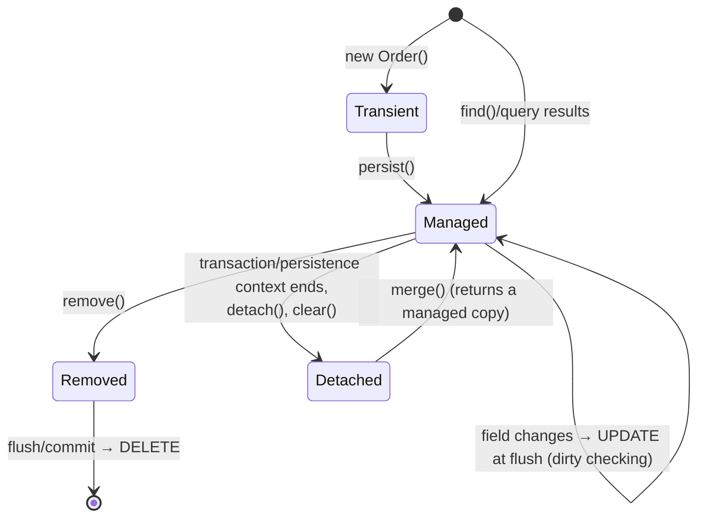
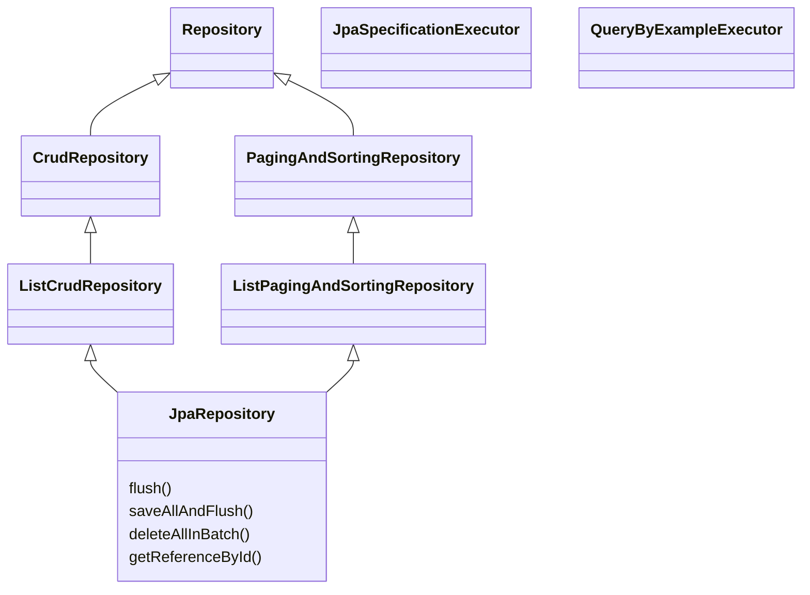
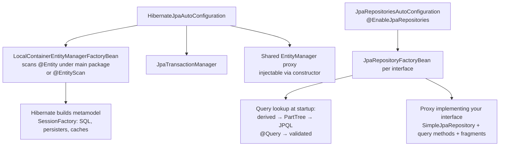
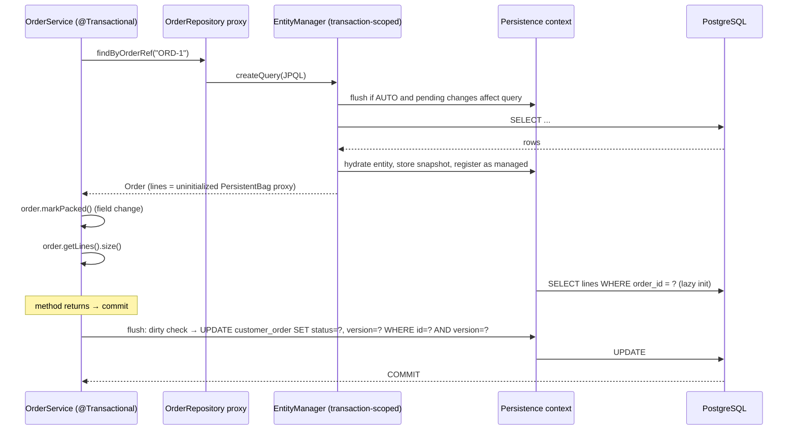

# 13 · Spring Data JPA & Hibernate

## 1. Introduction & Why It Matters

JPA with Hibernate is the most widely used — and most widely misused — part of the Spring ecosystem. It lets you work with an **object model** (`Order` with `OrderLine`s and a `DeliveryAddress`) while Hibernate generates SQL, tracks changes, manages identity and caches entities. Spring Data JPA adds **repositories** so a `findByCustomerIdAndStatus` method needs no implementation.

The productivity is real. So are the failure modes, and every one of them has shown up in production grocery systems:

- **N+1 queries**: the "My Orders" screen loads 20 orders, then 20 queries for lines, then 200 queries for products — 221 queries and 1.8 seconds.
- **`LazyInitializationException`** in a controller — "fixed" by turning on Open Session in View, which then holds database connections during JSON serialization and remote calls.
- **Lost updates**: two warehouse staff update the same stock record; the last save silently wins.
- **Accidental mass updates**: dirty checking flushes a changed entity nobody meant to save.
- **Pagination in memory**: `JOIN FETCH` + `Pageable` loads 400,000 rows to return 20.
- **Slow inserts**: `IDENTITY` ids disable JDBC batching, so importing 50,000 products issues 50,000 round trips.

This chapter explains how JPA really works — persistence context, entity states, flushing, proxies — and builds the **order-service persistence layer** properly: mapping, ids, embeddables, relationships, repositories and queries, projections, specifications, keyset scrolling, auditing, soft delete, N+1 prevention with tests that count statements, optimistic and pessimistic locking, caching, and the Hibernate 6.6 → 7 changes in Boot 4.

### Who should read which section

| Band | Focus |
|---|---|
| B1 · 0–2 yrs | Parts 1, 2, 4 — entities, repositories, derived queries |
| B2 · 2–5 yrs | Parts 2, 5 — relationships, fetch strategies, projections, pagination, auditing |
| B3 · 5–8 yrs | Parts 3, 5, 6 — persistence context, flush, proxies, N+1, locking, batching |
| B4 · 8–12 yrs | Parts 6, 7, 8 — aggregate design, performance, Hibernate 7 migration |
| B5 · 12–15+ yrs | Parts 8, 9 — when (not) to use JPA, data architecture |

---

## 2. Core Concepts

### 2.1 The layers

| Layer | What it is |
|---|---|
| **Jakarta Persistence (JPA)** | Specification: annotations, `EntityManager`, JPQL, Criteria API |
| **Hibernate ORM** | Implementation (Boot's default provider) with many extensions |
| **Spring ORM** | `LocalContainerEntityManagerFactoryBean`, `JpaTransactionManager`, exception translation, shared `EntityManager` proxy |
| **Spring Data JPA** | Repository interfaces, derived queries, `@Query`, specifications, paging, auditing |
| **Spring Boot** | Auto-configures all of the above from `spring.jpa.*` and `spring.datasource.*` |

### 2.2 Entity and its states

An **entity** is a class annotated `@Entity` with an `@Id`, mapped to a table. Requirements: non-final class, non-final persistent methods (for proxies), a no-arg constructor (protected is fine). **Records can't be entities** (final, immutable) — but can be embeddables and projections.



### 2.3 Persistence context

The **persistence context** (Hibernate `Session`) is a first-level cache and unit of work bound to a transaction:

- **Identity guarantee**: within one context, `find(Order, 42)` returns the same Java object every time.
- **Dirty checking**: at flush, Hibernate compares managed entities with their loaded snapshot and issues `UPDATE`s — **no `save()` call needed** for managed entities.
- **Write-behind**: SQL is queued and sent at **flush** — before commit, before queries that might be affected (`FlushMode.AUTO`), or on explicit `flush()`.

### 2.4 Identifiers

| Strategy | SQL | Batching inserts | Notes |
|---|---|---|---|
| `IDENTITY` | Auto-increment / identity column | ❌ Hibernate must insert immediately to learn the id | Simple; slow bulk inserts |
| `SEQUENCE` (pooled optimizer) | `nextval` once per `allocationSize` ids | ✅ | **Recommended** for PostgreSQL |
| `UUID` | Generated in Java | ✅ | Random UUIDv4 fragments B-tree indexes; prefer time-ordered UUIDs |
| Assigned (natural key) | App sets id | ✅ | Spring Data needs help to know "new vs existing" (`Persistable`, `@Version`) |

Keep **surrogate ids** internal and expose a separate **business reference** (`order_ref = "ORD-7F3A91C2"`) in APIs — no enumeration attacks, no leaking volumes.

### 2.5 Value types: embeddables and converters

- **`@Embeddable`** — a value object stored in the owner's table (`DeliveryAddress` → `address_line1`, `address_pincode`...). Records are supported as embeddables in recent Hibernate/JPA versions.
- **`AttributeConverter<X, Y>`** — map a single attribute type to a column (`Money` ↔ `numeric`, `Pincode` ↔ `varchar`).
- **Enums** — always `@Enumerated(EnumType.STRING)`; `ORDINAL` breaks when someone reorders constants.

### 2.6 Relationships

| Mapping | Default fetch | Guidance |
|---|---|---|
| `@ManyToOne` | **EAGER** | Always set `fetch = LAZY` |
| `@OneToOne` | **EAGER** | Set `LAZY`; prefer `@MapsId` shared primary key |
| `@OneToMany` | LAZY | Use for aggregate children only; `mappedBy` + `@ManyToOne` on child |
| `@ManyToMany` | LAZY | Avoid; model the join as an entity (`ProductTag`) when it has attributes |
| `@ElementCollection` | LAZY | Small collections of values (tags) |

**Owning side** = the side with the foreign key (`@ManyToOne` / `@JoinColumn`). Only the owning side's changes are persisted; keep both sides in sync with helper methods (`order.addLine(line)`).

**Cascade and orphan removal**: within an aggregate (`Order` → `OrderLine`), `cascade = ALL, orphanRemoval = true`. Never cascade across aggregates (order → customer, line → product).

### 2.7 Fetching strategies and N+1

**N+1**: 1 query for the parents + N queries for each parent's lazy association. Fixes:

| Fix | How | Trade-off |
|---|---|---|
| `JOIN FETCH` in JPQL | `select o from Order o join fetch o.lines where ...` | Row duplication; can't safely paginate collection fetches |
| `@EntityGraph` | On repository method | Same as join fetch, declarative |
| Batch fetching | `hibernate.default_batch_fetch_size=50` / `@BatchSize` | N+1 → 1 + N/50 queries; works with pagination |
| DTO projection | Select exactly the columns needed | No entities, no lazy loading at all |
| Two-step | Page ids first, then fetch entities with graph `where id in :ids` | Correct pagination with collections |

### 2.8 Spring Data repositories



Query options, from simplest to most flexible:

1. **Derived queries** — `findByCustomerIdAndStatusOrderByPlacedAtDesc(...)`.
2. **`@Query` JPQL** — explicit, validated at startup.
3. **`@Query(nativeQuery = true)`** — database-specific SQL.
4. **Specifications / Criteria / Querydsl** — dynamic filters.
5. **Custom repository fragment** — any code (`JdbcClient`, `EntityManager`).

### 2.9 Projections

| Kind | Example | Notes |
|---|---|---|
| Interface-based (closed) | `interface OrderSummary { String getOrderRef(); BigDecimal getTotal(); }` | Only selected columns queried |
| Class/record-based (DTO) | `record OrderSummary(String orderRef, BigDecimal total)` | Constructor expression; explicit |
| Dynamic | `<T> List<T> findByCustomerId(String id, Class<T> type)` | Caller chooses projection |
| Open interface (`@Value("#{...}")`) | SpEL | Loads full entity — avoid |

### 2.10 Pagination and scrolling

| API | Returns | Cost |
|---|---|---|
| `Page<T>` | Content + total count | Two queries (data + `count`) |
| `Slice<T>` | Content + `hasNext` | One query (fetches size+1) |
| `Window<T>` + `ScrollPosition` (keyset) | Content + position to continue | Index-friendly; no offset scanning |
| `Limit` parameter | Top-N | — |

Deep offsets (`OFFSET 100000`) scan and discard rows — use **keyset scrolling** for infinite lists like order history.

### 2.11 Locking

| Type | Mechanism | Use |
|---|---|---|
| **Optimistic** | `@Version` column; `UPDATE ... WHERE version = ?` | Default for user edits; conflicts are rare |
| **Pessimistic** | `@Lock(PESSIMISTIC_WRITE)` → `SELECT ... FOR UPDATE` | Hot rows with guaranteed contention (slot capacity) |
| `SKIP LOCKED` | Native query | Work queues (pick next unassigned delivery) |

### 2.12 Auditing and soft delete

- **Spring Data auditing**: `@CreatedDate`, `@LastModifiedDate`, `@CreatedBy`, `@LastModifiedBy` with `@EnableJpaAuditing` and `AuditorAware`.
- **Hibernate Envers**: full revision history tables.
- **Soft delete**: Hibernate `@SoftDelete` (6.4+) or `@SQLDelete` + `@SQLRestriction`.

### 2.13 Open Session in View (OSIV)

Boot enables `spring.jpa.open-in-view=true` by default (and logs a warning). It keeps the persistence context — and a **database connection** — open for the entire web request, including view rendering and JSON serialization, so lazy loading "works" in controllers. **Disable it** in API services: it hides N+1 queries and holds connections during slow work.

---

## 3. How It Works Internally

### 3.1 Bootstrapping



Derived and `@Query` JPQL queries are **parsed and validated at startup** — a typo fails the boot, not the first request.

### 3.2 A request through a repository



Key classes: `SessionImpl`, `StatefulPersistenceContext`, `DefaultFlushEventListener`, `ActionQueue` (ordered inserts/updates/deletes), `EntityPersister`, `PersistentBag`/`PersistentSet` (lazy collections), ByteBuddy proxies for lazy `@ManyToOne`.

### 3.3 `save()` — persist or merge?

`SimpleJpaRepository.save(entity)` calls `entityInformation.isNew(entity)`:

- **New** (id null, or `@Version` null, or `Persistable.isNew()` true) → `em.persist(entity)` and returns the same instance.
- **Otherwise** → `em.merge(entity)` → **SELECT** to load the current state, copy fields, return a *different* managed instance.

Consequences: assigned-id entities without `@Version` always `merge` (extra SELECT, and `save()` returns a different object — use the returned one). For managed entities inside a transaction, calling `save()` is unnecessary.

### 3.4 Flush ordering and batching

At flush, `ActionQueue` executes: inserts → updates → collection removals → collection updates → deletes. With `hibernate.jdbc.batch_size` and `order_inserts/order_updates`, statements of the same type are grouped into JDBC batches. `IDENTITY` ids force immediate inserts, defeating this.

### 3.5 Lazy proxies and `equals`/`hashCode`

A lazy `@ManyToOne` returns a generated subclass proxy. Implications:

- `getClass()` on a proxy isn't the entity class → use `Hibernate.getClass(obj)` or `instanceof` in `equals`.
- Accessing any non-id property initializes it (a query) — **outside a session → `LazyInitializationException`**.
- Entity `equals`/`hashCode`: base on the id **with care** (id is null before persist). A common robust pattern: `equals` by id when non-null; `hashCode` = constant per class.

---

## 4. Hands-On Code — Level 1 (Beginner)

### 4.1 Dependencies and settings

```kotlin title="services/order-service/build.gradle.kts"
dependencies {
    implementation(libs.spring.boot.starter.data.jpa)
    runtimeOnly("org.postgresql:postgresql")
    implementation("org.flywaydb:flyway-core")
    implementation("org.flywaydb:flyway-database-postgresql")
}
```

```yaml title="application.yml"
spring:
  jpa:
    open-in-view: false                          # (1)!
    hibernate:
      ddl-auto: validate                         # (2)!
    properties:
      hibernate:
        jdbc:
          batch_size: 50
        order_inserts: true
        order_updates: true
        default_batch_fetch_size: 50
        query:
          fail_on_pagination_over_collection_fetch: true   # (3)!
```

1. Disable OSIV (see 2.13).
2. Flyway owns the schema (Chapter 14); Hibernate only **validates** that mappings match. Never `update` in production.
3. Turn Hibernate's "pagination in memory" warning into an error.

### 4.2 A first entity and repository

```java title="in/grocery/catalog/domain/Category.java"
package in.grocery.catalog.domain;

import jakarta.persistence.Column;
import jakarta.persistence.Entity;
import jakarta.persistence.GeneratedValue;
import jakarta.persistence.GenerationType;
import jakarta.persistence.Id;
import jakarta.persistence.SequenceGenerator;
import jakarta.persistence.Table;

@Entity
@Table(name = "category")
public class Category {

    @Id
    @GeneratedValue(strategy = GenerationType.SEQUENCE, generator = "category_seq")
    @SequenceGenerator(name = "category_seq", sequenceName = "category_seq", allocationSize = 50)   // (1)!
    private Long id;

    @Column(nullable = false, unique = true, length = 40)
    private String slug;

    @Column(nullable = false, length = 80)
    private String name;

    private boolean active = true;

    protected Category() {}                                                                         // (2)!

    public Category(String slug, String name) {
        this.slug = slug;
        this.name = name;
    }

    public Long getId() { return id; }
    public String getSlug() { return slug; }
    public String getName() { return name; }
    public boolean isActive() { return active; }

    public void rename(String newName) { this.name = newName; }                                     // (3)!
    public void deactivate() { this.active = false; }
}
```

1. The DB sequence must use `INCREMENT BY 50` to match `allocationSize`.
2. JPA needs a no-arg constructor; `protected` keeps it out of application code.
3. Intention-revealing methods instead of public setters.

```sql title="V10__category.sql"
create sequence category_seq increment by 50;
create table category (
    id     bigint primary key,
    slug   varchar(40) not null unique,
    name   varchar(80) not null,
    active boolean not null
);
```

```java title="in/grocery/catalog/repository/CategoryRepository.java"
package in.grocery.catalog.repository;

import in.grocery.catalog.domain.Category;
import java.util.List;
import java.util.Optional;
import org.springframework.data.jpa.repository.JpaRepository;

public interface CategoryRepository extends JpaRepository<Category, Long> {

    Optional<Category> findBySlug(String slug);                                   // (1)!

    List<Category> findByActiveTrueOrderByNameAsc();

    boolean existsBySlug(String slug);
}
```

1. Derived query: Spring Data parses the method name into JPQL at startup.

### 4.3 Using it in a service — dirty checking

```java title="in/grocery/catalog/service/CategoryService.java"
package in.grocery.catalog.service;

import in.grocery.catalog.domain.Category;
import in.grocery.catalog.repository.CategoryRepository;
import org.springframework.stereotype.Service;
import org.springframework.transaction.annotation.Transactional;

@Service
public class CategoryService {

    private final CategoryRepository categories;

    public CategoryService(CategoryRepository categories) {
        this.categories = categories;
    }

    @Transactional
    public Long create(String slug, String name) {
        if (categories.existsBySlug(slug)) throw new IllegalArgumentException("Duplicate slug " + slug);
        return categories.save(new Category(slug, name)).getId();                    // persist
    }

    @Transactional
    public void rename(String slug, String newName) {
        Category c = categories.findBySlug(slug).orElseThrow();
        c.rename(newName);                                                           // (1)!
    }
}
```

1. No `save()` — the entity is managed, and dirty checking issues the `UPDATE` at commit.

### 4.4 `@DataJpaTest`

```java title="in/grocery/catalog/repository/CategoryRepositoryTest.java"
package in.grocery.catalog.repository;

import static org.assertj.core.api.Assertions.assertThat;

import in.grocery.catalog.domain.Category;
import org.junit.jupiter.api.Test;
import org.springframework.beans.factory.annotation.Autowired;
import org.springframework.boot.test.autoconfigure.jdbc.AutoConfigureTestDatabase;
import org.springframework.boot.test.autoconfigure.orm.jpa.DataJpaTest;
import org.springframework.boot.test.autoconfigure.orm.jpa.TestEntityManager;
import org.springframework.boot.testcontainers.service.connection.ServiceConnection;
import org.testcontainers.containers.PostgreSQLContainer;
import org.testcontainers.junit.jupiter.Container;
import org.testcontainers.junit.jupiter.Testcontainers;

@DataJpaTest                                                                     // (1)!
@AutoConfigureTestDatabase(replace = AutoConfigureTestDatabase.Replace.NONE)
@Testcontainers
class CategoryRepositoryTest {

    @Container @ServiceConnection
    static PostgreSQLContainer<?> pg = new PostgreSQLContainer<>("postgres:17-alpine");

    @Autowired CategoryRepository categories;
    @Autowired TestEntityManager em;

    @Test
    void findsBySlug() {
        em.persistAndFlush(new Category("dairy", "Dairy & Eggs"));
        em.clear();                                                               // (2)!
        assertThat(categories.findBySlug("dairy")).get().extracting(Category::getName).isEqualTo("Dairy & Eggs");
    }
}
```

1. JPA slice: entities, repositories, `TestEntityManager`, Flyway; transactional and rolled back per test.
2. Clear the persistence context so the next read really hits the database — otherwise you test the first-level cache.

!!! warning "Verify — Boot 4 test packages"
    `@DataJpaTest` and `TestEntityManager` move to the JPA test module in Boot 4 (e.g. `spring-boot-starter-data-jpa-test`, new packages). Update imports accordingly.

---

## 5. Hands-On Code — Level 2 (Intermediate) & Level 3 (Advanced)

### 5.1 Level 2 — The Order aggregate

```sql title="V11__orders_jpa.sql"
create sequence customer_order_seq increment by 50;
create sequence order_line_seq increment by 50;

create table customer_order (
    id                bigint primary key,
    order_ref         varchar(20) not null unique,
    customer_id       varchar(20) not null,
    status            varchar(20) not null,
    subtotal          numeric(12,2) not null,
    delivery_fee      numeric(8,2)  not null,
    addr_name         varchar(80)  not null,
    addr_line1        varchar(200) not null,
    addr_line2        varchar(200),
    addr_city         varchar(60)  not null,
    addr_pincode      varchar(6)   not null,
    placed_at         timestamptz  not null,
    version           bigint       not null,
    created_at        timestamptz  not null,
    updated_at        timestamptz  not null,
    deleted           boolean      not null default false
);
create index customer_order_customer_idx on customer_order (customer_id, placed_at desc, id desc);

create table order_line (
    id          bigint primary key,
    order_id    bigint not null references customer_order(id),
    sku         varchar(40) not null,
    name        varchar(150) not null,
    quantity    int not null check (quantity > 0),
    unit_price  numeric(10,2) not null
);
create index order_line_order_idx on order_line (order_id);
```

```java title="in/grocery/common/money/MoneyConverter.java"
package in.grocery.common.money;

import jakarta.persistence.AttributeConverter;
import jakarta.persistence.Converter;
import java.math.BigDecimal;

@Converter(autoApply = true)                                                        // (1)!
public class MoneyConverter implements AttributeConverter<Money, BigDecimal> {

    @Override
    public BigDecimal convertToDatabaseColumn(Money money) {
        return money == null ? null : money.amount();
    }

    @Override
    public Money convertToEntityAttribute(BigDecimal value) {
        return value == null ? null : new Money(value);
    }
}
```

1. Every `Money` attribute in every entity uses it automatically (the converter's package must be scanned, e.g. via `@EntityScan`).

```java title="in/grocery/order/domain/DeliveryAddress.java"
package in.grocery.order.domain;

import jakarta.persistence.Column;
import jakarta.persistence.Embeddable;

@Embeddable
public record DeliveryAddress(                                                        // (1)!
        @Column(name = "addr_name") String name,
        @Column(name = "addr_line1") String line1,
        @Column(name = "addr_line2") String line2,
        @Column(name = "addr_city") String city,
        @Column(name = "addr_pincode") String pincode) {}
```

1. Record as embeddable — immutable value object stored in the order's table. Supported in Hibernate 6.2+ and standardized in Jakarta Persistence 3.2.

```java title="in/grocery/order/domain/OrderStatus.java"
package in.grocery.order.domain;

public enum OrderStatus { PLACED, PAID, PACKED, OUT_FOR_DELIVERY, DELIVERED, CANCELLED }
```

```java title="in/grocery/order/domain/Order.java"
package in.grocery.order.domain;

import in.grocery.common.money.Money;
import jakarta.persistence.CascadeType;
import jakarta.persistence.Column;
import jakarta.persistence.Embedded;
import jakarta.persistence.Entity;
import jakarta.persistence.EntityListeners;
import jakarta.persistence.EnumType;
import jakarta.persistence.Enumerated;
import jakarta.persistence.GeneratedValue;
import jakarta.persistence.GenerationType;
import jakarta.persistence.Id;
import jakarta.persistence.OneToMany;
import jakarta.persistence.OrderBy;
import jakarta.persistence.SequenceGenerator;
import jakarta.persistence.Table;
import jakarta.persistence.Version;
import java.time.Instant;
import java.util.ArrayList;
import java.util.Collections;
import java.util.List;
import java.util.Objects;
import org.hibernate.annotations.SoftDelete;
import org.hibernate.annotations.SoftDeleteType;
import org.springframework.data.annotation.CreatedDate;
import org.springframework.data.annotation.LastModifiedDate;
import org.springframework.data.jpa.domain.support.AuditingEntityListener;

@Entity
@Table(name = "customer_order")
@EntityListeners(AuditingEntityListener.class)
@SoftDelete(columnName = "deleted", strategy = SoftDeleteType.DELETED)                         // (1)!
public class Order {

    @Id
    @GeneratedValue(strategy = GenerationType.SEQUENCE, generator = "order_seq")
    @SequenceGenerator(name = "order_seq", sequenceName = "customer_order_seq", allocationSize = 50)
    private Long id;

    @Column(name = "order_ref", nullable = false, unique = true, updatable = false)
    private String orderRef;

    @Column(name = "customer_id", nullable = false, updatable = false)
    private String customerId;

    @Enumerated(EnumType.STRING)
    @Column(nullable = false, length = 20)
    private OrderStatus status;

    private Money subtotal;
    @Column(name = "delivery_fee")
    private Money deliveryFee;

    @Embedded
    private DeliveryAddress address;

    @OneToMany(mappedBy = "order", cascade = CascadeType.ALL, orphanRemoval = true)          // (2)!
    @OrderBy("id")
    private List<OrderLine> lines = new ArrayList<>();

    @Column(name = "placed_at", nullable = false)
    private Instant placedAt;

    @Version
    private Long version;                                                                      // (3)!

    @CreatedDate @Column(name = "created_at", updatable = false)
    private Instant createdAt;
    @LastModifiedDate @Column(name = "updated_at")
    private Instant updatedAt;

    protected Order() {}

    public static Order place(String orderRef, String customerId, DeliveryAddress address,
                              Money deliveryFee, Instant now) {
        Order o = new Order();
        o.orderRef = orderRef;
        o.customerId = customerId;
        o.address = address;
        o.deliveryFee = deliveryFee;
        o.status = OrderStatus.PLACED;
        o.subtotal = Money.ZERO;
        o.placedAt = now;
        return o;
    }

    public void addLine(String sku, String name, int quantity, Money unitPrice) {             // (4)!
        if (status != OrderStatus.PLACED) throw new IllegalStateException("Order " + orderRef + " is " + status);
        OrderLine line = new OrderLine(this, sku, name, quantity, unitPrice);
        lines.add(line);
        subtotal = subtotal.plus(line.lineTotal());
    }

    public void markPaid() { transition(OrderStatus.PLACED, OrderStatus.PAID); }
    public void markPacked() { transition(OrderStatus.PAID, OrderStatus.PACKED); }

    public void cancel() {
        if (status == OrderStatus.OUT_FOR_DELIVERY || status == OrderStatus.DELIVERED) {
            throw new IllegalStateException("Order " + orderRef + " can no longer be cancelled");
        }
        status = OrderStatus.CANCELLED;
    }

    private void transition(OrderStatus from, OrderStatus to) {
        if (status != from) throw new IllegalStateException("Order " + orderRef + " is " + status + ", expected " + from);
        status = to;
    }

    public Money total() { return subtotal.plus(deliveryFee); }

    public Long getId() { return id; }
    public String getOrderRef() { return orderRef; }
    public String getCustomerId() { return customerId; }
    public OrderStatus getStatus() { return status; }
    public DeliveryAddress getAddress() { return address; }
    public List<OrderLine> getLines() { return Collections.unmodifiableList(lines); }         // (5)!
    public Instant getPlacedAt() { return placedAt; }
    public Long getVersion() { return version; }

    @Override
    public boolean equals(Object o) {                                                          // (6)!
        if (this == o) return true;
        if (!(o instanceof Order other)) return false;
        return id != null && Objects.equals(id, other.getId());
    }

    @Override
    public int hashCode() {
        return Order.class.hashCode();
    }
}
```

1. Hibernate 6.4+ soft delete: `delete` becomes `UPDATE ... SET deleted = true`, and all queries filter deleted rows automatically.
2. Lines belong to the aggregate: persisted, updated and deleted with the order.
3. Optimistic locking; also makes Spring Data's `isNew()` reliable.
4. Invariants enforced in the aggregate: lines only while `PLACED`, subtotal always consistent.
5. No external mutation of the collection.
6. Proxy-safe equality (`instanceof`, getter), stable `hashCode` across persist.

```java title="in/grocery/order/domain/OrderLine.java"
package in.grocery.order.domain;

import in.grocery.common.money.Money;
import jakarta.persistence.Column;
import jakarta.persistence.Entity;
import jakarta.persistence.FetchType;
import jakarta.persistence.GeneratedValue;
import jakarta.persistence.GenerationType;
import jakarta.persistence.Id;
import jakarta.persistence.JoinColumn;
import jakarta.persistence.ManyToOne;
import jakarta.persistence.SequenceGenerator;
import jakarta.persistence.Table;

@Entity
@Table(name = "order_line")
public class OrderLine {

    @Id
    @GeneratedValue(strategy = GenerationType.SEQUENCE, generator = "order_line_seq")
    @SequenceGenerator(name = "order_line_seq", sequenceName = "order_line_seq", allocationSize = 50)
    private Long id;

    @ManyToOne(fetch = FetchType.LAZY, optional = false)                                      // (1)!
    @JoinColumn(name = "order_id")
    private Order order;

    @Column(nullable = false) private String sku;
    @Column(nullable = false) private String name;
    private int quantity;
    @Column(name = "unit_price") private Money unitPrice;

    protected OrderLine() {}

    OrderLine(Order order, String sku, String name, int quantity, Money unitPrice) {
        if (quantity <= 0) throw new IllegalArgumentException("quantity must be positive");
        this.order = order;
        this.sku = sku;
        this.name = name;
        this.quantity = quantity;
        this.unitPrice = unitPrice;
    }

    public Money lineTotal() { return unitPrice.times(quantity); }
    public String getSku() { return sku; }
    public String getName() { return name; }
    public int getQuantity() { return quantity; }
    public Money getUnitPrice() { return unitPrice; }
}
```

1. **Always `LAZY`** on `@ManyToOne` — the JPA default is `EAGER`.

!!! note "Snapshot, not reference"
    Lines store `sku`, `name` and `unitPrice` as they were at order time — not a `@ManyToOne Product`. Product data changes; invoices must not. It also keeps the aggregate boundary clean (catalog is another service).

### 5.2 Level 2 — Repository with JPQL, projections and entity graphs

```java title="in/grocery/order/repository/OrderRepository.java"
package in.grocery.order.repository;

import in.grocery.common.money.Money;
import in.grocery.order.domain.Order;
import in.grocery.order.domain.OrderStatus;
import java.time.Instant;
import java.util.Collection;
import java.util.List;
import java.util.Optional;
import org.springframework.data.domain.Limit;
import org.springframework.data.domain.ScrollPosition;
import org.springframework.data.domain.Window;
import org.springframework.data.jpa.repository.EntityGraph;
import org.springframework.data.jpa.repository.JpaRepository;
import org.springframework.data.jpa.repository.JpaSpecificationExecutor;
import org.springframework.data.jpa.repository.Modifying;
import org.springframework.data.jpa.repository.Query;
import org.springframework.data.repository.query.Param;

public interface OrderRepository extends JpaRepository<Order, Long>, JpaSpecificationExecutor<Order> {

    record OrderSummary(String orderRef, OrderStatus status, Money subtotal, Instant placedAt, long itemCount) {}

    @EntityGraph(attributePaths = "lines")                                                     // (1)!
    Optional<Order> findByOrderRef(String orderRef);

    @Query("""
           select new in.grocery.order.repository.OrderRepository$OrderSummary(
                  o.orderRef, o.status, o.subtotal, o.placedAt, count(l))
           from Order o left join o.lines l
           where o.customerId = :customerId
           group by o.id, o.orderRef, o.status, o.subtotal, o.placedAt
           order by o.placedAt desc
           """)                                                                               // (2)!
    List<OrderSummary> summariesFor(@Param("customerId") String customerId, Limit limit);

    Window<Order> findByCustomerIdOrderByPlacedAtDescIdDesc(String customerId, ScrollPosition position, Limit limit);  // (3)!

    List<Order> findByStatusAndPlacedAtBefore(OrderStatus status, Instant cutoff);

    @Modifying(clearAutomatically = true, flushAutomatically = true)                            // (4)!
    @Query("update Order o set o.status = in.grocery.order.domain.OrderStatus.CANCELLED " +
           "where o.status = in.grocery.order.domain.OrderStatus.PLACED and o.placedAt < :cutoff")
    int cancelUnpaidBefore(@Param("cutoff") Instant cutoff);

    @EntityGraph(attributePaths = "lines")
    List<Order> findByIdIn(Collection<Long> ids);
}
```

1. Loads lines in the same query (left join) — no lazy loading afterwards.
2. DTO projection: exactly the needed columns and a count, no entities, no persistence-context overhead. `o.subtotal` is a converted attribute, so the record component is `Money` — the converter applies to projections too.
3. **Keyset scrolling**: `WHERE (placed_at, id) < (?, ?)` using the composite index — constant cost at any depth.
4. Bulk JPQL update bypasses the persistence context: flush pending changes first and clear afterwards so stale managed entities aren't used. Bulk updates **don't** increment `@Version` or run entity listeners unless you do it in the query.

!!! warning "Hibernate 6+ and nested record in JPQL constructor expressions"
    The `$` form for nested classes in `select new` works in Hibernate 6; alternatively place projection records in their own top-level file to avoid it. Spring Data JPA can also infer DTO projections from the method return type for simple cases.

### 5.3 Level 2 — Keyset scrolling in the delegate

```java title="in/grocery/order/delegate/OrderHistoryDelegate.java"
package in.grocery.order.delegate;

import in.grocery.order.domain.Order;
import in.grocery.order.repository.OrderRepository;
import java.util.Base64;
import java.util.List;
import java.util.Map;
import org.springframework.data.domain.KeysetScrollPosition;
import org.springframework.data.domain.Limit;
import org.springframework.data.domain.ScrollPosition;
import org.springframework.data.domain.Window;
import org.springframework.stereotype.Component;
import org.springframework.transaction.annotation.Transactional;

@Component
public class OrderHistoryDelegate {

    public record OrderCard(String orderRef, String status, String total, String placedAt) {}
    public record HistoryPage(List<OrderCard> items, String nextCursor) {}

    private final OrderRepository orders;

    public OrderHistoryDelegate(OrderRepository orders) {
        this.orders = orders;
    }

    @Transactional(readOnly = true)
    public HistoryPage page(String customerId, String cursor, int size) {
        ScrollPosition position = cursor == null ? ScrollPosition.keyset() : decode(cursor);
        Window<Order> window = orders.findByCustomerIdOrderByPlacedAtDescIdDesc(
                customerId, position, Limit.of(Math.min(size, 50)));
        List<OrderCard> items = window.getContent().stream()
                .map(o -> new OrderCard(o.getOrderRef(), o.getStatus().name(), o.total().asString(), o.getPlacedAt().toString()))
                .toList();
        String next = window.hasNext() ? encode((KeysetScrollPosition) window.positionAt(window.size() - 1)) : null;
        return new HistoryPage(items, next);                                                  // (1)!
    }

    private static String encode(KeysetScrollPosition p) {
        Map<String, Object> keys = p.getKeys();
        String raw = keys.get("placedAt") + "|" + keys.get("id");
        return Base64.getUrlEncoder().withoutPadding().encodeToString(raw.getBytes());
    }

    private static ScrollPosition decode(String cursor) {
        String[] parts = new String(Base64.getUrlDecoder().decode(cursor)).split("\\|");
        return ScrollPosition.forward(Map.of("placedAt", java.time.Instant.parse(parts[0]), "id", Long.valueOf(parts[1])));
    }
}
```

1. Opaque cursor for the app's infinite scroll: `GET /api/orders?cursor=MjAyNi0wOS0yMl...`. Validate/sign cursors in production so clients can't craft arbitrary keys (low risk here: keys are only used as bound parameters).

### 5.4 Level 2 — Auditing

```java title="in/grocery/order/config/JpaAuditingConfig.java"
package in.grocery.order.config;

import java.time.Clock;
import java.util.Optional;
import org.springframework.context.annotation.Bean;
import org.springframework.context.annotation.Configuration;
import org.springframework.data.auditing.DateTimeProvider;
import org.springframework.data.jpa.repository.config.EnableJpaAuditing;

@Configuration(proxyBeanMethods = false)
@EnableJpaAuditing(dateTimeProviderRef = "auditingDateTimeProvider")
class JpaAuditingConfig {

    @Bean
    DateTimeProvider auditingDateTimeProvider(Clock clock) {                                   // (1)!
        return () -> Optional.of(clock.instant());
    }
}
```

1. Auditing timestamps come from the platform `Clock` — deterministic in tests. Add an `AuditorAware<String>` bean for `@CreatedBy` (from the security context in Chapter 17).

### 5.5 Level 3 — Diagnosing and fixing N+1 with a statement-count test

```java title="in/grocery/order/repository/OrderQueryCountTest.java"
package in.grocery.order.repository;

import static org.assertj.core.api.Assertions.assertThat;

import in.grocery.common.money.Money;
import in.grocery.order.domain.DeliveryAddress;
import in.grocery.order.domain.Order;
import jakarta.persistence.EntityManagerFactory;
import java.time.Instant;
import java.util.List;
import org.hibernate.SessionFactory;
import org.hibernate.stat.Statistics;
import org.junit.jupiter.api.BeforeEach;
import org.junit.jupiter.api.Test;
import org.springframework.beans.factory.annotation.Autowired;
import org.springframework.boot.test.autoconfigure.jdbc.AutoConfigureTestDatabase;
import org.springframework.boot.test.autoconfigure.orm.jpa.DataJpaTest;
import org.springframework.boot.test.autoconfigure.orm.jpa.TestEntityManager;
import org.springframework.boot.testcontainers.service.connection.ServiceConnection;
import org.springframework.data.domain.Limit;
import org.springframework.data.domain.PageRequest;
import org.springframework.test.context.TestPropertySource;
import org.testcontainers.containers.PostgreSQLContainer;
import org.testcontainers.junit.jupiter.Container;
import org.testcontainers.junit.jupiter.Testcontainers;

@DataJpaTest
@AutoConfigureTestDatabase(replace = AutoConfigureTestDatabase.Replace.NONE)
@Testcontainers
@TestPropertySource(properties = {
        "spring.jpa.properties.hibernate.generate_statistics=true",
        "spring.jpa.properties.hibernate.default_batch_fetch_size=0"                            // (1)!
})
class OrderQueryCountTest {

    @Container @ServiceConnection
    static PostgreSQLContainer<?> pg = new PostgreSQLContainer<>("postgres:17-alpine");

    @Autowired OrderRepository orders;
    @Autowired TestEntityManager em;
    @Autowired EntityManagerFactory emf;
    Statistics stats;

    @BeforeEach
    void seed() {
        var addr = new DeliveryAddress("Asha", "12 MG Road", null, "Bengaluru", "560001");
        for (int i = 0; i < 10; i++) {
            Order o = Order.place("ORD-" + i, "C-1", addr, Money.ZERO, Instant.parse("2026-09-01T00:00:00Z").plusSeconds(i));
            o.addLine("MILK-1L", "Toned Milk", 2, Money.parse("66"));
            o.addLine("ATTA-5KG", "Atta", 1, Money.parse("289"));
            em.persist(o);
        }
        em.flush();
        em.clear();
        stats = emf.unwrap(SessionFactory.class).getStatistics();
        stats.clear();
    }

    @Test
    void naiveLoopCausesNPlusOne() {
        List<Order> page = orders.findAll(PageRequest.of(0, 10)).getContent();
        long lines = page.stream().mapToLong(o -> o.getLines().size()).sum();                   // lazy init per order
        assertThat(lines).isEqualTo(20);
        assertThat(stats.getPrepareStatementCount()).isEqualTo(1 + 1 + 10);                    // (2)!
    }

    @Test
    void twoStepFetchIsConstant() {
        List<Long> ids = orders.findAll(PageRequest.of(0, 10)).map(Order::getId).getContent();   // page of ids (+ count)
        List<Order> withLines = orders.findByIdIn(ids);                                            // one join-fetch query
        assertThat(withLines).allSatisfy(o -> assertThat(o.getLines()).hasSize(2));
        assertThat(stats.getPrepareStatementCount()).isEqualTo(3);
    }

    @Test
    void dtoProjectionIsOneQuery() {
        assertThat(orders.summariesFor("C-1", Limit.of(10))).hasSize(10);
        assertThat(stats.getPrepareStatementCount()).isEqualTo(1);
    }
}
```

1. Batch fetching disabled here to make the N+1 visible; production keeps it at 50 as a safety net.
2. Page query + count query + one query per order's lines. A regression test like this catches N+1s before customers do.

!!! tip "Count queries in integration tests of every repository"
    Libraries such as `datasource-proxy` (and Boot integrations of it) can assert query counts per test without Hibernate statistics. Put a query-count assertion on every list endpoint's integration test.

### 5.6 Level 3 — Dynamic search with Specifications

Admin order search with optional filters (status, pincode, date range, min total):

```java title="in/grocery/order/repository/OrderSpecs.java"
package in.grocery.order.repository;

import in.grocery.common.money.Money;
import in.grocery.order.domain.Order;
import in.grocery.order.domain.OrderStatus;
import java.time.Instant;
import org.springframework.data.jpa.domain.Specification;

public final class OrderSpecs {

    private OrderSpecs() {}

    public static Specification<Order> hasStatus(OrderStatus status) {
        return (root, query, cb) -> status == null ? null : cb.equal(root.get("status"), status);    // (1)!
    }

    public static Specification<Order> inPincode(String pincode) {
        return (root, query, cb) -> pincode == null ? null : cb.equal(root.get("address").get("pincode"), pincode);
    }

    public static Specification<Order> placedBetween(Instant from, Instant to) {
        return (root, query, cb) -> {
            if (from == null && to == null) return null;
            if (from == null) return cb.lessThan(root.get("placedAt"), to);
            if (to == null) return cb.greaterThanOrEqualTo(root.get("placedAt"), from);
            return cb.and(cb.greaterThanOrEqualTo(root.get("placedAt"), from), cb.lessThan(root.get("placedAt"), to));
        };
    }

    public static Specification<Order> subtotalAtLeast(BigDecimal min) {
        return (root, query, cb) -> min == null ? null
                : cb.greaterThanOrEqualTo(root.get("subtotal").as(BigDecimal.class), min);
    }
}
```

1. Returning `null` means "no restriction" — composable optional filters.

```java title="Dynamic search with Specifications (snippet)"
Page<Order> result = orders.findAll(
        Specification.allOf(hasStatus(status), inPincode(pincode), placedBetween(from, to), subtotalAtLeast(min)),
        PageRequest.of(page, size, Sort.by(Sort.Direction.DESC, "placedAt")));
```

!!! tip "Type-safe attribute names"
    String attribute names (`"placedAt"`) break silently on rename. Generate the JPA static metamodel (`hibernate-jpamodelgen` annotation processor → `Order_.placedAt`) or use Querydsl. Spring Data JPA 4 also evolves the Specification API (e.g. `PredicateSpecification`) — verify for Boot 4.

### 5.7 Level 3 — Pessimistic locking for slot capacity

Delivery slots have fixed capacity; during a sale thousands of customers race for the 7–9 a.m. slot. Optimistic locking would produce a storm of retries; a short row lock is the right tool.

```java title="in/grocery/delivery/domain/DeliverySlot.java (excerpt)"
@Entity
@Table(name = "delivery_slot")
public class DeliverySlot {
    @Id private String slotId;
    private int capacity;
    private int booked;
    @Version private Long version;

    public boolean tryBook() {
        if (booked >= capacity) return false;
        booked++;
        return true;
    }
}
```

```java title="in/grocery/delivery/repository/SlotRepository.java"
public interface SlotRepository extends JpaRepository<DeliverySlot, String> {

    @Lock(LockModeType.PESSIMISTIC_WRITE)                                                       // (1)!
    @QueryHints(@QueryHint(name = "jakarta.persistence.lock.timeout", value = "2000"))          // (2)!
    @Query("select s from DeliverySlot s where s.slotId = :id")
    Optional<DeliverySlot> lockById(@Param("id") String id);
}
```

1. `SELECT ... FOR UPDATE` (Hibernate may render `FOR NO KEY UPDATE` on PostgreSQL) — concurrent bookers queue on the row.
2. Wait at most 2 s; then `PessimisticLockingFailureException`/`CannotAcquireLockException` → 503 "slot busy, retry". Keep the locked transaction **short**: lock, check, increment, commit — no remote calls.

```java title="SlotBookingService.java"
@Transactional
public boolean book(String slotId) {
    DeliverySlot slot = slots.lockById(slotId).orElseThrow(() -> new SlotNotFoundException(slotId));
    return slot.tryBook();                                                                        // dirty checking → UPDATE on commit
}
```

!!! note "Even simpler"
    For a pure counter, Chapter 12's atomic SQL (`update ... set booked = booked + 1 where booked < capacity`) needs no lock at all. Use pessimistic locking when the decision needs more logic than a single `WHERE` clause can express.

### 5.8 Level 3 — `SKIP LOCKED` work queue

Assigning packed orders to delivery partners from several pods:

```java title="SKIP LOCKED work queue (snippet)"
@Query(value = """
        select * from customer_order
        where status = 'PACKED' and assigned_partner is null
        order by placed_at
        limit :batch
        for update skip locked
        """, nativeQuery = true)
List<Order> claimNextBatch(@Param("batch") int batch);
```

Each pod locks different rows; no two pods assign the same order, and nobody waits.

---

## 6. Hands-On Code — Level 4 (Expert / Production)

### 6.1 The order placement service end to end

```java title="in/grocery/order/service/OrderPlacementService.java"
package in.grocery.order.service;

import in.grocery.common.money.Money;
import in.grocery.order.domain.DeliveryAddress;
import in.grocery.order.domain.Order;
import in.grocery.order.event.OrderPlaced;
import in.grocery.order.repository.OrderRepository;
import java.time.Clock;
import java.util.List;
import org.springframework.context.ApplicationEventPublisher;
import org.springframework.dao.DataIntegrityViolationException;
import org.springframework.orm.ObjectOptimisticLockingFailureException;
import org.springframework.stereotype.Service;
import org.springframework.transaction.annotation.Transactional;

@Service
public class OrderPlacementService {

    public record LineRequest(String sku, String name, int quantity, Money unitPrice) {}

    private final OrderRepository orders;
    private final ApplicationEventPublisher events;
    private final Clock clock;

    public OrderPlacementService(OrderRepository orders, ApplicationEventPublisher events, Clock clock) {
        this.orders = orders;
        this.events = events;
        this.clock = clock;
    }

    @Transactional
    public Order place(String orderRef, String customerId, DeliveryAddress address, Money fee, List<LineRequest> lines) {
        Order order = Order.place(orderRef, customerId, address, fee, clock.instant());
        lines.forEach(l -> order.addLine(l.sku(), l.name(), l.quantity(), l.unitPrice()));
        Order saved = orders.save(order);                                                     // persist: id from sequence pool
        events.publishEvent(new OrderPlaced(saved.getOrderRef(), customerId, saved.total().amount()));   // (1)!
        return saved;
    }

    @Transactional
    public void cancel(String orderRef, long expectedVersion) {
        Order order = orders.findByOrderRef(orderRef).orElseThrow(() -> new OrderNotFoundException(orderRef));
        if (!order.getVersion().equals(expectedVersion)) {
            throw new OrderVersionConflictException(orderRef, order.getVersion());           // (2)!
        }
        order.cancel();                                                                       // UPDATE ... WHERE version = ?
    }
}
```

1. Transactional event listeners (Chapter 03) react after commit — SMS, stock release, analytics.
2. API-level optimistic concurrency (ETag from Chapter 08) on top of JPA's `@Version`, which still protects the race between this check and commit (`ObjectOptimisticLockingFailureException` → 409/412 in the error handler).

### 6.2 Hibernate settings for production

```yaml title="application-prod.yml — order-service"
spring:
  jpa:
    open-in-view: false
    hibernate:
      ddl-auto: validate
    properties:
      hibernate:
        jdbc:
          batch_size: 50
          time_zone: UTC                                  # (1)!
        order_inserts: true
        order_updates: true
        default_batch_fetch_size: 50
        query:
          fail_on_pagination_over_collection_fetch: true
          in_clause_parameter_padding: true               # (2)!
          plan_cache_max_size: 2048
        connection:
          provider_disables_autocommit: true              # (3)!
        session:
          events:
            log:
              LOG_QUERIES_SLOWER_THAN_MS: 200              # (4)!
  datasource:
    hikari:
      auto-commit: false
```

1. Store `Instant`s consistently in UTC regardless of the JVM zone.
2. Pads `IN (?, ?, ?)` lists to powers of two → fewer distinct SQL strings → better plan-cache hit rate.
3. With Hikari `auto-commit: false`, Hibernate can skip toggling auto-commit on every transaction start — lets it delay acquiring the connection until the first statement.
4. Hibernate's slow-query log — a cheap early warning (property name valid for Hibernate 6.x; verify for 7).

### 6.3 Second-level cache for reference data

Categories and GST rate masters change rarely and are read constantly.

```java title="Category.java"
@Entity
@org.hibernate.annotations.Cache(usage = CacheConcurrencyStrategy.READ_WRITE, region = "category")
public class Category { ... }
```

```yaml title="application.yml"
spring:
  jpa:
    properties:
      hibernate:
        cache:
          use_second_level_cache: true
          region.factory_class: jcache
        javax.cache.provider: com.github.benmanes.caffeine.jcache.spi.CaffeineCachingProvider   # verify key name
```

!!! warning "Local L2 caches across pods"
    A Caffeine-backed L2 cache is **per pod**: pod A updates a category; pod B keeps serving the old one until expiry. Use L2 only for data that tolerates staleness with a short TTL, or a distributed provider — or cache at the service layer with explicit invalidation (Chapter 21). For most services, **no L2 cache** is the safest default.

### 6.4 Custom repository fragment with `JdbcClient`

Heavy reporting queries don't belong in JPQL:

```java title="in/grocery/order/repository/OrderStatsRepository.java"
public interface OrderStatsRepository {
    record HourlyGmv(java.time.Instant hour, java.math.BigDecimal gmv, long orders) {}
    List<HourlyGmv> hourlyGmv(java.time.Instant from, java.time.Instant to);
}
```

```java title="in/grocery/order/repository/OrderStatsRepositoryImpl.java"
class OrderStatsRepositoryImpl implements OrderStatsRepository {                               // (1)!

    private final JdbcClient jdbc;

    OrderStatsRepositoryImpl(JdbcClient jdbc) { this.jdbc = jdbc; }

    @Override
    public List<HourlyGmv> hourlyGmv(Instant from, Instant to) {
        return jdbc.sql("""
                select date_trunc('hour', placed_at) as hour, sum(subtotal + delivery_fee) as gmv, count(*) as orders
                from customer_order
                where placed_at >= :from and placed_at < :to and status <> 'CANCELLED' and not deleted
                group by 1 order by 1
                """)
                .param("from", from).param("to", to)
                .query(HourlyGmv.class).list();
    }
}
```

```java title="OrderRepository.java"
public interface OrderRepository extends JpaRepository<Order, Long>, JpaSpecificationExecutor<Order>, OrderStatsRepository { ... }
```

1. The `Impl` suffix lets Spring Data combine it into the repository proxy. Both JPA and `JdbcClient` share the same transaction and connection when called within `@Transactional`.

!!! warning "Mixing JPA and JDBC in one transaction"
    `JdbcClient` doesn't see un-flushed JPA changes. If you modify entities and then query with JDBC in the same transaction, call `entityManager.flush()` first (JPQL/HQL queries auto-flush; native/JDBC may not).

### 6.5 Aggregate integration test with optimistic locking

```java title="OrderConcurrencyTest.java"
@SpringBootTest
@Testcontainers
class OrderConcurrencyTest {

    @Container @ServiceConnection
    static PostgreSQLContainer<?> pg = new PostgreSQLContainer<>("postgres:17-alpine");

    @Autowired OrderPlacementService placement;
    @Autowired OrderRepository orders;
    @Autowired TransactionTemplate tx;

    @Test
    void concurrentModificationIsDetected() {
        var addr = new DeliveryAddress("Asha", "12 MG Road", null, "Bengaluru", "560001");
        placement.place("ORD-C1", "C-1", addr, Money.ZERO,
                List.of(new OrderPlacementService.LineRequest("MILK-1L", "Toned Milk", 1, Money.parse("66"))));

        Order staleCopy = tx.execute(s -> orders.findByOrderRef("ORD-C1").orElseThrow());           // detached, version 0
        tx.executeWithoutResult(s -> orders.findByOrderRef("ORD-C1").orElseThrow().markPaid());    // version → 1

        assertThatThrownBy(() -> tx.executeWithoutResult(s -> {
            Order merged = orders.save(staleCopy);                                                  // merge with version 0
            merged.cancel();
        })).isInstanceOf(ObjectOptimisticLockingFailureException.class);
    }
}
```

---

## 7. Spring Boot 3 vs 4 & Migration

| Topic | Boot 3.5 | Boot 4.x |
|---|---|---|
| Jakarta Persistence | 3.1 | 3.2 |
| Hibernate ORM | 6.6 | 7.x (7.1 at Boot 4.0 — verify) |
| Spring Data JPA | 3.5 | 4.0 |
| Removed Hibernate APIs | Deprecated `Session.save/update/saveOrUpdate`, legacy `@Where`, `Criteria` | Removed in 7 — use `persist`/`merge`, `@SQLRestriction` |
| Records as embeddables | Hibernate-supported | Standardized (JPA 3.2) |
| Soft delete | `@SoftDelete` (6.4+) | Same |
| Jakarta Data repositories | Hibernate 6.6 preview support | Hibernate 7 implements Jakarta Data 1.0 |
| Specification API | `Specification<T>` | Evolved (e.g. `PredicateSpecification`, `UpdateSpecification`) — verify |
| Test slice | `@DataJpaTest` in `boot.test.autoconfigure.orm.jpa` | JPA test module (verify) |
| Hibernate license | LGPL | Apache 2.0 (Hibernate 7) |

=== "Spring Boot 3.5 / Hibernate 6.6"

    ```java title="Coupon.java"
    @Entity
    @SQLRestriction("active = true")      // replaces the deprecated @Where
    public class Coupon { ... }

    session.persist(entity);             // not session.save(entity) — deprecated
    ```

=== "Spring Boot 4.x / Hibernate 7"

    ```java title="Coupon.java"
    @Entity
    @SQLRestriction("active = true")
    public class Coupon { ... }

    session.persist(entity);             // save/update/saveOrUpdate removed
    ```

### Migration checklist

- [ ] On Boot 3.5, fix every Hibernate deprecation warning (`-Werror` from Chapter 01 helps).
- [ ] Replace `@Where`/`@WhereJoinTable` with `@SQLRestriction`; legacy `Criteria` with JPA Criteria/HQL.
- [ ] Re-run all repository integration tests and **query-count tests** — SQL generation can change between major versions.
- [ ] Check custom types (`UserType`), naming strategies, and dialect settings (Hibernate auto-detects dialect; remove explicit legacy dialect classes).
- [ ] Review `Specification` usages against Spring Data JPA 4 API changes.
- [ ] Verify `ddl-auto=validate` passes against production-like schema.
- [ ] Update test slice dependencies/imports.

---

## 8. Production Playbook

### Best practices

1. **Aggregates, not object graphs**: entities within an aggregate are mapped; across aggregates, store ids.
2. **`LAZY` everywhere**; load what you need per use case (graph, join fetch, projection, batch size).
3. **DTO projections for reads**, entities for writes.
4. **`SEQUENCE` ids with pooled allocation** + JDBC batching.
5. **`@Version` on every mutable aggregate root.**
6. **OSIV off; `ddl-auto=validate`; Flyway owns schema.**
7. **Keyset scrolling** for long lists; never paginate collection fetch joins.
8. **Query-count tests** for list/detail endpoints.
9. **Short transactions**; no remote calls inside; bulk updates with explicit flush/clear.
10. **Mix in `JdbcClient`** for reporting and bulk SQL.

### Anti-patterns

❌ **`FetchType.EAGER` "to avoid LazyInitializationException"** — loads huge graphs on every query, can't be turned off per query.

❌ **Bidirectional everything** — `Product.orderLines` loads every order line ever when touched.

❌ **Returning entities from controllers** — lazy loading during serialization (OSIV) or `LazyInitializationException`; API coupled to schema.

❌ **`CascadeType.ALL` on `@ManyToOne`** — deleting a line deletes the product.

❌ **Lombok `@Data` on entities** — `equals/hashCode/toString` over lazy associations → N+1, stack overflows.

❌ **`findAll()` then filter in Java.**

❌ **`save()` in a loop of 50,000 with `IDENTITY` ids** — 50,000 round trips.

❌ **`ddl-auto: update` in production** — no review, no rollback, drifts silently.

### Troubleshooting

| Symptom | Cause | Fix |
|---|---|---|
| `LazyInitializationException` | Accessing lazy association after transaction | Fetch within the use case (graph/projection) inside the transaction |
| Hundreds of queries per request | N+1 | Join fetch/graph/batch size/projection; query-count tests |
| `HHH90003004: firstResult/maxResults specified with collection fetch` | Paginating a fetch join | Two-step fetch; now an error via `fail_on_pagination_over_collection_fetch` |
| `ObjectOptimisticLockingFailureException` | Concurrent update | Map to 409/412; retry where safe |
| Slow bulk inserts | `IDENTITY` ids, no batching | Sequences, `batch_size`, `order_inserts`, chunk + `flush/clear` |
| Memory grows in batch job | Persistence context holds all entities | `flush()` + `clear()` every N items, or JDBC |
| Schema validation fails on startup | Mapping ≠ schema | Fix migration or mapping |
| Updates to fields not persisted | Entity detached; modified outside transaction | Load and modify within `@Transactional` |
| Unexpected `UPDATE`s | Dirty checking on mutable fields / converters returning new instances each time | Immutable value types with correct `equals`; read-only transactions |
| `MultipleBagFetchException` | Fetch-joining two `List` collections | Use `Set`, separate queries, or batch fetching |

### Production checklist

- [ ] OSIV disabled; `ddl-auto=validate`
- [ ] All `@ManyToOne`/`@OneToOne` lazy
- [ ] `@Version` on aggregate roots; conflicts mapped to 409/412
- [ ] Sequence ids with allocation size matching DB sequences
- [ ] JDBC batching enabled
- [ ] Query-count tests on list/detail paths
- [ ] Slow-query logging (Hibernate + database)
- [ ] No entities in API responses
- [ ] L2 cache used only deliberately

---

## 9. Interview Questions & Answers

### B1 · 0–2 years

??? question "B1 · JPA vs Hibernate vs Spring Data JPA?"
    **Short answer:** JPA is the specification; Hibernate implements it; Spring Data JPA adds repository abstractions on top.

??? question "B1 · What is a derived query?"
    **Short answer:** A repository method whose name (`findBySlug`, `countByStatus`) Spring Data parses into a query.

??? question "B1 · Why does JPA need a no-arg constructor?"
    **Short answer:** Hibernate instantiates entities (and proxies) reflectively before populating fields.

??? question "B1 · `@Enumerated(ORDINAL)` vs `STRING`?"
    **Short answer:** ORDINAL stores position — breaks when constants are reordered or inserted. Use STRING.

??? question "B1 · What does `@Transactional` give a repository call?"
    **Short answer:** A persistence context and database transaction spanning the method; changes to managed entities are flushed and committed at the end.

### B2 · 2–5 years

??? question "B2 · What is the N+1 problem and how do you fix it?"
    **Short answer:** One query for parents plus one per parent for a lazy association. Fix with join fetch/`@EntityGraph`, batch fetching, or DTO projections; verify with query-count tests.

??? question "B2 · `FetchType.LAZY` vs `EAGER` — defaults and recommendation?"
    **Short answer:** `@ManyToOne`/`@OneToOne` default EAGER; collections LAZY. Make everything LAZY and fetch per use case.

??? question "B2 · What is Open Session in View and why disable it?"
    **Short answer:** Keeps the persistence context (and a connection) open for the whole web request so lazy loading works in views/serialization. It hides N+1s and holds connections during slow work; disable it for APIs.

??? question "B2 · `Page` vs `Slice` vs `Window`?"
    **Short answer:** `Page` includes a total count (extra query); `Slice` only knows whether there's a next page; `Window` supports keyset scrolling with positions — efficient for deep lists.

??? question "B2 · Interface projections vs DTO projections?"
    **Short answer:** Both select only needed columns (closed projections). DTO/record projections are explicit and type-safe; open interface projections with SpEL load full entities.

??? question "B2 · How do you implement optimistic locking?"
    **Short answer:** `@Version` field; Hibernate adds `WHERE version = ?` and increments it; conflicts throw `OptimisticLockException` (Spring: `ObjectOptimisticLockingFailureException`).

### B3 · 5–8 years

??? question "B3 · Explain the persistence context and dirty checking."
    **Short answer:** A transaction-scoped identity map of managed entities with loaded-state snapshots. At flush, Hibernate compares current and snapshot state and issues UPDATEs for changes — no explicit save needed.

??? question "B3 · When does Hibernate flush?"
    **Short answer:** Before commit, before queries whose results might be affected (FlushMode.AUTO for JPQL/HQL), and on explicit `flush()`. Native/JDBC queries may not trigger it.

??? question "B3 · How does Spring Data's `save()` decide between persist and merge?"
    **Short answer:** `isNew()` — id null, version null, or `Persistable.isNew()`. New → persist; otherwise merge (SELECT + copy, returns a different instance).

??? question "B3 · Why do IDENTITY ids hurt batch inserts?"
    **Short answer:** Hibernate must execute each INSERT immediately to obtain the generated id, so it can't batch. Sequences with pooled optimizers allocate ids in memory.

??? question "B3 · Why can't you paginate a collection fetch join?"
    **Short answer:** Rows are duplicated per child; SQL LIMIT would cut parents' collections. Hibernate falls back to in-memory pagination. Use two-step fetch or batch fetching.

??? question "B3 · Pessimistic vs optimistic locking — when to use which?"
    **Short answer:** Optimistic for low-contention user edits (cheap, detects conflicts). Pessimistic for known hot rows where retries would storm (slot capacity), with lock timeouts and short transactions. `SKIP LOCKED` for queues.

### B4 · 8–12 years

??? question "B4 · How do you design aggregates with JPA?"
    **Short answer:** Aggregate root with `@Version`, children via `mappedBy` with cascade/orphanRemoval, value objects as embeddables/converters, invariants in methods, references to other aggregates by id, repositories only for roots, small aggregates for contention.

??? question "B4 · A list endpoint went from 50 ms to 2 s after a feature. How do you diagnose?"
    **Short answer:** Hibernate statistics/datasource-proxy query counts, slow query log, `EXPLAIN ANALYZE`, check new lazy associations touched in mapping code (N+1), missing indexes, eager fetches introduced; add a query-count regression test.

??? question "B4 · What changes in Hibernate 7 matter for a Boot 4 migration?"
    **Short answer:** Removal of long-deprecated APIs (`save/update/saveOrUpdate`, `@Where`, legacy Criteria), Jakarta Persistence 3.2, Jakarta Data support, possible SQL generation differences; fix deprecations on 6.6 first and rerun query-count and integration tests.

### B5 · 12–15+ years

??? question "B5 · When would you not use JPA?"
    **Short answer:** Read-heavy reporting, bulk/ETL workloads, heavy use of database-specific SQL, event-sourced models, simple aggregates better served by Spring Data JDBC, or teams without the expertise to manage ORM pitfalls. Mixed approaches are normal.

??? question "B5 · How do you prevent ORM performance regressions across 26 services?"
    **Short answer:** Platform defaults (OSIV off, batching, validate), query-count tests in CI, slow-query dashboards, code review checklists (EAGER, cascades, entities in APIs), architecture tests, and performance tests before sale events.

### Scenario questions

??? example "Scenario · 'My Orders' times out for customers with 800 orders"
    Endpoint used `Page` with `OFFSET` and fetch-joined lines; Hibernate paginated in memory and the count query scanned all rows. Fix: keyset scrolling with composite index `(customer_id, placed_at desc, id desc)`, DTO projection for list cards, lines loaded only on the detail view.

??? example "Scenario · Warehouse stock counts drift after concurrent updates"
    Two staff edit the same `Stock` entity; no `@Version`, last write wins. Fix: `@Version`, 409 with current state to the UI, atomic SQL for increments/decrements, and audit trail with Envers.

### Coding exercise

!!! example "Exercise · Seller product with tags and prices"
    Model `SellerProduct` (aggregate root, `@Version`) with `@ElementCollection` tags and `@OneToMany` `PriceHistory` entries (append-only). Write a repository method that loads products of a seller with tags **without N+1** for a page of 20, and a test asserting ≤ 3 statements.

??? success "Solution"
    ```java title="SellerProduct.java (excerpt)"
    @Entity
    @Table(name = "seller_product")
    public class SellerProduct {
        @Id @GeneratedValue(strategy = GenerationType.SEQUENCE, generator = "sp_seq")
        @SequenceGenerator(name = "sp_seq", sequenceName = "seller_product_seq", allocationSize = 50)
        private Long id;
        private String sellerId;
        private String sku;
        @Version private Long version;

        @ElementCollection
        @CollectionTable(name = "seller_product_tag", joinColumns = @JoinColumn(name = "product_id"))
        @Column(name = "tag")
        @BatchSize(size = 50)
        private Set<String> tags = new HashSet<>();

        @OneToMany(mappedBy = "product", cascade = CascadeType.ALL, orphanRemoval = true)
        @OrderBy("effectiveFrom desc")
        private List<PriceHistory> prices = new ArrayList<>();

        protected SellerProduct() {}
        // factory, addTag, changePrice(...) appends PriceHistory
        public Set<String> getTags() { return Collections.unmodifiableSet(tags); }
    }
    ```

    ```java title="SellerProductRepository.java"
    public interface SellerProductRepository extends JpaRepository<SellerProduct, Long> {
        Page<SellerProduct> findBySellerId(String sellerId, Pageable pageable);   // tags via @BatchSize
    }
    ```

    ```java title="SellerProductQueryCountTest.java (core assertion)"
    @Test
    void pageWithTagsIsBounded() {
        Page<SellerProduct> page = products.findBySellerId("S-1", PageRequest.of(0, 20));
        page.forEach(p -> p.getTags().size());                         // initialize tags
        assertThat(stats.getPrepareStatementCount()).isLessThanOrEqualTo(3);   // page + count + 1 batched tag query
    }
    ```

    `@BatchSize(size = 50)` loads tags for up to 50 products in one `IN` query, keeping pagination correct (no fetch join on the page query). Price history is loaded only on the product detail use case.

---

## Key Takeaways

- JPA = **persistence context + dirty checking + write-behind**; know entity states and flush timing.
- **Aggregates** with lazy associations, value objects, `@Version`, and ids across boundaries.
- **N+1** is the default outcome of naive code — prevent with graphs, batch fetching, projections and **query-count tests**.
- **Sequences + batching** for write performance; **keyset scrolling** for deep lists.
- **Optimistic locking by default**, pessimistic/`SKIP LOCKED` for hot rows and queues.
- **OSIV off, `ddl-auto=validate`, Flyway owns the schema.**
- Boot 4 brings **Hibernate 7 / Jakarta Persistence 3.2 / Spring Data JPA 4** — clear deprecations on 3.5 first.

## Further Reading

- Spring Data JPA Reference — *Repositories*, *Query Methods*, *Projections*, *Specifications*, *Scrolling*, *Auditing*, *Locking*
- Spring Boot Reference — *Data › SQL › JPA and Spring Data JPA*; *Testing › Data JPA Tests*
- Hibernate ORM User Guide (6.6 and 7.x) — *Fetching*, *Batching*, *Locking*, *Caching*, *Soft delete*
- Hibernate ORM 7 migration guide; Jakarta Persistence 3.2 specification

---

[:material-arrow-left: 12 Data Access — JDBC](12-data-access-jdbc.md) · [14 Database Migrations :material-arrow-right:](14-database-migrations.md)
