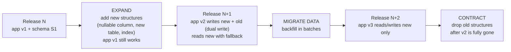
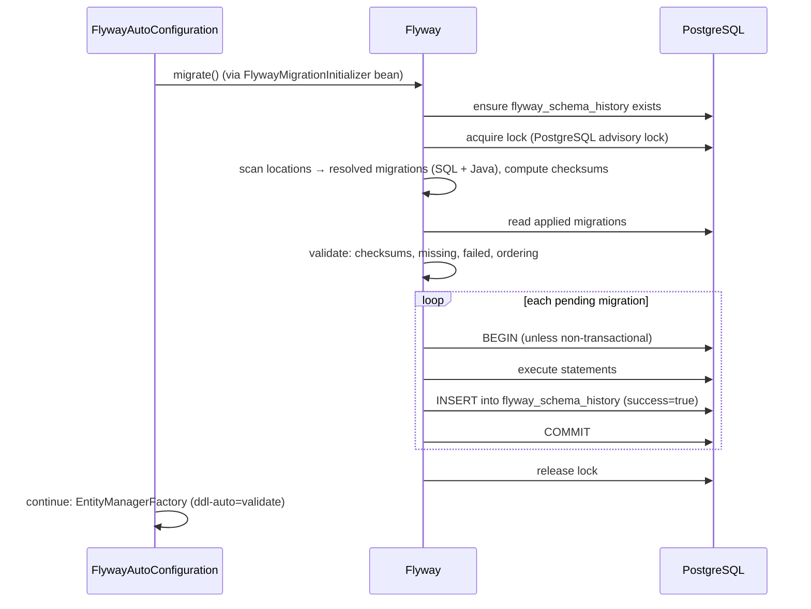
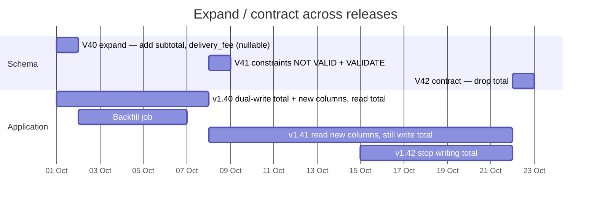
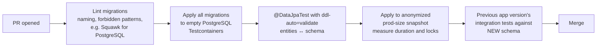

# 14 · Database Migrations

## 1. Introduction & Why It Matters

Code is easy to roll back: redeploy the previous image. **Databases are not.** Once a migration drops a column, adds a `NOT NULL` constraint or rewrites a 40-million-row table, there is no "undo" button — and while it runs, it may be holding locks that stop checkout.

Schema changes in the grocery platform happen weekly: new GST columns on invoices, delivery slot tables, seller onboarding fields, indexes for new search filters. They must be:

- **Versioned and reviewable** — the schema is code, in Git, next to the entity that uses it.
- **Repeatable across environments** — laptop, CI, staging and production reach the exact same schema.
- **Safe under traffic** — no long locks, no downtime, compatible with both the old and new application version during a rolling deploy.
- **Recoverable** — a failed migration leaves a known state and a clear roll-forward path.

Spring Boot integrates **Flyway** and **Liquibase**: add the dependency and migrations run on startup. That's the easy part. This chapter covers the hard part too: **zero-downtime schema evolution** (expand/contract), lock-safe PostgreSQL migrations, large backfills, running migrations as a Kubernetes Job versus at startup, CI checks, and a complete multi-release example that renames a column in `customer_order` without dropping a single request.

### Who should read which section

| Band | Focus |
|---|---|
| B1 · 0–2 yrs | Parts 1, 2, 4 — Flyway basics, naming, running migrations |
| B2 · 2–5 yrs | Parts 2, 5 — repeatable migrations, Java migrations, Liquibase, testing |
| B3 · 5–8 yrs | Parts 3, 5, 6 — locking, transactions, `CONCURRENTLY`, backfills |
| B4 · 8–12 yrs | Parts 6, 7, 8 — expand/contract across releases, migration jobs, rollback strategy |
| B5 · 12–15+ yrs | Parts 8, 9 — schema governance, change management at scale |

---

## 2. Core Concepts

### 2.1 Migration tools

| | Flyway | Liquibase |
|---|---|---|
| Change format | Plain SQL (and Java) | XML/YAML/JSON/SQL changelogs with changesets |
| Mental model | Ordered, immutable scripts | Changesets with ids, authors, preconditions, contexts |
| Database abstraction | You write the SQL | Can generate SQL per database |
| Rollback | Undo scripts (paid edition) | Rollback blocks per changeset (community) |
| Learning curve | Very low | Moderate |
| Boot integration | `spring.flyway.*` | `spring.liquibase.*` |

This handbook uses **Flyway with SQL migrations** — PostgreSQL is the only database and SQL is what reviewers understand. Liquibase is shown for comparison.

### 2.2 Flyway essentials

| Concept | Meaning |
|---|---|
| **Versioned migration** | `V<version>__<description>.sql` — runs once, in version order |
| **Repeatable migration** | `R__<description>.sql` — reruns whenever its checksum changes (views, functions) |
| **Schema history table** | `flyway_schema_history`: version, description, checksum, success, installed_on |
| **Checksum** | Detects edits to applied migrations → validation fails |
| **Baseline** | Adopt Flyway on an existing database: mark version N as applied |
| **Callbacks** | SQL/Java hooks: `beforeMigrate`, `afterMigrate`, ... |
| **Java migrations** | Classes extending `BaseJavaMigration` for logic SQL can't express |
| **Placeholders** | `${schema}` substituted at runtime |
| **Out-of-order** | Allow applying a lower version after higher ones (hotfix branches) |
| **clean** | Drops everything — **disabled by default** since Flyway 10; keep it that way |

!!! danger "Never edit an applied migration"
    Once `V14__add_gst.sql` ran anywhere shared, it's history. Fix mistakes with `V15__fix_gst.sql`. Editing breaks checksums in every environment where it already ran.

### 2.3 How Boot runs migrations

With `flyway-core` (plus `flyway-database-postgresql` for Flyway 10+) on the classpath, `FlywayAutoConfiguration`:

1. Builds a `Flyway` instance from `spring.flyway.*` using the application `DataSource` (or a dedicated one).
2. Runs `migrate()` during context startup **before** JPA's `EntityManagerFactory` initializes (so `ddl-auto=validate` sees the new schema).
3. Lets you replace the strategy with a `FlywayMigrationStrategy` bean (e.g. validate only).

Key properties:

| Property | Default | Notes |
|---|---|---|
| `spring.flyway.enabled` | true | Disable when migrations run as a separate Job |
| `spring.flyway.locations` | `classpath:db/migration` | Multiple locations allowed, e.g. vendor-specific |
| `spring.flyway.baseline-on-migrate` | false | For adopting existing databases |
| `spring.flyway.validate-on-migrate` | true | Checksum validation |
| `spring.flyway.out-of-order` | false | Keep false in production unless you know why |
| `spring.flyway.clean-disabled` | true | Never enable in shared environments |
| `spring.flyway.url/user/password` | app DataSource | Separate privileged migration user |
| `spring.flyway.placeholders.*` | — | Script placeholders |

### 2.4 Zero-downtime schema changes: expand and contract

During a rolling deploy, **old and new application versions run simultaneously** against the same schema. Every schema change must be compatible with both.



Classification of changes:

| Change | Safe in one step? | How |
|---|---|---|
| Add nullable column | ✅ | Direct |
| Add column with non-volatile default (PG 11+) | ✅ | Metadata-only, no rewrite (volatile defaults like `gen_random_uuid()` rewrite the table) |
| Add `NOT NULL` column without default | ❌ | Add nullable → backfill → add constraint `NOT VALID` → `VALIDATE` |
| Add index | ⚠️ | `CREATE INDEX CONCURRENTLY` (non-transactional) |
| Add foreign key | ⚠️ | `ADD CONSTRAINT ... NOT VALID` then `VALIDATE CONSTRAINT` |
| Rename column/table | ❌ | Expand/contract: new column, dual write, backfill, switch, drop |
| Drop column | ⚠️ | Only after no deployed version reads it (and JPA mapping removed) |
| Change column type | ❌ | New column + backfill, or careful `USING` on small tables |
| Large `UPDATE`/`DELETE` | ❌ | Batches outside the schema migration |

### 2.5 PostgreSQL locking in one table

| Operation | Lock taken | Blocks |
|---|---|---|
| `ALTER TABLE ... ADD COLUMN` | `ACCESS EXCLUSIVE` (brief) | Everything — including reads — while waiting/holding |
| `CREATE INDEX` | `SHARE` | Writes for the whole build |
| `CREATE INDEX CONCURRENTLY` | `SHARE UPDATE EXCLUSIVE` | Other DDL; not reads/writes |
| `ADD CONSTRAINT ... NOT VALID` | Brief `ACCESS EXCLUSIVE` / weaker for FK | Minimal |
| `VALIDATE CONSTRAINT` | `SHARE UPDATE EXCLUSIVE` | Not reads/writes |

!!! danger "The lock queue problem"
    Even a "fast" `ALTER TABLE` needs `ACCESS EXCLUSIVE`. If a long-running report holds a lock on `customer_order`, the `ALTER` **waits** — and every new query on that table queues **behind** the `ALTER`. Checkout stops. Always set `lock_timeout` (e.g. `5s`) in migrations so they fail fast and retry, instead of freezing production.

### 2.6 Where migrations run

| Option | Pros | Cons |
|---|---|---|
| **On application startup** (Boot default) | Simple; schema and code in lockstep | Slow migrations delay readiness; every pod attempts (Flyway serializes with a DB lock); needs DDL privileges in app user |
| **Kubernetes Job / Helm pre-upgrade hook** | Separate privileged user; clear logs; app starts fast | More deployment plumbing |
| **Init container** | Runs before app container per pod | Runs per pod; same lock contention |
| **CI/CD pipeline step** | Central control | Pipeline needs DB network access |

Platform rule: **startup migrations for small, fast changes; a migration Job for anything long-running or requiring elevated privileges**, and backfills as batch jobs.

### 2.7 Rollback strategy

Database rollbacks are rarely safe (data written after the change would be lost). Prefer:

- **Roll forward**: fix with a new migration.
- **Backward-compatible schema**: the previous app version keeps working on the new schema, so rolling back the *app* never requires rolling back the *database*.
- **Backups/PITR** for disasters, not for routine rollbacks.

---

## 3. How It Works Internally

### 3.1 Flyway migrate



- **Concurrency:** multiple pods starting together block on the lock; the first applies migrations, the rest find nothing pending.
- **PostgreSQL DDL is transactional** — a failed migration rolls back completely (except non-transactional statements like `CREATE INDEX CONCURRENTLY`).
- **Ordering with JPA:** Boot makes the `EntityManagerFactory` depend on the Flyway initializer bean, so validation sees the migrated schema.

### 3.2 Liquibase update

Liquibase reads a changelog (`db/changelog/db.changelog-master.yaml`), acquires `DATABASECHANGELOGLOCK`, compares changesets (id + author + file path) against `DATABASECHANGELOG`, checks preconditions and contexts/labels, and executes pending changesets in order, recording MD5 checksums.

---

## 4. Hands-On Code — Level 1 (Beginner)

### 4.1 Setup

```kotlin title="build.gradle.kts"
dependencies {
    implementation("org.flywaydb:flyway-core")
    implementation("org.flywaydb:flyway-database-postgresql")     // (1)!
    runtimeOnly("org.postgresql:postgresql")
}
```

1. Since Flyway 10, database support is modular — PostgreSQL needs this module or Flyway fails with "Unsupported Database".

```text title="Layout"
src/main/resources/db/migration/
├── V1__create_category.sql
├── V2__create_product.sql
├── V3__add_product_hsn_code.sql
└── R__product_search_view.sql
```

### 4.2 First migrations

```sql title="V1__create_category.sql"
create sequence category_seq increment by 50;

create table category (
    id     bigint primary key,
    slug   varchar(40) not null unique,
    name   varchar(80) not null,
    active boolean not null default true
);
```

```sql title="V2__create_product.sql"
create table product (
    sku           varchar(40) primary key,
    name          varchar(150) not null,
    category_id   bigint not null references category(id),
    mrp           numeric(10,2) not null check (mrp > 0),
    selling_price numeric(10,2) not null check (selling_price > 0 and selling_price <= mrp),
    active        boolean not null default true,
    updated_at    timestamptz not null default now()
);
create index product_category_idx on product (category_id);
```

```sql title="V3__add_product_hsn_code.sql"
alter table product add column hsn_code varchar(8);      -- nullable: safe, instant
```

```sql title="R__product_search_view.sql"
create or replace view product_search as
select p.sku, p.name, c.slug as category, p.selling_price, p.mrp
from product p join category c on c.id = p.category_id
where p.active and c.active;
```

### 4.3 Run and inspect

```bash title="Terminal"
./gradlew bootRun
```

```text title="Startup log"
Flyway Community Edition ... by Redgate
Database: jdbc:postgresql://localhost:5432/catalog (PostgreSQL 17.x)
Successfully validated 4 migrations
Creating Schema History table "public"."flyway_schema_history" ...
Migrating schema "public" to version "1 - create category"
Migrating schema "public" to version "2 - create product"
Migrating schema "public" to version "3 - add product hsn code"
Migrating schema "public" with repeatable migration "product search view"
Successfully applied 4 migrations to schema "public", now at version v3
```

```sql title="SQL"
select installed_rank, version, description, type, checksum, success from flyway_schema_history;
```

### 4.4 Test that migrations apply cleanly

```java title="MigrationsApplyTest.java"
package in.grocery.catalog;

import static org.assertj.core.api.Assertions.assertThat;

import org.flywaydb.core.Flyway;
import org.junit.jupiter.api.Test;
import org.testcontainers.containers.PostgreSQLContainer;
import org.testcontainers.junit.jupiter.Container;
import org.testcontainers.junit.jupiter.Testcontainers;

@Testcontainers
class MigrationsApplyTest {

    @Container
    static PostgreSQLContainer<?> pg = new PostgreSQLContainer<>("postgres:17-alpine");

    @Test
    void allMigrationsApplyOnEmptyDatabase() {
        Flyway flyway = Flyway.configure()
                .dataSource(pg.getJdbcUrl(), pg.getUsername(), pg.getPassword())
                .locations("classpath:db/migration")
                .load();
        var result = flyway.migrate();
        assertThat(result.success).isTrue();
        assertThat(flyway.validateWithResult().validationSuccessful).isTrue();
    }
}
```

This plain Flyway test runs in seconds, without Spring. Chapter 13's `@DataJpaTest` with `ddl-auto=validate` additionally proves the **entities match the schema**.

---

## 5. Hands-On Code — Level 2 (Intermediate) & Level 3 (Advanced)

### 5.1 Level 2 — Configuration per environment

```yaml title="application.yml"
spring:
  flyway:
    locations: classpath:db/migration
    validate-migration-naming: true             # (1)!
    clean-disabled: true
    placeholders:
      app_user: order_app
---
spring.config.activate.on-profile: local
spring:
  flyway:
    locations: classpath:db/migration,classpath:db/testdata     # (2)!
---
spring.config.activate.on-profile: prod
spring:
  flyway:
    enabled: false                               # (3)!
```

1. Fail if a file in the location doesn't follow the naming pattern (e.g. `V3_add.sql` with one underscore would otherwise be silently ignored).
2. Seed data only locally — never mix test data into production locations.
3. Production runs migrations in a dedicated Job (Level 4).

**Placeholders** in scripts:

```sql title="V20__grant_app_user.sql"
grant select, insert, update, delete on all tables in schema public to ${app_user};
```

### 5.2 Level 2 — Java migration for logic SQL can't express

Normalizing legacy pincodes stored as `"560 001"`/`"560-001"`:

```java title="src/main/java/db/migration/V21__normalize_pincodes.java"
package db.migration;                                                             // (1)!

import java.sql.PreparedStatement;
import java.sql.ResultSet;
import java.sql.Statement;
import org.flywaydb.core.api.migration.BaseJavaMigration;
import org.flywaydb.core.api.migration.Context;

public class V21__normalize_pincodes extends BaseJavaMigration {

    @Override
    public void migrate(Context context) throws Exception {
        var conn = context.getConnection();
        try (Statement select = conn.createStatement();
             ResultSet rs = select.executeQuery(
                     "select id, addr_pincode from customer_address where addr_pincode !~ '^[1-9][0-9]{5}$'");
             PreparedStatement update = conn.prepareStatement(
                     "update customer_address set addr_pincode = ? where id = ?")) {
            int batch = 0;
            while (rs.next()) {
                String normalized = rs.getString(2).replaceAll("[^0-9]", "");
                if (normalized.matches("[1-9][0-9]{5}")) {
                    update.setString(1, normalized);
                    update.setLong(2, rs.getLong(1));
                    update.addBatch();
                    if (++batch % 500 == 0) update.executeBatch();
                }
            }
            update.executeBatch();
        }
    }
}
```

1. Flyway scans `db/migration` on the classpath for Java classes too. With Boot, Java migrations can also be **Spring beans** implementing `JavaMigration` — Boot passes them to Flyway, so they can use injected services (use sparingly: migrations should not depend on application code that will change).

!!! warning "Java migrations are frozen history too"
    Don't call application classes (entities, services) from migrations — when that code changes next year, replaying V21 on a fresh database breaks. Keep migrations self-contained.

### 5.3 Level 2 — The same change in Liquibase

```yaml title="src/main/resources/db/changelog/db.changelog-master.yaml"
databaseChangeLog:
  - include:
      file: db/changelog/2026/09/0001-add-hsn-code.yaml
```

```yaml title="db/changelog/2026/09/0001-add-hsn-code.yaml"
databaseChangeLog:
  - changeSet:
      id: 0001-add-hsn-code
      author: catalog-team
      preConditions:
        - onFail: MARK_RAN
        - not:
            columnExists:
              tableName: product
              columnName: hsn_code
      changes:
        - addColumn:
            tableName: product
            columns:
              - column:
                  name: hsn_code
                  type: varchar(8)
      rollback:
        - dropColumn:
            tableName: product
            columnName: hsn_code
```

```yaml title="application.yml"
spring:
  liquibase:
    change-log: classpath:db/changelog/db.changelog-master.yaml
    contexts: prod
```

Pick **one** tool per service.

### 5.4 Level 3 — Lock-safe migrations on PostgreSQL

Every production migration starts with timeouts:

```sql title="V30__add_invoice_gst_columns.sql"
set lock_timeout = '5s';                  -- (1)
set statement_timeout = '60s';

alter table invoice add column cgst_amount numeric(12,2);
alter table invoice add column sgst_amount numeric(12,2);
alter table invoice add column igst_amount numeric(12,2);
alter table invoice add column place_of_supply varchar(2);
```

1. If the table is busy, fail after 5 s instead of queueing all traffic behind the `ALTER`. The deployment retries later. `SET` (without `LOCAL`) lasts for the session; Flyway uses one connection per migration run.

### 5.5 Level 3 — Indexes without blocking writes

```sql title="V31__order_customer_status_idx.sql"
set lock_timeout = '5s';
create index concurrently if not exists customer_order_status_idx
    on customer_order (status, placed_at)
    where status in ('PLACED', 'PAID', 'PACKED');
```

```properties title="V31__order_customer_status_idx.sql.conf"
executeInTransaction=false
```

`CREATE INDEX CONCURRENTLY` can't run inside a transaction; the per-script config file tells Flyway to run it outside one.

!!! warning "Failed concurrent index builds leave an INVALID index"
    If it fails midway, PostgreSQL leaves an index marked `INVALID` that still slows writes. The retry must `DROP INDEX CONCURRENTLY IF EXISTS ...` first, or check `pg_index.indisvalid`. Keep one concurrent index per migration so failures are easy to reason about.

!!! note "Verify"
    Recent Flyway versions can auto-detect some non-transactional PostgreSQL statements; the explicit `.conf` file (or the `-- flyway:executeInTransaction=false` script directive, depending on version) is the unambiguous choice. Check your Flyway version's documentation.

### 5.6 Level 3 — `NOT NULL` and foreign keys without long locks

```sql title="V32__order_place_of_supply_not_null.sql"
set lock_timeout = '5s';

-- (1) constraint added without scanning the table
alter table customer_order
    add constraint customer_order_place_of_supply_nn check (place_of_supply is not null) not valid;

-- (2) validates existing rows with a weak lock (reads/writes continue)
alter table customer_order validate constraint customer_order_place_of_supply_nn;
```

After this, PostgreSQL 12+ can promote to a real `NOT NULL` cheaply (it uses the validated check constraint to skip the scan):

```sql title="V33__order_place_of_supply_set_not_null.sql"
set lock_timeout = '5s';
alter table customer_order alter column place_of_supply set not null;
alter table customer_order drop constraint customer_order_place_of_supply_nn;
```

Same pattern for foreign keys: `add constraint ... foreign key (...) references ... not valid;` then `validate constraint`.

### 5.7 Level 3 — Backfills are not migrations

Filling `place_of_supply` for 40 million historical orders inside a Flyway migration would run for an hour in one transaction, bloating the table and blocking deploys. Instead:

- The migration adds the nullable column (instant).
- A **batch job** (Spring Batch, Chapter 33, or a simple scheduled task) backfills in chunks with pauses.
- A later migration adds the constraint once the job reports zero remaining rows.

```java title="in/grocery/order/backfill/PlaceOfSupplyBackfill.java"
package in.grocery.order.backfill;

import java.time.Duration;
import org.slf4j.Logger;
import org.slf4j.LoggerFactory;
import org.springframework.jdbc.core.simple.JdbcClient;
import org.springframework.stereotype.Component;

@Component
public class PlaceOfSupplyBackfill {

    private static final Logger log = LoggerFactory.getLogger(PlaceOfSupplyBackfill.class);
    private final JdbcClient jdbc;

    public PlaceOfSupplyBackfill(JdbcClient jdbc) {
        this.jdbc = jdbc;
    }

    /** Runs until done; each chunk is its own short transaction (auto-commit). */
    public long run(int chunkSize, Duration pause) throws InterruptedException {
        long total = 0;
        while (true) {
            int updated = jdbc.sql("""
                    with batch as (
                        select id from customer_order
                        where place_of_supply is null
                        order by id
                        limit :chunk
                        for update skip locked
                    )
                    update customer_order o
                    set place_of_supply = s.gst_state_code
                    from batch, pincode_state s
                    where o.id = batch.id and s.pincode_prefix = left(o.addr_pincode, 3)
                    """)                                                                   // (1)!
                    .param("chunk", chunkSize)
                    .update();
            total += updated;
            if (updated == 0) break;
            log.info("Backfilled {} rows (total {})", updated, total);
            Thread.sleep(pause);                                                           // (2)!
        }
        return total;
    }
}
```

1. Chunked by primary key, `SKIP LOCKED` so it never waits on rows the application is updating. Rows whose pincode prefix isn't in the mapping stay null — the job must report them for manual fixing, or the loop exits when `updated == 0` with leftovers.
2. Throttle to protect replication lag and I/O.

---

## 6. Hands-On Code — Level 4 (Expert / Production)

### 6.1 Zero-downtime rename: `total` → `subtotal` + `delivery_fee`

Business change: the order table has a single `total` column; finance wants `subtotal` and `delivery_fee` separately (GST applies differently). The old app reads `total`. Here's the full sequence across **three releases**, never breaking a running version.



**Release 1 — expand + dual write**

```sql title="V40__order_split_total_expand.sql"
set lock_timeout = '5s';
alter table customer_order add column subtotal numeric(12,2);
alter table customer_order add column delivery_fee numeric(8,2);
```

```java title="Order entity in v1.40 (excerpt)"
@Column(name = "total", nullable = false)
private BigDecimal total;                 // still the source of truth for reads

@Column(name = "subtotal")
private BigDecimal subtotal;              // new, written alongside
@Column(name = "delivery_fee")
private BigDecimal deliveryFee;

void recalculate() {
    this.subtotal = linesTotal();
    this.deliveryFee = fee;
    this.total = subtotal.add(deliveryFee);   // dual write keeps old readers correct
}
```

Backfill job (as in 5.7) fills `subtotal`/`delivery_fee` for old rows from `total` and the fee rules.

**Release 2 — enforce and switch reads**

```sql title="V41__order_split_total_constraints.sql"
set lock_timeout = '5s';
alter table customer_order add constraint customer_order_subtotal_nn check (subtotal is not null) not valid;
alter table customer_order add constraint customer_order_delivery_fee_nn check (delivery_fee is not null) not valid;
alter table customer_order validate constraint customer_order_subtotal_nn;
alter table customer_order validate constraint customer_order_delivery_fee_nn;
```

App v1.41 reads `subtotal + delivery_fee`, still writes `total` (so v1.40 pods during the rollout and any rollback to v1.40 keep working).

**Release 3 — stop writing, then contract**

App v1.42 removes the `total` field from the entity (`ddl-auto=validate` doesn't complain about extra columns). Only after **every** v1.41 pod is gone and a rollback to v1.41 is no longer planned:

```sql title="V42__order_split_total_contract.sql"
set lock_timeout = '5s';
alter table customer_order alter column subtotal set not null;
alter table customer_order alter column delivery_fee set not null;
alter table customer_order drop constraint customer_order_subtotal_nn;
alter table customer_order drop constraint customer_order_delivery_fee_nn;
alter table customer_order drop column total;
```

!!! tip "Views and triggers as bridges"
    For renames used by many consumers (reporting tools, other services' read models), a compatibility **view** or a temporary **trigger** that keeps the old column in sync can replace application-level dual writes. Remove the bridge in the contract step.

### 6.2 Migration Job in Kubernetes

The app image contains the migrations; a Job runs the same image in "migrate-only" mode with a privileged database user. The app itself runs with `spring.flyway.enabled=false` and a least-privilege user.

```java title="in/grocery/order/migrate/MigrateOnlyRunner.java"
package in.grocery.order.migrate;

import org.flywaydb.core.Flyway;
import org.springframework.boot.ApplicationArguments;
import org.springframework.boot.ApplicationRunner;
import org.springframework.boot.ExitCodeGenerator;
import org.springframework.context.annotation.Profile;
import org.springframework.stereotype.Component;

@Component
@Profile("migrate")
class MigrateOnlyRunner implements ApplicationRunner, ExitCodeGenerator {

    private final Flyway flyway;                                                         // (1)!
    private int exit = 0;

    MigrateOnlyRunner(Flyway flyway) {
        this.flyway = flyway;
    }

    @Override
    public void run(ApplicationArguments args) {
        var result = flyway.migrate();
        exit = result.success ? 0 : 1;
    }

    @Override
    public int getExitCode() {
        return exit;
    }
}
```

1. In the `migrate` profile, Flyway is enabled and configured with migration credentials; `spring.main.web-application-type=none`; JPA validation can stay on to prove the schema matches.

```yaml title="application-migrate.yml"
spring:
  main:
    web-application-type: none
  flyway:
    enabled: true
    user: ${ORDERS_MIGRATION_USER}
    password: ${ORDERS_MIGRATION_PASSWORD}
  jpa:
    hibernate:
      ddl-auto: validate
```

!!! note "Run migrate() once"
    With `spring.flyway.enabled=true`, Boot's `FlywayMigrationInitializer` already migrates during startup. Either rely on that (and make the runner just exit 0), or register a `FlywayMigrationStrategy` bean that does nothing so the runner is the only caller. Don't migrate twice.

```yaml title="helm/order-service/templates/migrate-job.yaml"
apiVersion: batch/v1
kind: Job
metadata:
  name: order-service-migrate-{{ .Release.Revision }}
  annotations:
    "helm.sh/hook": pre-upgrade,pre-install
    "helm.sh/hook-delete-policy": before-hook-creation,hook-succeeded
spec:
  backoffLimit: 2
  activeDeadlineSeconds: 900
  template:
    spec:
      restartPolicy: Never
      containers:
        - name: migrate
          image: "{{ .Values.image.repository }}:{{ .Values.image.tag }}"
          args: ["--spring.profiles.active=prod,migrate"]
          envFrom:
            - secretRef:
                name: order-service-migration-credentials
```

The Helm upgrade only proceeds to roll out new pods if the migration Job succeeds.

### 6.3 CI pipeline checks



The last step is the key one for zero downtime: **N-1 app on N schema must pass**.

A simple forbidden-pattern check that runs in the build:

```java title="MigrationLintTest.java"
package in.grocery.order;

import static org.assertj.core.api.Assertions.assertThat;

import java.io.IOException;
import java.nio.file.Files;
import java.nio.file.Path;
import java.util.List;
import java.util.regex.Pattern;
import java.util.stream.Stream;
import org.junit.jupiter.api.Test;

class MigrationLintTest {

    private static final Path DIR = Path.of("src/main/resources/db/migration");
    private static final List<Pattern> FORBIDDEN = List.of(
            Pattern.compile("(?i)create\\s+(unique\\s+)?index\\s+(?!concurrently)"),          // (1)!
            Pattern.compile("(?i)alter\\s+table\\s+\\S+\\s+rename\\s+column"),
            Pattern.compile("(?i)add\\s+column\\s+\\S+\\s+[^,;]*not\\s+null(?![^;]*default)"),
            Pattern.compile("(?i)\\bdrop\\s+table\\b(?!\\s+if\\s+exists\\s+tmp_)"));

    @Test
    void newMigrationsFollowSafetyRules() throws IOException {
        try (Stream<Path> files = Files.list(DIR)) {
            files.filter(f -> f.getFileName().toString().matches("V(\\d+)__.*\\.sql"))
                 .filter(f -> version(f) >= 30)                                                // (2)!
                 .forEach(f -> {
                     String sql = read(f);
                     assertThat(sql).as("%s must set lock_timeout", f.getFileName()).containsIgnoringCase("lock_timeout");
                     FORBIDDEN.forEach(p -> assertThat(p.matcher(sql).find())
                             .as("%s matches forbidden pattern %s", f.getFileName(), p).isFalse());
                 });
        }
    }

    private static int version(Path f) {
        return Integer.parseInt(f.getFileName().toString().replaceAll("^V(\\d+)__.*", "$1"));
    }

    private static String read(Path f) {
        try { return Files.readString(f); } catch (IOException e) { throw new RuntimeException(e); }
    }
}
```

1. Non-concurrent index creation on existing tables blocks writes (new tables in the same migration are an exception — add an allow-list comment if needed).
2. Rules apply from the version they were introduced — history is not rewritten.

!!! tip "Use a real linter too"
    Tools like **Squawk** (PostgreSQL migration linter) understand SQL rather than regex and catch many more lock hazards. Regex rules are a cheap first line.

### 6.4 Schema drift detection

Someone ran a manual `CREATE INDEX` in production during an incident. Now environments differ.

- Nightly job runs `flyway validate` and a **schema diff** (e.g. `pg_dump --schema-only` of staging vs production, or Liquibase `diff`) and alerts on differences.
- Incident procedure: every manual change is followed within a day by a migration that makes it official (`create index if not exists ...`).

---

## 7. Spring Boot 3 vs 4 & Migration

| Topic | Boot 3.5 | Boot 4.x |
|---|---|---|
| Flyway | 11.x (verify) | 11.x or newer (verify) |
| Database module | `flyway-database-postgresql` required | Same |
| Liquibase | 4.x | 4.x / 5.x (verify) |
| Auto-config package | `org.springframework.boot.autoconfigure.flyway` | Flyway module (verify) |
| Test support | `@AutoConfigureFlyway` etc. in Boot test autoconfigure | Moved to Flyway test module (verify) |
| JPA validate ordering | Flyway before EMF | Same |
| `FlywayConfigurationCustomizer` | ✅ | ✅ (verify package) |

=== "Spring Boot 3.5"

    ```java title="Spring Boot 3.5 (snippet)"
    import org.springframework.boot.autoconfigure.flyway.FlywayConfigurationCustomizer;

    @Bean
    FlywayConfigurationCustomizer lockRetry() {
        return config -> config.lockRetryCount(60);        // wait up to ~60s for another pod's migration
    }
    ```

=== "Spring Boot 4.x"

    ```java title="Spring Boot 4.x (snippet)"
    // Same idea; import from the Flyway module package in Boot 4 (verify).
    @Bean
    FlywayConfigurationCustomizer lockRetry() {
        return config -> config.lockRetryCount(60);
    }
    ```

### Migration checklist

- [ ] Add `flyway-database-postgresql` if coming from Flyway 9.
- [ ] Check Flyway/Liquibase property renames with the properties migrator.
- [ ] Update test annotations and custom Flyway beans for Boot 4 packages.
- [ ] Re-run the full migration set on an empty database and a snapshot after upgrading Flyway.

---

## 8. Production Playbook

### Best practices

1. **Schema changes are migrations in Git**, reviewed like code; never `ddl-auto=update`.
2. **Never edit applied migrations**; roll forward.
3. **Every migration is backward compatible** with the currently deployed app version (expand/contract).
4. **`lock_timeout` in every production migration**; `CONCURRENTLY` for indexes; `NOT VALID` + `VALIDATE` for constraints.
5. **Backfills are jobs**, chunked and throttled, not migrations.
6. **Migrations run with a privileged user**, the app with least privilege; long migrations in a Job.
7. **CI applies migrations** to empty DB, validates JPA mappings, and runs N-1 app tests against the new schema.
8. **Monitor** migration duration, locks (`pg_locks`, `pg_stat_activity`) and replication lag during deploys.
9. **Small, frequent migrations** beat big-bang schema releases.

### Anti-patterns

❌ `ALTER TABLE ... RENAME COLUMN` in one release — old pods crash mid-rollout.

❌ `CREATE INDEX` on a hot 40M-row table without `CONCURRENTLY` — writes blocked for minutes.

❌ `UPDATE customer_order SET ...` over all rows in a migration — hour-long transaction, bloat, replication lag.

❌ Editing `V14` because "it hasn't reached prod yet" — it has reached staging and three laptops.

❌ Test data in production migration locations.

❌ `flyway clean` enabled anywhere shared.

❌ Dropping a column the previous app version still maps with JPA — rollback becomes impossible.

### Troubleshooting

| Symptom | Cause | Fix |
|---|---|---|
| `Validate failed: Migration checksum mismatch` | Applied migration edited | Revert the edit; new migration; `repair` only with full understanding |
| `Detected failed migration to version X` | Previous run failed (non-transactional) | Fix manually, `flyway repair`, re-run |
| `Unsupported Database: PostgreSQL` | Missing Flyway database module | Add `flyway-database-postgresql` |
| Pods stuck at startup | Waiting for Flyway lock / long migration | Move to Job; check `pg_locks` |
| Traffic freezes during deploy | `ALTER` waiting on lock with queue behind it | `lock_timeout`; deploy off-peak; kill blocker |
| Migration ignored | Wrong naming (`V3_x.sql`), wrong location | `validate-migration-naming`; check locations |
| `Schema-validation: missing column` at startup | Entity ahead of migration | Ensure migration included and ordered |
| INVALID index after failed concurrent build | Interrupted `CONCURRENTLY` | `DROP INDEX CONCURRENTLY` and retry |

### Production checklist

- [ ] Flyway (or Liquibase) in every service with a database
- [ ] Migration user separate from app user
- [ ] Lint + empty-DB apply + JPA validate + N-1 compatibility in CI
- [ ] `lock_timeout` convention enforced
- [ ] Backfill job pattern documented
- [ ] Migration Job for production with Helm hook
- [ ] Drift detection scheduled
- [ ] Deploy runbook covers failed-migration recovery

---

## 9. Interview Questions & Answers

### B1 · 0–2 years

??? question "B1 · Why use a migration tool instead of `ddl-auto=update`?"
    **Short answer:** Versioned, reviewable, repeatable, ordered changes with history; `update` is unreviewed, can't drop/rename safely, and diverges between environments.

??? question "B1 · What is a versioned vs repeatable migration in Flyway?"
    **Short answer:** Versioned (`V1__x.sql`) runs once in order; repeatable (`R__x.sql`) reruns whenever its content changes — used for views and functions.

??? question "B1 · Where does Flyway record what it applied?"
    **Short answer:** The `flyway_schema_history` table with version, checksum, success flag and timestamps.

??? question "B1 · What happens if you edit an applied migration?"
    **Short answer:** Checksum validation fails on the next run. Add a new migration instead.

### B2 · 2–5 years

??? question "B2 · How does Boot order Flyway and JPA?"
    **Short answer:** Flyway migrates during startup before the `EntityManagerFactory` initializes, so `ddl-auto=validate` sees the migrated schema.

??? question "B2 · When would you write a Java migration?"
    **Short answer:** When logic is awkward in SQL (data transformation with rules, calling a library). Keep it self-contained — no application classes.

??? question "B2 · Flyway vs Liquibase?"
    **Short answer:** Flyway: plain SQL, minimal model, easy. Liquibase: changesets with preconditions, contexts, database-agnostic changes, rollback blocks. Choose one per service.

??? question "B2 · How do you test migrations?"
    **Short answer:** Apply all to an empty PostgreSQL in Testcontainers, validate JPA mappings with `ddl-auto=validate`, lint scripts, and apply to a production-size snapshot for timing.

??? question "B2 · Why does Flyway 10+ need an extra dependency for PostgreSQL?"
    **Short answer:** Database support was modularized; `flyway-database-postgresql` provides it.

### B3 · 5–8 years

??? question "B3 · How do you add an index to a large, busy PostgreSQL table?"
    **Short answer:** `CREATE INDEX CONCURRENTLY` in a non-transactional migration, with `lock_timeout`, handling INVALID indexes on failure.

??? question "B3 · How do you add a NOT NULL column to a large table without downtime?"
    **Short answer:** Add nullable (or with constant default on PG 11+), backfill in batches, add `CHECK ... NOT VALID`, `VALIDATE`, then `SET NOT NULL` (cheap with validated check on PG 12+), drop the check.

??? question "B3 · What is the lock queue problem?"
    **Short answer:** DDL needing `ACCESS EXCLUSIVE` waits behind existing locks, and all later queries queue behind it — a short DDL causes a long outage. Use `lock_timeout` and retry.

??? question "B3 · What happens when several pods start and run Flyway at once?"
    **Short answer:** Flyway takes a database lock; one pod migrates, others wait then find nothing to do. Long migrations delay all pods' readiness — use a Job for long ones.

??? question "B3 · How do you backfill a new column on 40 million rows?"
    **Short answer:** In a separate, resumable job — batches of a few thousand rows keyed by primary key, committed individually, throttled, and idempotent — never inside the Flyway migration, which would hold one long transaction and lock. Verify with a rehearsal on production-sized data.

### B4 · 8–12 years

??? question "B4 · Walk through renaming a column with zero downtime."
    **Short answer:** Expand (add new column), dual write in app, backfill, switch reads to new column (still writing old), stop writing old, contract (drop old) once no deployed/rollback version uses it. Constraints via NOT VALID/VALIDATE. Possibly views/triggers as bridges.

??? question "B4 · Migrations at startup or in a Job?"
    **Short answer:** Startup for small fast changes (simple, lockstep). Job/pre-upgrade hook for long migrations, privileged credentials, clearer failure handling and faster pod startup. Backfills as separate batch jobs.

??? question "B4 · How do you roll back a bad release that included a migration?"
    **Short answer:** Design so you don't need to: backward-compatible migrations mean rolling back the app is enough. Fix forward with a new migration. Restore from PITR only for data-destroying accidents.

??? question "B4 · How do migrations work when old and new pods run at the same time?"
    **Short answer:** Every migration must be compatible with the code version still running: expand first (add nullable columns, new tables), deploy code that handles both shapes, contract only in a later release. Destructive changes in the same release as the code that stops using the column break the rollout and the rollback.

### B5 · 12–15+ years

??? question "B5 · How do you govern schema changes across 26 services and several teams?"
    **Short answer:** Database-per-service ownership, migration conventions (lint, lock timeouts, expand/contract), CI gates including N-1 compatibility, DBA review for high-risk patterns, migration Jobs with observability, drift detection, deploy windows for large-table changes, and a shared runbook.

??? question "B5 · Events and read models depend on table structure via CDC. What changes?"
    **Short answer:** Schema changes become contract changes for downstream consumers (Debezium topics). Use outbox tables with explicit event schemas instead of raw table CDC where possible, version event schemas, and include consumers in the expand/contract plan.

### Scenario questions

??? example "Scenario · A 'small' migration took checkout down for 4 minutes"
    `ALTER TABLE customer_order ADD COLUMN public_id uuid NOT NULL DEFAULT gen_random_uuid()` — a **volatile** default forces PostgreSQL to rewrite all 40M rows under `ACCESS EXCLUSIVE` (constant and even `now()`-style stable defaults are evaluated once and stored as metadata; volatile ones are evaluated per row). Fix: add the column nullable without default, set the default for new rows (`ALTER COLUMN SET DEFAULT gen_random_uuid()` — metadata only), backfill existing rows in batches, then `NOT VALID`/`VALIDATE`/`SET NOT NULL`. Add a lint rule for volatile defaults in `ADD COLUMN`.

??? example "Scenario · Rollback after a failed release fails with 'column total does not exist'"
    Release dropped `total` in the same deploy that stopped using it; rolling back the app to the previous version (which still mapped `total`) failed JPA validation. Fix: separate contract migration into a later release; restore column from backup data if needed; add N-1 compatibility test in CI.

### Coding exercise

!!! example "Exercise · Split `customer.full_name` into `first_name` and `last_name`"
    Write the migrations (expand, constraints, contract) and a chunked backfill job for a 5M-row `customer` table. The app is deployed with rolling updates. Include lock timeouts and describe what each app release does.

??? success "Solution"
    ```sql title="V50__customer_names_expand.sql"
    set lock_timeout = '5s';
    alter table customer add column first_name varchar(80);
    alter table customer add column last_name  varchar(80);
    ```

    **App r50:** writes `full_name` *and* `first_name`/`last_name` (split on first space); reads `full_name`.

    ```java title="CustomerNameBackfill.java (core loop)"
    int updated;
    do {
        updated = jdbc.sql("""
                with batch as (
                    select id from customer where first_name is null
                    order by id limit :chunk for update skip locked
                )
                update customer c set
                    first_name = split_part(c.full_name, ' ', 1),
                    last_name  = nullif(substr(c.full_name, length(split_part(c.full_name, ' ', 1)) + 2), '')
                from batch where c.id = batch.id
                """).param("chunk", 2_000).update();
        Thread.sleep(200);
    } while (updated > 0);
    ```

    ```sql title="V51__customer_names_constraint.sql"
    set lock_timeout = '5s';
    alter table customer add constraint customer_first_name_nn check (first_name is not null) not valid;
    alter table customer validate constraint customer_first_name_nn;
    ```

    **App r51:** reads `first_name`/`last_name`, still writes `full_name` (rollback-safe).
    **App r52:** stops writing `full_name`; entity no longer maps it.

    ```sql title="V53__customer_names_contract.sql (after r51 is fully retired)"
    set lock_timeout = '5s';
    alter table customer alter column first_name set not null;
    alter table customer drop constraint customer_first_name_nn;
    alter table customer drop column full_name;
    ```

    `last_name` stays nullable — many people legitimately have a single name. Validation rules are a domain decision, not a migration convenience.

---

## Key Takeaways

- The **schema is code**: versioned, immutable migrations, reviewed and tested.
- Boot runs **Flyway before JPA**; `ddl-auto=validate` proves mappings match.
- **Every change must work with the old and new app** — expand, migrate, contract across releases.
- On PostgreSQL: **`lock_timeout`, `CONCURRENTLY`, `NOT VALID` + `VALIDATE`**, no volatile defaults on `ADD COLUMN`, no big updates in migrations.
- **Backfills are throttled batch jobs.**
- **Long migrations run as Jobs** with privileged users; apps run least-privilege.
- **Roll forward**, don't roll back schemas; keep the previous app version compatible.

## Further Reading

- Spring Boot Reference — *How-to › Data Initialization › Use a Higher-level Database Migration Tool* (Flyway, Liquibase)
- Flyway documentation — *Migrations*, *Java-based migrations*, *Script config files*, *Callbacks*
- Liquibase documentation — *Changelogs*, *Preconditions*, *Rollback*
- PostgreSQL documentation — *ALTER TABLE* (notes on locking and rewrites), *CREATE INDEX CONCURRENTLY*, *Explicit Locking*

---

[:material-arrow-left: 13 Spring Data JPA & Hibernate](13-spring-data-jpa-hibernate.md) · [15 Testing Fundamentals :material-arrow-right:](15-testing-fundamentals.md)
