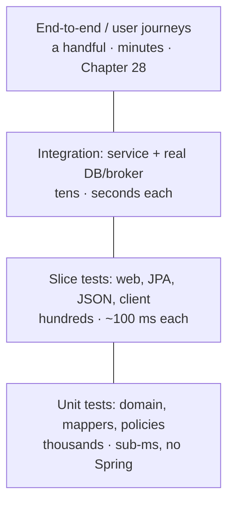
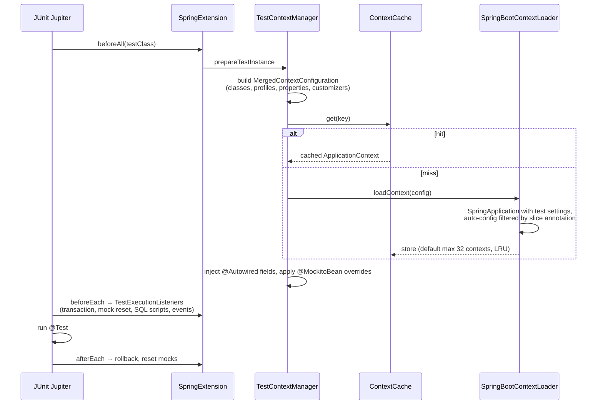
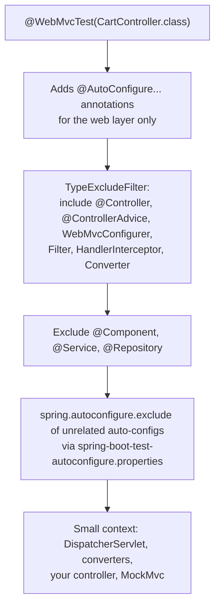

# 15 · Testing Fundamentals

## 1. Introduction & Why It Matters

Twenty-six services, a mobile app that can't be force-upgraded, and a Diwali sale where a bad deploy costs crores — the only thing that makes weekly releases safe is a test suite the team trusts. "Trusts" means three things: it **catches real regressions**, it **doesn't cry wolf** (no flaky tests), and it **runs fast enough** that nobody skips it.

Spring Boot gives you a lot: a test starter with JUnit Jupiter, AssertJ, Mockito and Spring Test; **slice tests** that boot only the layer under test; **context caching** so 300 tests share a handful of application contexts; `MockMvc`/`MockMvcTester` for controllers; bean overriding with `@MockitoBean`; and Testcontainers integration for real databases.

Used badly, the same tools produce a suite where every test is `@SpringBootTest`, 40 different contexts start, `@MockitoBean` is sprinkled everywhere, and CI takes 35 minutes to tell you a date assertion broke because midnight passed.

This chapter builds the platform's testing foundation: what to test where, unit tests without Spring, each slice with a real example, context caching economics, deterministic time and data builders, `@MockitoBean`/`@TestBean`, parameterized tests, async assertions, and composed annotations that make the right test style the easy one. Chapter 28 covers integration, contract and architecture testing; Chapter 34 covers performance testing.

### Who should read which section

| Band | Focus |
|---|---|
| B1 · 0–2 yrs | Parts 1, 2, 4 — JUnit, AssertJ, Mockito, first slice tests |
| B2 · 2–5 yrs | Parts 2, 5 — slices, `@MockitoBean`, `@SpringBootTest` modes, data builders |
| B3 · 5–8 yrs | Parts 3, 5, 6 — context caching, test configuration, determinism, parallelism |
| B4 · 8–12 yrs | Parts 6, 8 — suite architecture, CI speed, flakiness budgets |
| B5 · 12–15+ yrs | Parts 8, 9 — testing strategy and quality gates across teams |

---

## 2. Core Concepts

### 2.1 The shape of the suite



Rules of thumb for a grocery service:

| Layer | What it proves | Typical count |
|---|---|---|
| **Unit** | Business rules, calculations, state machines, value objects | 60–70% |
| **Slice** | Wiring of one layer: HTTP contract, SQL mapping, JSON shape | 20–30% |
| **Integration** | The service works against real PostgreSQL/Kafka/Redis | 5–10% |
| **End-to-end** | Critical journeys across services | A few per platform |

### 2.2 The toolbox in `spring-boot-starter-test`

| Library | Use |
|---|---|
| **JUnit Jupiter** | Test engine: `@Test`, `@Nested`, `@ParameterizedTest`, lifecycle |
| **AssertJ** | Fluent assertions (`assertThat(...)`) |
| **Mockito** | Mocks and stubs for collaborators |
| **Spring Test** | `ApplicationContext` for tests, `MockMvc`, `TestRestTemplate`, caching |
| **JSONassert / JsonPath** | JSON assertions |
| **Awaitility** | Waiting for asynchronous conditions |
| **XMLUnit** | XML comparison |

### 2.3 Unit tests: no Spring at all

If a class's dependencies can be passed in a constructor (they can — Chapter 02), it's testable with `new`. No context, no annotations, microseconds per test. **Most business logic belongs here.**

Mock **collaborators you own** (repositories, gateways) — not value objects, not `List`, not the JDK.

### 2.4 `@SpringBootTest`

Loads the full application context. `webEnvironment` decides how much:

| Value | Meaning |
|---|---|
| `MOCK` (default) | Mock servlet environment; use `MockMvc`/`MockMvcTester` |
| `RANDOM_PORT` | Real embedded server on a random port; `TestRestTemplate`/`RestTestClient`, `@LocalServerPort` |
| `DEFINED_PORT` | Real server on the configured port (avoid — port clashes) |
| `NONE` | No web server |

### 2.5 Slice tests

Each slice auto-configures **only** the beans of one layer and excludes regular `@Component`s:

| Slice | Loads | Typical assertions |
|---|---|---|
| `@WebMvcTest` | Controllers, advices, filters, converters, `MockMvc` | Status codes, JSON, validation, security rules |
| `@DataJpaTest` | Entities, repositories, `TestEntityManager`, transactional | Mappings, queries, constraints |
| `@JdbcTest` / `@DataJdbcTest` | `DataSource`, `JdbcClient` / Spring Data JDBC | SQL, translation |
| `@JsonTest` | Jackson configuration, `JacksonTester` | Serialization contracts |
| `@RestClientTest` | `RestClient`/`RestTemplate` builders + `MockRestServiceServer` | Outbound HTTP, error mapping |
| `@DataRedisTest`, `@DataMongoTest`, `@GraphQlTest`, `@JooqTest`, `@WebFluxTest` | Their technology | — |

Slices are fast because the context is small — and they force you to notice when a controller needs "just one service" injected.

### 2.6 Replacing beans in tests

| Tool | Since | Behaviour |
|---|---|---|
| `@MockitoBean` | Framework 6.2 | Replaces (or adds) a bean with a Mockito mock |
| `@MockitoSpyBean` | 6.2 | Wraps the real bean in a spy |
| `@TestBean` | 6.2 | Replaces a bean with the value from a static factory method — no Mockito |
| `@MockBean` / `@SpyBean` | Boot ≤3.x | **Deprecated in 3.4, removed in Boot 4** |
| `@TestConfiguration` | — | Extra/overriding beans for a test (not picked up by component scanning) |
| `@Import` | — | Pull in specific configuration classes |

### 2.7 Context caching — the biggest lever on suite speed

Spring caches contexts by a **key** built from: configuration classes, active profiles, property sources, `@MockitoBean` definitions, web environment, context customizers, resource overrides. Same key → the same context is reused across test classes.

Every *distinct* key starts another context (seconds each, plus memory). Two rules:

1. **Standardize** test setups (composed annotations) so keys repeat.
2. Avoid `@DirtiesContext` unless a test genuinely corrupts state — it evicts the context and forces a restart.

### 2.8 Transactional tests

`@DataJpaTest` (and `@Transactional` on a test class) wraps each test in a transaction that is **rolled back**. Benefits: isolation, no cleanup. Pitfalls:

- Commit-time behaviour (constraint checks at commit, `@TransactionalEventListener(AFTER_COMMIT)`) never happens — use `TestTransaction`, `@Commit`, or a `TransactionTemplate` in a non-transactional test.
- Code under test that requires a **new** transaction (`REQUIRES_NEW`) sees the test's uncommitted data differently than production would.

### 2.9 Determinism

Flaky tests destroy trust faster than missing tests. The usual causes and fixes:

| Cause | Fix |
|---|---|
| `Instant.now()` / `LocalDate.now()` | Inject a `Clock`; use `Clock.fixed` in tests |
| Random data/ids | Seeded generator or fixed values |
| `Thread.sleep` for async | Awaitility with a condition |
| Shared mutable state between tests | Fresh fixtures; no static caches |
| Test order dependence | Each test sets up its own data |
| Time zones / locales | Set explicitly (`Asia/Kolkata`, `en-IN`) |
| Real network calls | Mock servers, Testcontainers |

### 2.10 Test data builders

Object mothers/builders keep tests readable and resilient: `anOrder().withLine("MILK-1L", 2).placed()` instead of ten constructor arguments repeated 40 times.

---

## 3. How It Works Internally

### 3.1 The Spring TestContext framework



`TestExecutionListener`s do the per-test work: `TransactionalTestExecutionListener` (rollback), `MockitoResetTestExecutionListener`, `SqlScriptsTestExecutionListener` (`@Sql`), `ApplicationEventsTestExecutionListener` (`@RecordApplicationEvents`), `DirtiesContextTestExecutionListener`.

### 3.2 How a slice narrows the context



Because services and repositories are excluded, every collaborator the controller needs must be supplied — normally with `@MockitoBean`.

### 3.3 `MockMvc` vs a real server

`MockMvc` calls the `DispatcherServlet` directly with mock request/response objects: no socket, no servlet container, no real filters unless registered. It's fast and exercises mappings, converters, validation, advices and (when configured) Spring Security's filter chain. A real server (`RANDOM_PORT`) additionally exercises the container, connectors, servlet filters as deployed, and serialization over the wire.

---

## 4. Hands-On Code — Level 1 (Beginner)

### 4.1 A unit test of business logic

```java title="in/grocery/cart/service/DeliveryFeePolicy.java"
package in.grocery.cart.service;

import in.grocery.common.money.Money;

public class DeliveryFeePolicy {

    private final Money freeAbove;
    private final Money standardFee;

    public DeliveryFeePolicy(Money freeAbove, Money standardFee) {
        this.freeAbove = freeAbove;
        this.standardFee = standardFee;
    }

    public Money feeFor(Money subtotal, boolean expressSlot) {
        if (subtotal.compareTo(Money.ZERO) == 0) return Money.ZERO;
        Money base = subtotal.compareTo(freeAbove) >= 0 ? Money.ZERO : standardFee;
        return expressSlot ? base.plus(Money.parse("29.00")) : base;
    }
}
```

```java title="in/grocery/cart/service/DeliveryFeePolicyTest.java"
package in.grocery.cart.service;

import static org.assertj.core.api.Assertions.assertThat;

import in.grocery.common.money.Money;
import org.junit.jupiter.api.DisplayName;
import org.junit.jupiter.api.Test;
import org.junit.jupiter.params.ParameterizedTest;
import org.junit.jupiter.params.provider.CsvSource;

class DeliveryFeePolicyTest {

    private final DeliveryFeePolicy policy = new DeliveryFeePolicy(Money.parse("499"), Money.parse("35"));

    @Test
    @DisplayName("empty cart is never charged")
    void emptyCartHasNoFee() {
        assertThat(policy.feeFor(Money.ZERO, false)).isEqualTo(Money.ZERO);
    }

    @ParameterizedTest(name = "subtotal {0}, express {1} → fee {2}")                    // (1)!
    @CsvSource({
            "100.00, false, 35.00",
            "498.99, false, 35.00",
            "499.00, false, 0.00",
            "600.00, false, 0.00",
            "600.00, true,  29.00",
            "100.00, true,  64.00"
    })
    void appliesThresholdAndExpressSurcharge(String subtotal, boolean express, String expected) {
        assertThat(policy.feeFor(Money.parse(subtotal), express)).isEqualTo(Money.parse(expected));
    }
}
```

1. One parameterized test replaces six near-identical methods and documents the boundaries (498.99 vs 499.00).

### 4.2 A unit test with Mockito

```java title="in/grocery/cart/service/CartServiceTest.java"
package in.grocery.cart.service;

import static org.assertj.core.api.Assertions.assertThat;
import static org.assertj.core.api.Assertions.assertThatThrownBy;
import static org.mockito.ArgumentMatchers.any;
import static org.mockito.ArgumentMatchers.anyLong;
import static org.mockito.ArgumentMatchers.eq;
import static org.mockito.BDDMockito.given;
import static org.mockito.BDDMockito.then;

import in.grocery.cart.repository.CartRepository;
import in.grocery.cart.repository.CatalogLookup;
import java.util.Optional;
import org.junit.jupiter.api.Test;
import org.junit.jupiter.api.extension.ExtendWith;
import org.mockito.ArgumentCaptor;
import org.mockito.Captor;
import org.mockito.Mock;
import org.mockito.junit.jupiter.MockitoExtension;

@ExtendWith(MockitoExtension.class)                                                    // (1)!
class CartServiceTest {

    @Mock CartRepository repository;
    @Mock CatalogLookup catalog;
    @Captor ArgumentCaptor<Cart> savedCart;

    @Test
    void addingAnItemStoresNewVersion() {
        Cart existing = new Cart("c1", "C-1", java.util.Map.of(), 3);
        given(repository.find("c1")).willReturn(Optional.of(existing));
        given(repository.update(any(), anyLong())).willAnswer(inv -> inv.getArgument(0));   // (2)!

        var service = new CartService(repository, catalog, TestProperties.cart());
        service.addItem("c1", "MILK-1L", 2);

        then(repository).should().update(savedCart.capture(), eq(3L));                  // (3)!
        assertThat(savedCart.getValue().quantities()).containsEntry("MILK-1L", 2);
        assertThat(savedCart.getValue().version()).isEqualTo(4);
    }

    @Test
    void unknownCartFails() {
        given(repository.find("nope")).willReturn(Optional.empty());
        var service = new CartService(repository, catalog, TestProperties.cart());

        assertThatThrownBy(() -> service.addItem("nope", "MILK-1L", 1))
                .isInstanceOf(CartNotFoundException.class);
    }
}
```

1. Initializes `@Mock` fields and enforces strict stubbing (unused stubs fail the test — a good thing).
2. `willAnswer` returns the argument, mimicking a repository that saves and returns.
3. BDD style (`given/willReturn`, `then/should`) reads like the scenario. Capture arguments to assert on what the code *produced*.

### 4.3 A web slice test

```java title="in/grocery/cart/web/CartItemControllerTest.java"
package in.grocery.cart.web;

import static org.assertj.core.api.Assertions.assertThat;
import static org.mockito.BDDMockito.given;

import in.grocery.cart.delegate.CartDelegate;
import in.grocery.cart.web.dto.CartDtos.CartView;
import java.math.BigDecimal;
import java.util.List;
import org.junit.jupiter.api.Test;
import org.springframework.beans.factory.annotation.Autowired;
import org.springframework.boot.test.autoconfigure.web.servlet.WebMvcTest;
import org.springframework.http.HttpStatus;
import org.springframework.http.MediaType;
import org.springframework.test.context.bean.override.mockito.MockitoBean;
import org.springframework.test.web.servlet.assertj.MockMvcTester;

@WebMvcTest(CartItemController.class)
class CartItemControllerTest {

    @Autowired MockMvcTester mvc;
    @MockitoBean CartDelegate delegate;                                                // (1)!

    @Test
    void addsItem() {
        given(delegate.addItem(org.mockito.ArgumentMatchers.eq("c1"), org.mockito.ArgumentMatchers.any()))
                .willReturn(new CartView("c1", List.of(), BigDecimal.ZERO, BigDecimal.ZERO, BigDecimal.ZERO, 1));

        assertThat(mvc.post().uri("/api/carts/c1/items")
                .contentType(MediaType.APPLICATION_JSON)
                .content("{\"sku\":\"MILK-1L\",\"quantity\":2}"))
                .hasStatusOk()
                .bodyJson().extractingPath("$.cartId").isEqualTo("c1");
    }

    @Test
    void rejectsInvalidQuantity() {
        assertThat(mvc.post().uri("/api/carts/c1/items")
                .contentType(MediaType.APPLICATION_JSON)
                .content("{\"sku\":\"MILK-1L\",\"quantity\":0}"))
                .hasStatus(HttpStatus.BAD_REQUEST);                                    // (2)!
    }
}
```

1. The delegate isn't in the slice; `@MockitoBean` supplies it.
2. Validation (Chapter 09) runs inside the slice — the controller's contract is tested end to end at the HTTP layer without any business code.

---

## 5. Hands-On Code — Level 2 (Intermediate) & Level 3 (Advanced)

### 5.1 Level 2 — Test data builders and a fixed clock

```java title="src/test/java/in/grocery/order/TestOrders.java"
package in.grocery.order;

import in.grocery.common.money.Money;
import in.grocery.order.domain.DeliveryAddress;
import in.grocery.order.domain.Order;
import java.time.Instant;
import java.util.ArrayList;
import java.util.List;

public final class TestOrders {

    public static final Instant FIXED_NOW = Instant.parse("2026-10-20T04:30:00Z");     // 10:00 IST
    public static final DeliveryAddress HSR = new DeliveryAddress("Asha", "12, 5th Main", null, "Bengaluru", "560102");

    private String ref = "ORD-TEST";
    private String customerId = "C-1";
    private final List<Object[]> lines = new ArrayList<>();
    private Money fee = Money.parse("35");

    public static TestOrders anOrder() { return new TestOrders(); }

    public TestOrders ref(String ref) { this.ref = ref; return this; }
    public TestOrders forCustomer(String id) { this.customerId = id; return this; }
    public TestOrders freeDelivery() { this.fee = Money.ZERO; return this; }

    public TestOrders withLine(String sku, int qty, String price) {
        lines.add(new Object[] {sku, qty, price});
        return this;
    }

    public Order placed() {
        Order order = Order.place(ref, customerId, HSR, fee, FIXED_NOW);
        lines.forEach(l -> order.addLine((String) l[0], "Test " + l[0], (int) l[1], Money.parse((String) l[2])));
        return order;
    }

    public Order paid() {
        Order order = placed();
        order.markPaid();
        return order;
    }
}
```

```java title="Usage"
Order order = anOrder().forCustomer("C-9").withLine("MILK-1L", 2, "66.00").freeDelivery().paid();
```

```java title="src/test/java/in/grocery/platform/test/FixedClockConfig.java"
package in.grocery.platform.test;

import java.time.Clock;
import java.time.Instant;
import java.time.ZoneId;
import org.springframework.boot.test.context.TestConfiguration;
import org.springframework.context.annotation.Bean;
import org.springframework.context.annotation.Primary;

@TestConfiguration(proxyBeanMethods = false)                                          // (1)!
public class FixedClockConfig {

    public static final Instant NOW = Instant.parse("2026-10-20T04:30:00Z");

    @Bean
    @Primary
    Clock fixedClock() {
        return Clock.fixed(NOW, ZoneId.of("Asia/Kolkata"));
    }
}
```

1. `@TestConfiguration` isn't picked up by component scanning — it applies only where `@Import`ed (or as a nested static class in the test).

### 5.2 Level 2 — `@SpringBootTest` with a real server

```java title="in/grocery/cart/CartApiIntegrationTest.java"
package in.grocery.cart;

import static org.assertj.core.api.Assertions.assertThat;

import in.grocery.platform.test.FixedClockConfig;
import java.util.Map;
import org.junit.jupiter.api.Test;
import org.springframework.beans.factory.annotation.Autowired;
import org.springframework.boot.test.context.SpringBootTest;
import org.springframework.boot.test.web.client.TestRestTemplate;
import org.springframework.context.annotation.Import;
import org.springframework.http.HttpEntity;
import org.springframework.http.HttpHeaders;
import org.springframework.http.HttpStatus;

@SpringBootTest(webEnvironment = SpringBootTest.WebEnvironment.RANDOM_PORT)             // (1)!
@Import(FixedClockConfig.class)
class CartApiIntegrationTest {

    @Autowired TestRestTemplate rest;

    @Test
    void createAndFetchCart() {
        HttpHeaders headers = new HttpHeaders();
        headers.set("X-Customer-Id", "C-1");

        var created = rest.postForEntity("/api/carts", new HttpEntity<>(headers), Map.class);
        assertThat(created.getStatusCode()).isEqualTo(HttpStatus.CREATED);
        assertThat(created.getHeaders().getETag()).isEqualTo("\"0\"");                  // (2)!

        String location = created.getHeaders().getLocation().getPath();
        var fetched = rest.exchange(location, org.springframework.http.HttpMethod.GET,
                new HttpEntity<>(headers), Map.class);
        assertThat(fetched.getStatusCode()).isEqualTo(HttpStatus.OK);
    }
}
```

1. Real Tomcat on a random port: servlet filters, connectors and the full serialization path are exercised.
2. Headers set by `ResponseEntity` (Chapter 08) are verified as the client sees them.

!!! note "Boot 4: `RestTestClient`"
    Framework 7 adds `RestTestClient`, a fluent testing client that can bind either to a running server or to `MockMvc` — the same assertions for slice and integration tests. Prefer it in new Boot 4 code; `TestRestTemplate` still works.

### 5.3 Level 2 — Testing an outbound HTTP client

```java title="in/grocery/payment/client/RazorpayClientTest.java"
package in.grocery.payment.client;

import static org.assertj.core.api.Assertions.assertThat;
import static org.assertj.core.api.Assertions.assertThatThrownBy;
import static org.springframework.test.web.client.match.MockRestRequestMatchers.header;
import static org.springframework.test.web.client.match.MockRestRequestMatchers.jsonPath;
import static org.springframework.test.web.client.match.MockRestRequestMatchers.method;
import static org.springframework.test.web.client.match.MockRestRequestMatchers.requestTo;
import static org.springframework.test.web.client.response.MockRestResponseCreators.withServerError;
import static org.springframework.test.web.client.response.MockRestResponseCreators.withSuccess;

import in.grocery.platform.error.DependencyException;
import java.math.BigDecimal;
import org.junit.jupiter.api.Test;
import org.springframework.beans.factory.annotation.Autowired;
import org.springframework.boot.test.autoconfigure.web.client.RestClientTest;
import org.springframework.http.HttpMethod;
import org.springframework.http.MediaType;
import org.springframework.test.web.client.MockRestServiceServer;

@RestClientTest(RazorpayClient.class)                                                   // (1)!
class RazorpayClientTest {

    @Autowired RazorpayClient client;
    @Autowired MockRestServiceServer server;                                            // (2)!

    @Test
    void createsOrderInPaise() {
        server.expect(requestTo("https://api.razorpay.com/v1/orders"))
              .andExpect(method(HttpMethod.POST))
              .andExpect(header("Authorization", org.hamcrest.Matchers.startsWith("Basic ")))
              .andExpect(jsonPath("$.amount").value(57800))
              .andRespond(withSuccess("""
                      {"id":"order_9A33XWu170gUtm","amount":57800,"currency":"INR","status":"created"}
                      """, MediaType.APPLICATION_JSON));

        assertThat(client.createOrder("ORD-1", new BigDecimal("578.00"))).isEqualTo("order_9A33XWu170gUtm");
        server.verify();
    }

    @Test
    void serverErrorBecomesDependencyException() {
        server.expect(requestTo("https://api.razorpay.com/v1/orders")).andRespond(withServerError());

        assertThatThrownBy(() -> client.createOrder("ORD-2", new BigDecimal("100.00")))
                .isInstanceOf(DependencyException.class);                                // (3)!
    }
}
```

1. Slice with `RestClient`/`RestTemplate` builders configured as in production.
2. Intercepts requests at the client level — no network, no port.
3. The error-translation contract from Chapter 10 is part of the client's unit of behaviour.

### 5.4 Level 3 — Context caching economics

```java title="What creates a NEW context"
@SpringBootTest                                        // context A
class OrderServiceTest { }

@SpringBootTest                                        // context A (reused)
class PaymentServiceTest { }

@SpringBootTest(properties = "grocery.cart.max-items=5")   // context B
class CartLimitTest { }

@SpringBootTest
@ActiveProfiles("integration")                             // context C
class IntegrationFlowTest { }

@SpringBootTest
class OrderNotifierTest {
    @MockitoBean SmsSender sms;                            // context D (mock changes the key)
}

@SpringBootTest
@DirtiesContext                                            // context A destroyed after this class!
class LegacyStateTest { }
```

Practical rules:

1. **Group properties**: use a profile (`test`) or a shared composed annotation instead of ad-hoc `properties = ...` per class.
2. **Mock the same collaborators in the same place** — a shared `@TestConfiguration` reused across classes keeps one context.
3. **`@DirtiesContext` is a last resort**; reset state in `@AfterEach` instead.
4. Inspect with `logging.level.org.springframework.test.context.cache=DEBUG` — it logs hit/miss statistics.

```text title="Cache statistics in the log"
Spring test ApplicationContext cache statistics: [DefaultContextCache@... size = 4, maxSize = 32,
 parentContextCount = 0, hitCount = 187, missCount = 4]
```

Four contexts, 187 hits — healthy. Four contexts, 4 hits means every test class starts its own.

### 5.5 Level 3 — Composed annotations for the platform

```java title="src/test/java/in/grocery/platform/test/GroceryWebTest.java"
package in.grocery.platform.test;

import in.grocery.platform.error.GroceryProblemHandler;
import in.grocery.platform.web.GroceryWebMvcConfig;
import in.grocery.platform.web.ServiceabilityInterceptor;
import java.lang.annotation.ElementType;
import java.lang.annotation.Retention;
import java.lang.annotation.RetentionPolicy;
import java.lang.annotation.Target;
import org.springframework.boot.test.autoconfigure.web.servlet.WebMvcTest;
import org.springframework.context.annotation.Import;
import org.springframework.test.context.ActiveProfiles;
import org.springframework.test.context.bean.override.mockito.MockitoBean;

/** Web slice with the platform's MVC config, error handling and a mocked serviceability check. */
@Target(ElementType.TYPE)
@Retention(RetentionPolicy.RUNTIME)
@WebMvcTest
@ActiveProfiles("test")
@Import({GroceryWebMvcConfig.class, GroceryProblemHandler.class, FixedClockConfig.class})
@MockitoBean(types = ServiceabilityInterceptor.ServiceabilityChecker.class)             // (1)!
public @interface GroceryWebTest {

    @org.springframework.core.annotation.AliasFor(annotation = WebMvcTest.class, attribute = "controllers")
    Class<?>[] controllers() default {};                                                 // (2)!
}
```

1. Class-level `@MockitoBean(types = ...)` (Framework 6.2+) declares the mock without a field — every web test gets the same context key.
2. `@AliasFor` forwards the controller list, so tests write `@GroceryWebTest(controllers = CartController.class)`.

```java title="Usage"
@GroceryWebTest(controllers = CartCommandController.class)
class CartCommandControllerTest {
    @Autowired MockMvcTester mvc;
    @Autowired ServiceabilityInterceptor.ServiceabilityChecker serviceability;   // the shared mock
    @MockitoBean CartDelegate delegate;                                          // test-specific
    ...
}
```

Similar annotations: `@GroceryJpaTest` (`@DataJpaTest` + Testcontainers config + fixed clock), `@GroceryJsonTest`.

### 5.6 Level 3 — One database container for the whole suite

Starting a PostgreSQL container per test class is slow. Share one:

```java title="src/test/java/in/grocery/platform/test/ContainersConfig.java"
package in.grocery.platform.test;

import org.springframework.boot.test.context.TestConfiguration;
import org.springframework.boot.testcontainers.service.connection.ServiceConnection;
import org.springframework.context.annotation.Bean;
import org.testcontainers.containers.PostgreSQLContainer;
import org.testcontainers.utility.DockerImageName;

@TestConfiguration(proxyBeanMethods = false)
public class ContainersConfig {

    @Bean
    @ServiceConnection                                                                   // (1)!
    PostgreSQLContainer<?> postgres() {
        return new PostgreSQLContainer<>(DockerImageName.parse("postgres:17-alpine"))
                .withReuse(true);                                                        // (2)!
    }
}
```

1. Boot starts the container as a bean and points `spring.datasource.*` at it. Because it's part of the cached context, all tests importing this configuration share one container **and** one context.
2. With `testcontainers.reuse.enable=true` in `~/.testcontainers.properties`, the container survives between local runs — seconds instead of minutes. (Not used in CI.)

```java title="src/test/java/in/grocery/order/TestOrderApplication.java"
package in.grocery.order;

import in.grocery.platform.test.ContainersConfig;
import org.springframework.boot.SpringApplication;

/** Run the app locally with real infrastructure: ./gradlew bootTestRun */
public class TestOrderApplication {
    public static void main(String[] args) {
        SpringApplication.from(OrderApplication::main).with(ContainersConfig.class).run(args);   // (1)!
    }
}
```

1. Boot 3.1+: start the application from tests with Testcontainers-provided infrastructure — no local PostgreSQL install.

### 5.7 Level 3 — Asynchronous assertions

```java title="OrderEventsIntegrationTest.java"
@SpringBootTest
@Import({ContainersConfig.class, FixedClockConfig.class})
class OrderEventsIntegrationTest {

    @Autowired OrderPlacementService placement;
    @Autowired TestSmsSender sms;                     // test double collecting messages

    @Test
    void sendsSmsAfterCommit() {
        placement.place("ORD-A1", "C-1", TestOrders.HSR, Money.ZERO,
                List.of(new OrderPlacementService.LineRequest("MILK-1L", "Toned Milk", 1, Money.parse("66"))));

        await().atMost(Duration.ofSeconds(5))                                            // (1)!
               .untilAsserted(() -> assertThat(sms.messages()).anySatisfy(m ->
                       assertThat(m).contains("ORD-A1")));
    }
}
```

1. Awaitility polls until the assertion passes or the timeout expires — no `Thread.sleep(2000)` that is both slow and flaky. (The listener is `@Async` + `AFTER_COMMIT`, Chapter 03; this test must **not** be `@Transactional`, or the commit never happens.)

---

## 6. Hands-On Code — Level 4 (Expert / Production)

### 6.1 The platform test strategy

| Test kind | Annotation | Infrastructure | Runs in |
|---|---|---|---|
| Unit | none | none | every build, `test` task |
| Web slice | `@GroceryWebTest` | none | `test` |
| JSON slice | `@GroceryJsonTest` | none | `test` |
| Persistence slice | `@GroceryJpaTest` | shared PostgreSQL container | `test` (tagged `db`) |
| Client slice | `@RestClientTest` | none | `test` |
| Service integration | `@SpringBootTest` + `ContainersConfig` | PostgreSQL, Kafka, Redis | `integrationTest` task |
| Contract/consumer | Chapter 28 | stubs | `integrationTest` |
| Architecture | ArchUnit (Chapter 01) | none | `test` |

```kotlin title="build-logic/src/main/kotlin/grocery.java-conventions.gradle.kts (addition)"
testing {
    suites {
        val test by getting(JvmTestSuite::class) { useJUnitJupiter() }
        register<JvmTestSuite>("integrationTest") {                                      // (1)!
            useJUnitJupiter()
            dependencies {
                implementation(project())
                implementation("org.springframework.boot:spring-boot-starter-test")
                implementation("org.springframework.boot:spring-boot-testcontainers")
                implementation("org.testcontainers:postgresql")
            }
            targets.all {
                testTask.configure {
                    shouldRunAfter(test)
                    systemProperty("junit.jupiter.execution.parallel.enabled", "true")   // (2)!
                    systemProperty("junit.jupiter.execution.parallel.mode.default", "same_thread")
                    systemProperty("junit.jupiter.execution.parallel.mode.classes.default", "concurrent")
                }
            }
        }
    }
}
tasks.named("check") { dependsOn(testing.suites.named("integrationTest")) }
```

1. A separate source set (`src/integrationTest/java`) keeps slow tests out of the fast feedback loop.
2. Test **classes** run in parallel, methods within a class sequentially — safe for Spring contexts (they're thread-safe and shared) as long as tests don't mutate global state.

### 6.2 Deterministic, parallel-safe data

Parallel tests against one database need isolation without `@DirtiesContext`:

```java title="src/test/java/in/grocery/platform/test/UniqueIds.java"
package in.grocery.platform.test;

import java.util.concurrent.atomic.AtomicLong;

/** Unique but readable ids so parallel tests never collide on unique constraints. */
public final class UniqueIds {

    private static final AtomicLong SEQ = new AtomicLong();

    private UniqueIds() {}

    public static String orderRef() {
        return "ORD-T%05d".formatted(SEQ.incrementAndGet());
    }

    public static String customerId() {
        return "C-T%05d".formatted(SEQ.incrementAndGet());
    }
}
```

Each test creates its own customer and orders; nothing is deleted between tests; assertions are scoped by the generated ids. This is faster and far more parallel-friendly than truncating tables.

### 6.3 A full-stack test of the checkout path

```java title="src/integrationTest/java/in/grocery/order/CheckoutFlowTest.java"
package in.grocery.order;

import static org.assertj.core.api.Assertions.assertThat;
import static org.awaitility.Awaitility.await;

import in.grocery.platform.test.ContainersConfig;
import in.grocery.platform.test.FixedClockConfig;
import in.grocery.platform.test.UniqueIds;
import java.time.Duration;
import java.util.Map;
import org.junit.jupiter.api.Test;
import org.springframework.beans.factory.annotation.Autowired;
import org.springframework.boot.test.context.SpringBootTest;
import org.springframework.boot.test.web.client.TestRestTemplate;
import org.springframework.context.annotation.Import;
import org.springframework.http.HttpEntity;
import org.springframework.http.HttpHeaders;
import org.springframework.http.HttpMethod;
import org.springframework.http.HttpStatus;
import org.springframework.test.context.bean.override.mockito.MockitoBean;

@SpringBootTest(webEnvironment = SpringBootTest.WebEnvironment.RANDOM_PORT)
@Import({ContainersConfig.class, FixedClockConfig.class})
class CheckoutFlowTest {

    @Autowired TestRestTemplate rest;
    @MockitoBean in.grocery.payment.gateway.PaymentGateway gateway;                       // (1)!

    private HttpHeaders customer(String id) {
        HttpHeaders h = new HttpHeaders();
        h.set("X-Customer-Id", id);
        h.set("X-Pincode", "560102");
        h.setContentType(org.springframework.http.MediaType.APPLICATION_JSON);
        return h;
    }

    @Test
    void placesOrderIdempotently() {
        String customer = UniqueIds.customerId();
        HttpHeaders headers = customer(customer);
        headers.set("Idempotency-Key", java.util.UUID.randomUUID().toString());

        var body = """
                {"cartId":"%s"}
                """.formatted(seedCart(customer));

        var first = rest.postForEntity("/api/orders", new HttpEntity<>(body, headers), Map.class);
        var second = rest.postForEntity("/api/orders", new HttpEntity<>(body, headers), Map.class);   // (2)!

        assertThat(first.getStatusCode()).isEqualTo(HttpStatus.CREATED);
        assertThat(second.getBody()).isEqualTo(first.getBody());

        await().atMost(Duration.ofSeconds(5)).untilAsserted(() -> {
            var history = rest.exchange("/api/orders?size=10", HttpMethod.GET, new HttpEntity<>(headers), Map.class);
            assertThat(history.getStatusCode()).isEqualTo(HttpStatus.OK);
            assertThat((java.util.List<?>) history.getBody().get("items")).hasSize(1);                // (3)!
        });
    }

    @Test
    void unserviceablePincodeReturnsProblemDetail() {
        HttpHeaders headers = customer(UniqueIds.customerId());
        headers.set("X-Pincode", "744101");
        headers.set("Idempotency-Key", java.util.UUID.randomUUID().toString());

        var response = rest.postForEntity("/api/orders", new HttpEntity<>("{\"cartId\":\"x\"}", headers), Map.class);

        assertThat(response.getStatusCode()).isEqualTo(HttpStatus.UNPROCESSABLE_ENTITY);
        assertThat(response.getBody())
                .containsEntry("code", "PINCODE_NOT_SERVICEABLE")
                .containsKey("traceId");                                                             // (4)!
    }

    private String seedCart(String customer) { /* call cart API, return cart id */ return "..."; }
}
```

1. Only the **external** dependency is mocked; database, HTTP stack, transactions, events and error handling are real.
2. Proves the idempotency aspect (Chapter 04) at the API level — the highest-value integration test in the service.
3. Exactly one order exists — no duplicate created by the retry.
4. Asserts the platform error contract (Chapter 10), not an English message.

### 6.4 CI configuration and quality gates

```kotlin title="build-logic (coverage gate)"
tasks.named<JacocoCoverageVerification>("jacocoTestCoverageVerification") {
    violationRules {
        rule {
            element = "CLASS"
            includes = listOf("in.grocery.*.service.*", "in.grocery.*.domain.*")          // (1)!
            limit {
                counter = "BRANCH"
                minimum = "0.70".toBigDecimal()
            }
            excludes = listOf("*Application", "*Configuration", "*Properties")
        }
    }
}
```

1. Coverage gates on **business logic**, not on configuration classes. A blanket 80% target pushes teams to write tests for getters.

```yaml title=".github/workflows/ci.yml (excerpt)"
      - name: Unit + slice tests
        run: ./gradlew test --configuration-cache
      - name: Integration tests
        run: ./gradlew integrationTest
      - name: Quality gates
        run: ./gradlew jacocoTestCoverageVerification
      - name: Publish test report
        if: always()
        uses: actions/upload-artifact@v4
        with:
          name: test-results
          path: "**/build/reports/tests/**"
```

### 6.5 Flaky test policy

| Rule | Detail |
|---|---|
| **Quarantine, don't ignore** | Tag `@Tag("flaky")`, exclude from the gate, create a ticket with an owner and a due date |
| **Never rerun blindly** | Retry plugins hide real races; if used, report retries as failures in the dashboard |
| **Budget** | More than 1% flaky → stop feature work and fix the suite |
| **Root causes** | Time, ordering, shared state, async waits, ports, container startup, clock skew, locale |
| **Detection** | Nightly job runs the suite N times and reports non-deterministic outcomes |

---

## 7. Spring Boot 3 vs 4 & Migration

| Topic | Boot 3.5 | Boot 4.x |
|---|---|---|
| JUnit | Jupiter 5.x | Jupiter 6.x (verify) |
| `@MockBean` / `@SpyBean` | Deprecated (3.4+) | **Removed** — `@MockitoBean` / `@MockitoSpyBean` |
| `@TestBean` | ✅ (6.2) | ✅ |
| Test starter | `spring-boot-starter-test` (everything) | Focused test starters per technology + classic starter (verify) |
| Slice annotations | `org.springframework.boot.test.autoconfigure.*` | Moved into technology test modules (verify) |
| `MockMvcTester` | ✅ (3.4) | ✅ |
| `RestTestClient` | — | ✅ (Framework 7) |
| Testcontainers support | `spring-boot-testcontainers` | Same (verify module name) |
| Mockito | 5.x | 5.x/6.x (verify) — inline mock maker agent flags on modern JDKs |

=== "Spring Boot 3.5"

    ```java title="CartControllerTest.java"
    import org.springframework.boot.test.mock.mockito.MockBean;      // deprecated

    @WebMvcTest(CartController.class)
    class CartControllerTest {
        @MockBean CartDelegate delegate;
    }
    ```

=== "Spring Boot 4.x"

    ```java title="CartControllerTest.java"
    import org.springframework.test.context.bean.override.mockito.MockitoBean;

    @WebMvcTest(CartController.class)
    class CartControllerTest {
        @MockitoBean CartDelegate delegate;
    }
    ```

### Migration checklist

- [ ] Replace `@MockBean`/`@SpyBean` with `@MockitoBean`/`@MockitoSpyBean` **before** upgrading (works on 3.4+).
- [ ] Update slice annotation imports and test starter dependencies for Boot 4.
- [ ] Check JUnit 6 changes (removed deprecations, extension APIs) if your build pulls it.
- [ ] Migrate `MockMvc` assertions to `MockMvcTester`/`RestTestClient` where convenient (optional but consistent).
- [ ] Re-measure suite duration and context counts after upgrading.

---

## 8. Production Playbook

### Best practices

1. **Push logic down** to plain classes and test it without Spring.
2. **One slice per layer**, `@SpringBootTest` only for real integration.
3. **Composed annotations** to standardize contexts and keep the cache hot.
4. **Fixed `Clock`, unique ids, builders** — determinism by construction.
5. **Awaitility, never `sleep`.**
6. **Testcontainers as beans** with `@ServiceConnection`, shared across the suite.
7. **Assert the contract** (status, `code`, JSON shape), not internal messages.
8. **Separate fast and slow suites**; run classes in parallel.
9. **Coverage gates on business packages**, mutation testing for critical logic (Chapter 28).
10. **Treat flakiness as a build-breaking defect.**

### Anti-patterns

❌ **`@SpringBootTest` for everything** — 40-second suites that test Spring, not your code.

❌ **Mocking what you don't own** (`JdbcClient`, `RestClient`, `EntityManager`) — tests pass, production fails; use slices/Testcontainers instead.

❌ **Asserting log messages or exception text** as the contract.

❌ **`@DirtiesContext` to fix state leaks** — fix the leak.

❌ **`Thread.sleep(2000)`** for async behaviour.

❌ **Shared mutable fixtures** (static `List` of orders) across tests.

❌ **Testing getters/setters for coverage** while the checkout flow has no test.

❌ **`@Transactional` on integration tests that must observe commits** — after-commit listeners and constraints never fire.

### Troubleshooting

| Symptom | Cause | Fix |
|---|---|---|
| Suite takes minutes; many "Starting ... Application" lines | Too many distinct contexts | Composed annotations, shared properties, fewer `@MockitoBean` variants |
| `No qualifying bean of type ...` in a slice | Collaborator excluded by the slice | `@MockitoBean` or `@Import` the needed configuration |
| Test passes alone, fails in suite | Shared state / ordering | Unique data per test, no statics, reset mocks |
| `LazyInitializationException` in a test but not in prod | `@DataJpaTest` transaction boundaries differ | Fetch within the query or assert inside a transaction |
| After-commit listener never runs | Test is transactional (rolled back) | Non-transactional integration test |
| Mockito strict stubbing failure | Unused stub | Remove it (it documents nothing) |
| `Mockito ... self-attaching ... dynamic agent` warning on JDK 21+ | Inline mock maker attaching dynamically | Configure `-javaagent` for `mockito-core` in the test task |
| Testcontainers slow on every class | Container per class | Container as a bean in a shared `@TestConfiguration`, reuse locally |
| Random failures at midnight / month end | `now()` in code | Inject `Clock` |

### Production checklist

- [ ] Business rules covered by fast unit tests
- [ ] Each controller has a web slice test incl. error statuses
- [ ] Each repository has a slice test on real PostgreSQL
- [ ] JSON contracts covered by `@JsonTest` golden files
- [ ] Outbound clients tested with `MockRestServiceServer`
- [ ] Critical journeys covered by integration tests with containers
- [ ] Context cache statistics reviewed; < ~5 contexts per service
- [ ] Fast suite under ~2 minutes; integration suite under ~10
- [ ] Flaky tests tracked with owners

---

## 9. Interview Questions & Answers

### B1 · 0–2 years

??? question "B1 · What comes with `spring-boot-starter-test`?"
    **Short answer:** JUnit Jupiter, Spring Test, AssertJ, Mockito, JSONassert, JsonPath, Awaitility, XMLUnit.

??? question "B1 · What's the difference between a unit test and a `@SpringBootTest`?"
    **Short answer:** A unit test instantiates the class directly with fakes/mocks and runs in microseconds; `@SpringBootTest` starts the whole application context.

??? question "B1 · What is `@WebMvcTest` for?"
    **Short answer:** Testing controllers with a slim context: mappings, validation, JSON, error handling, with `MockMvc` and mocked collaborators.

??? question "B1 · How do you test that a method throws?"
    **Short answer:** `assertThatThrownBy(() -> ...).isInstanceOf(X.class)` (AssertJ) or `assertThrows` (JUnit).

??? question "B1 · What replaced `@MockBean`?"
    **Short answer:** `@MockitoBean` (and `@MockitoSpyBean`), from Spring Framework 6.2; `@MockBean` is removed in Boot 4.

??? question "B1 · Why use a parameterized test?"
    **Short answer:** One test method covering many input/expected pairs — less duplication, clearer boundaries.

### B2 · 2–5 years

??? question "B2 · When do you use `@SpringBootTest(webEnvironment = RANDOM_PORT)`?"
    **Short answer:** When you need the real servlet container and an HTTP client (filters, connectors, end-to-end serialization). Otherwise MOCK with `MockMvc` is faster.

??? question "B2 · How do you test a repository?"
    **Short answer:** `@DataJpaTest`/`@JdbcTest` with `@AutoConfigureTestDatabase(replace = NONE)` against a Testcontainers PostgreSQL, with Flyway migrations applied.

??? question "B2 · What does `@DataJpaTest` do about transactions?"
    **Short answer:** Each test runs in a transaction rolled back afterwards — fast and isolated, but commit-time behaviour isn't exercised.

??? question "B2 · How do you test outgoing HTTP calls?"
    **Short answer:** `@RestClientTest` with `MockRestServiceServer` (request expectations and canned responses), or WireMock for full-stack behaviour (Chapter 28).

??? question "B2 · How do you avoid flaky time-based tests?"
    **Short answer:** Inject a `Clock` and use `Clock.fixed` in tests; never call `Instant.now()` directly in business code.

??? question "B2 · What's `@TestConfiguration` and how does it differ from `@Configuration`?"
    **Short answer:** It's not picked up by component scanning; it applies only where imported or nested in the test class — so it can't leak into other tests.

### B3 · 5–8 years

??? question "B3 · How does Spring's test context cache work and what breaks it?"
    **Short answer:** Contexts are cached by a key from configuration classes, profiles, properties, bean overrides, web environment and customizers. Ad-hoc `properties`, different `@MockitoBean` sets, extra profiles and `@DirtiesContext` create or evict contexts and slow the suite.

??? question "B3 · How does a slice annotation restrict the context?"
    **Short answer:** It applies `@AutoConfigure...` annotations for that technology, filters component scanning with a `TypeExcludeFilter` (only web/JPA/... component types) and excludes unrelated auto-configurations.

??? question "B3 · `MockMvc` vs a real server — what's not covered by `MockMvc`?"
    **Short answer:** The servlet container, connectors/HTTP parsing, filters registered outside the MVC context, real network serialization and timeouts.

??? question "B3 · How do you run tests in parallel safely with Spring?"
    **Short answer:** Enable JUnit parallel execution for classes, keep contexts shared and thread-safe, avoid static mutable state, generate unique data per test rather than truncating tables, and watch container/database connection limits.

??? question "B3 · When is mocking the wrong tool?"
    **Short answer:** For framework/infrastructure types (repositories' SQL behaviour, HTTP clients' serialization) — mocks encode assumptions that production violates. Use slices with real infrastructure instead.

### B4 · 8–12 years

??? question "B4 · Design the test strategy for a service with 200 endpoints."
    **Short answer:** Unit tests for domain logic; one web slice test per controller covering contract and error paths; persistence slices on real PostgreSQL; client slices for integrations; a handful of integration tests for critical journeys; contract tests with consumers; architecture tests; separate fast/slow suites; standardized composed annotations; quality gates on business packages.

??? question "B4 · The suite takes 25 minutes. How do you cut it?"
    **Short answer:** Measure per-class time and context counts; convert `@SpringBootTest` to slices; unify contexts; share containers; parallelize classes; split fast/slow tasks and run them concurrently in CI; cache Gradle and Docker layers; remove redundant end-to-end tests.

??? question "B4 · How do you handle flaky tests organizationally?"
    **Short answer:** Detect (nightly repeated runs), quarantine with ownership and deadlines, never blind-retry in the gate, treat the flake rate as a tracked metric, and budget time to fix root causes.

### B5 · 12–15+ years

??? question "B5 · What does 'good coverage' mean to you?"
    **Short answer:** Coverage is a diagnostic, not a goal. Gate on business-critical packages, require tests for every bug fix, use mutation testing where correctness matters most, and measure escaped defects and change failure rate instead of chasing a percentage.

??? question "B5 · How do you keep tests from becoming a maintenance burden?"
    **Short answer:** Test behaviour through stable contracts (HTTP, events), not internals; builders and shared fixtures; avoid over-mocking; delete redundant tests; refactor tests like production code; keep them fast so they're run.

### Scenario questions

??? example "Scenario · A regression reached production: order totals excluded delivery fee for express slots"
    Unit tests covered `DeliveryFeePolicy` but the delegate that assembled `CartView` summed only line totals; no test asserted the API response total. Fix: add a web slice test asserting the JSON `total`, add the case to the checkout integration test, and add a rule that every bug fix ships with a failing-then-passing test at the level the bug escaped.

??? example "Scenario · CI is green but the same suite fails locally for one developer"
    Their machine is on `Asia/Kolkata` while CI runs UTC, and a test asserted a formatted date. Fix: pin timezone and locale in the test task (`systemProperty("user.timezone", "Asia/Kolkata")`), inject `Clock`, and assert on `Instant`s rather than formatted strings.

### Coding exercise

!!! example "Exercise · Test the cart item limit end to end"
    `CartProperties.maxItems` is 50. Write (1) a unit test proving `CartService` rejects the 51st distinct SKU, and (2) a web slice test proving the API returns 422 with `code = CART_ITEM_LIMIT_EXCEEDED`, using the platform error handler. Keep both fast and independent of the database.

??? success "Solution"
    ```java title="CartServiceLimitTest.java"
    package in.grocery.cart.service;

    import static org.assertj.core.api.Assertions.assertThatThrownBy;
    import static org.mockito.ArgumentMatchers.any;
    import static org.mockito.ArgumentMatchers.anyLong;
    import static org.mockito.BDDMockito.given;

    import in.grocery.cart.config.CartProperties;
    import in.grocery.cart.repository.CartRepository;
    import in.grocery.cart.repository.CatalogLookup;
    import java.math.BigDecimal;
    import java.util.LinkedHashMap;
    import java.util.Map;
    import java.util.Optional;
    import org.junit.jupiter.api.Test;
    import org.junit.jupiter.api.extension.ExtendWith;
    import org.mockito.Mock;
    import org.mockito.junit.jupiter.MockitoExtension;

    @ExtendWith(MockitoExtension.class)
    class CartServiceLimitTest {

        @Mock CartRepository repository;
        @Mock CatalogLookup catalog;

        private static CartProperties props() {
            return new CartProperties(50, 20, java.time.Duration.ofMinutes(30),
                    new CartProperties.FreeDelivery(new BigDecimal("499"), true),
                    org.springframework.util.unit.DataSize.ofKilobytes(64),
                    java.util.List.of("tobacco"), Map.of());
        }

        @Test
        void rejectsFiftyFirstDistinctSku() {
            Map<String, Integer> fifty = new LinkedHashMap<>();
            for (int i = 0; i < 50; i++) fifty.put("SKU-" + i, 1);
            given(repository.find("c1")).willReturn(Optional.of(new Cart("c1", "C-1", fifty, 5)));

            var service = new CartService(repository, catalog, props());

            assertThatThrownBy(() -> service.addItem("c1", "SKU-NEW", 1))
                    .isInstanceOf(CartItemLimitExceededException.class);
        }
    }
    ```

    ```java title="CartItemControllerLimitTest.java"
    package in.grocery.cart.web;

    import static org.assertj.core.api.Assertions.assertThat;
    import static org.mockito.ArgumentMatchers.any;
    import static org.mockito.ArgumentMatchers.eq;
    import static org.mockito.BDDMockito.given;

    import in.grocery.cart.delegate.CartDelegate;
    import in.grocery.cart.service.CartItemLimitExceededException;
    import in.grocery.platform.test.GroceryWebTest;
    import org.junit.jupiter.api.Test;
    import org.springframework.beans.factory.annotation.Autowired;
    import org.springframework.http.HttpStatus;
    import org.springframework.http.MediaType;
    import org.springframework.test.context.bean.override.mockito.MockitoBean;
    import org.springframework.test.web.servlet.assertj.MockMvcTester;

    @GroceryWebTest(controllers = CartItemController.class)
    class CartItemControllerLimitTest {

        @Autowired MockMvcTester mvc;
        @MockitoBean CartDelegate delegate;

        @Test
        void limitExceededIs422WithCode() {
            given(delegate.addItem(eq("c1"), any())).willThrow(new CartItemLimitExceededException(50));

            assertThat(mvc.post().uri("/api/carts/c1/items")
                    .contentType(MediaType.APPLICATION_JSON)
                    .content("{\"sku\":\"SKU-NEW\",\"quantity\":1}"))
                    .hasStatus(HttpStatus.UNPROCESSABLE_ENTITY)
                    .bodyJson()
                    .satisfies(json -> {
                        assertThat(json).extractingPath("$.code").isEqualTo("CART_ITEM_LIMIT_EXCEEDED");
                        assertThat(json).extractingPath("$.maxItems").isEqualTo(50);
                    });
        }
    }
    ```

    The unit test owns the **rule**; the slice test owns the **contract**. Neither needs a database, and both run in milliseconds.

---

## Key Takeaways

- **Most tests are plain JUnit** on classes built with constructor injection; Spring appears only where wiring is the thing under test.
- **Slices** (`@WebMvcTest`, `@DataJpaTest`, `@JsonTest`, `@RestClientTest`) give layer-level confidence at ~100 ms each.
- **Context caching** decides suite speed — standardize setups with composed annotations, avoid `@DirtiesContext`.
- **`@MockitoBean`/`@MockitoSpyBean`/`@TestBean`** replace `@MockBean`.
- **Determinism** comes from fixed clocks, unique ids, builders and Awaitility.
- **Testcontainers as beans** with `@ServiceConnection` share one database across the suite.
- **Assert contracts** (status, error `code`, JSON shape), not internals.
- **Flaky tests are defects** — quarantine with owners, fix root causes.

## Further Reading

- Spring Boot Reference — *Testing* (test scope dependencies, `@SpringBootTest`, auto-configured test slices, Testcontainers, mocking beans)
- Spring Framework Reference — *Testing* (TestContext framework, context caching, bean overriding, `MockMvc`, `RestTestClient`)
- JUnit 5 User Guide — *Parameterized Tests*, *Parallel Execution*, *Extensions*
- AssertJ, Mockito and Awaitility documentation

---

[:material-arrow-left: 14 Database Migrations](14-database-migrations.md) · [16 Transactions Deep Dive :material-arrow-right:](../part-2-production/16-transactions-deep-dive.md)
