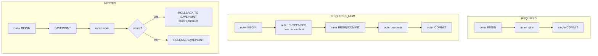
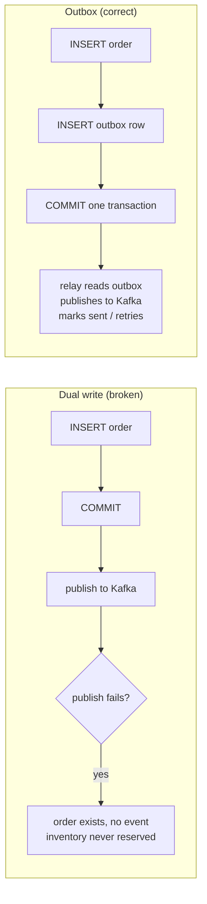
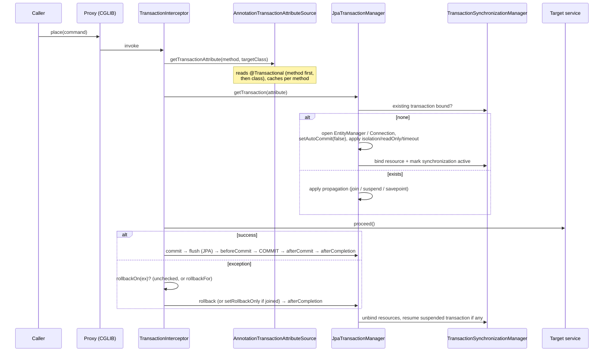
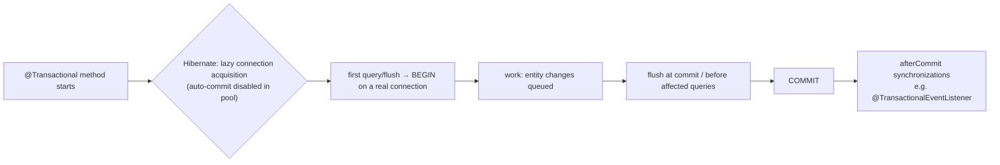
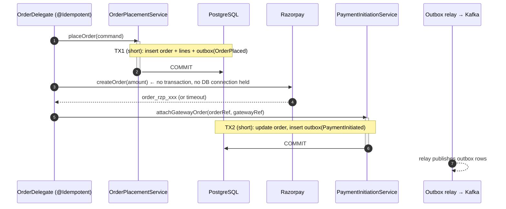
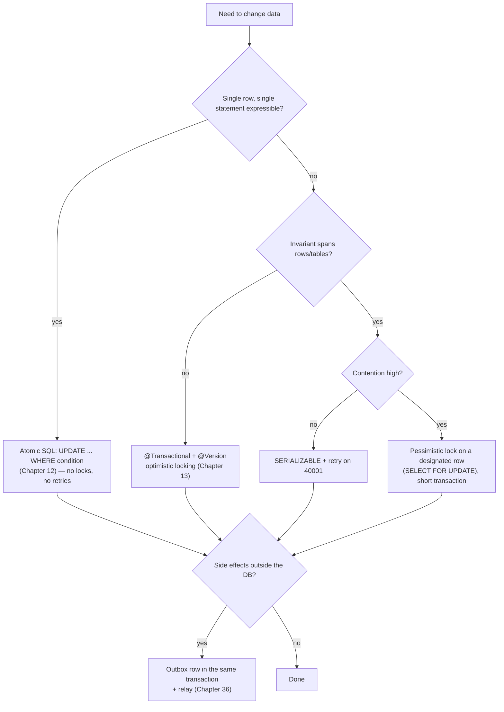

# 16 · Transactions Deep Dive

## 1. Introduction & Why It Matters

`@Transactional` is one annotation and a hundred production incidents. In the grocery platform, transactions decide whether:

- an order row exists without its lines because an exception was swallowed by a checked-exception rule;
- stock is decremented twice because a `REQUIRES_NEW` call was a self-invocation and never started a new transaction;
- checkout holds a database connection for eight seconds while Razorpay is slow, exhausting the pool (Chapter 12);
- an "order placed" SMS goes out for an order that rolled back (Chapter 03);
- two customers both book the last delivery slot under `READ COMMITTED`;
- a Kafka event is published but the database commit fails — the dual-write problem.

Transactions are where **correctness, concurrency and performance meet**. This chapter goes deep: what Spring actually does around your method, all seven propagation modes with what they mean in SQL, isolation levels and the anomalies they do and don't prevent (including write skew, which surprises people on PostgreSQL), rollback rules, read-only optimizations, the self-invocation trap, programmatic transactions, synchronization callbacks, retrying serialization failures, transaction boundaries in the four-layer architecture, and why we use the **outbox** instead of XA for Kafka.

### Who should read which section

| Band | Focus |
|---|---|
| B1 · 0–2 yrs | Parts 1, 2, 4 — `@Transactional` basics, rollback rules |
| B2 · 2–5 yrs | Parts 2, 5 — propagation, isolation, read-only, self-invocation |
| B3 · 5–8 yrs | Parts 3, 5, 6 — interceptor internals, synchronization, retries, boundaries |
| B4 · 8–12 yrs | Parts 6, 7, 8 — architecture, outbox vs XA, observability of transactions |
| B5 · 12–15+ yrs | Parts 8, 9 — consistency strategy across services |

---

## 2. Core Concepts

### 2.1 ACID, briefly

| Property | Meaning in our world |
|---|---|
| **Atomicity** | Order + lines + outbox row all commit, or none do |
| **Consistency** | Constraints (stock ≥ 0, price ≤ MRP) hold before and after |
| **Isolation** | Concurrent checkouts don't see each other's half-done work |
| **Durability** | Committed orders survive a pod crash |

### 2.2 Spring's abstraction

| Type | Role |
|---|---|
| `PlatformTransactionManager` | Strategy interface: `getTransaction`, `commit`, `rollback` |
| `DataSourceTransactionManager` | JDBC: binds a `Connection` to the thread |
| `JpaTransactionManager` | JPA: binds an `EntityManager` (and exposes its JDBC connection) |
| `JtaTransactionManager` | Global/XA transactions (rare, avoid) |
| `TransactionTemplate` | Programmatic transactions |
| `TransactionSynchronizationManager` | Thread-bound resources + synchronization callbacks |
| `@Transactional` | Declarative demarcation via AOP (Chapter 04) |

Boot auto-configures **one** transaction manager: `JpaTransactionManager` when JPA is present (it manages JDBC too, so `JdbcClient` joins the same transaction), otherwise `DataSourceTransactionManager`.

### 2.3 `@Transactional` attributes

| Attribute | Default | Notes |
|---|---|---|
| `propagation` | `REQUIRED` | How to behave if a transaction already exists |
| `isolation` | `DEFAULT` (database default; `READ_COMMITTED` on PostgreSQL) | Concurrency semantics |
| `readOnly` | `false` | Hints: Hibernate skips dirty checking; connection marked read-only; enables replica routing (Chapter 12) |
| `timeout` / `timeoutString` | none | Seconds; enforced via statement timeouts where supported |
| `rollbackFor` / `noRollbackFor` | — | Override the default rule |
| `transactionManager` | the only one | Qualifier when several exist |
| `label` | — | Custom labels readable by the transaction manager |

### 2.4 Propagation — all seven

| Propagation | No transaction exists | A transaction exists |
|---|---|---|
| `REQUIRED` (default) | Start a new one | **Join** it |
| `REQUIRES_NEW` | Start a new one | **Suspend** the outer, start an independent one, resume after |
| `SUPPORTS` | Run without a transaction | Join it |
| `NOT_SUPPORTED` | Run without one | **Suspend** it, run without |
| `MANDATORY` | Throw `IllegalTransactionStateException` | Join it |
| `NEVER` | Run without one | Throw |
| `NESTED` | Start a new one | **Savepoint** inside the existing one (JDBC transaction manager only) |



!!! danger "`REQUIRES_NEW` uses a second connection"
    The outer transaction still holds its connection while the inner one runs. Each nesting level doubles connection usage — a pool of 20 with nested `REQUIRES_NEW` under load can deadlock **itself**: all connections held by outer transactions waiting for a connection for the inner one.

!!! warning "Rollback-only propagation"
    If an inner `REQUIRED` method throws and the outer catches the exception and continues, the transaction was already marked **rollback-only**; at commit Spring throws `UnexpectedRollbackException`. "Handling" an exception from a joined transaction doesn't undo the rollback marking — use `REQUIRES_NEW` (or `NESTED`) if the inner work must be able to fail independently.

### 2.5 Isolation levels and anomalies

| Level | Dirty read | Non-repeatable read | Phantom | Write skew |
|---|---|---|---|---|
| `READ_UNCOMMITTED` | possible | possible | possible | possible |
| `READ_COMMITTED` (PostgreSQL default) | no | possible | possible | possible |
| `REPEATABLE_READ` (PostgreSQL: snapshot isolation) | no | no | no (in PostgreSQL) | **possible** |
| `SERIALIZABLE` (PostgreSQL: SSI) | no | no | no | no — conflicting transactions fail with a serialization error |

Vocabulary with grocery examples:

- **Lost update** — two staff read stock 10, both set 9; one update vanishes. Prevented by `@Version` (Chapter 13) or atomic SQL (Chapter 12), not by `READ_COMMITTED`.
- **Write skew** — two transactions each check "slot has capacity" (both see 9/10), then each insert a booking → 11 bookings. `REPEATABLE_READ` on PostgreSQL does **not** prevent this; `SERIALIZABLE`, a lock, or a constraint does.

!!! note "PostgreSQL specifics"
    PostgreSQL uses MVCC: readers never block writers. `REPEATABLE_READ` and `SERIALIZABLE` transactions can fail at commit (or mid-statement) with SQLSTATE `40001` (serialization failure) or `40P01` (deadlock) — these are **retryable** and must be retried by the application.

### 2.6 Rollback rules

By default Spring rolls back on **unchecked** exceptions (`RuntimeException`, `Error`) and **commits** on checked exceptions. This surprises everyone once:

```java title="Rollback rules (snippet)"
@Transactional
public void importRow(...) throws IOException {     // checked
    repository.save(entity);
    if (bad) throw new IOException("bad row");        // ← COMMITS the save
}
```

Fix with `@Transactional(rollbackFor = Exception.class)` — or, better, use unchecked domain exceptions (Chapter 10) throughout.

### 2.7 `readOnly = true`

- Hibernate sets `FlushMode.MANUAL`: no dirty checking, no accidental updates, less memory.
- The JDBC connection is marked read-only (PostgreSQL then rejects writes with an error).
- Enables read-replica routing (Chapter 12).
- Makes intent explicit to readers.

Use it on **every** query-only service method.

### 2.8 Where transactions belong

In the four-layer pattern:

| Layer | Transaction |
|---|---|
| Controller | ❌ never |
| Delegate | ❌ usually not (it orchestrates; idempotency lives here) |
| **Service** | ✅ the transaction boundary — one business operation |
| Repository | ❌ (participates in the caller's transaction) |

Boot's Spring Data repositories are transactional per method by default (`SimpleJpaRepository` is `@Transactional(readOnly = true)` with write methods overridden) — enough for a single call, never enough for a business operation.

### 2.9 What must not happen inside a transaction

- **Remote calls** (payment gateway, other services) — latency is multiplied by connection hold time.
- **Long computations, file/report generation.**
- **`Thread.sleep`, waiting on locks/queues.**
- **Sending Kafka/SMS/email directly** — use after-commit hooks or the outbox.

### 2.10 The dual-write problem and the outbox

Writing to the database **and** publishing to Kafka can't be atomic without XA:



Chapter 36 builds the full outbox and relay; this chapter shows the transactional half.

### 2.11 XA / JTA — why not

Global (two-phase commit) transactions across PostgreSQL and Kafka/JMS look attractive and cost: extra latency, an additional transaction coordinator to operate, in-doubt transactions holding locks after crashes, poor support in cloud-managed services, and Boot 3 dropped its embedded Atomikos integration. Prefer **local transaction + outbox + idempotent consumers**.

---

## 3. How It Works Internally

### 3.1 The transaction interceptor



Key classes: `TransactionInterceptor`/`TransactionAspectSupport`, `AbstractPlatformTransactionManager` (the propagation state machine), `TransactionSynchronizationManager` (thread-bound `ConnectionHolder`/`EntityManagerHolder` + synchronizations), `DataSourceUtils`/`EntityManagerFactoryUtils` (resource lookup used by `JdbcClient` and repositories).

### 3.2 Why self-invocation breaks it (again)

The proxy is only involved on calls from **outside** the bean (Chapter 04). `this.reserve(...)` runs the target method directly — no interceptor, no transaction attribute, no new transaction. Symptoms are silent: `REQUIRES_NEW` is ignored, `readOnly` isn't applied, a method that "must" be transactional runs with auto-commit.

### 3.3 When SQL actually runs



With `spring.datasource.hikari.auto-commit=false` and `hibernate.connection.provider_disables_autocommit=true` (Chapter 13), Hibernate defers borrowing a connection until the first statement — a read-only method that ends up not querying costs nothing.

### 3.4 Synchronizations

`TransactionSynchronizationManager.registerSynchronization(...)` adds callbacks: `beforeCommit`, `beforeCompletion`, `afterCommit`, `afterCompletion(status)`. Spring uses them for `@TransactionalEventListener`, JPA flush/close, and connection release. Your code can use them for cache invalidation and "publish after commit" — though the event listener is usually cleaner.

---

## 4. Hands-On Code — Level 1 (Beginner)

### 4.1 One business operation, one transaction

```java title="in/grocery/order/service/OrderCancellationService.java"
package in.grocery.order.service;

import in.grocery.order.domain.Order;
import in.grocery.order.event.OrderCancelled;
import in.grocery.order.repository.OrderRepository;
import org.springframework.context.ApplicationEventPublisher;
import org.springframework.stereotype.Service;
import org.springframework.transaction.annotation.Transactional;

@Service
public class OrderCancellationService {

    private final OrderRepository orders;
    private final ApplicationEventPublisher events;

    public OrderCancellationService(OrderRepository orders, ApplicationEventPublisher events) {
        this.orders = orders;
        this.events = events;
    }

    @Transactional                                                            // (1)!
    public void cancel(String orderRef, String reason) {
        Order order = orders.findByOrderRef(orderRef)
                .orElseThrow(() -> new OrderNotFoundException(orderRef));
        order.cancel();                                                       // (2)!
        events.publishEvent(new OrderCancelled(orderRef, reason));            // (3)!
    }

    @Transactional(readOnly = true)                                           // (4)!
    public Order view(String orderRef) {
        return orders.findByOrderRef(orderRef).orElseThrow(() -> new OrderNotFoundException(orderRef));
    }
}
```

1. The whole operation is atomic: status change + any other writes.
2. No `save()` — dirty checking flushes at commit (Chapter 13).
3. Published inside the transaction; `@TransactionalEventListener` subscribers run **after commit**.
4. Read-only: no dirty checking, replica-routable, intent obvious.

### 4.2 The checked-exception surprise

```java title="in/grocery/seller/service/CatalogImportService.java"
@Transactional
public void importRow(ProductRow row) throws ImportException {     // checked exception
    products.save(toEntity(row));
    if (row.sellingPrice().compareTo(row.mrp()) > 0) {
        throw new ImportException("price above MRP");               // ❌ commits the save!
    }
}
```

```java title="Fixed"
@Transactional(rollbackFor = Exception.class)                      // (1)!
public void importRow(ProductRow row) throws ImportException { ... }
```

1. Or — preferred — throw an unchecked domain exception (`SellingPriceAboveMrpException extends DomainException`, Chapter 10) and delete the checked exception entirely.

### 4.3 Proving rollback in a test

```java title="OrderCancellationServiceTest.java"
@SpringBootTest
@Import({ContainersConfig.class, FixedClockConfig.class})
class OrderCancellationServiceTest {

    @Autowired OrderCancellationService service;
    @Autowired OrderRepository orders;
    @Autowired TransactionTemplate tx;

    @Test
    void failureLeavesNoPartialState() {
        String ref = UniqueIds.orderRef();
        tx.executeWithoutResult(s -> orders.save(anOrder().ref(ref).withLine("MILK-1L", 1, "66.00").delivered()));

        assertThatThrownBy(() -> service.cancel(ref, "customer changed mind"))   // delivered orders cannot be cancelled
                .isInstanceOf(IllegalStateException.class);

        tx.executeWithoutResult(s ->
                assertThat(orders.findByOrderRef(ref).orElseThrow().getStatus()).isEqualTo(OrderStatus.DELIVERED));
    }
}
```

!!! note "Don't make this test `@Transactional`"
    A transactional test rolls everything back, so you can't observe what the service committed. Use a `TransactionTemplate` for setup and verification instead (see 5.6).

---

## 5. Hands-On Code — Level 2 (Intermediate) & Level 3 (Advanced)

### 5.1 Level 2 — Propagation in practice: audit that must survive rollback

Failed payment attempts must be recorded **even when the business transaction rolls back**.

```java title="in/grocery/payment/service/PaymentAttemptRecorder.java"
package in.grocery.payment.service;

import in.grocery.payment.repository.PaymentAttemptRepository;
import java.time.Clock;
import org.springframework.stereotype.Service;
import org.springframework.transaction.annotation.Propagation;
import org.springframework.transaction.annotation.Transactional;

@Service
public class PaymentAttemptRecorder {

    private final PaymentAttemptRepository attempts;
    private final Clock clock;

    public PaymentAttemptRecorder(PaymentAttemptRepository attempts, Clock clock) {
        this.attempts = attempts;
        this.clock = clock;
    }

    @Transactional(propagation = Propagation.REQUIRES_NEW)                     // (1)!
    public void record(String orderRef, String gateway, String outcome, String reason) {
        attempts.insert(orderRef, gateway, outcome, reason, clock.instant());
    }
}
```

1. Independent transaction: commits (or fails) on its own. It must be a **separate bean** — a `REQUIRES_NEW` method called from within the same class does nothing (self-invocation).

```java title="in/grocery/payment/service/PaymentService.java (excerpt)"
@Transactional
public void capture(String orderRef, PaymentResult result) {
    switch (result) {
        case PaymentResult.Captured c -> { /* update order, ledger */ }
        case PaymentResult.Failed f -> {
            recorder.record(orderRef, "RAZORPAY", "FAILED", f.reason());        // survives the rollback below
            throw new PaymentDeclinedException(f.reason());
        }
        case PaymentResult.Pending p -> { /* ... */ }
    }
}
```

!!! warning "Keep `REQUIRES_NEW` rare and short"
    Each one holds a second connection. This recorder does a single insert and returns. Never wrap a long operation or another remote call in `REQUIRES_NEW`.

### 5.2 Level 2 — `UnexpectedRollbackException` in the wild

```java title="Broken"
@Transactional
public ImportReport importAll(List<ProductRow> rows) {
    int ok = 0, failed = 0;
    for (ProductRow row : rows) {
        try {
            importer.importRow(row);          // @Transactional (REQUIRED) → joins THIS transaction
            ok++;
        } catch (RuntimeException e) {
            failed++;                          // swallowed, loop continues
        }
    }
    return new ImportReport(ok, failed);       // → UnexpectedRollbackException at commit
}
```

The first failing row marked the shared transaction rollback-only. Two fixes:

```java title="Fix A — independent transaction per row"
@Transactional(propagation = Propagation.REQUIRES_NEW)
public void importRow(ProductRow row) { ... }
```

```java title="Fix B — no outer transaction (preferred for imports)"
public ImportReport importAll(List<ProductRow> rows) {            // no @Transactional here
    ...
    importer.importRow(row);                                      // each row its own REQUIRED transaction
}
```

Fix B is usually right: an import of 5,000 rows should never be one transaction.

### 5.3 Level 2 — Read-only and replica routing

```java title="in/grocery/catalog/service/CatalogQueryService.java"
@Service
public class CatalogQueryService {

    @Transactional(readOnly = true)                                            // (1)!
    public PageResponse<ProductSummary> browse(String category, Pageable pageable) { ... }

    @Transactional(readOnly = true, timeout = 5)                               // (2)!
    public List<ProductSummary> search(String query, int limit) { ... }
}
```

1. Routed to the read replica (Chapter 12); Hibernate skips dirty checking.
2. Bound the time a search can hold resources; on timeout Spring rolls back and throws `TransactionTimedOutException` / `QueryTimeoutException`.

### 5.4 Level 3 — Serialization failures and retry

Slot booking with `SERIALIZABLE` is correct but can fail; correctness comes from **retrying**.

```java title="in/grocery/delivery/service/SlotBookingService.java"
package in.grocery.delivery.service;

import in.grocery.delivery.repository.SlotRepository;
import org.springframework.dao.ConcurrencyFailureException;
import org.springframework.retry.annotation.Backoff;
import org.springframework.retry.annotation.Retryable;
import org.springframework.stereotype.Service;
import org.springframework.transaction.annotation.Isolation;
import org.springframework.transaction.annotation.Transactional;

@Service
public class SlotBookingService {

    private final SlotRepository slots;

    public SlotBookingService(SlotRepository slots) {
        this.slots = slots;
    }

    @Retryable(retryFor = ConcurrencyFailureException.class, maxAttempts = 4,
               backoff = @Backoff(delay = 25, multiplier = 2.0, random = true))          // (1)!
    @Transactional(isolation = Isolation.SERIALIZABLE, timeout = 3)                      // (2)!
    public boolean book(String slotId) {
        int booked = slots.countBookings(slotId);
        int capacity = slots.capacity(slotId);
        if (booked >= capacity) return false;
        slots.insertBooking(slotId);
        return true;
    }
}
```

1. **Retry must wrap the transaction** — the outer proxy retries a whole new transaction. Order matters: `@Retryable`'s advisor must run outside `@Transactional`'s (configure orders explicitly, Chapter 04). Jitter (`random = true`) avoids retry storms.
2. `SERIALIZABLE` makes the read-then-insert safe against write skew; PostgreSQL detects conflicts and raises `40001`, which Spring translates to a `ConcurrencyFailureException` subtype.

!!! tip "Cheaper alternatives first"
    A `check-and-increment` SQL statement (Chapter 12) or a unique constraint on `(slot_id, booking_seq)` solves this without `SERIALIZABLE`. Use serializable isolation when the invariant spans **multiple rows or tables** and can't be expressed as one statement or constraint.

=== "Spring Boot 3.5 — Spring Retry"

    ```java title="RetryConfig.java"
    @EnableRetry
    @Configuration(proxyBeanMethods = false)
    class RetryConfig {}
    ```

=== "Spring Boot 4.x — Framework 7 core resilience"

    ```java title="ResilienceConfig.java"
    @EnableResilientMethods
    @Configuration(proxyBeanMethods = false)
    class ResilienceConfig {}

    // org.springframework.resilience.annotation.Retryable — verify attribute names (Chapter 26)
    ```

### 5.5 Level 3 — Programmatic transactions

Useful when boundaries are dynamic, inside non-Spring code, or to avoid self-invocation.

```java title="in/grocery/inventory/service/StockSyncService.java"
package in.grocery.inventory.service;

import java.util.List;
import org.springframework.stereotype.Service;
import org.springframework.transaction.support.TransactionTemplate;

@Service
public class StockSyncService {

    private final TransactionTemplate tx;                                     // (1)!
    private final StockRepository stock;

    public StockSyncService(TransactionTemplate tx, StockRepository stock) {
        this.tx = tx;
        this.stock = stock;
    }

    /** Sync a hub's stock in chunks: one transaction per chunk, progress preserved on failure. */
    public int sync(String hub, List<StockUpdate> updates, int chunkSize) {
        int applied = 0;
        for (int i = 0; i < updates.size(); i += chunkSize) {
            List<StockUpdate> chunk = updates.subList(i, Math.min(updates.size(), i + chunkSize));
            applied += tx.execute(status -> {                                  // (2)!
                int n = stock.applyAll(hub, chunk);
                if (n != chunk.size()) {
                    status.setRollbackOnly();                                  // (3)!
                    return 0;
                }
                return n;
            });
        }
        return applied;
    }
}
```

1. Boot auto-configures a `TransactionTemplate` bean (Boot 3.x+); otherwise build one from the transaction manager.
2. Explicit, visible boundaries — no proxies, no self-invocation trap.
3. Programmatic rollback without throwing.

### 5.6 Level 3 — After-commit work

```java title="in/grocery/order/service/CacheInvalidation.java"
package in.grocery.order.service;

import org.springframework.stereotype.Component;
import org.springframework.transaction.support.TransactionSynchronization;
import org.springframework.transaction.support.TransactionSynchronizationManager;

@Component
public class CacheInvalidation {

    private final CustomerOrderCache cache;

    public CacheInvalidation(CustomerOrderCache cache) {
        this.cache = cache;
    }

    public void afterCommit(String customerId) {
        if (TransactionSynchronizationManager.isSynchronizationActive()) {
            TransactionSynchronizationManager.registerSynchronization(new TransactionSynchronization() {
                @Override
                public void afterCommit() {                                    // (1)!
                    cache.evict(customerId);
                }
            });
        } else {
            cache.evict(customerId);                                            // (2)!
        }
    }
}
```

1. Evict only if the data actually changed — evicting before commit can repopulate the cache with pre-commit state.
2. Called outside a transaction (e.g. from a consumer): act immediately.

For most cases `@TransactionalEventListener` (Chapter 03) expresses the same thing more clearly; use raw synchronizations in infrastructure code.

### 5.7 Level 3 — Testing transactional behaviour

```java title="PaymentAttemptRecorderTest.java"
@SpringBootTest
@Import({ContainersConfig.class, FixedClockConfig.class})
class PaymentAttemptRecorderTest {

    @Autowired PaymentService payments;
    @Autowired PaymentAttemptRepository attempts;
    @Autowired TransactionTemplate tx;

    @Test
    void failedAttemptSurvivesRollback() {
        String ref = UniqueIds.orderRef();
        tx.executeWithoutResult(s -> orders.save(anOrder().ref(ref).placed()));

        assertThatThrownBy(() -> payments.capture(ref, new PaymentResult.Failed("BAD", "insufficient_funds", true)))
                .isInstanceOf(PaymentDeclinedException.class);

        assertThat(attempts.findByOrderRef(ref)).singleElement()                  // (1)!
                .extracting(PaymentAttempt::outcome).isEqualTo("FAILED");
        tx.executeWithoutResult(s ->
                assertThat(orders.findByOrderRef(ref).orElseThrow().getStatus()).isEqualTo(OrderStatus.PLACED));  // (2)!
    }
}
```

1. The `REQUIRES_NEW` insert committed.
2. The outer transaction rolled back — order state unchanged.

---

## 6. Hands-On Code — Level 4 (Expert / Production)

### 6.1 Checkout: correct boundaries around a slow gateway

Requirements: create the order atomically with its outbox event; never hold a database connection during the Razorpay call; be idempotent; keep after-commit work out of the transaction.



```java title="in/grocery/order/service/OrderPlacementService.java"
package in.grocery.order.service;

import in.grocery.order.domain.DeliveryAddress;
import in.grocery.order.domain.Order;
import in.grocery.order.outbox.OutboxWriter;
import in.grocery.order.repository.OrderRepository;
import java.time.Clock;
import java.util.List;
import org.springframework.stereotype.Service;
import org.springframework.transaction.annotation.Transactional;

@Service
public class OrderPlacementService {

    private final OrderRepository orders;
    private final OutboxWriter outbox;
    private final Clock clock;

    public OrderPlacementService(OrderRepository orders, OutboxWriter outbox, Clock clock) {
        this.orders = orders;
        this.outbox = outbox;
        this.clock = clock;
    }

    @Transactional(timeout = 5)                                                            // (1)!
    public Order place(String orderRef, String customerId, DeliveryAddress address,
                       in.grocery.common.money.Money fee, List<LineRequest> lines) {
        Order order = Order.place(orderRef, customerId, address, fee, clock.instant());
        lines.forEach(l -> order.addLine(l.sku(), l.name(), l.quantity(), l.unitPrice()));
        Order saved = orders.save(order);
        outbox.append("order", saved.getOrderRef(), "OrderPlaced",                         // (2)!
                new OrderPlacedPayload(saved.getOrderRef(), customerId, saved.total().asString()));
        return saved;
    }

    public record LineRequest(String sku, String name, int quantity, in.grocery.common.money.Money unitPrice) {}
}
```

1. A hard ceiling: if this transaction can't finish in 5 s, something is wrong; fail instead of holding a connection.
2. The event is written **in the same transaction** — atomic with the order. No Kafka client here.

```java title="in/grocery/order/outbox/OutboxWriter.java"
package in.grocery.order.outbox;

import com.fasterxml.jackson.databind.ObjectMapper;        // JsonMapper on Boot 4
import java.time.Clock;
import java.util.UUID;
import org.springframework.jdbc.core.simple.JdbcClient;
import org.springframework.stereotype.Component;
import org.springframework.transaction.annotation.Propagation;
import org.springframework.transaction.annotation.Transactional;

@Component
public class OutboxWriter {

    private final JdbcClient jdbc;
    private final ObjectMapper json;
    private final Clock clock;

    public OutboxWriter(JdbcClient jdbc, ObjectMapper json, Clock clock) {
        this.jdbc = jdbc;
        this.json = json;
        this.clock = clock;
    }

    @Transactional(propagation = Propagation.MANDATORY)                                    // (1)!
    public void append(String aggregateType, String aggregateId, String eventType, Object payload) {
        try {
            jdbc.sql("""
                    insert into outbox (id, aggregate_type, aggregate_id, event_type, payload, created_at)
                    values (:id, :type, :aggId, :event, cast(:payload as jsonb), :now)
                    """)
                .param("id", UUID.randomUUID())
                .param("type", aggregateType)
                .param("aggId", aggregateId)
                .param("event", eventType)
                .param("payload", json.writeValueAsString(payload))
                .param("now", clock.instant())
                .update();
        } catch (com.fasterxml.jackson.core.JsonProcessingException e) {
            throw new IllegalStateException("Cannot serialize outbox payload", e);
        }
    }
}
```

1. **`MANDATORY`** is the whole point: writing an outbox row outside a transaction would be a silent correctness bug, so the container refuses it (`IllegalTransactionStateException`). Note that `JdbcClient` shares the JPA transaction's connection (`JpaTransactionManager`), so the insert and the entity flush commit together.

```java title="in/grocery/order/delegate/OrderDelegate.java"
@Component
public class OrderDelegate {

    private final OrderPlacementService placement;
    private final PaymentGateway gateway;
    private final PaymentInitiationService paymentInitiation;

    @Idempotent(key = "#command.idempotencyKey()", scope = "order-place")                  // Chapter 04
    public OrderView place(PlaceOrderCommand command) {
        Order order = placement.place(command.orderRef(), command.customerId(),            // TX1
                command.address(), command.fee(), command.lines());

        String gatewayRef;
        try {
            gatewayRef = gateway.createOrder(order.getOrderRef(), order.total().amount()); // (1)!
        } catch (DependencyException e) {
            paymentInitiation.markGatewayUnavailable(order.getOrderRef());                 // TX2'
            throw e;
        }
        paymentInitiation.attachGatewayOrder(order.getOrderRef(), gatewayRef);             // TX2
        return OrderView.from(order, gatewayRef);
    }
}
```

1. **Outside any transaction** — no connection is held while Razorpay is slow. The delegate is the orchestration layer precisely so services can keep their transactions small.

### 6.2 Transaction observability

You can't tune what you can't see. Two cheap tools:

```java title="in/grocery/platform/tx/TransactionMetrics.java"
package in.grocery.platform.tx;

import io.micrometer.core.instrument.MeterRegistry;
import io.micrometer.core.instrument.Timer;
import org.aspectj.lang.ProceedingJoinPoint;
import org.aspectj.lang.annotation.Around;
import org.aspectj.lang.annotation.Aspect;
import org.slf4j.Logger;
import org.slf4j.LoggerFactory;
import org.springframework.core.Ordered;
import org.springframework.core.annotation.Order;

/** Times every @Transactional method and warns about long-running transactions. */
@Aspect
@Order(Ordered.LOWEST_PRECEDENCE - 1)                                                       // (1)!
public class TransactionMetrics {

    private static final Logger log = LoggerFactory.getLogger(TransactionMetrics.class);
    private static final long WARN_MS = 1_000;

    private final MeterRegistry meters;

    public TransactionMetrics(MeterRegistry meters) {
        this.meters = meters;
    }

    @Around("@annotation(org.springframework.transaction.annotation.Transactional)")
    public Object measure(ProceedingJoinPoint pjp) throws Throwable {
        String name = pjp.getSignature().getDeclaringType().getSimpleName() + "." + pjp.getSignature().getName();
        long start = System.nanoTime();
        String outcome = "success";
        try {
            return pjp.proceed();
        } catch (Throwable t) {
            outcome = "failure";
            throw t;
        } finally {
            long ms = (System.nanoTime() - start) / 1_000_000;
            Timer.builder("grocery.transaction")
                 .tag("method", name).tag("outcome", outcome)
                 .publishPercentileHistogram()
                 .register(meters)
                 .record(java.time.Duration.ofMillis(ms));
            if (ms > WARN_MS) {
                log.warn("Long transaction {} took {} ms", name, ms);                       // (2)!
            }
        }
    }
}
```

1. Just inside the transaction interceptor (`LOWEST_PRECEDENCE`) so the measurement covers the transaction, not only the method body. Verify ordering against your configuration (Chapter 04).
2. Alert on this: long transactions precede pool exhaustion.

Database-side checks during incidents:

```sql title="SQL"
-- longest running transactions right now
select pid, now() - xact_start as duration, state, left(query, 120) as query
from pg_stat_activity
where xact_start is not null and state <> 'idle'
order by duration desc limit 10;

-- idle in transaction: the classic "connection held during a remote call"
select count(*) from pg_stat_activity where state = 'idle in transaction';
```

### 6.3 Platform rules encoded as tests

```java title="src/test/java/in/grocery/order/TransactionRulesTest.java"
package in.grocery.order;

import static com.tngtech.archunit.lang.syntax.ArchRuleDefinition.methods;
import static com.tngtech.archunit.lang.syntax.ArchRuleDefinition.noMethods;

import com.tngtech.archunit.core.importer.ImportOption;
import com.tngtech.archunit.junit.AnalyzeClasses;
import com.tngtech.archunit.junit.ArchTest;
import com.tngtech.archunit.lang.ArchRule;
import org.springframework.transaction.annotation.Transactional;

@AnalyzeClasses(packages = "in.grocery.order", importOptions = ImportOption.DoNotIncludeTests.class)
class TransactionRulesTest {

    @ArchTest
    static final ArchRule transactionsOnlyInServices = methods()
            .that().areAnnotatedWith(Transactional.class)
            .should().beDeclaredInClassesThat().resideInAPackage("..service..")
            .orShould().beDeclaredInClassesThat().resideInAPackage("..outbox..")
            .because("controllers and delegates must not open transactions");

    @ArchTest
    static final ArchRule transactionalMethodsArePublic = methods()
            .that().areAnnotatedWith(Transactional.class)
            .should().bePublic()
            .because("Spring AOP cannot advise non-public methods");

    @ArchTest
    static final ArchRule noGatewayCallsFromServices = noMethods()
            .that().areDeclaredInClassesThat().resideInAPackage("..service..")
            .should().callMethodWhere(com.tngtech.archunit.core.domain.JavaCall.Predicates
                    .target(com.tngtech.archunit.core.domain.properties.HasOwner.Predicates.With
                            .owner(com.tngtech.archunit.base.DescribedPredicate.describe(
                                    "a payment gateway", c -> c.getName().contains("PaymentGateway")))))
            .because("remote calls must not happen inside transactions");                   // (1)!
}
```

1. A coarse approximation of "no remote calls in transactions" — combined with the long-transaction alert and code review, it catches the common cases.

### 6.4 Decision guide



---

## 7. Spring Boot 3 vs 4 & Migration

| Topic | Boot 3.5 / Framework 6.2 | Boot 4.x / Framework 7 |
|---|---|---|
| `@Transactional` semantics | Unchanged | Unchanged |
| Transaction manager auto-config | `JpaTransactionManager` / `DataSourceTransactionManager` | Same (module packages move — verify) |
| `TransactionTemplate` bean | Auto-configured | Same |
| Retry support | Spring Retry (`@EnableRetry`) | + core `@Retryable` / `@EnableResilientMethods` (Chapter 26) |
| JTA/XA | Narayana/community starters (Atomikos removed in Boot 3) | Same direction — avoid |
| Reactive transactions | `@Transactional` with `ReactiveTransactionManager` | Same |
| Null-safety | Spring `@Nullable` | JSpecify |

=== "Spring Boot 3.5"

    ```java title="Spring Boot 3.5 (snippet)"
    @EnableRetry
    @Retryable(retryFor = ConcurrencyFailureException.class, maxAttempts = 4,
               backoff = @Backoff(delay = 25, multiplier = 2, random = true))
    @Transactional(isolation = Isolation.SERIALIZABLE)
    public boolean book(String slotId) { ... }
    ```

=== "Spring Boot 4.x"

    ```java title="Spring Boot 4.x (snippet)"
    @EnableResilientMethods
    @Retryable(includes = ConcurrencyFailureException.class, maxRetries = 3, delay = 25, multiplier = 2)
    @Transactional(isolation = Isolation.SERIALIZABLE)
    public boolean book(String slotId) { ... }     // verify attribute names for Framework 7
    ```

### Migration checklist

- [ ] Confirm aspect ordering (retry outside transaction) still holds after switching retry implementations.
- [ ] Re-check custom `TransactionManagerCustomizer`s and imports for moved packages.
- [ ] Review `@Transactional` on non-public methods flagged by newer tooling.
- [ ] Re-run transactional integration tests (propagation, rollback rules) after upgrade.

---

## 8. Production Playbook

### Best practices

1. **One business operation = one transaction**, opened in the service layer.
2. **Short transactions**: no remote calls, no file I/O, no sleeps; set `timeout`.
3. **`readOnly = true`** on every query method.
4. **Unchecked domain exceptions** so default rollback rules do the right thing.
5. **`REQUIRES_NEW` sparingly**, always in another bean, always short.
6. **Atomic SQL or optimistic locking** before reaching for isolation levels or pessimistic locks.
7. **Retry `40001`/deadlocks** with jittered backoff, retry outside the transaction.
8. **Outbox for cross-system side effects**; after-commit listeners for in-process ones.
9. **Measure**: transaction duration histogram, `idle in transaction`, pool pending.
10. **Encode the rules** (ArchUnit + review checklist).

### Anti-patterns

❌ `@Transactional` on the controller or delegate — transaction spans HTTP serialization and orchestration.

❌ Remote call inside a transaction (the single most common cause of pool exhaustion).

❌ `@Transactional` on a private method or via self-invocation — silently no transaction.

❌ Catching exceptions from a joined `REQUIRED` call and continuing → `UnexpectedRollbackException`.

❌ Batch import as one giant transaction.

❌ Raising isolation to `SERIALIZABLE` globally "to be safe" — serialization failures everywhere without retries.

❌ Manual `connection.commit()` or `entityManager.getTransaction()` inside a Spring-managed transaction.

❌ Publishing to Kafka inside the transaction (dual write) — use the outbox.

### Troubleshooting

| Symptom | Cause | Fix |
|---|---|---|
| `UnexpectedRollbackException: Transaction rolled back because it has been marked as rollback-only` | Inner `REQUIRED` failed, outer swallowed it | `REQUIRES_NEW`/`NESTED`, or don't swallow |
| Changes not persisted | No transaction (self-invocation, non-public method, missing annotation) or checked exception committed then rolled back elsewhere | Check proxying; `rollbackFor` |
| `TransactionRequiredException` | Write outside a transaction (e.g. `MANDATORY` writer or JPA flush) | Add `@Transactional` at the right boundary |
| `CannotAcquireLockException` / deadlock | Lock ordering, long transactions | Consistent ordering, shorter transactions, retry |
| `could not serialize access due to concurrent update` (40001) | Serializable/repeatable-read conflict | Retry with backoff |
| Pool exhaustion, `idle in transaction` high | Remote calls or slow work inside transactions | Move calls out; timeouts |
| `TransactionTimedOutException` | `timeout` exceeded | Investigate slow SQL; raise only with evidence |
| Read-only method fails with "cannot execute INSERT in a read-only transaction" | Write path marked `readOnly` | Correct the annotation |
| After-commit listener never runs | No transaction active / test rolled back | Ensure a real transaction commits |
| Two `REQUIRES_NEW` levels hang under load | Pool starvation (connections held by outer transactions) | Remove nesting; increase pool only as a stopgap |

### Production checklist

- [ ] Transaction boundaries only in services; verified by ArchUnit
- [ ] No remote calls inside transactions
- [ ] `readOnly` on all queries; replica routing where applicable
- [ ] Timeouts set on write transactions
- [ ] Retry policy for serialization/deadlock errors
- [ ] Outbox used for all cross-system effects
- [ ] Transaction duration metrics + `idle in transaction` alerts
- [ ] Propagation choices documented (especially every `REQUIRES_NEW`)

---

## 9. Interview Questions & Answers

### B1 · 0–2 years

??? question "B1 · What does `@Transactional` do?"
    **Short answer:** Spring wraps the method in a transaction: begin before, commit after, roll back on unchecked exceptions — implemented with an AOP proxy and a `PlatformTransactionManager`.

??? question "B1 · Which exceptions cause a rollback by default?"
    **Short answer:** `RuntimeException` and `Error`. Checked exceptions commit unless `rollbackFor` says otherwise.

??? question "B1 · Where should `@Transactional` go: controller, service or repository?"
    **Short answer:** The service — one business operation per transaction.

??? question "B1 · What does `readOnly = true` do?"
    **Short answer:** Signals a query-only transaction: Hibernate skips dirty checking, the connection is marked read-only, and it can be routed to a replica.

??? question "B1 · What is the default isolation level?"
    **Short answer:** `DEFAULT` — whatever the database uses; PostgreSQL's default is `READ COMMITTED`.

### B2 · 2–5 years

??? question "B2 · Explain `REQUIRED` vs `REQUIRES_NEW`."
    **Short answer:** `REQUIRED` joins an existing transaction (one commit). `REQUIRES_NEW` suspends it and runs in an independent transaction on a second connection, committing separately.

??? question "B2 · Why doesn't `@Transactional` work on a method called from the same class?"
    **Short answer:** Self-invocation bypasses the proxy, so the interceptor never runs. Move the method to another bean or use `TransactionTemplate`.

??? question "B2 · What causes `UnexpectedRollbackException`?"
    **Short answer:** A joined inner transaction failed and marked the transaction rollback-only; the outer code caught the exception and tried to commit.

??? question "B2 · What's `NESTED` propagation?"
    **Short answer:** A savepoint inside the current transaction (JDBC transaction manager): inner failure rolls back to the savepoint, the outer can continue. Not supported by `JpaTransactionManager` in the general case.

??? question "B2 · Why must remote calls stay out of transactions?"
    **Short answer:** They hold a database connection (and locks) for the duration; a slow dependency then exhausts the pool and takes down unrelated endpoints.

??? question "B2 · How do you make sure an SMS is sent only if the order commits?"
    **Short answer:** `@TransactionalEventListener(AFTER_COMMIT)` (Chapter 03), or an outbox row written in the same transaction for durability.

### B3 · 5–8 years

??? question "B3 · Walk through what `TransactionInterceptor` does."
    **Short answer:** Reads the `@Transactional` attribute (cached), asks the transaction manager for a transaction per propagation, binds resources to the thread via `TransactionSynchronizationManager`, proceeds, then commits or rolls back based on `rollbackOn`, running synchronizations and restoring any suspended transaction.

??? question "B3 · Which anomalies does PostgreSQL's REPEATABLE READ prevent, and which not?"
    **Short answer:** It's snapshot isolation: no dirty or non-repeatable reads, and no phantoms — but **write skew** is still possible. `SERIALIZABLE` (SSI) prevents it by aborting conflicting transactions with `40001`.

??? question "B3 · How do you handle serialization failures?"
    **Short answer:** Retry the whole transaction with jittered exponential backoff and a small attempt limit, ensuring the retry advice wraps the transactional proxy (fresh transaction per attempt) and the operation is idempotent.

??? question "B3 · How does `JdbcClient` share a transaction with JPA?"
    **Short answer:** `JpaTransactionManager` binds the `EntityManager` and exposes its JDBC `Connection` as the bound resource for that `DataSource`, so `DataSourceUtils` hands the same connection to `JdbcClient`. Flush JPA changes first if the SQL must see them.

??? question "B3 · Why can nested `REQUIRES_NEW` deadlock the connection pool?"
    **Short answer:** Each level holds a connection while waiting for another; with enough concurrency all connections are held by outer transactions and none can be acquired for inner ones — a self-inflicted deadlock the database can't detect.

### B4 · 8–12 years

??? question "B4 · How do you design checkout with a slow payment gateway?"
    **Short answer:** Short TX1 writing order + outbox, commit; call the gateway outside any transaction with timeouts and circuit breaker; short TX2 to record the gateway reference/outcome; idempotency key at the delegate; relay publishes events; reconciliation job for in-doubt payments.

??? question "B4 · Outbox vs XA for database + Kafka atomicity?"
    **Short answer:** XA adds a coordinator, latency, in-doubt transactions and poor cloud support. Outbox keeps a single local transaction, publishes asynchronously with at-least-once delivery, and requires idempotent consumers — the standard choice.

??? question "B4 · How do you find transactions that hold connections too long?"
    **Short answer:** Transaction duration histogram per method, Hikari usage/pending metrics, PostgreSQL `pg_stat_activity` (`idle in transaction`, `xact_start`), slow query logs, plus alerts and a long-transaction warning log.

### B5 · 12–15+ years

??? question "B5 · How do you reason about consistency across 26 services?"
    **Short answer:** Strong consistency inside an aggregate/service via local ACID transactions; across services, eventual consistency with sagas, outbox, idempotent consumers and compensations; make the business-visible consequences explicit (e.g. "stock is reserved within seconds"), and design UX for it.

??? question "B5 · What standards would you set for transactions platform-wide?"
    **Short answer:** Boundary in services only; timeouts mandatory; no remote calls; `readOnly` for queries; outbox for side effects; documented propagation exceptions; metrics and alerts; ArchUnit enforcement; incident runbook for lock/serialization storms.

### Scenario questions

??? example "Scenario · Nightly price import leaves the database half-updated"
    Import ran as one transaction over 5,000 rows; a constraint violation on row 4,800 rolled everything back, but the job reported partial success from an in-memory counter. Fix: per-row (or per-chunk) transactions via `TransactionTemplate`, report results from committed work, make the job resumable, and stop swallowing exceptions inside a shared transaction.

??? example "Scenario · Sale evening: p99 latency spikes and `idle in transaction` climbs"
    A new coupon feature called the promotion service inside the order transaction. Each checkout held a connection for the promotion call's latency (up to 3 s). Fix: fetch coupon data before the transaction (or after commit), set transaction timeouts, add the long-transaction alert, and add the ArchUnit rule against remote calls in services.

### Coding exercise

!!! example "Exercise · Wallet debit with correct transactional semantics"
    `wallet(customer_id, balance_paise, version)` and `wallet_txn(id, customer_id, order_ref, amount_paise, type)`. Implement `debit(customerId, orderRef, amountPaise)` that: is atomic, rejects insufficient balance with a domain exception, is idempotent per `order_ref` (unique constraint), and records an audit row even when the debit fails — then write tests proving each property.

??? success "Solution"
    ```java title="WalletService.java"
    package in.grocery.wallet.service;

    import in.grocery.platform.error.DomainException;
    import in.grocery.platform.error.ErrorCode;
    import org.springframework.dao.DuplicateKeyException;
    import org.springframework.stereotype.Service;
    import org.springframework.transaction.annotation.Transactional;

    @Service
    public class WalletService {

        public static final class InsufficientBalanceException extends DomainException {
            public InsufficientBalanceException(long available) {
                super(ErrorCode.PAYMENT_DECLINED, "insufficient wallet balance", "wallet balance too low");
            }
        }

        private final WalletRepository wallets;
        private final WalletAuditRecorder audit;          // separate bean, REQUIRES_NEW

        public WalletService(WalletRepository wallets, WalletAuditRecorder audit) {
            this.wallets = wallets;
            this.audit = audit;
        }

        @Transactional(timeout = 3)
        public void debit(String customerId, String orderRef, long amountPaise) {
            try {
                int rows = wallets.debitIfSufficient(customerId, amountPaise);      // atomic conditional UPDATE
                if (rows == 0) {
                    audit.record(customerId, orderRef, amountPaise, "INSUFFICIENT");
                    throw new InsufficientBalanceException(wallets.balance(customerId));
                }
                wallets.insertTxn(customerId, orderRef, amountPaise, "DEBIT");       // unique(order_ref)
                audit.record(customerId, orderRef, amountPaise, "DEBITED");
            } catch (DuplicateKeyException retryOfSameOrder) {
                throw new AlreadyDebitedException(orderRef);                          // idempotent: caller treats as success
            }
        }
    }
    ```

    ```java title="WalletAuditRecorder.java"
    @Service
    public class WalletAuditRecorder {
        private final JdbcClient jdbc;
        private final Clock clock;

        WalletAuditRecorder(JdbcClient jdbc, Clock clock) { this.jdbc = jdbc; this.clock = clock; }

        @Transactional(propagation = Propagation.REQUIRES_NEW, timeout = 2)
        public void record(String customerId, String orderRef, long amount, String outcome) {
            jdbc.sql("insert into wallet_audit (customer_id, order_ref, amount_paise, outcome, at) " +
                     "values (:c, :o, :a, :r, :t)")
                .param("c", customerId).param("o", orderRef).param("a", amount)
                .param("r", outcome).param("t", clock.instant())
                .update();
        }
    }
    ```

    ```java title="WalletServiceTest.java (key assertions)"
    @Test
    void insufficientBalanceRollsBackButAudits() {
        seedWallet("C-1", 1000);
        assertThatThrownBy(() -> wallets.debit("C-1", UniqueIds.orderRef(), 5000))
                .isInstanceOf(WalletService.InsufficientBalanceException.class);
        assertThat(balanceOf("C-1")).isEqualTo(1000);                       // rolled back
        assertThat(auditRows("C-1")).extracting("outcome").contains("INSUFFICIENT");   // committed separately
    }

    @Test
    void duplicateOrderRefIsIdempotent() {
        seedWallet("C-2", 10_000);
        String ref = UniqueIds.orderRef();
        wallets.debit("C-2", ref, 5_000);
        assertThatThrownBy(() -> wallets.debit("C-2", ref, 5_000)).isInstanceOf(AlreadyDebitedException.class);
        assertThat(balanceOf("C-2")).isEqualTo(5_000);                      // debited exactly once
    }
    ```

    Note the ordering: the conditional `UPDATE` prevents lost updates without locking, the unique constraint on `order_ref` gives idempotency, and the audit uses `REQUIRES_NEW` so it survives the rollback. On the duplicate call the debit transaction rolls back completely, while its audit row stays — which is exactly what an audit trail should do.

---

## Key Takeaways

- Spring transactions are **AOP + a transaction manager + thread-bound resources**; the proxy rules from Chapter 04 all apply.
- **Propagation** decides join/suspend/savepoint; `REQUIRES_NEW` costs an extra connection; swallowing exceptions from joined transactions causes `UnexpectedRollbackException`.
- **Isolation** prevents some anomalies, not all — lost updates and write skew need `@Version`, atomic SQL, locks or `SERIALIZABLE` + retry.
- **Default rollback is on unchecked exceptions** — use unchecked domain exceptions.
- **Short transactions, `readOnly` queries, timeouts, no remote calls.**
- **Outbox, not XA**, for database + Kafka atomicity; after-commit listeners for in-process effects.
- **Observe transactions** (duration histogram, `idle in transaction`) before they become pool incidents.

## Further Reading

- Spring Framework Reference — *Data Access › Transaction Management* (declarative model, propagation, `TransactionTemplate`, synchronization, transaction-bound events)
- Spring Boot Reference — *Data › Transactions*
- PostgreSQL documentation — *Transaction Isolation*, *Explicit Locking*, *Serialization Failure Handling*
- Chapter 36 (outbox, sagas) and Chapter 26 (retries, circuit breakers) of this handbook

---

[:material-arrow-left: 15 Testing Fundamentals](../part-1-foundations/15-testing-fundamentals.md) · [17 Spring Security Fundamentals :material-arrow-right:](17-spring-security-fundamentals.md)
