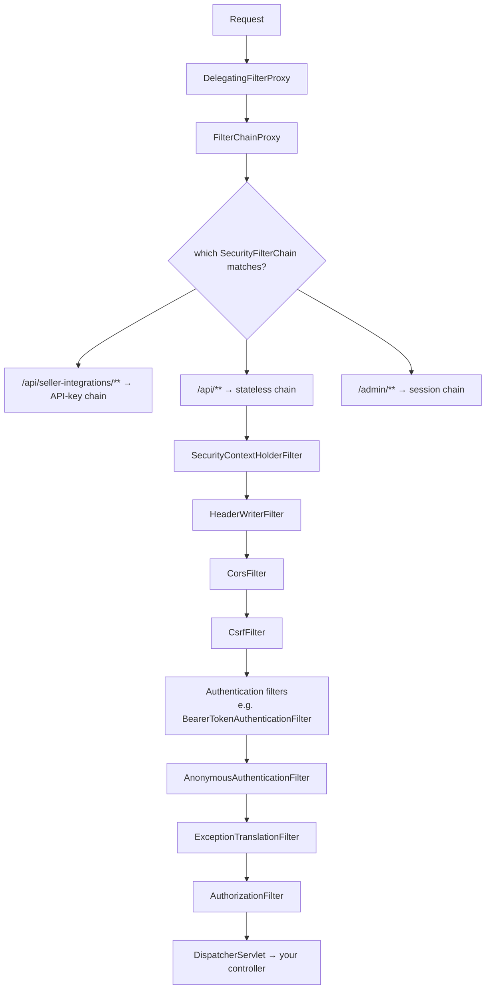
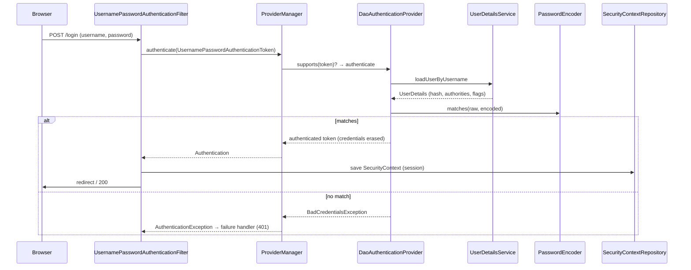
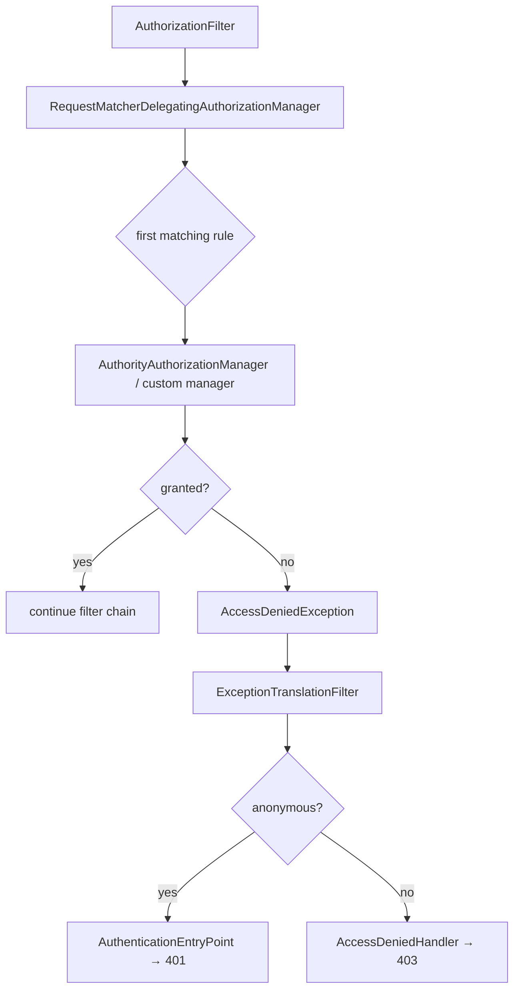
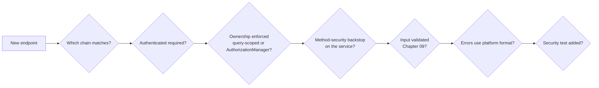

# 17 · Spring Security Fundamentals

## 1. Introduction & Why It Matters

Everything in the grocery platform is behind a security decision: a customer may see **their** cart, a seller may edit **their** catalog, an operations user may cancel any order, a delivery partner may update only assigned deliveries, and Razorpay may call exactly one webhook endpoint with a signature.

Getting this wrong is the most expensive class of bug. Real incidents this chapter's patterns prevent:

- **IDOR** — `GET /api/carts/{id}` returns someone else's cart because the controller checked authentication but not ownership.
- **Missing method-level checks** — an internal admin endpoint reachable from the public gateway because one route wasn't matched.
- **CSRF on a cookie-session admin portal** — a malicious page triggers "cancel all orders" as a logged-in operator.
- **Password handling** — plaintext or MD5 in a legacy table, no upgrade path.
- **Security context loss** — `@Async` code runs as anonymous, silently skipping checks or failing.

Spring Security is a **filter chain** with an authentication model and an authorization model. Once those three ideas are clear, the DSL stops being magic.

This chapter covers the fundamentals with the grocery platform's actual needs: the filter chain and where your code plugs in, `SecurityFilterChain` beans with the lambda DSL, authentication providers (including OTP for Indian mobile numbers), password encoding and upgrades, request- and method-level authorization, **ownership checks** with a custom `AuthorizationManager`, CSRF for the admin portal versus stateless APIs, CORS with Security in play, sessions, and testing. Chapter 18 covers JWT, OAuth2, the authorization server, passkeys and webhook signatures.

### Who should read which section

| Band | Focus |
|---|---|
| B1 · 0–2 yrs | Parts 1, 2, 4 — filter chain, basic rules, password encoding |
| B2 · 2–5 yrs | Parts 2, 5 — multiple chains, method security, CSRF/CORS, testing |
| B3 · 5–8 yrs | Parts 3, 5, 6 — internals, custom authentication, ownership authorization |
| B4 · 8–12 yrs | Parts 6, 7, 8 — platform security config, migration to Security 7 |
| B5 · 12–15+ yrs | Parts 8, 9 — authorization architecture and governance |

---

## 2. Core Concepts

### 2.1 The three questions

| Question | Spring Security concept |
|---|---|
| **Who are you?** | Authentication — `Authentication`, `AuthenticationManager`, providers |
| **What are you allowed to do?** | Authorization — `AuthorizationManager`, request matchers, method security |
| **How do I protect the transport and session?** | Filters: CSRF, CORS, headers, session management |

### 2.2 The filter chain

Spring Security is a servlet `Filter` (`springSecurityFilterChain`, registered via `DelegatingFilterProxy`) that delegates to `FilterChainProxy`, which picks the **first matching `SecurityFilterChain`** and runs its filters in order.



Two filters deserve special attention:

- **`ExceptionTranslationFilter`** catches `AuthenticationException` → entry point (401) and `AccessDeniedException` → 403 (or entry point if anonymous). This is why security errors don't reach `@ControllerAdvice` by default (Chapter 10).
- **`AuthorizationFilter`** (Security 6+, replacing `FilterSecurityInterceptor`) applies the request-level rules.

### 2.3 `SecurityFilterChain` beans

Boot auto-configures a default chain (everything authenticated, HTTP Basic + form login, generated password) **only if you define none**. In production you define one or more:

```java title="SecurityFilterChain beans (snippet)"
@Bean
SecurityFilterChain api(HttpSecurity http) throws Exception {
    return http
        .securityMatcher("/api/**")                 // which requests this chain handles
        .authorizeHttpRequests(auth -> auth...)     // rules
        .csrf(csrf -> csrf.disable())               // stateless API
        .sessionManagement(s -> s.sessionCreationPolicy(STATELESS))
        .build();
}
```

Order matters — annotate chains with `@Order` when their matchers could overlap; the **first match wins** and no later chain is consulted.

### 2.4 Authentication model

| Type | Role |
|---|---|
| `Authentication` | The token: principal, credentials, authorities, `isAuthenticated()` |
| `SecurityContext` / `SecurityContextHolder` | Thread-bound holder of the current `Authentication` |
| `AuthenticationManager` → `ProviderManager` | Delegates to a list of `AuthenticationProvider`s |
| `AuthenticationProvider` | Knows how to authenticate one kind of token (`DaoAuthenticationProvider`, `JwtAuthenticationProvider`, your OTP provider) |
| `UserDetailsService` | Loads a user by username for `DaoAuthenticationProvider` |
| `PasswordEncoder` | Hashes and verifies passwords |
| `SecurityContextRepository` | Where the context is persisted between requests (session, or none for stateless) |

### 2.5 Password storage

`PasswordEncoderFactories.createDelegatingPasswordEncoder()` produces a `DelegatingPasswordEncoder` that stores an algorithm prefix: `{bcrypt}$2a$10$...`. It can **verify** old formats while **writing** new ones — the migration path for legacy hashes. With `UserDetailsPasswordService`, Spring Security upgrades a user's hash automatically on successful login.

Never store plaintext, MD5, SHA-1, or unsalted hashes. BCrypt (cost 10–12), Argon2id or PBKDF2 are the sane choices.

### 2.6 Authorization: request level

```java title="Authorization: request level (snippet)"
.authorizeHttpRequests(auth -> auth
    .requestMatchers(HttpMethod.GET, "/api/public/**").permitAll()
    .requestMatchers("/api/admin/**").hasRole("OPS")
    .requestMatchers("/api/sellers/**").hasAuthority("SCOPE_seller")
    .anyRequest().authenticated())
```

- `hasRole("OPS")` checks the authority `ROLE_OPS` (the prefix is added for you).
- Rules are evaluated **in order**; the first matching rule decides. Put specific rules before general ones, and always end with `anyRequest()`.
- `access(AuthorizationManager)` plugs in custom logic.

### 2.7 Authorization: method level

`@EnableMethodSecurity` enables `@PreAuthorize`, `@PostAuthorize`, `@PreFilter`, `@PostFilter` (AOP — Chapter 04 rules apply: public methods, no self-invocation).

```java title="Authorization: method level (snippet)"
@PreAuthorize("hasRole('OPS')")
public void forceCancel(String orderRef) { ... }
```

Use method security for **service-level rules** (especially ones reachable from more than one entry point), and request matchers for coarse routing. Avoid writing complex SpEL — put the logic in an `AuthorizationManager` or a bean method (`@PreAuthorize("@orderAccess.canCancel(#orderRef, authentication)")`).

### 2.8 Ownership (the IDOR problem)

"Authenticated" is not "authorized for this resource". Three places to enforce ownership:

| Where | How | Notes |
|---|---|---|
| Query | `findByIdAndCustomerId(...)` returns empty → 404 | Simplest, fastest, no leakage |
| Method security | `@PostAuthorize("returnObject.customerId == authentication.name")` | Loads the object first |
| Custom `AuthorizationManager` | Reusable rule at request or method level | Best for cross-cutting rules |

The platform default: **scope the query by owner** and return 404, plus a method-security backstop on sensitive operations.

### 2.9 CSRF

CSRF protection matters when the browser **automatically** attaches credentials: cookies (sessions) or HTTP Basic. It is unnecessary for APIs authenticated with an `Authorization` header on every request.

| Surface | CSRF |
|---|---|
| Admin portal (session cookie) | **Enabled**, cookie-based token readable by the SPA |
| `/api/**` with bearer tokens | Disabled (no ambient credentials) |
| Webhooks | Disabled; authenticated by signature (Chapter 18) |

### 2.10 CORS with Security

When Spring Security is present, configure CORS **through Security** (`http.cors(...)` with a `CorsConfigurationSource` bean) so preflight `OPTIONS` requests are handled before authentication.

### 2.11 Sessions

| Policy | Use |
|---|---|
| `STATELESS` | APIs with per-request credentials — no `HttpSession`, no `JSESSIONID` |
| `IF_REQUIRED` (default) | Form-login portals |
| Session fixation protection | On by default (`changeSessionId`) |
| Concurrency control | Limit sessions per user (admin portal) |
| Spring Session + Redis | Shared sessions across pods |

### 2.12 Security context and threads

`SecurityContextHolder` is thread-local. Work handed to another thread (`@Async`, executors, virtual-thread tasks) loses it unless you propagate: `DelegatingSecurityContextExecutor`/`...Runnable`, or Micrometer context propagation (Chapter 07). Symptoms: "anonymous" in audit logs, or `AccessDeniedException` inside async code.

---

## 3. How It Works Internally

### 3.1 Authentication flow (username/password)



`ProviderManager` tries providers in order and rethrows the last exception if none succeed; it erases credentials from the resulting token by default.

### 3.2 Authorization flow



Method security works the same way one level down: `AuthorizationManagerBeforeMethodInterceptor` consults an `AuthorizationManager<MethodInvocation>` built from `@PreAuthorize`.

### 3.3 Where security errors become responses

`ExceptionTranslationFilter` runs **before** the DispatcherServlet, so `@ControllerAdvice` never sees `AccessDeniedException` thrown by the filter chain. To emit the platform's `ProblemDetail` (Chapter 10), configure an `AuthenticationEntryPoint` and `AccessDeniedHandler` — Level 4 does this. (Method-security denials **do** happen inside the dispatch and can be handled by an advice.)

---

## 4. Hands-On Code — Level 1 (Beginner)

### 4.1 Add the starter and see the default

```kotlin title="build.gradle.kts"
dependencies {
    implementation("org.springframework.boot:spring-boot-starter-security")
    testImplementation("org.springframework.security:spring-security-test")
}
```

Start the app: every endpoint now requires authentication, and the log prints a generated password for user `user`. That default exists to make "we added security and forgot to configure it" obvious.

### 4.2 A first explicit chain

```java title="in/grocery/catalog/config/SecurityConfig.java"
package in.grocery.catalog.config;

import org.springframework.context.annotation.Bean;
import org.springframework.context.annotation.Configuration;
import org.springframework.http.HttpMethod;
import org.springframework.security.config.annotation.web.builders.HttpSecurity;
import org.springframework.security.config.http.SessionCreationPolicy;
import org.springframework.security.crypto.factory.PasswordEncoderFactories;
import org.springframework.security.crypto.password.PasswordEncoder;
import org.springframework.security.web.SecurityFilterChain;

@Configuration(proxyBeanMethods = false)
class SecurityConfig {

    @Bean
    SecurityFilterChain catalogApi(HttpSecurity http) throws Exception {
        return http
                .securityMatcher("/api/**")                                            // (1)!
                .authorizeHttpRequests(auth -> auth
                        .requestMatchers(HttpMethod.GET, "/api/public/**").permitAll()  // (2)!
                        .requestMatchers(HttpMethod.GET, "/api/products/**").permitAll()
                        .requestMatchers("/api/admin/**").hasRole("OPS")
                        .anyRequest().authenticated())                                  // (3)!
                .csrf(csrf -> csrf.disable())                                           // (4)!
                .sessionManagement(s -> s.sessionCreationPolicy(SessionCreationPolicy.STATELESS))
                .httpBasic(basic -> {})                                                 // (5)!
                .build();
    }

    @Bean
    PasswordEncoder passwordEncoder() {
        return PasswordEncoderFactories.createDelegatingPasswordEncoder();              // (6)!
    }
}
```

1. This chain handles `/api/**` only; other paths fall through to another chain (or Boot's default).
2. Public product browsing needs no login.
3. **Always** end with `anyRequest()` — otherwise unmatched requests are permitted by this chain.
4. Safe here because the chain is stateless and uses per-request credentials.
5. Basic auth as a placeholder; Chapter 18 replaces it with JWT.
6. `{bcrypt}`-prefixed hashes, able to verify legacy formats.

### 4.3 Users from the database

```java title="in/grocery/identity/service/GroceryUserDetailsService.java"
package in.grocery.identity.service;

import java.util.List;
import org.springframework.security.core.authority.SimpleGrantedAuthority;
import org.springframework.security.core.userdetails.User;
import org.springframework.security.core.userdetails.UserDetails;
import org.springframework.security.core.userdetails.UserDetailsService;
import org.springframework.security.core.userdetails.UsernameNotFoundException;
import org.springframework.stereotype.Service;

@Service
public class GroceryUserDetailsService implements UserDetailsService {

    private final StaffRepository staff;

    public GroceryUserDetailsService(StaffRepository staff) {
        this.staff = staff;
    }

    @Override
    public UserDetails loadUserByUsername(String username) throws UsernameNotFoundException {
        StaffRow row = staff.findByEmail(username)
                .orElseThrow(() -> new UsernameNotFoundException("No staff user " + username));   // (1)!
        List<SimpleGrantedAuthority> authorities = row.roles().stream()
                .map(r -> new SimpleGrantedAuthority("ROLE_" + r))                                 // (2)!
                .toList();
        return User.withUsername(row.email())
                .password(row.passwordHash())
                .authorities(authorities)
                .accountLocked(row.locked())
                .disabled(!row.active())
                .build();
    }
}
```

1. The exception message never reaches the client (Spring Security returns a generic 401) — don't leak "user exists but wrong password".
2. `hasRole("OPS")` ⇢ authority `ROLE_OPS`.

### 4.4 Testing security rules

```java title="in/grocery/catalog/web/ProductSecurityTest.java"
package in.grocery.catalog.web;

import static org.assertj.core.api.Assertions.assertThat;

import in.grocery.catalog.config.SecurityConfig;
import org.junit.jupiter.api.Test;
import org.springframework.beans.factory.annotation.Autowired;
import org.springframework.boot.test.autoconfigure.web.servlet.WebMvcTest;
import org.springframework.context.annotation.Import;
import org.springframework.http.HttpStatus;
import org.springframework.security.test.context.support.WithMockUser;
import org.springframework.test.web.servlet.assertj.MockMvcTester;

@WebMvcTest(ProductController.class)
@Import(SecurityConfig.class)                                                    // (1)!
class ProductSecurityTest {

    @Autowired MockMvcTester mvc;

    @Test
    void publicProductsAreOpen() {
        assertThat(mvc.get().uri("/api/products/ATTA-5KG")).hasStatusOk();
    }

    @Test
    void adminEndpointNeedsAuthentication() {
        assertThat(mvc.get().uri("/api/admin/products")).hasStatus(HttpStatus.UNAUTHORIZED);
    }

    @Test
    @WithMockUser(roles = "SELLER")                                              // (2)!
    void wrongRoleIsForbidden() {
        assertThat(mvc.get().uri("/api/admin/products")).hasStatus(HttpStatus.FORBIDDEN);
    }

    @Test
    @WithMockUser(roles = "OPS")
    void opsRoleIsAllowed() {
        assertThat(mvc.get().uri("/api/admin/products")).hasStatusOk();
    }
}
```

1. `@WebMvcTest` enables Spring Security's filter chain but doesn't scan your `@Configuration` — import it.
2. `@WithMockUser` populates the security context; `roles = "OPS"` becomes `ROLE_OPS`.

---

## 5. Hands-On Code — Level 2 (Intermediate) & Level 3 (Advanced)

### 5.1 Level 2 — Multiple chains for different surfaces

The order-service serves customers (bearer tokens), operations staff (session portal) and sellers (API keys).

```java title="in/grocery/order/config/SecurityChains.java"
package in.grocery.order.config;

import org.springframework.context.annotation.Bean;
import org.springframework.context.annotation.Configuration;
import org.springframework.core.Ordered;
import org.springframework.core.annotation.Order;
import org.springframework.security.config.Customizer;
import org.springframework.security.config.annotation.web.builders.HttpSecurity;
import org.springframework.security.config.http.SessionCreationPolicy;
import org.springframework.security.web.SecurityFilterChain;
import org.springframework.security.web.csrf.CookieCsrfTokenRepository;

@Configuration(proxyBeanMethods = false)
class SecurityChains {

    @Bean
    @Order(1)                                                                            // (1)!
    SecurityFilterChain webhooks(HttpSecurity http) throws Exception {
        return http
                .securityMatcher("/webhooks/**")
                .authorizeHttpRequests(a -> a.anyRequest().permitAll())                  // (2)!
                .csrf(csrf -> csrf.disable())
                .sessionManagement(s -> s.sessionCreationPolicy(SessionCreationPolicy.STATELESS))
                .build();
    }

    @Bean
    @Order(2)
    SecurityFilterChain sellerIntegrations(HttpSecurity http, ApiKeyAuthFilter apiKeys) throws Exception {
        return http
                .securityMatcher("/api/seller-integrations/**")
                .authorizeHttpRequests(a -> a.anyRequest().hasAuthority("SCOPE_seller-integration"))
                .addFilterBefore(apiKeys, org.springframework.security.web.authentication
                        .UsernamePasswordAuthenticationFilter.class)                      // (3)!
                .csrf(csrf -> csrf.disable())
                .sessionManagement(s -> s.sessionCreationPolicy(SessionCreationPolicy.STATELESS))
                .build();
    }

    @Bean
    @Order(3)
    SecurityFilterChain customerApi(HttpSecurity http) throws Exception {
        return http
                .securityMatcher("/api/**")
                .authorizeHttpRequests(a -> a
                        .requestMatchers("/api/public/**").permitAll()
                        .requestMatchers("/api/admin/**").hasRole("OPS")
                        .anyRequest().authenticated())
                .oauth2ResourceServer(o -> o.jwt(Customizer.withDefaults()))              // Chapter 18
                .csrf(csrf -> csrf.disable())
                .sessionManagement(s -> s.sessionCreationPolicy(SessionCreationPolicy.STATELESS))
                .build();
    }

    @Bean
    @Order(Ordered.LOWEST_PRECEDENCE)
    SecurityFilterChain adminPortal(HttpSecurity http) throws Exception {
        return http
                .authorizeHttpRequests(a -> a
                        .requestMatchers("/login", "/css/**", "/js/**").permitAll()
                        .anyRequest().hasRole("OPS"))
                .formLogin(form -> form.loginPage("/login").permitAll())
                .logout(logout -> logout.logoutSuccessUrl("/login?logout"))
                .csrf(csrf -> csrf.csrfTokenRepository(CookieCsrfTokenRepository.withHttpOnlyFalse()))   // (4)!
                .sessionManagement(s -> s
                        .sessionFixation(f -> f.changeSessionId())
                        .maximumSessions(2))
                .build();
    }
}
```

1. Explicit ordering — the most specific matcher first. Without `@Order`, overlapping chains cause startup errors or surprising matches.
2. Webhook endpoints authenticate by **signature** inside the handler (Chapter 18), not by the filter chain; the chain still applies headers and disables sessions.
3. A custom filter placed before the username/password filter position.
4. Session-based portal keeps CSRF on, with a cookie the SPA can read.

### 5.2 Level 2 — A custom authentication filter (API keys)

```java title="in/grocery/order/security/ApiKeyAuthFilter.java"
package in.grocery.order.security;

import jakarta.servlet.FilterChain;
import jakarta.servlet.ServletException;
import jakarta.servlet.http.HttpServletRequest;
import jakarta.servlet.http.HttpServletResponse;
import java.io.IOException;
import java.util.List;
import org.springframework.security.authentication.UsernamePasswordAuthenticationToken;
import org.springframework.security.core.authority.SimpleGrantedAuthority;
import org.springframework.security.core.context.SecurityContextHolder;
import org.springframework.security.web.authentication.WebAuthenticationDetailsSource;
import org.springframework.stereotype.Component;
import org.springframework.web.filter.OncePerRequestFilter;

@Component
public class ApiKeyAuthFilter extends OncePerRequestFilter {

    public interface ApiKeyService {
        /** Returns the seller id for a valid key (constant-time compare of a hashed key), or empty. */
        java.util.Optional<String> sellerFor(String apiKey);
    }

    private final ApiKeyService apiKeys;

    public ApiKeyAuthFilter(ApiKeyService apiKeys) {
        this.apiKeys = apiKeys;
    }

    @Override
    protected void doFilterInternal(HttpServletRequest req, HttpServletResponse res, FilterChain chain)
            throws ServletException, IOException {
        String key = req.getHeader("X-Seller-Api-Key");
        if (key != null && SecurityContextHolder.getContext().getAuthentication() == null) {
            apiKeys.sellerFor(key).ifPresent(sellerId -> {
                var auth = UsernamePasswordAuthenticationToken.authenticated(                 // (1)!
                        sellerId, null, List.of(new SimpleGrantedAuthority("SCOPE_seller-integration")));
                auth.setDetails(new WebAuthenticationDetailsSource().buildDetails(req));
                var context = SecurityContextHolder.createEmptyContext();                     // (2)!
                context.setAuthentication(auth);
                SecurityContextHolder.setContext(context);
            });
        }
        try {
            chain.doFilter(req, res);
        } finally {
            SecurityContextHolder.clearContext();                                             // (3)!
        }
    }
}
```

1. Authenticated token with no credentials retained.
2. Create a fresh context rather than mutating the existing one (required since Security 5.8/6).
3. Stateless chain: clear the context so nothing leaks to the next request on a pooled thread.

!!! warning "Store API keys hashed"
    Keep `sha256(key)` (with a per-seller salt or an HMAC) in the database, compare in constant time, support rotation with two active keys, and log the key **id**, never the key. Better still, move sellers to OAuth2 client credentials (Chapter 18).

### 5.3 Level 2 — OTP authentication for customers

Indian consumer apps log in with a mobile number and a one-time password. Model it as a custom `AuthenticationProvider`.

```java title="in/grocery/identity/security/OtpAuthenticationToken.java"
package in.grocery.identity.security;

import java.util.Collection;
import org.springframework.security.authentication.AbstractAuthenticationToken;
import org.springframework.security.core.GrantedAuthority;

public class OtpAuthenticationToken extends AbstractAuthenticationToken {

    private final String mobile;
    private final String otp;
    private final String customerId;

    private OtpAuthenticationToken(String mobile, String otp, String customerId,
                                   Collection<? extends GrantedAuthority> authorities) {
        super(authorities);
        this.mobile = mobile;
        this.otp = otp;
        this.customerId = customerId;
        setAuthenticated(customerId != null);
    }

    public static OtpAuthenticationToken unauthenticated(String mobile, String otp) {
        return new OtpAuthenticationToken(mobile, otp, null, java.util.List.of());
    }

    public static OtpAuthenticationToken authenticated(String mobile, String customerId,
                                                       Collection<? extends GrantedAuthority> authorities) {
        return new OtpAuthenticationToken(mobile, null, customerId, authorities);
    }

    @Override public Object getCredentials() { return otp; }
    @Override public Object getPrincipal() { return customerId != null ? customerId : mobile; }
    public String mobile() { return mobile; }
}
```

```java title="in/grocery/identity/security/OtpAuthenticationProvider.java"
package in.grocery.identity.security;

import java.util.List;
import org.springframework.security.authentication.AuthenticationProvider;
import org.springframework.security.authentication.BadCredentialsException;
import org.springframework.security.authentication.LockedException;
import org.springframework.security.core.Authentication;
import org.springframework.security.core.AuthenticationException;
import org.springframework.security.core.authority.SimpleGrantedAuthority;
import org.springframework.stereotype.Component;

@Component
public class OtpAuthenticationProvider implements AuthenticationProvider {

    public interface OtpStore {
        /** Consumes the OTP: true only on first correct use within TTL. Counts failures per mobile. */
        boolean consume(String mobile, String otp);
        boolean isLockedOut(String mobile);
    }

    public interface CustomerDirectory {
        String findOrCreateCustomerId(String mobile);
    }

    private final OtpStore otps;
    private final CustomerDirectory customers;

    public OtpAuthenticationProvider(OtpStore otps, CustomerDirectory customers) {
        this.otps = otps;
        this.customers = customers;
    }

    @Override
    public Authentication authenticate(Authentication authentication) throws AuthenticationException {
        OtpAuthenticationToken token = (OtpAuthenticationToken) authentication;
        if (otps.isLockedOut(token.mobile())) {
            throw new LockedException("Too many attempts");                                  // (1)!
        }
        if (!otps.consume(token.mobile(), String.valueOf(token.getCredentials()))) {
            throw new BadCredentialsException("Invalid OTP");                                // (2)!
        }
        String customerId = customers.findOrCreateCustomerId(token.mobile());
        return OtpAuthenticationToken.authenticated(token.mobile(), customerId,
                List.of(new SimpleGrantedAuthority("ROLE_CUSTOMER")));
    }

    @Override
    public boolean supports(Class<?> authentication) {
        return OtpAuthenticationToken.class.isAssignableFrom(authentication);
    }
}
```

1. Rate limiting belongs here: 5 attempts per mobile per 15 minutes, and a separate limit on OTP **requests** (Chapter 26) — otherwise the login endpoint is an SMS-cost DoS.
2. Single-use consumption prevents replay; OTPs are stored hashed with a short TTL in Redis.

The login controller calls `authenticationManager.authenticate(OtpAuthenticationToken.unauthenticated(mobile, otp))` and, on success, issues a JWT (Chapter 18).

### 5.4 Level 3 — Ownership authorization

```java title="in/grocery/order/security/OrderAccess.java"
package in.grocery.order.security;

import in.grocery.order.repository.OrderRepository;
import java.util.function.Supplier;
import org.springframework.security.authorization.AuthorizationDecision;
import org.springframework.security.authorization.AuthorizationManager;
import org.springframework.security.core.Authentication;
import org.springframework.security.web.access.intercept.RequestAuthorizationContext;
import org.springframework.stereotype.Component;

@Component("orderAccess")
public class OrderAccess implements AuthorizationManager<RequestAuthorizationContext> {       // (1)!

    private final OrderRepository orders;

    public OrderAccess(OrderRepository orders) {
        this.orders = orders;
    }

    @Override
    public AuthorizationDecision check(Supplier<Authentication> authentication, RequestAuthorizationContext context) {
        Authentication auth = authentication.get();
        if (auth == null || !auth.isAuthenticated()) return new AuthorizationDecision(false);
        if (hasRole(auth, "ROLE_OPS")) return new AuthorizationDecision(true);                 // (2)!

        String orderRef = context.getVariables().get("orderRef");                              // (3)!
        return new AuthorizationDecision(orders.existsByOrderRefAndCustomerId(orderRef, auth.getName()));
    }

    /** For @PreAuthorize("@orderAccess.canCancel(#orderRef, authentication)") */
    public boolean canCancel(String orderRef, Authentication auth) {
        return hasRole(auth, "ROLE_OPS")
                || orders.existsByOrderRefAndCustomerId(orderRef, auth.getName());
    }

    private static boolean hasRole(Authentication auth, String role) {
        return auth.getAuthorities().stream().anyMatch(a -> a.getAuthority().equals(role));
    }
}
```

1. Implementing `AuthorizationManager` makes the rule usable in the DSL **and** as a bean in SpEL.
2. Operations staff bypass ownership — a deliberate, reviewable exception.
3. URI template variables are available in the authorization context.

```java title="Using it in the chain"
.authorizeHttpRequests(a -> a
    .requestMatchers("/api/orders/{orderRef}/**").access(orderAccess)
    .anyRequest().authenticated())
```

!!! tip "Prefer owner-scoped queries"
    `findByOrderRefAndCustomerId(...)` needs no extra query and returns 404 rather than 403, revealing nothing about existence. Use the `AuthorizationManager` when the rule must apply to many endpoints or when the handler can't easily scope its query.

### 5.5 Level 3 — Method security in services

```java title="in/grocery/order/config/MethodSecurityConfig.java"
@Configuration(proxyBeanMethods = false)
@EnableMethodSecurity                                                                          // (1)!
class MethodSecurityConfig {}
```

```java title="in/grocery/order/service/OrderAdminService.java"
package in.grocery.order.service;

import org.springframework.security.access.prepost.PreAuthorize;
import org.springframework.stereotype.Service;
import org.springframework.transaction.annotation.Transactional;

@Service
public class OrderAdminService {

    @PreAuthorize("hasRole('OPS')")                                                            // (2)!
    @Transactional
    public void forceCancel(String orderRef, String reason) { ... }

    @PreAuthorize("hasRole('OPS') and hasAuthority('PERM_REFUND')")
    @Transactional
    public void refund(String orderRef, long amountPaise) { ... }

    @PreAuthorize("@orderAccess.canCancel(#orderRef, authentication)")                         // (3)!
    @Transactional
    public void cancelOwn(String orderRef) { ... }
}
```

1. Enables `@PreAuthorize`/`@PostAuthorize` (prePostEnabled by default).
2. Defence in depth: even if a route is misconfigured, the service refuses.
3. Delegates to a bean instead of embedding logic in SpEL — testable, debuggable, no string expressions over your domain model.

!!! warning "Method security is AOP"
    Public methods only, no self-invocation, and the denial happens **inside** the dispatch — so `AuthorizationDeniedException` reaches your `@ControllerAdvice` (map it to 403 with the platform problem format).

### 5.6 Level 3 — CSRF for the admin SPA and CORS with Security

```java title="in/grocery/admin/config/AdminSecurityConfig.java (excerpt)"
@Bean
SecurityFilterChain adminPortal(HttpSecurity http, CorsConfigurationSource cors) throws Exception {
    CookieCsrfTokenRepository tokenRepository = CookieCsrfTokenRepository.withHttpOnlyFalse();
    CsrfTokenRequestAttributeHandler requestHandler = new CsrfTokenRequestAttributeHandler();
    requestHandler.setCsrfRequestAttributeName(null);                                          // (1)!

    return http
            .securityMatcher("/admin/**")
            .cors(c -> c.configurationSource(cors))                                             // (2)!
            .csrf(csrf -> csrf.csrfTokenRepository(tokenRepository)
                              .csrfTokenRequestHandler(requestHandler))
            .headers(h -> h
                    .contentSecurityPolicy(csp -> csp.policyDirectives(
                            "default-src 'self'; frame-ancestors 'none'; object-src 'none'"))
                    .httpStrictTransportSecurity(hsts -> hsts.includeSubDomains(true).maxAgeInSeconds(31536000)))
            .authorizeHttpRequests(a -> a.anyRequest().hasRole("OPS"))
            .formLogin(Customizer.withDefaults())
            .build();
}

@Bean
CorsConfigurationSource corsConfigurationSource(GroceryCorsProperties props) {
    CorsConfiguration config = new CorsConfiguration();
    config.setAllowedOrigins(props.allowedOrigins());
    config.setAllowedMethods(List.of("GET", "POST", "PUT", "PATCH", "DELETE"));
    config.setAllowedHeaders(List.of("Content-Type", "Authorization", "X-XSRF-TOKEN", "Idempotency-Key", "If-Match"));
    config.setExposedHeaders(List.of("ETag", "Location", "X-Request-Id"));
    config.setAllowCredentials(true);
    config.setMaxAge(3600L);
    UrlBasedCorsConfigurationSource source = new UrlBasedCorsConfigurationSource();
    source.registerCorsConfiguration("/**", config);
    return source;
}
```

1. Opts out of Security 6's deferred CSRF token loading so a SPA that reads the `XSRF-TOKEN` cookie works as expected. **Verify** this recipe against your Spring Security version's CSRF documentation — the details changed in 6.x and again in 7.
2. With Security present, CORS is configured here so preflight requests pass before authentication.

### 5.7 Level 3 — Propagating the security context to async work

```java title="in/grocery/platform/security/AsyncSecurityConfig.java"
package in.grocery.platform.security;

import java.util.concurrent.Executor;
import org.springframework.context.annotation.Bean;
import org.springframework.context.annotation.Configuration;
import org.springframework.scheduling.concurrent.ThreadPoolTaskExecutor;
import org.springframework.security.concurrent.DelegatingSecurityContextExecutor;

@Configuration(proxyBeanMethods = false)
class AsyncSecurityConfig {

    @Bean
    Executor auditExecutor(ThreadPoolTaskExecutor base) {
        return new DelegatingSecurityContextExecutor(base);                                     // (1)!
    }
}
```

1. Tasks submitted here run with the submitting request's `SecurityContext`, so `authentication.getName()` in an audit aspect (Chapter 04) is the real user, not `anonymous`. `SecurityContextHolder`'s strategy can also be set to `MODE_INHERITABLETHREADLOCAL`, but explicit delegation is clearer and works with pooled and virtual threads alike.

---

## 6. Hands-On Code — Level 4 (Expert / Production)

### 6.1 Platform security configuration

Goals: identical behaviour across 26 services, platform error format for 401/403, security events audited, and rules that are tested.

```java title="in/grocery/platform/security/GrocerySecurityDefaults.java"
package in.grocery.platform.security;

import jakarta.servlet.http.HttpServletRequest;
import jakarta.servlet.http.HttpServletResponse;
import java.io.IOException;
import java.time.Clock;
import org.springframework.boot.autoconfigure.condition.ConditionalOnMissingBean;
import org.springframework.context.annotation.Bean;
import org.springframework.context.annotation.Configuration;
import org.springframework.http.MediaType;
import org.springframework.security.web.AuthenticationEntryPoint;
import org.springframework.security.web.access.AccessDeniedHandler;

@Configuration(proxyBeanMethods = false)
public class GrocerySecurityDefaults {

    @Bean
    @ConditionalOnMissingBean
    AuthenticationEntryPoint groceryEntryPoint(Clock clock) {                                   // (1)!
        return (request, response, ex) -> writeProblem(request, response, 401,
                "UNAUTHENTICATED", "Authentication is required", clock);
    }

    @Bean
    @ConditionalOnMissingBean
    AccessDeniedHandler groceryAccessDeniedHandler(Clock clock) {
        return (request, response, ex) -> writeProblem(request, response, 403,
                "FORBIDDEN", "You are not allowed to perform this action", clock);
    }

    private static void writeProblem(HttpServletRequest request, HttpServletResponse response,
                                     int status, String code, String detail, Clock clock) throws IOException {
        response.setStatus(status);
        response.setContentType(MediaType.APPLICATION_PROBLEM_JSON_VALUE);                       // (2)!
        response.getWriter().write("""
                {"type":"https://errors.grocery.in/%s","title":"%s","status":%d,"detail":"%s",
                 "instance":"%s","code":"%s","retryable":false,"timestamp":"%s","errors":[]}
                """.formatted(code.toLowerCase().replace('_', '-'), code.replace('_', ' '), status,
                detail, request.getRequestURI(), code, clock.instant()));
    }
}
```

1. Without these, Spring Security returns an empty 401/403 (or an HTML login page) and clients see a different error shape than everywhere else (Chapter 10).
2. Hand-written JSON keeps this free of the mapper and safe to run inside the filter chain. Alternatively, delegate to the `HandlerExceptionResolver` as in Chapter 10's filter recipe.

```java title="in/grocery/platform/security/SecurityAuditListener.java"
package in.grocery.platform.security;

import io.micrometer.core.instrument.MeterRegistry;
import org.slf4j.Logger;
import org.slf4j.LoggerFactory;
import org.springframework.context.event.EventListener;
import org.springframework.security.authentication.event.AbstractAuthenticationFailureEvent;
import org.springframework.security.authentication.event.AuthenticationSuccessEvent;
import org.springframework.security.authorization.event.AuthorizationDeniedEvent;
import org.springframework.stereotype.Component;

@Component
public class SecurityAuditListener {

    private static final Logger log = LoggerFactory.getLogger("security-audit");

    private final MeterRegistry meters;

    public SecurityAuditListener(MeterRegistry meters) {
        this.meters = meters;
    }

    @EventListener
    public void onSuccess(AuthenticationSuccessEvent event) {
        meters.counter("grocery.auth", "outcome", "success").increment();
    }

    @EventListener
    public void onFailure(AbstractAuthenticationFailureEvent event) {                            // (1)!
        String type = event.getException().getClass().getSimpleName();
        meters.counter("grocery.auth", "outcome", "failure", "reason", type).increment();
        log.warn("Authentication failure ({}) for principal hash {}", type,
                Integer.toHexString(String.valueOf(event.getAuthentication().getName()).hashCode()));   // (2)!
    }

    @EventListener
    public void onDenied(AuthorizationDeniedEvent<?> event) {
        meters.counter("grocery.authz", "outcome", "denied").increment();
    }
}
```

1. Spring Security publishes application events for authentication outcomes; `AuthorizationDeniedEvent` requires the authorization event publisher to be configured (`SpringAuthorizationEventPublisher` bean) — verify for your version.
2. Never log the mobile number or username in clear text (Chapter 07); a stable hash is enough to spot brute force.

### 6.2 Rate limiting the login endpoint

```java title="in/grocery/identity/security/OtpRateLimiter.java"
package in.grocery.identity.security;

import java.time.Duration;
import org.springframework.data.redis.core.StringRedisTemplate;
import org.springframework.stereotype.Component;

@Component
public class OtpRateLimiter {

    private final StringRedisTemplate redis;

    public OtpRateLimiter(StringRedisTemplate redis) {
        this.redis = redis;
    }

    /** @return true if the action is allowed. Fixed window; good enough for OTP flows. */
    public boolean allow(String bucket, String key, int limit, Duration window) {
        String redisKey = "rl:" + bucket + ":" + key;
        Long count = redis.opsForValue().increment(redisKey);                                    // (1)!
        if (count != null && count == 1L) {
            redis.expire(redisKey, window);
        }
        return count != null && count <= limit;
    }
}
```

1. Atomic increment in Redis; shared across pods. Apply **two** buckets: OTP requests per mobile (e.g. 3 per 10 min) and verification attempts per mobile (5 per 15 min), plus a per-IP limit to blunt enumeration. Chapter 26 covers proper rate limiting and bulkheads.

### 6.3 Securing Actuator

```yaml title="application-prod.yml"
management:
  server:
    port: 9090                                     # (1)!
  endpoints:
    web:
      exposure:
        include: health,info,prometheus,loggers,startup
  endpoint:
    health:
      show-details: when-authorized
      probes:
        enabled: true
```

```java title="in/grocery/platform/security/ActuatorSecurityConfig.java"
@Bean
@Order(0)
SecurityFilterChain actuator(HttpSecurity http) throws Exception {
    return http
            .securityMatcher(EndpointRequest.toAnyEndpoint())                                    // (2)!
            .authorizeHttpRequests(a -> a
                    .requestMatchers(EndpointRequest.to(HealthEndpoint.class, InfoEndpoint.class)).permitAll()
                    .anyRequest().hasRole("PLATFORM"))
            .httpBasic(Customizer.withDefaults())
            .csrf(csrf -> csrf.disable())
            .build();
}
```

1. A separate management port keeps Actuator off the public ingress entirely — the strongest control.
2. `EndpointRequest` matchers adapt automatically to the configured base path. Probes stay open for Kubernetes; everything else (including `loggers`, which can flood logs) requires a platform role.

!!! warning "Verify"
    `EndpointRequest` lives in Boot's Actuator autoconfigure package and moves in Boot 4's modularization; check the import.

### 6.4 Security tests that encode the rules

```java title="src/test/java/in/grocery/order/security/OrderSecurityRulesTest.java"
package in.grocery.order.security;

import static org.assertj.core.api.Assertions.assertThat;
import static org.mockito.BDDMockito.given;

import in.grocery.order.config.SecurityChains;
import in.grocery.order.repository.OrderRepository;
import in.grocery.order.web.OrderController;
import org.junit.jupiter.api.Test;
import org.springframework.beans.factory.annotation.Autowired;
import org.springframework.boot.test.autoconfigure.web.servlet.WebMvcTest;
import org.springframework.context.annotation.Import;
import org.springframework.http.HttpStatus;
import org.springframework.security.test.context.support.WithAnonymousUser;
import org.springframework.security.test.context.support.WithMockUser;
import org.springframework.test.context.bean.override.mockito.MockitoBean;
import org.springframework.test.web.servlet.assertj.MockMvcTester;

@WebMvcTest(OrderController.class)
@Import({SecurityChains.class, OrderAccess.class})
class OrderSecurityRulesTest {

    @Autowired MockMvcTester mvc;
    @MockitoBean OrderRepository orders;
    @MockitoBean in.grocery.order.delegate.OrderDelegate delegate;

    @Test
    @WithAnonymousUser
    void anonymousGets401() {
        assertThat(mvc.get().uri("/api/orders/ORD-1")).hasStatus(HttpStatus.UNAUTHORIZED);
    }

    @Test
    @WithMockUser(username = "C-1", roles = "CUSTOMER")
    void ownerCanRead() {
        given(orders.existsByOrderRefAndCustomerId("ORD-1", "C-1")).willReturn(true);
        assertThat(mvc.get().uri("/api/orders/ORD-1")).hasStatusOk();
    }

    @Test
    @WithMockUser(username = "C-2", roles = "CUSTOMER")
    void otherCustomerIsDenied() {
        given(orders.existsByOrderRefAndCustomerId("ORD-1", "C-2")).willReturn(false);
        assertThat(mvc.get().uri("/api/orders/ORD-1"))
                .hasStatus(HttpStatus.FORBIDDEN)
                .bodyJson().extractingPath("$.code").isEqualTo("FORBIDDEN");                     // (1)!
    }

    @Test
    @WithMockUser(username = "ops@grocery.in", roles = "OPS")
    void opsCanReadAnyOrder() {
        assertThat(mvc.get().uri("/api/orders/ORD-1")).hasStatusOk();
    }
}
```

1. Asserts both the status **and** the platform error contract from 6.1.

```java title="Custom test annotation for customers"
@Retention(RetentionPolicy.RUNTIME)
@WithMockUser(roles = "CUSTOMER")
public @interface WithCustomer {
    @AliasFor(annotation = WithMockUser.class, attribute = "username")
    String value() default "C-1";
}
```

### 6.5 Checklist-driven review



Every PR adding an endpoint answers these seven questions. Most IDOR bugs die at step D.

---

## 7. Spring Boot 3 vs 4 & Migration

| Topic | Boot 3.5 / Security 6.5 | Boot 4.x / Security 7 |
|---|---|---|
| Configuration style | Lambda DSL recommended; non-lambda deprecated | **Lambda DSL only** — deprecated methods removed |
| `WebSecurityConfigurerAdapter` | Removed (since 5.7/6.0) | Removed |
| Request matchers | `requestMatchers(...)`; `AntPathRequestMatcher` deprecated | `PathPatternRequestMatcher` — Ant matcher removed (verify) |
| Authorization | `authorizeHttpRequests` + `AuthorizationManager` | Same |
| Method security | `@EnableMethodSecurity` | Same |
| Authorization events | Opt-in publisher | Same (verify bean/config name) |
| CSRF SPA recipe | 6.x deferred tokens + `XorCsrfTokenRequestAttributeHandler` | Changed again — **verify** against 7.x docs |
| Passkeys / one-time tokens | 6.4+ | Available (Chapter 18) |
| Servlet API | 6.0 | 6.1 |

=== "Spring Boot 3.5 / Security 6.5"

    ```java title="Spring Boot 3.5 / Security 6.5 (snippet)"
    http.authorizeHttpRequests(a -> a
            .requestMatchers(new AntPathRequestMatcher("/api/admin/**")).hasRole("OPS")
            .anyRequest().authenticated());
    ```

=== "Spring Boot 4.x / Security 7"

    ```java title="Spring Boot 4.x / Security 7 (snippet)"
    http.authorizeHttpRequests(a -> a
            .requestMatchers("/api/admin/**").hasRole("OPS")      // String matchers use PathPattern
            .anyRequest().authenticated());
    ```

### Migration checklist

- [ ] Remove any non-lambda DSL usage while still on 6.x (deprecation warnings guide you).
- [ ] Replace explicit `AntPathRequestMatcher`/`MvcRequestMatcher` constructions with string matchers or `PathPatternRequestMatcher`.
- [ ] Re-test **every** security rule after the upgrade — matcher semantics (trailing slashes, servlet path) are the classic silent break.
- [ ] Re-verify the CSRF configuration for SPAs against 7.x documentation.
- [ ] Check imports of Actuator `EndpointRequest` and Boot security auto-configuration classes.
- [ ] Review custom filters for Servlet 6.1 behaviour and for context clearing.

---

## 8. Production Playbook

### Best practices

1. **Explicit `SecurityFilterChain` beans**, ordered, each ending with `anyRequest()`.
2. **Deny by default**; open only what must be public, per method and path.
3. **Enforce ownership** with owner-scoped queries (404) plus method-security backstops.
4. **Stateless APIs**: no sessions, CSRF off, credentials per request; sessions and CSRF for the cookie-based portal.
5. **Delegating password encoder**, BCrypt 10–12, automatic upgrades; never custom crypto.
6. **Rate-limit authentication** (OTP request, OTP verify, login) per identity and per IP.
7. **Platform error format** for 401/403 via entry point and denied handler.
8. **Audit and meter** authentication/authorization outcomes; alert on spikes.
9. **Actuator on a separate port**, probes public, everything else restricted.
10. **Security tests per endpoint**: anonymous, wrong role, wrong owner, right owner.

### Anti-patterns

❌ `permitAll()` on a broad prefix ("we'll secure it in the gateway") — services must not trust the network.

❌ Missing `anyRequest()` — unmatched requests pass through unauthenticated.

❌ Ownership checks in the controller body only (easy to forget in the next endpoint).

❌ Complex SpEL in `@PreAuthorize` querying repositories inline — untestable and slow.

❌ Disabling CSRF on a cookie-session portal "because the SPA breaks".

❌ Logging usernames, mobile numbers, tokens or API keys.

❌ `SecurityContextHolder.getContext().setAuthentication(...)` without creating a fresh context (and without clearing it afterwards in stateless filters).

❌ Storing API keys or OTPs in plaintext.

### Troubleshooting

| Symptom | Cause | Fix |
|---|---|---|
| Everything returns 401 after adding the starter | Default chain active | Define your own `SecurityFilterChain` |
| 403 on every POST from the SPA | CSRF enabled without a token | Correct CSRF setup, or stateless + bearer tokens |
| 401 instead of 403 | Anonymous request to a protected route | Expected; check the client sends credentials |
| Rules ignored | Another chain matched first | Order chains; check `securityMatcher` |
| CORS preflight fails with 401 | CORS not configured through Security | `http.cors(...)` + `CorsConfigurationSource` |
| `@PreAuthorize` ignored | Self-invocation, non-public method, missing `@EnableMethodSecurity` | Fix proxying |
| Audit shows `anonymousUser` in async code | Context not propagated | `DelegatingSecurityContextExecutor` |
| 403 body is empty HTML | No `AccessDeniedHandler` | Platform handlers (6.1) |
| Users can read others' data | Missing ownership check | Owner-scoped query + `AuthorizationManager` |
| Login works locally, fails behind ingress | `X-Forwarded-*` not honoured; secure cookie flags | `server.forward-headers-strategy`, cookie settings |

### Production checklist

- [ ] One chain per surface, ordered, `anyRequest()` present
- [ ] Ownership enforced and tested for every resource endpoint
- [ ] Passwords/API keys/OTPs hashed; rotation supported
- [ ] Login and OTP endpoints rate-limited
- [ ] 401/403 use the platform problem format
- [ ] Security events audited and metered
- [ ] Actuator restricted; management port separate
- [ ] Security headers (HSTS, CSP, nosniff, frame-ancestors) set
- [ ] Security tests for anonymous/wrong-role/wrong-owner paths

---

## 9. Interview Questions & Answers

### B1 · 0–2 years

??? question "B1 · How does Spring Security plug into a servlet application?"
    **Short answer:** A `DelegatingFilterProxy` registers `springSecurityFilterChain`, which is a `FilterChainProxy` that selects the first matching `SecurityFilterChain` and runs its filters before the DispatcherServlet.

??? question "B1 · Authentication vs authorization?"
    **Short answer:** Authentication establishes who the caller is; authorization decides what they may do.

??? question "B1 · What does `hasRole('OPS')` check?"
    **Short answer:** The authority `ROLE_OPS` — the prefix is added automatically. `hasAuthority` checks the exact string.

??? question "B1 · How should passwords be stored?"
    **Short answer:** Hashed with a slow, salted algorithm (BCrypt/Argon2) via `DelegatingPasswordEncoder`, which prefixes the algorithm and can verify legacy formats.

??? question "B1 · Why do I get 401 for one endpoint and 403 for another?"
    **Short answer:** 401 when no (or invalid) credentials were supplied; 403 when the caller is authenticated but lacks permission.

### B2 · 2–5 years

??? question "B2 · How do you define multiple security configurations?"
    **Short answer:** Several `SecurityFilterChain` beans, each with a `securityMatcher` and `@Order`; the first matching chain handles the request entirely.

??? question "B2 · When is CSRF protection needed?"
    **Short answer:** When credentials are attached automatically by the browser (cookies/Basic). Not needed for APIs using an `Authorization` header per request.

??? question "B2 · How do you write a custom authentication mechanism (e.g. OTP)?"
    **Short answer:** A custom `Authentication` token, an `AuthenticationProvider` that validates it (with rate limiting and single-use semantics), optionally a filter to extract credentials, registered in the `AuthenticationManager`.

??? question "B2 · `@PreAuthorize` vs request matchers?"
    **Short answer:** Matchers protect URLs coarsely at the filter level; method security protects service methods wherever they're called from. Use both — defence in depth.

??? question "B2 · How do you test security rules?"
    **Short answer:** `@WebMvcTest` with the security configuration imported, `spring-security-test` (`@WithMockUser`, `csrf()` post-processor), asserting 401/403/200 for anonymous, wrong role, wrong owner and correct user.

??? question "B2 · Why must API keys be hashed in the database?"
    **Short answer:** They're credentials; a database leak would otherwise hand over every seller's access. Store a hash/HMAC, compare in constant time, support rotation.

### B3 · 5–8 years

??? question "B3 · Describe the request flow through the security filter chain."
    **Short answer:** Context loaded (`SecurityContextHolderFilter`) → headers → CORS → CSRF → authentication filters populate the context → anonymous → `ExceptionTranslationFilter` (catches later exceptions) → `AuthorizationFilter` evaluates rules → application. Denials surface as 401 via the entry point or 403 via the denied handler.

??? question "B3 · Why don't `AccessDeniedException`s from the filter chain hit `@ControllerAdvice`?"
    **Short answer:** They're thrown and handled in the filter chain, before the DispatcherServlet. Configure `AuthenticationEntryPoint`/`AccessDeniedHandler`, or delegate to the `HandlerExceptionResolver`. Method-security denials do reach advices.

??? question "B3 · How do you implement resource ownership checks cleanly?"
    **Short answer:** Scope queries by owner (returning 404), and/or implement `AuthorizationManager<RequestAuthorizationContext>` using URI variables, reusable in the DSL and via `@PreAuthorize("@bean.method(...)")`.

??? question "B3 · What happens to the security context in `@Async` methods?"
    **Short answer:** Nothing propagates by default (thread-local). Use `DelegatingSecurityContextExecutor`/`Runnable`, context propagation, or `MODE_INHERITABLETHREADLOCAL`.

??? question "B3 · How does `DelegatingPasswordEncoder` enable migration?"
    **Short answer:** The stored hash carries an `{id}` prefix, so old algorithms can still be verified while new passwords use the current one; with `UserDetailsPasswordService`, hashes are upgraded on successful login.

### B4 · 8–12 years

??? question "B4 · Design authorization for customers, sellers, ops and delivery partners."
    **Short answer:** Separate chains per surface; roles for coarse capabilities and scopes for token-based clients; ownership rules as reusable `AuthorizationManager`s; method security on sensitive service operations; audit and metrics for denials; tests per rule; documented role/permission catalog reviewed with the business.

??? question "B4 · Gateway or service — where do you enforce authentication?"
    **Short answer:** Both. The gateway does coarse checks (valid token, rate limits, WAF), services re-validate tokens and enforce fine-grained authorization: never trust the network or an upstream header.

??? question "B4 · What are the pitfalls upgrading to Spring Security 7?"
    **Short answer:** Removal of deprecated non-lambda DSL and Ant matchers (matcher semantics differ subtly), CSRF/SPA configuration changes, and moved Boot packages. Every rule needs a test; run the full security test suite before and after.

### B5 · 12–15+ years

??? question "B5 · How do you keep authorization rules understandable as the platform grows?"
    **Short answer:** A single source of truth for roles/permissions, rules expressed as named managers rather than scattered SpEL, tests as executable specification, PR checklist for new endpoints, periodic access reviews, and telemetry on denials to find both bugs and abuse.

??? question "B5 · Roles, scopes or policy engine (OPA/Cedar)?"
    **Short answer:** Roles/scopes suffice for most services; a policy engine helps with complex, frequently changing, cross-service rules (tenant hierarchies, delegated admin) at the cost of another moving part and a new failure mode. Start simple, externalize only where variability justifies it.

### Scenario questions

??? example "Scenario · A customer sees another customer's order after a refactor"
    The new `GET /api/orders/{orderRef}` handler used `findByOrderRef` instead of the owner-scoped query and no chain rule covered the new path (an earlier `permitAll` prefix matched). Fixes: owner-scoped query, `access(orderAccess)` on `/api/orders/{orderRef}/**`, method-security backstop, a security test per role/owner combination, and a PR checklist item.

??? example "Scenario · OTP SMS costs spike overnight"
    An attacker looped OTP requests for random numbers; there was a limit on verification attempts but none on OTP requests. Fixes: per-mobile and per-IP limits on requests, CAPTCHA/device attestation after N attempts, alerting on OTP volume, and a cost dashboard.

### Coding exercise

!!! example "Exercise · Seller catalog isolation"
    `GET/PUT /api/sellers/{sellerId}/products/**` must be accessible only to that seller (token authority `SCOPE_seller` with claim `seller_id`) or to `ROLE_OPS`. Implement an `AuthorizationManager`, wire it in the chain, and write tests for: anonymous → 401, other seller → 403, own seller → 200, ops → 200.

??? success "Solution"
    ```java title="SellerAccess.java"
    package in.grocery.seller.security;

    import java.util.function.Supplier;
    import org.springframework.security.authorization.AuthorizationDecision;
    import org.springframework.security.authorization.AuthorizationManager;
    import org.springframework.security.core.Authentication;
    import org.springframework.security.oauth2.jwt.Jwt;
    import org.springframework.security.oauth2.server.resource.authentication.JwtAuthenticationToken;
    import org.springframework.security.web.access.intercept.RequestAuthorizationContext;
    import org.springframework.stereotype.Component;

    @Component("sellerAccess")
    public class SellerAccess implements AuthorizationManager<RequestAuthorizationContext> {

        @Override
        public AuthorizationDecision check(Supplier<Authentication> authentication, RequestAuthorizationContext ctx) {
            Authentication auth = authentication.get();
            if (auth == null || !auth.isAuthenticated()) return new AuthorizationDecision(false);
            boolean ops = auth.getAuthorities().stream().anyMatch(a -> a.getAuthority().equals("ROLE_OPS"));
            if (ops) return new AuthorizationDecision(true);

            String pathSeller = ctx.getVariables().get("sellerId");
            String tokenSeller = auth instanceof JwtAuthenticationToken jwtAuth
                    ? ((Jwt) jwtAuth.getToken()).getClaimAsString("seller_id")
                    : null;
            boolean isSeller = auth.getAuthorities().stream().anyMatch(a -> a.getAuthority().equals("SCOPE_seller"));
            return new AuthorizationDecision(isSeller && pathSeller != null && pathSeller.equals(tokenSeller));
        }
    }
    ```

    ```java title="SecurityChains.java (rule)"
    .authorizeHttpRequests(a -> a
        .requestMatchers("/api/sellers/{sellerId}/**").access(sellerAccess)
        .anyRequest().authenticated())
    ```

    ```java title="SellerAccessTest.java"
    @WebMvcTest(SellerProductController.class)
    @Import({SecurityChains.class, SellerAccess.class})
    class SellerAccessTest {

        @Autowired MockMvcTester mvc;
        @MockitoBean SellerProductDelegate delegate;

        private static RequestPostProcessor seller(String sellerId) {
            return SecurityMockMvcRequestPostProcessors.jwt()
                    .jwt(j -> j.claim("seller_id", sellerId))
                    .authorities(new SimpleGrantedAuthority("SCOPE_seller"));
        }

        @Test
        void anonymousIs401() {
            assertThat(mvc.get().uri("/api/sellers/S-1/products")).hasStatus(HttpStatus.UNAUTHORIZED);
        }

        @Test
        void otherSellerIs403() {
            assertThat(mvc.get().uri("/api/sellers/S-1/products").with(seller("S-2")))
                    .hasStatus(HttpStatus.FORBIDDEN);
        }

        @Test
        void ownSellerIsAllowed() {
            assertThat(mvc.get().uri("/api/sellers/S-1/products").with(seller("S-1"))).hasStatusOk();
        }

        @Test
        @WithMockUser(roles = "OPS")
        void opsIsAllowed() {
            assertThat(mvc.get().uri("/api/sellers/S-1/products")).hasStatusOk();
        }
    }
    ```

    The same manager can back `@PreAuthorize("@sellerAccess.check(...)")`-style checks on service methods; keep one rule, used twice.

---

## Key Takeaways

- Spring Security is a **filter chain** in front of the DispatcherServlet; know which chain matches and what each filter does.
- **Define your own `SecurityFilterChain`s**, ordered, deny-by-default, always ending with `anyRequest()`.
- **Authentication** = token + provider + (optionally) `UserDetailsService`; **authorization** = `AuthorizationManager` at request and method level.
- **Ownership is the bug that matters** — scope queries by owner and back it with method security.
- **CSRF for cookie sessions, stateless for APIs**; configure CORS through Security.
- **Hash everything credential-shaped**; rate-limit authentication endpoints.
- **401/403 must use the platform error format**; audit and meter security events.
- Security 7 removes the old DSL and Ant matchers — **retest every rule** when upgrading.

## Further Reading

- Spring Security Reference — *Architecture*, *Authentication*, *Authorization (`AuthorizationManager`, method security)*, *Protection Against Exploits (CSRF, headers)*, *Testing*
- Spring Boot Reference — *Security* (auto-configuration, Actuator security)
- OWASP — *Application Security Verification Standard*, *API Security Top 10* (Chapter 39 goes deeper)

---

[:material-arrow-left: 16 Transactions Deep Dive](16-transactions-deep-dive.md) · [18 Tokens, OAuth2 & Modern Auth :material-arrow-right:](18-security-tokens-oauth2.md)
