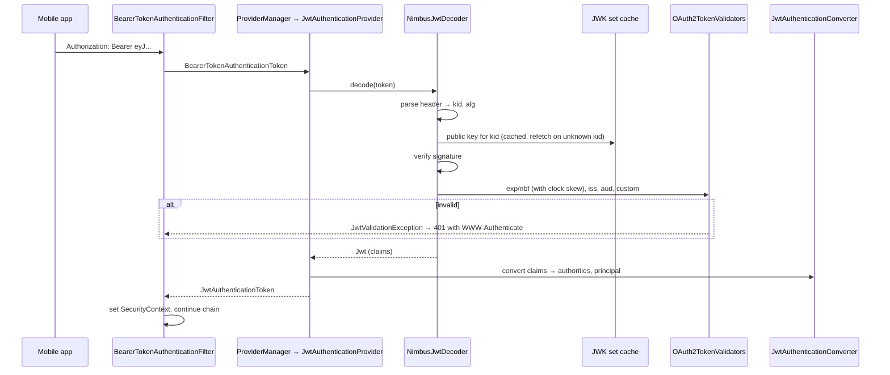
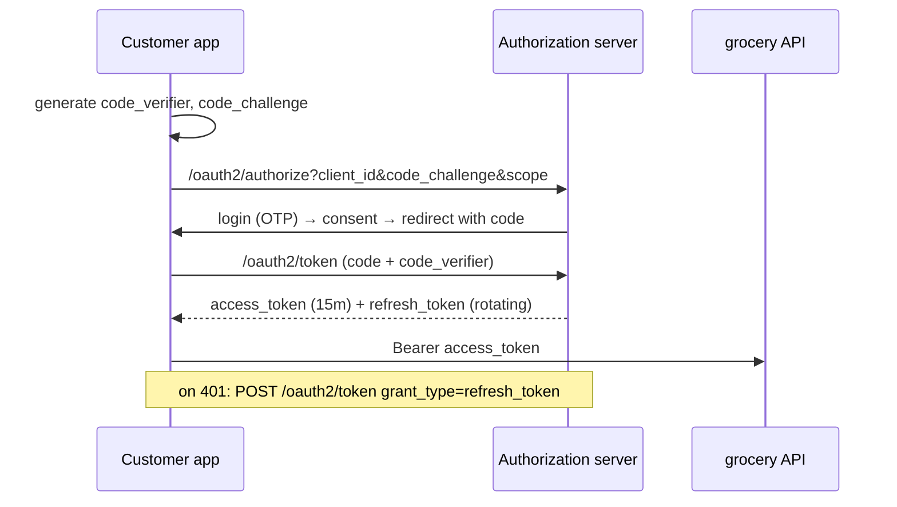
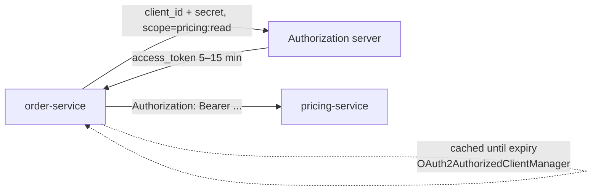
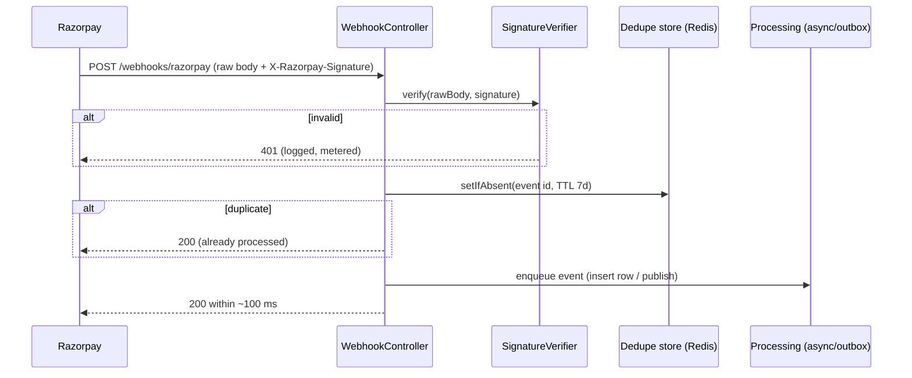
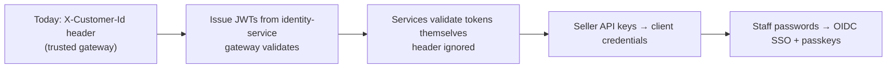

# 18 · Spring Security — Tokens, OAuth2 & Modern Auth

## 1. Introduction & Why It Matters

Chapter 17 built the filter chains and authorization rules. This chapter answers the question they depend on: **where does the `Authentication` come from in a distributed platform?**

The grocery platform has five different answers, and each is a different protocol:

| Caller | Mechanism |
|---|---|
| Customer app (Flutter/Angular) | Short-lived **JWT access token** + rotating refresh token, issued after OTP login |
| Operations staff | **OAuth2 / OIDC login** against the corporate identity provider, session in the admin portal |
| Service → service (order → pricing) | **OAuth2 client credentials** token, attached automatically to outbound calls |
| Seller integrations | API keys today, **client credentials** tomorrow |
| Razorpay | No token at all — an **HMAC signature** over the raw webhook body |

Get any of these wrong and the consequences are severe: tokens that can't be revoked when a phone is stolen, an admin portal that accepts tokens issued for the customer app, a webhook endpoint anyone can call to mark orders as paid, or a refresh-token design that lets a stolen token live for 90 days.

This chapter covers the resource-server side (validating JWTs properly, including audience, issuer, clock skew and key rotation), issuing tokens with Spring Authorization Server, refresh-token rotation with reuse detection, revocation, OAuth2 login for staff, client credentials for service-to-service calls, multi-issuer setups, passkeys and one-time tokens, and webhook signature verification done right.

### Who should read which section

| Band | Focus |
|---|---|
| B1 · 0–2 yrs | Parts 1, 2, 4 — what a JWT is, resource server basics |
| B2 · 2–5 yrs | Parts 2, 5 — claims→authorities, OAuth2 login, client credentials |
| B3 · 5–8 yrs | Parts 3, 5, 6 — validation internals, rotation, revocation, webhooks |
| B4 · 8–12 yrs | Parts 6, 7, 8 — token architecture, multi-issuer, migration |
| B5 · 12–15+ yrs | Parts 8, 9 — identity strategy, build vs buy |

---

## 2. Core Concepts

### 2.1 OAuth2 and OIDC in one table

| Term | Meaning here |
|---|---|
| **Resource server** | Our APIs — validate tokens, enforce scopes |
| **Authorization server** | Issues tokens (our own Spring Authorization Server, or Okta/Auth0/Keycloak) |
| **Client** | The app requesting tokens (mobile app, admin portal, order-service calling pricing) |
| **Resource owner** | The customer |
| **Access token** | Short-lived credential sent on every API call |
| **Refresh token** | Long-lived credential used only to get new access tokens |
| **ID token (OIDC)** | Proof of authentication for login flows — never used as an API credential |
| **Scope** | What the token is allowed to do (`orders:read`) |
| **Grant** | How a token is obtained: authorization code + PKCE (users), client credentials (services) |

### 2.2 JWT anatomy

`header.payload.signature`, base64url-encoded, signed (RS256/ES256 asymmetric, HS256 symmetric).

| Claim | Purpose | Platform value |
|---|---|---|
| `iss` | Issuer | `https://id.grocery.in` |
| `sub` | Subject | `C-1043221` (customer id) |
| `aud` | Audience | `grocery-api` |
| `exp` / `iat` / `nbf` | Expiry / issued / not-before | 15 minutes |
| `jti` | Token id | Used for revocation lists |
| `scope` | Space-separated scopes | `orders:read orders:write cart` |
| custom | App claims | `seller_id`, `roles`, `device_id`, `amr` |

!!! danger "A JWT is signed, not secret"
    Anyone holding the token can read the payload. Never put PII (mobile number, address), card data or secrets in claims. Keep claims small — they travel on every request.

### 2.3 JWT vs opaque tokens

| | JWT | Opaque (reference) token |
|---|---|---|
| Validation | Local signature check (fast, offline) | Introspection call to the authorization server |
| Revocation | Hard — needs a denylist or very short expiry | Immediate |
| Size | Larger (claims) | Small |
| Coupling | Consumers need the JWKS | Consumers need the introspection endpoint |

Platform choice: **short-lived JWTs** (15 min) for APIs + refresh tokens + a `jti` denylist for immediate revocation of stolen sessions.

### 2.4 Resource server configuration

```yaml title="application.yml"
spring:
  security:
    oauth2:
      resourceserver:
        jwt:
          issuer-uri: https://id.grocery.in        # discovers the JWKS URI
          audiences: grocery-api                   # verify the audience (Boot 3.4+; verify)
```

Boot builds a `JwtDecoder` (Nimbus) that downloads and caches the JWK set, verifies the signature by `kid`, and runs validators (`exp`, `nbf`, `iss`, and any you add).

### 2.5 From claims to authorities

By default Spring maps the `scope`/`scp` claim to authorities prefixed `SCOPE_`. Application roles usually live in a custom claim, so a `JwtAuthenticationConverter` maps both:

```text title="Example"
scope: "orders:read orders:write"  → SCOPE_orders:read, SCOPE_orders:write
roles: ["OPS"]                     → ROLE_OPS
sub:   "C-1043221"                 → principal name
```

### 2.6 Scopes vs roles vs attributes

| Model | Question it answers | Use |
|---|---|---|
| **Scope** | What is *this client/token* allowed to request? | Per-token capability (`orders:write`) |
| **Role** | What is *this user* in the organization? | Coarse organizational permission (`ROLE_OPS`) |
| **Attribute (ABAC)** | Does this *specific resource* belong to them? | Ownership (`seller_id`, `customer_id`) — Chapter 17 |

Real endpoints usually need all three: a token with `orders:write`, a user who isn't blocked, and an order that belongs to them.

### 2.7 Refresh tokens

- **Short access tokens** (10–15 min) limit the damage of a leak.
- **Rotation**: every refresh returns a new refresh token and invalidates the old one.
- **Reuse detection**: if an already-used refresh token appears again, the whole token family is revoked (someone cloned it).
- Store only a **hash** of the refresh token, with device metadata for "log out other devices".

### 2.8 Revocation

| Need | Mechanism |
|---|---|
| Logout on one device | Delete that refresh token family |
| Stolen phone / account compromise | Revoke all families + add active `jti`s to a denylist until their `exp` |
| Employee offboarding | Identity provider deactivation + short tokens |
| Compromised signing key | Rotate JWKS keys, remove the old `kid` |

### 2.9 OAuth2 login for staff

`oauth2Login()` performs the authorization-code flow with the corporate IdP, creating a session in the admin portal. Group/role claims from the IdP map to `ROLE_*` authorities.

### 2.10 Service-to-service: client credentials

order-service holds a client id/secret, requests a token with scope `pricing:read`, caches it until expiry, and attaches it to outbound calls. Spring Security's `OAuth2AuthorizedClientManager` does the acquisition and refresh; an interceptor attaches the header (Chapter 19).

!!! warning "Don't relay the customer's token blindly"
    Forwarding a customer access token to internal services makes every service a confused deputy — any service could use it anywhere. Use client credentials for service identity plus explicit context (customer id) in the request, or token exchange if delegation is genuinely required.

### 2.11 Webhook authentication

Webhooks are unauthenticated HTTP with a **signature**:

1. Read the **raw body bytes** (never a re-serialized object).
2. Compute `HMAC-SHA256(secret, rawBody)`.
3. Compare in **constant time** with the provider's header.
4. Deduplicate by event id (idempotency).
5. Respond 2xx quickly; process asynchronously.

### 2.12 Passkeys and one-time tokens

Spring Security 6.4+ supports **WebAuthn/passkeys** (`http.webAuthn(...)`) and **one-time token login** (magic links). Passkeys remove passwords for the admin portal; one-time tokens are a good fallback and a clean "reset" path.

---

## 3. How It Works Internally

### 3.1 Bearer token validation



- The JWK set is cached; an unknown `kid` triggers a refresh, which makes **key rotation** transparent as long as the old key stays published for the lifetime of old tokens.
- Validation failures produce `401` with a `WWW-Authenticate: Bearer error="invalid_token"` header — Chapter 17's entry point turns it into the platform problem format.

### 3.2 Authorization code + PKCE (customer app)



PKCE is mandatory for public clients (mobile/SPA) — there's no client secret that can be kept secret on a phone.

### 3.3 Client credentials



---

## 4. Hands-On Code — Level 1 (Beginner)

### 4.1 A resource server in ten lines

```kotlin title="build.gradle.kts"
implementation("org.springframework.boot:spring-boot-starter-oauth2-resource-server")
```

```yaml title="application.yml"
spring:
  security:
    oauth2:
      resourceserver:
        jwt:
          issuer-uri: https://id.grocery.in
```

```java title="in/grocery/order/config/ResourceServerConfig.java"
package in.grocery.order.config;

import org.springframework.context.annotation.Bean;
import org.springframework.context.annotation.Configuration;
import org.springframework.security.config.Customizer;
import org.springframework.security.config.annotation.web.builders.HttpSecurity;
import org.springframework.security.config.http.SessionCreationPolicy;
import org.springframework.security.web.SecurityFilterChain;

@Configuration(proxyBeanMethods = false)
class ResourceServerConfig {

    @Bean
    SecurityFilterChain api(HttpSecurity http) throws Exception {
        return http
                .securityMatcher("/api/**")
                .authorizeHttpRequests(a -> a
                        .requestMatchers("/api/public/**").permitAll()
                        .requestMatchers("/api/orders/**").hasAuthority("SCOPE_orders:read")   // (1)!
                        .anyRequest().authenticated())
                .oauth2ResourceServer(o -> o.jwt(Customizer.withDefaults()))                    // (2)!
                .sessionManagement(s -> s.sessionCreationPolicy(SessionCreationPolicy.STATELESS))
                .csrf(csrf -> csrf.disable())
                .build();
    }
}
```

1. Default converter maps the `scope` claim to `SCOPE_*` authorities.
2. Uses the `JwtDecoder` Boot built from `issuer-uri` (JWKS discovered from `/.well-known/openid-configuration`).

```bash title="Terminal"
curl -H "Authorization: Bearer $TOKEN" localhost:8083/api/orders/ORD-1
```

### 4.2 Reading the token in a controller

```java title="in/grocery/order/web/MeController.java"
package in.grocery.order.web;

import java.util.Map;
import org.springframework.security.core.annotation.AuthenticationPrincipal;
import org.springframework.security.oauth2.jwt.Jwt;
import org.springframework.web.bind.annotation.GetMapping;
import org.springframework.web.bind.annotation.RestController;

@RestController
class MeController {

    @GetMapping("/api/me")
    Map<String, Object> me(@AuthenticationPrincipal Jwt jwt) {                       // (1)!
        return Map.of(
                "customerId", jwt.getSubject(),
                "scopes", jwt.getClaimAsStringList("scope") == null ? jwt.getClaimAsString("scope") : jwt.getClaimAsStringList("scope"),
                "expiresAt", String.valueOf(jwt.getExpiresAt()));
    }
}
```

1. The principal is the decoded `Jwt`; claims are already validated.

### 4.3 Testing with a mock JWT

```java title="in/grocery/order/web/MeControllerTest.java"
@WebMvcTest(MeController.class)
@Import(ResourceServerConfig.class)
class MeControllerTest {

    @Autowired MockMvcTester mvc;
    @MockitoBean JwtDecoder jwtDecoder;                                              // (1)!

    @Test
    void returnsCustomerIdFromToken() {
        assertThat(mvc.get().uri("/api/me")
                .with(SecurityMockMvcRequestPostProcessors.jwt()                     // (2)!
                        .jwt(j -> j.subject("C-1").claim("scope", "orders:read"))))
                .hasStatusOk()
                .bodyJson().extractingPath("$.customerId").isEqualTo("C-1");
    }

    @Test
    void missingTokenIs401() {
        assertThat(mvc.get().uri("/api/me")).hasStatus(HttpStatus.UNAUTHORIZED);
    }
}
```

1. The slice would otherwise try to reach the real issuer at startup.
2. `spring-security-test` builds an authenticated `Jwt` without any signing.

---

## 5. Hands-On Code — Level 2 (Intermediate) & Level 3 (Advanced)

### 5.1 Level 2 — Strict validation: audience, issuer, clock skew, authorities

```java title="in/grocery/platform/security/JwtConfig.java"
package in.grocery.platform.security;

import java.time.Duration;
import java.util.ArrayList;
import java.util.Collection;
import java.util.List;
import org.springframework.context.annotation.Bean;
import org.springframework.context.annotation.Configuration;
import org.springframework.security.authentication.AbstractAuthenticationToken;
import org.springframework.security.core.GrantedAuthority;
import org.springframework.security.core.authority.SimpleGrantedAuthority;
import org.springframework.security.oauth2.core.DelegatingOAuth2TokenValidator;
import org.springframework.security.oauth2.core.OAuth2Error;
import org.springframework.security.oauth2.core.OAuth2TokenValidator;
import org.springframework.security.oauth2.core.OAuth2TokenValidatorResult;
import org.springframework.security.oauth2.jwt.Jwt;
import org.springframework.security.oauth2.jwt.JwtDecoder;
import org.springframework.security.oauth2.jwt.JwtDecoders;
import org.springframework.security.oauth2.jwt.JwtTimestampValidator;
import org.springframework.security.oauth2.jwt.JwtValidators;
import org.springframework.security.oauth2.jwt.NimbusJwtDecoder;
import org.springframework.security.oauth2.server.resource.authentication.JwtAuthenticationConverter;
import org.springframework.security.oauth2.server.resource.authentication.JwtGrantedAuthoritiesConverter;

@Configuration(proxyBeanMethods = false)
public class JwtConfig {

    @Bean
    JwtDecoder jwtDecoder(GroceryTokenProperties props) {
        NimbusJwtDecoder decoder = (NimbusJwtDecoder) JwtDecoders.fromIssuerLocation(props.issuer());  // (1)!
        decoder.setJwtValidator(new DelegatingOAuth2TokenValidator<>(
                JwtValidators.createDefaultWithIssuer(props.issuer()),
                new JwtTimestampValidator(Duration.ofSeconds(30)),                                      // (2)!
                audienceValidator(props.audience())));
        return decoder;
    }

    private static OAuth2TokenValidator<Jwt> audienceValidator(String expected) {                       // (3)!
        return jwt -> jwt.getAudience().contains(expected)
                ? OAuth2TokenValidatorResult.success()
                : OAuth2TokenValidatorResult.failure(new OAuth2Error("invalid_token",
                        "Required audience " + expected + " missing", null));
    }

    @Bean
    JwtAuthenticationConverter jwtAuthenticationConverter() {
        JwtGrantedAuthoritiesConverter scopes = new JwtGrantedAuthoritiesConverter();                   // SCOPE_*
        JwtAuthenticationConverter converter = new JwtAuthenticationConverter();
        converter.setPrincipalClaimName("sub");
        converter.setJwtGrantedAuthoritiesConverter(jwt -> {
            Collection<GrantedAuthority> authorities = new ArrayList<>(scopes.convert(jwt));
            List<String> roles = jwt.getClaimAsStringList("roles");                                     // (4)!
            if (roles != null) {
                roles.forEach(r -> authorities.add(new SimpleGrantedAuthority("ROLE_" + r)));
            }
            return authorities;
        });
        return converter;
    }
}
```

1. Discovery gives the JWKS URI and validates the issuer metadata at startup. For air-gapped environments configure `jwk-set-uri` directly.
2. 30 s clock skew — enough for NTP drift, small enough to matter.
3. **Audience validation is not on by default in all setups** and is the difference between "a valid token" and "a token meant for us". Without it, a token issued for the analytics API is accepted by the orders API.
4. Roles from a custom claim; the mapping is the platform's contract with the authorization server.

!!! warning "Verify"
    Recent Boot versions expose `spring.security.oauth2.resourceserver.jwt.audiences`; if available, prefer the property over a custom validator. Confirm for your version.

### 5.2 Level 2 — Customer context from the token

Chapter 08 read `X-Customer-Id` from a header (a placeholder). Now it comes from the verified token:

```java title="in/grocery/platform/web/CurrentCustomerArgumentResolver.java (token version)"
@Override
public Object resolveArgument(MethodParameter parameter, ModelAndViewContainer mav,
                              NativeWebRequest request, WebDataBinderFactory binderFactory) {
    Authentication auth = SecurityContextHolder.getContext().getAuthentication();
    if (!(auth instanceof JwtAuthenticationToken jwtAuth)) {
        throw new ResponseStatusException(HttpStatus.UNAUTHORIZED, "Customer token required");
    }
    Jwt jwt = jwtAuth.getToken();
    String pincode = request.getHeader("X-Pincode");                                                 // (1)!
    return new CustomerContext(jwt.getSubject(), pincode, jwt.getClaimAsString("channel"));
}
```

1. The customer id is now **unforgeable**; the pincode remains a request hint (it's not a security claim — serviceability is validated server-side anyway).

!!! danger "Never trust identity headers from the network"
    `X-Customer-Id` was fine as a development placeholder behind a trusted gateway. In production, either the gateway strips and re-adds such headers with mTLS between it and the services, or (better) services validate tokens themselves — which is what we do here.

### 5.3 Level 2 — OAuth2 login for the admin portal

```yaml title="application.yml"
spring:
  security:
    oauth2:
      client:
        registration:
          corp:
            client-id: ${ADMIN_OIDC_CLIENT_ID}
            client-secret: ${ADMIN_OIDC_CLIENT_SECRET}
            scope: openid,profile,email,groups
            authorization-grant-type: authorization_code
            redirect-uri: "{baseUrl}/login/oauth2/code/{registrationId}"
        provider:
          corp:
            issuer-uri: https://sso.grocery.in
```

```java title="in/grocery/admin/config/AdminLoginConfig.java"
@Bean
SecurityFilterChain adminPortal(HttpSecurity http, GrantedAuthoritiesMapper authoritiesMapper) throws Exception {
    return http
            .securityMatcher("/admin/**", "/login/**", "/oauth2/**")
            .authorizeHttpRequests(a -> a
                    .requestMatchers("/login/**", "/oauth2/**", "/css/**").permitAll()
                    .anyRequest().hasRole("OPS"))
            .oauth2Login(login -> login
                    .userInfoEndpoint(u -> u.userAuthoritiesMapper(authoritiesMapper))                  // (1)!
                    .defaultSuccessUrl("/admin", true))
            .logout(l -> l.logoutSuccessUrl("/admin/logged-out"))
            .build();
}

@Bean
GrantedAuthoritiesMapper groupsToRoles() {
    return authorities -> authorities.stream()
            .filter(OidcUserAuthority.class::isInstance)
            .map(OidcUserAuthority.class::cast)
            .flatMap(a -> {
                List<String> groups = a.getIdToken().getClaimAsStringList("groups");                    // (2)!
                return groups == null ? Stream.<GrantedAuthority>of()
                        : groups.stream().map(g -> switch (g) {
                            case "grocery-ops" -> new SimpleGrantedAuthority("ROLE_OPS");
                            case "grocery-finance" -> new SimpleGrantedAuthority("ROLE_FINANCE");
                            default -> null;
                        }).filter(Objects::nonNull);
            })
            .collect(Collectors.toSet());
}
```

1. Map IdP groups to platform roles in one place.
2. **Allow-list** the mapping: never turn arbitrary IdP groups into authorities.

### 5.4 Level 3 — Issuing tokens: OTP login with Spring Authorization Server

The identity-service is our authorization server. Customers authenticate with OTP (Chapter 17) and receive tokens with platform claims.

```kotlin title="identity-service/build.gradle.kts"
implementation("org.springframework.boot:spring-boot-starter-oauth2-authorization-server")
```

```java title="in/grocery/identity/config/AuthorizationServerConfig.java (excerpt)"
@Bean
RegisteredClientRepository registeredClients(PasswordEncoder encoder) {
    RegisteredClient mobileApp = RegisteredClient.withId(UUID.randomUUID().toString())
            .clientId("grocery-mobile")
            .clientAuthenticationMethod(ClientAuthenticationMethod.NONE)                      // (1)!
            .authorizationGrantType(AuthorizationGrantType.AUTHORIZATION_CODE)
            .authorizationGrantType(AuthorizationGrantType.REFRESH_TOKEN)
            .redirectUri("in.grocery.app://oauth2/callback")
            .scope("cart").scope("orders:read").scope("orders:write")
            .clientSettings(ClientSettings.builder().requireProofKey(true).build())            // (2)!
            .tokenSettings(TokenSettings.builder()
                    .accessTokenTimeToLive(Duration.ofMinutes(15))
                    .refreshTokenTimeToLive(Duration.ofDays(60))
                    .reuseRefreshTokens(false)                                                 // (3)!
                    .build())
            .build();

    RegisteredClient orderService = RegisteredClient.withId(UUID.randomUUID().toString())
            .clientId("order-service")
            .clientSecret(encoder.encode(System.getenv("ORDER_SERVICE_CLIENT_SECRET")))
            .clientAuthenticationMethod(ClientAuthenticationMethod.CLIENT_SECRET_BASIC)
            .authorizationGrantType(AuthorizationGrantType.CLIENT_CREDENTIALS)                  // (4)!
            .scope("pricing:read").scope("inventory:write")
            .tokenSettings(TokenSettings.builder().accessTokenTimeToLive(Duration.ofMinutes(10)).build())
            .build();

    return new InMemoryRegisteredClientRepository(mobileApp, orderService);                     // (5)!
}

@Bean
OAuth2TokenCustomizer<JwtEncodingContext> tokenCustomizer(CustomerDirectory customers) {
    return context -> {
        if (OAuth2TokenType.ACCESS_TOKEN.equals(context.getTokenType())) {
            context.getClaims().claim("aud", List.of("grocery-api"));                           // (6)!
            Authentication principal = context.getPrincipal();
            if (principal instanceof OtpAuthenticationToken otp) {
                context.getClaims().claim("channel", "mobile");
                context.getClaims().claim("roles", List.of("CUSTOMER"));
            }
        }
    };
}
```

1. Public client — no secret on a phone.
2. PKCE required.
3. **Rotating** refresh tokens.
4. Machine client for service-to-service.
5. In production use a JDBC-backed repository so clients are configuration, not code.
6. Audience so resource servers can verify the token is for them.

**Key management:** the `JWKSource` must be backed by persisted keys (not generated per start, or every restart invalidates all tokens), support two active keys during rotation, and publish both at `/oauth2/jwks`.

### 5.5 Level 3 — Refresh-token rotation with reuse detection

Spring Authorization Server rotates refresh tokens when `reuseRefreshTokens(false)` is set. Reuse detection — revoking a whole family when an old token reappears — is application logic worth adding for mobile apps:

```java title="in/grocery/identity/token/RefreshTokenFamilyService.java"
package in.grocery.identity.token;

import java.time.Clock;
import java.time.Duration;
import java.util.Optional;
import org.slf4j.Logger;
import org.slf4j.LoggerFactory;
import org.springframework.stereotype.Service;

@Service
public class RefreshTokenFamilyService {

    private static final Logger log = LoggerFactory.getLogger("security-audit");

    public record Family(String familyId, String customerId, String deviceId, boolean revoked) {}

    private final RefreshTokenRepository tokens;
    private final TokenDenyList denyList;
    private final Clock clock;

    public RefreshTokenFamilyService(RefreshTokenRepository tokens, TokenDenyList denyList, Clock clock) {
        this.tokens = tokens;
        this.denyList = denyList;
        this.clock = clock;
    }

    /** Called when a refresh token is presented. */
    public void onRefreshPresented(String tokenHash) {
        Optional<RefreshTokenRow> row = tokens.findByHash(tokenHash);
        if (row.isEmpty()) {
            throw new InvalidRefreshTokenException();
        }
        RefreshTokenRow token = row.get();
        if (token.usedAt() != null) {                                                          // (1)!
            log.warn("Refresh token reuse detected for family {} — revoking family", token.familyId());
            revokeFamily(token.familyId(), "reuse-detected");
            throw new InvalidRefreshTokenException();
        }
        tokens.markUsed(tokenHash, clock.instant());
    }

    public void revokeFamily(String familyId, String reason) {
        tokens.revokeFamily(familyId, clock.instant(), reason);
        tokens.activeAccessTokenIds(familyId)                                                   // (2)!
              .forEach(jti -> denyList.add(jti, Duration.ofMinutes(20)));
    }
}
```

1. A used-but-not-rotated token means someone replayed a stolen copy — kill the whole family; the legitimate user simply logs in again.
2. Outstanding access tokens can't be un-signed; deny them by `jti` until they expire.

```java title="in/grocery/platform/security/DenyListJwtValidator.java"
package in.grocery.platform.security;

import org.springframework.security.oauth2.core.OAuth2Error;
import org.springframework.security.oauth2.core.OAuth2TokenValidator;
import org.springframework.security.oauth2.core.OAuth2TokenValidatorResult;
import org.springframework.security.oauth2.jwt.Jwt;

/** Rejects access tokens whose jti has been revoked. Backed by Redis with TTL = token lifetime. */
public class DenyListJwtValidator implements OAuth2TokenValidator<Jwt> {

    private final TokenDenyList denyList;

    public DenyListJwtValidator(TokenDenyList denyList) {
        this.denyList = denyList;
    }

    @Override
    public OAuth2TokenValidatorResult validate(Jwt jwt) {
        String jti = jwt.getId();
        if (jti != null && denyList.contains(jti)) {                                            // (1)!
            return OAuth2TokenValidatorResult.failure(new OAuth2Error("invalid_token", "Token revoked", null));
        }
        return OAuth2TokenValidatorResult.success();
    }
}
```

1. One Redis lookup per request. Keep the deny list small (only revoked tokens, TTL = remaining lifetime) and fail **open or closed** deliberately: if Redis is down, the platform choice is to fail *open* for reads and *closed* for writes — document it.

### 5.6 Level 3 — Multi-issuer (tenant or migration)

During a migration from a legacy identity provider, both issuers are valid for a while:

```java title="Multi-issuer (tenant or migration) (snippet)"
@Bean
AuthenticationManagerResolver<HttpServletRequest> issuerResolver(JwtDecoder legacy, JwtDecoder current) {
    Map<String, AuthenticationManager> managers = Map.of(
            "https://legacy-id.grocery.in", new ProviderManager(new JwtAuthenticationProvider(legacy)),
            "https://id.grocery.in", new ProviderManager(new JwtAuthenticationProvider(current)));
    return new JwtIssuerAuthenticationManagerResolver(managers::get);                            // (1)!
}

// in the chain:
.oauth2ResourceServer(o -> o.authenticationManagerResolver(issuerResolver))
```

1. Routes by the `iss` claim. Only listed issuers are accepted — never resolve issuers dynamically from the token.

### 5.7 Level 3 — Passkeys and one-time tokens for staff

```java title="AdminAuthConfig.java (Security 6.4+)"
http.webAuthn(webAuthn -> webAuthn
        .rpName("Grocery Admin")
        .rpId("admin.grocery.in")                                                                // (1)!
        .allowedOrigins("https://admin.grocery.in"))
    .oneTimeTokenLogin(ott -> ott
        .tokenGenerationSuccessHandler(emailOneTimeTokenHandler));                               // (2)!
```

1. Passkeys are bound to the domain — phishing-resistant, which passwords and OTP SMS are not.
2. Magic link sent by email as a fallback/recovery path. Tokens must be single-use, short-lived and rate-limited.

!!! warning "Verify"
    WebAuthn and one-time token APIs are recent (Security 6.4) and evolving in 7. Check the reference for required repositories (`PublicKeyCredentialUserEntityRepository`, `UserCredentialRepository` — implement persistent versions; the defaults are in-memory).

---

## 6. Hands-On Code — Level 4 (Expert / Production)

### 6.1 Razorpay webhook: signature, replay protection, fast ack



```java title="in/grocery/payment/webhook/RazorpaySignatureVerifier.java"
package in.grocery.payment.webhook;

import java.nio.charset.StandardCharsets;
import java.security.MessageDigest;
import javax.crypto.Mac;
import javax.crypto.spec.SecretKeySpec;
import org.springframework.stereotype.Component;

@Component
public class RazorpaySignatureVerifier {

    private final byte[] secret;

    public RazorpaySignatureVerifier(in.grocery.payment.config.RazorpayProperties props) {
        this.secret = props.webhookSecret().getBytes(StandardCharsets.UTF_8);                    // (1)!
    }

    public boolean isValid(byte[] rawBody, String signatureHeader) {
        if (signatureHeader == null || rawBody == null) return false;
        try {
            Mac mac = Mac.getInstance("HmacSHA256");
            mac.init(new SecretKeySpec(secret, "HmacSHA256"));
            byte[] expected = mac.doFinal(rawBody);
            byte[] provided = hexToBytes(signatureHeader.trim());
            return provided != null && MessageDigest.isEqual(expected, provided);                 // (2)!
        } catch (Exception e) {
            return false;                                                                         // (3)!
        }
    }

    private static byte[] hexToBytes(String hex) {
        int len = hex.length();
        if (len % 2 != 0) return null;
        byte[] out = new byte[len / 2];
        for (int i = 0; i < len; i += 2) {
            int hi = Character.digit(hex.charAt(i), 16);
            int lo = Character.digit(hex.charAt(i + 1), 16);
            if (hi < 0 || lo < 0) return null;
            out[i / 2] = (byte) ((hi << 4) + lo);
        }
        return out;
    }
}
```

1. The secret comes from a mounted file, trimmed (Chapter 06's trailing-newline trap) — a stray `\n` breaks every signature.
2. **Constant-time** comparison: `String.equals` leaks timing information about how many bytes matched.
3. Never distinguish "bad hex" from "bad signature" in the response — one 401 for all failures.

```java title="in/grocery/payment/webhook/RazorpayWebhookController.java"
package in.grocery.payment.webhook;

import com.fasterxml.jackson.databind.ObjectMapper;        // JsonMapper on Boot 4
import io.micrometer.core.instrument.MeterRegistry;
import java.nio.charset.StandardCharsets;
import java.time.Duration;
import org.slf4j.Logger;
import org.slf4j.LoggerFactory;
import org.springframework.http.HttpStatus;
import org.springframework.http.ResponseEntity;
import org.springframework.web.bind.annotation.PostMapping;
import org.springframework.web.bind.annotation.RequestBody;
import org.springframework.web.bind.annotation.RequestHeader;
import org.springframework.web.bind.annotation.RestController;

@RestController
class RazorpayWebhookController {

    private static final Logger log = LoggerFactory.getLogger("security-audit");

    private final RazorpaySignatureVerifier verifier;
    private final WebhookDedupeStore dedupe;
    private final WebhookIngestService ingest;
    private final ObjectMapper json;
    private final MeterRegistry meters;

    RazorpayWebhookController(RazorpaySignatureVerifier verifier, WebhookDedupeStore dedupe,
                              WebhookIngestService ingest, ObjectMapper json, MeterRegistry meters) {
        this.verifier = verifier;
        this.dedupe = dedupe;
        this.ingest = ingest;
        this.json = json;
        this.meters = meters;
    }

    @PostMapping(path = "/webhooks/razorpay", consumes = "application/json")
    ResponseEntity<Void> receive(@RequestBody byte[] rawBody,                                    // (1)!
                                 @RequestHeader(value = "X-Razorpay-Signature", required = false) String signature,
                                 @RequestHeader(value = "X-Razorpay-Event-Id", required = false) String eventId) {
        if (!verifier.isValid(rawBody, signature)) {
            meters.counter("grocery.webhook", "provider", "razorpay", "outcome", "invalid-signature").increment();
            log.warn("Rejected Razorpay webhook with invalid signature (event {})", eventId);
            return ResponseEntity.status(HttpStatus.UNAUTHORIZED).build();
        }
        String id = eventId != null ? eventId : sha256Hex(rawBody);                              // (2)!
        if (!dedupe.firstTime(id, Duration.ofDays(7))) {
            meters.counter("grocery.webhook", "provider", "razorpay", "outcome", "duplicate").increment();
            return ResponseEntity.ok().build();                                                   // (3)!
        }
        ingest.accept(id, new String(rawBody, StandardCharsets.UTF_8));                            // (4)!
        meters.counter("grocery.webhook", "provider", "razorpay", "outcome", "accepted").increment();
        return ResponseEntity.ok().build();
    }
}
```

1. **Raw bytes** — parsing to an object and re-serializing changes the bytes and breaks the HMAC. (`@RequestBody byte[]` works because Spring has a byte-array message converter.)
2. Fall back to a body hash if the provider doesn't send an event id.
3. Duplicates are normal: providers retry until they see a 2xx.
4. Persist quickly (an inbox row), then process asynchronously — webhook endpoints must answer in milliseconds, not after a payment reconciliation.

```java title="RazorpayWebhookControllerTest.java"
@WebMvcTest(RazorpayWebhookController.class)
@Import({SecurityChains.class, RazorpaySignatureVerifier.class})
class RazorpayWebhookControllerTest {

    private static final String SECRET = "whsec_test";

    @Autowired MockMvcTester mvc;
    @MockitoBean WebhookDedupeStore dedupe;
    @MockitoBean WebhookIngestService ingest;

    private static String sign(String body) throws Exception {
        Mac mac = Mac.getInstance("HmacSHA256");
        mac.init(new SecretKeySpec(SECRET.getBytes(UTF_8), "HmacSHA256"));
        return HexFormat.of().formatHex(mac.doFinal(body.getBytes(UTF_8)));
    }

    @Test
    void validSignatureIsAccepted() throws Exception {
        given(dedupe.firstTime(any(), any())).willReturn(true);
        String body = "{\"event\":\"payment.captured\"}";

        assertThat(mvc.post().uri("/webhooks/razorpay")
                .contentType(MediaType.APPLICATION_JSON)
                .header("X-Razorpay-Signature", sign(body))
                .header("X-Razorpay-Event-Id", "evt_1")
                .content(body))
                .hasStatusOk();
        then(ingest).should().accept(eq("evt_1"), any());
    }

    @Test
    void tamperedBodyIsRejected() throws Exception {
        String body = "{\"event\":\"payment.captured\"}";
        String signature = sign(body);

        assertThat(mvc.post().uri("/webhooks/razorpay")
                .contentType(MediaType.APPLICATION_JSON)
                .header("X-Razorpay-Signature", signature)
                .content("{\"event\":\"payment.captured\",\"amount\":1}"))
                .hasStatus(HttpStatus.UNAUTHORIZED);
        then(ingest).shouldHaveNoInteractions();
    }

    @Test
    void duplicateEventIsAcknowledgedWithoutProcessing() throws Exception {
        given(dedupe.firstTime(any(), any())).willReturn(false);
        String body = "{\"event\":\"payment.captured\"}";

        assertThat(mvc.post().uri("/webhooks/razorpay")
                .contentType(MediaType.APPLICATION_JSON)
                .header("X-Razorpay-Signature", sign(body))
                .header("X-Razorpay-Event-Id", "evt_2")
                .content(body))
                .hasStatusOk();
        then(ingest).shouldHaveNoInteractions();
    }
}
```

### 6.2 Token architecture summary

| Token | Lifetime | Audience | Claims | Revocation |
|---|---|---|---|---|
| Customer access | 15 min | `grocery-api` | `sub`, `scope`, `roles`, `channel`, `jti` | Deny list by `jti` |
| Customer refresh | 60 days, rotating | authorization server | opaque | Family revocation, reuse detection |
| Staff session | 8 h idle | admin portal | — | Session invalidation, IdP deactivation |
| Service (client credentials) | 10 min | `grocery-api` | `sub`=client id, `scope` | Short lifetime; client secret rotation |
| Webhook | — | — | — | Secret rotation (two active secrets during rollover) |

### 6.3 Operational concerns

| Concern | Practice |
|---|---|
| Key rotation | Two keys in JWKS; sign with the new one, keep the old until max token age passes; automate |
| Secret rotation | Support two valid webhook secrets/client secrets during rollover |
| Clock skew | NTP everywhere; 30 s validator leeway |
| JWKS availability | Cache with a long TTL; a JWKS outage must not fail all requests instantly (consider stale-while-error) |
| Observability | Metrics for auth failures by reason, token age at use, refresh rates, deny-list size |
| Incident playbook | "Compromised customer": revoke families + deny jti; "compromised client": rotate secret, revoke tokens; "compromised signing key": rotate JWKS, force re-login |

### 6.4 Migration path for the platform



Each step is independently deployable and testable; the header is removed only after every service validates tokens.

---

## 7. Spring Boot 3 vs 4 & Migration

| Topic | Boot 3.5 / Security 6.5 | Boot 4.x / Security 7 |
|---|---|---|
| Resource server | `spring-boot-starter-oauth2-resource-server` | Same (module names — verify) |
| Audience property | `...jwt.audiences` (3.4+) | Available |
| Authorization Server | Spring Authorization Server 1.x | 2.x with Security 7 (verify) |
| Passkeys / one-time tokens | 6.4+ | Available, APIs evolving |
| `OAuth2ClientHttpRequestInterceptor` (RestClient) | 6.4+ | Available (Chapter 19) |
| Token introspection | `SpringOpaqueTokenIntrospector` | Same (verify class names) |
| Nimbus / JOSE | Nimbus 9.x | Nimbus 10.x (verify) |

=== "Spring Boot 3.5"

    ```yaml title="application.yml"
    spring:
      security:
        oauth2:
          resourceserver:
            jwt:
              issuer-uri: https://id.grocery.in
              audiences: grocery-api
    ```

=== "Spring Boot 4.x"

    ```yaml title="application.yml"
    # Same properties; verify names after modularization, and re-test token validation end to end.
    spring:
      security:
        oauth2:
          resourceserver:
            jwt:
              issuer-uri: https://id.grocery.in
              audiences: grocery-api
    ```

### Migration checklist

- [ ] Pin and test the authorization server upgrade separately from resource servers (they can differ in version).
- [ ] Verify audience/issuer validation still applies after upgrade (a silently dropped validator is invisible until an incident).
- [ ] Re-run token tests with real signed tokens (not only mocked `Jwt`s) in integration tests.
- [ ] Check WebAuthn/one-time token APIs against the new reference.
- [ ] Confirm JWKS caching behaviour and key rotation with a staged rotation drill.

---

## 8. Production Playbook

### Best practices

1. **Short access tokens, rotating refresh tokens, reuse detection**; store hashes only.
2. **Validate issuer, audience, expiry (with small skew) and signature** — all four, always.
3. **Map claims to authorities in one place**; allow-list role mappings.
4. **Client credentials for service identity**, not forwarded user tokens.
5. **Webhooks: raw-body HMAC, constant-time compare, dedupe, fast 2xx, async processing.**
6. **Rotate keys and secrets on a schedule**, with two valid values during rollover.
7. **Revocation plan** (`jti` deny list + family revocation) and an incident runbook.
8. **No PII in claims**; keep tokens small.
9. **Passkeys/SSO for staff**; MFA for privileged roles.
10. **Test with real signed tokens** in at least one integration test per service.

### Anti-patterns

❌ Long-lived access tokens ("30 days, simpler") — no practical revocation.

❌ Skipping audience validation — any token from the issuer works everywhere.

❌ `alg: none` or accepting the algorithm from the token header (use a decoder that pins algorithms; Nimbus does).

❌ Storing JWTs in `localStorage` for web clients (XSS) — prefer memory + refresh via secure cookie, or a BFF.

❌ Forwarding the customer's token to internal services.

❌ Verifying webhook signatures over re-serialized JSON.

❌ `equals()` for signature comparison.

❌ Generating signing keys at startup (all tokens die on restart; multiple pods sign with different keys).

❌ Putting the mobile number or address in claims.

### Troubleshooting

| Symptom | Cause | Fix |
|---|---|---|
| 401 with `invalid_token` and no detail | Signature/issuer/audience/expiry failure | Log the validation error server-side (not to the client); check clock, `kid`, audience |
| Works locally, 401 in production | Different issuer/JWKS, clock skew, secret mismatch | Compare `iss`/`aud`, check NTP, verify secret mounts |
| All tokens invalid after a restart | Signing keys generated in memory | Persist keys; JWKS with stable `kid` |
| Random 401s after key rotation | Old `kid` removed too early | Keep old keys for max token lifetime |
| Refresh loop / users logged out constantly | Rotation without storing new token; reuse detection false positives (parallel refreshes) | Serialize refresh per device; tolerate a short grace window |
| Webhook always 401 | Trailing newline in secret, re-serialized body, wrong encoding | Trim secret, use raw bytes, hex vs base64 |
| Duplicate order updates from webhooks | No dedupe | Event-id dedupe + idempotent processing |
| Service-to-service 403 | Missing scope on the client registration | Add scope; verify authority prefix (`SCOPE_`) |

### Production checklist

- [ ] Issuer, audience, expiry, signature validated in every service
- [ ] Access tokens ≤ 15 min; refresh tokens rotating with reuse detection
- [ ] Deny list + family revocation implemented and exercised in a drill
- [ ] JWKS keys persisted, rotation automated and rehearsed
- [ ] Webhook secrets rotated; signature verification tested against tampering
- [ ] No PII in claims (reviewed)
- [ ] Auth metrics and alerts (failure spikes, deny-list growth)
- [ ] Integration test using a real signed token per service

---

## 9. Interview Questions & Answers

### B1 · 0–2 years

??? question "B1 · What is a JWT and is it encrypted?"
    **Short answer:** A signed, base64url-encoded token with header, claims and signature. It's **signed, not encrypted** — anyone can read the claims, so no secrets or PII belong there.

??? question "B1 · How do you turn a Spring Boot app into a resource server?"
    **Short answer:** Add `spring-boot-starter-oauth2-resource-server`, set `spring.security.oauth2.resourceserver.jwt.issuer-uri`, and enable `oauth2ResourceServer(o -> o.jwt(...))` in the filter chain.

??? question "B1 · Access token vs refresh token?"
    **Short answer:** The access token is short-lived and sent on every API call; the refresh token is long-lived, sent only to the authorization server to get new access tokens.

??? question "B1 · What is a scope?"
    **Short answer:** A capability granted to a token (`orders:read`). Spring maps the `scope` claim to `SCOPE_*` authorities.

??? question "B1 · Where does the token go in a request?"
    **Short answer:** The `Authorization: Bearer <token>` header.

### B2 · 2–5 years

??? question "B2 · How do you map custom claims to roles?"
    **Short answer:** A `JwtAuthenticationConverter` with a custom `JwtGrantedAuthoritiesConverter` that reads `roles` and prefixes `ROLE_`, combined with the default scope converter.

??? question "B2 · Why validate the audience claim?"
    **Short answer:** Otherwise a token issued for a different API of the same issuer is accepted — a privilege escalation across services.

??? question "B2 · JWT vs opaque tokens?"
    **Short answer:** JWTs validate locally (fast, no call) but are hard to revoke; opaque tokens require introspection but can be revoked instantly. Mitigate JWT revocation with short lifetimes and a `jti` deny list.

??? question "B2 · How does a service authenticate to another service?"
    **Short answer:** OAuth2 client credentials: the service holds a client id/secret, gets a token with the needed scope, caches it, and attaches it to outbound calls (`OAuth2AuthorizedClientManager` + interceptor).

??? question "B2 · How do you test a secured endpoint without a real token?"
    **Short answer:** `spring-security-test`'s `jwt()` request post-processor (or `@WithMockUser`), plus at least one integration test with a genuinely signed token.

??? question "B2 · How should refresh tokens be stored server-side?"
    **Short answer:** Hashed, with family/device metadata, expiry and used-at timestamps — never in clear text.

### B3 · 5–8 years

??? question "B3 · Walk through JWT validation in Spring Security."
    **Short answer:** `BearerTokenAuthenticationFilter` extracts the token → `JwtAuthenticationProvider` → `NimbusJwtDecoder` parses the header, fetches the key by `kid` from the cached JWK set, verifies the signature, then runs validators (timestamp with skew, issuer, audience, custom) → converter builds authorities → context set.

??? question "B3 · How does key rotation work without downtime?"
    **Short answer:** Publish both old and new keys in the JWKS; sign new tokens with the new `kid`; decoders refresh the JWK set when they see an unknown `kid`; remove the old key only after the longest possible token lifetime.

??? question "B3 · How do you implement immediate revocation with JWTs?"
    **Short answer:** A `jti` deny list checked by a custom `OAuth2TokenValidator`, entries expiring with the token; plus refresh-token family revocation so no new access tokens are issued. Keep access-token lifetime short so the list stays small.

??? question "B3 · How do you verify a webhook signature correctly?"
    **Short answer:** HMAC over the **raw request bytes** with the shared secret, constant-time comparison, then dedupe by event id and process asynchronously. Never parse-then-re-serialize before verifying.

??? question "B3 · What is refresh-token reuse detection and why does it matter?"
    **Short answer:** Rotated refresh tokens are single-use; if an old one is presented again, either the user's copy or the attacker's was replayed — revoke the whole family. It limits the value of a stolen refresh token.

### B4 · 8–12 years

??? question "B4 · Design the token architecture for customers, staff, services and partners."
    **Short answer:** Per-audience access tokens with scopes; OTP + PKCE authorization code for the mobile app with rotating refresh tokens; OIDC SSO (+ passkeys) with sessions for staff; client credentials for services; signed webhooks for partners; centralized claim mapping; documented lifetimes, rotation and revocation procedures.

??? question "B4 · Own authorization server or SaaS (Okta/Auth0/Keycloak)?"
    **Short answer:** SaaS buys compliance, MFA, threat detection and operations at a per-user cost and vendor lock-in; Spring Authorization Server gives full control over OTP/India-specific flows and data residency at the cost of running critical security infrastructure yourself. Many platforms use SaaS for staff and their own server for consumer flows.

??? question "B4 · How do you migrate 26 services from gateway-injected identity headers to token validation?"
    **Short answer:** Issue tokens first and have the gateway validate them while still setting headers; roll services over to token-based resolution one at a time behind a flag; monitor for services still reading the header; finally strip the header at the gateway and remove the code path.

### B5 · 12–15+ years

??? question "B5 · What's your position on forwarding user tokens between services?"
    **Short answer:** Avoid it: it spreads user credentials widely and makes every service a confused deputy. Use service identity plus explicit user context; where true delegation is required (acting on behalf of a user in a third-party system), use token exchange with narrowly scoped, short-lived tokens.

??? question "B5 · How do you handle a suspected key or secret compromise at 2 a.m.?"
    **Short answer:** Rehearsed runbook: rotate the key/secret (both values valid during rollover), invalidate affected token families, populate the deny list, force re-authentication for impacted users, verify via metrics that old `kid`/secret traffic drops to zero, then post-mortem with detection improvements.

### Scenario questions

??? example "Scenario · Orders marked paid without payment"
    The webhook endpoint parsed JSON first and verified the HMAC over the re-serialized body, so verification "worked" in tests but any body producing the same parsed object passed — and a misconfiguration made the check optional when the header was absent. Fixes: verify raw bytes, require the header, reject on any failure, add tamper tests (6.1), rotate the secret, reconcile affected orders against Razorpay.

??? example "Scenario · After a JWKS rotation, 30% of requests fail with 401"
    The old key was removed immediately while 15-minute tokens were still valid, and one service's decoder cached the JWK set for an hour without refreshing on unknown `kid`. Fixes: keep old keys for at least max token lifetime, ensure decoders refresh on unknown `kid` (Nimbus does, with rate limits), rehearse rotation in staging, alert on `invalid_token` spikes.

### Coding exercise

!!! example "Exercise · Scope + ownership for seller order access"
    Sellers call `GET /api/sellers/{sellerId}/orders`. Require: token audience `grocery-api`, scope `orders:read`, and `seller_id` claim matching the path. Implement the validator/converter configuration and a test using a signed token (not a mock) via a test JWK.

??? success "Solution"
    ```java title="TestTokens.java (integration-test helper)"
    public final class TestTokens {

        private static final RSAKey KEY = generate();                      // com.nimbusds.jose.jwk.RSAKey

        public static String jwks() { return new JWKSet(KEY.toPublicJWK()).toString(); }

        public static String sellerToken(String sellerId) throws JOSEException {
            JWTClaimsSet claims = new JWTClaimsSet.Builder()
                    .issuer("https://id.test")
                    .subject(sellerId)
                    .audience("grocery-api")
                    .claim("scope", "orders:read")
                    .claim("seller_id", sellerId)
                    .jwtID(UUID.randomUUID().toString())
                    .issueTime(Date.from(Instant.now()))
                    .expirationTime(Date.from(Instant.now().plusSeconds(300)))
                    .build();
            SignedJWT jwt = new SignedJWT(new JWSHeader.Builder(JWSAlgorithm.RS256).keyID(KEY.getKeyID()).build(), claims);
            jwt.sign(new RSASSASigner(KEY));
            return jwt.serialize();
        }
    }
    ```

    ```java title="SellerOrderAccessTest.java"
    @SpringBootTest(webEnvironment = RANDOM_PORT)
    @Import(ContainersConfig.class)
    class SellerOrderAccessTest {

        static MockWebServer jwksServer;                                    // serves TestTokens.jwks()

        @DynamicPropertySource
        static void props(DynamicPropertyRegistry r) {
            r.add("spring.security.oauth2.resourceserver.jwt.jwk-set-uri",
                    () -> jwksServer.url("/jwks").toString());
            r.add("grocery.token.issuer", () -> "https://id.test");
            r.add("grocery.token.audience", () -> "grocery-api");
        }

        @Autowired TestRestTemplate rest;

        @Test
        void ownSellerIsAllowed() throws Exception {
            var headers = new HttpHeaders();
            headers.setBearerAuth(TestTokens.sellerToken("S-1"));
            var response = rest.exchange("/api/sellers/S-1/orders", HttpMethod.GET, new HttpEntity<>(headers), String.class);
            assertThat(response.getStatusCode()).isEqualTo(HttpStatus.OK);
        }

        @Test
        void otherSellerIsForbidden() throws Exception {
            var headers = new HttpHeaders();
            headers.setBearerAuth(TestTokens.sellerToken("S-2"));
            var response = rest.exchange("/api/sellers/S-1/orders", HttpMethod.GET, new HttpEntity<>(headers), String.class);
            assertThat(response.getStatusCode()).isEqualTo(HttpStatus.FORBIDDEN);
        }

        @Test
        void wrongAudienceIsUnauthorized() throws Exception { /* token with aud=analytics-api → 401 */ }
    }
    ```

    The chain reuses `SellerAccess` from Chapter 17 (`.requestMatchers("/api/sellers/{sellerId}/**").access(sellerAccess)`) with `.hasAuthority("SCOPE_orders:read")` composed via `AuthorizationManagers.allOf(...)`. A signed-token test catches misconfigurations (missing audience validator, wrong claim name) that mocked `Jwt`s never will.

---

## Key Takeaways

- Validate **signature + issuer + audience + expiry** on every token; audience is the one teams forget.
- **Short access tokens + rotating refresh tokens + reuse detection**, with a `jti` deny list for immediate revocation.
- Map claims to authorities **once**, in a platform converter; allow-list role mappings.
- **Client credentials** for service identity; don't forward user tokens.
- **OIDC SSO and passkeys** for staff; OTP + PKCE for consumers.
- **Webhooks**: raw-body HMAC, constant-time compare, dedupe, fast 2xx, async processing.
- Persist signing keys, rotate with overlap, rehearse it.
- Test with **real signed tokens** at least once per service.

## Further Reading

- Spring Security Reference — *OAuth2 Resource Server (JWT, opaque tokens, multi-tenancy)*, *OAuth2 Client*, *OAuth2 Login*, *WebAuthn*, *One-Time Token Login*
- Spring Authorization Server Reference — *Registered clients*, *Token customization*, *Key management*
- RFC 9068 (JWT access tokens), RFC 7636 (PKCE), RFC 6749/6750, OAuth 2.0 Security Best Current Practice
- Razorpay webhook documentation (signature verification)

---

[:material-arrow-left: 17 Spring Security Fundamentals](17-spring-security-fundamentals.md) · [19 HTTP Clients :material-arrow-right:](19-http-clients.md)
