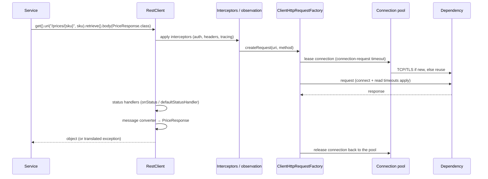
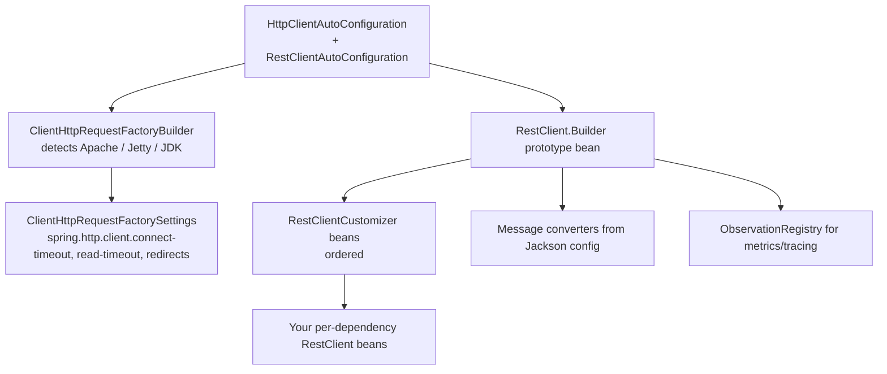
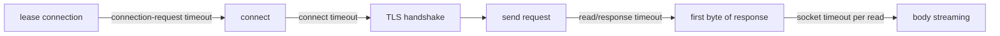
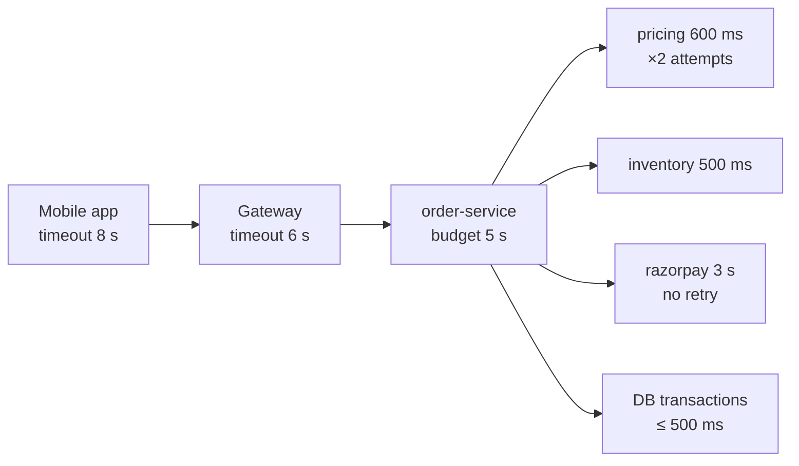

# 19 · HTTP Clients & Service-to-Service Calls

## 1. Introduction & Why It Matters

Every grocery service is also an HTTP **client**: order-service calls pricing and inventory, payment-service calls Razorpay, delivery-service calls a maps provider, notification-service calls an SMS gateway. Outbound calls are where most production latency and most cascading failures come from.

The failure pattern is always the same:

1. A dependency slows from 80 ms to 4 s.
2. Our calls have no timeout (or a 60 s default).
3. Threads and **database connections** pile up waiting (Chapter 12, 16).
4. Our service becomes unavailable — for endpoints that don't even use that dependency.

The fix is boring and mechanical: **every outbound call has a connect timeout, a read timeout, a bounded connection pool, explicit error translation, and retries only where they're safe**. Add observability (Chapter 27) and a circuit breaker (Chapter 26) and a slow dependency becomes a degraded feature instead of an outage.

Spring now offers three clients — `RestClient` (synchronous, modern), `WebClient` (reactive) and `RestTemplate` (maintenance) — plus **HTTP interfaces**, a declarative style that replaces Feign. Boot 4 adds **HTTP service client groups** that configure and register those interfaces for you.

This chapter builds the platform's outbound stack: a configured `RestClient` per dependency, declarative interfaces, timeouts and pools, error translation to the Chapter 10 exceptions, token propagation for service-to-service calls, a production Razorpay client with idempotency, and tests.

### Who should read which section

| Band | Focus |
|---|---|
| B1 · 0–2 yrs | Parts 1, 2, 4 — `RestClient` basics, timeouts |
| B2 · 2–5 yrs | Parts 2, 5 — HTTP interfaces, error handling, headers, testing |
| B3 · 5–8 yrs | Parts 3, 5, 6 — request factories, pools, keep-alive, propagation |
| B4 · 8–12 yrs | Parts 6, 7, 8 — client platform design, timeout budgets, migration |
| B5 · 12–15+ yrs | Parts 8, 9 — inter-service communication strategy |

---

## 2. Core Concepts

### 2.1 Which client?

| Client | Style | Status | Use |
|---|---|---|---|
| **`RestClient`** (Framework 6.1) | Synchronous, fluent | ✅ Default choice | Everything blocking, including with virtual threads |
| **HTTP interfaces** (`@HttpExchange`) | Declarative, backed by `RestClient`/`WebClient` | ✅ Preferred for typed clients | Service-to-service APIs |
| **`WebClient`** | Reactive, non-blocking | ✅ | WebFlux services, streaming, high fan-out |
| `RestTemplate` | Synchronous, template | 🟡 Maintenance | Legacy code only |
| Spring Cloud OpenFeign | Declarative | 🟡 Maintenance | Migrate to HTTP interfaces |

With virtual threads (Chapter 25), blocking `RestClient` calls scale well — the reactive stack is no longer required just for concurrency.

### 2.2 Request factories

`RestClient`/`RestTemplate` delegate the actual HTTP to a `ClientHttpRequestFactory`:

| Factory | Notes |
|---|---|
| `HttpComponentsClientHttpRequestFactory` (Apache HttpClient 5) | Best control: pooling, keep-alive, per-route limits, response timeout |
| `JdkClientHttpRequestFactory` (JDK `HttpClient`) | No extra dependency; HTTP/2; per-request timeout |
| `JettyClientHttpRequestFactory` | Jetty stack |
| `ReactorClientHttpRequestFactory` | Reactor Netty (blocking bridge) |
| `SimpleClientHttpRequestFactory` | `HttpURLConnection`; avoid |

Boot picks one based on the classpath and lets you configure timeouts centrally with `spring.http.client.*` (Boot 3.4+).

### 2.3 Timeouts — the three that matter

| Timeout | Meaning | Typical |
|---|---|---|
| **Connect** | TCP + TLS handshake | 1–2 s |
| **Read / response** | Waiting for (the start of) the response | Tight, per dependency |
| **Total / request** | Whole call including retries | Budgeted |

**Timeout budget**: if the incoming request must answer in 2 s, and there are two sequential downstream calls, each can have at most ~800 ms including retries. A downstream timeout larger than the caller's own timeout is always a bug.

### 2.4 Connection pools

HTTPS handshakes are expensive; pools reuse connections. Key settings (Apache HttpClient 5):

| Setting | Meaning |
|---|---|
| `maxTotal` | Connections across all routes |
| `maxPerRoute` | Connections per host — the one that actually limits a single dependency |
| `validateAfterInactivity` | Re-validate idle connections before use (stale sockets) |
| `timeToLive` / keep-alive | Retire connections before load balancers drop them |
| connection-request timeout | How long to wait for a pooled connection (fail fast!) |

### 2.5 Error handling

`RestClient` throws by default for 4xx/5xx: `HttpClientErrorException`/`HttpServerErrorException` (subclasses of `RestClientResponseException`). Translate at the client boundary into platform exceptions (Chapter 10):

| Downstream | Platform exception |
|---|---|
| 400/422 with known error code | Domain exception (e.g. `PaymentDeclinedException`) |
| 401/403 | `DependencyException` (config problem — alert) |
| 404 | Often a domain "not found", sometimes an empty `Optional` |
| 429 | `DependencyException` with retry-after |
| 5xx / timeout / connect failure | `DependencyException.unavailable/timeout` |

**Never** let a downstream error body reach our clients unchanged.

### 2.6 Retries — only where safe

| Call | Retry? |
|---|---|
| `GET` (idempotent) | ✅ on timeout/5xx/connect errors |
| `PUT`/`DELETE` (idempotent by definition) | ✅ with care |
| `POST` creating something | ❌ unless the API supports an idempotency key |
| 4xx | ❌ (except 429 with backoff) |

Always use **jittered exponential backoff**, a small attempt count (2–3), and a total budget. Retries plus a circuit breaker prevent retry storms (Chapter 26).

### 2.7 Headers you should propagate

| Header | Why |
|---|---|
| `traceparent` (W3C) | Distributed tracing — added automatically by Micrometer Tracing |
| `X-Request-Id` | Log correlation (Chapter 07) |
| `Authorization` | Service credentials (client credentials token, Chapter 18) |
| `Idempotency-Key` | For non-idempotent POSTs you must be able to retry |
| `Accept-Language` | Localized downstream errors |

### 2.8 HTTP interfaces

```java title="PricingClient.java"
@HttpExchange("/api/prices")
interface PricingClient {
    @GetExchange("/{sku}")
    PriceResponse price(@PathVariable String sku, @RequestParam String pincode);
}
```

A proxy is created from an adapter over `RestClient` (`RestClientAdapter`) or `WebClient`. In Boot 3.x you build the proxy in a `@Bean`; **Boot 4 adds `@ImportHttpServices` groups** that do it declaratively with per-group properties.

---

## 3. How It Works Internally

### 3.1 A `RestClient` call



- **Observation** wraps the call (`http.client.requests` timer with `uri`, `method`, `status`, `outcome` tags) when the client is built from Boot's auto-configured builder.
- **Interceptors** see the request before the factory — the right place for auth and correlation headers.

### 3.2 How Boot configures the builder



Inject `RestClient.Builder` (a **prototype** bean) and call `build()` per dependency — never `RestClient.create()`, which skips all of the above.

### 3.3 Timeouts and where they fire



A dependency that accepts the connection and then stalls is caught by the **read** timeout, not the connect timeout. Both are required.

---

## 4. Hands-On Code — Level 1 (Beginner)

### 4.1 A configured client

```yaml title="application.yml"
spring:
  http:
    client:
      connect-timeout: 1s          # (1)!
      read-timeout: 2s
```

1. Boot 3.4+ applies these to `RestClient`/`RestTemplate` builders globally; per-client overrides come next.

```java title="in/grocery/cart/client/PricingClientConfig.java"
package in.grocery.cart.client;

import java.time.Duration;
import org.springframework.boot.http.client.ClientHttpRequestFactorySettings;
import org.springframework.boot.web.client.ClientHttpRequestFactories;
import org.springframework.context.annotation.Bean;
import org.springframework.context.annotation.Configuration;
import org.springframework.web.client.RestClient;

@Configuration(proxyBeanMethods = false)
class PricingClientConfig {

    @Bean
    RestClient pricingRestClient(RestClient.Builder builder, PricingProperties props) {   // (1)!
        return builder
                .baseUrl(props.baseUrl())
                .defaultHeader("Accept", "application/json")
                .requestFactory(ClientHttpRequestFactories.get(                           // (2)!
                        ClientHttpRequestFactorySettings.DEFAULTS
                                .withConnectTimeout(Duration.ofSeconds(1))
                                .withReadTimeout(props.readTimeout())))
                .build();
    }
}
```

1. Boot's builder: message converters, observability and customizers included.
2. Per-client timeouts. **Verify the API**: Boot 3.4 introduced `ClientHttpRequestFactoryBuilder`, and these helper classes moved/were deprecated across 3.3 → 3.5 → 4.0.

### 4.2 Making calls

```java title="in/grocery/cart/client/PricingHttpClient.java"
package in.grocery.cart.client;

import java.math.BigDecimal;
import java.util.List;
import org.springframework.stereotype.Component;
import org.springframework.web.client.RestClient;

@Component
public class PricingHttpClient {

    public record PriceResponse(String sku, BigDecimal price, BigDecimal mrp) {}
    public record BulkPriceRequest(List<String> skus, String pincode) {}

    private final RestClient rest;

    public PricingHttpClient(RestClient pricingRestClient) {
        this.rest = pricingRestClient;
    }

    public PriceResponse price(String sku, String pincode) {
        return rest.get()
                .uri("/api/prices/{sku}?pincode={pincode}", sku, pincode)              // (1)!
                .retrieve()
                .body(PriceResponse.class);
    }

    public List<PriceResponse> prices(List<String> skus, String pincode) {
        return rest.post()
                .uri("/api/prices/bulk")
                .body(new BulkPriceRequest(skus, pincode))
                .retrieve()
                .body(new org.springframework.core.ParameterizedTypeReference<>() {});   // (2)!
    }
}
```

1. **URI template with variables** — values are encoded for you. Never concatenate user input into a URL.
2. Generic types need a `ParameterizedTypeReference`.

### 4.3 Testing it

```java title="PricingHttpClientTest.java"
@RestClientTest(PricingHttpClient.class)
@Import(PricingClientConfig.class)
class PricingHttpClientTest {

    @Autowired PricingHttpClient client;
    @Autowired MockRestServiceServer server;

    @Test
    void fetchesPrice() {
        server.expect(requestTo("/api/prices/MILK-1L?pincode=560102"))
              .andRespond(withSuccess("{\"sku\":\"MILK-1L\",\"price\":66.00,\"mrp\":68.00}",
                      MediaType.APPLICATION_JSON));

        assertThat(client.price("MILK-1L", "560102").price()).isEqualByComparingTo("66.00");
        server.verify();
    }
}
```

---

## 5. Hands-On Code — Level 2 (Intermediate) & Level 3 (Advanced)

### 5.1 Level 2 — Declarative HTTP interfaces

```java title="in/grocery/cart/client/PricingApi.java"
package in.grocery.cart.client;

import java.math.BigDecimal;
import java.util.List;
import org.springframework.web.bind.annotation.PathVariable;
import org.springframework.web.bind.annotation.RequestBody;
import org.springframework.web.bind.annotation.RequestParam;
import org.springframework.web.service.annotation.GetExchange;
import org.springframework.web.service.annotation.HttpExchange;
import org.springframework.web.service.annotation.PostExchange;

@HttpExchange("/api/prices")
public interface PricingApi {

    record PriceResponse(String sku, BigDecimal price, BigDecimal mrp) {}
    record BulkPriceRequest(List<String> skus, String pincode) {}

    @GetExchange("/{sku}")
    PriceResponse price(@PathVariable String sku, @RequestParam String pincode);

    @PostExchange("/bulk")
    List<PriceResponse> prices(@RequestBody BulkPriceRequest request);
}
```

=== "Spring Boot 3.5 — build the proxy yourself"

    ```java title="PricingApiConfig.java"
    @Bean
    PricingApi pricingApi(RestClient pricingRestClient) {
        RestClientAdapter adapter = RestClientAdapter.create(pricingRestClient);
        HttpServiceProxyFactory factory = HttpServiceProxyFactory.builderFor(adapter).build();
        return factory.createClient(PricingApi.class);                                     // (1)!
    }
    ```

    1. One line per interface; the `RestClient` carries base URL, timeouts, interceptors and observability.

=== "Spring Boot 4.x — HTTP service client groups"

    ```java title="PricingApiConfig.java"
    @Configuration(proxyBeanMethods = false)
    @ImportHttpServices(group = "pricing", types = PricingApi.class)                       // (1)!
    class PricingApiConfig {}
    ```

    ```yaml title="application.yml"
    spring:
      http:
        client:
          service:
            group:
              pricing:
                base-url: http://pricing-service:8080
                read-timeout: 800ms
    ```

    1. Boot creates the client proxy for the group and applies group properties and customizers. **Verify** annotation and property names against the 4.x reference — this API is new.

### 5.2 Level 2 — Error translation

```java title="in/grocery/cart/client/PricingClientConfig.java (status handlers)"
@Bean
RestClient pricingRestClient(RestClient.Builder builder, PricingProperties props) {
    return builder
            .baseUrl(props.baseUrl())
            .defaultStatusHandler(HttpStatusCode::isError, (request, response) -> {         // (1)!
                int status = response.getStatusCode().value();
                String body = new String(response.getBody().readAllBytes(), StandardCharsets.UTF_8);
                throw switch (status) {
                    case 404 -> new PriceNotFoundException(request.getURI().getPath());
                    case 429 -> DependencyException.rateLimited("pricing-service",
                            response.getHeaders().getFirst("Retry-After"));
                    case 400, 422 -> new DependencyException("pricing-service", ErrorCode.INTERNAL_ERROR,
                            "pricing rejected our request: " + truncate(body), null);        // (2)!
                    default -> DependencyException.unavailable("pricing-service", null);
                };
            })
            .build();
}
```

1. One place for all error mapping; callers see platform exceptions only.
2. A 4xx from a **downstream** service is usually **our** bug (wrong payload) → 500 for the customer, alert for us. Truncate and log the body; never forward it.

### 5.3 Level 2 — Propagating identity and correlation

```java title="in/grocery/platform/client/ServiceCallInterceptor.java"
package in.grocery.platform.client;

import java.io.IOException;
import org.slf4j.MDC;
import org.springframework.http.HttpRequest;
import org.springframework.http.client.ClientHttpRequestExecution;
import org.springframework.http.client.ClientHttpRequestInterceptor;
import org.springframework.http.client.ClientHttpResponse;

public class ServiceCallInterceptor implements ClientHttpRequestInterceptor {

    @Override
    public ClientHttpResponse intercept(HttpRequest request, byte[] body, ClientHttpRequestExecution execution)
            throws IOException {
        String requestId = MDC.get("requestId");                                            // (1)!
        if (requestId != null) {
            request.getHeaders().add("X-Request-Id", requestId);
        }
        return execution.execute(request, body);
    }
}
```

1. `traceparent` is added by Micrometer Tracing automatically; this carries our own correlation id (Chapter 07).

**Service credentials** (Chapter 18) with Spring Security's OAuth2 client:

```java title="in/grocery/platform/client/ServiceTokenConfig.java"
@Bean
RestClient pricingRestClient(RestClient.Builder builder, OAuth2AuthorizedClientManager manager,
                             PricingProperties props) {
    OAuth2ClientHttpRequestInterceptor auth =
            new OAuth2ClientHttpRequestInterceptor(manager);                                 // (1)!
    auth.setClientRegistrationIdResolver(request -> "grocery-internal");

    return builder
            .baseUrl(props.baseUrl())
            .requestInterceptor(auth)
            .requestInterceptor(new ServiceCallInterceptor())
            .build();
}
```

1. Spring Security 6.4+ provides this interceptor for `RestClient`; it acquires and caches client-credentials tokens and adds the `Authorization` header. **Verify** the class name/package for your version.

### 5.4 Level 3 — Apache HttpClient pool and keep-alive

```java title="in/grocery/platform/client/PooledHttpClientConfig.java"
package in.grocery.platform.client;

import java.time.Duration;
import org.apache.hc.client5.http.config.ConnectionConfig;
import org.apache.hc.client5.http.config.RequestConfig;
import org.apache.hc.client5.http.impl.classic.CloseableHttpClient;
import org.apache.hc.client5.http.impl.classic.HttpClients;
import org.apache.hc.client5.http.impl.io.PoolingHttpClientConnectionManager;
import org.apache.hc.client5.http.impl.io.PoolingHttpClientConnectionManagerBuilder;
import org.apache.hc.core5.util.TimeValue;
import org.apache.hc.core5.util.Timeout;
import org.springframework.context.annotation.Bean;
import org.springframework.context.annotation.Configuration;
import org.springframework.http.client.ClientHttpRequestFactory;
import org.springframework.http.client.HttpComponentsClientHttpRequestFactory;

@Configuration(proxyBeanMethods = false)
public class PooledHttpClientConfig {

    @Bean
    ClientHttpRequestFactory pooledRequestFactory(HttpClientProperties props) {
        PoolingHttpClientConnectionManager pool = PoolingHttpClientConnectionManagerBuilder.create()
                .setMaxConnTotal(props.maxTotal())                    // e.g. 100
                .setMaxConnPerRoute(props.maxPerRoute())              // e.g. 50 — the real limit per dependency
                .setDefaultConnectionConfig(ConnectionConfig.custom()
                        .setConnectTimeout(Timeout.ofSeconds(1))
                        .setSocketTimeout(Timeout.ofSeconds(2))
                        .setValidateAfterInactivity(TimeValue.ofSeconds(5))    // (1)!
                        .setTimeToLive(TimeValue.ofMinutes(5))                 // (2)!
                        .build())
                .build();

        CloseableHttpClient client = HttpClients.custom()
                .setConnectionManager(pool)
                .evictIdleConnections(TimeValue.ofMinutes(1))
                .setDefaultRequestConfig(RequestConfig.custom()
                        .setConnectionRequestTimeout(Timeout.ofMillis(200))    // (3)!
                        .setResponseTimeout(Timeout.ofSeconds(2))
                        .build())
                .disableAutomaticRetries()                                     // (4)!
                .build();

        return new HttpComponentsClientHttpRequestFactory(client);
    }
}
```

1. Revalidate connections idle longer than 5 s — avoids "connection reset" from silently dropped sockets.
2. Retire connections before load balancers or NATs do (keep below their idle timeout).
3. **Fail fast when the pool is exhausted** instead of queuing — the caller gets a clear dependency error and the circuit breaker can open.
4. Retries are a policy decision made one level up (5.5), not a silent client default.

Expose pool metrics (Chapter 27) so "pending connection leases" is visible before it becomes latency.

### 5.5 Level 3 — Safe retries

```java title="in/grocery/cart/client/PricingRetryConfig.java"
@Bean
PricingApi pricingApi(RestClient pricingRestClient, RetryTemplate pricingRetryTemplate) {
    PricingApi delegate = HttpServiceProxyFactory
            .builderFor(RestClientAdapter.create(pricingRestClient)).build()
            .createClient(PricingApi.class);
    return new RetryingPricingApi(delegate, pricingRetryTemplate);                          // (1)!
}

@Bean
RetryTemplate pricingRetryTemplate() {
    return RetryTemplate.builder()
            .maxAttempts(3)
            .exponentialBackoff(50, 2.0, 400, true)                                          // (2)!
            .retryOn(DependencyException.class)
            .withListener(new MetricsRetryListener("pricing-service"))
            .build();
}
```

1. A decorator retries **only the idempotent methods** (`price`, `prices`) — a `POST /bulk` that only reads is idempotent in practice; document that assumption with the dependency's owner.
2. 50 ms, 100 ms, 200 ms with jitter, capped — total worst case ~350 ms of backoff plus 3 × 800 ms of timeouts. That must still fit the caller's budget: with a 2 s SLA, use 2 attempts and a 600 ms timeout.

!!! danger "Retry storms"
    Retrying at every layer multiplies load: gateway (3) × order-service (3) × pricing client (3) = 27 requests for one user action, exactly when the dependency is already struggling. **Retry at one layer only**, and pair retries with a circuit breaker (Chapter 26).

### 5.6 Level 3 — WebClient where it's the right tool

```java title="in/grocery/delivery/tracking/TrackingFeedClient.java"
@Bean
WebClient trackingWebClient(WebClient.Builder builder) {
    return builder.baseUrl("http://fleet-service:8080").build();
}

public Flux<PositionUpdate> stream(String orderRef) {
    return trackingWebClient.get()
            .uri("/api/deliveries/{ref}/positions", orderRef)
            .accept(MediaType.TEXT_EVENT_STREAM)
            .retrieve()
            .bodyToFlux(PositionUpdate.class)                                                // (1)!
            .timeout(Duration.ofMinutes(5));
}
```

1. Server-sent events consumed as a stream — a genuine reactive use case (Chapter 31, 32). For request/response calls in an MVC service, `RestClient` is simpler.

---

## 6. Hands-On Code — Level 4 (Expert / Production)

### 6.1 The Razorpay client

Requirements: basic auth from mounted secrets, tight timeouts, no retries on capture, idempotency on order creation, error translation to domain/dependency exceptions (Chapter 10), no secret ever logged, and metrics per operation.

```java title="in/grocery/payment/client/razorpay/RazorpayApi.java"
package in.grocery.payment.client.razorpay;

import java.util.Map;
import org.springframework.web.bind.annotation.PathVariable;
import org.springframework.web.bind.annotation.RequestBody;
import org.springframework.web.service.annotation.GetExchange;
import org.springframework.web.service.annotation.HttpExchange;
import org.springframework.web.service.annotation.PostExchange;

@HttpExchange
public interface RazorpayApi {

    record OrderRequest(long amount, String currency, String receipt, Map<String, String> notes) {}
    record OrderResponse(String id, long amount, String currency, String status, String receipt) {}
    record PaymentResponse(String id, String orderId, long amount, String status, String method,
                           String errorCode, String errorReason) {}
    record RefundRequest(long amount, Map<String, String> notes) {}
    record RefundResponse(String id, String paymentId, long amount, String status) {}

    @PostExchange("/v1/orders")
    OrderResponse createOrder(@RequestBody OrderRequest request);

    @GetExchange("/v1/payments/{paymentId}")
    PaymentResponse payment(@PathVariable String paymentId);

    @PostExchange("/v1/payments/{paymentId}/refund")
    RefundResponse refund(@PathVariable String paymentId, @RequestBody RefundRequest request);
}
```

```java title="in/grocery/payment/client/razorpay/RazorpayClientConfig.java"
package in.grocery.payment.client.razorpay;

import in.grocery.payment.config.RazorpayProperties;
import java.nio.charset.StandardCharsets;
import java.util.Base64;
import org.springframework.context.annotation.Bean;
import org.springframework.context.annotation.Configuration;
import org.springframework.http.HttpHeaders;
import org.springframework.http.client.ClientHttpRequestFactory;
import org.springframework.web.client.RestClient;
import org.springframework.web.client.support.RestClientAdapter;
import org.springframework.web.service.invoker.HttpServiceProxyFactory;

@Configuration(proxyBeanMethods = false)
class RazorpayClientConfig {

    @Bean
    RestClient razorpayRestClient(RestClient.Builder builder, RazorpayProperties props,
                                  ClientHttpRequestFactory pooledRequestFactory,
                                  RazorpayErrorHandler errorHandler) {
        String basic = Base64.getEncoder().encodeToString(
                (props.keyId() + ":" + props.keySecret()).getBytes(StandardCharsets.UTF_8));   // (1)!
        return builder
                .baseUrl(props.baseUrl().toString())
                .requestFactory(pooledRequestFactory)
                .defaultHeader(HttpHeaders.AUTHORIZATION, "Basic " + basic)
                .defaultHeader(HttpHeaders.USER_AGENT, "grocery-payment-service")
                .defaultStatusHandler(errorHandler)                                            // (2)!
                .build();
    }

    @Bean
    RazorpayApi razorpayApi(RestClient razorpayRestClient) {
        return HttpServiceProxyFactory
                .builderFor(RestClientAdapter.create(razorpayRestClient))
                .build()
                .createClient(RazorpayApi.class);
    }
}
```

1. Credentials from the config tree (Chapter 06), never logged; `RazorpayProperties.toString()` masks them.
2. Central error translation (next).

```java title="in/grocery/payment/client/razorpay/RazorpayErrorHandler.java"
package in.grocery.payment.client.razorpay;

import com.fasterxml.jackson.databind.ObjectMapper;        // JsonMapper on Boot 4
import in.grocery.payment.client.RazorpayErrorTranslator;
import java.io.IOException;
import java.nio.charset.StandardCharsets;
import org.slf4j.Logger;
import org.slf4j.LoggerFactory;
import org.springframework.http.client.ClientHttpResponse;
import org.springframework.stereotype.Component;
import org.springframework.web.client.ResponseErrorHandler;

@Component
class RazorpayErrorHandler implements ResponseErrorHandler {

    private static final Logger log = LoggerFactory.getLogger(RazorpayErrorHandler.class);

    private final ObjectMapper json;

    RazorpayErrorHandler(ObjectMapper json) {
        this.json = json;
    }

    @Override
    public boolean hasError(ClientHttpResponse response) throws IOException {
        return response.getStatusCode().isError();
    }

    @Override
    public void handleError(ClientHttpResponse response) throws IOException {
        int status = response.getStatusCode().value();
        String body = new String(response.getBody().readAllBytes(), StandardCharsets.UTF_8);
        String errorCode = null;
        String reason = null;
        try {
            var node = json.readTree(body).path("error");
            errorCode = node.path("code").asText(null);
            reason = node.path("reason").asText(null);
        } catch (Exception ignored) {
            // non-JSON error body (gateway HTML page) — treat as unavailable
        }
        log.warn("Razorpay error status={} code={} reason={}", status, errorCode, reason);      // (1)!
        throw RazorpayErrorTranslator.translate(status, errorCode, reason);                     // (2)!
    }
}
```

1. Log the classification, not the body (it can contain customer contact details).
2. Reuses Chapter 10's translator: known declines → `PaymentDeclinedException` (422), everything else → `DependencyException` (503/504).

```java title="in/grocery/payment/service/RazorpayGatewayAdapter.java"
package in.grocery.payment.service;

import in.grocery.payment.client.razorpay.RazorpayApi;
import in.grocery.platform.error.DependencyException;
import io.micrometer.core.instrument.MeterRegistry;
import io.micrometer.core.instrument.Timer;
import java.math.BigDecimal;
import java.util.Map;
import org.springframework.stereotype.Component;
import org.springframework.web.client.ResourceAccessException;

@Component
public class RazorpayGatewayAdapter implements in.grocery.payment.gateway.PaymentGateway {

    private final RazorpayApi api;
    private final MeterRegistry meters;

    public RazorpayGatewayAdapter(RazorpayApi api, MeterRegistry meters) {
        this.api = api;
        this.meters = meters;
    }

    @Override
    public String code() {
        return "RAZORPAY";
    }

    @Override
    public String createOrder(String orderRef, BigDecimal amountInRupees) {
        Timer.Sample sample = Timer.start(meters);
        String outcome = "success";
        try {
            var response = api.createOrder(new RazorpayApi.OrderRequest(
                    amountInRupees.movePointRight(2).longValueExact(),                          // paise
                    "INR",
                    orderRef,                                                                    // (1)!
                    Map.of("order_ref", orderRef)));
            return response.id();
        } catch (ResourceAccessException networkOrTimeout) {                                    // (2)!
            outcome = "timeout";
            throw DependencyException.timeout("razorpay", networkOrTimeout);
        } catch (RuntimeException e) {
            outcome = "failure";
            throw e;
        } finally {
            sample.stop(Timer.builder("grocery.gateway.call")
                    .tag("gateway", "RAZORPAY").tag("operation", "createOrder").tag("outcome", outcome)
                    .publishPercentileHistogram()
                    .register(meters));
        }
    }
}
```

1. `receipt` is our order reference — Razorpay treats it as a natural key, so a retried creation returns the **same** order instead of a duplicate. That's what makes a retry safe here; the platform's own idempotency aspect (Chapter 04) covers the rest of the flow.
2. Connect failures, read timeouts and DNS problems surface as `ResourceAccessException` — translate them distinctly so dashboards can separate "gateway slow" from "gateway rejected".

### 6.2 Timeout budget for checkout



Rules encoded in the platform:

| Rule | Value |
|---|---|
| Sum of downstream worst cases + DB < caller budget | checked in review |
| Client timeout < caller's remaining budget | always |
| Retries counted in the worst case | always |
| Payment calls | never retried automatically; reconciled asynchronously |
| Timeout properties | per dependency, in configuration, not hard-coded |

### 6.3 Platform client library

```java title="in/grocery/platform/client/GroceryClients.java"
package in.grocery.platform.client;

import java.time.Duration;
import org.springframework.web.client.RestClient;

/** Factory used by every service so all outbound calls share the same defaults. */
public class GroceryClients {

    private final RestClient.Builder builder;
    private final ServiceCallInterceptor correlation;

    public GroceryClients(RestClient.Builder builder, ServiceCallInterceptor correlation) {
        this.builder = builder;
        this.correlation = correlation;
    }

    public RestClient internal(String name, String baseUrl, Duration readTimeout) {
        return builder.clone()                                                                 // (1)!
                .baseUrl(baseUrl)
                .requestInterceptor(correlation)
                .defaultStatusHandler(new InternalServiceErrorHandler(name))                   // (2)!
                .requestFactory(RequestFactories.pooled(Duration.ofSeconds(1), readTimeout))
                .build();
    }
}
```

1. `RestClient.Builder` is a prototype bean, but cloning makes the per-client mutation explicit and safe.
2. A shared handler translating any internal service's errors into `DependencyException` with the service name — one dashboard dimension for all inter-service failures.

### 6.4 Testing the production client

```java title="RazorpayGatewayAdapterTest.java"
@RestClientTest
@Import({RazorpayClientConfig.class, RazorpayErrorHandler.class, RazorpayGatewayAdapter.class})
@TestPropertySource(properties = {
        "grocery.payment.razorpay.key-id=rzp_test_ABC123",
        "grocery.payment.razorpay.key-secret=secret",
        "grocery.payment.razorpay.webhook-secret=whsec"
})
class RazorpayGatewayAdapterTest {

    @Autowired RazorpayGatewayAdapter gateway;
    @Autowired MockRestServiceServer server;

    @Test
    void sendsAmountInPaiseAndReceipt() {
        server.expect(requestTo("https://api.razorpay.com/v1/orders"))
              .andExpect(method(HttpMethod.POST))
              .andExpect(header("Authorization", startsWith("Basic ")))
              .andExpect(jsonPath("$.amount").value(57800))
              .andExpect(jsonPath("$.receipt").value("ORD-1"))
              .andRespond(withSuccess("{\"id\":\"order_x\",\"amount\":57800,\"currency\":\"INR\"," +
                      "\"status\":\"created\",\"receipt\":\"ORD-1\"}", MediaType.APPLICATION_JSON));

        assertThat(gateway.createOrder("ORD-1", new BigDecimal("578.00"))).isEqualTo("order_x");
    }

    @Test
    void declineBecomesDomainException() {
        server.expect(requestTo("https://api.razorpay.com/v1/orders"))
              .andRespond(withStatus(HttpStatus.BAD_REQUEST).contentType(MediaType.APPLICATION_JSON)
                      .body("{\"error\":{\"code\":\"BAD_REQUEST_ERROR\",\"reason\":\"insufficient_funds\"}}"));

        assertThatThrownBy(() -> gateway.createOrder("ORD-2", new BigDecimal("100.00")))
                .isInstanceOf(PaymentDeclinedException.class);
    }

    @Test
    void serverErrorBecomesDependencyException() {
        server.expect(requestTo("https://api.razorpay.com/v1/orders")).andRespond(withServerError());

        assertThatThrownBy(() -> gateway.createOrder("ORD-3", new BigDecimal("100.00")))
                .isInstanceOf(DependencyException.class);
    }
}
```

For timeout behaviour (which `MockRestServiceServer` can't simulate), use **WireMock** with a fixed delay in an integration test (Chapter 28):

```java title="Testing the production client (snippet)"
stubFor(post("/v1/orders").willReturn(aResponse().withFixedDelay(5_000)));
assertThatThrownBy(() -> gateway.createOrder("ORD-4", TEN))
        .isInstanceOf(DependencyException.class)
        .hasMessageContaining("timed out");
```

---

## 7. Spring Boot 3 vs 4 & Migration

| Topic | Boot 3.5 / Framework 6.2 | Boot 4.x / Framework 7 |
|---|---|---|
| `RestClient` | ✅ (3.2+) | ✅ |
| HTTP interfaces | Manual proxy via `HttpServiceProxyFactory` | **`@ImportHttpServices` groups** + `spring.http.client.service.group.*` |
| Client properties | `spring.http.client.*` (3.4+) | Extended with per-group settings (verify) |
| Request factory helpers | `ClientHttpRequestFactories` (3.x, deprecated in later versions) → `ClientHttpRequestFactoryBuilder` (3.4+) | `ClientHttpRequestFactoryBuilder` |
| `RestTemplate` | Maintenance | Maintenance |
| OAuth2 client interceptor | `OAuth2ClientHttpRequestInterceptor` (Security 6.4+) | Available |
| Observability | `http.client.requests` observation | Same |
| Jackson | 2 | 3 — client DTOs unchanged, mapper differs (Chapter 11) |

=== "Spring Boot 3.5"

    ```java title="Spring Boot 3.5 (snippet)"
    @Bean
    PricingApi pricingApi(RestClient.Builder builder) {
        RestClient client = builder.baseUrl("http://pricing-service:8080").build();
        return HttpServiceProxyFactory.builderFor(RestClientAdapter.create(client)).build()
                .createClient(PricingApi.class);
    }
    ```

=== "Spring Boot 4.x"

    ```java title="PricingApiConfig.java"
    @Configuration(proxyBeanMethods = false)
    @ImportHttpServices(group = "pricing", types = PricingApi.class)
    class PricingApiConfig {}
    ```

    ```yaml title="Configuration"
    spring.http.client.service.group.pricing.base-url: http://pricing-service:8080
    ```

### Migration checklist

- [ ] Replace `RestTemplate` with `RestClient` (same request factories, same interceptors).
- [ ] Convert hand-written clients to HTTP interfaces; adopt Boot 4 groups once on 4.x.
- [ ] Move timeouts from code into `spring.http.client.*` / per-group properties.
- [ ] Migrate OpenFeign clients: `@FeignClient` → `@HttpExchange` interface + `RestClient` (error decoders → status handlers, Feign retryer → explicit retry).
- [ ] Re-verify timeout and pool settings after factory API changes; add an integration test with a delayed stub.

---

## 8. Production Playbook

### Best practices

1. **One configured client bean per dependency**, built from Boot's builder — never `RestClient.create()`.
2. **Connect + read + connection-request timeouts on every client**, tuned per dependency and inside the caller's budget.
3. **Bounded pool** with `maxPerRoute`, idle validation and TTL; fail fast when exhausted.
4. **Translate errors at the boundary** into platform exceptions; never forward downstream bodies.
5. **Retry only idempotent operations**, at one layer, with jitter and a circuit breaker.
6. **Propagate** trace, correlation and service credentials via interceptors.
7. **Idempotency keys (or natural keys)** for non-idempotent POSTs you might retry.
8. **Metrics per dependency and operation** (`http.client.requests` + your own), alert on error rate and p99.
9. **Declarative HTTP interfaces** for typed clients; keep DTOs separate from your domain.
10. **Test error paths and timeouts**, not only the happy path.

### Anti-patterns

❌ No timeouts (defaults are effectively infinite for some factories).

❌ `RestClient.create()` / `new RestTemplate()` — no observability, no converters, no customizers.

❌ Building a client inside the method that calls it — new pool, new TLS handshake per call.

❌ Retrying `POST /payments/capture` — double charges.

❌ Retrying at gateway **and** service **and** client.

❌ Passing downstream error bodies to customers (leaks internals, couples clients).

❌ Calling downstream services inside a database transaction (Chapter 16).

❌ Logging request/response bodies of payment or identity calls.

❌ Unbounded parallel fan-out (1,000 SKUs → 1,000 concurrent calls) without a bulkhead.

### Troubleshooting

| Symptom | Cause | Fix |
|---|---|---|
| Latency spikes with no downstream errors | Pool exhaustion (queuing for a connection) | Raise `maxPerRoute` deliberately, shorten timeouts, add bulkhead |
| `ResourceAccessException: Read timed out` | Downstream slow | Check budget; circuit breaker; is the timeout right? |
| `Connection reset by peer` after idle periods | Stale pooled connections | `validateAfterInactivity`, TTL below LB idle timeout |
| Retries multiply load during incidents | Retries at several layers | Single retry layer + circuit breaker |
| Duplicate orders/refunds | Retrying non-idempotent POST | Idempotency key or natural key; disable retries |
| 401 from an internal service | Token not attached/expired | OAuth2 interceptor; check registration id and scopes |
| Missing traces across services | Client not built from Boot's builder | Use the injected builder |
| `IllegalStateException: Cannot use a builder after build()` | Reusing a mutated builder | `clone()` per client |
| Works in tests, fails in cluster | DNS/keep-alive/proxy differences | Test with WireMock + delays; check service mesh timeouts |

### Production checklist

- [ ] Every outbound dependency has a named client bean with timeouts and pool settings
- [ ] Timeout budget documented per endpoint and reviewed
- [ ] Error translation covers 4xx/5xx/timeout/connect
- [ ] Retry policy explicit (and absent for payments)
- [ ] Idempotency keys where retries are possible
- [ ] Trace/correlation/auth headers propagated
- [ ] Metrics and alerts per dependency; pool metrics exposed
- [ ] Timeout and error-path tests exist

---

## 9. Interview Questions & Answers

### B1 · 0–2 years

??? question "B1 · Which HTTP client should new Spring code use?"
    **Short answer:** `RestClient` for synchronous calls (or an HTTP interface backed by it); `WebClient` for reactive/streaming. `RestTemplate` is in maintenance.

??? question "B1 · Why inject `RestClient.Builder` instead of creating a client directly?"
    **Short answer:** Boot's builder carries message converters, timeouts, customizers and observability; `RestClient.create()` has none of that.

??? question "B1 · Which timeouts must you set?"
    **Short answer:** Connect and read (plus connection-request when pooling). Without them a slow dependency blocks threads indefinitely.

??? question "B1 · How do you pass path and query parameters safely?"
    **Short answer:** URI templates with variables (`uri("/prices/{sku}?pincode={p}", sku, p)`) — Spring encodes them.

??? question "B1 · What happens on a 404 by default with `RestClient`?"
    **Short answer:** `retrieve()` throws `HttpClientErrorException.NotFound` unless you register a status handler.

### B2 · 2–5 years

??? question "B2 · What is an HTTP interface and why prefer it to Feign?"
    **Short answer:** A Java interface annotated with `@HttpExchange` whose proxy is backed by `RestClient`/`WebClient` — part of Spring Framework, same configuration and observability as other clients. Spring Cloud OpenFeign is in maintenance.

??? question "B2 · How do you map downstream errors to your own?"
    **Short answer:** `defaultStatusHandler`/`onStatus` on the client (or a `ResponseErrorHandler`) translating status and error codes into domain or dependency exceptions — never forwarding the raw body.

??? question "B2 · Which calls are safe to retry?"
    **Short answer:** Idempotent ones (GET, PUT, DELETE) on timeouts/5xx/connect errors, with jittered backoff; non-idempotent POSTs only with an idempotency key or natural key.

??? question "B2 · How do you attach a service token to outbound calls?"
    **Short answer:** Spring Security's OAuth2 client (`OAuth2AuthorizedClientManager`) with the `RestClient` interceptor for client-credentials tokens; it caches and refreshes automatically.

??? question "B2 · How do you test an HTTP client?"
    **Short answer:** `@RestClientTest` + `MockRestServiceServer` for request/response expectations and error mapping; WireMock for delays, faults and full-stack behaviour.

### B3 · 5–8 years

??? question "B3 · What's the difference between connect, read and connection-request timeouts?"
    **Short answer:** Connect covers establishing TCP/TLS; read covers waiting for response data; connection-request covers waiting for a pooled connection. Pool exhaustion shows up as the third and is invisible if it's unset.

??? question "B3 · How do you size an HTTP connection pool?"
    **Short answer:** `maxPerRoute` ≈ expected concurrent calls to that host (throughput × latency, Little's law), bounded by the dependency's capacity; keep total sane across dependencies; watch lease wait time and adjust.

??? question "B3 · Why do idle pooled connections cause 'connection reset'?"
    **Short answer:** Load balancers/NATs drop idle connections silently; a later request on that socket fails. Fix with idle validation, TTL shorter than the infrastructure's idle timeout and eviction.

??? question "B3 · How does observability work for outbound calls?"
    **Short answer:** Clients built from Boot's builder create Micrometer observations — `http.client.requests` timer with method/uri/status/outcome tags — and tracing propagates `traceparent` headers automatically.

??? question "B3 · How do timeout budgets work across a call chain?"
    **Short answer:** Each hop gets a share of the caller's remaining deadline, including retries; downstream timeouts must be strictly smaller than upstream ones, otherwise the caller gives up first and the work is wasted.

### B4 · 8–12 years

??? question "B4 · Design the outbound client platform for 26 services."
    **Short answer:** A shared library providing configured clients (timeouts, pools, interceptors, error translation, metrics), HTTP interfaces per dependency, per-dependency properties, documented timeout budgets, retry/circuit-breaker policy, and contract tests with consumers.

??? question "B4 · When is a service mesh the better place for retries and timeouts?"
    **Short answer:** A mesh gives uniform, language-agnostic policy and mTLS, but doesn't know semantics (is this POST idempotent?) and duplicates in-app policy if both are enabled. Common split: mesh for connection-level concerns and mTLS; app for semantic retries, idempotency and error translation — never both retrying.

??? question "B4 · How do you migrate 40 Feign clients?"
    **Short answer:** Interface-by-interface to `@HttpExchange` with `RestClient`, mapping decoders to status handlers, Feign retryer to explicit policy, and Ribbon/LoadBalancer to service DNS or `spring-cloud-loadbalancer`; keep both temporarily behind a flag with contract tests comparing behaviour.

### B5 · 12–15+ years

??? question "B5 · Synchronous HTTP, messaging or gRPC between services?"
    **Short answer:** Synchronous HTTP for request/response with a user waiting; messaging for work that can be asynchronous (and to decouple availability); gRPC for high-volume internal RPC with schemas. Prefer async wherever the user doesn't need the result now — it removes latency coupling entirely.

??? question "B5 · How do you prevent a slow dependency from becoming an outage?"
    **Short answer:** Timeout budgets, bounded pools and bulkheads, circuit breakers with fallbacks, degradation paths (cached prices, default delivery fee), retries at one layer, load shedding at the gateway, and chaos/latency tests to prove it works.

### Scenario questions

??? example "Scenario · Pricing slows to 3 s; checkout goes down completely"
    order-service had no read timeout, so request threads and their database connections waited; the pool emptied and unrelated endpoints failed. Fixes: 600 ms read timeout with 2 attempts, connection-request timeout 200 ms, circuit breaker with a cached-price fallback, move the pricing call out of the transaction, and alert on `http.client.requests` p99 per dependency.

??? example "Scenario · Customers charged twice during a network blip"
    The payment adapter retried `createOrder` **and** the capture call on `ResourceAccessException`. Order creation was safe (Razorpay dedupes by `receipt`), capture was not. Fixes: disable retries on capture, reconcile with the gateway asynchronously, add idempotency keys end to end, and add a test asserting no retry on non-idempotent operations.

### Coding exercise

!!! example "Exercise · Inventory client with a fallback"
    Build an `InventoryApi` HTTP interface (`GET /api/stock/{sku}?hub=...`), a `RestClient` with 400 ms read timeout and pooled factory, error translation (404 → `Optional.empty()`, 5xx/timeout → `DependencyException`), one retry for timeouts, and a service method that falls back to "assume available" for non-perishable categories when the dependency is down. Test all four paths.

??? success "Solution"
    ```java title="InventoryApi.java"
    @HttpExchange("/api/stock")
    public interface InventoryApi {
        record StockResponse(String sku, String hub, int available) {}

        @GetExchange("/{sku}")
        StockResponse stock(@PathVariable String sku, @RequestParam String hub);
    }
    ```

    ```java title="InventoryClientConfig.java"
    @Bean
    RestClient inventoryRestClient(RestClient.Builder builder, ClientHttpRequestFactory pooledRequestFactory,
                                   InventoryProperties props) {
        return builder
                .baseUrl(props.baseUrl())
                .requestFactory(pooledRequestFactory)
                .defaultStatusHandler(HttpStatusCode::isError, (req, res) -> {
                    if (res.getStatusCode().value() == 404) throw new StockNotFoundException(req.getURI().getPath());
                    throw DependencyException.unavailable("inventory-service", null);
                })
                .build();
    }

    @Bean
    InventoryApi inventoryApi(RestClient inventoryRestClient) {
        return HttpServiceProxyFactory.builderFor(RestClientAdapter.create(inventoryRestClient))
                .build().createClient(InventoryApi.class);
    }
    ```

    ```java title="InventoryLookupService.java"
    @Service
    public class InventoryLookupService {

        private final InventoryApi inventory;
        private final RetryTemplate retry;
        private final MeterRegistry meters;

        public Optional<Integer> available(String sku, String hub) {
            try {
                return retry.execute(ctx -> Optional.of(inventory.stock(sku, hub).available()));   // retries timeouts
            } catch (StockNotFoundException e) {
                return Optional.empty();
            }
        }

        /** Degrade gracefully: non-perishables are assumed available if inventory is down. */
        public boolean isPurchasable(String sku, String hub, boolean perishable) {
            try {
                return available(sku, hub).orElse(0) > 0;
            } catch (DependencyException e) {
                meters.counter("grocery.inventory.fallback", "perishable", String.valueOf(perishable)).increment();
                if (perishable) throw e;                                                            // never guess for fresh items
                return true;                                                                        // reconciled at reservation
            }
        }
    }
    ```

    ```java title="InventoryLookupServiceTest.java (paths)"
    @Test void returnsQuantity() { /* 200 → Optional.of(12) */ }
    @Test void missingSkuIsEmpty() { /* 404 → Optional.empty() */ }
    @Test void serverErrorPropagatesForPerishables() { /* 500 → DependencyException */ }
    @Test void nonPerishableFallsBackToPurchasable() { /* 500 → true, counter incremented */ }
    ```

    The fallback is a **business decision** (risk of overselling shelf-stable goods vs blocking checkout) — document it, meter it, and reconcile at reservation time.

---

## Key Takeaways

- **`RestClient` + HTTP interfaces** are the modern stack; `RestTemplate` and Feign are legacy.
- Build clients from **Boot's builder** so they get converters, customizers and observability.
- **Timeouts and bounded pools on every dependency**, fitting a documented **timeout budget**.
- **Translate errors at the boundary**; never forward downstream bodies.
- **Retry only idempotent calls, at one layer, with jitter** — pair with a circuit breaker.
- **Propagate trace, correlation and service tokens**; use idempotency keys for risky POSTs.
- **Boot 4 adds HTTP service client groups** — declarative registration plus per-group properties.
- Test **error paths and timeouts**, not just the happy path.

## Further Reading

- Spring Framework Reference — *Web › REST Clients* (`RestClient`, `WebClient`, HTTP interfaces, `RestTemplate`)
- Spring Boot Reference — *Web › Calling REST Services*; *HTTP Clients* (`spring.http.client.*`, request factories, service groups)
- Spring Security Reference — *OAuth2 Client › `RestClient` integration*
- Apache HttpClient 5 documentation — connection management and timeouts

---

[:material-arrow-left: 18 Tokens, OAuth2 & Modern Auth](18-security-tokens-oauth2.md) · [20 API Design & Versioning :material-arrow-right:](20-api-design-versioning.md)
