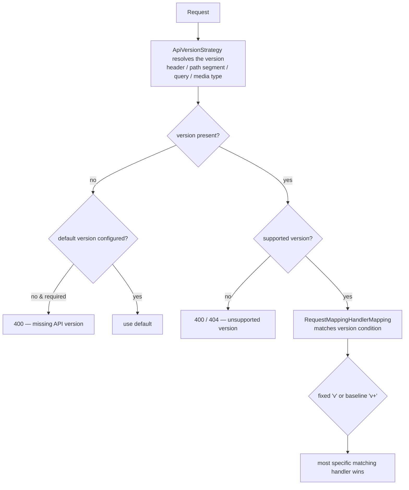
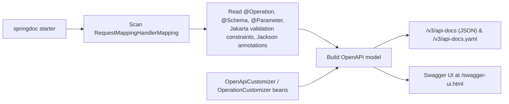
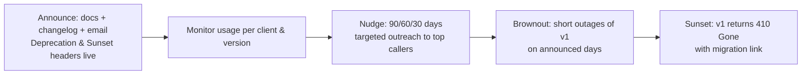

# 20 · API Design, Versioning & Documentation

## 1. Introduction & Why It Matters

The grocery platform's APIs are consumed by an Angular web app, a Flutter mobile app installed on millions of phones, 26 internal services, seller integrations and partner marketplaces. Two facts follow:

1. **You cannot force clients to upgrade.** A Flutter build from eight months ago is still calling `POST /api/orders` during the Diwali sale.
2. **Every design decision becomes permanent.** A field named `total` that sometimes includes delivery fee will be encoded in four client codebases within a week.

Good API design is therefore mostly about **evolution**: making additive changes easy, breaking changes visible and rare, and giving clients the signals (versions, deprecation headers, error codes) they need to adapt on their own schedule.

This chapter pulls together the conventions used throughout the handbook — resources and status codes (Chapter 08), validation errors and problem details (Chapters 09, 10), idempotency (Chapter 04), ETags and conditional requests (Chapter 08), pagination (Chapter 13) — into a **platform API standard**, then covers versioning (including Spring Framework 7's built-in support), deprecation with `Deprecation`/`Sunset` headers, OpenAPI documentation, a generated error catalog, rate-limit signalling, and CI checks that catch breaking changes before they ship.

### Who should read which section

| Band | Focus |
|---|---|
| B1 · 0–2 yrs | Parts 1, 2, 4 — resource naming, status codes, OpenAPI basics |
| B2 · 2–5 yrs | Parts 2, 5 — pagination, filtering, bulk endpoints, documentation |
| B3 · 5–8 yrs | Parts 3, 5, 6 — versioning mechanics, compatibility rules |
| B4 · 8–12 yrs | Parts 6, 7, 8 — platform standards, deprecation programme, CI gates |
| B5 · 12–15+ yrs | Parts 8, 9 — API governance and product thinking |

---

## 2. Core Concepts

### 2.1 Resource design

| Rule | Example |
|---|---|
| Plural nouns for collections | `/api/orders`, `/api/products` |
| Identify resources by a **business reference**, not a database id | `/api/orders/ORD-7F3A91C2` |
| Nest only for true containment (one level) | `/api/carts/{cartId}/items/{sku}` |
| Verbs only for genuine actions that aren't CRUD | `POST /api/orders/{ref}/cancellations` |
| Query parameters for filtering/sorting/pagination | `?category=dairy&sort=price,asc&size=20` |
| kebab-case in paths, camelCase in JSON | `/api/delivery-slots` → `{"slotId": ...}` |
| No response envelope | return the resource; metadata in headers or a page wrapper |

### 2.2 The platform's non-negotiables

| Concern | Standard | Chapter |
|---|---|---|
| Errors | RFC 9457 problem details + `code`, `traceId` | 10 |
| Validation errors | `errors[]` with `field`, `code`, `message` | 09, 10 |
| Creation | `201` + `Location` | 08 |
| Concurrency | strong `ETag` + `If-Match` (428/412) | 08 |
| Idempotency | `Idempotency-Key` on money-moving POSTs | 04 |
| Pagination | `page`/`size` or opaque `cursor`, capped | 08, 13 |
| Money | decimal strings; paise integers at gateways | 11 |
| Time | ISO-8601, `Instant`/`OffsetDateTime` | 11 |
| Enums | open — clients tolerate unknown values | 11 |
| Auth | Bearer tokens, scopes + ownership | 17, 18 |
| Rate limits | `RateLimit-*` / `Retry-After` headers | 26 |

### 2.3 Compatible vs breaking changes

| Change | Compatible? |
|---|---|
| Add an optional request field | ✅ |
| Add a response field | ✅ (clients must ignore unknown fields) |
| Add a new endpoint / enum value | ✅ (enums: only if clients tolerate unknowns) |
| Relax a validation rule | ✅ |
| Make an optional request field required | ❌ |
| Remove or rename a field | ❌ |
| Change a field's type or format (`289.00` → `28900`) | ❌ |
| Change status codes or error `code` meanings | ❌ |
| Tighten validation | ❌ (in practice) |
| Change pagination defaults | ⚠️ often breaking in effect |

**Tolerant reader** on both sides makes most evolution free: ignore unknown fields (Boot's default), never assume field order, treat enums as open.

### 2.4 Versioning strategies

| Strategy | Example | Pros | Cons |
|---|---|---|---|
| **URI path** | `/api/v1/orders` | Visible, cacheable, trivially routable | Version leaks into every URL; duplicated routes |
| **Header** | `X-API-Version: 2` | Clean URLs, per-request | Invisible in logs/browsers unless logged |
| **Media type** | `Accept: application/vnd.grocery.v2+json` | HTTP-native content negotiation | Awkward for clients and tooling |
| **Query param** | `?v=2` | Easy to test | Pollutes caching, easy to forget |
| **No versioning, additive only** | — | Simplest | Only works while you never need a breaking change |

Platform choice: **major version in the path** for the public API (visible, easy to route and monitor) and **Framework 7's built-in versioning** for fine-grained minor versions within a major — with additive evolution as the default so versions stay rare.

### 2.5 Framework 7 API versioning

Spring Framework 7 (Boot 4) adds first-class versioning to Spring MVC and WebFlux:

```java title="Framework 7 API versioning (snippet)"
configurer.useRequestHeader("X-API-Version");   // or usePathSegment(n) / useQueryParam("v") / useMediaTypeParameter(...)
```

Handler methods then declare a version:

```java title="Framework 7 API versioning (snippet)"
@GetMapping(path = "/{cartId}", version = "1")     // exactly version 1
@GetMapping(path = "/{cartId}", version = "1.2+")  // 1.2 and later (baseline)
```

Requests with an unsupported version are rejected before reaching a handler. Clients built with `RestClient`/`WebClient` can set a default API version too.

!!! warning "Verify"
    This API is new. Confirm configuration method names, the `version` attribute syntax (`"1.2+"`), default/required version settings, the exception types for unsupported versions, and any `spring.mvc.apiversion.*` properties in the Framework 7 / Boot 4 reference before standardizing on them.

### 2.6 Deprecation signalling

| Header | Meaning | Spec |
|---|---|---|
| `Deprecation: @1789552800` or `true` | The resource/version is deprecated (with a timestamp) | RFC 9745 |
| `Sunset: Sat, 01 Nov 2026 00:00:00 GMT` | When it stops working | RFC 8594 |
| `Link: <https://docs.grocery.in/api/migrations/v2>; rel="deprecation"` | Migration guide | RFC 8288 |
| `Warning` (legacy) | Free-text notice | obsolete — prefer the above |

Headers alone don't retire an API; a **deprecation programme** (telemetry per client/version, direct outreach, deadlines) does.

### 2.7 Documentation: code-first vs contract-first

| | Code-first (springdoc) | Contract-first (OpenAPI file) |
|---|---|---|
| Source of truth | Java code | `openapi.yaml` in Git |
| Drift risk | Low (generated) | Needs generation/verification |
| Design review | After code | Before code |
| Client SDKs | Generated from the generated spec | Generated from the spec |

Platform approach: **code-first with springdoc**, but the generated spec is **committed and diffed in CI**, which gives contract-first's review benefits without maintaining two artefacts.

### 2.8 Pagination, filtering, sorting — the contract

```text title="Example"
GET /api/products?category=dairy&minPrice=20&maxPrice=100&sort=price,asc&page=0&size=20
GET /api/orders?cursor=eyJwbGFjZWRBdCI6...&size=20
```

| Rule | Detail |
|---|---|
| Cap `size` | `max-page-size: 100`, documented |
| Whitelist `sort` fields | reject others with 400 |
| Deep lists use cursors | opaque, forward-only |
| Page response shape is stable | `items`, `page`, `size`, `totalItems`, `totalPages`, `hasNext` (Chapter 08) |
| Filters are AND-combined, optional | absent = no restriction |

### 2.9 Bulk endpoints

For "price 200 SKUs" or "update 500 stock rows", a per-item loop over HTTP is wasteful. Design bulk endpoints with **per-item results**:

```json title="JSON"
POST /api/prices/bulk        →  200 OK
{
  "results": [
    {"sku": "MILK-1L", "status": "OK", "price": "66.00"},
    {"sku": "NOPE-1",  "status": "NOT_FOUND", "code": "PRODUCT_NOT_FOUND"}
  ]
}
```

Bound the batch size (e.g. 500), keep the overall status `200` when the request itself was valid, and give each item its own status and error code.

### 2.10 Rate limiting signals

When throttling (Chapter 26), tell the client what happened:

```text title="Example"
HTTP/1.1 429 Too Many Requests
RateLimit-Limit: 100
RateLimit-Remaining: 0
RateLimit-Reset: 42
Retry-After: 42
```

Plus a problem body with `code: RATE_LIMITED` so the app can back off instead of hammering.

---

## 3. How It Works Internally

### 3.1 Version resolution in Framework 7



The version becomes another **request condition** alongside path, method, params, headers, consumes and produces — so two handlers can share a path and differ only by version.

### 3.2 How springdoc builds the OpenAPI document



Validation annotations become schema constraints (`minimum`, `maxLength`, `pattern`), and `@JsonProperty`/`@JsonNaming` shape property names — which is why Chapters 09 and 11 are prerequisites for good documentation.

---

## 4. Hands-On Code — Level 1 (Beginner)

### 4.1 Add OpenAPI

```kotlin title="build.gradle.kts"
implementation("org.springdoc:springdoc-openapi-starter-webmvc-ui:2.8.x")   // verify version for Boot 4
```

```yaml title="application.yml"
springdoc:
  api-docs:
    path: /v3/api-docs
  swagger-ui:
    path: /swagger-ui.html
    operations-sorter: method
---
spring.config.activate.on-profile: prod
springdoc:
  swagger-ui:
    enabled: false          # (1)!
```

1. Serve the spec to internal tooling, but don't expose an interactive UI publicly (it's also an information-disclosure surface). Some teams publish the UI on the management port or an internal portal instead.

### 4.2 Documenting an endpoint

```java title="in/grocery/cart/web/CartController.java (documented)"
@RestController
@RequestMapping("/api/v1/carts")
@Tag(name = "Cart", description = "Customer shopping cart")                              // (1)!
class CartController {

    @Operation(summary = "Add an item to the cart",
               description = "Adds `quantity` units of `sku`. Requires a serviceable pincode.")
    @ApiResponses({
            @ApiResponse(responseCode = "200", description = "Updated cart"),
            @ApiResponse(responseCode = "422", description = "Business rule violated",
                    content = @Content(mediaType = "application/problem+json",
                            schema = @Schema(ref = "#/components/schemas/Problem"))),     // (2)!
            @ApiResponse(responseCode = "428", description = "If-Match header required",
                    content = @Content(mediaType = "application/problem+json"))
    })
    @PostMapping("/{cartId}/items")
    ResponseEntity<CartView> addItem(
            @Parameter(description = "Cart identifier", example = "b1f0…")
            @PathVariable String cartId,
            @Valid @RequestBody AddItemRequest request) { ... }
}
```

1. Tags group operations in the UI and in generated SDKs.
2. All error responses reference **one shared `Problem` schema** (Level 4 registers it once).

### 4.3 The generated spec

```bash title="Terminal"
curl -s localhost:8082/v3/api-docs.yaml | head -40
```

```yaml title="Configuration"
openapi: 3.1.0
info:
  title: cart-service
  version: 1.0.0
paths:
  /api/v1/carts/{cartId}/items:
    post:
      tags: [Cart]
      summary: Add an item to the cart
      requestBody:
        content:
          application/json:
            schema:
              $ref: '#/components/schemas/AddItemRequest'
components:
  schemas:
    AddItemRequest:
      type: object
      properties:
        sku:
          type: string
          pattern: "[A-Z0-9-]{3,40}"      # from @Pattern (Chapter 09)
        quantity:
          type: integer
          minimum: 1
          maximum: 20
      required: [sku, quantity]
```

---

## 5. Hands-On Code — Level 2 (Intermediate) & Level 3 (Advanced)

### 5.1 Level 2 — Shared OpenAPI components

```java title="in/grocery/platform/openapi/GroceryOpenApiConfig.java"
package in.grocery.platform.openapi;

import io.swagger.v3.oas.models.Components;
import io.swagger.v3.oas.models.OpenAPI;
import io.swagger.v3.oas.models.info.Contact;
import io.swagger.v3.oas.models.info.Info;
import io.swagger.v3.oas.models.media.Schema;
import io.swagger.v3.oas.models.media.StringSchema;
import io.swagger.v3.oas.models.parameters.HeaderParameter;
import io.swagger.v3.oas.models.security.SecurityRequirement;
import io.swagger.v3.oas.models.security.SecurityScheme;
import org.springdoc.core.customizers.OpenApiCustomizer;
import org.springframework.boot.info.BuildProperties;
import org.springframework.context.annotation.Bean;
import org.springframework.context.annotation.Configuration;

@Configuration(proxyBeanMethods = false)
public class GroceryOpenApiConfig {

    @Bean
    OpenAPI groceryOpenApi(BuildProperties build) {
        return new OpenAPI()
                .info(new Info()
                        .title(build.getName())
                        .version(build.getVersion())                                        // (1)!
                        .description("Part of the Grocery platform. Errors follow RFC 9457.")
                        .contact(new Contact().name("Platform team").email("platform@grocery.in")))
                .components(new Components()
                        .addSecuritySchemes("bearer", new SecurityScheme()
                                .type(SecurityScheme.Type.HTTP).scheme("bearer").bearerFormat("JWT"))
                        .addSchemas("Problem", problemSchema()))                             // (2)!
                .addSecurityItem(new SecurityRequirement().addList("bearer"));
    }

    private static Schema<?> problemSchema() {
        return new Schema<>()
                .type("object")
                .addProperty("type", new StringSchema().example("https://errors.grocery.in/pincode-not-serviceable"))
                .addProperty("title", new StringSchema().example("Pincode not serviceable"))
                .addProperty("status", new Schema<Integer>().type("integer").example(422))
                .addProperty("detail", new StringSchema())
                .addProperty("instance", new StringSchema())
                .addProperty("code", new StringSchema().example("PINCODE_NOT_SERVICEABLE"))
                .addProperty("traceId", new StringSchema())
                .addProperty("retryable", new Schema<Boolean>().type("boolean"))
                .addProperty("errors", new Schema<>().type("array"));
    }

    @Bean
    OpenApiCustomizer commonHeaders() {                                                      // (3)!
        return openApi -> openApi.getPaths().values().forEach(path ->
                path.readOperations().forEach(op -> op.addParametersItem(
                        new HeaderParameter().name("X-Request-Id")
                                .description("Correlation id echoed in responses").required(false))));
    }
}
```

1. Version and name from `build-info` (Chapter 01) — the spec always matches the deployed artefact.
2. One `Problem` schema referenced by every error response.
3. Customizers add cross-cutting documentation without touching every controller.

### 5.2 Level 2 — Documenting idempotency and concurrency headers

```java title="in/grocery/platform/openapi/HeaderConventionsCustomizer.java"
@Bean
OperationCustomizer headerConventions() {
    return (operation, handlerMethod) -> {
        boolean mutates = handlerMethod.hasMethodAnnotation(PostMapping.class)
                || handlerMethod.hasMethodAnnotation(PutMapping.class)
                || handlerMethod.hasMethodAnnotation(PatchMapping.class);
        if (handlerMethod.hasMethodAnnotation(Idempotent.class)) {                          // (1)!
            operation.addParametersItem(new HeaderParameter().name("Idempotency-Key")
                    .required(true)
                    .description("Client-generated UUID. Retries with the same key return the original result."));
        }
        if (mutates && handlerMethod.getReturnType().getParameterType().equals(ResponseEntity.class)) {
            operation.addParametersItem(new HeaderParameter().name("If-Match")
                    .description("Strong ETag from a previous GET; required for cart mutations (428 if missing)."));
        }
        return operation;
    };
}
```

1. The `@Idempotent` annotation from Chapter 04 becomes documentation automatically — one source of truth for behaviour and docs.

### 5.3 Level 2 — Bulk pricing endpoint

```java title="in/grocery/pricing/web/BulkPriceController.java"
package in.grocery.pricing.web;

import jakarta.validation.Valid;
import jakarta.validation.constraints.NotEmpty;
import jakarta.validation.constraints.Size;
import java.util.List;
import org.springframework.web.bind.annotation.PostMapping;
import org.springframework.web.bind.annotation.RequestBody;
import org.springframework.web.bind.annotation.RestController;

@RestController
class BulkPriceController {

    record BulkPriceRequest(
            @NotEmpty @Size(max = 500) List<@NotBlank String> skus,                          // (1)!
            @Pincode String pincode) {}

    record PriceResult(String sku, Status status, String price, String code) {
        enum Status { OK, NOT_FOUND, NOT_SERVICEABLE }
    }

    record BulkPriceResponse(List<PriceResult> results) {}

    private final PricingDelegate delegate;

    BulkPriceController(PricingDelegate delegate) {
        this.delegate = delegate;
    }

    @PostMapping("/api/v1/prices/bulk")
    BulkPriceResponse prices(@Valid @RequestBody BulkPriceRequest request) {                 // (2)!
        return new BulkPriceResponse(delegate.priceAll(request.skus(), request.pincode()));
    }
}
```

1. Bounded batch — an unbounded bulk endpoint is a denial-of-service vector.
2. `200` with per-item statuses: the request was valid even if some SKUs weren't. A single unknown SKU must not fail the other 499.

### 5.4 Level 3 — Introducing version 2 of an endpoint

The cart response changes `total` (which included delivery) into `subtotal` + `deliveryFee` + `total` — a breaking change for clients that summed lines themselves.

=== "Boot 3.5 — path versioning with a shared service"

    ```java title="CartV1Controller.java"
    @RestController
    @RequestMapping("/api/v1/carts")
    class CartV1Controller {

        private final CartDelegate delegate;

        @GetMapping("/{cartId}")
        ResponseEntity<CartViewV1> get(@PathVariable String cartId, @CurrentCustomer CustomerContext customer) {
            CartView view = delegate.getCartFor(customer.customerId(), cartId);
            return ResponseEntity.ok()
                    .eTag("\"" + view.version() + "\"")
                    .header("Deprecation", "@1793491200")                                  // (1)!
                    .header("Sunset", "Sun, 01 Nov 2026 00:00:00 GMT")
                    .header("Link", "<https://docs.grocery.in/api/migrations/cart-v2>; rel=\"deprecation\"")
                    .body(CartViewV1.from(view));                                           // (2)!
        }
    }
    ```

    1. Machine-readable deprecation (RFC 9745) and sunset (RFC 8594) dates.
    2. V1 DTO built from the same domain view — one implementation, two representations.

=== "Boot 4 — built-in versioning"

    ```java title="ApiVersionConfig.java"
    @Configuration(proxyBeanMethods = false)
    class ApiVersionConfig implements WebMvcConfigurer {
        @Override
        public void configureApiVersioning(ApiVersionConfigurer configurer) {
            configurer.useRequestHeader("X-API-Version")
                      .addSupportedVersions("1", "2")
                      .setDefaultVersion("1");                                              // (1)!
        }
    }
    ```

    ```java title="CartController.java"
    @RestController
    @RequestMapping("/api/carts")
    class CartController {

        @GetMapping(path = "/{cartId}", version = "1")
        ResponseEntity<CartViewV1> getV1(...) { ... }

        @GetMapping(path = "/{cartId}", version = "2")
        ResponseEntity<CartViewV2> getV2(...) { ... }
    }
    ```

    1. Old clients that send no version keep getting v1. **Verify** these APIs against the Framework 7 reference.

**Version usage telemetry** — you can't retire what you can't measure:

```java title="in/grocery/platform/web/ApiVersionMetricsInterceptor.java"
@Override
public boolean preHandle(HttpServletRequest req, HttpServletResponse res, Object handler) {
    String version = req.getRequestURI().startsWith("/api/v1/") ? "1"
            : req.getHeader("X-API-Version") != null ? req.getHeader("X-API-Version") : "unknown";
    meters.counter("grocery.api.requests",
            "version", version,
            "client", clientId(req),                                                        // (1)!
            "endpoint", pattern(req)).increment();
    return true;
}
```

1. From the token's client id (Chapter 18) or a `User-Agent` allow-list — this is what lets you email the three teams still on v1 instead of guessing.

### 5.5 Level 3 — Generating the error catalog

Chapter 10 defined `ErrorCode` with title/detail message keys. Generate the public catalog from it so documentation can't drift:

```java title="src/test/java/in/grocery/platform/error/ErrorCatalogGeneratorTest.java"
package in.grocery.platform.error;

import static org.assertj.core.api.Assertions.assertThat;

import java.io.IOException;
import java.nio.file.Files;
import java.nio.file.Path;
import java.util.Locale;
import java.util.ResourceBundle;
import java.util.stream.Collectors;
import org.junit.jupiter.api.Test;

class ErrorCatalogGeneratorTest {

    @Test
    void generatesMarkdownCatalogAndFailsOnMissingMessages() throws IOException {
        ResourceBundle bundle = ResourceBundle.getBundle("grocery-errors", Locale.ENGLISH);

        var missing = java.util.Arrays.stream(ErrorCode.values())
                .filter(c -> !bundle.containsKey(c.titleKey()) || !bundle.containsKey(c.detailKey()))
                .map(Enum::name)
                .toList();
        assertThat(missing).as("error codes without messages").isEmpty();                    // (1)!

        String markdown = java.util.Arrays.stream(ErrorCode.values())
                .map(c -> "| `%s` | %d | %s | %s | %s |".formatted(
                        c.name(), c.status().value(), bundle.getString(c.titleKey()),
                        bundle.getString(c.detailKey()), c.retryable() ? "yes" : "no"))
                .collect(Collectors.joining("\n"));

        Path out = Path.of("build/generated-docs/error-catalog.md");                         // (2)!
        Files.createDirectories(out.getParent());
        Files.writeString(out, """
                # Grocery API error catalog

                | Code | HTTP | Title | Detail template | Retryable |
                |---|---|---|---|---|
                """ + markdown + "\n");
    }
}
```

1. A test, not a script: adding an error code without messages fails the build.
2. Published with the docs site and linked from every `type` URI.

### 5.6 Level 3 — Client SDK generation

```kotlin title="build.gradle.kts (spec + SDK)"
tasks.register<Exec>("generateOpenApiSpec") {                                                // (1)!
    dependsOn("bootTestRun")   // or use springdoc's Gradle plugin to start the app and dump the spec
    commandLine("sh", "-c", "curl -s http://localhost:8082/v3/api-docs.yaml -o src/main/resources/openapi/cart-service.yaml")
}

tasks.register<Exec>("generateTypeScriptClient") {
    dependsOn("generateOpenApiSpec")
    commandLine("npx", "@openapitools/openapi-generator-cli", "generate",
            "-i", "src/main/resources/openapi/cart-service.yaml",
            "-g", "typescript-angular",
            "-o", "build/clients/angular")                                                   // (2)!
}
```

1. The spec is committed so its diff is visible in code review (5.7).
2. Generated clients keep the web and mobile teams in sync with the contract automatically; regenerate on every release.

---

## 6. Hands-On Code — Level 4 (Expert / Production)

### 6.1 The platform API standard (the actual document)

```markdown title="docs/api-standard.md (excerpt)"
## 1. URLs
- `/api/v{major}/<plural-resource>`; kebab-case; business references as ids.
## 2. Methods & statuses
- POST create → 201 + Location; PATCH partial; DELETE → 204; see the status table.
## 3. Payloads
- camelCase JSON; money as decimal strings; ISO-8601 times with offsets; enums are open.
## 4. Errors
- RFC 9457 + `code`, `traceId`, `retryable`, `errors[]`; codes from the shared catalog.
## 5. Concurrency & idempotency
- Mutable resources expose strong ETags; mutations require If-Match (428/412).
- Money-moving POSTs require Idempotency-Key.
## 6. Pagination
- `page`/`size` (max 100) or opaque `cursor`; stable page envelope.
## 7. Versioning
- Additive by default. Breaking changes → new major version, with Deprecation + Sunset headers
  and a minimum 6-month overlap.
## 8. Documentation
- OpenAPI generated, committed, linted; examples for every operation; errors referenced by code.
## 9. Rate limits
- RateLimit-* headers; 429 with `code: RATE_LIMITED` and Retry-After.
```

### 6.2 CI gates: lint and breaking-change detection

```yaml title=".github/workflows/api.yml (excerpt)"
      - name: Generate spec
        run: ./gradlew generateOpenApiSpec

      - name: Fail if the committed spec is stale
        run: git diff --exit-code src/main/resources/openapi/            # (1)!

      - name: Lint with Spectral
        run: npx @stoplight/spectral-cli lint src/main/resources/openapi/*.yaml --ruleset .spectral.yaml

      - name: Detect breaking changes vs main
        run: |
          git show origin/main:src/main/resources/openapi/cart-service.yaml > /tmp/base.yaml
          npx @redocly/cli diff /tmp/base.yaml src/main/resources/openapi/cart-service.yaml --fail-on breaking   # (2)!
```

1. The spec in Git must match the code — no silent drift.
2. Breaking changes fail the build unless the PR carries a `breaking-change-approved` label and a version bump. Tools: Redocly, `openapi-diff`, or `oasdiff`.

```yaml title=".spectral.yaml (platform rules)"
extends: ["spectral:oas"]
rules:
  grocery-problem-errors:
    description: Error responses must use application/problem+json
    given: $.paths[*][*].responses[?(@property >= '400')].content
    then:
      field: application/problem+json
      function: truthy
  grocery-no-snake-case:
    given: $.components.schemas[*].properties[*]~
    then:
      function: pattern
      functionOptions: { match: "^[a-z][a-zA-Z0-9]*$" }
  grocery-operation-tags: { given: $.paths[*][*], then: { field: tags, function: truthy } }
  grocery-examples-required: { given: $.paths[*][*].responses[?(@property == '200')], then: { field: content, function: truthy } }
```

### 6.3 Deprecation programme



```java title="in/grocery/platform/web/SunsetFilter.java"
/** After the sunset date, retired versions answer 410 with a problem body pointing at the migration guide. */
@Override
protected void doFilterInternal(HttpServletRequest req, HttpServletResponse res, FilterChain chain)
        throws ServletException, IOException {
    if (req.getRequestURI().startsWith("/api/v1/") && clock.instant().isAfter(props.v1SunsetAt())) {
        res.setStatus(HttpStatus.GONE.value());                                              // (1)!
        res.setContentType(MediaType.APPLICATION_PROBLEM_JSON_VALUE);
        res.setHeader("Link", "<https://docs.grocery.in/api/migrations/v2>; rel=\"deprecation\"");
        res.getWriter().write(problemJson("API_VERSION_RETIRED", 410,
                "API v1 was retired on " + props.v1SunsetAt() + ". Migrate to v2.", req.getRequestURI()));
        return;
    }
    chain.doFilter(req, res);
}
```

1. `410 Gone` is honest and actionable; a silent 404 sends client teams debugging the wrong thing.

Dashboards to run the programme: requests per version per client, unique clients per version, error rates after brownouts, and days-to-sunset countdown.

### 6.4 Documentation quality rules

| Rule | Why |
|---|---|
| Every operation has a summary, tags, and at least one response example | Generated SDKs and UIs are useless without them |
| Every 4xx/5xx references the shared `Problem` schema and lists possible `code`s | Clients switch on codes, not text |
| Request examples use realistic Indian data (`560102`, `ORD-…`, `₹289.00`) | Catches format misunderstandings early |
| Security requirements documented per operation (scopes) | Integrators know what to request |
| Deprecated operations marked `deprecated: true` with a migration link | Shows up in SDKs and UIs |

```java title="Listing possible error codes per operation"
@ApiResponse(responseCode = "422", description = """
        Business rule violated. Possible codes:
        `CART_ITEM_LIMIT_EXCEEDED`, `PINCODE_NOT_SERVICEABLE`, `OUT_OF_STOCK`.
        See the [error catalog](https://errors.grocery.in/).""",
        content = @Content(mediaType = "application/problem+json",
                schema = @Schema(ref = "#/components/schemas/Problem")))
```

### 6.5 Contract tests as the real guarantee

OpenAPI describes; tests enforce. The platform runs **consumer-driven contract tests** (Chapter 28) plus a lightweight spec-conformance check:

```java title="OpenApiConformanceTest.java (sketch)"
@SpringBootTest(webEnvironment = RANDOM_PORT)
class OpenApiConformanceTest {

    @Test
    void responsesMatchTheSpec() {
        // 1. fetch /v3/api-docs
        // 2. for each documented example request, call the endpoint
        // 3. validate the response against the declared schema
        //    (e.g. with an OpenAPI request/response validator library)
    }
}
```

The point is not 100% coverage but catching the classic drift: a field renamed in code, documented under the old name, and shipped to clients.

---

## 7. Spring Boot 3 vs 4 & Migration

| Topic | Boot 3.5 / Framework 6.2 | Boot 4.x / Framework 7 |
|---|---|---|
| API versioning | Convention (path/header handled manually) | **Built-in** `ApiVersionConfigurer` + `version` attribute |
| Client-side versioning | Manual header | `RestClient`/`WebClient` API version support |
| OpenAPI tooling | springdoc-openapi 2.x | springdoc release compatible with Boot 4 (verify) |
| Problem details | `ProblemDetail` | Same |
| Jackson | 2 | 3 — schema generation unchanged, serialization differs (Chapter 11) |

=== "Boot 3.5 — version in the path"

    ```java title="CartV1Controller.java"
    @RestController
    @RequestMapping("/api/v1/carts")
    class CartV1Controller { ... }

    @RestController
    @RequestMapping("/api/v2/carts")
    class CartV2Controller { ... }
    ```

=== "Boot 4 — versioned handlers"

    ```java title="CartController.java"
    @RestController
    @RequestMapping("/api/carts")
    class CartController {
        @GetMapping(path = "/{id}", version = "1") CartViewV1 v1(...) { ... }
        @GetMapping(path = "/{id}", version = "2") CartViewV2 v2(...) { ... }
    }
    ```

### Migration checklist

- [ ] Decide whether to keep path versioning (simplest for gateways/caches) or adopt header versioning; don't mix within one API.
- [ ] If adopting Framework 7 versioning: configure a default version so existing clients keep working, and verify behaviour for missing/unsupported versions.
- [ ] Regenerate and diff the OpenAPI spec after the upgrade — Jackson 3 and package moves can change schemas subtly.
- [ ] Update generated SDKs and notify client teams.
- [ ] Re-check springdoc compatibility before upgrading Boot.

---

## 8. Production Playbook

### Best practices

1. **Additive evolution by default**; versions are a last resort.
2. **One platform standard**, applied by every service and enforced by lint rules.
3. **Errors by code**, documented in a generated catalog.
4. **Idempotency and ETags** on the operations that need them, documented as headers.
5. **Cap and whitelist** page sizes, sort fields, bulk batch sizes.
6. **Spec generated, committed, linted, diffed** in CI; breaking changes need explicit approval.
7. **Deprecation with headers, telemetry and outreach** — plus brownouts before sunset.
8. **Generate client SDKs** for web and mobile from the spec.
9. **Contract tests** with consumers (Chapter 28) — documentation is not a guarantee.
10. **Measure API usage per client and version** continuously.

### Anti-patterns

❌ `200 OK` with `{"status": "error"}` — breaks every HTTP-aware tool.

❌ Response envelopes (`{"data": …, "meta": …}`) on every endpoint — noise for little benefit.

❌ Exposing database ids and column names as the API contract.

❌ Version in **every** URL bumped for additive changes — churn without value.

❌ Deprecating without telemetry — you'll never dare to sunset.

❌ Documenting by hand in a wiki — it's wrong within a sprint.

❌ Breaking enums: adding values without telling clients to tolerate unknowns.

❌ Unbounded bulk endpoints or page sizes.

### Troubleshooting

| Symptom | Cause | Fix |
|---|---|---|
| Mobile app crashes after a deploy | New enum value or removed field | Tolerant readers; treat as breaking; hotfix + contract tests |
| Clients ignore `Retry-After` | Not documented / not sent | Send `RateLimit-*` + `Retry-After`, document in SDK |
| Swagger UI shows no examples | Missing `@Schema(example=...)`/response examples | Lint rule requiring examples |
| Spec drifts from code | Manual spec, or generated but not committed | Generate in CI and fail on diff |
| Two clients disagree on `total` semantics | Ambiguous field naming | Rename via versioned change; document units and inclusions |
| Version usage unknown | No telemetry | Per-version, per-client counters |
| Breaking change shipped unnoticed | No diff gate | `oasdiff`/Redocly `--fail-on breaking` |

### Production checklist

- [ ] API standard documented and linked from every repo
- [ ] OpenAPI generated, committed, linted, diffed in CI
- [ ] Shared `Problem` schema and generated error catalog published
- [ ] Idempotency/ETag/pagination conventions applied and documented
- [ ] Version telemetry per client
- [ ] Deprecation headers + sunset plan for anything deprecated
- [ ] SDKs regenerated each release
- [ ] Contract tests with the top consumers

---

## 9. Interview Questions & Answers

### B1 · 0–2 years

??? question "B1 · What makes an API RESTful in practice?"
    **Short answer:** Resources identified by URLs, standard HTTP methods with their semantics, correct status codes, representations in JSON, statelessness, and use of HTTP features (caching, conditional requests) instead of reinventing them.

??? question "B1 · Where do you put filtering and pagination parameters?"
    **Short answer:** Query parameters (`?category=dairy&page=0&size=20`), with capped sizes and whitelisted sort fields.

??? question "B1 · What is OpenAPI and how do you get it in Spring Boot?"
    **Short answer:** A machine-readable API description. Add springdoc-openapi; it generates the spec from controllers, DTOs and annotations, and serves Swagger UI.

??? question "B1 · Why shouldn't you return `200` with an error body?"
    **Short answer:** Monitoring, caches, retries and client libraries all key off status codes; hiding failures in a `200` breaks them.

??? question "B1 · Name three backward-compatible API changes."
    **Short answer:** Adding an optional request field, adding a response field, adding a new endpoint (with tolerant clients).

### B2 · 2–5 years

??? question "B2 · Compare URI, header and media-type versioning."
    **Short answer:** URI is visible and easy to route/cache but pollutes URLs; header keeps URLs clean but is invisible in logs/browsers; media type is HTTP-native but awkward for tooling. Pick one and be consistent.

??? question "B2 · How do you deprecate an API version properly?"
    **Short answer:** Announce it, send `Deprecation`/`Sunset`/`Link` headers, measure usage per client, nudge top callers with deadlines, optionally brown out, then return `410 Gone` after the sunset date.

??? question "B2 · How do you design a bulk endpoint?"
    **Short answer:** Bounded batch size, per-item results with individual statuses and error codes, overall `200` when the request itself was valid, and idempotency where it creates things.

??? question "B2 · What headers communicate rate limiting?"
    **Short answer:** `RateLimit-Limit`/`Remaining`/`Reset` (draft standard) plus `Retry-After` with a `429` and a problem body with a stable code.

??? question "B2 · How do you keep documentation in sync with code?"
    **Short answer:** Generate the spec from the code, commit it, and fail CI if the generated output differs from the committed one; lint and diff it for breaking changes.

### B3 · 5–8 years

??? question "B3 · How does Framework 7's API versioning work?"
    **Short answer:** A configured strategy resolves the version from a header, path segment, query parameter or media-type parameter; the version becomes a request-mapping condition (`version = "1"` or `"1.2+"`), with configurable supported/default versions and errors for unsupported ones.

??? question "B3 · How do you run two versions without duplicating business logic?"
    **Short answer:** Keep one domain/service layer; versions differ only in DTO mapping at the delegate/controller boundary. Shared tests assert the invariants, version-specific tests assert the representation.

??? question "B3 · How do you detect breaking changes automatically?"
    **Short answer:** Diff the generated OpenAPI spec against the base branch with a tool that classifies changes (`oasdiff`, Redocly), failing on breaking ones; complement with consumer-driven contract tests.

??? question "B3 · How do ETags and idempotency keys differ?"
    **Short answer:** ETags prevent **lost updates** (conditional writes on a known version); idempotency keys prevent **duplicate effects** from retries of a non-idempotent operation. Money-moving flows often need both.

??? question "B3 · How do you add a value to an enum used in responses without breaking clients?"
    **Short answer:** Only if clients are tolerant readers that map unknown values to a fallback; otherwise treat it as breaking. Document enums as open, test client behaviour with an unknown value, and roll out behind telemetry before relying on it.

### B4 · 8–12 years

??? question "B4 · You must change the meaning of a field used by a million installed apps. How?"
    **Short answer:** Never mutate meaning in place. Add the new fields alongside, dual-populate, version the representation, migrate clients with telemetry-driven outreach, then retire the old field after the sunset window. Gateways can adapt for the longest tail.

??? question "B4 · How do you govern APIs across 26 services?"
    **Short answer:** A written standard, lint rules in CI, a shared platform library implementing the conventions (errors, pagination, headers), design review for new public APIs, spec diffing, SDK generation, and usage/version dashboards.

??? question "B4 · Contract-first or code-first?"
    **Short answer:** Code-first with generated, committed, linted specs works well when the same team owns both sides and CI enforces review of spec diffs. Contract-first pays off with external partners or when several teams must agree before implementation.

### B5 · 12–15+ years

??? question "B5 · How do you treat APIs as products?"
    **Short answer:** Named owners, published standards and changelogs, versioning and deprecation policies with SLAs, usage analytics per consumer, support channels, and roadmaps — the same discipline as a customer-facing product, because integrators are customers.

??? question "B5 · When do you choose GraphQL or gRPC over REST?"
    **Short answer:** GraphQL for flexible client-driven aggregation across many resources (mobile screens with varying needs); gRPC for internal high-volume, low-latency RPC with schemas; REST for public, cacheable, widely consumable APIs. Chapter 32 covers both in Spring.

### Scenario questions

??? example "Scenario · A field rename shipped and 12% of orders fail"
    `deliveryFee` was renamed `delivery_charge` in a sprint "cleanup". Older apps read `deliveryFee`, got null, and crashed on the checkout screen. Fixes: revert immediately, add the field back permanently, add a spec-diff gate that fails on removed/renamed properties, add contract tests with the mobile team, and document the rename as a v2 change.

??? example "Scenario · v1 can't be retired after two years"
    Nobody knew who was calling it. Fixes: add per-client, per-version telemetry (token client id + user agent), publish a usage dashboard, contact the top 10 callers with deadlines, run brownouts, and set an explicit sunset date with `410` afterwards. Institutionalize the policy so v2 doesn't repeat it.

### Coding exercise

!!! example "Exercise · Version the order response"
    `GET /api/orders/{ref}` currently returns `{"orderRef","status","total","placedAt"}`. Version 2 must return `{"orderRef","status","subtotal","deliveryFee","total","placedAt","statusHistory"}`. Implement both versions sharing one service, add deprecation headers to v1, document both in OpenAPI, and add tests proving each shape.

??? success "Solution"
    ```java title="OrderViews.java"
    public record OrderViewV1(String orderRef, String status, String total, Instant placedAt) {
        public static OrderViewV1 from(OrderDetail d) {
            return new OrderViewV1(d.orderRef(), d.status(), d.total().asString(), d.placedAt());
        }
    }

    public record OrderViewV2(String orderRef, String status, String subtotal, String deliveryFee,
                              String total, Instant placedAt, List<StatusChange> statusHistory) {
        public record StatusChange(String status, Instant at) {}

        public static OrderViewV2 from(OrderDetail d) {
            return new OrderViewV2(d.orderRef(), d.status(), d.subtotal().asString(), d.deliveryFee().asString(),
                    d.total().asString(), d.placedAt(),
                    d.history().stream().map(h -> new StatusChange(h.status(), h.at())).toList());
        }
    }
    ```

    ```java title="OrderQueryController.java (Boot 3.5 path versioning)"
    @RestController
    class OrderQueryController {

        private final OrderQueryDelegate delegate;
        private final DeprecationProperties deprecation;

        @GetMapping("/api/v1/orders/{ref}")
        @Operation(summary = "Get an order (deprecated)", deprecated = true)
        ResponseEntity<OrderViewV1> v1(@PathVariable String ref, @CurrentCustomer CustomerContext c) {
            OrderDetail detail = delegate.detail(c.customerId(), ref);
            return ResponseEntity.ok()
                    .header("Deprecation", "@" + deprecation.v1DeprecatedAt().getEpochSecond())
                    .header("Sunset", deprecation.v1SunsetHttpDate())
                    .header("Link", "<https://docs.grocery.in/api/migrations/order-v2>; rel=\"deprecation\"")
                    .body(OrderViewV1.from(detail));
        }

        @GetMapping("/api/v2/orders/{ref}")
        @Operation(summary = "Get an order")
        ResponseEntity<OrderViewV2> v2(@PathVariable String ref, @CurrentCustomer CustomerContext c) {
            return ResponseEntity.ok(OrderViewV2.from(delegate.detail(c.customerId(), ref)));
        }
    }
    ```

    ```java title="OrderQueryControllerTest.java"
    @GroceryWebTest(controllers = OrderQueryController.class)
    class OrderQueryControllerTest {

        @Autowired MockMvcTester mvc;
        @MockitoBean OrderQueryDelegate delegate;

        @Test
        void v1ShapeAndDeprecationHeaders() {
            given(delegate.detail("C-1", "ORD-1")).willReturn(sampleDetail());
            assertThat(mvc.get().uri("/api/v1/orders/ORD-1").header("X-Customer-Id", "C-1"))
                    .hasStatusOk()
                    .hasHeader("Sunset", "Sun, 01 Nov 2026 00:00:00 GMT")
                    .bodyJson()
                    .satisfies(json -> {
                        assertThat(json).extractingPath("$.total").isEqualTo("578.00");
                        assertThat(json.getJson()).doesNotContain("deliveryFee");
                    });
        }

        @Test
        void v2ShapeHasBreakdownAndHistory() {
            given(delegate.detail("C-1", "ORD-1")).willReturn(sampleDetail());
            assertThat(mvc.get().uri("/api/v2/orders/ORD-1").header("X-Customer-Id", "C-1"))
                    .hasStatusOk()
                    .bodyJson()
                    .satisfies(json -> {
                        assertThat(json).extractingPath("$.deliveryFee").isEqualTo("35.00");
                        assertThat(json).extractingPath("$.statusHistory[0].status").isEqualTo("PLACED");
                    });
        }
    }
    ```

    On Boot 4 the same result comes from one controller with `version = "1"` / `version = "2"` handlers and a header strategy; the DTOs and tests are unchanged.

---

## Key Takeaways

- **Design for evolution**: additive changes, tolerant readers, stable error codes.
- **One platform standard** for URLs, payloads, errors, pagination, concurrency and idempotency.
- **Version only for breaking changes** — path versions for the public API, Framework 7 versioning for finer control on Boot 4.
- **Deprecate with headers, telemetry and outreach**, then `410 Gone` after sunset.
- **Generate, commit, lint and diff the OpenAPI spec** in CI; generate client SDKs from it.
- **Publish a generated error catalog** so clients code against codes, not text.
- **Contract tests**, not documentation, are the actual guarantee.

## Further Reading

- RFC 9110 (HTTP semantics), RFC 9457 (problem details), RFC 8594 (Sunset), RFC 9745 (Deprecation), RFC 8288 (Link)
- Spring Framework 7 Reference — *Web MVC › API Versioning*
- springdoc-openapi documentation; OpenAPI Specification 3.1
- Spectral, Redocly/oasdiff for linting and breaking-change detection

---

[:material-arrow-left: 19 HTTP Clients](19-http-clients.md) · [21 Caching :material-arrow-right:](21-caching.md)
