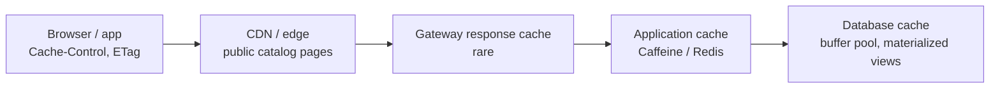
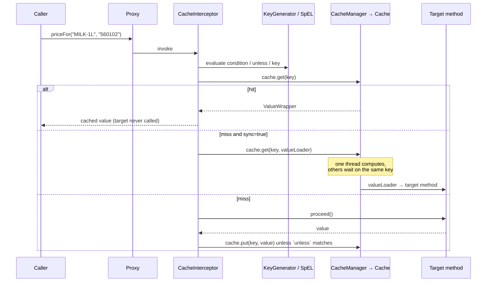
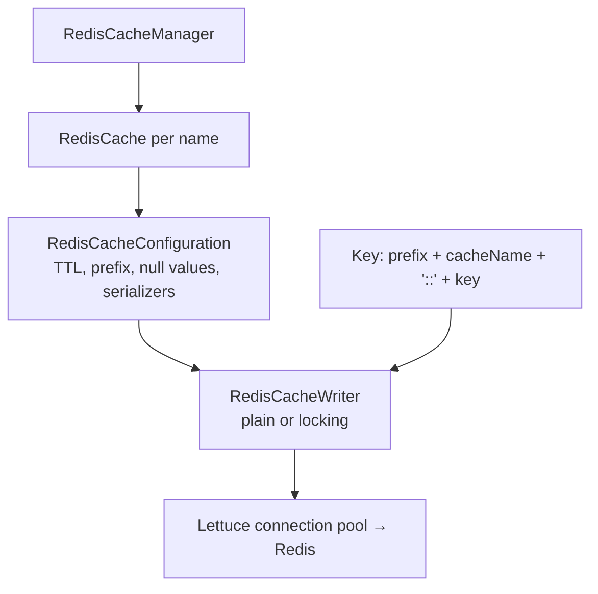
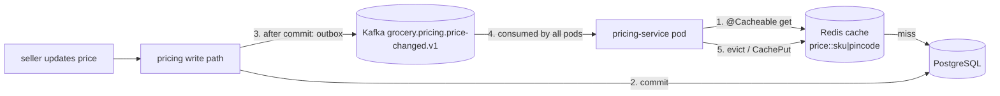

# 21 · Caching

## 1. Introduction & Why It Matters

On a normal evening the grocery catalog serves 12,000 product page views per minute. Prices depend on SKU **and** pincode (zone pricing, local taxes, hub-specific offers), so a naive implementation runs one pricing query per product per customer. During a Diwali sale that becomes 200,000 queries per minute against a database that comfortably handles 20,000.

Caching is how you serve the other 90% without buying nine more databases. Done well it is the highest-leverage performance work available. Done badly it produces the worst class of bug:

- A price drops at 6 p.m.; some pods keep charging the old price for an hour because their local caches never heard about it.
- A cached `null` for a SKU that existed five seconds later makes the product invisible until TTL expiry.
- A popular key expires during peak traffic and 4,000 concurrent requests all miss and hit the database at once — a **cache stampede** that takes the database down.
- Redis has a 200 ms hiccup; every request fails with `RedisConnectionFailureException` because the cache was allowed to break the request path.
- Two customers see each other's cart because the cache key forgot the customer id.

This chapter covers Spring's cache abstraction properly: annotations and their internals, Caffeine for local caching, Redis for shared caching, TTLs with jitter, stampede protection, event-driven invalidation across pods, negative caching, fail-open error handling, metrics, and a two-level cache where it's genuinely worth the complexity. HTTP-level caching (ETags, `Cache-Control`) from Chapters 08 and 20 is the cheapest cache of all and comes first.

### Who should read which section

| Band | Focus |
|---|---|
| B1 · 0–2 yrs | Parts 1, 2, 4 — `@Cacheable`, keys, TTL |
| B2 · 2–5 yrs | Parts 2, 5 — Caffeine vs Redis, eviction, conditions, serialization |
| B3 · 5–8 yrs | Parts 3, 5, 6 — internals, stampede, invalidation across pods, metrics |
| B4 · 8–12 yrs | Parts 6, 8 — cache architecture, failure modes, capacity |
| B5 · 12–15+ yrs | Parts 8, 9 — consistency trade-offs and when not to cache |

---

## 2. Core Concepts

### 2.1 What to cache

| Good candidates | Why |
|---|---|
| Reference data (categories, GST rate master, pincode → hub) | Rarely changes, read constantly |
| Computed prices per (sku, pincode) | Expensive, high reuse |
| Serviceability checks | Called on every cart mutation |
| Product detail projections | Read-heavy, tolerant of seconds of staleness |
| Idempotency/dedupe records | Naturally key-value with TTL (Chapters 04, 18) |

| Poor candidates | Why |
|---|---|
| Cart contents, stock counts | Change constantly; staleness causes real errors |
| Anything per-request unique | No reuse |
| Payment state | Correctness over speed |
| Data with legal accuracy requirements (invoices) | Read from the source |

### 2.2 Caching patterns

| Pattern | How | Notes |
|---|---|---|
| **Cache-aside (lazy)** | Read cache → miss → load → populate | Spring's `@Cacheable`; the default |
| **Write-through** | Write cache and store together | `@CachePut`; keeps cache warm, costs on every write |
| **Write-behind** | Write cache, flush to store later | Risk of loss; rare in application code |
| **Refresh-ahead** | Refresh hot entries before expiry | Caffeine `refreshAfterWrite`; hides latency |
| **Negative caching** | Cache "not found" briefly | Stops repeated misses hammering the store |

### 2.3 Spring's cache abstraction

| Piece | Role |
|---|---|
| `@EnableCaching` | Registers the caching AOP advisor |
| `CacheManager` | Provides named `Cache` instances |
| `Cache` | `get`, `put`, `evict`, `clear`, `get(key, valueLoader)` |
| `@Cacheable` | Return cached value if present, else invoke and store |
| `@CachePut` | Always invoke, then store the result |
| `@CacheEvict` | Remove entries (`key`, `allEntries`, `beforeInvocation`) |
| `@Caching` | Combine several of the above |
| `@CacheConfig` | Class-level defaults (cache names, key generator) |
| `KeyGenerator` | Builds keys when `key` isn't specified (`SimpleKeyGenerator`) |
| `CacheResolver` | Chooses caches dynamically |
| `CacheErrorHandler` | Decides what happens when the cache itself fails |

It's **AOP** (Chapter 04): public methods, no self-invocation, proxies only.

### 2.4 Keys

The default `SimpleKeyGenerator` builds a `SimpleKey` from all method arguments. That's convenient and dangerous:

- Adding a parameter silently changes the key space.
- Arguments must have correct `equals`/`hashCode` — and for Redis, a sane `toString()`, since keys become strings.

**Always specify keys explicitly** for anything shared: `@Cacheable(cacheNames = "price", key = "#sku + '|' + #pincode")`.

!!! danger "Forgetting the tenant/customer dimension"
    A key that omits the customer, seller or pincode dimension leaks data between users. Key design is a **security** decision, not just a performance one.

### 2.5 Local vs distributed

| | Caffeine (in-process) | Redis (shared) |
|---|---|---|
| Latency | ~100 ns | ~0.3–1 ms (network) |
| Consistency across pods | ❌ each pod has its own copy | ✅ one copy |
| Capacity | Heap-bound | Large, independent of pods |
| Survives restarts | ❌ | ✅ |
| Failure impact | None (in-process) | Needs fail-open handling |
| Invalidation | Hard (must broadcast) | Easy (delete the key) |

Rule of thumb: **Redis for anything that must be consistent across pods or must survive a restart; Caffeine for tiny, hot, tolerant-of-staleness data** — and only add a two-level cache when measurements justify it.

### 2.6 TTL, eviction and jitter

- **TTL** bounds staleness. Pick it from the business tolerance ("prices may lag by up to 60 s"), not from a vibe.
- **Size limits** bound memory: Caffeine `maximumSize` or `maximumWeight`.
- **Jitter**: identical TTLs make thousands of keys expire in the same second after a deploy or warm-up — add ±10–20% randomness.

### 2.7 Stampede (thundering herd)

When a hot key expires, every concurrent request misses. Defences:

| Technique | Where |
|---|---|
| `@Cacheable(sync = true)` | Per-key locking inside one JVM (Caffeine); Redis needs a locking cache writer |
| Distributed lock | One pod recomputes, others wait or serve stale |
| Refresh-ahead | Recompute before expiry (Caffeine `refreshAfterWrite`) |
| Stale-while-revalidate | Serve the old value, refresh asynchronously |
| Jittered TTL | Spreads expiries out |

### 2.8 Invalidation across pods

Local caches need a broadcast: Redis pub/sub or a Kafka topic that every pod consumes and uses to evict its local entries. Alternative: **versioned key prefixes** (`price:v42:{sku}|{pincode}`) — bumping the version invalidates everything at once without touching individual keys.

### 2.9 Cache failures must not break requests

By default a `CacheManager` exception propagates and fails the request. For a *cache*, that is almost never right: configure a `CacheErrorHandler` that logs, meters and continues to the underlying method.

### 2.10 Layers of caching



Always ask whether the layer to the **left** can handle it: an ETag that avoids the request entirely beats any server-side cache.

---

## 3. How It Works Internally

### 3.1 The caching interceptor



Key classes: `CacheInterceptor` (extends `CacheAspectSupport`), `AnnotationCacheOperationSource`, `SimpleKeyGenerator`, `CacheResolver`, `SimpleCacheErrorHandler`.

`@CacheEvict(beforeInvocation = true)` evicts **before** the method runs — useful when the method may throw but the cached value is already known to be wrong.

### 3.2 Where Redis fits



- **Serializers** decide the on-wire format. The value serializer is where JSON polymorphism risks live (Chapter 11) — prefer a **typed** serializer per cache over a generic one with default typing.
- The **locking** cache writer provides `sync = true` semantics across pods at the cost of extra round trips.

### 3.3 Caffeine

Window TinyLFU eviction (better hit rates than pure LRU for skewed workloads), `expireAfterWrite`/`expireAfterAccess`, `maximumSize`/`maximumWeight`, `refreshAfterWrite` with a `CacheLoader`, and statistics when `recordStats()` is enabled (needed for Micrometer metrics).

---

## 4. Hands-On Code — Level 1 (Beginner)

### 4.1 Enable caching with Caffeine

```kotlin title="build.gradle.kts"
implementation("org.springframework.boot:spring-boot-starter-cache")
implementation("com.github.ben-manes.caffeine:caffeine")
```

```yaml title="application.yml"
spring:
  cache:
    type: caffeine
    cache-names: categories, pincode-hubs
    caffeine:
      spec: maximumSize=5000,expireAfterWrite=10m,recordStats      # (1)!
```

1. `recordStats` is required for cache metrics (Chapter 27).

```java title="in/grocery/catalog/config/CachingConfig.java"
@Configuration(proxyBeanMethods = false)
@EnableCaching                                                      // (1)!
class CachingConfig {}
```

1. Without it, the annotations do nothing — silently.

### 4.2 A first cached method

```java title="in/grocery/catalog/service/CategoryService.java"
package in.grocery.catalog.service;

import java.util.List;
import org.springframework.cache.annotation.CacheEvict;
import org.springframework.cache.annotation.Cacheable;
import org.springframework.stereotype.Service;
import org.springframework.transaction.annotation.Transactional;

@Service
public class CategoryService {

    private final CategoryRepository categories;

    public CategoryService(CategoryRepository categories) {
        this.categories = categories;
    }

    @Cacheable(cacheNames = "categories", key = "'active'")                       // (1)!
    @Transactional(readOnly = true)
    public List<CategoryView> activeCategories() {
        return categories.findByActiveTrueOrderByNameAsc().stream().map(CategoryView::from).toList();
    }

    @CacheEvict(cacheNames = "categories", allEntries = true)                     // (2)!
    @Transactional
    public void rename(String slug, String newName) {
        categories.findBySlug(slug).orElseThrow().rename(newName);
    }
}
```

1. A single-entry cache needs an explicit constant key (a no-arg method would otherwise use `SimpleKey.EMPTY`, which works but is less readable).
2. Category lists are small and change rarely — evicting everything is simplest and safe here.

!!! warning "Evict after commit"
    `@CacheEvict` runs when the method returns — which, inside a transaction, is **before commit**. Another thread can repopulate the cache from pre-commit state. For write paths, either evict after commit (Chapter 16's synchronization or a `@TransactionalEventListener`), or accept the short window for tolerant data.

### 4.3 Seeing it work

```java title="CategoryServiceCacheTest.java"
@SpringBootTest
@Import(ContainersConfig.class)
class CategoryServiceCacheTest {

    @Autowired CategoryService service;
    @Autowired CacheManager cacheManager;
    @MockitoSpyBean CategoryRepository categories;                                // (1)!

    @BeforeEach
    void clear() {
        cacheManager.getCache("categories").clear();
    }

    @Test
    void secondCallIsServedFromCache() {
        service.activeCategories();
        service.activeCategories();

        then(categories).should(times(1)).findByActiveTrueOrderByNameAsc();        // (2)!
    }
}
```

1. A spy on the real repository counts actual database calls.
2. The point of a caching test: **the expensive thing happened once**.

---

## 5. Hands-On Code — Level 2 (Intermediate) & Level 3 (Advanced)

### 5.1 Level 2 — Redis cache with per-cache configuration

```kotlin title="build.gradle.kts"
implementation("org.springframework.boot:spring-boot-starter-data-redis")
```

```yaml title="application.yml"
spring:
  data:
    redis:
      host: redis
      port: 6379
      timeout: 200ms                      # (1)!
      lettuce:
        pool:
          max-active: 16
          max-wait: 100ms
  cache:
    type: redis
    redis:
      key-prefix: "grocery:"
      use-key-prefix: true
      time-to-live: 5m
      cache-null-values: true             # (2)!
      enable-statistics: true             # (3)!
```

1. A cache must never be slower than the thing it caches — a tight timeout plus fail-open handling (5.5) makes Redis latency a non-event.
2. Negative caching, so a missing SKU doesn't hit the database repeatedly.
3. Required for Micrometer cache metrics with Redis.

```java title="in/grocery/pricing/config/RedisCacheConfig.java"
package in.grocery.pricing.config;

import java.time.Duration;
import java.util.Map;
import org.springframework.boot.autoconfigure.cache.RedisCacheManagerBuilderCustomizer;
import org.springframework.context.annotation.Bean;
import org.springframework.context.annotation.Configuration;
import org.springframework.data.redis.cache.RedisCacheConfiguration;
import org.springframework.data.redis.serializer.Jackson2JsonRedisSerializer;
import org.springframework.data.redis.serializer.RedisSerializationContext;
import org.springframework.data.redis.serializer.StringRedisSerializer;

@Configuration(proxyBeanMethods = false)
class RedisCacheConfig {

    @Bean
    RedisCacheManagerBuilderCustomizer cacheCustomizer(com.fasterxml.jackson.databind.ObjectMapper mapper) {
        RedisCacheConfiguration base = RedisCacheConfiguration.defaultCacheConfig()
                .serializeKeysWith(RedisSerializationContext.SerializationPair.fromSerializer(new StringRedisSerializer()))
                .disableCachingNullValues();

        return builder -> builder
                .withCacheConfiguration("price", typed(base, mapper, PriceView.class).entryTtl(Duration.ofMinutes(2)))   // (1)!
                .withCacheConfiguration("serviceability", base.entryTtl(Duration.ofHours(6)))
                .withCacheConfiguration("product-detail", typed(base, mapper, ProductDetailView.class)
                        .entryTtl(Duration.ofMinutes(15)))
                .withInitialCacheConfigurations(Map.of());
    }

    private static <T> RedisCacheConfiguration typed(RedisCacheConfiguration base,
                                                     com.fasterxml.jackson.databind.ObjectMapper mapper,
                                                     Class<T> type) {
        var serializer = new Jackson2JsonRedisSerializer<>(mapper, type);                                                // (2)!
        return base.serializeValuesWith(RedisSerializationContext.SerializationPair.fromSerializer(serializer));
    }
}
```

1. **Per-cache TTLs**: prices may lag two minutes, serviceability six hours.
2. A **typed** serializer per cache — no polymorphic type information in the payload, so a poisoned cache entry can't instantiate arbitrary classes (Chapter 11). On Boot 4 the Jackson 3 equivalents apply; **verify** class names.

### 5.2 Level 2 — Keys, conditions and `unless`

```java title="in/grocery/pricing/service/PricingService.java"
package in.grocery.pricing.service;

import java.util.List;
import org.springframework.cache.annotation.CacheConfig;
import org.springframework.cache.annotation.CacheEvict;
import org.springframework.cache.annotation.CachePut;
import org.springframework.cache.annotation.Cacheable;
import org.springframework.stereotype.Service;

@Service
@CacheConfig(cacheNames = "price")
public class PricingService {

    private final PriceRepository prices;
    private final GstCalculator gst;

    public PricingService(PriceRepository prices, GstCalculator gst) {
        this.prices = prices;
        this.gst = gst;
    }

    @Cacheable(key = "#sku + '|' + #pincode",                                     // (1)!
               condition = "#pincode != null",                                    // (2)!
               unless = "#result == null || #result.promotional()",               // (3)!
               sync = true)                                                       // (4)!
    public PriceView priceFor(String sku, String pincode) {
        return prices.findPrice(sku, pincode).map(p -> PriceView.of(p, gst)).orElse(null);
    }

    @CachePut(key = "#sku + '|' + #pincode")                                      // (5)!
    public PriceView refresh(String sku, String pincode) {
        return prices.findPrice(sku, pincode).map(p -> PriceView.of(p, gst)).orElse(null);
    }

    @CacheEvict(key = "#sku + '|' + #pincode")
    public void evict(String sku, String pincode) {}

    @CacheEvict(allEntries = true)
    public void evictAll() {}
}
```

1. Explicit key including **every** dimension that changes the result.
2. Don't cache when a required dimension is missing.
3. Don't cache flash-sale prices that change minute to minute.
4. One computation per key per JVM under concurrency.
5. `@CachePut` always executes and refreshes the entry — used by the invalidation listener (6.2).

!!! warning "`sync = true` limitations"
    `sync` can't be combined with `unless`, multiple cache names or `@CachePut` on the same method, and its guarantee is **per JVM** unless the cache implementation locks globally (Redis needs a locking cache writer). Chapter 26's bulkheads and 6.3's stale-while-revalidate cover the distributed case.

### 5.3 Level 2 — Self-invocation strikes again

```java title="Broken"
@Service
public class CatalogService {

    public CartQuote quote(List<String> skus, String pincode) {
        return skus.stream().map(sku -> priceFor(sku, pincode))    // ❌ this.priceFor → no cache
                   .collect(...);
    }

    @Cacheable(cacheNames = "price", key = "#sku + '|' + #pincode")
    public PriceView priceFor(String sku, String pincode) { ... }
}
```

The bulk path bypasses the cache entirely (Chapter 04). Fix by moving `priceFor` into a `PricingService` bean and injecting it — the structure used in 5.2.

### 5.4 Level 3 — Stampede protection and jittered TTL

```java title="in/grocery/pricing/cache/JitteredTtlCacheConfig.java"
@Bean
RedisCacheManagerBuilderCustomizer jitteredTtl() {
    return builder -> builder.withCacheConfiguration("price",
            RedisCacheConfiguration.defaultCacheConfig()
                    .entryTtl(key -> Duration.ofSeconds(120 + ThreadLocalRandom.current().nextInt(-20, 21))));   // (1)!
}
```

1. Per-entry TTL functions are supported in recent Spring Data Redis versions — **verify** the API; otherwise apply jitter by writing entries through the `Cache` API with an explicit TTL, or randomize at warm-up time.

**Stale-while-revalidate** for the hottest keys:

```java title="in/grocery/pricing/cache/StaleWhileRevalidatePriceCache.java"
package in.grocery.pricing.cache;

import java.time.Clock;
import java.time.Duration;
import java.time.Instant;
import java.util.concurrent.Executor;
import org.springframework.data.redis.core.RedisTemplate;
import org.springframework.stereotype.Component;

@Component
public class StaleWhileRevalidatePriceCache {

    public record Entry(PriceView value, Instant freshUntil) {}

    private final RedisTemplate<String, Entry> redis;
    private final PriceLoader loader;
    private final Executor refreshExecutor;
    private final Clock clock;

    public PriceView get(String sku, String pincode) {
        String key = "price:" + sku + "|" + pincode;
        Entry entry = redis.opsForValue().get(key);
        if (entry == null) {
            return load(key, sku, pincode);                                        // (1)!
        }
        if (clock.instant().isAfter(entry.freshUntil())) {
            refreshExecutor.execute(() -> load(key, sku, pincode));                // (2)!
        }
        return entry.value();
    }

    private PriceView load(String key, String sku, String pincode) {
        PriceView value = loader.load(sku, pincode);
        redis.opsForValue().set(key, new Entry(value, clock.instant().plusSeconds(120)),
                Duration.ofMinutes(10));                                            // (3)!
        return value;
    }
}
```

1. Cold miss: load synchronously (protect with a lock or `sync` if the loader is expensive).
2. **Stale but usable**: return immediately, refresh in the background — no request ever waits for an expiry, so no stampede.
3. Two horizons: `freshUntil` (2 min) governs refresh, the Redis TTL (10 min) governs hard expiry.

### 5.5 Level 3 — Fail open when the cache is down

```java title="in/grocery/platform/cache/ResilientCacheConfig.java"
package in.grocery.platform.cache;

import io.micrometer.core.instrument.MeterRegistry;
import org.slf4j.Logger;
import org.slf4j.LoggerFactory;
import org.springframework.cache.Cache;
import org.springframework.cache.annotation.CachingConfigurer;
import org.springframework.cache.interceptor.CacheErrorHandler;
import org.springframework.context.annotation.Bean;
import org.springframework.context.annotation.Configuration;

@Configuration(proxyBeanMethods = false)
public class ResilientCacheConfig implements CachingConfigurer {                    // (1)!

    private static final Logger log = LoggerFactory.getLogger(ResilientCacheConfig.class);

    private final MeterRegistry meters;

    public ResilientCacheConfig(MeterRegistry meters) {
        this.meters = meters;
    }

    @Bean
    @Override
    public CacheErrorHandler errorHandler() {
        return new CacheErrorHandler() {
            @Override public void handleCacheGetError(RuntimeException e, Cache cache, Object key) { record("get", cache, e); }
            @Override public void handleCachePutError(RuntimeException e, Cache cache, Object key, Object value) { record("put", cache, e); }
            @Override public void handleCacheEvictError(RuntimeException e, Cache cache, Object key) { record("evict", cache, e); }
            @Override public void handleCacheClearError(RuntimeException e, Cache cache) { record("clear", cache, e); }

            private void record(String op, Cache cache, RuntimeException e) {
                meters.counter("grocery.cache.errors", "cache", cache.getName(), "op", op,
                        "exception", e.getClass().getSimpleName()).increment();
                log.warn("Cache {} {} failed: {}", cache.getName(), op, e.toString());   // (2)!
            }
        };
    }
}
```

1. Implementing `CachingConfigurer` replaces the default `SimpleCacheErrorHandler`, which rethrows.
2. Swallow, meter, continue — the request goes to the database instead of failing. **Alert on the error counter**: a silently broken cache shows up as database load, not as errors.

!!! danger "Fail open is not always right"
    For a cache that protects an expensive third-party API with strict quotas, failing open can blow the quota. Decide per cache: fail open (most), or fail closed with a fallback value.

### 5.6 Level 3 — Metrics

```yaml title="application.yml"
management:
  metrics:
    enable:
      cache: true
```

With `recordStats` (Caffeine) or `enable-statistics` (Redis) and caches registered in the `CacheManager` at startup, Boot exposes:

| Metric | Meaning |
|---|---|
| `cache.gets{result=hit\|miss}` | Hit ratio — the headline number |
| `cache.puts`, `cache.evictions` | Write and eviction volume |
| `cache.size` | Entries (Caffeine) |
| `cache.lock.duration` (Redis) | Time spent in locking writers |
| `grocery.cache.errors` (ours) | Cache infrastructure failures |

A cache below ~70% hit rate is usually mis-keyed, too small, or caching the wrong thing.

---

## 6. Hands-On Code — Level 4 (Expert / Production)

### 6.1 The pricing cache end to end

Requirements: 2-minute staleness budget, immediate invalidation when a seller changes a price, no stampede, works across 6 pods, survives Redis outages, measurable.



```java title="in/grocery/pricing/service/PriceUpdateService.java"
package in.grocery.pricing.service;

import in.grocery.pricing.outbox.OutboxWriter;
import org.springframework.stereotype.Service;
import org.springframework.transaction.annotation.Transactional;

@Service
public class PriceUpdateService {

    private final PriceRepository prices;
    private final OutboxWriter outbox;

    public PriceUpdateService(PriceRepository prices, OutboxWriter outbox) {
        this.prices = prices;
        this.outbox = outbox;
    }

    @Transactional
    public void updatePrice(String sku, String zone, java.math.BigDecimal newPrice) {
        prices.update(sku, zone, newPrice);
        outbox.append("price", sku, "PriceChanged", new PriceChanged(sku, zone));        // (1)!
    }
}
```

1. The invalidation event is written **in the same transaction** as the price (Chapter 16) — a price change can never be committed without its invalidation being published.

```java title="in/grocery/pricing/cache/PriceCacheInvalidator.java"
package in.grocery.pricing.cache;

import io.micrometer.core.instrument.MeterRegistry;
import java.util.List;
import org.springframework.cache.CacheManager;
import org.springframework.kafka.annotation.KafkaListener;
import org.springframework.stereotype.Component;

@Component
public class PriceCacheInvalidator {

    private final CacheManager caches;
    private final PincodeDirectory pincodes;
    private final MeterRegistry meters;

    public PriceCacheInvalidator(CacheManager caches, PincodeDirectory pincodes, MeterRegistry meters) {
        this.caches = caches;
        this.pincodes = pincodes;
        this.meters = meters;
    }

    @KafkaListener(topics = "grocery.pricing.price-changed.v1", groupId = "${spring.application.name}-cache")  // (1)!
    public void onPriceChanged(PriceChanged event) {
        var cache = caches.getCache("price");
        if (cache == null) return;
        List<String> affected = pincodes.pincodesInZone(event.zone());                    // (2)!
        affected.forEach(pincode -> cache.evict(event.sku() + "|" + pincode));
        meters.counter("grocery.cache.invalidations", "cache", "price").increment(affected.size());
    }
}
```

1. **Every pod** consumes (unique group per instance isn't needed for a shared Redis cache — one eviction suffices; for **local** caches each pod must consume independently, so the group id must be per-instance).
2. The cache key includes the pincode, but prices change per zone — the invalidator expands zone → pincodes. A **versioned key** (`price:v{zoneVersion}:{sku}|{pincode}`) is the alternative when that expansion gets large.

!!! tip "Key-space design determines invalidation cost"
    If invalidating one logical change means deleting 4,000 keys, redesign the key: either cache per zone (`price:{sku}|{zone}`) with a cheap pincode→zone lookup, or embed a version in the prefix so one counter bump invalidates everything.

### 6.2 Two-level cache where it pays

Serviceability (`pincode → serviceable`) is queried on **every** cart mutation, changes weekly, and has ~19,000 keys — ideal for a local cache with a Redis backstop.

```java title="in/grocery/delivery/cache/TwoLevelServiceabilityCache.java"
package in.grocery.delivery.cache;

import com.github.benmanes.caffeine.cache.Caffeine;
import java.time.Duration;
import java.util.concurrent.TimeUnit;
import org.springframework.data.redis.core.StringRedisTemplate;
import org.springframework.stereotype.Component;

@Component
public class TwoLevelServiceabilityCache {

    private final com.github.benmanes.caffeine.cache.Cache<String, Boolean> local = Caffeine.newBuilder()
            .maximumSize(25_000)
            .expireAfterWrite(10, TimeUnit.MINUTES)                                        // (1)!
            .recordStats()
            .build();

    private final StringRedisTemplate redis;
    private final ServiceabilityLoader loader;

    public boolean isServiceable(String pincode) {
        Boolean cached = local.getIfPresent(pincode);
        if (cached != null) return cached;

        String fromRedis = redis.opsForValue().get("svc:" + pincode);                      // (2)!
        if (fromRedis != null) {
            boolean value = Boolean.parseBoolean(fromRedis);
            local.put(pincode, value);
            return value;
        }
        boolean value = loader.load(pincode);
        redis.opsForValue().set("svc:" + pincode, String.valueOf(value), Duration.ofHours(6));
        local.put(pincode, value);
        return value;
    }

    /** Invoked by the Kafka listener on every pod when serviceability changes. */
    public void invalidate(String pincode) {
        local.invalidate(pincode);                                                          // (3)!
        redis.delete("svc:" + pincode);
    }
}
```

1. Local TTL is the **maximum staleness** if an invalidation message is missed — keep it short enough to be a safety net (10 min), long enough to be useful.
2. L1 miss → L2 → source. Each layer populates the ones above it.
3. Local invalidation must happen on **every pod**, so the Kafka consumer group id is per-instance (`${spring.application.name}-${random.uuid}`) — a broadcast, not a queue.

!!! warning "Two levels double the failure modes"
    Only add L1 when you've measured that L2 latency matters (e.g. 3 Redis round trips per request in a hot path). Most caches should be single-level.

### 6.3 Warm-up

```java title="in/grocery/pricing/startup/PriceCacheWarmer.java"
@Component
@Order(20)
class PriceCacheWarmer implements ApplicationRunner {                                      // (1)!

    @Override
    public void run(ApplicationArguments args) {
        List<String> topSkus = analytics.topSkus(2_000);
        List<String> topPincodes = analytics.topPincodes(50);
        topSkus.forEach(sku -> topPincodes.forEach(pincode -> pricing.refresh(sku, pincode)));   // (2)!
        log.info("Warmed {} price entries", topSkus.size() * topPincodes.size());
    }
}
```

1. Runs before readiness (Chapter 03), so the pod doesn't take traffic with an empty cache.
2. `@CachePut` populates without serving. Cap the work (100k entries here — at ~1 ms each that's minutes; in practice warm the top 200 SKUs × 20 pincodes, or warm asynchronously with readiness gating only on a subset).

### 6.4 Testing cache behaviour

```java title="PriceCacheIntegrationTest.java"
@SpringBootTest
@Import({ContainersConfig.class, RedisContainerConfig.class})
class PriceCacheIntegrationTest {

    @Autowired PricingService pricing;
    @Autowired CacheManager caches;
    @MockitoSpyBean PriceRepository repository;

    @BeforeEach
    void clear() {
        caches.getCache("price").clear();
        Mockito.clearInvocations(repository);
    }

    @Test
    void secondReadHitsCache() {
        pricing.priceFor("MILK-1L", "560102");
        pricing.priceFor("MILK-1L", "560102");
        then(repository).should(times(1)).findPrice("MILK-1L", "560102");
    }

    @Test
    void differentPincodeIsADifferentKey() {                                                // (1)!
        pricing.priceFor("MILK-1L", "560102");
        pricing.priceFor("MILK-1L", "400001");
        then(repository).should(times(2)).findPrice(any(), any());
    }

    @Test
    void invalidationRemovesEntry() {
        pricing.priceFor("MILK-1L", "560102");
        invalidator.onPriceChanged(new PriceChanged("MILK-1L", "BLR"));
        pricing.priceFor("MILK-1L", "560102");
        then(repository).should(times(2)).findPrice("MILK-1L", "560102");
    }

    @Test
    void concurrentMissesLoadOnce() throws Exception {                                      // (2)!
        try (var pool = Executors.newVirtualThreadPerTaskExecutor()) {
            var futures = IntStream.range(0, 50)
                    .mapToObj(i -> pool.submit(() -> pricing.priceFor("ATTA-5KG", "560102")))
                    .toList();
            for (var f : futures) f.get();
        }
        then(repository).should(atMost(2)).findPrice("ATTA-5KG", "560102");                 // (3)!
    }

    @Test
    void redisOutageDoesNotBreakRequests() {                                                 // (4)!
        redisContainer.stop();
        assertThatCode(() -> pricing.priceFor("MILK-1L", "560102")).doesNotThrowAnyException();
        redisContainer.start();
    }
}
```

1. The key test nobody writes — and the reason customers occasionally see another city's price.
2. Stampede behaviour under concurrency.
3. `sync = true` gives one load per JVM; allow a small margin for races at the boundary.
4. Proves the fail-open handler. (Restart the container afterwards for other tests, or run this one last / in isolation.)

### 6.5 Capacity and cost

| Question | How to answer |
|---|---|
| How many keys? | SKUs × pincodes (or zones) × variants — compute it before choosing Redis instance size |
| How big is a value? | Serialize a real object and measure; multiply |
| What hit rate justifies it? | (misses × source cost) vs (cache cost + complexity) |
| What's the memory ceiling? | Redis `maxmemory` + `allkeys-lru` policy so it degrades instead of OOMs |
| What if the cache is empty? | The database must survive a cold start — test it (that's what a deploy does) |

The last row is the one that causes outages: **a system that only works with a warm cache is a system that fails on every restart.**

---

## 7. Spring Boot 3 vs 4 & Migration

| Topic | Boot 3.5 | Boot 4.x |
|---|---|---|
| Cache abstraction | Unchanged | Unchanged |
| Redis cache config | `spring.cache.redis.*`, `RedisCacheManagerBuilderCustomizer` | Same (module/package moves — verify) |
| Serializers | Jackson 2 (`Jackson2JsonRedisSerializer`, `GenericJackson2JsonRedisSerializer`) | Jackson 3 equivalents (verify names) |
| Caffeine | `spring.cache.caffeine.spec` | Same |
| Metrics | `cache.*` meters | Same |
| Test slices | `@DataRedisTest` | Moved to Redis test module (verify) |

=== "Spring Boot 3.5"

    ```java title="Spring Boot 3.5 (snippet)"
    var serializer = new Jackson2JsonRedisSerializer<>(objectMapper, PriceView.class);
    ```

=== "Spring Boot 4.x"

    ```java title="name.java"
    // Jackson 3 serializer equivalent — verify the class name/package in Spring Data Redis for Boot 4.
    // Values written by 3.5 pods must remain readable by 4.x pods during the rollout (see below).
    ```

!!! danger "Cached values are a cross-version contract"
    During a rolling upgrade, Boot 3.5 and Boot 4 pods read each other's cache entries. If the serializer or JSON defaults change, one side sees corrupt data. Safest path: **version the cache key prefix** for the upgrade (`grocery:v2:`) so each version populates its own namespace, then drop the old prefix afterwards.

### Migration checklist

- [ ] Inventory cache names, TTLs, serializers and key patterns.
- [ ] Bump the key prefix for the upgrade window; plan the cleanup.
- [ ] Re-verify serializer classes and that no cache uses polymorphic default typing.
- [ ] Re-run cache tests (hit/miss counts, invalidation) after the upgrade.
- [ ] Check metric names and dashboards still resolve.

---

## 8. Production Playbook

### Best practices

1. **Cache the expensive and reusable**; measure before and after.
2. **Explicit keys with every dimension** (sku, pincode, customer, tenant, version).
3. **TTL from the business staleness budget**, with jitter.
4. **Stampede protection** (`sync`, stale-while-revalidate, or a lock) on hot keys.
5. **Event-driven invalidation** written in the same transaction as the change.
6. **Fail open** with a `CacheErrorHandler` and alert on cache error counters.
7. **Typed serializers**; never polymorphic default typing.
8. **Metrics on hit rate, size, evictions, errors**; alert on hit-rate drops.
9. **Design for a cold cache** — every deploy is one.
10. **Prefer HTTP caching** (ETag, `Cache-Control`, CDN) where the data is public.

### Anti-patterns

❌ `@Cacheable` without `@EnableCaching` — silently does nothing.

❌ Default keys on multi-argument methods — invisible key-space bugs and data leaks.

❌ Caching mutable objects and mutating them afterwards (Caffeine stores references!).

❌ `@CacheEvict(allEntries = true)` on a hot cache for a single-row change — self-inflicted stampede.

❌ Caching inside a transaction and evicting before commit.

❌ Local caches for data that must be consistent across pods.

❌ Infinite TTLs "because we invalidate properly" — you will miss an event.

❌ Making the cache mandatory (no fallback path) — an outage becomes total.

❌ Caching personal data in a shared cache without the customer in the key.

### Troubleshooting

| Symptom | Cause | Fix |
|---|---|---|
| Cache has no effect | `@EnableCaching` missing; self-invocation; non-public method | Fix wiring/structure |
| Hit rate near zero | Key includes a unique value (timestamp, request id) | Fix the key |
| Stale prices after a change | Missed/absent invalidation; local cache; evict before commit | Event-driven eviction after commit; shorter TTL |
| Latency spike every N minutes | Synchronized TTL expiry | Jitter; refresh-ahead |
| Database spike after deploy | Cold cache | Warm-up; ensure DB survives cold start |
| `RedisConnectionFailureException` in responses | No `CacheErrorHandler` | Fail open, meter, alert |
| `SerializationException` after a deploy | Changed DTO or serializer | Versioned key prefix; tolerant DTOs |
| Memory grows until OOM | Unbounded Caffeine cache | `maximumSize`/`maximumWeight` + TTL |
| Customer sees another's data | Key missing a dimension | Add it; audit all keys |
| Redis memory full | No `maxmemory` policy | `allkeys-lru`, size the instance, shorter TTLs |

### Production checklist

- [ ] Every cache has a documented purpose, key format, TTL and invalidation path
- [ ] Keys include all identity/tenant dimensions
- [ ] Hot caches have stampede protection and jittered TTLs
- [ ] `CacheErrorHandler` installed; error counter alerted on
- [ ] Hit-rate dashboards per cache, with alerts
- [ ] Typed serializers, no default typing
- [ ] Cold-start behaviour tested (cache flush in staging under load)
- [ ] Redis `maxmemory` + eviction policy set; capacity computed

---

## 9. Interview Questions & Answers

### B1 · 0–2 years

??? question "B1 · How do you cache a method result in Spring?"
    **Short answer:** `@EnableCaching` plus `@Cacheable(cacheNames = "...", key = "...")` on a public method of a Spring bean.

??? question "B1 · `@Cacheable` vs `@CachePut` vs `@CacheEvict`?"
    **Short answer:** `@Cacheable` skips the method on a hit; `@CachePut` always runs and stores the result; `@CacheEvict` removes entries.

??? question "B1 · What is the default cache key?"
    **Short answer:** A `SimpleKey` built from all method arguments (no-args → `SimpleKey.EMPTY`). Specify keys explicitly for shared caches.

??? question "B1 · Why does my `@Cacheable` method still hit the database?"
    **Short answer:** Missing `@EnableCaching`, self-invocation, a non-public method, a `condition`/`unless` that excludes it, or a key that's different every call.

??? question "B1 · Caffeine vs Redis in one sentence?"
    **Short answer:** Caffeine is a fast in-process cache private to each pod; Redis is a shared network cache all pods see.

### B2 · 2–5 years

??? question "B2 · How do you set different TTLs per cache?"
    **Short answer:** With Redis, per-cache `RedisCacheConfiguration` via `RedisCacheManagerBuilderCustomizer`; with Caffeine, per-cache specs or separate `CaffeineCacheManager` configurations.

??? question "B2 · What is a cache stampede and how do you prevent it?"
    **Short answer:** Many concurrent requests missing the same expired hot key and all hitting the source. Prevent with `sync = true`/locking, refresh-ahead, stale-while-revalidate and jittered TTLs.

??? question "B2 · How do you invalidate caches across multiple pods?"
    **Short answer:** Shared cache (Redis) — delete the key once. Local caches — broadcast an event (Kafka/Redis pub/sub) that every pod consumes, or use versioned key prefixes.

??? question "B2 · Should you cache nulls?"
    **Short answer:** Often yes, briefly, to stop repeated misses for non-existent keys — but with a short TTL and explicit invalidation when the entity is created.

??? question "B2 · How do you verify caching in tests?"
    **Short answer:** Spy on the underlying repository/client and assert the number of invocations across repeated calls, plus tests for key separation and invalidation.

### B3 · 5–8 years

??? question "B3 · How does the caching interceptor work?"
    **Short answer:** `CacheInterceptor` (AOP) resolves cache operations per method, evaluates `condition`, computes the key (SpEL or `KeyGenerator`), consults the `Cache`, and on a miss invokes the target and stores the result unless `unless` matches. `sync` uses `cache.get(key, valueLoader)` for per-key locking.

??? question "B3 · What are the risks of the Redis value serializer?"
    **Short answer:** Generic serializers with default typing allow arbitrary class instantiation from cached payloads (deserialization attacks) and break on DTO changes. Use typed serializers per cache and version key prefixes across incompatible changes.

??? question "B3 · Where should eviction happen relative to the transaction?"
    **Short answer:** After commit. Evicting before commit lets another thread repopulate from pre-commit state; use transaction synchronization or an after-commit event.

??? question "B3 · When is a two-level cache worth it?"
    **Short answer:** When L2 (network) latency is significant in a hot path and the data tolerates the L1 staleness window. It doubles invalidation complexity, so measure first.

??? question "B3 · What happens when Redis is unavailable?"
    **Short answer:** By default cache operations throw and fail requests. With a `CacheErrorHandler` the request falls through to the source — as long as the source can carry the load, which must be capacity-tested.

### B4 · 8–12 years

??? question "B4 · Design the caching strategy for the catalog and pricing services."
    **Short answer:** HTTP caching/CDN for public catalog pages; Redis cache for computed prices keyed by sku+zone with a 2-minute staleness budget, jittered TTL and stale-while-revalidate; invalidation events emitted transactionally on price changes; local cache only for tiny hot reference data with broadcast invalidation; fail-open handling, metrics and cold-start capacity planning.

??? question "B4 · How do you decide TTLs?"
    **Short answer:** From business tolerance (how wrong may this be, for how long?) combined with change frequency and invalidation reliability. Short TTLs where invalidation may be missed; longer TTLs where events are reliable and the data is stable.

??? question "B4 · Your database is at 90% CPU and someone proposes 'just add caching'. Response?"
    **Short answer:** Measure first: which queries, what reuse, what staleness is acceptable? Caching helps repeated reads, not unique or write-heavy load. Also fix the obvious (indexes, N+1, pagination). And verify the database can still survive a cold cache — otherwise you've added a new single point of failure.

### B5 · 12–15+ years

??? question "B5 · What are the organizational risks of caching?"
    **Short answer:** Invisible coupling (services depend on another's cache semantics), staleness bugs that appear only in production, capacity hidden behind a cache until it's flushed, and "cache as a fix" replacing real performance work. Mitigate with documented cache contracts, ownership, dashboards and periodic cold-start tests.

??? question "B5 · When would you deliberately not cache?"
    **Short answer:** When correctness beats latency (payments, stock at reservation), when reuse is low, when invalidation can't be made reliable, or when the added failure mode outweighs the gain. Sometimes the right fix is a better query, a denormalized read model, or a CDN.

### Scenario questions

??? example "Scenario · Customers charged yesterday's price after a nationwide price drop"
    Prices were cached locally in Caffeine on six pods with a 30-minute TTL and no invalidation. Fixes: move the price cache to Redis (single copy), emit `PriceChanged` transactionally, consume it to evict, cut the TTL to two minutes as a safety net, and add a test asserting invalidation.

??? example "Scenario · Every deploy causes a 90-second database CPU spike"
    Cold caches across all pods at once. Fixes: warm the top keys in an `ApplicationRunner` before readiness, stagger pod rollout (`maxSurge`/`maxUnavailable`), keep the shared Redis cache warm across deploys (it isn't restarted), and load-test the cold path so the database can survive it.

### Coding exercise

!!! example "Exercise · Serviceability cache"
    Cache `isServiceable(pincode)` in Redis with a 6-hour TTL, negative caching, `sync` behaviour for stampedes and invalidation via a `ServiceabilityChanged` event. Write tests for: hit/miss counts, key separation, invalidation, and Redis being down.

??? success "Solution"
    ```java title="ServiceabilityService.java"
    @Service
    public class ServiceabilityService {

        private final ServiceabilityRepository repository;

        @Cacheable(cacheNames = "serviceability", key = "#pincode", sync = true)
        public boolean isServiceable(String pincode) {
            return repository.findHubFor(pincode).isPresent();          // false is cached too
        }

        @CacheEvict(cacheNames = "serviceability", key = "#pincode")
        public void evict(String pincode) {}
    }
    ```

    ```java title="ServiceabilityCacheConfig.java"
    @Bean
    RedisCacheManagerBuilderCustomizer serviceabilityCache() {
        return builder -> builder.withCacheConfiguration("serviceability",
                RedisCacheConfiguration.defaultCacheConfig()
                        .entryTtl(Duration.ofHours(6))
                        .serializeKeysWith(SerializationPair.fromSerializer(new StringRedisSerializer()))
                        .serializeValuesWith(SerializationPair.fromSerializer(
                                new Jackson2JsonRedisSerializer<>(objectMapper, Boolean.class))));
    }
    ```

    ```java title="ServiceabilityChangedListener.java"
    @KafkaListener(topics = "grocery.delivery.serviceability-changed.v1",
                   groupId = "${spring.application.name}-serviceability-cache")
    public void onChanged(ServiceabilityChanged event) {
        serviceability.evict(event.pincode());
    }
    ```

    ```java title="ServiceabilityCacheTest.java (assertions)"
    @Test void cachesPositiveAndNegativeResults() { /* 2 calls per pincode → 1 repository hit each */ }
    @Test void distinctPincodesAreDistinctKeys() { /* 2 repository hits */ }
    @Test void eventEvictsEntry() { /* after event → repository hit again */ }
    @Test void redisDownStillAnswers() { /* stop container → no exception, repository called */ }
    ```

    Note that `sync = true` here protects a single JVM. Because the underlying query is a cheap indexed lookup, that's enough; for an expensive computation, add a distributed lock or stale-while-revalidate (5.4).

---

## Key Takeaways

- Cache what is **expensive and reused**; measure before and after.
- **Keys carry every dimension** — a missing dimension is a correctness *and* security bug.
- **TTL = staleness budget**, with jitter; invalidate via events written in the same transaction as the change.
- **Stampede protection** for hot keys: `sync`, refresh-ahead or stale-while-revalidate.
- **Fail open** on cache errors, meter them, and make sure the source survives a cold cache.
- **Redis for cross-pod consistency**, Caffeine for tiny hot data; two levels only with evidence.
- **Typed serializers, versioned key prefixes** across upgrades — cached data is a contract.
- **HTTP caching first** where the data is public and cacheable.

## Further Reading

- Spring Framework Reference — *Integration › Cache Abstraction* (annotations, SpEL keys, `sync`, custom `KeyGenerator`/`CacheResolver`/`CacheErrorHandler`)
- Spring Boot Reference — *Caching* (supported providers, Caffeine, Redis configuration)
- Spring Data Redis Reference — *Redis Cache*
- Caffeine documentation — eviction, refresh, statistics

---

[:material-arrow-left: 20 API Design & Versioning](20-api-design-versioning.md) · [22 NoSQL & Search :material-arrow-right:](22-nosql-search.md)
