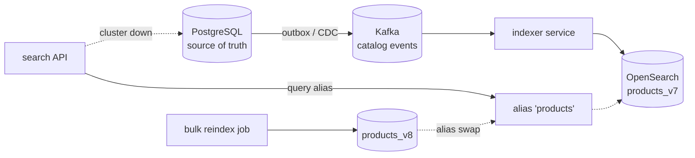
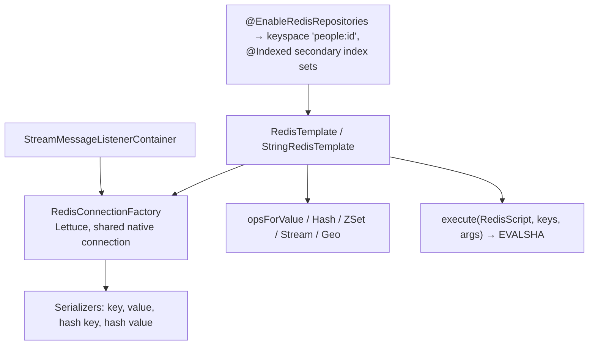
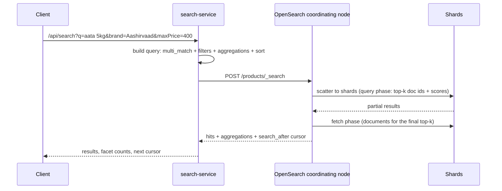
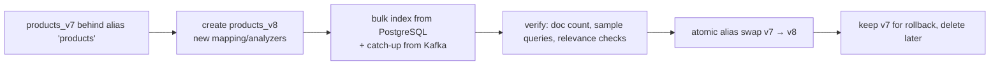

# 22 · NoSQL & Search

## 1. Introduction & Why It Matters

PostgreSQL is the grocery platform's system of record, and Chapters 12–14 made it fast and safe. But three workloads don't fit a relational table well:

- **Ephemeral, high-churn key-value data** — OTP codes, idempotency records, rate-limit counters, distributed locks, delivery-partner locations. Writing these to PostgreSQL means millions of short-lived rows, vacuum pressure and wasted IOPS. This is Redis territory.
- **Variable-shaped documents** — seller catalog feeds where a shampoo has `volumeMl` and a rice bag has `grainLength`, plus raw partner payloads kept for audit. A table with 200 nullable columns (or an EAV model) is the wrong answer. This is MongoDB territory.
- **Search** — a customer types "atta 5kg", misspells it as "aata", filters by brand and price, sorts by relevance, and expects results in 80 ms with facet counts. `LIKE '%atta%'` cannot do this at any scale. This is OpenSearch/Elasticsearch territory.

The danger is the opposite mistake: treating these stores as a general-purpose database. Redis is not durable in the way money needs; MongoDB transactions have constraints; a search index is a **derived** view that will occasionally lag or be rebuilt from scratch.

This chapter covers each store as used in the platform — Redis data structures and Lua scripts beyond caching, MongoDB documents and aggregations, and a production search service with Indian-language analyzers, synonyms, zero-downtime reindexing and a fallback path — plus a decision table for choosing.

### Who should read which section

| Band | Focus |
|---|---|
| B1 · 0–2 yrs | Parts 1, 2, 4 — Redis templates, basic documents |
| B2 · 2–5 yrs | Parts 2, 5 — data structures, MongoDB modelling, simple search |
| B3 · 5–8 yrs | Parts 3, 5, 6 — atomicity with Lua, aggregation, index design |
| B4 · 8–12 yrs | Parts 6, 8 — search architecture, reindexing, failure modes |
| B5 · 12–15+ yrs | Parts 8, 9 — polyglot persistence strategy |

---

## 2. Core Concepts

### 2.1 Choosing a store

| Need | Store | Why |
|---|---|---|
| Transactions, constraints, joins, reporting | **PostgreSQL** | System of record (Chapters 12–14) |
| Sub-millisecond key-value, TTL, counters, locks, queues | **Redis** | In-memory data structures |
| Variable-schema documents, nested arrays, flexible queries | **MongoDB** | Document model |
| Full-text relevance, facets, typo tolerance, autocomplete | **OpenSearch / Elasticsearch** | Inverted index + scoring |
| Massive write-heavy time series (delivery pings, event logs) | **Cassandra / time-series DB** | Linear write scale |
| Analytics over history | **Warehouse** (BigQuery/Snowflake/ClickHouse) | Columnar |

!!! danger "Derived stores are not sources of truth"
    Search indexes and read models are **rebuildable projections**. If a store can't be rebuilt from PostgreSQL (or the event log) in a reasonable time, you've accidentally made it a system of record — with none of the guarantees.

### 2.2 Redis beyond caching

| Structure | Commands | Grocery use |
|---|---|---|
| String | `SET`, `GET`, `INCR`, `SET NX EX` | OTP, counters, rate limits, locks |
| Hash | `HSET`, `HGETALL`, `HINCRBY` | Session/cart snapshots, per-field counters |
| List | `LPUSH`, `BRPOP` | Simple work queues (small scale) |
| Set | `SADD`, `SISMEMBER` | Serviceable pincodes, feature cohorts |
| Sorted set | `ZADD`, `ZRANGEBYSCORE`, `ZINCRBY` | Top-selling SKUs, delayed jobs, sliding-window rate limits |
| Stream | `XADD`, `XREADGROUP` | Lightweight event streams with consumer groups |
| Geo | `GEOADD`, `GEOSEARCH` | Nearest hub, nearby delivery partners |
| HyperLogLog | `PFADD`, `PFCOUNT` | Unique visitors per pincode (approximate, tiny) |
| Pub/Sub | `PUBLISH`, `SUBSCRIBE` | Cache invalidation broadcast (Chapter 21) |

**Atomicity**: single commands are atomic; multi-step logic needs `MULTI/EXEC`, `WATCH` (optimistic) or — usually best — a **Lua script**, which executes atomically on the server.

### 2.3 Redis durability expectations

| Mode | Guarantee |
|---|---|
| No persistence | Everything lost on restart |
| RDB snapshots | Lose up to the snapshot interval |
| AOF (`everysec`) | Lose up to ~1 second |
| AOF (`always`) | Slow; still not a relational database |

Design so that a total Redis loss is **degradation, not corruption**: caches repopulate, rate limits reset, locks expire, idempotency records are backed by unique constraints in PostgreSQL where it matters.

### 2.4 Distributed locks — with eyes open

`SET key token NX PX 30000` + a Lua compare-and-delete release is a good **efficiency** lock ("only one pod should run this job"). It is not a correctness guarantee under GC pauses, clock issues or failover — for correctness use database constraints, conditional updates (Chapter 12) or fencing tokens.

### 2.5 MongoDB essentials

| Concept | Notes |
|---|---|
| Document | BSON; `_id` primary key; nested objects and arrays |
| Collection | Like a table, but schema-flexible (with optional JSON-schema validation) |
| Embed vs reference | Embed what is read together and bounded; reference what is large, shared or unbounded |
| Indexes | Single, compound (order matters: equality → sort → range), text, TTL, partial |
| Aggregation pipeline | `$match`, `$group`, `$lookup`, `$facet`, `$project` |
| Transactions | Multi-document transactions require a replica set; keep them short and rare |
| Write concern / read preference | `w:majority` for durability; `primary` reads for read-your-writes |

### 2.6 Search fundamentals

| Concept | Meaning |
|---|---|
| Index / mapping | Schema: field types and analyzers |
| Analyzer | Tokenizer + filters (lowercase, stemming, synonyms) applied at index and query time |
| Inverted index | term → documents; the reason search is fast |
| Relevance (BM25) | Term frequency vs document frequency and length |
| Filter vs query | Filters are cached and don't score (price range, category); queries score (text match) |
| Facets (aggregations) | Counts per brand/price bucket for the UI |
| Alias | A pointer to a concrete index — enables zero-downtime reindexing |
| `search_after` | Cursor pagination; `from`/`size` degrades past a few thousand |

### 2.7 Search architecture



The index is always **eventually consistent** with the database (typically < 2 s). The UI must tolerate that: after adding a product, the seller sees it in "my products" (read from PostgreSQL) before it appears in search.

---

## 3. How It Works Internally

### 3.1 Spring Data Redis



- **Lettuce** is netty-based and thread-safe: one connection multiplexes commands; pooling is only needed for blocking commands or transactions.
- **Serializers matter**: `StringRedisTemplate` uses strings everywhere (readable in `redis-cli`); a raw `RedisTemplate` defaults to JDK serialization — avoid it.
- Lua scripts are sent once and executed by SHA (`EVALSHA`), falling back to `EVAL` if the script isn't cached.

### 3.2 A search query



Analysis happens twice: documents are analyzed at **index** time, the query string at **search** time — with the same analyzer, otherwise "aata" never matches "atta" even with synonyms configured.

### 3.3 Zero-downtime reindex



Mappings are mostly immutable: changing an analyzer or field type requires a new index. Aliases make that invisible to callers.

---

## 4. Hands-On Code — Level 1 (Beginner)

### 4.1 Redis basics

```kotlin title="build.gradle.kts"
implementation("org.springframework.boot:spring-boot-starter-data-redis")
```

```yaml title="application.yml"
spring:
  data:
    redis:
      host: redis
      port: 6379
      timeout: 200ms
```

```java title="in/grocery/identity/otp/RedisOtpStore.java"
package in.grocery.identity.otp;

import java.time.Duration;
import org.springframework.data.redis.core.StringRedisTemplate;
import org.springframework.stereotype.Component;

@Component
public class RedisOtpStore {

    private final StringRedisTemplate redis;                                  // (1)!

    public RedisOtpStore(StringRedisTemplate redis) {
        this.redis = redis;
    }

    public void store(String mobile, String otpHash) {
        redis.opsForValue().set(key(mobile), otpHash, Duration.ofMinutes(5));  // (2)!
    }

    public boolean matches(String mobile, String otpHash) {
        String stored = redis.opsForValue().get(key(mobile));
        return stored != null && stored.equals(otpHash);
    }

    public void clear(String mobile) {
        redis.delete(key(mobile));
    }

    private static String key(String mobile) {
        return "otp:" + mobile;                                                // (3)!
    }
}
```

1. `StringRedisTemplate` — human-readable keys and values, no serializer surprises.
2. TTL is part of the write: expiry is the store's job, not a cleanup job's.
3. Consistent prefixes (`otp:`, `rl:`, `lock:`) make a shared Redis navigable and `SCAN`-able per concern.

### 4.2 MongoDB basics

```kotlin title="build.gradle.kts"
implementation("org.springframework.boot:spring-boot-starter-data-mongodb")
```

```java title="in/grocery/seller/feed/RawFeedDocument.java"
package in.grocery.seller.feed;

import java.time.Instant;
import java.util.Map;
import org.springframework.data.annotation.Id;
import org.springframework.data.mongodb.core.index.Indexed;
import org.springframework.data.mongodb.core.mapping.Document;

@Document("seller_feed")                                                      // (1)!
public record RawFeedDocument(
        @Id String id,
        @Indexed String sellerId,
        String sourceFileName,
        Instant receivedAt,
        Map<String, Object> payload,                                          // (2)!
        String status) {}
```

1. Collection name explicit — never rely on the class name.
2. The partner's raw shape, stored as received. Parsing and validation (Chapter 09) produce normalized rows in PostgreSQL; this document is the audit trail.

```java title="RawFeedRepository.java"
public interface RawFeedRepository extends MongoRepository<RawFeedDocument, String> {
    List<RawFeedDocument> findBySellerIdAndReceivedAtAfter(String sellerId, Instant after);
}
```

```yaml title="application.yml"
spring:
  data:
    mongodb:
      uri: mongodb://mongo:27017/grocery
      auto-index-creation: false        # (1)!
```

1. Index creation belongs in migrations (Chapter 14's discipline applies here too), not in application startup where it silently builds indexes on production collections.

### 4.3 Testing with containers

```java title="RedisOtpStoreTest.java"
@SpringBootTest
@Testcontainers
class RedisOtpStoreTest {

    @Container @ServiceConnection
    static GenericContainer<?> redis = new GenericContainer<>("redis:7-alpine").withExposedPorts(6379);  // (1)!

    @Autowired RedisOtpStore store;

    @Test
    void storesAndMatches() {
        store.store("9876543210", "hash1");
        assertThat(store.matches("9876543210", "hash1")).isTrue();
        assertThat(store.matches("9876543210", "wrong")).isFalse();
    }
}
```

1. `@ServiceConnection` works with the Redis container out of the box in recent Boot versions (or use Testcontainers' `RedisContainer` module); **verify** for your version.

---

## 5. Hands-On Code — Level 2 (Intermediate) & Level 3 (Advanced)

### 5.1 Level 2 — Redis data structures in action

```java title="in/grocery/analytics/TrendingProducts.java"
package in.grocery.analytics;

import java.time.Duration;
import java.util.List;
import org.springframework.data.redis.core.StringRedisTemplate;
import org.springframework.stereotype.Component;

@Component
public class TrendingProducts {

    private final StringRedisTemplate redis;

    public TrendingProducts(StringRedisTemplate redis) {
        this.redis = redis;
    }

    /** Called on every order line. */
    public void recordSale(String pincodePrefix, String sku, int quantity) {
        String key = "trending:" + pincodePrefix + ":" + hourBucket();
        redis.opsForZSet().incrementScore(key, sku, quantity);                 // (1)!
        redis.expire(key, Duration.ofHours(48));
    }

    public List<String> top(String pincodePrefix, int n) {
        String key = "trending:" + pincodePrefix + ":" + hourBucket();
        return List.copyOf(redis.opsForZSet().reverseRange(key, 0, n - 1));    // (2)!
    }
}
```

1. Sorted set: one atomic command maintains a ranked leaderboard per zone per hour.
2. Top-N in O(log n) — the same query in PostgreSQL would be a `GROUP BY` over order lines.

```java title="in/grocery/delivery/fleet/PartnerLocationStore.java"
/** Delivery partner locations for "who is nearest to this hub?" */
public void updateLocation(String partnerId, double lon, double lat) {
    redis.opsForGeo().add("fleet:BLR", new Point(lon, lat), partnerId);        // (1)!
    redis.expire("fleet:BLR", Duration.ofMinutes(10));
}

public List<String> nearestPartners(double lon, double lat, double radiusKm, int limit) {
    var args = GeoRadiusCommandArgs.newGeoRadiusArgs().sortAscending().limit(limit);
    var results = redis.opsForGeo().radius("fleet:BLR",
            new Circle(new Point(lon, lat), new Distance(radiusKm, Metrics.KILOMETERS)), args);
    return results.getContent().stream().map(r -> r.getContent().getName()).toList();
}
```

1. Geo sets are sorted sets with geohash scores — location updates are cheap enough for a per-30-second ping from thousands of riders.

### 5.2 Level 2 — Lua for atomic multi-step logic

A sliding-window rate limiter (better than the fixed window in Chapter 17) needs several commands executed atomically:

```lua title="src/main/resources/redis/sliding-window-rate-limit.lua"
-- KEYS[1] = bucket key, ARGV[1] = now(ms), ARGV[2] = window(ms), ARGV[3] = limit, ARGV[4] = member
redis.call('ZREMRANGEBYSCORE', KEYS[1], 0, ARGV[1] - ARGV[2])
local count = redis.call('ZCARD', KEYS[1])
if count >= tonumber(ARGV[3]) then
  return 0
end
redis.call('ZADD', KEYS[1], ARGV[1], ARGV[4])
redis.call('PEXPIRE', KEYS[1], ARGV[2])
return 1
```

```java title="in/grocery/platform/ratelimit/SlidingWindowRateLimiter.java"
package in.grocery.platform.ratelimit;

import java.time.Clock;
import java.time.Duration;
import java.util.List;
import java.util.UUID;
import org.springframework.core.io.ClassPathResource;
import org.springframework.data.redis.core.StringRedisTemplate;
import org.springframework.data.redis.core.script.DefaultRedisScript;
import org.springframework.data.redis.core.script.RedisScript;
import org.springframework.stereotype.Component;

@Component
public class SlidingWindowRateLimiter {

    private final RedisScript<Long> script = RedisScript.of(                      // (1)!
            new ClassPathResource("redis/sliding-window-rate-limit.lua"), Long.class);

    private final StringRedisTemplate redis;
    private final Clock clock;

    public SlidingWindowRateLimiter(StringRedisTemplate redis, Clock clock) {
        this.redis = redis;
        this.clock = clock;
    }

    public boolean allow(String bucket, int limit, Duration window) {
        Long allowed = redis.execute(script, List.of("rl:" + bucket),             // (2)!
                String.valueOf(clock.millis()),
                String.valueOf(window.toMillis()),
                String.valueOf(limit),
                UUID.randomUUID().toString());
        return allowed != null && allowed == 1L;
    }
}
```

1. Loaded once; executed with `EVALSHA`.
2. Keys passed as `KEYS` (required for Redis Cluster slot routing) and values as `ARGV`. All four steps happen atomically on the server — no race between the count and the insert.

### 5.3 Level 2 — A safe(ish) distributed lock

```java title="in/grocery/platform/lock/RedisLock.java"
package in.grocery.platform.lock;

import java.time.Duration;
import java.util.List;
import java.util.Optional;
import java.util.UUID;
import org.springframework.data.redis.core.StringRedisTemplate;
import org.springframework.data.redis.core.script.RedisScript;
import org.springframework.stereotype.Component;

@Component
public class RedisLock {

    private static final RedisScript<Long> RELEASE = RedisScript.of(
            "if redis.call('get', KEYS[1]) == ARGV[1] then return redis.call('del', KEYS[1]) else return 0 end",
            Long.class);                                                          // (1)!

    private final StringRedisTemplate redis;

    public RedisLock(StringRedisTemplate redis) {
        this.redis = redis;
    }

    public Optional<String> tryAcquire(String name, Duration ttl) {
        String token = UUID.randomUUID().toString();
        Boolean acquired = redis.opsForValue().setIfAbsent("lock:" + name, token, ttl);   // (2)!
        return Boolean.TRUE.equals(acquired) ? Optional.of(token) : Optional.empty();
    }

    public void release(String name, String token) {
        redis.execute(RELEASE, List.of("lock:" + name), token);                   // (3)!
    }

    public <T> Optional<T> withLock(String name, Duration ttl, java.util.function.Supplier<T> work) {
        return tryAcquire(name, ttl).map(token -> {
            try {
                return work.get();
            } finally {
                release(name, token);
            }
        });
    }
}
```

1. Compare-and-delete: only the owner releases. A plain `DEL` could delete a lock another pod acquired after ours expired.
2. `SET NX PX` — atomic acquire with expiry; the TTL is the safety valve if a pod dies.
3. Still not a correctness guarantee: a long GC pause can let two pods believe they hold the lock. Use it for "don't run this nightly job twice", not for "don't double-charge a customer".

!!! tip "ShedLock for scheduled jobs"
    For `@Scheduled` deduplication across pods, the **ShedLock** library (backed by Redis or PostgreSQL) is a well-tested implementation of exactly this pattern (Chapter 25).

### 5.4 Level 3 — MongoDB modelling and aggregation

Seller catalog documents have variable attributes and a history of revisions:

```java title="in/grocery/seller/catalog/SellerProductDocument.java"
package in.grocery.seller.catalog;

import java.math.BigDecimal;
import java.time.Instant;
import java.util.List;
import java.util.Map;
import org.springframework.data.annotation.Id;
import org.springframework.data.annotation.Version;
import org.springframework.data.mongodb.core.index.CompoundIndex;
import org.springframework.data.mongodb.core.mapping.Document;

@Document("seller_product")
@CompoundIndex(name = "seller_sku_idx", def = "{'sellerId': 1, 'sku': 1}", unique = true)   // (1)!
public record SellerProductDocument(
        @Id String id,
        String sellerId,
        String sku,
        String title,
        String category,
        BigDecimal mrp,
        BigDecimal sellingPrice,
        Map<String, Object> attributes,                                                     // (2)!
        List<String> images,
        Instant updatedAt,
        @Version Long version) {}
```

1. Unique compound index — MongoDB's equivalent of a composite unique constraint.
2. The flexible part: `{"volumeMl": 500, "fragrance": "rose"}` for shampoo, `{"grainLength": "long"}` for rice.

```java title="in/grocery/seller/catalog/SellerCatalogQueries.java"
package in.grocery.seller.catalog;

import static org.springframework.data.mongodb.core.aggregation.Aggregation.group;
import static org.springframework.data.mongodb.core.aggregation.Aggregation.match;
import static org.springframework.data.mongodb.core.aggregation.Aggregation.newAggregation;
import static org.springframework.data.mongodb.core.aggregation.Aggregation.project;
import static org.springframework.data.mongodb.core.aggregation.Aggregation.sort;

import java.util.List;
import org.springframework.data.domain.Sort;
import org.springframework.data.mongodb.core.MongoTemplate;
import org.springframework.data.mongodb.core.query.Criteria;
import org.springframework.stereotype.Component;

@Component
public class SellerCatalogQueries {

    public record CategoryStats(String category, long products, double avgSellingPrice) {}

    private final MongoTemplate mongo;

    public SellerCatalogQueries(MongoTemplate mongo) {
        this.mongo = mongo;
    }

    public List<CategoryStats> statsFor(String sellerId) {
        var aggregation = newAggregation(
                match(Criteria.where("sellerId").is(sellerId)),                                 // (1)!
                group("category")
                        .count().as("products")
                        .avg("sellingPrice").as("avgSellingPrice"),
                project("products", "avgSellingPrice").and("_id").as("category"),
                sort(Sort.Direction.DESC, "products"));
        return mongo.aggregate(aggregation, "seller_product", CategoryStats.class).getMappedResults();
    }
}
```

1. `$match` first, always — filtering before grouping lets the pipeline use indexes.

!!! warning "MongoDB is not a relational database"
    No foreign keys, no cross-collection joins worth relying on (`$lookup` is limited and slow at scale), and multi-document transactions need a replica set and hurt throughput. Model documents so a single document is the unit of consistency — the same aggregate thinking as Chapter 13.

### 5.5 Level 3 — Product search index

```json title="opensearch/products-mapping.json"
{
  "settings": {
    "number_of_shards": 3,
    "number_of_replicas": 1,
    "analysis": {
      "filter": {
        "grocery_synonyms": {
          "type": "synonym_graph",
          "synonyms": [
            "atta, aata, flour, gehu ka atta",
            "dal, daal, lentils",
            "curd, dahi, yogurt",
            "ghee, clarified butter"
          ]
        },
        "english_stemmer": { "type": "stemmer", "language": "english" }
      },
      "analyzer": {
        "grocery_index": {
          "tokenizer": "standard",
          "filter": ["lowercase", "english_stemmer"]
        },
        "grocery_search": {
          "tokenizer": "standard",
          "filter": ["lowercase", "grocery_synonyms", "english_stemmer"]
        },
        "autocomplete_index": {
          "tokenizer": "standard",
          "filter": ["lowercase", "edge_ngram_filter"]
        }
      }
    }
  },
  "mappings": {
    "properties": {
      "sku":      { "type": "keyword" },
      "title":    { "type": "text", "analyzer": "grocery_index", "search_analyzer": "grocery_search",
                    "fields": { "autocomplete": { "type": "text", "analyzer": "autocomplete_index",
                                                  "search_analyzer": "grocery_search" } } },
      "brand":    { "type": "keyword" },
      "category": { "type": "keyword" },
      "tags":     { "type": "keyword" },
      "sellingPrice": { "type": "scaled_float", "scaling_factor": 100 },
      "inStockPincodes": { "type": "keyword" },
      "popularity": { "type": "float" },
      "updatedAt": { "type": "date" }
    }
  }
}
```

Design notes:

- **Synonyms at search time only** (`search_analyzer`) so adding a synonym doesn't require reindexing.
- Indian shopping vocabulary mixes languages and transliterations — synonyms are the highest-leverage relevance work here. Add an ICU/Hindi analyzer if you index Devanagari titles.
- `keyword` for anything filtered or aggregated; `text` for anything matched.
- `scaled_float` keeps money exact to paise in the index.
- `popularity` is a precomputed score used for boosting (from the Redis trending data or the warehouse).

### 5.6 Level 3 — The search query

```java title="in/grocery/search/service/ProductSearchService.java"
package in.grocery.search.service;

import java.util.List;
import java.util.Map;
import org.springframework.stereotype.Service;

@Service
public class ProductSearchService {

    public record SearchRequest(String query, String pincode, List<String> brands,
                                java.math.BigDecimal maxPrice, String cursor, int size) {}
    public record SearchHit(String sku, String title, String brand, String price, double score) {}
    public record Facet(String name, Map<String, Long> counts) {}
    public record SearchResponse(List<SearchHit> hits, long total, List<Facet> facets, String nextCursor) {}

    private final SearchClient client;         // thin wrapper over the OpenSearch/Elasticsearch Java client

    public SearchResponse search(SearchRequest request) {
        var query = SearchQuery.builder()
                .must(multiMatch(request.query(), Map.of(                                    // (1)!
                        "title", 3.0f,
                        "brand", 2.0f,
                        "tags", 1.0f))
                        .fuzziness("AUTO")                                                   // (2)!
                        .minimumShouldMatch("2<75%"))
                .filter(term("inStockPincodes", request.pincode()))                          // (3)!
                .filter(request.brands().isEmpty() ? null : terms("brand", request.brands()))
                .filter(request.maxPrice() == null ? null : range("sellingPrice").lte(request.maxPrice()))
                .functionScore(fieldValueFactor("popularity", 0.3f))                         // (4)!
                .aggregation(terms("brand").size(20))
                .aggregation(range("sellingPrice", 0, 100, 250, 500, 1000))
                .sort("_score", "desc").sort("sku", "asc")                                   // (5)!
                .searchAfter(decodeCursor(request.cursor()))
                .size(Math.min(request.size(), 50))
                .build();
        return client.search("products", query);
    }
}
```

1. Field boosts: a match in the title matters more than in tags.
2. Typo tolerance — "aata", "atat" still find atta. Fuzziness costs CPU; keep it `AUTO` (edit distance scaled by term length).
3. **Filters, not queries**, for structured constraints: cached, no scoring cost. Stock is modelled as a list of serviceable pincodes on the document — denormalized for search, authoritative elsewhere.
4. Popularity boost blended with text relevance.
5. A tiebreaker field is **required** for `search_after` to be stable.

!!! note "Client libraries — verify"
    Spring Data Elasticsearch targets the official Elasticsearch client; **OpenSearch** has its own community `spring-data-opensearch` project and the `opensearch-java` client. Pick per your cluster and confirm version compatibility before writing a lot of code; the query structures above are the same either way.

---

## 6. Hands-On Code — Level 4 (Expert / Production)

### 6.1 Indexing pipeline

```java title="in/grocery/search/indexer/ProductIndexer.java"
package in.grocery.search.indexer;

import io.micrometer.core.instrument.MeterRegistry;
import java.time.Duration;
import java.util.List;
import org.springframework.kafka.annotation.KafkaListener;
import org.springframework.stereotype.Component;

@Component
public class ProductIndexer {

    private final SearchClient search;
    private final ProductProjectionLoader loader;
    private final MeterRegistry meters;

    @KafkaListener(topics = {"grocery.catalog.product-changed.v1", "grocery.inventory.stock-changed.v1"},
                   groupId = "search-indexer", batch = "true")                                 // (1)!
    public void onEvents(List<CatalogEvent> events) {
        var docs = loader.loadProjections(events.stream().map(CatalogEvent::sku).distinct().toList());  // (2)!
        search.bulkIndex("products", docs);                                                     // (3)!
        meters.counter("grocery.search.indexed").increment(docs.size());
        events.stream().map(CatalogEvent::occurredAt).max(java.util.Comparator.naturalOrder())
              .ifPresent(t -> meters.gauge("grocery.search.index.lag.seconds",
                      Duration.between(t, java.time.Instant.now()).toSeconds()));               // (4)!
    }
}
```

1. **Batch listener** (Chapter 23): indexing 500 documents in one bulk request instead of 500 round trips.
2. Events carry ids; the **projection is loaded from PostgreSQL** so the index is always built from the source of truth — events are a trigger, not the data.
3. Bulk API with retry on partial failures (OpenSearch returns per-item status).
4. **Index lag** is the metric that matters: "how stale can search be right now?"

### 6.2 Zero-downtime reindex

```java title="in/grocery/search/admin/ReindexService.java"
package in.grocery.search.admin;

import java.time.Instant;
import org.slf4j.Logger;
import org.slf4j.LoggerFactory;
import org.springframework.stereotype.Service;

@Service
public class ReindexService {

    private static final Logger log = LoggerFactory.getLogger(ReindexService.class);

    private final SearchClient search;
    private final ProductProjectionLoader loader;

    public String reindex(String mappingVersion) {
        String target = "products_" + mappingVersion + "_" + Instant.now().getEpochSecond();
        search.createIndex(target, Mappings.load(mappingVersion));                              // (1)!

        long indexed = loader.streamAll(batch -> search.bulkIndex(target, batch), 1_000);       // (2)!
        log.info("Bulk indexed {} products into {}", indexed, target);

        long live = search.count("products");
        if (indexed < live * 0.99) {                                                            // (3)!
            throw new IllegalStateException("Refusing to swap: new index has %d docs vs %d live".formatted(indexed, live));
        }
        SmokeQueries.run(search, target);                                                       // (4)!

        search.swapAlias("products", target);                                                   // (5)!
        log.info("Alias 'products' now points at {}", target);
        return target;
    }
}
```

1. New index with the new mapping — analyzers and field types can change freely.
2. Streamed from PostgreSQL in batches (Chapter 12's streaming), so memory stays flat for 2M products.
3. **Guard rail**: never swap to an index that's obviously incomplete.
4. Relevance smoke tests: "atta" returns Aashirvaad in the top 3, "dahi" returns curd, an out-of-stock pincode filters correctly. Automate the queries a human would check.
5. Atomic alias swap: the next query goes to the new index; the old one stays for instant rollback.

Events that arrive **during** the bulk load are handled by keeping the indexer running against both indices (dual write) or by replaying the Kafka topic from the offset recorded at the start of the reindex.

### 6.3 Search failure handling

```java title="in/grocery/search/web/SearchController.java"
@GetMapping("/api/v1/search")
SearchResponse search(@Valid SearchRequest request) {
    try {
        return circuitBreaker.executeSupplier(() -> searchService.search(request));             // (1)!
    } catch (SearchUnavailableException e) {
        meters.counter("grocery.search.fallback").increment();
        return fallback.categoryBrowse(request);                                                // (2)!
    }
}
```

1. Circuit breaker (Chapter 26) — a slow cluster must not hold request threads.
2. **Degrade, don't fail**: fall back to a PostgreSQL category/prefix listing. Customers get a usable (worse) experience instead of an error page. Track the fallback rate — it should be ~0.

| Failure | Behaviour |
|---|---|
| Cluster unreachable | Fallback browse; alert |
| Query timeout | Return partial/first-page results if available, else fallback |
| Index lag > 60 s | Alert; freshly changed products may be missing |
| Zero-result rate spike | Alert — usually a broken analyzer or a failed reindex |

### 6.4 Relevance as a product concern

| Signal | Implementation |
|---|---|
| Text match | BM25 over title/brand/tags with boosts |
| Popularity | `popularity` field refreshed nightly from sales data |
| Availability | Out-of-stock items demoted (not removed — customers search for them) |
| Business rules | Sponsored placements as a separate, labelled slot — never silently mixed into organic ranking |
| Personalization | Later: re-rank top 100 by purchase history |

Measure: zero-result rate, click-through on the top 3, search → add-to-cart conversion, and a **golden query set** (200 queries with expected results) run in CI against a test index so a mapping change can't silently wreck relevance.

### 6.5 Testing search

```java title="ProductSearchIntegrationTest.java"
@SpringBootTest
@Testcontainers
class ProductSearchIntegrationTest {

    @Container
    static GenericContainer<?> opensearch = new GenericContainer<>("opensearchproject/opensearch:2.x")
            .withEnv("discovery.type", "single-node")
            .withEnv("DISABLE_SECURITY_PLUGIN", "true")
            .withExposedPorts(9200);                                                            // (1)!

    @DynamicPropertySource
    static void props(DynamicPropertyRegistry r) {
        r.add("grocery.search.uri", () -> "http://" + opensearch.getHost() + ":" + opensearch.getMappedPort(9200));
    }

    @Autowired SearchClient client;
    @Autowired ProductSearchService search;

    @BeforeAll
    static void indexFixtures() { /* create index with real mapping, index 20 products, refresh */ }

    @Test
    void synonymAndTypoTolerance() {
        assertThat(skus(search.search(query("aata")))).contains("ATTA-5KG");                    // synonym
        assertThat(skus(search.search(query("attta")))).contains("ATTA-5KG");                   // fuzziness
    }

    @Test
    void filtersByPincodeAvailability() {
        assertThat(skus(search.search(queryWithPincode("atta", "744101")))).isEmpty();
    }

    @Test
    void facetsAreReturned() {
        var response = search.search(query("atta"));
        assertThat(response.facets()).anySatisfy(f -> assertThat(f.name()).isEqualTo("brand"));
    }

    @Test
    void goldenQueriesStillRank() {                                                             // (2)!
        GoldenQueries.load().forEach(g ->
                assertThat(skus(search.search(query(g.query()))).subList(0, Math.min(3, g.expected().size())))
                        .containsAnyElementsOf(g.expected()));
    }
}
```

1. A real search engine in a container — mocking an analyzer proves nothing.
2. The golden-query test is what stops "small mapping tweak" from tanking search quality.

---

## 7. Spring Boot 3 vs 4 & Migration

| Topic | Boot 3.5 | Boot 4.x |
|---|---|---|
| Spring Data Redis | 3.x (Lettuce default) | 4.x (verify) |
| Redis serializers | Jackson 2 variants | Jackson 3 equivalents (verify) |
| Spring Data MongoDB | 4.x | 5.x (verify) |
| Spring Data Elasticsearch | 5.x targeting the ES Java client | Next major (verify); OpenSearch via `spring-data-opensearch` |
| Test slices | `@DataRedisTest`, `@DataMongoTest` | Moved into technology test modules (verify) |
| `@ServiceConnection` | Redis, Mongo, Elasticsearch supported | Same |

!!! danger "Serialized data outlives your deploy"
    Redis values, MongoDB documents and index documents written by Boot 3.5 pods are read by Boot 4 pods during a rolling upgrade. Same rule as Chapter 21: **version the key/index namespace** for the upgrade, keep DTOs tolerant, and test cross-version reads.

### Migration checklist

- [ ] Inventory Redis key patterns, Mongo collections and search indices with their serialization formats.
- [ ] Re-verify serializer classes after the Jackson 3 move; test reading old values.
- [ ] Check Spring Data module versions against your server versions (Mongo/OpenSearch server compatibility matrices).
- [ ] Re-run search golden queries after upgrading client libraries.
- [ ] Update test slice imports.

---

## 8. Production Playbook

### Best practices

1. **PostgreSQL is the source of truth**; Redis, Mongo and the search index are derived or ephemeral.
2. **Namespace Redis keys** by concern and always set TTLs.
3. **Lua (or single commands) for atomicity**; keys in `KEYS` for cluster compatibility.
4. **Locks for efficiency, constraints for correctness.**
5. **Model Mongo documents as aggregates**; index deliberately; create indexes via migrations.
6. **Search: aliases + versioned indices**, reindex from the database, swap atomically with guard rails.
7. **Synonyms and fuzziness** tuned for Indian shopping vocabulary; search-time synonyms.
8. **Degrade gracefully** when a derived store is down.
9. **Measure lag** (index lag, replication lag) and **quality** (zero-result rate, golden queries).
10. **Rebuild drills**: prove you can rebuild each derived store from scratch, and know how long it takes.

### Anti-patterns

❌ Using Redis as a database of record for anything financial.

❌ Keys without TTL — memory grows until eviction starts silently dropping data you assumed was there.

❌ `KEYS *` in production (blocking) — use `SCAN`.

❌ JDK serialization in `RedisTemplate` — opaque, fragile, insecure.

❌ Multi-document Mongo transactions used routinely instead of modelling aggregates properly.

❌ Unbounded arrays in Mongo documents (16 MB limit; also slow).

❌ Searching with `LIKE '%term%'` in PostgreSQL at scale (no index, full scans).

❌ Writing directly to the search index from business code — the index must be rebuildable from the source.

❌ Reindexing in place (delete + recreate the live index) — a window with zero search results.

❌ Relevance changes without golden-query tests.

### Troubleshooting

| Symptom | Cause | Fix |
|---|---|---|
| Redis memory climbing | Missing TTLs, big keys | Audit with `--bigkeys`/`MEMORY USAGE`, add TTLs, set `maxmemory-policy` |
| Redis latency spikes | Blocking commands, big values, `KEYS` | Use `SCAN`, split large values, monitor `SLOWLOG` |
| Lock held forever | Process died before release; no TTL | Always set TTL; compare-and-delete on release |
| Mongo query slow | Missing/wrong compound index order | `explain()`, index equality→sort→range |
| Mongo writes rejected | Write concern/replica set issues | Check topology, `w:majority` semantics |
| Search returns nothing for a valid term | Analyzer mismatch, wrong field type (`keyword` vs `text`) | Use `_analyze` API to compare index/search analysis |
| Search misses new products | Indexer lag, consumer stuck, failed bulk items | Lag metric, DLT for failed events, replay |
| Slow deep pagination | `from`/`size` beyond a few thousand | `search_after` cursors |
| Relevance regression after a deploy | Mapping/analyzer change | Golden queries in CI; alias rollback |
| Cluster red/yellow | Shard allocation, disk watermarks | Capacity, replicas, disk alerts |

### Production checklist

- [ ] Each derived store documented with its source and rebuild procedure
- [ ] Redis: key namespaces, TTLs, `maxmemory` policy, slowlog monitoring
- [ ] Mongo: indexes in migrations, document size bounds, backup/restore tested
- [ ] Search: alias-based deploys, reindex runbook, index lag alert, zero-result alert
- [ ] Golden query suite in CI
- [ ] Fallback path when search is unavailable, with a monitored fallback rate
- [ ] Cross-version serialization tested before upgrades

---

## 9. Interview Questions & Answers

### B1 · 0–2 years

??? question "B1 · When would you use Redis instead of PostgreSQL?"
    **Short answer:** For ephemeral, high-churn key-value data needing sub-millisecond access and TTLs — caches, rate limits, OTPs, locks, counters — not for durable business records.

??? question "B1 · What is `StringRedisTemplate` and why prefer it?"
    **Short answer:** A `RedisTemplate` with string serializers for keys and values — readable in `redis-cli`, no JDK-serialization surprises.

??? question "B1 · Why does MongoDB suit variable-schema data?"
    **Short answer:** Documents can differ in shape within a collection, so optional attributes don't require nullable columns or an EAV model.

??? question "B1 · Why can't you use `LIKE '%atta%'` for product search?"
    **Short answer:** It can't use an index (leading wildcard), doesn't rank results, and has no typo tolerance, synonyms or facets.

??? question "B1 · What is a search index alias?"
    **Short answer:** A name that points to a concrete index, letting you rebuild into a new index and switch atomically.

### B2 · 2–5 years

??? question "B2 · Which Redis structure for a leaderboard, a lock, a queue?"
    **Short answer:** Sorted set (ZSET) for leaderboards; `SET NX PX` string with a token for locks; list (`LPUSH`/`BRPOP`) or Redis Streams for queues — Streams when you need consumer groups and acknowledgement.

??? question "B2 · How do you make multi-step Redis logic atomic?"
    **Short answer:** A Lua script executed server-side (`EVAL`/`EVALSHA`), or `MULTI`/`EXEC` with `WATCH`. Pass keys via `KEYS` for cluster routing.

??? question "B2 · Embed or reference in MongoDB?"
    **Short answer:** Embed data that is read together, bounded in size and owned by the document; reference large, shared or unbounded data. Model the document as an aggregate.

??? question "B2 · Filter vs query in a search request?"
    **Short answer:** Filters are boolean, cacheable and don't affect score (price range, category, availability); queries compute relevance (text match). Put everything structured in filters.

??? question "B2 · How do you keep the search index up to date?"
    **Short answer:** Consume change events (outbox/CDC), load the projection from the source of truth, and bulk index — with lag metrics and a DLT for failures.

### B3 · 5–8 years

??? question "B3 · What are the limits of a Redis distributed lock?"
    **Short answer:** It's an efficiency lock: GC pauses, clock skew and failover can allow two holders. TTL plus compare-and-delete limits damage; for correctness use database constraints/conditional updates or fencing tokens.

??? question "B3 · How do you perform a zero-downtime reindex?"
    **Short answer:** Create a new index with the new mapping, bulk load from the source while the indexer keeps both current (or replay events from a recorded offset), validate counts and golden queries, then swap the alias atomically and keep the old index for rollback.

??? question "B3 · Why do synonyms belong in the search analyzer?"
    **Short answer:** Search-time synonyms let you change the list without reindexing; index-time synonyms bake them into the inverted index (faster, but any change means a reindex).

??? question "B3 · How do you paginate millions of search results?"
    **Short answer:** `search_after` with a stable sort (score + a unique tiebreaker) rather than `from`/`size`, which gets expensive because every shard must collect and discard deep offsets.

??? question "B3 · How do you decide MongoDB compound index order?"
    **Short answer:** Equality fields first, then sort fields, then range fields; verify with `explain()` that the index covers the query and avoids in-memory sorts.

### B4 · 8–12 years

??? question "B4 · Design search for a 2-million-SKU marketplace."
    **Short answer:** PostgreSQL as source of truth; events → indexer → OpenSearch with alias-versioned indices; mapping with keyword filters, boosted text fields, search-time synonyms and fuzziness; availability denormalized per pincode; facets for the UI; `search_after` pagination; popularity boosting refreshed nightly; circuit breaker with database fallback; lag, zero-result and golden-query monitoring; documented reindex runbook.

??? question "B4 · What breaks when Redis goes down and how do you prepare?"
    **Short answer:** Caches (fail open), rate limits (fail open or closed by policy), locks (jobs may double-run — make them idempotent), OTP/idempotency (back critical uniqueness with database constraints). Test it: stop Redis in staging under load and confirm degradation, not failure.

??? question "B4 · How do you keep polyglot persistence from becoming an operational burden?"
    **Short answer:** Limit the number of stores, give each a documented purpose, source and rebuild procedure; standardize clients and observability in the platform library; ensure every derived store can be rebuilt; and run periodic rebuild drills.

### B5 · 12–15+ years

??? question "B5 · How do you decide whether a new store is justified?"
    **Short answer:** Show that the workload genuinely doesn't fit existing stores (measured), that the operational cost (backups, upgrades, on-call knowledge, security review) is accepted, and that data can be rebuilt. Otherwise extend PostgreSQL — it does JSONB, full-text, and geo well enough for many cases.

??? question "B5 · Search relevance is a product problem. How do you organize it?"
    **Short answer:** Shared ownership with the business: metrics (zero-result, CTR, conversion), a golden query set maintained with category managers, experimentation (A/B on ranking), clearly separated sponsored placements, and release discipline (aliases, rollback) so relevance changes are as reversible as code.

### Scenario questions

??? example "Scenario · After a mapping change, search returns nothing for 'atta'"
    The new mapping changed `title` from `text` to `keyword` for "exact matching", so only the full string matches. Fix: revert the alias to the previous index (instant), correct the mapping, reindex, and add a golden-query CI job that indexes fixtures into a container and asserts the top results.

??? example "Scenario · Redis memory hits `maxmemory` and OTP logins start failing"
    Trending sorted sets were written without TTL, filling memory; `allkeys-lru` evicted OTP keys. Fixes: TTLs on every key, separate Redis databases/instances for cache vs critical short-lived data, `volatile-lru` on the cache instance, memory alerts, and OTP verification that falls back to a database-backed store.

### Coding exercise

!!! example "Exercise · 'Recently viewed products'"
    Store the last 20 products viewed per customer in Redis (most recent first, no duplicates, 30-day expiry) and return them with product details from PostgreSQL. Implement it with one atomic operation per view and write tests.

??? success "Solution"
    ```java title="RecentlyViewedStore.java"
    package in.grocery.catalog.recent;

    import java.time.Duration;
    import java.util.List;
    import org.springframework.data.redis.core.StringRedisTemplate;
    import org.springframework.stereotype.Component;

    @Component
    public class RecentlyViewedStore {

        private static final int MAX = 20;

        private final StringRedisTemplate redis;

        public RecentlyViewedStore(StringRedisTemplate redis) {
            this.redis = redis;
        }

        public void recordView(String customerId, String sku) {
            String key = key(customerId);
            var ops = redis.opsForList();
            ops.remove(key, 0, sku);          // (1)!
            ops.leftPush(key, sku);
            ops.trim(key, 0, MAX - 1);
            redis.expire(key, Duration.ofDays(30));
        }

        public List<String> recent(String customerId) {
            return redis.opsForList().range(key(customerId), 0, MAX - 1);
        }

        private static String key(String customerId) {
            return "recent:" + customerId;
        }
    }
    ```

    1. Four commands, not atomic as a group. For this use case that's fine (worst case: a duplicate or a slightly long list for microseconds). If atomicity mattered, the same logic in Lua would be four lines:

    ```lua title="Lua script"
    redis.call('LREM', KEYS[1], 0, ARGV[1])
    redis.call('LPUSH', KEYS[1], ARGV[1])
    redis.call('LTRIM', KEYS[1], 0, tonumber(ARGV[2]) - 1)
    redis.call('EXPIRE', KEYS[1], tonumber(ARGV[3]))
    ```

    ```java title="RecentlyViewedStoreTest.java"
    @Test
    void keepsMostRecentFirstWithoutDuplicates() {
        store.recordView("C-1", "MILK-1L");
        store.recordView("C-1", "ATTA-5KG");
        store.recordView("C-1", "MILK-1L");                       // moves to front

        assertThat(store.recent("C-1")).containsExactly("MILK-1L", "ATTA-5KG");
    }

    @Test
    void capsAtTwenty() {
        for (int i = 0; i < 25; i++) store.recordView("C-2", "SKU-" + i);
        assertThat(store.recent("C-2")).hasSize(20).startsWith("SKU-24");
    }
    ```

    Product details are then fetched from PostgreSQL by SKU (Chapter 12's `IN` query) — Redis holds only the *ordering*, which is exactly the kind of ephemeral, per-user state it's good at.

---

## Key Takeaways

- **Right store for the workload**: PostgreSQL for truth, Redis for ephemeral key-value, Mongo for variable documents, OpenSearch for relevance.
- **Redis is data structures, not just a cache** — sorted sets, geo, streams, Lua for atomicity — but plan for total loss.
- **Locks are efficiency, not correctness.**
- **Model Mongo documents as aggregates**; indexes belong in migrations.
- **Search is a derived, rebuildable projection**: alias-versioned indices, reindex from the source, swap atomically, guard with golden queries.
- **Degrade gracefully** when a derived store is unavailable, and measure lag and quality.
- **Every derived store needs a rehearsed rebuild procedure.**

## Further Reading

- Spring Data Redis Reference — templates, serializers, scripting, streams, pub/sub
- Spring Data MongoDB Reference — mapping, aggregation framework, transactions, indexes
- Spring Data Elasticsearch Reference / `spring-data-opensearch` documentation
- OpenSearch / Elasticsearch documentation — analysis, relevance tuning, aliases, `search_after`, bulk API

---

[:material-arrow-left: 21 Caching](21-caching.md) · [23 Messaging with Kafka :material-arrow-right:](23-messaging-kafka.md)
