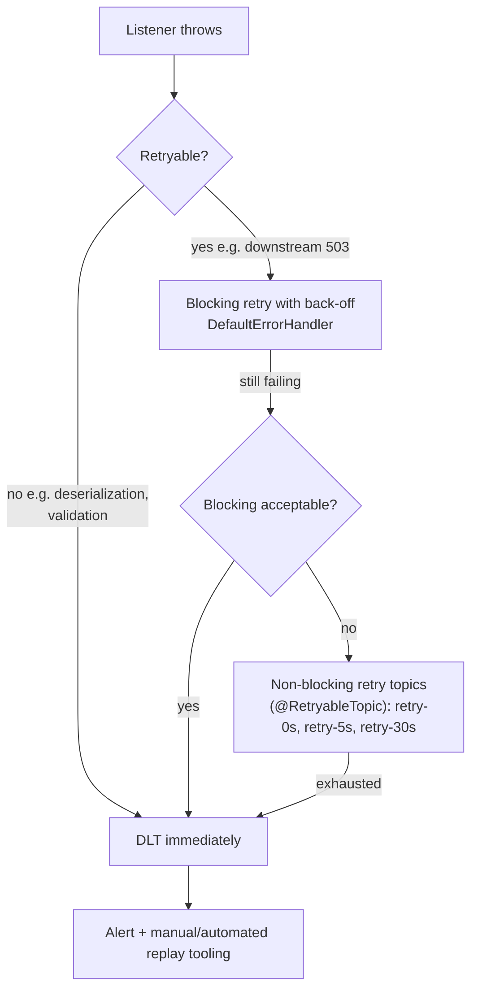
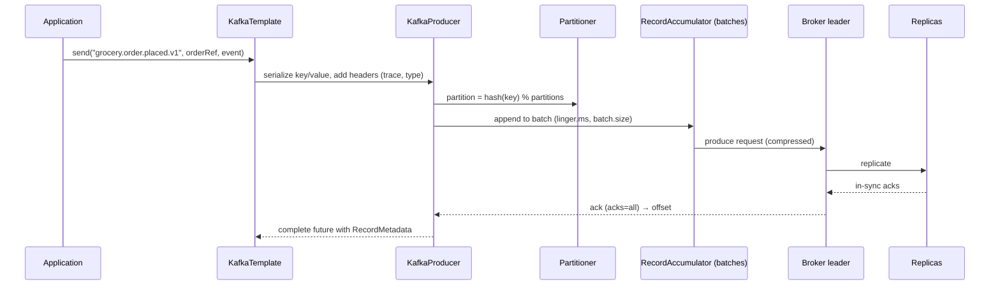
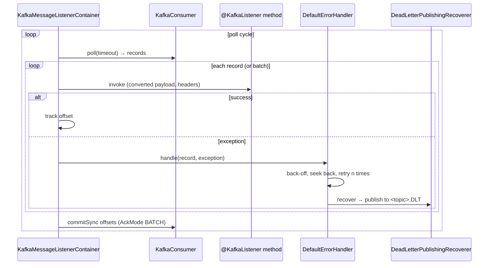
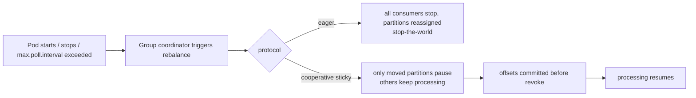
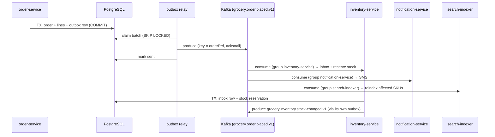

# 23 · Messaging with Kafka

## 1. Introduction & Why It Matters

Synchronous HTTP couples services in availability and latency: if inventory is slow, checkout is slow; if notification is down, orders fail. Kafka breaks that coupling. When an order is placed, `order-service` writes one event and returns; inventory reserves stock, notification sends an SMS, analytics updates dashboards, search reindexes and loyalty awards points — independently, at their own pace, and they can be down for ten minutes without losing a single event.

That power comes with a new set of failure modes, and every one of them has a name and a fix:

- **Lost events** — the database committed but the publish failed (dual write). Fix: the outbox (Chapters 16, 36).
- **Duplicate processing** — Kafka is at-least-once; a rebalance or retry re-delivers. Fix: idempotent consumers.
- **Out-of-order processing** — `OrderPaid` handled before `OrderPlaced`. Fix: partition by aggregate key.
- **Poison pills** — one unparseable message blocks a partition forever. Fix: error handlers, retry topics, DLT.
- **Silent lag** — a consumer falls 4 million messages behind and nobody notices until customers complain.
- **Schema breakage** — a producer adds a required field and every consumer fails.

This chapter covers Kafka with Spring properly: producing and consuming, partitioning and ordering, serialization and schema evolution, acknowledgement modes, error handling with retry topics and dead-letter topics, idempotent consumers with an inbox, transactions (and why the outbox still wins), batch consumption, consumer lag and observability, rebalancing during deploys, and testing with Testcontainers.

### Who should read which section

| Band | Focus |
|---|---|
| B1 · 0–2 yrs | Parts 1, 2, 4 — topics, `KafkaTemplate`, `@KafkaListener` |
| B2 · 2–5 yrs | Parts 2, 5 — keys, offsets, error handling, DLT, testing |
| B3 · 5–8 yrs | Parts 3, 5, 6 — rebalancing, idempotency, batching, tuning |
| B4 · 8–12 yrs | Parts 6, 7, 8 — topic/schema governance, delivery guarantees, operations |
| B5 · 12–15+ yrs | Parts 8, 9 — event-driven architecture strategy |

---

## 2. Core Concepts

### 2.1 Kafka in five sentences

A **topic** is an append-only log split into **partitions**. Each partition is ordered and assigned to exactly one **consumer** within a **consumer group**, which tracks its position with **offsets**. Producers choose a partition by **key** (same key → same partition → ordered). Messages are retained by time or size (or compacted by key), so consumers can replay. Brokers replicate partitions for durability.

### 2.2 Grocery topics

| Topic | Key | Retention | Purpose |
|---|---|---|---|
| `grocery.order.placed.v1` | `orderRef` | 7 days | Order lifecycle fan-out |
| `grocery.order.status-changed.v1` | `orderRef` | 7 days | Status transitions |
| `grocery.payment.captured.v1` | `orderRef` | 30 days | Payment outcomes |
| `grocery.inventory.stock-changed.v1` | `sku` | 3 days | Search/catalog updates |
| `grocery.catalog.product-changed.v1` | `sku` | compacted | Latest state per product |
| `grocery.pricing.price-changed.v1` | `sku` | 1 day | Cache invalidation (Chapter 21) |
| `grocery.*.dlt` | original | 30 days | Dead letters |

Convention: `grocery.<domain>.<event>.v<major>` — the version in the name makes an incompatible schema change a **new topic**, which consumers adopt on their own schedule.

### 2.3 Delivery guarantees

| Guarantee | Reality |
|---|---|
| At-most-once | Commit offset before processing — lose messages on crash. Rarely acceptable. |
| **At-least-once** | Process, then commit — duplicates possible. **The default and the right choice**, combined with idempotent consumers. |
| Exactly-once (EOS) | Kafka transactions for read-process-**write-to-Kafka** flows. Does **not** extend to your database. |

Since your side effects are usually database writes, "exactly once" in practice means **at-least-once delivery + idempotent processing**.

### 2.4 Producer essentials

| Setting | Recommended | Why |
|---|---|---|
| `acks` | `all` | Wait for in-sync replicas |
| `enable.idempotence` | `true` (default in modern clients) | No duplicates from producer retries |
| `max.in.flight.requests.per.connection` | ≤ 5 with idempotence | Keeps ordering |
| `compression.type` | `lz4` or `zstd` | Cheaper network and disk |
| `linger.ms` | 5–20 ms | Batching; small latency cost |
| `delivery.timeout.ms` | 120s (default) | Total time before failing the send |
| Key | aggregate id | Ordering and co-location |

### 2.5 Consumer essentials

| Setting | Notes |
|---|---|
| `group.id` | Identifies the consumer group; one offset per group per partition |
| `auto.offset.reset` | `earliest` for new consumers that must not miss history; `latest` for pure live feeds |
| `enable.auto.commit` | `false` — Spring commits offsets after successful processing |
| `max.poll.records` | Batch size per poll (default 500) |
| `max.poll.interval.ms` | Processing budget per poll before the consumer is considered dead |
| `concurrency` (Spring) | Number of consumer threads — never more than partitions |
| `isolation.level` | `read_committed` when producers use transactions |

### 2.6 Spring for Apache Kafka

| Piece | Role |
|---|---|
| `KafkaTemplate` | Send messages (returns `CompletableFuture<SendResult>`) |
| `@KafkaListener` | Consume; one or many topics; batch or record |
| `ConcurrentKafkaListenerContainerFactory` | Builds listener containers (concurrency, error handler, ack mode) |
| `AckMode` | `BATCH` (default), `RECORD`, `MANUAL`, `MANUAL_IMMEDIATE` |
| `DefaultErrorHandler` | Retries in place with back-off, then recovers (e.g. publish to DLT) |
| `DeadLetterPublishingRecoverer` | Sends failed records to `<topic>.DLT` with failure headers |
| `@RetryableTopic` | Non-blocking retries via separate retry topics |
| `KafkaAdmin` + `NewTopic` beans | Topic creation (dev only in this platform) |

### 2.7 Ordering

Order is guaranteed **only within a partition**. Therefore:

- Key by the entity whose order matters (`orderRef`), so all events for one order land on one partition.
- More partitions = more parallelism but no global order.
- Adding partitions later **changes key→partition mapping** — plan partition counts up front (they can only grow, and growth reshuffles keys).

### 2.8 Error handling ladder



**Blocking retries** stall the partition (ordering preserved, throughput lost). **Non-blocking retry topics** keep the main partition moving but lose ordering for retried records. Choose per topic.

### 2.9 Idempotent consumers

Because delivery is at-least-once, every consumer must tolerate repeats:

| Technique | Example |
|---|---|
| Natural idempotency | `UPDATE order SET status='PAID' WHERE ref=? AND status='PLACED'` |
| Inbox table | Insert `(consumer, event_id)` with a unique constraint; skip on duplicate |
| Versioned state | Ignore events with `version <= current` |
| Upsert | `INSERT ... ON CONFLICT DO UPDATE` |

### 2.10 Schema evolution

| Format | Notes |
|---|---|
| JSON (typed DTOs) | Simple, human-readable; evolution enforced by discipline and tests |
| JSON + Schema Registry | Validation and compatibility checks |
| **Avro/Protobuf + Schema Registry** | Compact, enforced compatibility (`BACKWARD` by default) |

Rules, whatever the format: **add optional fields**, never remove or repurpose; keep enums open; breaking changes mean a **new topic version**.

!!! danger "Spring's JSON type headers"
    `JsonSerializer` adds a `__TypeId__` header and `JsonDeserializer` instantiates that class. Always configure `spring.kafka.consumer.properties.spring.json.trusted.packages` (never `*`) or, better, configure the deserializer with an explicit target type — otherwise a malicious or wrong producer can drive class instantiation on the consumer.

---

## 3. How It Works Internally

### 3.1 Producing



With `enable.idempotence`, each producer has a producer id and sequence numbers, so broker-side retries don't create duplicates.

### 3.2 Consuming with Spring



Key facts:

- Offsets are committed **after** processing (at-least-once).
- Processing must finish within `max.poll.interval.ms`, or the broker removes the consumer from the group → rebalance → reprocessing.
- `concurrency = n` creates n consumers in the same group inside one application instance; total useful parallelism is bounded by partitions.

### 3.3 Rebalancing



Rolling deploys cause rebalances. Mitigations: **cooperative sticky** assignment (the modern default), **static membership** (`group.instance.id` + longer `session.timeout.ms`) so a restarting pod reclaims its partitions without a full reshuffle, and short, idempotent processing so reprocessing after a rebalance is harmless.

---

## 4. Hands-On Code — Level 1 (Beginner)

### 4.1 Configuration

```kotlin title="build.gradle.kts"
implementation("org.springframework.kafka:spring-kafka")
testImplementation("org.springframework.kafka:spring-kafka-test")
testImplementation("org.testcontainers:kafka")
```

```yaml title="application.yml"
spring:
  kafka:
    bootstrap-servers: kafka:9092
    producer:
      acks: all
      properties:
        enable.idempotence: true
        linger.ms: 10
        compression.type: lz4
      key-serializer: org.apache.kafka.common.serialization.StringSerializer
      value-serializer: org.springframework.kafka.support.serializer.JsonSerializer
    consumer:
      group-id: ${spring.application.name}
      auto-offset-reset: earliest
      enable-auto-commit: false
      key-deserializer: org.apache.kafka.common.serialization.StringDeserializer
      value-deserializer: org.springframework.kafka.support.serializer.ErrorHandlingDeserializer   # (1)!
      properties:
        spring.deserializer.value.delegate.class: org.springframework.kafka.support.serializer.JsonDeserializer
        spring.json.trusted.packages: in.grocery.*.events                                         # (2)!
    listener:
      ack-mode: batch
      concurrency: 3
      observation-enabled: true                                                                    # (3)!
    template:
      observation-enabled: true
```

1. `ErrorHandlingDeserializer` wraps the real deserializer so a malformed message becomes a handled failure (→ DLT) instead of an infinite poison-pill loop.
2. Never `*` — this controls which classes a payload can instantiate.
3. Micrometer observations for producers and consumers (traces across services, Chapter 27).

### 4.2 An event and a producer

```java title="in/grocery/order/events/OrderPlacedEvent.java"
package in.grocery.order.events;

import java.time.Instant;
import java.util.List;

public record OrderPlacedEvent(
        String eventId,                       // (1)!
        String orderRef,
        String customerId,
        String pincode,
        String total,
        List<Line> lines,
        Instant occurredAt) {

    public record Line(String sku, int quantity) {}
}
```

1. A stable event id — the basis of consumer idempotency.

```java title="in/grocery/order/events/OrderEventPublisher.java"
package in.grocery.order.events;

import org.slf4j.Logger;
import org.slf4j.LoggerFactory;
import org.springframework.kafka.core.KafkaTemplate;
import org.springframework.stereotype.Component;

@Component
public class OrderEventPublisher {

    private static final Logger log = LoggerFactory.getLogger(OrderEventPublisher.class);
    static final String TOPIC = "grocery.order.placed.v1";

    private final KafkaTemplate<String, Object> kafka;

    public OrderEventPublisher(KafkaTemplate<String, Object> kafka) {
        this.kafka = kafka;
    }

    public void publish(OrderPlacedEvent event) {
        kafka.send(TOPIC, event.orderRef(), event)                                  // (1)!
             .whenComplete((result, ex) -> {                                        // (2)!
                 if (ex != null) {
                     log.error("Failed to publish {} for {}", TOPIC, event.orderRef(), ex);
                 } else {
                     log.debug("Published {} to partition {} offset {}", event.orderRef(),
                             result.getRecordMetadata().partition(), result.getRecordMetadata().offset());
                 }
             });
    }
}
```

1. **Key = `orderRef`** → all events for one order are ordered.
2. `send` is asynchronous. Logging the failure is *not* enough for important events — that's the dual-write problem, solved with the outbox (5.5).

### 4.3 A consumer

```java title="in/grocery/notification/OrderPlacedNotifier.java"
package in.grocery.notification;

import in.grocery.order.events.OrderPlacedEvent;
import org.springframework.kafka.annotation.KafkaListener;
import org.springframework.stereotype.Component;

@Component
public class OrderPlacedNotifier {

    private final SmsSender sms;
    private final CustomerDirectory customers;

    public OrderPlacedNotifier(SmsSender sms, CustomerDirectory customers) {
        this.sms = sms;
        this.customers = customers;
    }

    @KafkaListener(topics = "grocery.order.placed.v1", groupId = "notification-service")     // (1)!
    public void onOrderPlaced(OrderPlacedEvent event) {
        String mobile = customers.mobileFor(event.customerId());
        sms.send(mobile, "Your order %s for ₹%s is confirmed.".formatted(event.orderRef(), event.total()));
    }
}
```

1. Each consuming service uses its **own group id** — every group receives every message (fan-out), while instances inside a group share partitions (scale-out).

### 4.4 A first test with Testcontainers

```java title="OrderEventFlowTest.java"
@SpringBootTest
@Testcontainers
class OrderEventFlowTest {

    @Container @ServiceConnection
    static KafkaContainer kafka = new KafkaContainer("apache/kafka:3.9.0");                  // (1)!

    @Autowired OrderEventPublisher publisher;
    @MockitoBean SmsSender sms;

    @Test
    void notifierReceivesPublishedEvent() {
        publisher.publish(new OrderPlacedEvent("evt-1", "ORD-1", "C-1", "560102", "578.00",
                List.of(new OrderPlacedEvent.Line("MILK-1L", 2)), Instant.now()));

        await().atMost(Duration.ofSeconds(10)).untilAsserted(() ->                            // (2)!
                then(sms).should().send(any(), contains("ORD-1")));
    }
}
```

1. A real broker; `@ServiceConnection` wires `spring.kafka.bootstrap-servers`.
2. Messaging is asynchronous — always assert with Awaitility, never `Thread.sleep`.

---

## 5. Hands-On Code — Level 2 (Intermediate) & Level 3 (Advanced)

### 5.1 Level 2 — Error handling and the dead-letter topic

```java title="in/grocery/platform/kafka/KafkaErrorConfig.java"
package in.grocery.platform.kafka;

import java.time.Duration;
import org.apache.kafka.common.TopicPartition;
import org.springframework.context.annotation.Bean;
import org.springframework.context.annotation.Configuration;
import org.springframework.kafka.core.KafkaOperations;
import org.springframework.kafka.listener.DefaultErrorHandler;
import org.springframework.kafka.listener.DeadLetterPublishingRecoverer;
import org.springframework.util.backoff.ExponentialBackOffWithMaxRetries;

@Configuration(proxyBeanMethods = false)
public class KafkaErrorConfig {

    @Bean
    DefaultErrorHandler kafkaErrorHandler(KafkaOperations<Object, Object> template) {
        var recoverer = new DeadLetterPublishingRecoverer(template,
                (record, exception) -> new TopicPartition(record.topic() + ".DLT", record.partition()));   // (1)!

        var backOff = new ExponentialBackOffWithMaxRetries(3);
        backOff.setInitialInterval(500);
        backOff.setMultiplier(2.0);
        backOff.setMaxInterval(5_000);

        var handler = new DefaultErrorHandler(recoverer, backOff);
        handler.addNotRetryableExceptions(                                                                 // (2)!
                org.springframework.kafka.support.serializer.DeserializationException.class,
                com.fasterxml.jackson.core.JsonProcessingException.class,
                IllegalArgumentException.class,
                jakarta.validation.ConstraintViolationException.class);
        handler.setRetryListeners((record, ex, attempt) ->                                                 // (3)!
                org.slf4j.LoggerFactory.getLogger("kafka-retry")
                        .warn("Retry {} for {}-{}@{}: {}", attempt, record.topic(), record.partition(),
                                record.offset(), ex.toString()));
        return handler;
    }
}
```

1. Failed records go to `<topic>.DLT`, keeping the original partition and carrying headers with the exception, stack trace, original topic/partition/offset and timestamp.
2. Retrying a malformed payload or a validation failure is pointless — send it straight to the DLT.
3. Retries must be visible; a silent retry storm looks like "the consumer is slow".

```java title="in/grocery/platform/kafka/DltMonitor.java"
@KafkaListener(topicPattern = "grocery\\..*\\.DLT", groupId = "dlt-monitor")                  // (1)!
public void onDeadLetter(ConsumerRecord<String, byte[]> record) {
    String originalTopic = header(record, KafkaHeaders.DLT_ORIGINAL_TOPIC);
    String exception = header(record, KafkaHeaders.DLT_EXCEPTION_FQCN);
    meters.counter("grocery.kafka.dlt", "topic", originalTopic, "exception", shortName(exception)).increment();
    log.error("Dead letter from {} key={} exception={}", originalTopic, record.key(), exception);
}
```

1. One monitor for all DLTs: metrics + alerts. **A message in a DLT is an incident**, not a log line.

### 5.2 Level 2 — Non-blocking retries

Blocking retries stall the partition. When a downstream is slow but ordering per key isn't critical, use retry topics:

```java title="in/grocery/loyalty/LoyaltyPointsConsumer.java"
@RetryableTopic(
        attempts = "4",
        backoff = @Backoff(delay = 1000, multiplier = 3.0, maxDelay = 60_000),                 // (1)!
        dltTopicSuffix = "-dlt",
        include = {DependencyException.class},                                                  // (2)!
        autoCreateTopics = "false")                                                             // (3)!
@KafkaListener(topics = "grocery.order.placed.v1", groupId = "loyalty-service")
public void award(OrderPlacedEvent event) {
    loyalty.awardPoints(event.customerId(), event.orderRef(), event.total());
}

@DltHandler
public void dlt(OrderPlacedEvent event, @Header(KafkaHeaders.ORIGINAL_TOPIC) String topic) {
    log.error("Loyalty permanently failed for {} from {}", event.orderRef(), topic);
    incidents.raise("loyalty-dlt", event.orderRef());
}
```

1. Creates `...-retry-0`, `...-retry-1`, `...-retry-2` topics with increasing delays; the main partition keeps flowing.
2. Only dependency failures are retried; everything else goes straight to the DLT.
3. Topics are provisioned by the platform (6.4) — auto-creation in production hides mistakes.

!!! warning "Retry topics lose ordering"
    A retried event is processed later than events that followed it. Use them for **commutative** work (awarding points, sending notifications, indexing), not for state machines where order matters.

### 5.3 Level 2 — Idempotent consumption with an inbox

```sql title="V60__inbox.sql"
create table processed_event (
    consumer     varchar(60) not null,
    event_id     varchar(64) not null,
    processed_at timestamptz not null default now(),
    primary key (consumer, event_id)
);
create index processed_event_cleanup_idx on processed_event (processed_at);
```

```java title="in/grocery/inventory/consumer/StockReservationConsumer.java"
package in.grocery.inventory.consumer;

import in.grocery.order.events.OrderPlacedEvent;
import org.springframework.dao.DuplicateKeyException;
import org.springframework.kafka.annotation.KafkaListener;
import org.springframework.stereotype.Component;
import org.springframework.transaction.annotation.Transactional;

@Component
public class StockReservationConsumer {

    private static final String CONSUMER = "inventory.stock-reservation";

    private final InboxRepository inbox;
    private final StockService stock;

    public StockReservationConsumer(InboxRepository inbox, StockService stock) {
        this.inbox = inbox;
        this.stock = stock;
    }

    @KafkaListener(topics = "grocery.order.placed.v1", groupId = "inventory-service")
    @Transactional                                                                            // (1)!
    public void onOrderPlaced(OrderPlacedEvent event) {
        try {
            inbox.markProcessed(CONSUMER, event.eventId());                                    // (2)!
        } catch (DuplicateKeyException alreadyDone) {
            return;                                                                            // (3)!
        }
        event.lines().forEach(line ->
                stock.reserve(event.orderRef(), line.sku(), line.quantity(), event.pincode()));
    }
}
```

1. The inbox insert and the business effect commit **together** — either both happen or neither, so a crash between them can't mark an unprocessed event as done.
2. Unique constraint on `(consumer, event_id)` does the deduplication.
3. Redelivery after a rebalance is a no-op. This is what makes at-least-once safe.

A scheduled job deletes inbox rows older than the topic retention (7 days), keeping the table small.

### 5.4 Level 3 — Batch consumption for throughput

```java title="in/grocery/search/indexer/ProductIndexConsumer.java"
@KafkaListener(topics = "grocery.catalog.product-changed.v1", groupId = "search-indexer",
               containerFactory = "batchListenerContainerFactory")                              // (1)!
public void onBatch(List<ConsumerRecord<String, ProductChanged>> records, Acknowledgment ack) {
    var skus = records.stream().map(r -> r.value().sku()).distinct().toList();                  // (2)!
    try {
        search.bulkIndex("products", loader.loadProjections(skus));
        ack.acknowledge();                                                                      // (3)!
    } catch (BulkPartialFailureException e) {
        log.warn("Bulk index partial failure: {} of {}", e.failedCount(), records.size());
        throw e;                                                                                // (4)!
    }
}
```

```java title="batchListenerContainerFactory"
@Bean
ConcurrentKafkaListenerContainerFactory<String, Object> batchListenerContainerFactory(
        ConsumerFactory<String, Object> consumerFactory, DefaultErrorHandler errorHandler) {
    var factory = new ConcurrentKafkaListenerContainerFactory<String, Object>();
    factory.setConsumerFactory(consumerFactory);
    factory.setBatchListener(true);
    factory.setConcurrency(3);
    factory.getContainerProperties().setAckMode(ContainerProperties.AckMode.MANUAL);
    factory.setCommonErrorHandler(errorHandler);
    return factory;
}
```

1. Batch mode: one call per poll instead of one per record.
2. Deduplicate within the batch — 500 events about 40 SKUs become 40 lookups.
3. Manual acknowledgement after the whole batch succeeds.
4. On failure the whole batch is retried (and duplicates are handled by idempotency). For partial failures, `BatchListenerFailedException` with the failing index lets Spring recover only that record — **verify** the API for your version.

### 5.5 Level 3 — The outbox relay (publishing side)

Chapter 16 wrote outbox rows in the business transaction. Here they reach Kafka:

```java title="in/grocery/platform/outbox/OutboxRelay.java"
package in.grocery.platform.outbox;

import io.micrometer.core.instrument.MeterRegistry;
import java.time.Duration;
import java.util.List;
import org.springframework.kafka.core.KafkaTemplate;
import org.springframework.scheduling.annotation.Scheduled;
import org.springframework.stereotype.Component;
import org.springframework.transaction.annotation.Transactional;

@Component
public class OutboxRelay {

    private final OutboxRepository outbox;
    private final KafkaTemplate<String, Object> kafka;
    private final MeterRegistry meters;

    @Scheduled(fixedDelay = 500)                                                                 // (1)!
    @Transactional
    public void relay() {
        List<OutboxRow> batch = outbox.claimBatch(200);                                          // (2)!
        for (OutboxRow row : batch) {
            try {
                kafka.send(row.topic(), row.aggregateId(), row.payload())
                     .get(Duration.ofSeconds(5).toMillis(), java.util.concurrent.TimeUnit.MILLISECONDS);  // (3)!
                outbox.markSent(row.id());
            } catch (Exception e) {
                outbox.markFailed(row.id(), e.getMessage());                                     // (4)!
                meters.counter("grocery.outbox.failures", "topic", row.topic()).increment();
                break;                                                                            // (5)!
            }
        }
        meters.gauge("grocery.outbox.pending", outbox.countPending());
    }
}
```

1. Polling every 500 ms is simple and adequate; CDC (Debezium, Chapter 36) removes the poll entirely.
2. `SELECT ... FOR UPDATE SKIP LOCKED` (Chapter 12) so multiple pods relay different rows.
3. Synchronous wait: the row is only marked sent after the broker acknowledges.
4. Failures leave the row pending for the next cycle — **at-least-once**, which consumers already tolerate.
5. Stop the batch on failure to preserve per-aggregate order and avoid hammering a broken broker.

**Pending outbox size** is a first-class alert: growing means events aren't reaching consumers even though the database looks healthy.

### 5.6 Level 3 — Kafka transactions (and their limits)

For read-process-**write-to-Kafka** pipelines (e.g. enriching a stream), exactly-once within Kafka is real:

```yaml title="application.yml"
spring:
  kafka:
    producer:
      transaction-id-prefix: enricher-${HOSTNAME}-        # (1)!
    consumer:
      isolation-level: read_committed                     # (2)!
```

```java title="Kafka transactions (and their limits) (snippet)"
@KafkaListener(topics = "grocery.order.placed.v1", groupId = "enricher")
@Transactional("kafkaTransactionManager")                                                       // (3)!
public void enrich(OrderPlacedEvent event) {
    kafka.send("grocery.order.enriched.v1", event.orderRef(), enricher.enrich(event));
}
```

1. A unique, stable transactional id per instance.
2. Consumers only see committed records.
3. Offsets and produced records commit atomically.

!!! danger "This does not include your database"
    A Kafka transaction plus a JDBC transaction is still two transactions. Ordering them ("commit DB then Kafka") reduces but never eliminates the window. The **outbox** is the correct answer whenever a database write and an event must be atomic (Chapters 16, 36).

---

## 6. Hands-On Code — Level 4 (Expert / Production)

### 6.1 The order fan-out, end to end



Every consumer: own group, own offsets, own failure handling, own DLT. A notification outage delays SMS but never blocks stock reservation.

### 6.2 Production listener configuration

```java title="in/grocery/platform/kafka/GroceryKafkaConfig.java"
package in.grocery.platform.kafka;

import java.util.Map;
import org.apache.kafka.clients.consumer.ConsumerConfig;
import org.springframework.boot.autoconfigure.kafka.KafkaProperties;
import org.springframework.context.annotation.Bean;
import org.springframework.context.annotation.Configuration;
import org.springframework.kafka.config.ConcurrentKafkaListenerContainerFactory;
import org.springframework.kafka.core.ConsumerFactory;
import org.springframework.kafka.core.DefaultKafkaConsumerFactory;
import org.springframework.kafka.listener.ContainerProperties;

@Configuration(proxyBeanMethods = false)
public class GroceryKafkaConfig {

    @Bean
    ConsumerFactory<String, Object> consumerFactory(KafkaProperties properties,
                                                    org.springframework.core.env.Environment env) {
        Map<String, Object> config = properties.buildConsumerProperties(null);
        config.put(ConsumerConfig.PARTITION_ASSIGNMENT_STRATEGY_CONFIG,
                "org.apache.kafka.clients.consumer.CooperativeStickyAssignor");                 // (1)!
        config.put(ConsumerConfig.GROUP_INSTANCE_ID_CONFIG, env.getProperty("HOSTNAME"));       // (2)!
        config.put(ConsumerConfig.SESSION_TIMEOUT_MS_CONFIG, 45_000);
        config.put(ConsumerConfig.MAX_POLL_INTERVAL_MS_CONFIG, 300_000);                        // (3)!
        config.put(ConsumerConfig.MAX_POLL_RECORDS_CONFIG, 100);
        return new DefaultKafkaConsumerFactory<>(config);
    }

    @Bean
    ConcurrentKafkaListenerContainerFactory<String, Object> kafkaListenerContainerFactory(
            ConsumerFactory<String, Object> consumerFactory,
            org.springframework.kafka.listener.DefaultErrorHandler errorHandler) {
        var factory = new ConcurrentKafkaListenerContainerFactory<String, Object>();
        factory.setConsumerFactory(consumerFactory);
        factory.setConcurrency(3);                                                              // (4)!
        factory.setCommonErrorHandler(errorHandler);
        factory.getContainerProperties().setAckMode(ContainerProperties.AckMode.BATCH);
        factory.getContainerProperties().setObservationEnabled(true);
        factory.getContainerProperties().setMicrometerEnabled(true);
        return factory;
    }
}
```

1. **Cooperative sticky** rebalancing: a deploy pauses only the partitions that actually move.
2. **Static membership**: a restarting pod (same `HOSTNAME` in a StatefulSet, or a stable id) reclaims its partitions without triggering a full reshuffle — dramatically smoother rolling deploys.
3. Processing budget per poll. If a consumer can exceed it (slow downstream), reduce `max.poll.records` or pause explicitly instead of risking a rebalance mid-batch.
4. Concurrency ≤ partitions; extra threads idle.

!!! warning "Verify"
    `KafkaProperties.buildConsumerProperties(...)` gained an `SslBundles` parameter in recent Boot versions; check the signature for yours. Static membership requires stable ids — with a Deployment, derive one from the pod ordinal/annotation rather than a random hostname.

### 6.3 Consumer lag and observability

| Signal | Source | Alert |
|---|---|---|
| Consumer lag per group/partition | `kafka_consumergroup_lag` (exporter) or `spring.kafka.listener` metrics | Lag > N or growing for 5 min |
| Records consumed/s, processing time | Micrometer listener observations | p99 processing time |
| DLT rate | `grocery.kafka.dlt` counter (5.1) | Any message |
| Outbox pending | `grocery.outbox.pending` gauge | > 1000 or rising |
| Rebalance rate | Kafka client metrics | Frequent rebalances |
| Producer error rate | `kafka.producer.record.error.total` | Any sustained errors |

```java title="in/grocery/platform/kafka/LagHealthIndicator.java"
@Component
class LagHealthIndicator implements HealthIndicator {                                           // (1)!

    @Override
    public Health health() {
        long lag = lagProvider.totalLag("inventory-service");
        return lag < 10_000
                ? Health.up().withDetail("lag", lag).build()
                : Health.down().withDetail("lag", lag).build();
    }
}
```

1. Expose lag as a health detail (not in the readiness group — a lagging consumer should keep consuming, not be restarted).

### 6.4 Topic governance

```java title="platform/topics/topics.yaml (managed by the platform team)"
topics:
  - name: grocery.order.placed.v1
    partitions: 12                                                                              # (1)!
    replication: 3
    config:
      retention.ms: 604800000        # 7 days
      min.insync.replicas: 2                                                                    # (2)!
      cleanup.policy: delete
  - name: grocery.catalog.product-changed.v1
    partitions: 6
    replication: 3
    config:
      cleanup.policy: compact                                                                   # (3)!
      min.cleanable.dirty.ratio: 0.1
```

1. Partition count is the hardest thing to change later (it reshuffles keys) — size for peak throughput and future consumer parallelism, e.g. 12 partitions ≈ 12 concurrent consumers.
2. With `acks=all`, `min.insync.replicas=2` means a write survives one broker loss; if only one replica is in sync, writes fail loudly instead of silently risking data.
3. **Compacted** topics keep the latest value per key forever — ideal for "current state of a product" that a new consumer can bootstrap from.

```yaml title="application.yml — production"
spring:
  kafka:
    admin:
      auto-create: false                                                                        # (4)!
```

4. Topics are infrastructure, created by the platform pipeline with reviewed settings. Auto-creation gives you one-partition, default-retention topics nobody planned.

### 6.5 Schema evolution rules

| Change | Allowed on `v1`? |
|---|---|
| Add an optional field | ✅ |
| Add an enum value | ✅ (consumers must tolerate unknowns — Chapter 11) |
| Rename/remove a field | ❌ → new topic `v2` |
| Change a field's type/units | ❌ → new topic `v2` |
| Tighten validation on consumers | ⚠️ coordinate |

Migration to `v2`: producers dual-publish to `v1` and `v2`, consumers migrate one by one, `v1` is retired when its consumer groups are gone (measurable from the broker).

```java title="Contract test: the event shape is a contract"
@Test
void orderPlacedEventKeepsItsContract() throws Exception {
    String json = mapper.writeValueAsString(sampleEvent());
    assertThatJson(json)                                                                        // (1)!
            .isEqualTo(Files.readString(Path.of("src/test/resources/contracts/order-placed-v1.json")));
}
```

1. A golden file for the event payload: any accidental rename fails the build (Chapter 11's discipline, applied to events). Consumer-driven contracts (Chapter 28) go further.

### 6.6 Replaying dead letters

```java title="in/grocery/platform/kafka/DltReplayService.java"
@Service
public class DltReplayService {

    /** Replays records from a DLT back to the original topic, optionally filtered. */
    public int replay(String dltTopic, Instant from, Instant to, Predicate<ConsumerRecord<String, byte[]>> filter) {
        try (var consumer = consumerFactory.createConsumer("dlt-replay-" + UUID.randomUUID(), null)) {
            var partitions = offsetsForTime(consumer, dltTopic, from);                          // (1)!
            int replayed = 0;
            for (var record : poll(consumer, partitions, to)) {
                if (!filter.test(record)) continue;
                String original = header(record, KafkaHeaders.DLT_ORIGINAL_TOPIC);
                kafka.send(original, record.key(), record.value());                              // (2)!
                replayed++;
            }
            return replayed;
        }
    }
}
```

1. Time-based seek so an operator can replay "everything from 14:00 to 15:30 yesterday".
2. Consumers are idempotent (5.3), so replay is safe — which is exactly why idempotency is non-negotiable.

Expose this as an operator command (a CLI profile as in Chapter 05), never as a public endpoint, and log who replayed what.

---

## 7. Spring Boot 3 vs 4 & Migration

| Topic | Boot 3.5 | Boot 4.x |
|---|---|---|
| Spring for Apache Kafka | 3.x | 4.x (verify) |
| Kafka clients | 3.x/4.x | 4.x — **KRaft only**, ZooKeeper removed |
| `@RetryableTopic` | ✅ | ✅ (verify attribute changes) |
| Observations | `observation-enabled` on template/listener | Same |
| Virtual threads | Listener containers can use them when `spring.threads.virtual.enabled` | Same |
| Share groups (queue semantics) | Preview in Kafka 4 | Evolving — verify support in Spring |
| JSON serializers | Jackson 2 | Jackson 3 — **payload format must stay compatible across the rollout** |

!!! danger "Rolling upgrades and serialization"
    During a Boot 3.5 → 4 rollout, 3.5 producers and 4.x consumers (and vice versa) coexist. Keep the JSON payload identical (field names, date formats), verify `__TypeId__` header handling, and test cross-version produce/consume before upgrading. Schema-registry formats (Avro) are safer here by design.

### Migration checklist

- [ ] Upgrade brokers to KRaft before Kafka 4 clients.
- [ ] Verify serializer/deserializer classes and trusted packages after the Jackson move.
- [ ] Cross-version produce/consume test (3.5 ↔ 4.x) for every topic.
- [ ] Re-check `KafkaProperties.build*Properties` signatures in custom factories.
- [ ] Re-run error-handling and DLT tests; header names must still match tooling.
- [ ] Confirm consumer group ids and static membership settings survive the deploy.

---

## 8. Production Playbook

### Best practices

1. **Outbox for publishing**; never publish inside the business transaction, never rely on "log the error".
2. **Idempotent consumers** (inbox, conditional updates, upserts) — at-least-once is the contract.
3. **Key by aggregate id** for ordering; size partitions for peak parallelism up front.
4. **`acks=all`, idempotent producer, `min.insync.replicas=2`.**
5. **Error handling ladder**: classify retryable vs not, back off, DLT, alert on every dead letter.
6. **Non-blocking retries only for commutative work.**
7. **Own group per consuming service**; concurrency ≤ partitions.
8. **Cooperative sticky + static membership** for smooth deploys.
9. **Monitor lag, DLT, outbox pending, rebalances**; alert on all four.
10. **Topics and schemas are governed infrastructure**: reviewed settings, versioned names, contract tests.

### Anti-patterns

❌ `kafka.send(...)` inside a database transaction (dual write) — the event may be published for work that rolls back, or lost.

❌ Ignoring the send future ("fire and forget") for events that matter.

❌ `spring.json.trusted.packages=*` — remote class instantiation from message headers.

❌ Auto-creating topics in production — one partition, wrong retention, no review.

❌ Consumers that aren't idempotent ("we'll just make sure it's delivered once").

❌ Long processing inside the listener beyond `max.poll.interval.ms` → endless rebalances.

❌ Concurrency greater than partitions (idle threads) or a single partition for a high-throughput topic (no parallelism).

❌ Using a DLT as a queue nobody reads.

❌ Changing an event's field meaning in place instead of publishing a new topic version.

❌ Blocking retries on a hot partition for a downstream that's down for an hour.

### Troubleshooting

| Symptom | Cause | Fix |
|---|---|---|
| Consumer lag grows steadily | Too few partitions/consumers, slow processing, downstream latency | Scale partitions+consumers, batch, profile the handler |
| Same message processed repeatedly | Exception after side effect, rebalance before commit, no idempotency | Inbox/conditional updates; shorten processing |
| Partition stuck | Poison pill retried forever | `ErrorHandlingDeserializer`, non-retryable classification, DLT |
| Frequent rebalances | `max.poll.interval.ms` exceeded, unstable pods, eager assignor | Reduce `max.poll.records`, cooperative sticky, static membership |
| Events out of order | Wrong key, retry topics, multiple producers per aggregate | Key by aggregate; avoid retry topics for ordered flows |
| `SerializationException` after a deploy | Incompatible payload change | Versioned topics, contract tests, tolerant readers |
| Messages published but never consumed | Wrong group/topic, `auto-offset-reset=latest` on a new consumer | Check group, offsets, reset policy |
| Duplicate side effects after an incident | Replay without idempotency | Make consumers idempotent before replaying |
| Broker full / retention surprises | Wrong retention/compaction settings | Governed topic configs |
| Producer blocks/times out | `buffer.memory` full, broker unreachable | Alert on producer errors; back-pressure upstream |

### Production checklist

- [ ] All publishing goes through the outbox
- [ ] Every consumer is idempotent (documented mechanism)
- [ ] Error handler with classified exceptions, back-off and DLT on every listener
- [ ] DLT monitoring + replay tooling, tested
- [ ] Lag, DLT, outbox-pending and rebalance alerts configured
- [ ] Topics provisioned with reviewed partitions/retention/replication; auto-create off
- [ ] Trusted packages restricted; schemas versioned and contract-tested
- [ ] Cooperative sticky + static membership; deploys verified not to cause reprocessing storms
- [ ] Integration tests with a real broker (Testcontainers)

---

## 9. Interview Questions & Answers

### B1 · 0–2 years

??? question "B1 · What is a Kafka topic, partition and consumer group?"
    **Short answer:** A topic is a named log split into partitions; each partition is ordered and consumed by one consumer per group; a group tracks offsets so different services (groups) each get all messages.

??? question "B1 · How do you send and receive messages in Spring Boot?"
    **Short answer:** `KafkaTemplate.send(topic, key, payload)` to produce; a `@KafkaListener` method to consume, with `spring.kafka.*` configuration.

??? question "B1 · What does the message key do?"
    **Short answer:** It determines the partition, so all messages with the same key are ordered and handled by the same consumer instance.

??? question "B1 · What delivery guarantee does Kafka give by default?"
    **Short answer:** At-least-once — messages can be redelivered, so consumers must be idempotent.

??? question "B1 · What is a dead-letter topic?"
    **Short answer:** A topic where messages that can't be processed after retries are published for inspection and replay.

### B2 · 2–5 years

??? question "B2 · How does Spring commit offsets?"
    **Short answer:** With `enable.auto.commit=false`, the listener container commits after successful processing (`AckMode` BATCH by default, or RECORD/MANUAL), giving at-least-once semantics.

??? question "B2 · How do you handle a poison pill?"
    **Short answer:** `ErrorHandlingDeserializer` turns deserialization errors into handled failures; classify them as non-retryable in `DefaultErrorHandler` so they go straight to the DLT instead of blocking the partition.

??? question "B2 · Blocking retries vs retry topics?"
    **Short answer:** Blocking retries pause the partition (ordering preserved, throughput lost); `@RetryableTopic` moves the record to delay topics so the main partition keeps flowing, at the cost of ordering.

??? question "B2 · How do you make a consumer idempotent?"
    **Short answer:** Natural idempotency (conditional updates/upserts) or an inbox table keyed by `(consumer, eventId)` written in the same transaction as the side effect.

??? question "B2 · How do you scale a consumer?"
    **Short answer:** Add instances or `concurrency` up to the partition count; beyond that, add partitions (planning for the key-reshuffle impact).

??? question "B2 · How do you test Kafka code?"
    **Short answer:** Testcontainers with a real broker (or `@EmbeddedKafka`), publishing and asserting with Awaitility; plus contract tests on event payloads.

### B3 · 5–8 years

??? question "B3 · Explain rebalancing and how to make deploys smooth."
    **Short answer:** Group membership changes trigger partition reassignment. Cooperative sticky assignment only moves affected partitions; static membership (`group.instance.id`) lets a restarting pod reclaim its partitions without a reshuffle; keep processing short and idempotent so any reprocessing is harmless.

??? question "B3 · What exactly do Kafka transactions guarantee?"
    **Short answer:** Atomic produce of multiple records plus offset commits within Kafka (`read_committed` consumers see all-or-nothing). They do **not** make a database write atomic with a publish — that needs the outbox.

??? question "B3 · Why is the outbox preferred over publishing after commit?"
    **Short answer:** A crash between commit and publish loses the event silently. The outbox row commits with the business data, and a relay publishes with at-least-once semantics and retry.

??? question "B3 · How do you keep ordering guarantees?"
    **Short answer:** Key by aggregate id; one partition per key; single producer per aggregate; idempotent producer with bounded in-flight requests; avoid retry topics for ordered flows.

??? question "B3 · What happens when processing exceeds `max.poll.interval.ms`?"
    **Short answer:** The broker considers the consumer dead, removes it from the group and rebalances; the in-flight work's offsets aren't committed, so records are reprocessed. Reduce `max.poll.records`, speed up processing, or pause the container explicitly.

### B4 · 8–12 years

??? question "B4 · Design the event architecture for the order lifecycle."
    **Short answer:** Versioned topics keyed by `orderRef`; outbox publishing from each service; per-service consumer groups with inbox idempotency; classified error handling with DLTs and replay tooling; governed topic configs (partitions, retention, replication); schema evolution rules with contract tests; lag/DLT/outbox dashboards and alerts.

??? question "B4 · How do you choose the partition count?"
    **Short answer:** From peak throughput divided by per-consumer throughput, plus headroom for future parallelism and ordering requirements (one key's events must fit one partition's throughput). Increasing later reshuffles keys, so start generous but not absurd (broker overhead per partition).

??? question "B4 · How do you migrate an event schema that must change incompatibly?"
    **Short answer:** Publish a new versioned topic; producers dual-publish; consumers migrate individually; monitor consumer groups on the old topic; retire it when empty. With a schema registry, enforce compatibility modes and use them to prevent accidental breaks.

??? question "B4 · Kafka or a database queue for a small workload?"
    **Short answer:** If you already run Kafka and need fan-out, replay or high throughput, use it. For a single consumer with modest volume, a PostgreSQL queue (`SKIP LOCKED`) is simpler to operate and transactional with your data — fewer moving parts is a real benefit.

### B5 · 12–15+ years

??? question "B5 · When does event-driven architecture hurt?"
    **Short answer:** When teams use events for request/response, when eventual consistency isn't reflected in the UX, when there's no schema governance (every change breaks someone), when debugging requires tracing across ten hops without correlation, or when operational maturity (lag monitoring, replay, DLT triage) is missing.

??? question "B5 · How do you govern events across many teams?"
    **Short answer:** An event catalog with owners and schemas, naming/versioning standards, compatibility enforcement in CI, platform libraries for outbox/idempotency/error handling, shared dashboards, and a review step for new topics — treating events as public APIs (Chapter 20).

### Scenario questions

??? example "Scenario · Stock reserved twice for some orders during a deploy"
    Pods restarted mid-batch; offsets weren't committed, so events were redelivered, and the consumer reserved stock again. Fixes: inbox table with `(consumer, eventId)` unique constraint committed in the same transaction as the reservation, plus conditional SQL (`WHERE NOT EXISTS`), cooperative sticky rebalancing and shorter batches.

??? example "Scenario · Notification consumer stuck for 6 hours, 2M messages behind"
    One malformed message (produced by an old service version) threw on deserialization; the default error handler retried forever, blocking the partition. Fixes: `ErrorHandlingDeserializer` + non-retryable classification → DLT, lag alerting (would have paged in minutes), DLT monitoring, and a contract test for the producing service.

### Coding exercise

!!! example "Exercise · Payment-captured consumer"
    Consume `grocery.payment.captured.v1` (key `orderRef`) in order-service: mark the order paid (only if currently `PLACED`), write an outbox event `OrderPaid`, be idempotent, retry only dependency failures (max 3, exponential back-off), and send anything else to the DLT. Write tests for happy path, duplicate delivery and poison pill.

??? success "Solution"
    ```java title="PaymentCapturedConsumer.java"
    package in.grocery.order.consumer;

    import in.grocery.order.outbox.OutboxWriter;
    import org.springframework.dao.DuplicateKeyException;
    import org.springframework.kafka.annotation.KafkaListener;
    import org.springframework.stereotype.Component;
    import org.springframework.transaction.annotation.Transactional;

    @Component
    public class PaymentCapturedConsumer {

        private static final String CONSUMER = "order.payment-captured";

        private final InboxRepository inbox;
        private final OrderRepository orders;
        private final OutboxWriter outbox;

        @KafkaListener(topics = "grocery.payment.captured.v1", groupId = "order-service")
        @Transactional
        public void onPaymentCaptured(PaymentCapturedEvent event) {
            try {
                inbox.markProcessed(CONSUMER, event.eventId());
            } catch (DuplicateKeyException duplicate) {
                return;                                                       // already handled
            }

            int updated = orders.markPaidIfPlaced(event.orderRef(), event.paymentId());   // (1)!
            if (updated == 0) {
                return;                                                       // (2)!
            }
            outbox.append("order", event.orderRef(), "OrderPaid",
                    new OrderPaid(event.orderRef(), event.paymentId(), event.amount()));
        }
    }
    ```

    1. Conditional update — a second mechanism of idempotency alongside the inbox.
    2. Order already paid or cancelled: nothing to do. Don't throw — that would send a perfectly valid duplicate to the DLT.

    ```java title="PaymentCapturedConsumerTest.java"
    @SpringBootTest
    @Testcontainers
    class PaymentCapturedConsumerTest {

        @Container @ServiceConnection static KafkaContainer kafka = new KafkaContainer("apache/kafka:3.9.0");
        @Container @ServiceConnection static PostgreSQLContainer<?> pg = new PostgreSQLContainer<>("postgres:17-alpine");

        @Autowired KafkaTemplate<String, Object> template;
        @Autowired OrderRepository orders;
        @Autowired OutboxRepository outbox;

        @Test
        void marksOrderPaidAndWritesOutbox() {
            String ref = seedPlacedOrder();
            template.send("grocery.payment.captured.v1", ref, new PaymentCapturedEvent("evt-1", ref, "pay_1", "578.00"));

            await().atMost(TEN_SECONDS).untilAsserted(() -> {
                assertThat(orders.findByOrderRef(ref).orElseThrow().getStatus()).isEqualTo(OrderStatus.PAID);
                assertThat(outbox.findByAggregateId(ref)).extracting(OutboxRow::eventType).contains("OrderPaid");
            });
        }

        @Test
        void duplicateDeliveryIsIgnored() {
            String ref = seedPlacedOrder();
            var event = new PaymentCapturedEvent("evt-2", ref, "pay_2", "578.00");
            template.send("grocery.payment.captured.v1", ref, event);
            template.send("grocery.payment.captured.v1", ref, event);

            await().atMost(TEN_SECONDS).untilAsserted(() ->
                    assertThat(outbox.findByAggregateId(ref)).hasSize(1));                 // exactly one OrderPaid
        }

        @Test
        void poisonPillGoesToDlt() {
            template.send("grocery.payment.captured.v1", "ORD-X", "{not json".getBytes());
            await().atMost(TEN_SECONDS).untilAsserted(() ->
                    assertThat(dltConsumer.received()).isNotEmpty());
        }
    }
    ```

    The duplicate test is the one that matters: it proves the consumer survives Kafka's at-least-once reality.

---

## Key Takeaways

- Kafka decouples services in **time and availability**; the price is at-least-once delivery and eventual consistency.
- **Publish via the outbox**, consume **idempotently** (inbox or conditional updates) — together these give effective exactly-once.
- **Key by aggregate id** for ordering; plan partitions early.
- **Classify errors**: retry transient ones with back-off, send the rest to a **DLT** — and treat DLT messages as incidents.
- **Non-blocking retry topics** only for commutative work.
- **Cooperative sticky + static membership** make deploys boring.
- **Monitor lag, DLT rate, outbox pending, rebalances.**
- **Topics and schemas are governed contracts**, versioned like APIs.

## Further Reading

- Spring for Apache Kafka Reference — listener containers, error handling, `@RetryableTopic`, transactions, observability
- Spring Boot Reference — *Messaging › Apache Kafka*
- Apache Kafka documentation — producer/consumer configs, transactions, compaction, KRaft
- Chapters 16 (transactions), 26 (resilience), 36 (outbox, sagas, CDC) of this handbook

---

[:material-arrow-left: 22 NoSQL & Search](22-nosql-search.md) · [24 RabbitMQ, Pulsar, JMS & Cloud Stream :material-arrow-right:](24-other-messaging.md)
