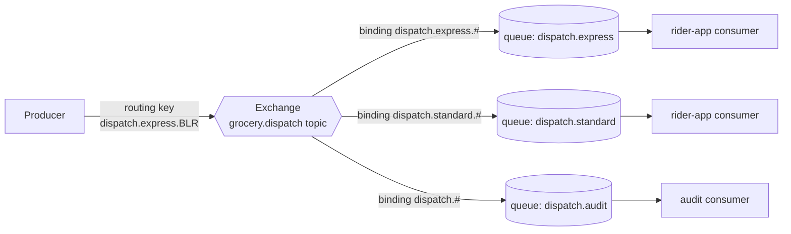
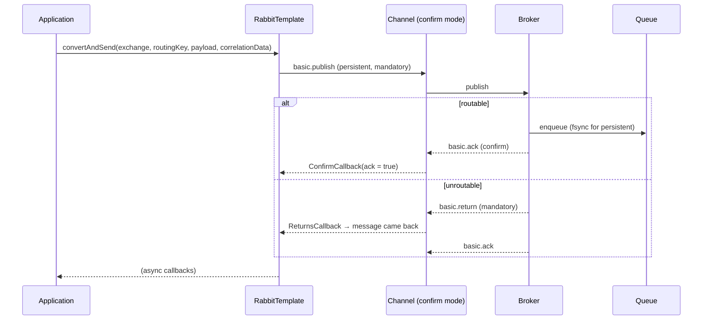
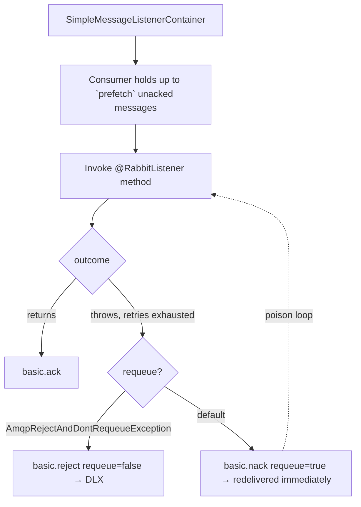
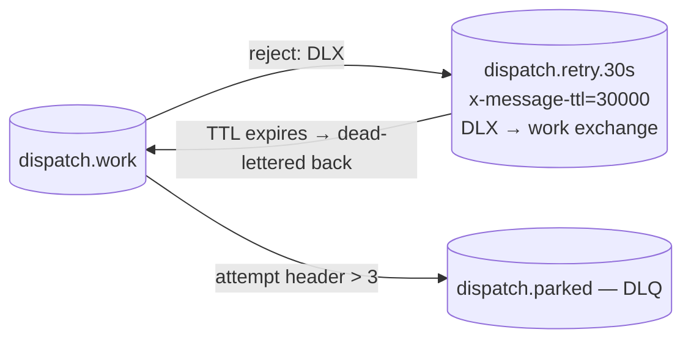
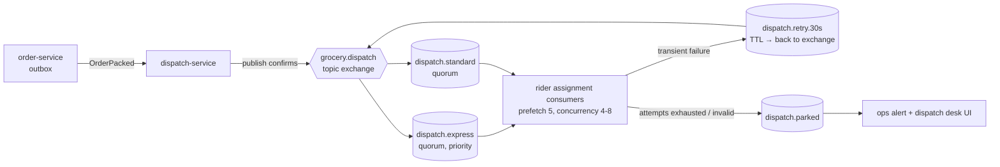
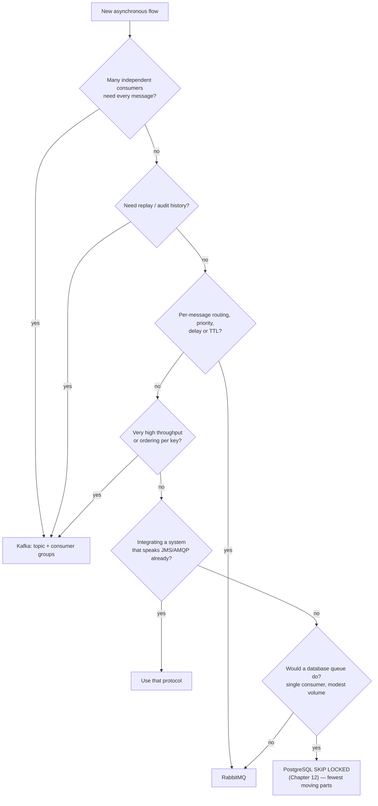
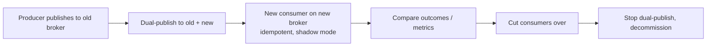

# 24 · RabbitMQ, Pulsar, JMS & Spring Cloud Stream

## 1. Introduction & Why It Matters

Kafka (Chapter 23) is a **log**: ordered, replayable, fan-out to many independent consumer groups. That makes it perfect for `OrderPlaced` — five services each want every event, at their own pace, with replay after an outage.

It is a poor fit for other jobs in the same platform:

- **Delivery dispatch.** A packed order must go to exactly one available rider, express orders before standard ones, with a retry in 30 seconds if nobody accepts. That's a **work queue with priorities and delays** — RabbitMQ's home ground.
- **Legacy ERP integration.** The finance ERP speaks JMS over ActiveMQ Artemis, because it was built in 2012 and isn't changing.
- **Multi-tenant streaming with tiered storage.** Pulsar does queueing and streaming in one system, with per-tenant isolation.
- **Binder-agnostic pipelines.** Some teams want to write the handler once and decide Kafka-or-Rabbit in configuration — Spring Cloud Stream's functional model.

This chapter covers those: the AMQP model and Spring AMQP with publisher confirms, manual acknowledgements, prefetch, dead-letter exchanges, delayed retries and quorum queues; Spring Pulsar; JMS with Artemis; and Spring Cloud Stream's functional programming model with its trade-offs. It closes with a decision guide so "which broker?" stops being an argument and becomes a lookup.

### Who should read which section

| Band | Focus |
|---|---|
| B1 · 0–2 yrs | Parts 1, 2, 4 — AMQP concepts, send/receive |
| B2 · 2–5 yrs | Parts 2, 5 — acks, prefetch, DLQ, retries, JMS basics |
| B3 · 5–8 yrs | Parts 3, 5, 6 — delivery guarantees, delayed retry, quorum queues |
| B4 · 8–12 yrs | Parts 6, 7, 8 — broker choice, operations, migration |
| B5 · 12–15+ yrs | Parts 8, 9 — messaging strategy across a platform |

---

## 2. Core Concepts

### 2.1 Log vs queue

| | Kafka (log) | RabbitMQ (queue) |
|---|---|---|
| Storage model | Append-only log, retained by time/size | Messages removed when acknowledged |
| Replay | ✅ re-read by offset | ❌ (once consumed, it's gone) |
| Routing | By topic + partition key | Exchanges, routing keys, headers — very flexible |
| Fan-out to N services | Consumer groups, independent offsets | Bind N queues to one exchange |
| Per-message features | — | TTL, priority, delay, per-message ack |
| Ordering | Per partition | Per queue (with one consumer) |
| Throughput | Very high (millions/s) | High (tens of thousands/s per queue) |
| Typical use | Event streams, audit, analytics, CDC | Work dispatch, RPC, task queues, routing |

Both are "messaging"; they solve different problems. Most mature platforms run both.

### 2.2 The AMQP model



| Concept | Meaning |
|---|---|
| **Exchange** | Receives messages and routes them. Types: `direct` (exact key), `topic` (patterns with `*`/`#`), `fanout` (all bound queues), `headers` |
| **Queue** | Stores messages until consumed and acknowledged |
| **Binding** | Rule linking exchange → queue (with a routing key pattern) |
| **Routing key** | The producer's label, e.g. `dispatch.express.BLR` |
| **Consumer** | Subscribes to a queue; competing consumers share the queue's messages |

### 2.3 Delivery guarantees in RabbitMQ

| Concern | Mechanism |
|---|---|
| Message survives a broker restart | Durable queue + **persistent** message (Spring's default delivery mode) |
| Producer knows it was stored | **Publisher confirms** (`publisher-confirm-type: correlated`) |
| Producer knows it was routable | **Publisher returns** (`mandatory: true`) — otherwise an unroutable message is silently dropped |
| Consumer doesn't lose work | Acknowledge **after** processing (`AUTO` ack mode in Spring means "ack after the handler returns") |
| Retries and poison messages | Dead-letter exchange + retry with back-off |
| High availability | **Quorum queues** (Raft-replicated) |

As with Kafka: **at-least-once plus idempotent consumers** (Chapter 23) is the practical contract.

### 2.4 Prefetch (QoS)

`prefetch` is how many unacknowledged messages a consumer may hold. Too high: one consumer hoards the queue and others idle, and a crash re-delivers a big batch. Too low: round-trip latency per message limits throughput. Start at `prefetch = 1` for slow, long tasks (fair dispatch) and 20–250 for fast ones.

### 2.5 Dead letters, delays and priorities

| Need | RabbitMQ mechanism |
|---|---|
| Failed message parking | `x-dead-letter-exchange` on the queue; rejected/expired messages go there |
| Retry after 30 s | Message published to a **delay queue** with TTL and DLX pointing back at the work queue |
| Scheduled/delayed publish | `rabbitmq_delayed_message_exchange` plugin (or the TTL+DLX pattern) |
| Priority | `x-max-priority` queue argument + per-message priority |
| Expiry | Per-message TTL or per-queue `x-message-ttl` |
| Length limits | `x-max-length`, `x-overflow` (drop-head or reject-publish) |

### 2.6 Spring AMQP

| Piece | Role |
|---|---|
| `RabbitTemplate` | Send (and RPC-style `convertSendAndReceive`) |
| `@RabbitListener` | Consume; container-managed acks |
| `SimpleRabbitListenerContainerFactory` | Concurrency, prefetch, ack mode, error handler |
| `Queue`, `TopicExchange`, `Binding` beans + `RabbitAdmin` | Declare topology |
| `MessageConverter` | `Jackson2JsonMessageConverter` for JSON |
| `RepublishMessageRecoverer` | After retries, republish to a DLQ with failure headers |

### 2.7 Spring Pulsar

Apache Pulsar unifies queueing and streaming: topics with **subscriptions** whose type decides the semantics — `Exclusive`, `Failover`, `Shared` (queue-like, competing consumers), `Key_Shared` (ordered per key, parallel across keys). Built-in delayed delivery, retry letter topics and dead-letter policy, multi-tenancy and tiered storage. Spring Boot auto-configures `PulsarTemplate` and `@PulsarListener`.

### 2.8 JMS

The Jakarta Messaging API (`jakarta.jms`), typically with ActiveMQ Artemis: `JmsTemplate` to send, `@JmsListener` to receive, **queues** (point-to-point) and **topics** (pub/sub, with durable subscriptions). Mostly relevant for integrating with existing enterprise systems.

### 2.9 Spring Cloud Stream

A binder abstraction: write `Supplier`/`Function`/`Consumer` beans, bind them to destinations in configuration, and swap Kafka for RabbitMQ without touching the handler.

| Pros | Cons |
|---|---|
| Binder-agnostic code; consistent DLQ/retry config | An abstraction layer over an abstraction layer |
| Functional, testable handlers | Broker-specific features need binder properties anyway |
| Good for simple, uniform pipelines | Harder to reason about than `@KafkaListener`/`@RabbitListener` |

Platform stance: **direct clients** (`spring-kafka`, `spring-amqp`) for services with real broker-specific needs; Cloud Stream where pipelines are simple and portability genuinely matters.

---

## 3. How It Works Internally

### 3.1 Publishing with confirms and returns



Confirms are **asynchronous**: `convertAndSend` returning doesn't mean the broker stored the message. Either wait (`waitForConfirms`) for critical sends or, better, publish from an outbox (Chapter 23) and mark rows sent inside the confirm callback.

### 3.2 Consuming and acknowledging



The default "requeue on exception" is the classic RabbitMQ poison-message loop: the same message is redelivered thousands of times per second. Always configure retries plus a recoverer that stops requeuing.

### 3.3 Delayed retry with TTL + DLX



A message that fails is dead-lettered into a TTL queue with no consumers; when the TTL expires, RabbitMQ dead-letters it **back** to the work exchange. That's a delay without any scheduler.

---

## 4. Hands-On Code — Level 1 (Beginner)

### 4.1 Setup and topology

```kotlin title="build.gradle.kts"
implementation("org.springframework.boot:spring-boot-starter-amqp")
testImplementation("org.springframework.amqp:spring-rabbit-test")
testImplementation("org.testcontainers:rabbitmq")
```

```yaml title="application.yml"
spring:
  rabbitmq:
    host: rabbitmq
    port: 5672
    username: ${RABBIT_USER}
    password: ${RABBIT_PASSWORD}
    publisher-confirm-type: correlated      # (1)!
    publisher-returns: true
    listener:
      simple:
        acknowledge-mode: auto              # (2)!
        prefetch: 20
        concurrency: 2
        max-concurrency: 8
        default-requeue-rejected: false     # (3)!
```

1. Asynchronous confirms with correlation data — required to know a message was really stored.
2. "Auto" = the container acknowledges **after** the handler returns successfully (not the broker's fire-and-forget `autoAck`).
3. Failed messages are **not** requeued endlessly; they go to the dead-letter exchange.

```java title="in/grocery/delivery/dispatch/DispatchTopology.java"
package in.grocery.delivery.dispatch;

import java.util.Map;
import org.springframework.amqp.core.Binding;
import org.springframework.amqp.core.BindingBuilder;
import org.springframework.amqp.core.Queue;
import org.springframework.amqp.core.QueueBuilder;
import org.springframework.amqp.core.TopicExchange;
import org.springframework.context.annotation.Bean;
import org.springframework.context.annotation.Configuration;

@Configuration(proxyBeanMethods = false)
class DispatchTopology {

    static final String EXCHANGE = "grocery.dispatch";
    static final String DLX = "grocery.dispatch.dlx";
    static final String EXPRESS = "dispatch.express";
    static final String STANDARD = "dispatch.standard";
    static final String PARKED = "dispatch.parked";

    @Bean TopicExchange dispatchExchange() { return new TopicExchange(EXCHANGE, true, false); }
    @Bean TopicExchange dispatchDlx() { return new TopicExchange(DLX, true, false); }

    @Bean
    Queue expressQueue() {
        return QueueBuilder.durable(EXPRESS)
                .quorum()                                                     // (1)!
                .withArgument("x-max-priority", 5)                            // (2)!
                .deadLetterExchange(DLX)
                .deadLetterRoutingKey("parked")
                .build();
    }

    @Bean Queue standardQueue() {
        return QueueBuilder.durable(STANDARD).quorum().deadLetterExchange(DLX)
                .deadLetterRoutingKey("parked").build();
    }

    @Bean Queue parkedQueue() { return QueueBuilder.durable(PARKED).quorum().build(); }

    @Bean Binding expressBinding() {
        return BindingBuilder.bind(expressQueue()).to(dispatchExchange()).with("dispatch.express.#");   // (3)!
    }

    @Bean Binding standardBinding() {
        return BindingBuilder.bind(standardQueue()).to(dispatchExchange()).with("dispatch.standard.#");
    }

    @Bean Binding parkedBinding() {
        return BindingBuilder.bind(parkedQueue()).to(dispatchDlx()).with("parked");
    }
}
```

1. **Quorum queues** (Raft-replicated) are the modern HA option; classic mirrored queues are removed in RabbitMQ 4.
2. Priority support must be declared on the queue; per-message priority does nothing otherwise.
3. Topic patterns: `*` = one word, `#` = zero or more.

!!! warning "Topology is infrastructure"
    Declaring queues from the application is convenient in development. In production, queue arguments (quorum, TTL, max-length) are reviewed infrastructure, like Kafka topics (Chapter 23) — declare them in a provisioning pipeline and let the app **assert** rather than create.

### 4.2 Producing and consuming

```java title="in/grocery/delivery/dispatch/DispatchPublisher.java"
package in.grocery.delivery.dispatch;

import org.springframework.amqp.core.MessagePostProcessor;
import org.springframework.amqp.rabbit.connection.CorrelationData;
import org.springframework.amqp.rabbit.core.RabbitTemplate;
import org.springframework.stereotype.Component;

@Component
public class DispatchPublisher {

    private final RabbitTemplate rabbit;

    public DispatchPublisher(RabbitTemplate rabbit) {
        this.rabbit = rabbit;
    }

    public void dispatch(DispatchTask task) {
        String routingKey = "dispatch.%s.%s".formatted(task.express() ? "express" : "standard", task.hubCode());
        MessagePostProcessor priority = message -> {
            message.getMessageProperties().setPriority(task.express() ? 5 : 1);      // (1)!
            message.getMessageProperties().setHeader("x-attempt", 1);
            return message;
        };
        rabbit.convertAndSend(DispatchTopology.EXCHANGE, routingKey, task, priority,
                new CorrelationData(task.orderRef()));                                // (2)!
    }
}
```

1. Express orders jump the queue.
2. Correlation data links the asynchronous confirm callback back to this message (5.1).

```java title="in/grocery/delivery/dispatch/DispatchConsumer.java"
package in.grocery.delivery.dispatch;

import org.springframework.amqp.rabbit.annotation.RabbitListener;
import org.springframework.stereotype.Component;

@Component
public class DispatchConsumer {

    private final RiderAssignmentService assignment;

    public DispatchConsumer(RiderAssignmentService assignment) {
        this.assignment = assignment;
    }

    @RabbitListener(queues = DispatchTopology.EXPRESS, concurrency = "4-8")           // (1)!
    public void onExpress(DispatchTask task) {
        assignment.assign(task);                                                      // (2)!
    }

    @RabbitListener(queues = DispatchTopology.STANDARD, concurrency = "2-6")
    public void onStandard(DispatchTask task) {
        assignment.assign(task);
    }
}
```

1. **Competing consumers**: each message goes to exactly one consumer — the opposite of Kafka's fan-out to groups.
2. The handler must be idempotent: a redelivery after a crash must not assign two riders (assignment uses a conditional update, Chapter 12).

### 4.3 JSON conversion

```java title="in/grocery/platform/amqp/RabbitJsonConfig.java"
@Bean
MessageConverter jsonMessageConverter(ObjectMapper mapper) {
    return new Jackson2JsonMessageConverter(mapper);                                  // (1)!
}
```

1. Uses Boot's configured mapper (Chapter 11). The converter writes a `__TypeId__` header; restrict trusted packages on the consumer side (`DefaultJackson2JavaTypeMapper#setTrustedPackages`) exactly as with Kafka.

### 4.4 A first test

```java title="DispatchFlowTest.java"
@SpringBootTest
@Testcontainers
class DispatchFlowTest {

    @Container @ServiceConnection
    static RabbitMQContainer rabbit = new RabbitMQContainer("rabbitmq:4-management");   // (1)!

    @Autowired DispatchPublisher publisher;
    @MockitoBean RiderAssignmentService assignment;

    @Test
    void expressTaskReachesConsumer() {
        publisher.dispatch(new DispatchTask("ORD-1", "BLR-HSR", true));

        await().atMost(Duration.ofSeconds(10))
               .untilAsserted(() -> then(assignment).should().assign(argThat(t -> t.orderRef().equals("ORD-1"))));
    }
}
```

1. A real broker; `@ServiceConnection` wires the connection factory.

---

## 5. Hands-On Code — Level 2 (Intermediate) & Level 3 (Advanced)

### 5.1 Level 2 — Confirms, returns and the outbox

```java title="in/grocery/platform/amqp/ConfirmingRabbitConfig.java"
package in.grocery.platform.amqp;

import org.slf4j.Logger;
import org.slf4j.LoggerFactory;
import org.springframework.amqp.rabbit.connection.ConnectionFactory;
import org.springframework.amqp.rabbit.core.RabbitTemplate;
import org.springframework.amqp.support.converter.MessageConverter;
import org.springframework.context.annotation.Bean;
import org.springframework.context.annotation.Configuration;

@Configuration(proxyBeanMethods = false)
public class ConfirmingRabbitConfig {

    private static final Logger log = LoggerFactory.getLogger(ConfirmingRabbitConfig.class);

    @Bean
    RabbitTemplate rabbitTemplate(ConnectionFactory factory, MessageConverter converter,
                                  OutboxRepository outbox, io.micrometer.core.instrument.MeterRegistry meters) {
        RabbitTemplate template = new RabbitTemplate(factory);
        template.setMessageConverter(converter);
        template.setMandatory(true);                                                      // (1)!

        template.setConfirmCallback((correlation, ack, cause) -> {                        // (2)!
            String id = correlation == null ? "unknown" : correlation.getId();
            if (ack) {
                outbox.markSent(id);
            } else {
                log.error("Broker rejected message {}: {}", id, cause);
                meters.counter("grocery.amqp.nack").increment();
            }
        });

        template.setReturnsCallback(returned -> {                                          // (3)!
            log.error("Unroutable message: exchange={} routingKey={} reply={}",
                    returned.getExchange(), returned.getRoutingKey(), returned.getReplyText());
            meters.counter("grocery.amqp.unroutable", "exchange", returned.getExchange()).increment();
        });
        return template;
    }
}
```

1. Without `mandatory`, a message whose routing key matches no binding is **silently discarded** — a typo in a routing key becomes lost work with no error anywhere.
2. Outbox rows are marked sent only when the broker confirms (Chapter 23's relay pattern, AMQP flavour).
3. Unroutable messages are an operational alert, not a debug log.

### 5.2 Level 2 — Retry, delay and parking

```yaml title="application.yml"
spring:
  rabbitmq:
    listener:
      simple:
        retry:
          enabled: true                 # (1)!
          initial-interval: 1s
          multiplier: 2
          max-attempts: 3
          max-interval: 10s
```

1. **In-memory blocking retries** inside the consumer. Good for a 200 ms blip; useless for a dependency that's down for ten minutes — that needs the delayed-retry queue below.

```java title="in/grocery/delivery/dispatch/DelayedRetryTopology.java"
@Bean
Queue retry30s() {
    return QueueBuilder.durable("dispatch.retry.30s")
            .quorum()
            .ttl(30_000)                                                   // (1)!
            .deadLetterExchange(DispatchTopology.EXCHANGE)                 // (2)!
            .deadLetterRoutingKey("dispatch.standard.retry")
            .build();
}
```

1. No consumer on this queue — messages simply sit for 30 seconds.
2. On expiry they're dead-lettered back to the work exchange.

```java title="in/grocery/delivery/dispatch/DispatchConsumer.java (with attempts)"
@RabbitListener(queues = DispatchTopology.STANDARD)
public void onStandard(DispatchTask task, Message message) {
    int attempt = (int) message.getMessageProperties().getHeaders().getOrDefault("x-attempt", 1);
    try {
        assignment.assign(task);
    } catch (DependencyException transientFailure) {
        if (attempt >= 5) {
            throw new AmqpRejectAndDontRequeueException("Giving up after " + attempt + " attempts",
                    transientFailure);                                                              // (1)!
        }
        rabbit.convertAndSend("", "dispatch.retry.30s", task, m -> {                                // (2)!
            m.getMessageProperties().setHeader("x-attempt", attempt + 1);
            return m;
        });
    }
}
```

1. Rejecting without requeue sends the message to the configured dead-letter exchange → `dispatch.parked`.
2. Otherwise republish into the delay queue with an incremented attempt counter. (Publishing to the **default exchange** `""` with the queue name as routing key delivers straight to that queue.)

!!! tip "The delayed-message plugin"
    `rabbitmq_delayed_message_exchange` lets you publish with an `x-delay` header and skip the TTL-queue dance. It's a plugin, so check that your managed RabbitMQ supports it; the TTL+DLX pattern works everywhere.

### 5.3 Level 2 — Parked-message handling

```java title="in/grocery/delivery/dispatch/ParkedConsumer.java"
@RabbitListener(queues = DispatchTopology.PARKED)
public void onParked(DispatchTask task, Message message) {
    String reason = header(message, "x-first-death-reason");                     // (1)!
    meters.counter("grocery.dispatch.parked", "hub", task.hubCode()).increment();
    incidents.raise("dispatch-parked", task.orderRef(), reason);
    ops.notifyDispatchDesk(task);                                                 // (2)!
}
```

1. RabbitMQ adds `x-death` headers describing why and where the message died — queue, reason, count, timestamps.
2. A parked delivery task is a **customer waiting for groceries**: a human must see it within minutes, not a dashboard nobody opens.

### 5.4 Level 3 — Manual acknowledgement and batch-like control

```java title="in/grocery/delivery/dispatch/ManualAckConsumer.java"
@RabbitListener(queues = DispatchTopology.EXPRESS, ackMode = "MANUAL")
public void onExpress(DispatchTask task, Channel channel,
                      @Header(AmqpHeaders.DELIVERY_TAG) long tag) throws IOException {
    try {
        assignment.assign(task);
        channel.basicAck(tag, false);                                             // (1)!
    } catch (RiderPoolExhaustedException retryLater) {
        channel.basicNack(tag, false, true);                                      // (2)!
    } catch (InvalidDispatchTaskException poison) {
        channel.basicReject(tag, false);                                          // (3)!
    }
}
```

1. Acknowledge exactly what was processed.
2. Requeue deliberately — acceptable here because the condition is short-lived and the message has a TTL. **Add a small sleep or use the delay queue**; an immediate requeue loop can spin a CPU.
3. Reject without requeue → dead-letter exchange.

Manual mode is for when the ack decision depends on business outcome. Otherwise `AUTO` (ack after the handler returns) is simpler and less error-prone.

### 5.5 Level 3 — JMS for the ERP integration

```kotlin title="build.gradle.kts"
implementation("org.springframework.boot:spring-boot-starter-artemis")
```

```yaml title="application.yml"
spring:
  artemis:
    mode: native
    broker-url: tcp://erp-broker:61616
    user: ${ERP_MQ_USER}
    password: ${ERP_MQ_PASSWORD}
  jms:
    listener:
      session:
        acknowledge-mode: client
      min-concurrency: 1
      max-concurrency: 4
```

```java title="in/grocery/finance/erp/ErpSettlementListener.java"
package in.grocery.finance.erp;

import jakarta.jms.Session;
import org.springframework.jms.annotation.JmsListener;
import org.springframework.jms.core.JmsTemplate;
import org.springframework.stereotype.Component;
import org.springframework.transaction.annotation.Transactional;

@Component
public class ErpSettlementListener {

    private final SettlementService settlements;
    private final JmsTemplate jms;

    public ErpSettlementListener(SettlementService settlements, JmsTemplate jms) {
        this.settlements = settlements;
        this.jms = jms;
    }

    @JmsListener(destination = "ERP.SETTLEMENT.CONFIRMATIONS", concurrency = "1-4")       // (1)!
    @Transactional
    public void onConfirmation(SettlementConfirmation confirmation) {
        settlements.recordConfirmation(confirmation.settlementId(), confirmation.utr());   // (2)!
    }

    public void sendBatch(SettlementBatch batch) {
        jms.convertAndSend("ERP.SETTLEMENT.REQUESTS", batch);                              // (3)!
    }
}
```

1. Point-to-point queue: one consumer per message, competing consumers for throughput.
2. Idempotent by settlement id — ERP systems love redelivering.
3. `JmsTemplate` sends are synchronous by default; wrap batch sends in the outbox pattern if they must be atomic with database state.

!!! note "JMS topics and durable subscriptions"
    For pub/sub over JMS, a **durable subscription** (`@JmsListener(destination = "...", subscription = "grocery-finance", containerFactory = "topicFactory")` with `pubSubDomain=true`) keeps messages while the consumer is down — the JMS equivalent of a Kafka consumer group's retained offset.

### 5.6 Level 3 — Spring Pulsar

```kotlin title="build.gradle.kts"
implementation("org.springframework.boot:spring-boot-starter-pulsar")
```

```java title="in/grocery/tracking/PulsarTrackingPipeline.java"
package in.grocery.tracking;

import org.apache.pulsar.client.api.SubscriptionType;
import org.springframework.pulsar.annotation.PulsarListener;
import org.springframework.pulsar.core.PulsarTemplate;
import org.springframework.stereotype.Component;

@Component
public class PulsarTrackingPipeline {

    private final PulsarTemplate<RiderPing> template;

    public PulsarTrackingPipeline(PulsarTemplate<RiderPing> template) {
        this.template = template;
    }

    public void publish(RiderPing ping) {
        template.send("persistent://grocery/tracking/rider-pings", ping);
    }

    @PulsarListener(topics = "persistent://grocery/tracking/rider-pings",
                    subscriptionName = "eta-calculator",
                    subscriptionType = SubscriptionType.Key_Shared)                        // (1)!
    public void onPing(RiderPing ping) {
        eta.update(ping.riderId(), ping.lat(), ping.lon());
    }
}
```

1. **`Key_Shared`**: ordering per rider, parallelism across riders — Kafka's per-key ordering without partition count being fixed in advance. Pulsar also has built-in retry-letter and dead-letter policies configurable per listener.

**Verify** subscription-type names and `@PulsarListener` attributes for your Spring Pulsar version.

### 5.7 Level 3 — Spring Cloud Stream, functionally

```kotlin title="build.gradle.kts"
implementation("org.springframework.cloud:spring-cloud-stream")
implementation("org.springframework.cloud:spring-cloud-stream-binder-rabbit")   // or -kafka
```

```java title="in/grocery/notification/NotificationFunctions.java"
package in.grocery.notification;

import java.util.function.Consumer;
import java.util.function.Function;
import org.springframework.context.annotation.Bean;
import org.springframework.context.annotation.Configuration;

@Configuration(proxyBeanMethods = false)
class NotificationFunctions {

    @Bean
    Function<OrderPlacedEvent, NotificationRequest> toNotification(NotificationBuilder builder) {   // (1)!
        return builder::build;
    }

    @Bean
    Consumer<NotificationRequest> sendNotification(NotificationSender sender) {
        return sender::send;
    }
}
```

```yaml title="application.yml"
spring:
  cloud:
    function:
      definition: toNotification;sendNotification                                   # (2)!
    stream:
      bindings:
        toNotification-in-0:
          destination: grocery.order.placed.v1
          group: notification-service                                               # (3)!
          consumer:
            max-attempts: 3
            back-off-initial-interval: 1000
        toNotification-out-0:
          destination: grocery.notification.requests
        sendNotification-in-0:
          destination: grocery.notification.requests
          group: notification-sender
      rabbit:
        bindings:
          sendNotification-in-0:
            consumer:
              auto-bind-dlq: true                                                    # (4)!
              republish-to-dlq: true
```

1. Plain functions — trivially unit-testable, no broker annotations.
2. Which functions to wire (`;` = separate flows, `|` = composed).
3. `group` gives competing-consumer semantics (one instance handles each message) — without it every instance gets a copy.
4. DLQ configuration lives in binder-specific properties, which is where the abstraction starts leaking.

```java title="NotificationFunctionsTest.java"
@SpringBootTest
@Import(TestChannelBinderConfiguration.class)                                        // (1)!
class NotificationFunctionsTest {

    @Autowired InputDestination input;
    @Autowired OutputDestination output;

    @Test
    void mapsOrderToNotification() {
        input.send(new GenericMessage<>(sampleOrderEvent()), "grocery.order.placed.v1");
        Message<byte[]> produced = output.receive(2000, "grocery.notification.requests");
        assertThat(new String(produced.getPayload())).contains("ORD-1");
    }
}
```

1. The test binder runs the whole pipeline in memory — fast tests without a broker (complement with one Testcontainers test for the real binder).

---

## 6. Hands-On Code — Level 4 (Expert / Production)

### 6.1 Delivery dispatch, production shape

Requirements: express before standard, exactly one rider per task, retry with back-off for 5 minutes, park and alert after that, survive broker node loss, visible queue depth.



```java title="in/grocery/delivery/dispatch/RiderAssignmentService.java"
package in.grocery.delivery.dispatch;

import org.springframework.stereotype.Service;
import org.springframework.transaction.annotation.Transactional;

@Service
public class RiderAssignmentService {

    private final AssignmentRepository assignments;
    private final RiderPool riders;

    @Transactional
    public void assign(DispatchTask task) {
        if (assignments.existsForOrder(task.orderRef())) {                                  // (1)!
            return;
        }
        String riderId = riders.claimNearest(task.hubCode(), task.express())                 // (2)!
                .orElseThrow(() -> new RiderPoolExhaustedException(task.hubCode()));
        int inserted = assignments.insertIfAbsent(task.orderRef(), riderId);                 // (3)!
        if (inserted == 0) {
            riders.release(riderId);
            return;
        }
        riders.notifyAssignment(riderId, task.orderRef());
    }
}
```

1. Cheap idempotency check for the common redelivery case.
2. `SELECT ... FOR UPDATE SKIP LOCKED` over available riders (Chapter 12) — two consumers never claim the same rider.
3. The unique constraint is the real guarantee; the check above is just an optimization. Release the rider if we lost the race.

```yaml title="application-prod.yml"
spring:
  rabbitmq:
    listener:
      simple:
        prefetch: 5                       # (1)!
        concurrency: 4
        max-concurrency: 8
        default-requeue-rejected: false
        retry:
          enabled: true
          max-attempts: 2                 # (2)!
          initial-interval: 500ms
```

1. Low prefetch for fair dispatch: assignment takes ~200 ms and involves a rider claim, so hoarding 250 messages in one consumer would starve the others.
2. Only a token in-memory retry; real back-off uses the delay queue (5.2).

### 6.2 Operations and observability

| Signal | Source | Alert |
|---|---|---|
| Queue depth (`messages_ready`) | RabbitMQ Prometheus plugin | Depth > N or growing 5 min |
| Unacked messages | Broker metrics | High and static = stuck consumer |
| Consumer count per queue | Broker metrics | Zero on a work queue |
| Parked queue depth | Broker metrics + our counter | **Any** message |
| Publish confirms nacked / unroutable | `grocery.amqp.nack`, `grocery.amqp.unroutable` | Any |
| Redelivered ratio | Broker metrics | Spike = poison loop or crash loop |
| Connection/channel churn | Broker metrics | Indicates client bugs |

```java title="in/grocery/delivery/dispatch/QueueDepthHealth.java"
@Component
class QueueDepthHealth implements HealthIndicator {

    private final RabbitAdmin admin;

    @Override
    public Health health() {
        Properties props = admin.getQueueProperties(DispatchTopology.PARKED);                 // (1)!
        int parked = props == null ? 0 : (int) props.get("QUEUE_MESSAGE_COUNT");
        return parked == 0 ? Health.up().build()
                : Health.down().withDetail("parkedMessages", parked).build();
    }
}
```

1. Surfaced in `/actuator/health` (not in the readiness group — a parked message shouldn't remove the pod from load balancing, it should page a human).

### 6.3 Choosing a broker — the decision guide



The last branch matters: **not every asynchronous need requires a broker.** A `SELECT ... FOR UPDATE SKIP LOCKED` queue in PostgreSQL is transactional with your data, needs no new infrastructure, and handles thousands of messages per minute comfortably.

| Platform decision | Broker |
|---|---|
| Order/payment/inventory events, search indexing, analytics | Kafka |
| Rider dispatch, notification retries with delays, per-hub routing | RabbitMQ |
| ERP settlement exchange | JMS (their broker) |
| Nightly report generation queue | PostgreSQL job table |

### 6.4 Migrating a flow between brokers



Idempotent consumers (Chapter 23) make the overlap safe: during the cutover both may process the same logical message, and nothing breaks.

### 6.5 Testing the delayed-retry path

```java title="DispatchRetryIntegrationTest.java"
@SpringBootTest
@Testcontainers
class DispatchRetryIntegrationTest {

    @Container @ServiceConnection
    static RabbitMQContainer rabbit = new RabbitMQContainer("rabbitmq:4-management");

    @Autowired DispatchPublisher publisher;
    @MockitoBean RiderAssignmentService assignment;

    @Test
    void transientFailureIsRetriedAfterDelayThenParked() {
        willThrow(new RiderPoolExhaustedException("BLR-HSR")).given(assignment).assign(any());   // (1)!

        publisher.dispatch(new DispatchTask("ORD-R1", "BLR-HSR", false));

        await().atMost(Duration.ofSeconds(20))                                                   // (2)!
               .untilAsserted(() -> then(assignment).should(atLeast(2)).assign(any()));
    }

    @Test
    void invalidTaskGoesStraightToParked() {
        willThrow(new InvalidDispatchTaskException("no hub")).given(assignment).assign(any());

        publisher.dispatch(new DispatchTask("ORD-R2", "XXX", false));

        await().atMost(Duration.ofSeconds(10)).untilAsserted(() ->
                assertThat(queueDepth(DispatchTopology.PARKED)).isEqualTo(1));                   // (3)!
    }
}
```

1. Simulate a dependency that keeps failing.
2. Use a **short TTL** in the test profile (e.g. 2 s instead of 30 s) so the retry path is testable in seconds — configuration, not code, makes that possible.
3. Assert on the broker's queue depth, not just on mock interactions: the parked path is the one nobody tests and everybody needs.

---

## 7. Spring Boot 3 vs 4 & Migration

| Topic | Boot 3.5 | Boot 4.x |
|---|---|---|
| Spring AMQP | 3.x | 4.x (verify) |
| RabbitMQ server | 3.13 / 4.x | 4.x — **classic mirrored queues removed**, use quorum |
| AMQP 1.0 | Limited | RabbitMQ 4 supports AMQP 1.0 natively; Spring AMQP client support — verify |
| JMS | Jakarta Messaging 3.1 (Artemis) | Jakarta Messaging 3.1+ (verify) |
| Spring Pulsar | 1.x (Boot 3.2+) | Next major (verify) |
| Spring Cloud Stream | 4.x release train | Release train aligned with Boot 4 (verify) |
| Message converters | Jackson 2 | Jackson 3 — payload compatibility across a rollout (Chapter 23) |

### Migration checklist

- [ ] Replace classic mirrored queues with **quorum queues** before RabbitMQ 4 (this is a queue re-declaration, i.e. a migration — plan drain/cutover).
- [ ] Verify `Jackson2JsonMessageConverter` equivalents and trusted-package settings after the Jackson move.
- [ ] Re-test confirm/return callbacks and retry configuration after upgrading Spring AMQP.
- [ ] Check Spring Cloud Stream release-train compatibility before upgrading Boot.
- [ ] Cross-version publish/consume test during the rollout window.

---

## 8. Production Playbook

### Best practices

1. **Pick the broker per flow** using the decision guide; write the reason in an ADR.
2. **Durable queues, persistent messages, publisher confirms, `mandatory`** — otherwise messages vanish silently.
3. **Never requeue blindly**: `default-requeue-rejected: false`, retry with back-off, then park.
4. **Delayed retries via TTL+DLX** (or the delay plugin) rather than in-memory sleeps.
5. **Quorum queues** for anything that matters.
6. **Idempotent consumers** — the same rule as Kafka.
7. **Tune prefetch** to the work profile; low for slow tasks, higher for fast ones.
8. **Alert on parked queues, unroutable messages and consumer count = 0.**
9. **Topology as infrastructure**, reviewed and provisioned, not invented at startup.
10. **Prefer a database queue** when a broker isn't justified.

### Anti-patterns

❌ Using RabbitMQ as an event log ("we'll replay from the queue") — consumed messages are gone.

❌ Using Kafka as a work queue with per-message delays and priorities — it has neither.

❌ Auto-acknowledging before processing (`acknowledge-mode: none`).

❌ Unbounded requeue on exception — a poison message spins the consumer at 100% CPU.

❌ Publishing without `mandatory` and without confirms, then wondering where messages went.

❌ Very high prefetch on slow handlers — one consumer hoards the queue.

❌ Declaring production topology from application code with different arguments per service.

❌ Cloud Stream chosen for "portability" that nobody will ever use, at the cost of clarity.

❌ Long processing while holding an unacked message beyond the consumer timeout.

### Troubleshooting

| Symptom | Cause | Fix |
|---|---|---|
| Messages disappear | Unroutable (no binding), no `mandatory`/returns | Enable returns; alert; fix routing key |
| Queue grows, consumers idle | Prefetch exhausted by stuck messages; consumers crashed | Check unacked count, consumer count, restart, lower prefetch |
| Same message processed forever | Requeue on exception | `default-requeue-rejected: false` + DLX |
| 100% CPU with no progress | Poison loop | Same as above; inspect `x-death` headers |
| `PRECONDITION_FAILED - inequivalent arg` | Queue declared with different arguments | Align declarations; provision topology centrally |
| Consumers rebalance/disconnect | Heartbeat/network timeouts, long processing blocking the connection thread | Tune heartbeat, move work off the listener thread |
| High memory on broker | Unbounded queues, no TTL/max-length | `x-max-length`, TTLs, consumer scaling |
| Duplicate side effects | Redelivery without idempotency | Inbox/unique constraints (Chapter 23) |
| JMS messages stuck in ERP queue | No durable subscription / wrong ack mode | Check subscription and acknowledge mode |

### Production checklist

- [ ] Broker choice documented per flow
- [ ] Durable + persistent + confirms + mandatory on all producers
- [ ] Retry/park topology declared and provisioned centrally
- [ ] Parked queue alerting to a human channel
- [ ] Prefetch/concurrency tuned and load-tested
- [ ] Quorum queues everywhere that matters
- [ ] Consumers idempotent (documented mechanism)
- [ ] Queue depth, unacked, consumer count dashboards
- [ ] Delayed-retry path covered by an integration test

---

## 9. Interview Questions & Answers

### B1 · 0–2 years

??? question "B1 · What are exchanges, queues and bindings?"
    **Short answer:** Producers publish to an **exchange** with a routing key; **bindings** route matching messages into **queues**; consumers read from queues. Exchange types: direct, topic, fanout, headers.

??? question "B1 · How is RabbitMQ different from Kafka?"
    **Short answer:** RabbitMQ is a queue — messages are removed once acknowledged, with rich routing, priorities and TTLs. Kafka is a retained log — consumers track offsets and can replay, with fan-out to independent groups.

??? question "B1 · How do you consume messages in Spring?"
    **Short answer:** `@RabbitListener(queues = "...")` for AMQP, `@JmsListener(destination = "...")` for JMS; the container acknowledges after the handler returns successfully.

??? question "B1 · What is a dead-letter queue?"
    **Short answer:** A queue that receives messages rejected or expired elsewhere, so failures can be inspected and replayed instead of being lost or retried forever.

??? question "B1 · What does prefetch control?"
    **Short answer:** How many unacknowledged messages a consumer may hold at once — the trade-off between throughput and fair distribution.

### B2 · 2–5 years

??? question "B2 · How do you make sure a published message isn't lost?"
    **Short answer:** Durable queue, persistent message, publisher **confirms** (know it was stored) and `mandatory` + returns (know it was routable) — and publish from an outbox so the database write and the publish can't diverge.

??? question "B2 · How do you retry a failed message after 30 seconds without blocking the consumer?"
    **Short answer:** Publish it to a TTL queue with no consumers whose dead-letter exchange points back at the work exchange (or use the delayed-message plugin), carrying an attempt counter and parking after N attempts.

??? question "B2 · Why is `default-requeue-rejected: false` important?"
    **Short answer:** Otherwise a failing message is immediately requeued and redelivered in a tight loop, burning CPU and blocking the queue — the classic poison-message incident.

??? question "B2 · Quorum vs classic queues?"
    **Short answer:** Quorum queues replicate via Raft with predictable failover and are the supported HA option (classic mirrored queues are removed in RabbitMQ 4). They trade some memory/throughput for safety.

??? question "B2 · What does Spring Cloud Stream give you?"
    **Short answer:** Binder-agnostic messaging with functional handlers (`Supplier`/`Function`/`Consumer`) and consistent retry/DLQ configuration, at the cost of an extra abstraction over broker-specific features.

### B3 · 5–8 years

??? question "B3 · Walk through delivery guarantees in RabbitMQ."
    **Short answer:** Producer → broker: confirms (+ mandatory for routability). Broker durability: durable queue + persistent message (+ quorum replication). Broker → consumer: acknowledge after processing; rejected messages dead-letter. Net effect is at-least-once, so consumers must be idempotent.

??? question "B3 · How do you choose prefetch?"
    **Short answer:** Roughly, prefetch ≈ consumer throughput × round-trip latency, clamped by fairness needs: 1–5 for slow tasks so work spreads evenly, tens to hundreds for fast tasks. Watch unacked counts and per-consumer distribution.

??? question "B3 · When would you use Pulsar's `Key_Shared` subscription?"
    **Short answer:** When you need ordering per key with parallelism across keys without fixing a partition count up front — e.g. rider pings ordered per rider but processed in parallel across riders.

??? question "B3 · What's the risk of long processing inside a listener?"
    **Short answer:** Held unacked messages, heartbeat/timeout issues, redelivery storms after restarts and unfair distribution. Keep handlers short; offload long work to a task executor or a job table, and acknowledge deliberately.

??? question "B3 · How do you migrate a flow from RabbitMQ to Kafka?"
    **Short answer:** Dual-publish, run the new consumer in shadow mode with idempotent processing, compare outcomes and metrics, cut consumers over, then stop dual-publishing and decommission.

### B4 · 8–12 years

??? question "B4 · Kafka, RabbitMQ or a database queue — how do you decide?"
    **Short answer:** Fan-out/replay/high throughput/ordering by key → Kafka. Per-message routing, priority, delay, competing consumers → RabbitMQ. Single consumer, modest volume, needs transactional consistency with your data → a PostgreSQL `SKIP LOCKED` queue. Document the choice; every broker is operational cost.

??? question "B4 · How do you operate RabbitMQ safely in production?"
    **Short answer:** Quorum queues, bounded queue lengths with overflow policies, TTLs, alerting on depth/unacked/consumer count/parked, provisioned topology, tested failover, and capacity planning for memory and disk watermarks.

??? question "B4 · Would you standardize on Spring Cloud Stream across all services?"
    **Short answer:** No. Use it where pipelines are simple and uniform; use direct clients where broker features (transactions, retry topics, priorities, manual acks) matter. Mandating either universally causes either leaky abstraction workarounds or duplicated plumbing.

### B5 · 12–15+ years

??? question "B5 · How do you prevent broker sprawl?"
    **Short answer:** A documented decision guide, platform libraries for the sanctioned brokers, review for anything new (who operates it, backup/upgrade/on-call story), and a default answer of "use what we already run" unless the workload demonstrably doesn't fit.

??? question "B5 · What does 'exactly once' mean across brokers?"
    **Short answer:** Practically nothing without idempotent consumers. Every broker gives at-least-once with acknowledgements; the application makes effects idempotent (inbox, unique constraints, conditional updates). Design for duplicates rather than trying to eliminate them.

### Scenario questions

??? example "Scenario · Riders stop receiving dispatch tasks at 8 p.m."
    A deploy changed the routing key from `dispatch.standard.BLR` to `dispatch.std.BLR`; no binding matched, and because `mandatory` wasn't set, the broker discarded every message silently. Fixes: enable returns with an alert on unroutable messages, add a contract test asserting routing keys against bindings, and monitor publish→consume counts per flow.

??? example "Scenario · One consumer at 100% CPU, queue not draining"
    A malformed task threw on deserialization and was requeued immediately in a loop. Fixes: `default-requeue-rejected: false`, retries with back-off, DLX to `dispatch.parked`, an alert on parked depth, and a trusted-package setting so the payload can't instantiate arbitrary types.

### Coding exercise

!!! example "Exercise · Notification retry pipeline"
    Consume `notification.requests` (RabbitMQ). On a transient SMS-gateway failure, retry after 10 s, 60 s and 300 s, then park. Invalid requests park immediately. Implement the topology, consumer and attempt tracking, and write tests for the retry and park paths (use short TTLs in tests).

??? success "Solution"
    ```java title="NotificationTopology.java"
    @Configuration(proxyBeanMethods = false)
    class NotificationTopology {

        static final String EXCHANGE = "grocery.notification";
        static final String WORK = "notification.requests";
        static final String PARKED = "notification.parked";
        static final int[] DELAYS_SECONDS = {10, 60, 300};

        @Bean TopicExchange exchange() { return new TopicExchange(EXCHANGE, true, false); }

        @Bean Queue work() {
            return QueueBuilder.durable(WORK).quorum().build();
        }

        @Bean Queue parked() { return QueueBuilder.durable(PARKED).quorum().build(); }

        @Bean Binding workBinding() {
            return BindingBuilder.bind(work()).to(exchange()).with("notification.request.#");
        }

        @Bean Binding parkedBinding() {
            return BindingBuilder.bind(parked()).to(exchange()).with("notification.parked");
        }

        @Bean
        Declarables retryQueues(@Value("${grocery.notification.retry-scale:1}") int scale) {   // (1)!
            var queues = java.util.Arrays.stream(DELAYS_SECONDS)
                    .mapToObj(seconds -> QueueBuilder.durable("notification.retry." + seconds + "s")
                            .quorum()
                            .ttl(seconds * 1000 / scale)
                            .deadLetterExchange(EXCHANGE)
                            .deadLetterRoutingKey("notification.request.retry")
                            .build())
                    .map(Declarable.class::cast)
                    .toList();
            return new Declarables(queues);
        }
    }
    ```

    1. `retry-scale` lets tests shrink 10 s → 100 ms without changing code.

    ```java title="NotificationConsumer.java"
    @Component
    public class NotificationConsumer {

        private final NotificationSender sender;
        private final RabbitTemplate rabbit;
        private final MeterRegistry meters;

        @RabbitListener(queues = NotificationTopology.WORK, concurrency = "2-6")
        public void onRequest(NotificationRequest request, Message message) {
            int attempt = (int) message.getMessageProperties().getHeaders().getOrDefault("x-attempt", 1);
            try {
                sender.send(request);
            } catch (InvalidNotificationException invalid) {
                park(request, "invalid: " + invalid.getMessage());                       // (1)!
            } catch (DependencyException transientFailure) {
                if (attempt > NotificationTopology.DELAYS_SECONDS.length) {
                    park(request, "retries exhausted");
                    return;
                }
                int delay = NotificationTopology.DELAYS_SECONDS[attempt - 1];
                rabbit.convertAndSend("", "notification.retry." + delay + "s", request, m -> {
                    m.getMessageProperties().setHeader("x-attempt", attempt + 1);
                    return m;
                });
                meters.counter("grocery.notification.retry", "attempt", String.valueOf(attempt)).increment();
            }
        }

        private void park(NotificationRequest request, String reason) {
            rabbit.convertAndSend(NotificationTopology.EXCHANGE, "notification.parked", request, m -> {
                m.getMessageProperties().setHeader("x-park-reason", reason);
                return m;
            });
            meters.counter("grocery.notification.parked").increment();
        }
    }
    ```

    1. Non-retryable failures park immediately — no point waiting 370 seconds to discover the mobile number is malformed.

    ```java title="NotificationRetryTest.java (assertions)"
    @Test void transientFailureRetriesWithBackoff() { /* fail twice, succeed third → sender called 3 times */ }
    @Test void exhaustedRetriesPark()               { /* always fail → parked depth == 1, sender called 4 times */ }
    @Test void invalidRequestParksImmediately()     { /* parked depth == 1, sender called once */ }
    ```

    Run with `grocery.notification.retry-scale=100` in the test profile so the three delays become 100 ms, 600 ms and 3 s.

---

## Key Takeaways

- **Log vs queue** is the core distinction: Kafka for replayable event streams, RabbitMQ for routed work queues with priorities, delays and per-message acks.
- RabbitMQ safety = **durable + persistent + confirms + mandatory + quorum queues**.
- **Never requeue blindly**: retry with back-off via TTL+DLX, then park and alert.
- **Prefetch** is the throughput/fairness dial; tune it to handler duration.
- **Pulsar** offers queue and stream semantics (including `Key_Shared`) in one system.
- **JMS** is for integrating with systems that already speak it.
- **Spring Cloud Stream** buys portability at the cost of an abstraction — use it selectively.
- Sometimes the right broker is **no broker**: a PostgreSQL `SKIP LOCKED` queue.

## Further Reading

- Spring AMQP Reference — templates, listener containers, publisher confirms, error handling, retries
- RabbitMQ documentation — quorum queues, dead lettering, TTL, priorities, monitoring
- Spring Pulsar Reference; Apache Pulsar documentation — subscription types, retry/dead-letter policies
- Spring Cloud Stream Reference — functional binding model, binders, error handling
- Spring Boot Reference — *Messaging* (AMQP, JMS, Pulsar)

---

[:material-arrow-left: 23 Messaging with Kafka](23-messaging-kafka.md) · [25 Async, Scheduling & Virtual Threads :material-arrow-right:](25-async-scheduling-virtual-threads.md)
