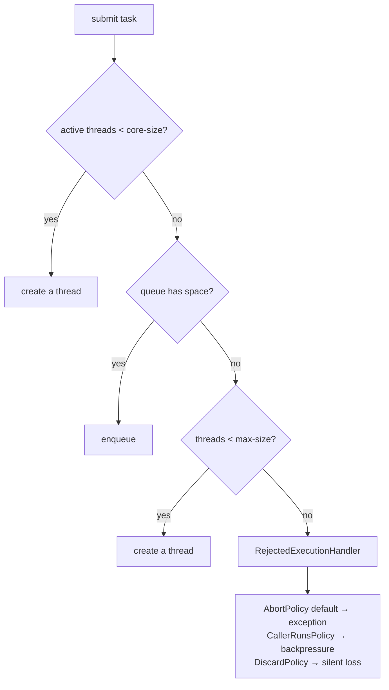
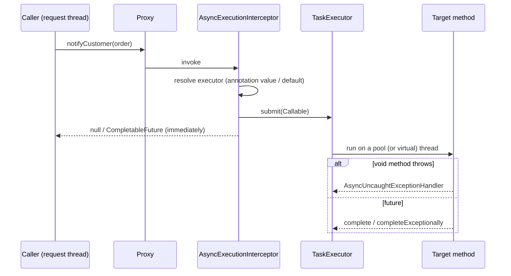
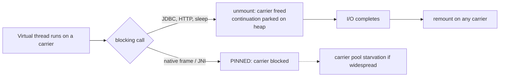
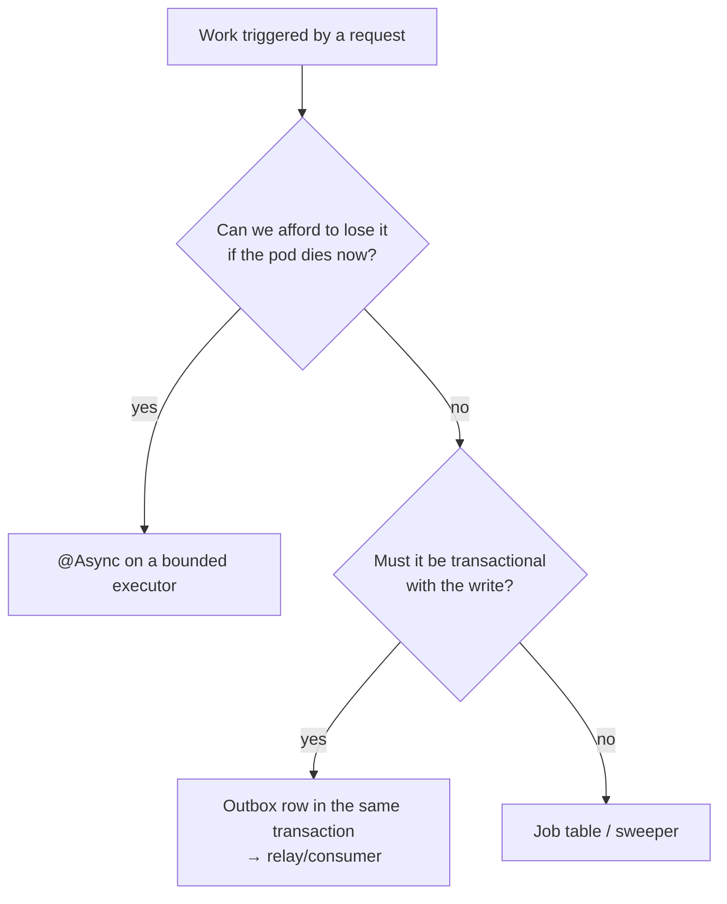
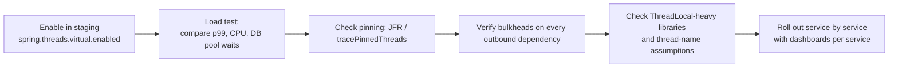

# 25 · Async, Scheduling & Virtual Threads

## 1. Introduction & Why It Matters

Not everything should happen inside the request. When a customer taps "Place order", the response must come back in 300 ms; sending the SMS, updating the loyalty balance, warming a cache and pushing an analytics event can all happen afterwards. And some work has no request at all: cancelling unpaid orders after 15 minutes, settling sellers nightly, refreshing the pricing cache every two minutes.

Spring gives you three tools for this — `@Async`, `@Scheduled`, and (since Java 21) **virtual threads** — and all three are easy to misuse:

- `@Async` on a method of the same class: silently synchronous (Chapter 04).
- Boot's default task executor has an **unbounded queue**: under load it accumulates millions of tasks and the pod dies of `OutOfMemoryError` instead of shedding work.
- The default scheduler pool size is **1**: one slow job delays every other scheduled job in the service.
- A `@Scheduled` job on six pods runs six times — sending six SMS messages per late order.
- Virtual threads remove the thread-count limit, so 5,000 concurrent requests all reach for a 20-connection database pool at once (Chapter 12).
- Fire-and-forget work is lost on shutdown unless the executor drains (Chapter 03).

This chapter covers all of it: the executor model and how Boot configures it, `@Async` done safely with bounded queues and rejection policies, virtual threads (what changed in Java 21–25, where pinning still matters, and why they need **bulkheads** rather than pools), scheduling with cron and fixed delays, cluster-safe scheduling with ShedLock, Quartz for durable schedules, context propagation, graceful shutdown and testing.

### Who should read which section

| Band | Focus |
|---|---|
| B1 · 0–2 yrs | Parts 1, 2, 4 — `@Async`, `@Scheduled`, basic executors |
| B2 · 2–5 yrs | Parts 2, 5 — pool sizing, rejection, cron, ShedLock |
| B3 · 5–8 yrs | Parts 3, 5, 6 — virtual threads, pinning, bulkheads, propagation |
| B4 · 8–12 yrs | Parts 6, 8 — platform executor strategy, scheduling architecture |
| B5 · 12–15+ yrs | Parts 8, 9 — concurrency strategy and its failure modes |

---

## 2. Core Concepts

### 2.1 Executors in Spring Boot

| Bean | Purpose | Property prefix |
|---|---|---|
| `applicationTaskExecutor` | `@Async`, `ApplicationRunner` async work, some auto-configurations | `spring.task.execution.*` |
| `taskScheduler` | `@Scheduled` | `spring.task.scheduling.*` |
| Your own executors | Per-dependency bulkheads | — |

```yaml title="application.yml"
spring:
  task:
    execution:
      pool:
        core-size: 8
        max-size: 32
        queue-capacity: 100        # default is Integer.MAX_VALUE — effectively unbounded!
      thread-name-prefix: grocery-task-
      shutdown:
        await-termination: true
        await-termination-period: 20s
    scheduling:
      pool:
        size: 4                    # default is 1
      shutdown:
        await-termination: true
        await-termination-period: 20s
```

!!! danger "The two defaults that cause outages"
    **Unbounded queue**: `ThreadPoolTaskExecutor` only grows past `core-size` when the queue is *full*, so with an unbounded queue `max-size` is never reached — tasks pile up in memory until the pod dies. **Scheduler pool size 1**: one long job blocks all others. Set both explicitly in every service.

### 2.2 `@Async`

```java title="@Async (snippet)"
@Async                      // fire and forget (void)
@Async("smsExecutor")       // named executor
CompletableFuture<Report> generate(...)   // or return a future
```

- Requires `@EnableAsync`.
- AOP-based: public methods, no self-invocation (Chapter 04).
- `void` methods: exceptions go to an `AsyncUncaughtExceptionHandler`, **not** to the caller.
- Returning `CompletableFuture` gives the caller the result and the failure.
- The caller's transaction, security context and MDC do **not** propagate by default (2.8).

### 2.3 Virtual threads

Java 21 introduced virtual threads: JVM-scheduled threads that **unmount** from a carrier (platform) thread while blocked on I/O. Millions can exist; blocking is no longer expensive.

```yaml title="application.yml"
spring:
  threads:
    virtual:
      enabled: true
```

With this, Boot uses virtual threads for the web server's request handling, the task executor, the scheduler and several listener containers (Kafka, RabbitMQ).

| Myth | Reality |
|---|---|
| "Virtual threads make code faster" | They make **blocking** code scale; a CPU-bound task is no faster |
| "Pool them for efficiency" | Never pool — create one per task (`newVirtualThreadPerTaskExecutor`) |
| "Unlimited concurrency is fine" | Downstream resources (DB pool, API quotas) are still bounded — you need **bulkheads** |
| "ThreadLocals are free" | A million threads × a fat ThreadLocal = a lot of heap |

**Pinning**: a virtual thread that can't unmount blocks its carrier thread. Historically `synchronized` blocks around I/O were the main cause; **JDK 24 removed that limitation** (JEP 491). Native frames (JNI) still pin. On Java 21–23, replace `synchronized` around I/O with `ReentrantLock`.

!!! warning "Verify for your JDK"
    Pinning behaviour differs between Java 21, 24 and 25. Confirm with your runtime (and `-Djdk.tracePinnedThreads` / JFR events on older JDKs) rather than assuming.

### 2.4 Structured concurrency and scoped values

- **Structured concurrency** (`StructuredTaskScope`) ties the lifetime of concurrent subtasks to a scope: if one fails, siblings are cancelled; the scope doesn't return until all finish. It has been a **preview** feature through Java 21–25 with API changes along the way — good to know, not yet a platform default. **Verify** the API for your JDK before using it.
- **Scoped values** (finalized in Java 25) are an immutable, inheritance-friendly alternative to `ThreadLocal` for per-request context — a better fit for virtual threads.

### 2.5 `@Scheduled`

| Attribute | Meaning |
|---|---|
| `fixedDelay` | Wait N after the **previous run finished** — never overlaps |
| `fixedRate` | Start every N regardless of duration — can overlap (unless the scheduler is busy) |
| `initialDelay` | Delay before the first run |
| `cron` | 6-field expression (second minute hour day month weekday) |
| `zone` | e.g. `Asia/Kolkata` — essential for business-day boundaries |
| `scheduler` | Named scheduler bean (Framework 6.1+) |

Cron examples for the platform:

```text title="Example"
0 */2 * * * *        every 2 minutes
0 0 2 * * *          02:00 every day (in `zone`)
0 30 23 * * SAT      23:30 every Saturday (weekly settlement)
0 0 0 1 * *          midnight on the 1st (monthly GST report)
```

### 2.6 Cluster-safe scheduling

Six pods = six executions. Options:

| Approach | Notes |
|---|---|
| **ShedLock** | A lock row in PostgreSQL/Redis; only one pod runs the job. Simple, recommended |
| **Quartz clustered** | Durable, database-backed schedules with failover and misfires |
| **Kubernetes CronJob** | Runs the app in "job mode" (Chapter 05); separate lifecycle, no in-app scheduler |
| Leader election | One pod is leader (Spring Integration / Kubernetes lease) |

ShedLock takes a lock **around** the job; it doesn't make the job idempotent. `lockAtMostFor` must exceed the worst-case duration, or a second pod may start while the first is still running.

### 2.7 Sweepers vs timers

To cancel unpaid orders after 15 minutes you could schedule a per-order timer (Quartz job per order, or a delayed message). Much simpler and far more robust:

```sql title="SQL"
select id from customer_order
where status = 'PLACED' and placed_at < now() - interval '15 minutes'
order by placed_at limit 500 for update skip locked
```

A **sweeper** query every minute is idempotent, self-healing after downtime, needs no per-entity state, and scales with a single index. Prefer sweepers; use timers/delayed messages only when the delay must be precise to the second.

### 2.8 Context propagation

| Context | Propagates to `@Async`? | How to propagate |
|---|---|---|
| Transaction | ❌ (and shouldn't — a new thread needs its own) | Start a transaction in the async method |
| Security | ❌ | `DelegatingSecurityContextExecutor` (Chapter 17) |
| MDC / tracing | ❌ | `ContextPropagatingTaskDecorator` (Chapter 07) |
| Request-scoped beans | ❌ | Pass data explicitly |

---

## 3. How It Works Internally

### 3.1 `ThreadPoolTaskExecutor` growth rules



The counter-intuitive part: **the queue fills before extra threads are created**. With an unbounded queue, `max-size` is dead configuration and the queue is the only thing absorbing load — until memory runs out.

### 3.2 `@Async` invocation



### 3.3 Virtual thread mounting



Carrier threads are a `ForkJoinPool` sized to the CPU count by default (`jdk.virtualThreadScheduler.parallelism`). Pinning matters because it removes a carrier from that small pool.

### 3.4 Scheduling

`ThreadPoolTaskScheduler` wraps a `ScheduledThreadPoolExecutor`. A `fixedDelay` task schedules its next run **after** completion; a `cron` task computes the next time from a `CronTrigger`. If the pool is busy, executions are **delayed, not parallelized** — the pool size is the ceiling on concurrent scheduled work.

---

## 4. Hands-On Code — Level 1 (Beginner)

### 4.1 Async done right

```java title="in/grocery/platform/async/AsyncConfig.java"
package in.grocery.platform.async;

import java.util.concurrent.Executor;
import java.util.concurrent.ThreadPoolExecutor;
import org.slf4j.Logger;
import org.slf4j.LoggerFactory;
import org.springframework.aop.interceptor.AsyncUncaughtExceptionHandler;
import org.springframework.context.annotation.Bean;
import org.springframework.context.annotation.Configuration;
import org.springframework.scheduling.annotation.AsyncConfigurer;
import org.springframework.scheduling.annotation.EnableAsync;
import org.springframework.scheduling.concurrent.ThreadPoolTaskExecutor;

@Configuration(proxyBeanMethods = false)
@EnableAsync                                                                        // (1)!
class AsyncConfig implements AsyncConfigurer {

    private static final Logger log = LoggerFactory.getLogger(AsyncConfig.class);

    @Bean("notificationExecutor")
    Executor notificationExecutor() {
        var executor = new ThreadPoolTaskExecutor();
        executor.setCorePoolSize(4);
        executor.setMaxPoolSize(8);
        executor.setQueueCapacity(500);                                             // (2)!
        executor.setThreadNamePrefix("notify-");
        executor.setRejectedExecutionHandler(new ThreadPoolExecutor.CallerRunsPolicy());   // (3)!
        executor.setWaitForTasksToCompleteOnShutdown(true);
        executor.setAwaitTerminationSeconds(20);                                    // (4)!
        executor.initialize();
        return executor;
    }

    @Override
    public AsyncUncaughtExceptionHandler getAsyncUncaughtExceptionHandler() {
        return (ex, method, params) ->                                              // (5)!
                log.error("Async method {} failed", method.getName(), ex);
    }
}
```

1. Without it, `@Async` does nothing.
2. **Bounded** queue — the single most important line in this file.
3. When the queue is full, the **caller** runs the task: natural backpressure instead of unbounded growth or silent loss.
4. Drain on shutdown (Chapter 03) so in-flight notifications aren't lost.
5. Otherwise `void` async failures vanish into a default logger with no context.

```java title="in/grocery/notification/NotificationService.java"
@Service
public class NotificationService {

    @Async("notificationExecutor")                                                   // (1)!
    public void sendOrderConfirmation(String orderRef, String mobile) {
        sms.send(mobile, "Order " + orderRef + " confirmed");
    }
}
```

1. Named executor: notification work never competes with unrelated async work.

!!! warning "Async and `@Transactional` don't share a transaction"
    An `@Async` method runs on another thread with **no** transaction (and no security context). If it needs one, annotate it `@Transactional` — it will start its own. And remember: after-commit hooks (Chapter 03) are usually a better trigger than calling an async method inside a transaction.

### 4.2 A first scheduled job

```java title="in/grocery/order/schedule/OrderSweeper.java"
package in.grocery.order.schedule;

import org.slf4j.Logger;
import org.slf4j.LoggerFactory;
import org.springframework.scheduling.annotation.Scheduled;
import org.springframework.stereotype.Component;

@Component
public class OrderSweeper {

    private static final Logger log = LoggerFactory.getLogger(OrderSweeper.class);

    private final OrderCancellationService cancellations;

    public OrderSweeper(OrderCancellationService cancellations) {
        this.cancellations = cancellations;
    }

    @Scheduled(fixedDelayString = "PT1M", initialDelayString = "PT30S")             // (1)!
    public void cancelUnpaidOrders() {
        int cancelled = cancellations.cancelUnpaidOlderThan(java.time.Duration.ofMinutes(15));
        if (cancelled > 0) {
            log.info("Auto-cancelled {} unpaid orders", cancelled);
        }
    }
}
```

1. `fixedDelay` (not `fixedRate`) so runs never overlap; ISO-8601 duration strings are readable and configurable. The initial delay keeps startup calm.

```yaml title="application.yml"
spring:
  task:
    scheduling:
      pool:
        size: 4                                     # (1)!
      thread-name-prefix: grocery-sched-
```

1. One thread means one slow job blocks all others — always size this deliberately.

### 4.3 Enabling virtual threads

```yaml title="application.yml"
spring:
  threads:
    virtual:
      enabled: true          # Java 21+
```

Now request handling, `@Async` (unless a specific executor is injected), `@Scheduled` and Kafka/Rabbit listener containers run on virtual threads. Nothing else changes in your code — that's the point.

### 4.4 Testing async and scheduled code

```java title="NotificationServiceTest.java"
@SpringBootTest
class NotificationServiceTest {

    @Autowired NotificationService notifications;
    @MockitoBean SmsSender sms;

    @Test
    void sendsAsynchronously() {
        notifications.sendOrderConfirmation("ORD-1", "9876543210");

        await().atMost(Duration.ofSeconds(2))                                        // (1)!
               .untilAsserted(() -> then(sms).should().send(eq("9876543210"), contains("ORD-1")));
    }
}
```

1. Never `Thread.sleep`. For deterministic unit tests, inject a synchronous executor:

```java title="SyncExecutorTestConfig.java"
@TestConfiguration(proxyBeanMethods = false)
class SyncExecutorTestConfig {
    @Bean("notificationExecutor")
    Executor notificationExecutor() {
        return Runnable::run;                                                        // same-thread
    }
}
```

---

## 5. Hands-On Code — Level 2 (Intermediate) & Level 3 (Advanced)

### 5.1 Level 2 — Cluster-safe scheduling with ShedLock

```kotlin title="build.gradle.kts"
implementation("net.javacrumbs.shedlock:shedlock-spring:5.x")
implementation("net.javacrumbs.shedlock:shedlock-provider-jdbc-template:5.x")
```

```sql title="V70__shedlock.sql"
create table shedlock (
    name       varchar(64)  primary key,
    lock_until timestamptz  not null,
    locked_at  timestamptz  not null,
    locked_by  varchar(255) not null
);
```

```java title="in/grocery/platform/schedule/ShedLockConfig.java"
@Configuration(proxyBeanMethods = false)
@EnableSchedulerLock(defaultLockAtMostFor = "PT10M")                                  // (1)!
class ShedLockConfig {

    @Bean
    LockProvider lockProvider(DataSource dataSource) {
        return new JdbcTemplateLockProvider(JdbcTemplateLockProvider.Configuration.builder()
                .withJdbcTemplate(new JdbcTemplate(dataSource))
                .usingDbTime()                                                        // (2)!
                .build());
    }
}
```

1. A safety net: if a pod dies holding the lock, it expires after 10 minutes.
2. Use the **database clock**, not pod clocks — clock skew between pods otherwise breaks the lock.

```java title="in/grocery/seller/schedule/SettlementJob.java"
@Component
public class SettlementJob {

    @Scheduled(cron = "0 30 23 * * SAT", zone = "Asia/Kolkata")                       // (1)!
    @SchedulerLock(name = "weekly-seller-settlement",
                   lockAtMostFor = "PT2H", lockAtLeastFor = "PT5M")                   // (2)!
    public void settleSellers() {
        LockAssert.assertLocked();                                                    // (3)!
        settlements.runWeekly();
    }
}
```

1. Saturday 23:30 **IST** — the zone matters; the pod's default is UTC in most clusters.
2. `lockAtMostFor` must exceed the worst-case duration; `lockAtLeastFor` prevents a very fast run from being repeated by another pod whose clock is slightly ahead.
3. Fails fast if the lock wasn't actually acquired (e.g. misconfiguration) — cheap insurance.

!!! warning "ShedLock is not idempotency"
    If the job dies halfway, the next run must be able to continue safely. Write jobs to be **resumable and idempotent** (process in chunks, mark progress) rather than assuming exactly one complete execution.

### 5.2 Level 2 — Sweeper pattern done properly

```java title="in/grocery/order/service/OrderCancellationService.java"
@Service
public class OrderCancellationService {

    private final JdbcClient jdbc;
    private final OrderRepository orders;
    private final MeterRegistry meters;

    /** Cancels in bounded chunks; safe to run every minute from any pod. */
    public int cancelUnpaidOlderThan(Duration age) {
        int total = 0;
        for (int batch = 0; batch < 10; batch++) {                                     // (1)!
            List<String> refs = jdbc.sql("""
                    select order_ref from customer_order
                    where status = 'PLACED' and placed_at < :cutoff
                    order by placed_at
                    limit 200
                    for update skip locked
                    """)                                                               // (2)!
                    .param("cutoff", Instant.now().minus(age))
                    .query(String.class).list();
            if (refs.isEmpty()) break;
            refs.forEach(this::cancelOne);                                             // (3)!
            total += refs.size();
        }
        meters.counter("grocery.orders.auto-cancelled").increment(total);
        return total;
    }

    @Transactional
    void cancelOne(String orderRef) {
        orders.findByOrderRef(orderRef).ifPresent(order -> {
            order.cancel();
            outbox.append("order", orderRef, "OrderCancelled", new OrderCancelled(orderRef, "unpaid-timeout"));
        });
    }
}
```

1. **Bounded work per run**: a backlog after downtime is drained over several runs instead of one hour-long transaction.
2. `SKIP LOCKED` means multiple pods could even run this concurrently without conflict — ShedLock becomes an optimization, not a correctness requirement.
3. One short transaction per order (Chapter 16), so a failure on order 37 doesn't roll back the first 36.

### 5.3 Level 2 — Quartz when you need durable schedules

```yaml title="application.yml"
spring:
  quartz:
    job-store-type: jdbc
    jdbc:
      initialize-schema: never            # (1)!
    properties:
      org.quartz.jobStore.isClustered: true
      org.quartz.scheduler.instanceId: AUTO
      org.quartz.jobStore.clusterCheckinInterval: 20000
```

1. Quartz's schema goes through Flyway like everything else (Chapter 14).

```java title="in/grocery/promotion/schedule/CampaignScheduler.java"
@Service
public class CampaignScheduler {

    private final Scheduler scheduler;

    /** Schedules a one-off job when a campaign is created — a dynamic, persistent schedule. */
    public void scheduleActivation(String campaignId, Instant activateAt) throws SchedulerException {
        JobDetail job = JobBuilder.newJob(ActivateCampaignJob.class)
                .withIdentity("activate-" + campaignId, "campaigns")
                .usingJobData("campaignId", campaignId)
                .storeDurably(false)
                .build();
        Trigger trigger = TriggerBuilder.newTrigger()
                .startAt(Date.from(activateAt))
                .withSchedule(SimpleScheduleBuilder.simpleSchedule()
                        .withMisfireHandlingInstructionFireNow())                      // (1)!
                .build();
        scheduler.scheduleJob(job, trigger);
    }
}
```

1. **Misfire policy**: what happens if the scheduler was down at the scheduled time — fire immediately, skip, or reschedule. Choosing this deliberately is most of the value of Quartz.

Use Quartz when schedules are **dynamic and per-entity** and must survive restarts. For fixed, code-defined schedules, `@Scheduled` + ShedLock is far less machinery.

### 5.4 Level 3 — Virtual threads and bulkheads

Virtual threads remove the thread limit; they do **not** remove downstream limits. A product page needs price, stock and delivery ETA:

```java title="in/grocery/catalog/page/ProductPageAssembler.java"
package in.grocery.catalog.page;

import java.time.Duration;
import java.util.List;
import java.util.concurrent.Callable;
import java.util.concurrent.ExecutorService;
import java.util.concurrent.Executors;
import java.util.concurrent.Future;
import java.util.concurrent.Semaphore;
import org.springframework.stereotype.Component;

@Component
public class ProductPageAssembler implements AutoCloseable {

    private final ExecutorService executor = Executors.newVirtualThreadPerTaskExecutor();   // (1)!
    private final Semaphore pricingBulkhead = new Semaphore(50);                            // (2)!

    private final PricingClient pricing;
    private final InventoryClient inventory;
    private final DeliveryClient delivery;

    public ProductPage assemble(String sku, String pincode) throws Exception {
        Future<String> price = executor.submit(bulkheaded(pricingBulkhead,
                () -> pricing.price(sku, pincode)));                                        // (3)!
        Future<Integer> stock = executor.submit(() -> inventory.stock(sku, pincode));
        Future<String> eta = executor.submit(() -> delivery.eta(pincode));

        return new ProductPage(sku, price.get(), stock.get(), eta.get());                   // (4)!
    }

    private static <T> Callable<T> bulkheaded(Semaphore semaphore, Callable<T> task) {
        return () -> {
            if (!semaphore.tryAcquire(200, java.util.concurrent.TimeUnit.MILLISECONDS)) {
                throw new BulkheadFullException("pricing");                                  // (5)!
            }
            try {
                return task.call();
            } finally {
                semaphore.release();
            }
        };
    }

    @Override
    public void close() {
        executor.close();
    }
}
```

1. One virtual thread per task — **never pool virtual threads**; creation is nearly free.
2. The bulkhead, not the thread count, limits concurrent calls to pricing. Without it, 5,000 concurrent requests × 1 pricing call = 5,000 concurrent HTTP calls to a service sized for 200.
3. Only the constrained dependency is limited.
4. Each client already has its own timeouts (Chapter 19); `get()` inherits them.
5. Fail fast when saturated — that's a 503 with `Retry-After`, not a 30-second queue (Chapters 10, 26).

!!! tip "Structured concurrency, when it stabilizes"
    `StructuredTaskScope` expresses exactly this fan-out — cancel siblings when one fails, join with a deadline — more safely than futures. It has been in preview through Java 21–25 with API churn; **verify** before adopting, and keep the semaphore bulkhead either way.

### 5.5 Level 3 — Pinning and what to do about it

```java title="Pinning on Java 21–23"
public synchronized String fetchRate(String currency) {      // ❌ blocks the carrier thread
    return restClient.get().uri("/rates/{c}", currency).retrieve().body(String.class);
}
```

```java title="Fixed"
private final ReentrantLock lock = new ReentrantLock();      // ✅ virtual-thread friendly

public String fetchRate(String currency) {
    lock.lock();
    try {
        return restClient.get().uri("/rates/{c}", currency).retrieve().body(String.class);
    } finally {
        lock.unlock();
    }
}
```

Better still: **don't hold a lock across I/O at all.**

Detection:

| JDK | How |
|---|---|
| 21–23 | `-Djdk.tracePinnedThreads=full` (stack traces on pinning), JFR `jdk.VirtualThreadPinned` events |
| 24+ | `synchronized` no longer pins (JEP 491); remaining pinning is native frames — JFR events still apply |

Also watch libraries that keep large `ThreadLocal`s, and anything that assumes `Thread.currentThread().getName()` is meaningful.

### 5.6 Level 3 — Context propagation

```java title="in/grocery/platform/async/PropagatingExecutorConfig.java"
@Bean("auditExecutor")
Executor auditExecutor(ThreadPoolTaskExecutorBuilder builder) {                       // (1)!
    return builder
            .corePoolSize(2).maxPoolSize(4).queueCapacity(200)
            .threadNamePrefix("audit-")
            .taskDecorator(new ContextPropagatingTaskDecorator())                     // (2)!
            .build();
}

@Bean
Executor securityAwareAuditExecutor(@Qualifier("auditExecutor") Executor delegate) {
    return new DelegatingSecurityContextExecutor(delegate);                           // (3)!
}
```

1. Boot's builder applies common settings and metrics.
2. MDC and tracing context follow the task (Chapter 07).
3. And the security context (Chapter 17), so audit records name the real user.

**Verify** the builder class name for your Boot version (`ThreadPoolTaskExecutorBuilder` in 3.2+; earlier `TaskExecutorBuilder`).

---

## 6. Hands-On Code — Level 4 (Expert / Production)

### 6.1 The platform executor policy

| Executor | Size | Queue | Rejection | Used for |
|---|---|---|---|---|
| `applicationTaskExecutor` | 8/32 (or virtual) | 100 | `CallerRunsPolicy` | Generic `@Async` |
| `notificationExecutor` | 4/8 | 500 | `CallerRunsPolicy` | SMS/push — bursty, tolerant of delay |
| `auditExecutor` | 2/4 | 200 | `CallerRunsPolicy` | Audit writes |
| `reportExecutor` | 2/2 | 10 | `AbortPolicy` | Heavy reports — fail fast, don't queue |
| `taskScheduler` | 4 | — | — | `@Scheduled` |
| Virtual per-task executors | unbounded threads | — | bulkhead semaphores | Fan-out I/O |

```java title="in/grocery/platform/async/ExecutorMetricsConfig.java"
@Configuration(proxyBeanMethods = false)
class ExecutorMetricsConfig {

    @Bean
    InitializingBean instrumentExecutors(MeterRegistry registry,
                                         Map<String, ThreadPoolTaskExecutor> executors) {
        return () -> executors.forEach((name, executor) ->
                ExecutorServiceMetrics.monitor(registry, executor.getThreadPoolExecutor(), name));   // (1)!
    }
}
```

1. Exposes `executor.queued`, `executor.active`, `executor.pool.size`, `executor.completed`, `executor.rejected`. **Alert on queue depth and rejections** — they are the early warning that async work is falling behind.

### 6.2 Async work that must not be lost

Fire-and-forget is fine for an SMS; it is not fine for a loyalty credit. The rule:



```java title="in/grocery/order/service/OrderPlacementService.java (applying the rule)"
@Transactional
public Order place(...) {
    Order saved = orders.save(order);
    outbox.append("order", saved.getOrderRef(), "OrderPlaced", payload);   // durable: loyalty, inventory, search
    return saved;
}

@TransactionalEventListener                                                 // after commit (Chapter 03)
@Async("notificationExecutor")                                              // best-effort: SMS
public void sendConfirmation(OrderPlaced event) { ... }
```

The SMS can be lost on a crash and a customer still has their order; a loyalty credit cannot, so it travels through the outbox (Chapter 23).

### 6.3 Scheduling architecture for the platform

| Job | Schedule | Mechanism | Guard |
|---|---|---|---|
| Cancel unpaid orders | every 1 min | `@Scheduled` sweeper | `SKIP LOCKED`, idempotent |
| Refresh pricing cache | every 2 min | `@Scheduled` | jittered start, ShedLock optional |
| Weekly seller settlement | Sat 23:30 IST | `@Scheduled` + ShedLock | chunked, resumable |
| Monthly GST report | 1st, 00:30 IST | Kubernetes CronJob (app in job mode) | separate resources, long timeout |
| Campaign activation | per campaign | Quartz (dynamic, persistent) | misfire policy |
| Delivery SLA watcher | continuous | `SmartLifecycle` (Chapter 03) | graceful stop |

```java title="in/grocery/platform/schedule/JitteredSchedulingConfig.java"
@Bean
SchedulingConfigurer jitteredTriggers() {
    return registrar -> registrar.addTriggerTask(
            cacheRefresh::run,
            context -> {
                Instant last = context.lastCompletion() == null ? Instant.now() : context.lastCompletion();
                long jitterMs = ThreadLocalRandom.current().nextLong(-10_000, 10_001);              // (1)!
                return last.plusMillis(120_000 + jitterMs);
            });
}
```

1. Without jitter, every pod refreshes at exactly the same second after a simultaneous deploy — a self-inflicted thundering herd (Chapter 21).

**Verify** the `Trigger`/`TriggerContext` API (`lastCompletion()` returning `Instant`) for your Framework version; older versions used `Date`.

### 6.4 Graceful shutdown of background work

```yaml title="application.yml"
spring:
  task:
    execution:
      shutdown:
        await-termination: true
        await-termination-period: 20s
    scheduling:
      shutdown:
        await-termination: true
        await-termination-period: 20s
  lifecycle:
    timeout-per-shutdown-phase: 25s        # (1)!
server:
  shutdown: graceful
```

1. The sum of executor drains must fit inside the lifecycle timeout, which must fit inside Kubernetes' `terminationGracePeriodSeconds` (Chapters 03, 30). Otherwise SIGKILL arrives mid-task.

Scheduled jobs should also check for shutdown:

```java title="in/grocery/seller/schedule/SettlementJob.java (interruptible)"
public void runWeekly() {
    for (SellerBatch batch : batches) {
        if (Thread.currentThread().isInterrupted()) {                                   // (1)!
            log.info("Shutdown requested — stopping after {} batches", processed);
            return;
        }
        process(batch);
    }
}
```

1. Long jobs must be resumable and must stop when asked; the next run picks up where this one left off.

### 6.5 Virtual threads: the platform rollout



Findings from a typical rollout:

| Observation | Action |
|---|---|
| p99 improves under load; CPU similar | Expected — blocking no longer costs threads |
| Hikari `pending` rises sharply | Add bulkheads / raise pool deliberately (Chapter 12) |
| A library pins on `synchronized` (JDK < 24) | Upgrade the library, upgrade the JDK, or exclude that path |
| Thread dumps huge | Use JFR and per-request tracing instead |
| Metrics tagged by thread name become useless | Tag by endpoint/dependency, not thread |

### 6.6 Testing concurrency and scheduling

```java title="SchedulingIntegrationTest.java"
@SpringBootTest(properties = {
        "grocery.sweeper.interval=PT1S",                                                 // (1)!
        "spring.task.scheduling.pool.size=2"
})
@Import(ContainersConfig.class)
class SchedulingIntegrationTest {

    @Autowired OrderRepository orders;

    @Test
    void unpaidOrdersAreCancelled() {
        String ref = seedUnpaidOrder(Instant.now().minus(Duration.ofMinutes(20)));

        await().atMost(Duration.ofSeconds(10)).untilAsserted(() ->
                assertThat(orders.findByOrderRef(ref).orElseThrow().getStatus()).isEqualTo(OrderStatus.CANCELLED));
    }
}
```

1. Intervals from configuration so tests run in seconds (the same trick as the retry TTLs in Chapter 24).

```java title="ShedLockTest.java"
@Test
void onlyOnePodRunsTheJob() throws Exception {
    var barrier = new CountDownLatch(2);
    var executions = new AtomicInteger();

    // two "pods" sharing one database
    Runnable pod = () -> lockedJobRunner.runIfLockAcquired(() -> executions.incrementAndGet());
    try (var pool = Executors.newVirtualThreadPerTaskExecutor()) {
        pool.submit(pod);
        pool.submit(pod);
    }

    assertThat(executions).hasValue(1);                                                  // (1)!
}
```

1. The test that justifies ShedLock's existence — and catches a misconfigured lock provider.

```java title="ExecutorRejectionTest.java"
@Test
void fullQueueAppliesBackpressureInsteadOfGrowing() {
    var executor = boundedExecutor(1, 1, 1, new ThreadPoolExecutor.CallerRunsPolicy());
    var ranOnCaller = new AtomicBoolean();
    String callerThread = Thread.currentThread().getName();

    executor.execute(() -> sleep(500));                 // occupies the single thread
    executor.execute(() -> sleep(500));                 // queued
    executor.execute(() -> ranOnCaller.set(Thread.currentThread().getName().equals(callerThread)));

    await().atMost(Duration.ofSeconds(2)).untilTrue(ranOnCaller);                         // (1)!
}
```

1. Proves the rejection policy is what you think it is — worth one test per platform executor.

---

## 7. Spring Boot 3 vs 4 & Migration

| Topic | Boot 3.5 | Boot 4.x |
|---|---|---|
| Virtual threads | `spring.threads.virtual.enabled` (Java 21+) | Same; Java 25 baseline recommended |
| Pinning on `synchronized` | Present on Java 21–23 | Gone on Java 24+ (JEP 491) |
| Scoped values | Preview | **Final in Java 25** — an alternative to `ThreadLocal` |
| Structured concurrency | Preview | Still preview (verify) |
| Executor builders | `ThreadPoolTaskExecutorBuilder`, `SimpleAsyncTaskExecutorBuilder` | Same (package moves — verify) |
| `@Scheduled` scheduler qualifier | Framework 6.1+ | Same |
| Quartz / ShedLock | 5.x | Verify compatibility with Boot 4 |
| Task decorators | `ContextPropagatingTaskDecorator` | Same |

=== "Spring Boot 3.5 (Java 21)"

    ```java title="Spring Boot 3.5 (Java 21) (snippet)"
    private final Object lock = new Object();
    public void update() {
        synchronized (lock) {       // pins the carrier thread on Java 21–23
            restClient.get()...;
        }
    }
    ```

=== "Spring Boot 4.x (Java 25)"

    ```java title="Spring Boot 4.x (Java 25) (snippet)"
    private final ReentrantLock lock = new ReentrantLock();   // still the clearer choice
    public void update() {
        lock.lock();
        try {
            restClient.get()...;    // synchronized would no longer pin on JDK 24+, but avoid I/O under locks anyway
        } finally {
            lock.unlock();
        }
    }
    ```

### Migration checklist

- [ ] Set `queue-capacity` and scheduler `pool.size` explicitly (defaults bite in both versions).
- [ ] Audit `synchronized` around I/O before enabling virtual threads on Java < 24.
- [ ] Re-check bulkheads and database pool sizing after enabling virtual threads.
- [ ] Verify ShedLock/Quartz versions against Boot 4.
- [ ] Re-test graceful shutdown timings end to end.
- [ ] Consider scoped values instead of `ThreadLocal` for request context on Java 25.

---

## 8. Production Playbook

### Best practices

1. **Bounded queues and explicit rejection policies** on every executor; `CallerRunsPolicy` for backpressure.
2. **Named executors per concern** — notifications must not starve audits.
3. **Instrument executors**; alert on queue depth and rejections.
4. **Async ≠ durable**: use the outbox for work that must not be lost.
5. **`fixedDelay` over `fixedRate`** unless overlap is genuinely wanted; add jitter across pods.
6. **ShedLock (or CronJob) for cluster-wide single execution**; jobs still idempotent and resumable.
7. **Sweepers over per-entity timers.**
8. **Virtual threads + bulkheads**, never virtual-thread pools.
9. **Propagate context** (MDC, tracing, security) explicitly to async work.
10. **Drain executors on shutdown** within the pod's grace period.

### Anti-patterns

❌ `@Async` with the default unbounded queue — an OOM waiting for the next traffic spike.

❌ `@Async` on a method called from the same class (does nothing).

❌ Scheduler pool of 1 with several jobs — one slow job delays everything.

❌ `@Scheduled` without cluster coordination — N pods, N executions.

❌ `fixedRate` on a job that sometimes runs longer than the interval — overlapping runs corrupting shared state.

❌ Cron expressions without a `zone` — jobs fire at the wrong local time.

❌ Pooling virtual threads or sizing "virtual thread pools".

❌ Assuming a new thread inherits the transaction, security context or MDC.

❌ Long, non-interruptible jobs that die mid-way on every deploy.

❌ Using async to hide slowness the user actually waits for.

### Troubleshooting

| Symptom | Cause | Fix |
|---|---|---|
| Memory grows, tasks delayed by minutes | Unbounded executor queue | Bound it; `CallerRunsPolicy`; scale consumers |
| `RejectedExecutionException` | Queue + pool saturated | Expected under overload — shed load, alert, then tune |
| Async method runs synchronously | Self-invocation, missing `@EnableAsync` | Restructure; enable |
| Async exceptions disappear | `void` method without a handler | `AsyncUncaughtExceptionHandler`, or return a future |
| Job runs N times | No cluster lock | ShedLock/CronJob/leader election |
| Job never runs | Scheduler pool exhausted; exception killed a `fixedDelay` task | Size pool; catch exceptions inside the task |
| Job fires at the wrong hour | Missing `zone` / UTC pods | Set `zone = "Asia/Kolkata"` |
| Latency high with virtual threads, CPU low | Downstream saturation (DB pool, API) | Bulkheads, pool sizing, circuit breakers |
| Carrier threads blocked | Pinning (JDK < 24 `synchronized`, native frames) | `ReentrantLock`, upgrade JDK, remove I/O from locks |
| Work lost on deploy | No drain / not durable | `await-termination`, outbox for critical work |

### Production checklist

- [ ] Every executor: bounded queue, named threads, rejection policy, metrics
- [ ] Scheduler pool sized; all cron jobs carry a `zone`
- [ ] Cluster-wide jobs protected by ShedLock/CronJob and idempotent
- [ ] Critical async work durable (outbox/job table)
- [ ] Bulkheads on every outbound dependency when virtual threads are on
- [ ] Pinning checked on the target JDK
- [ ] Context propagation configured (MDC, tracing, security)
- [ ] Shutdown drains verified in a kill test
- [ ] Tests for rejection policy, ShedLock single-execution, and the sweeper

---

## 9. Interview Questions & Answers

### B1 · 0–2 years

??? question "B1 · What does `@Async` do?"
    **Short answer:** Runs the method on another thread via an executor, returning immediately (`void` or a `CompletableFuture`). Requires `@EnableAsync` and goes through a proxy.

??? question "B1 · `fixedDelay` vs `fixedRate`?"
    **Short answer:** `fixedDelay` waits N after the previous run **finished** (no overlap); `fixedRate` starts every N regardless of duration.

??? question "B1 · Why doesn't my `@Async` method run asynchronously?"
    **Short answer:** Self-invocation (called from the same class), missing `@EnableAsync`, or a non-public method — the proxy isn't involved.

??? question "B1 · What is a virtual thread?"
    **Short answer:** A lightweight thread managed by the JVM that unmounts from a carrier thread while blocked, so blocking I/O scales to millions of concurrent tasks.

??? question "B1 · How do you run a job at 2 a.m. IST?"
    **Short answer:** `@Scheduled(cron = "0 0 2 * * *", zone = "Asia/Kolkata")`.

### B2 · 2–5 years

??? question "B2 · What's wrong with the default task executor settings?"
    **Short answer:** The queue is effectively unbounded, so `max-size` is never reached and tasks accumulate until the JVM runs out of memory. Always set `queue-capacity` and a rejection policy.

??? question "B2 · How does `ThreadPoolTaskExecutor` decide to create threads?"
    **Short answer:** Below `core-size` it creates threads; then it queues; only when the queue is **full** does it grow to `max-size`; beyond that the rejection handler runs.

??? question "B2 · How do you stop a scheduled job from running on every pod?"
    **Short answer:** ShedLock (a lock row in the database/Redis around the job), a Kubernetes CronJob running the app in job mode, or leader election.

??? question "B2 · Does an `@Async` method join the caller's transaction?"
    **Short answer:** No. It runs on a different thread with no transaction, security context or MDC; it must start its own transaction if needed.

??? question "B2 · How do you test asynchronous behaviour?"
    **Short answer:** Awaitility for integration tests; a same-thread executor for deterministic unit tests. Never `Thread.sleep`.

??? question "B2 · What are the risks of `fixedRate`?"
    **Short answer:** Overlapping executions if a run exceeds the interval, leading to double processing and contention — use `fixedDelay` unless overlap is intended and safe.

### B3 · 5–8 years

??? question "B3 · What actually changes when you enable virtual threads?"
    **Short answer:** Request handling, task execution/scheduling and some listener containers create a virtual thread per task instead of using a bounded pool. Blocking is cheap, so thread count stops being the limit — downstream resources (DB pool, HTTP pools, API quotas) become the constraint, which is why bulkheads are mandatory.

??? question "B3 · What is pinning and how do you detect it?"
    **Short answer:** A virtual thread that can't unmount blocks its carrier. On Java 21–23 `synchronized` around blocking I/O was the main cause (fixed in JDK 24); native frames still pin. Detect with `-Djdk.tracePinnedThreads` or JFR `VirtualThreadPinned` events.

??? question "B3 · Why never pool virtual threads?"
    **Short answer:** Pooling exists to amortize expensive thread creation; virtual threads are cheap. Pooling reintroduces a concurrency limit in the wrong place and defeats the model. Limit concurrency with semaphores/bulkheads instead.

??? question "B3 · How do you propagate MDC and security to async tasks?"
    **Short answer:** A `TaskDecorator` (`ContextPropagatingTaskDecorator` for Micrometer context; `DelegatingSecurityContextExecutor` for security), applied to the executor.

??? question "B3 · Sweeper or per-entity timer for 'cancel after 15 minutes'?"
    **Short answer:** Sweeper: a chunked query with `SKIP LOCKED` every minute. It's idempotent, self-healing after downtime, has no per-entity state, and scales with one index. Timers only when second-level precision matters.

### B4 · 8–12 years

??? question "B4 · Design the executor strategy for a service."
    **Short answer:** Separate, named, bounded executors per concern with rejection policies matching the work (backpressure for tolerant work, fail-fast for heavy work), metrics and alerts on queue depth/rejections, context propagation, drain on shutdown, and a rule that anything which must not be lost goes through the outbox rather than an executor.

??? question "B4 · How do you roll out virtual threads safely?"
    **Short answer:** Enable in staging, load test and compare p99/CPU/pool waits, check pinning on the target JDK, ensure every outbound dependency has a bulkhead and timeouts, review ThreadLocal-heavy libraries, then roll service by service with dashboards.

??? question "B4 · When is Quartz justified over `@Scheduled` + ShedLock?"
    **Short answer:** When schedules are dynamic and per-entity, must survive restarts, need misfire policies, or require a job history — e.g. campaign activations. For fixed code-defined schedules, Quartz is unnecessary infrastructure.

### B5 · 12–15+ years

??? question "B5 · Does reactive programming still have a place after virtual threads?"
    **Short answer:** Yes, but a narrower one: streaming with backpressure, very high fan-out, and event-driven pipelines. For request/response services, virtual threads deliver most of the scalability with far simpler code, debugging and libraries (Chapter 31).

??? question "B5 · How do you prevent asynchronous work from becoming invisible?"
    **Short answer:** Treat it as a first-class workload: metrics per executor and job, tracing that spans the async boundary, durable queues for anything important, dashboards showing backlog, and runbooks for "the backlog is growing" — otherwise failures surface only as customer complaints.

### Scenario questions

??? example "Scenario · Pods OOM every evening at peak"
    Heap dumps showed millions of queued `Runnable`s: `@Async` notifications used the default executor with an unbounded queue, and the SMS gateway had slowed from 50 ms to 2 s. Fixes: bounded queue with `CallerRunsPolicy`, a dedicated notification executor, metrics/alerts on queue depth, a circuit breaker on the gateway, and durable delivery for anything that mattered.

??? example "Scenario · Sellers received six settlement emails"
    `@Scheduled` on six pods with no coordination. Fixes: ShedLock with the database clock, `lockAtMostFor` above the worst-case duration, idempotent settlement (unique constraint per seller and period), and a test asserting exactly one execution across two concurrent runners.

### Coding exercise

!!! example "Exercise · Nightly seller payout job"
    Implement a job that runs at 01:00 IST, on exactly one pod, processes sellers in chunks of 100 with one short transaction per seller, is resumable after a crash, stops promptly on shutdown, and records metrics. Write tests for single execution and resumability.

??? success "Solution"
    ```java title="PayoutJob.java"
    @Component
    public class PayoutJob {

        private static final Logger log = LoggerFactory.getLogger(PayoutJob.class);

        private final PayoutService payouts;
        private final MeterRegistry meters;

        @Scheduled(cron = "0 0 1 * * *", zone = "Asia/Kolkata")
        @SchedulerLock(name = "nightly-seller-payout", lockAtMostFor = "PT3H", lockAtLeastFor = "PT1M")
        public void run() {
            LockAssert.assertLocked();
            Timer.Sample sample = Timer.start(meters);
            int processed = 0;
            try {
                List<String> sellers;
                while (!(sellers = payouts.claimPendingSellers(100)).isEmpty()) {          // (1)!
                    for (String sellerId : sellers) {
                        if (Thread.currentThread().isInterrupted()) {                      // (2)!
                            log.info("Shutdown requested after {} sellers", processed);
                            return;
                        }
                        payouts.payoutSeller(sellerId);                                    // (3)!
                        processed++;
                    }
                }
            } finally {
                sample.stop(meters.timer("grocery.payout.job"));
                meters.counter("grocery.payout.sellers").increment(processed);
                log.info("Payout job processed {} sellers", processed);
            }
        }
    }
    ```

    1. `claimPendingSellers` uses `SELECT ... FOR UPDATE SKIP LOCKED` on a `payout_run` table and marks rows `IN_PROGRESS` — the job resumes where it stopped because completed sellers are marked `DONE`.
    2. Cooperative shutdown.
    3. One short transaction per seller (Chapter 16), idempotent via a unique `(seller_id, period)` constraint on the payout record.

    ```java title="PayoutJobTest.java"
    @Test
    void onlyOneInstanceRuns() { /* two threads invoke run(); assert payouts.claimPendingSellers called once */ }

    @Test
    void resumesAfterInterruption() {
        seedPendingSellers(250);
        runUntil(120, () -> job.run());                        // simulate interrupt after 120 sellers
        assertThat(payouts.countDone()).isEqualTo(120);

        job.run();                                             // next night (or restart)
        assertThat(payouts.countDone()).isEqualTo(250);        // (1)!
    }
    ```

    1. Resumability proven, not assumed — which is what separates a job that survives deploys from one that quietly skips 130 sellers.

---

## Key Takeaways

- **Bound every executor queue** and choose a rejection policy — the default is an OOM waiting to happen.
- **`@Async` is best-effort**; anything that must not be lost belongs in the outbox or a job table.
- **Scheduler pool size 1 is a trap**; size it, and always set `zone` on cron jobs.
- **One job per cluster** via ShedLock (or a CronJob) — and still idempotent and resumable.
- **Sweepers beat per-entity timers** for "do X after N minutes".
- **Virtual threads** make blocking cheap but make **bulkheads essential**; never pool them.
- **Pinning** matters on JDK < 24; keep I/O out of locks regardless.
- **Propagate context** and **drain executors on shutdown**.

## Further Reading

- Spring Framework Reference — *Integration › Task Execution and Scheduling* (executors, `@Async`, `@Scheduled`, `TaskDecorator`)
- Spring Boot Reference — *Task Execution and Scheduling*; *Virtual Threads*
- JEP 444 (virtual threads), JEP 491 (synchronized without pinning), JEP 506 (scoped values), structured concurrency JEPs
- ShedLock and Quartz documentation

---

[:material-arrow-left: 24 RabbitMQ, Pulsar, JMS & Cloud Stream](24-other-messaging.md) · [26 Resilience :material-arrow-right:](26-resilience.md)
