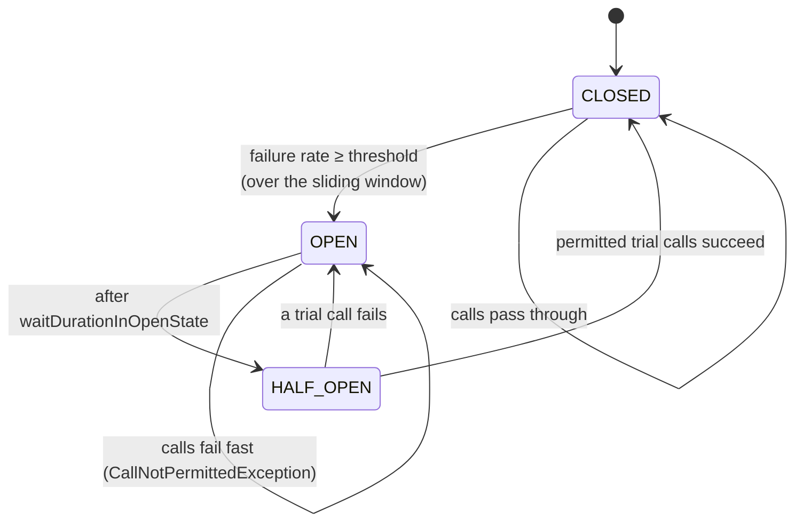
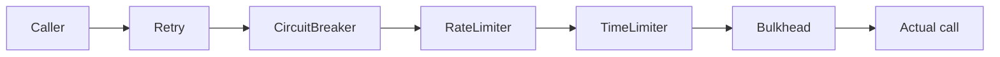
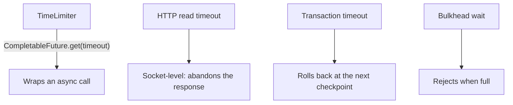
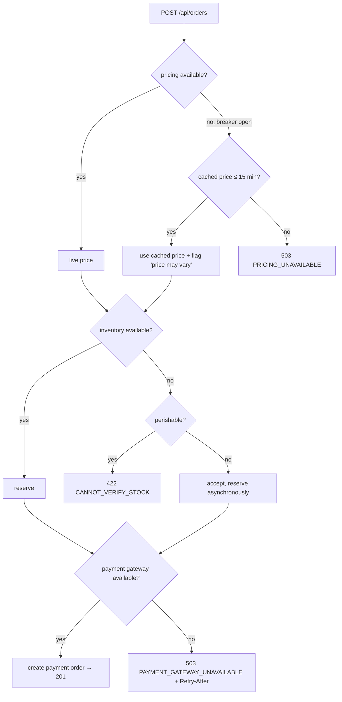

# 26 · Resilience

## 1. Introduction & Why It Matters

Every chapter so far added a dependency: PostgreSQL, Redis, Kafka, RabbitMQ, OpenSearch, Razorpay, an SMS gateway, five internal services. On a Diwali evening, one of them **will** be slow. The question resilience answers is: does that become "express delivery estimates are unavailable" or "the grocery app is down"?

The mechanics of the second outcome are always the same:

1. A dependency's latency goes from 80 ms to 4 s.
2. Callers have no timeout, or one longer than their own SLA.
3. Request threads, connections and memory accumulate.
4. Retries at three layers multiply the load 27×, keeping the dependency down.
5. Services that don't even use that dependency start failing, because they share a thread pool or database pool.

Every step has a countermeasure: **timeouts**, **bulkheads**, **circuit breakers**, **retries with budgets and jitter**, **rate limiting**, **load shedding** and **graceful degradation**. This chapter builds them with Resilience4j and Spring Framework 7's built-in resilience annotations, composes them in the right order, and — most importantly — decides *per dependency* what "degraded" means: a cached price is fine; a guessed payment result is not.

### Who should read which section

| Band | Focus |
|---|---|
| B1 · 0–2 yrs | Parts 1, 2, 4 — timeouts, retries, first circuit breaker |
| B2 · 2–5 yrs | Parts 2, 5 — configuration, fallbacks, bulkheads, rate limiting |
| B3 · 5–8 yrs | Parts 3, 5, 6 — composition order, tuning, degradation design |
| B4 · 8–12 yrs | Parts 6, 8 — platform policy, load shedding, chaos testing |
| B5 · 12–15+ yrs | Parts 8, 9 — availability strategy, error budgets |

---

## 2. Core Concepts

### 2.1 The failure modes

| Failure | Symptom | Countermeasure |
|---|---|---|
| Slow dependency | Threads/connections held | **Timeout** + bulkhead |
| Dead dependency | Every call waits then fails | **Circuit breaker** |
| Transient blip | Occasional 503/timeout | **Retry** (idempotent only) |
| Retry amplification | Load multiplies during an incident | Retry **budget**, one retry layer, jitter |
| Noisy neighbour | One endpoint starves others | **Bulkhead** per dependency |
| Overload | Everything slows until it fails | **Load shedding**, concurrency limits |
| Abusive client | One caller consumes the service | **Rate limiting** |
| Cascading failure | Failure spreads upstream | All of the above + **degradation** |

### 2.2 Timeouts are the foundation

Nothing else works without them. Every wait needs a bound:

| Wait | Where |
|---|---|
| HTTP connect / read | Client config (Chapter 19) |
| Connection pool lease | Hikari `connection-timeout`, HTTP pool lease timeout |
| SQL statement | `statement_timeout`, `@Transactional(timeout)` (Chapters 12, 16) |
| Cache | Redis `timeout` (Chapter 21) |
| Message processing | `max.poll.interval.ms` (Chapter 23) |
| Lock acquisition | `tryAcquire(timeout)` |
| Async task | `future.get(timeout)` / `@TimeLimiter` |

**Rule:** every downstream timeout must be smaller than the caller's remaining budget (Chapter 19's budget diagram).

### 2.3 Circuit breaker



Purpose: **stop hammering something that's already down**, fail fast (milliseconds instead of seconds), and give the dependency room to recover.

Key settings:

| Setting | Meaning | Typical |
|---|---|---|
| `slidingWindowType` / `Size` | COUNT (last N calls) or TIME (last N seconds) | TIME_BASED, 60 |
| `minimumNumberOfCalls` | Don't judge on 2 calls | 20 |
| `failureRateThreshold` | % failures to open | 50% |
| `slowCallDurationThreshold` / `slowCallRateThreshold` | Treat slow as failed | 2s / 60% |
| `waitDurationInOpenState` | How long before trying again | 10–30 s |
| `permittedNumberOfCallsInHalfOpenState` | Trial calls | 5 |
| `recordExceptions` / `ignoreExceptions` | What counts as failure | count 5xx/timeouts; **ignore 4xx** |

!!! danger "Business failures must not open the circuit"
    A declined payment or a validation error is the dependency working correctly. If `PaymentDeclinedException` counts as a failure, a spike of genuine declines opens the breaker and blocks everyone. Always configure `ignoreExceptions` for domain outcomes (Chapter 10's `DomainException`).

### 2.4 Retry — with discipline

| Rule | Why |
|---|---|
| Only idempotent operations | Otherwise duplicates (Chapters 04, 19) |
| Only transient failures | Timeouts, 5xx, connect errors — never 400/422 |
| Exponential backoff **with jitter** | Prevents synchronized retry waves |
| Small attempt count (2–3) | The rest is the circuit breaker's job |
| One retry layer | Gateway **or** service **or** client, not all three |
| Retry **budget** | Cap retries as a fraction of traffic (e.g. ≤ 10%) |

### 2.5 Bulkhead

Isolate resources so one dependency can't consume everything:

| Type | Mechanism | Use |
|---|---|---|
| **Semaphore** | Limit concurrent calls | Default, especially with virtual threads (Chapter 25) |
| **Thread pool** | Separate pool per dependency | When you also need queueing/timeouts on platform threads |
| Connection pools | Per-dependency HTTP/DB pools | Chapters 12, 19 |

### 2.6 Rate limiting

Two different things, often confused:

| Direction | Goal | Where |
|---|---|---|
| **Outbound** (client-side) | Respect a partner's quota (Razorpay, maps API) | Resilience4j `RateLimiter` |
| **Inbound** (server-side) | Protect us from abuse/overload | Gateway or filter with a shared store (Chapters 17, 22) |

Inbound limiting returns `429` with `Retry-After` and `RateLimit-*` headers (Chapter 20).

### 2.7 Load shedding

When the service is saturated, **reject some work immediately** rather than degrading everything:

- Concurrency limit per endpoint class (checkout > browse > search).
- Queue-depth-based rejection (Chapter 25's `CallerRunsPolicy`/`AbortPolicy`).
- Priority: never shed payment callbacks or webhooks.
- Return `503` with `Retry-After` so clients back off (Chapter 10).

Adaptive approaches (measuring latency to infer capacity, à la Little's law) exist; start with static limits derived from load tests.

### 2.8 Graceful degradation

| Dependency down | Degraded behaviour | Acceptable? |
|---|---|---|
| Pricing | Serve last cached price; mark "price may vary" | ✅ with a short staleness bound |
| Search | Category browse from PostgreSQL (Chapter 22) | ✅ |
| Recommendations | Show best sellers | ✅ |
| Inventory | Allow shelf-stable items, reserve later | ⚠️ business decision |
| Payment gateway | — | ❌ never guess; fail clearly |
| Auth | — | ❌ never fail open |

Degradation is a **product decision** with an owner, documented per dependency — not something a developer picks at 2 a.m.

### 2.9 Libraries

| Library | Gives | Notes |
|---|---|---|
| **Resilience4j** | Circuit breaker, retry, bulkhead, rate limiter, time limiter, metrics | The standard choice; `resilience4j-spring-boot3` starter |
| **Spring Framework 7 core resilience** | `@Retryable`, `@ConcurrencyLimit` via `@EnableResilientMethods` | No extra dependency; no circuit breaker |
| **Spring Retry** | `@Retryable`, `RetryTemplate` | Pre-Framework-7 standard |
| **Spring Cloud CircuitBreaker** | Abstraction over implementations | Useful if you must stay implementation-agnostic |
| Service mesh (Istio/Linkerd) | Timeouts, retries, outlier detection at the network | Complements, doesn't replace, app-level semantics |

---

## 3. How It Works Internally

### 3.1 Decorator composition

Resilience4j decorates a call with nested functions; Spring applies them as AOP advisors (Chapter 04), so **order matters**:



Reading outside-in: a retry attempt goes through the circuit breaker (so a retry can be short-circuited), which checks the rate limiter, which enforces the time limit, which enters the bulkhead. This is Resilience4j's default aspect order (`Retry` outermost); it is configurable via `...AspectOrder` properties.

!!! warning "Verify"
    Confirm the default aspect order and property names for your Resilience4j version — getting `Retry` and `CircuitBreaker` the wrong way round means retries never trip the breaker (or the breaker counts each attempt separately).

### 3.2 Circuit breaker internals

A ring-bit-buffer (count-based) or sliding time window records outcomes. On each call the breaker checks state:

- **CLOSED**: record result; if `minimumNumberOfCalls` reached and failure/slow rate ≥ threshold → OPEN.
- **OPEN**: throw `CallNotPermittedException` immediately (no call made); after `waitDurationInOpenState` → HALF_OPEN.
- **HALF_OPEN**: allow `permittedNumberOfCallsInHalfOpenState`; all succeed → CLOSED, any fails → OPEN.

State transitions emit events — subscribe to them for logging, metrics and alerts.

### 3.3 Where timeouts actually fire



A `TimeLimiter` cancels the **future**, not necessarily the underlying socket — the HTTP client's own timeouts still matter. Prefer client-level timeouts; use `@TimeLimiter` to bound composite async work.

---

## 4. Hands-On Code — Level 1 (Beginner)

### 4.1 Setup

```kotlin title="build.gradle.kts"
implementation("io.github.resilience4j:resilience4j-spring-boot3:2.x")     // verify for Boot 4
implementation("org.springframework.boot:spring-boot-starter-aop")
implementation("org.springframework.boot:spring-boot-starter-actuator")
```

```yaml title="application.yml"
resilience4j:
  circuitbreaker:
    configs:
      default:                                            # (1)!
        slidingWindowType: TIME_BASED
        slidingWindowSize: 60
        minimumNumberOfCalls: 20
        failureRateThreshold: 50
        slowCallDurationThreshold: 2s
        slowCallRateThreshold: 60
        waitDurationInOpenState: 20s
        permittedNumberOfCallsInHalfOpenState: 5
        automaticTransitionFromOpenToHalfOpenEnabled: true
        registerHealthIndicator: true                     # (2)!
        ignoreExceptions:
          - in.grocery.platform.error.DomainException     # (3)!
    instances:
      pricing:
        baseConfig: default
      razorpay:
        baseConfig: default
        slowCallDurationThreshold: 3s
        waitDurationInOpenState: 30s
```

1. Shared defaults, per-instance overrides — the same pattern as cache configuration (Chapter 21).
2. Breaker state appears in `/actuator/health` details.
3. **Business failures never open the circuit.**

### 4.2 A first circuit breaker with a fallback

```java title="in/grocery/cart/pricing/PricingGateway.java"
package in.grocery.cart.pricing;

import in.grocery.platform.error.DependencyException;
import io.github.resilience4j.circuitbreaker.annotation.CircuitBreaker;
import org.slf4j.Logger;
import org.slf4j.LoggerFactory;
import org.springframework.stereotype.Component;

@Component
public class PricingGateway {

    private static final Logger log = LoggerFactory.getLogger(PricingGateway.class);

    private final PricingApi api;                       // HTTP interface (Chapter 19)
    private final PriceCache cache;                     // Redis cache (Chapter 21)

    public PricingGateway(PricingApi api, PriceCache cache) {
        this.api = api;
        this.cache = cache;
    }

    @CircuitBreaker(name = "pricing", fallbackMethod = "cachedPrice")        // (1)!
    public PriceView price(String sku, String pincode) {
        PriceView price = api.price(sku, pincode);
        cache.putLastKnown(sku, pincode, price);                             // (2)!
        return price;
    }

    private PriceView cachedPrice(String sku, String pincode, Throwable cause) {     // (3)!
        log.warn("Pricing unavailable ({}), serving last known price for {}", cause.toString(), sku);
        return cache.lastKnown(sku, pincode)
                .orElseThrow(() -> DependencyException.unavailable("pricing-service", cause));   // (4)!
    }
}
```

1. The breaker wraps this call; when open, the fallback runs immediately.
2. Every success refreshes the "last known good" value — the degradation path is only as good as what you cached while healthy.
3. Fallback signature = original parameters + a `Throwable`.
4. If there's no cached price either, fail honestly — **never invent a price**.

### 4.3 Retry for a transient blip

```java title="in/grocery/inventory/InventoryGateway.java"
@Retry(name = "inventory")                                                    // (1)!
@CircuitBreaker(name = "inventory")
public int stock(String sku, String pincode) {
    return api.stock(sku, pincode).available();
}
```

```yaml title="application.yml"
resilience4j:
  retry:
    instances:
      inventory:
        maxAttempts: 3
        waitDuration: 100ms
        enableExponentialBackoff: true
        exponentialBackoffMultiplier: 2
        enableRandomizedWait: true          # (2)!
        randomizedWaitFactor: 0.5
        retryExceptions:
          - in.grocery.platform.error.DependencyException
          - java.io.IOException
        ignoreExceptions:
          - in.grocery.platform.error.DomainException   # (3)!
```

1. `@Retry` outside `@CircuitBreaker`: retries pass through the breaker, so once it's open they fail fast instead of waiting.
2. **Jitter** — without it, thousands of clients retry at exactly 100 ms, 200 ms, 400 ms in lockstep.
3. Don't retry "SKU not found".

### 4.4 Seeing it work

```java title="PricingGatewayTest.java"
@SpringBootTest
class PricingGatewayTest {

    @Autowired PricingGateway gateway;
    @Autowired CircuitBreakerRegistry registry;
    @MockitoBean PricingApi api;
    @MockitoBean PriceCache cache;

    @BeforeEach
    void reset() {
        registry.circuitBreaker("pricing").reset();                          // (1)!
    }

    @Test
    void opensAfterRepeatedFailuresAndUsesFallback() {
        given(api.price(any(), any())).willThrow(DependencyException.unavailable("pricing-service", null));
        given(cache.lastKnown(any(), any())).willReturn(Optional.of(samplePrice()));

        for (int i = 0; i < 25; i++) {
            gateway.price("MILK-1L", "560102");                              // fallback each time
        }

        assertThat(registry.circuitBreaker("pricing").getState())
                .isEqualTo(CircuitBreaker.State.OPEN);                       // (2)!
        then(api).should(atMost(25)).price(any(), any());
    }
}
```

1. Circuit breakers hold state across tests — reset them or the suite becomes order-dependent (a real flakiness source).
2. Assert the **state**, not just the outcome; that's what proves the protection exists.

---

## 5. Hands-On Code — Level 2 (Intermediate) & Level 3 (Advanced)

### 5.1 Level 2 — Bulkheads

```yaml title="application.yml"
resilience4j:
  bulkhead:
    instances:
      pricing:
        maxConcurrentCalls: 50          # (1)!
        maxWaitDuration: 50ms           # (2)!
      razorpay:
        maxConcurrentCalls: 20
        maxWaitDuration: 0              # (3)!
```

1. At most 50 concurrent pricing calls from this pod, whatever the request concurrency (Chapter 25).
2. A short wait absorbs micro-bursts; a long wait just converts rejection into latency.
3. Payment calls fail fast when saturated — queuing money-moving operations is worse than rejecting them.

```java title="Bulkheads (snippet)"
@Bulkhead(name = "razorpay")
@CircuitBreaker(name = "razorpay")
public String createOrder(String orderRef, BigDecimal amount) { ... }
```

Thread-pool bulkheads (`type = THREADPOOL`) also give you a queue and isolation from the caller's thread — useful on platform threads, largely unnecessary with virtual threads.

### 5.2 Level 2 — Outbound rate limiting

The maps provider allows 100 requests/second across the platform:

```yaml title="application.yml"
resilience4j:
  ratelimiter:
    instances:
      maps:
        limitForPeriod: 8               # (1)!
        limitRefreshPeriod: 1s
        timeoutDuration: 200ms          # (2)!
```

1. 100/s across ~12 pods ≈ 8 per pod per second. A shared Redis limiter (Chapter 22) is more accurate; a per-pod approximation is simpler and usually good enough with a safety margin.
2. Wait briefly for a permit, then fail — the caller gets a dependency error, not a 30-second stall.

```java title="Outbound rate limiting (snippet)"
@RateLimiter(name = "maps")
@CircuitBreaker(name = "maps", fallbackMethod = "straightLineDistance")
public int drivingDistanceMeters(String fromPincode, String toPincode) { ... }

private int straightLineDistance(String from, String to, Throwable cause) {
    return haversineMeters(centroid(from), centroid(to));                    // (1)!
}
```

1. A worse but usable answer — exactly what degradation should look like.

### 5.3 Level 2 — Framework 7's built-in resilience

For simple cases you may not need Resilience4j at all:

=== "Spring Boot 3.5 (Spring Retry)"

    ```java title="RetryConfig.java"
    @EnableRetry
    @Configuration(proxyBeanMethods = false)
    class RetryConfig {}

    @Retryable(retryFor = DependencyException.class, maxAttempts = 3,
               backoff = @Backoff(delay = 100, multiplier = 2, random = true))
    public StockView stock(String sku) { ... }

    @Recover
    public StockView fallback(DependencyException e, String sku) { ... }
    ```

=== "Spring Boot 4.x (Framework 7 core resilience)"

    ```java title="ResilienceConfig.java"
    @EnableResilientMethods
    @Configuration(proxyBeanMethods = false)
    class ResilienceConfig {}

    @Retryable(includes = DependencyException.class, maxRetries = 2, delay = 100, multiplier = 2)
    @ConcurrencyLimit(20)                                                     // (1)!
    public StockView stock(String sku) { ... }
    ```

    1. A built-in semaphore bulkhead. **Verify** annotation attributes in the Framework 7 reference.

**Choose:** Framework 7 annotations for retries and concurrency limits with no extra dependency; Resilience4j when you need **circuit breakers**, rate limiters, rich metrics and event streams — which most production services do.

### 5.4 Level 3 — Composing everything correctly

```java title="in/grocery/payment/gateway/RazorpayResilientGateway.java"
package in.grocery.payment.gateway;

import io.github.resilience4j.bulkhead.annotation.Bulkhead;
import io.github.resilience4j.circuitbreaker.annotation.CircuitBreaker;
import io.github.resilience4j.retry.annotation.Retry;
import java.math.BigDecimal;
import org.springframework.stereotype.Component;

@Component
public class RazorpayResilientGateway {

    private final RazorpayApi api;

    @Retry(name = "razorpay-read")                                            // (1)!
    @CircuitBreaker(name = "razorpay")
    @Bulkhead(name = "razorpay")
    public PaymentStatus status(String paymentId) {
        return api.payment(paymentId).toStatus();
    }

    @CircuitBreaker(name = "razorpay")                                        // (2)!
    @Bulkhead(name = "razorpay")
    public String createOrder(String orderRef, BigDecimal amount) {
        return api.createOrder(new RazorpayApi.OrderRequest(
                amount.movePointRight(2).longValueExact(), "INR", orderRef, java.util.Map.of())).id();
    }

    @CircuitBreaker(name = "razorpay")                                        // (3)!
    public RefundResult refund(String paymentId, long amountPaise) {
        return api.refund(paymentId, new RazorpayApi.RefundRequest(amountPaise, java.util.Map.of())).toResult();
    }
}
```

1. Status lookups are **idempotent reads** — safe to retry.
2. Order creation is **not** retried automatically here even though Razorpay dedupes by receipt (Chapter 19): the breaker and bulkhead protect us, and the platform's idempotency aspect (Chapter 04) handles client retries. One retry layer.
3. Refunds are never retried automatically; a failed refund becomes a reconciliation task.

Per-operation breakers vs per-dependency: use **one breaker per dependency** when failures are usually systemic (the whole service is down), and separate breakers per operation when one endpoint can fail independently (e.g. a heavy report endpoint on an otherwise healthy service).

### 5.5 Level 3 — Retry budgets

Even well-behaved retries amplify load exactly when a dependency is struggling. Cap them globally:

```java title="in/grocery/platform/resilience/RetryBudget.java"
package in.grocery.platform.resilience;

import java.time.Duration;
import java.util.concurrent.atomic.AtomicLong;
import org.springframework.stereotype.Component;

/** Token bucket: retries may not exceed ~10% of primary calls. */
@Component
public class RetryBudget {

    private final AtomicLong tokens = new AtomicLong();
    private final long maxTokens = 500;

    public void recordPrimaryCall() {
        tokens.updateAndGet(t -> Math.min(maxTokens, t + 1));                 // (1)!
    }

    public boolean tryConsume() {
        return tokens.updateAndGet(t -> t >= 10 ? t - 10 : t) >= 0            // (2)!
                && tokens.get() >= 0;
    }
}
```

1. Each successful primary call earns a token.
2. A retry costs 10 tokens → retries are capped at ~10% of traffic. When the budget is exhausted, calls fail immediately instead of retrying — the system stops making the incident worse.

Wire it into a `RetryConfig#retryOnResultPredicate`/custom `Retry` decorator, or check it in the code path before retrying. Some service meshes and gRPC implement retry budgets natively.

### 5.6 Level 3 — Inbound rate limiting and load shedding

```java title="in/grocery/platform/resilience/LoadShedFilter.java"
package in.grocery.platform.resilience;

import jakarta.servlet.FilterChain;
import jakarta.servlet.ServletException;
import jakarta.servlet.http.HttpServletRequest;
import jakarta.servlet.http.HttpServletResponse;
import java.io.IOException;
import java.util.concurrent.Semaphore;
import org.springframework.http.HttpStatus;
import org.springframework.web.filter.OncePerRequestFilter;

/** Priority-aware concurrency limiting: protects checkout when the service is saturated. */
public class LoadShedFilter extends OncePerRequestFilter {

    private final Semaphore total;
    private final Semaphore lowPriority;                                      // (1)!
    private final io.micrometer.core.instrument.MeterRegistry meters;

    public LoadShedFilter(int maxConcurrent, int maxLowPriority, io.micrometer.core.instrument.MeterRegistry meters) {
        this.total = new Semaphore(maxConcurrent);
        this.lowPriority = new Semaphore(maxLowPriority);
        this.meters = meters;
    }

    @Override
    protected void doFilterInternal(HttpServletRequest req, HttpServletResponse res, FilterChain chain)
            throws ServletException, IOException {
        boolean low = isLowPriority(req);
        Semaphore gate = low ? lowPriority : total;

        if (!gate.tryAcquire()) {                                              // (2)!
            meters.counter("grocery.load.shed", "priority", low ? "low" : "high").increment();
            res.setStatus(HttpStatus.SERVICE_UNAVAILABLE.value());
            res.setHeader("Retry-After", "2");
            res.setContentType("application/problem+json");
            res.getWriter().write(problemJson("OVERLOADED", 503, "Service is busy, please retry"));
            return;
        }
        try {
            chain.doFilter(req, res);
        } finally {
            gate.release();
        }
    }

    private static boolean isLowPriority(HttpServletRequest req) {
        String uri = req.getRequestURI();
        return uri.startsWith("/api/v1/search") || uri.startsWith("/api/v1/recommendations");   // (3)!
    }
}
```

1. Two gates: browsing/search can be shed while checkout and webhooks continue.
2. Reject **immediately** — a queued request that times out anyway wasted resources twice.
3. The priority list is a product decision, reviewed like any other business rule.

!!! tip "Where load shedding belongs"
    The gateway (Chapter 35) is the better place for global limits and per-client quotas; a service-level filter protects against internal callers and gateway misconfiguration. Doing it in both is fine — doing it in neither is how overload becomes an outage.

### 5.7 Level 3 — Circuit breaker events and alerts

```java title="in/grocery/platform/resilience/CircuitBreakerEventsConfig.java"
@Bean
InitializingBean circuitBreakerEventLogging(CircuitBreakerRegistry registry, MeterRegistry meters) {
    return () -> registry.getAllCircuitBreakers().forEach(cb ->
            cb.getEventPublisher()
              .onStateTransition(event -> {                                    // (1)!
                  log.warn("Circuit breaker {} {} → {}", cb.getName(),
                          event.getStateTransition().getFromState(), event.getStateTransition().getToState());
                  meters.counter("grocery.circuitbreaker.transitions",
                          "name", cb.getName(),
                          "to", event.getStateTransition().getToState().name()).increment();
              })
              .onCallNotPermitted(event ->
                  meters.counter("grocery.circuitbreaker.rejected", "name", cb.getName()).increment()));
}
```

1. **A breaker opening is an incident signal.** Alert on transitions to OPEN with the dependency name; the alert should link to a runbook describing the degraded behaviour customers are now seeing.

---

## 6. Hands-On Code — Level 4 (Expert / Production)

### 6.1 The platform resilience policy

Every outbound dependency is registered with an explicit policy:

| Dependency | Timeout | Retry | Breaker | Bulkhead | Degradation |
|---|---|---|---|---|---|
| pricing-service | 600 ms | 2 attempts (reads) | 50% / 60 s window | 50 | Last known price (≤ 15 min), else fail |
| inventory-service | 500 ms | 2 attempts (reads) | 50% | 50 | Shelf-stable: assume available; perishable: fail |
| search (OpenSearch) | 800 ms | none | 50% | 30 | Category browse from PostgreSQL |
| Razorpay | 3 s | none (writes) | 50% / 30 s | 20 | None — fail with a clear message |
| SMS gateway | 2 s | 3 attempts (async) | 50% | 10 | Queue and retry later (Chapter 24) |
| maps | 1 s | 1 attempt | 50% | 20 | Straight-line distance |
| Redis cache | 200 ms | none | none | — | Fail open to the database (Chapter 21) |

```java title="in/grocery/platform/resilience/DependencyPolicy.java"
/** Documented, code-visible policy — the table above, enforced. */
public record DependencyPolicy(
        String name,
        Duration timeout,
        int retryAttempts,
        int bulkheadConcurrency,
        Degradation degradation) {

    public enum Degradation { CACHED_VALUE, ALTERNATIVE_COMPUTATION, QUEUE_FOR_LATER, FAIL_FAST }
}
```

Keeping this in code (and asserting it in a test) stops the table drifting from reality.

### 6.2 Checkout under partial failure



Each branch is a decision someone made deliberately, with a metric behind it:

```java title="in/grocery/order/delegate/OrderDelegate.java (degradation metrics)"
private PriceView priceFor(String sku, String pincode) {
    try {
        return pricing.price(sku, pincode);
    } catch (DependencyException e) {
        meters.counter("grocery.degraded", "dependency", "pricing", "mode", "cached").increment();   // (1)!
        throw e;   // the gateway's fallback already handled cache lookup; this path means no cache either
    }
}
```

1. **Measure degradation**, not just failure: "we served 4% of checkouts with cached prices for 20 minutes" is the number a post-incident review needs.

### 6.3 Health, readiness and resilience

```yaml title="application.yml"
management:
  endpoint:
    health:
      group:
        readiness:
          include: readinessState, db, redis                 # (1)!
        liveness:
          include: livenessState                             # (2)!
  health:
    circuitbreakers:
      enabled: true                                          # (3)!
```

1. Readiness includes dependencies the service **cannot work without**. If PostgreSQL is down, this pod can't serve — take it out of rotation.
2. Liveness is internal only (Chapter 03): never restart pods because a dependency is down.
3. Breaker states appear in health details for humans — but an open breaker must **not** make the service unready, because the whole point is that we're still serving degraded traffic.

### 6.4 Chaos testing

```java title="src/integrationTest/java/in/grocery/order/ChaosCheckoutTest.java"
@SpringBootTest(webEnvironment = RANDOM_PORT)
@Testcontainers
class ChaosCheckoutTest {

    @Container static ToxiproxyContainer toxiproxy = new ToxiproxyContainer(...);   // (1)!
    static Proxy pricingProxy;

    @Test
    void checkoutSurvivesSlowPricing() throws Exception {
        pricingProxy.toxics().latency("slow", ToxicDirection.DOWNSTREAM, 5_000);    // (2)!

        var response = rest.postForEntity("/api/orders", checkoutRequest(), Map.class);

        assertThat(response.getStatusCode()).isIn(HttpStatus.CREATED, HttpStatus.SERVICE_UNAVAILABLE);
        assertThat(durationOf(response)).isLessThan(Duration.ofSeconds(3));          // (3)!
    }

    @Test
    void checkoutFailsFastWhenPricingIsDown() throws Exception {
        pricingProxy.disable();

        long start = System.nanoTime();
        for (int i = 0; i < 30; i++) {
            try { rest.postForEntity("/api/orders", checkoutRequest(), Map.class); } catch (Exception ignored) {}
        }
        assertThat(Duration.ofNanos(System.nanoTime() - start)).isLessThan(Duration.ofSeconds(10));   // (4)!
        assertThat(registry.circuitBreaker("pricing").getState()).isEqualTo(State.OPEN);
    }
}
```

1. **Toxiproxy** injects latency, bandwidth limits and disconnections between the app and its dependency — far more realistic than mocking an exception.
2. Simulate the actual production failure: not "throws immediately", but "takes 5 seconds".
3. **Assert the deadline**, not just the status: resilience means bounded latency.
4. Once the breaker opens, 30 calls take milliseconds, not 30 × 5 s. This is the test that proves the breaker earns its complexity.

Beyond automated tests: staged **game days** — disable a dependency in staging under load, watch dashboards, follow the runbook, fix what was missing.

### 6.5 Anti-amplification checklist for incidents

| Question | Where to check |
|---|---|
| Is anyone retrying more than once? | Gateway config, client config, mesh config |
| Are retries jittered? | Retry config |
| Is there a retry budget? | Platform policy |
| Do breakers cover this dependency? | Config + health details |
| Are timeouts shorter than the caller's? | Timeout budget doc (Chapter 19) |
| Is degradation actually working? | `grocery.degraded` counters |
| Are we shedding low-priority traffic? | `grocery.load.shed` counters |

---

## 7. Spring Boot 3 vs 4 & Migration

| Topic | Boot 3.5 | Boot 4.x |
|---|---|---|
| Resilience4j | `resilience4j-spring-boot3` | Version aligned with Boot 4 (verify) |
| Built-in retry | Spring Retry (`@EnableRetry`) | **Framework 7** `@Retryable` + `@ConcurrencyLimit` (`@EnableResilientMethods`) |
| Circuit breaker | Resilience4j / Spring Cloud CircuitBreaker | Same — Framework 7 has no breaker |
| Aspect ordering | Resilience4j `*AspectOrder` properties | Same; re-verify with Framework 7 annotations in the mix |
| Health indicators | `resilience4j.circuitbreaker.*.registerHealthIndicator` | Same (verify) |

=== "Boot 3.5"

    ```java title="Boot 3.5 (snippet)"
    @Retryable(retryFor = DependencyException.class, maxAttempts = 3,
               backoff = @Backoff(delay = 100, multiplier = 2, random = true))
    public StockView stock(String sku) { ... }
    ```

=== "Boot 4"

    ```java title="Boot 4 (snippet)"
    @Retryable(includes = DependencyException.class, maxRetries = 2, delay = 100, multiplier = 2)
    public StockView stock(String sku) { ... }      // verify attribute names
    ```

### Migration checklist

- [ ] Decide per service: keep Spring Retry, move to Framework 7 annotations, or standardize on Resilience4j.
- [ ] Don't mix two retry implementations on one method.
- [ ] Re-verify aspect ordering after changing annotations (retry must wrap the breaker).
- [ ] Re-run chaos tests after the upgrade — configuration typos are invisible until a dependency fails.
- [ ] Check metric names if dashboards depend on them.

---

## 8. Production Playbook

### Best practices

1. **Timeouts everywhere**, always shorter than the caller's budget.
2. **A documented policy per dependency**: timeout, retry, breaker, bulkhead, degradation.
3. **Breakers ignore business exceptions** and count slow calls as failures.
4. **Retry only idempotent operations**, once, with jitter, within a budget, at one layer.
5. **Bulkheads** on every outbound dependency (essential with virtual threads).
6. **Degrade deliberately** — cached values, alternative computations, queue-for-later — and never for payments or auth.
7. **Shed low-priority load** with 503 + `Retry-After` before the service collapses.
8. **Alert on breaker transitions and degradation counters**, with runbooks.
9. **Chaos-test latency and outages**, not just exceptions.
10. **Readiness ≠ dependency health**: stay in rotation while degraded.

### Anti-patterns

❌ Circuit breaker without timeouts — the breaker opens after threads are already exhausted.

❌ Counting 4xx/business errors as breaker failures.

❌ Retrying at gateway, service and client simultaneously.

❌ Retrying non-idempotent writes (double charges).

❌ Fallbacks that invent data (a guessed price, an assumed payment success).

❌ Fallbacks that hide bugs — catching `Exception` and returning empty results makes outages invisible.

❌ One shared breaker for unrelated calls, or a breaker per *instance* of a client object (state resets constantly).

❌ Unbounded queues instead of load shedding (Chapter 25).

❌ Marking the pod unready when a dependency is down — you remove capacity exactly when you need it.

❌ Resilience config that has never been tested under real latency.

### Troubleshooting

| Symptom | Cause | Fix |
|---|---|---|
| Breaker never opens | Business exceptions excluded but real failures also ignored; `minimumNumberOfCalls` too high for low traffic | Check `recordExceptions`, lower minimum, use TIME_BASED window |
| Breaker opens constantly | Threshold too low, slow-call threshold below normal p99 | Tune from real latency data |
| Retries make things worse | No budget, multiple layers, no jitter | One layer, budget, jitter |
| Latency unchanged during dependency outage | Timeouts too long / missing | Fix timeouts first |
| Fallback throws | Fallback signature mismatch or fallback itself depends on the broken thing | Test the fallback path explicitly |
| `CallNotPermittedException` leaking to customers | Not mapped | Map to 503 + `Retry-After` (Chapter 10) |
| Everything fails when Redis is slow | Cache not failing open | `CacheErrorHandler` (Chapter 21) |
| Pods restart during a dependency outage | Liveness includes dependencies | Liveness internal only |
| Resilience works in tests, not production | Annotations on self-invoked methods | Proxy rules (Chapter 04) |

### Production checklist

- [ ] Every outbound call has a timeout and a bulkhead
- [ ] Every dependency has a documented policy and degradation mode
- [ ] Breakers configured with business exceptions ignored and slow calls counted
- [ ] Retry budget and single retry layer verified
- [ ] Inbound rate limiting and priority-aware load shedding in place
- [ ] Breaker/degradation metrics with alerts and runbooks
- [ ] Chaos tests for latency and outage per critical dependency
- [ ] Game day run at least once before peak season

---

## 9. Interview Questions & Answers

### B1 · 0–2 years

??? question "B1 · What does a circuit breaker do?"
    **Short answer:** After enough failures it stops calling a failing dependency and fails fast (or falls back), then periodically tries again to see if it recovered.

??? question "B1 · Why are timeouts essential?"
    **Short answer:** Without them a slow dependency holds threads and connections indefinitely, so your service fails even for unrelated requests.

??? question "B1 · When is it safe to retry?"
    **Short answer:** For idempotent operations failing transiently (timeout, 5xx, connection error) — never for non-idempotent writes or business errors like validation failures.

??? question "B1 · What is a fallback?"
    **Short answer:** Alternative behaviour when a call fails — a cached value, a simpler computation, or a clear error. It must never fabricate data.

??? question "B1 · What is a bulkhead?"
    **Short answer:** A limit on concurrent calls to one dependency so it can't consume all the service's threads or connections.

### B2 · 2–5 years

??? question "B2 · How do you configure a circuit breaker sensibly?"
    **Short answer:** Time-based window (~60 s), minimum calls (~20), failure rate ~50%, slow-call threshold above normal p99, wait duration 10–30 s, a few half-open trial calls, and business exceptions ignored.

??? question "B2 · Why must the retry wrap the circuit breaker (and not the reverse)?"
    **Short answer:** With retry outermost, each attempt passes through the breaker, so once it's open retries fail fast. Reversed, the breaker sees one "call" per retried group and retries keep hammering a dead dependency.

??? question "B2 · Semaphore vs thread-pool bulkhead?"
    **Short answer:** Semaphore limits concurrency on the calling thread — simple and the right choice with virtual threads. Thread-pool bulkheads add isolation and queueing at the cost of context switching and propagation complexity.

??? question "B2 · How do you rate-limit calls to a partner API?"
    **Short answer:** A client-side rate limiter sized to your share of the quota (per pod, or shared via Redis), with a short wait then fail, plus a circuit breaker for when you're throttled anyway.

??? question "B2 · How should a 429 from a dependency be handled?"
    **Short answer:** Don't retry immediately; respect `Retry-After`, back off, and surface a degraded response or a 503 upstream. Count it separately from 5xx.

??? question "B2 · Why shouldn't business exceptions open the breaker?"
    **Short answer:** They mean the dependency is working. Opening on declines or validation errors takes down a healthy dependency during a legitimate spike.

### B3 · 5–8 years

??? question "B3 · Explain retry amplification and how to prevent it."
    **Short answer:** Retries at several layers multiply (3×3×3 = 27 requests per user action) exactly when a dependency is struggling. Prevent with a single retry layer, small attempt counts, jitter, retry budgets (retries ≤ ~10% of traffic) and circuit breakers that stop retries at the source.

??? question "B3 · Where does load shedding belong and how do you choose limits?"
    **Short answer:** At the gateway for global/per-client limits and in the service for internal protection. Limits come from load tests (concurrency at which latency degrades), applied per priority class so checkout survives while browsing is shed.

??? question "B3 · How do you design degradation?"
    **Short answer:** Per dependency, with the business: what's the worst acceptable answer? Cached data with a staleness bound, an alternative computation, deferred processing, or honest failure. Never fabricate money, stock or auth outcomes. Measure how often degradation is used.

??? question "B3 · How do you test resilience properly?"
    **Short answer:** Inject **latency and network faults** (Toxiproxy/WireMock delays) rather than exceptions, assert bounded response times and breaker state transitions, verify fallback paths, and run game days in staging under load.

??? question "B3 · Should an open circuit breaker make the service unready?"
    **Short answer:** No. Readiness removes the pod from load balancing; if the dependency is down, every pod would drop out and the degraded path — the whole point of the breaker — would never serve traffic. Surface the state in health details and alerts instead.

### B4 · 8–12 years

??? question "B4 · Define the resilience policy for a platform."
    **Short answer:** A per-dependency table (timeout, retry, breaker, bulkhead, degradation) implemented in a platform library, enforced by defaults, visible in metrics, tested with chaos tests, reviewed when SLAs change, and referenced in runbooks.

??? question "B4 · Application-level resilience or service mesh?"
    **Short answer:** Mesh gives uniform, language-agnostic timeouts, retries, outlier detection and mTLS; it can't know whether an operation is idempotent or what a good fallback is. Use the mesh for transport concerns, the app for semantics — and never let both retry.

??? question "B4 · How do you tune a circuit breaker for a low-traffic endpoint?"
    **Short answer:** Count-based windows and high minimums never trigger; use a time-based window with a low minimum call count, accept slower detection, or rely on timeouts plus upstream breakers. For very low traffic, a breaker may add little — measure before adding complexity.

### B5 · 12–15+ years

??? question "B5 · How does resilience relate to SLOs and error budgets?"
    **Short answer:** Resilience converts dependency failures into degraded-but-successful responses, protecting the availability SLI. Degradation should be measured as its own metric so the organization knows the difference between "healthy", "degraded" and "down", and error-budget burn drives investment in the weakest dependency.

??? question "B5 · What's the organizational failure mode of resilience work?"
    **Short answer:** Configuration that exists but was never exercised — breakers that don't open, fallbacks that throw, timeouts longer than the caller's. Without chaos tests and game days, resilience is theatre. Ownership per dependency and post-incident review of degradation behaviour keep it real.

### Scenario questions

??? example "Scenario · Search cluster degraded, entire catalog page fails"
    Search calls had no timeout and no fallback; the page waited 30 s and then 500'd. Fixes: 800 ms timeout, breaker, PostgreSQL category-browse fallback (Chapter 22), a `grocery.degraded` metric with an alert, and a chaos test asserting the page renders within 1.5 s with search dead.

??? example "Scenario · Payment provider incident, our pods OOM"
    Razorpay latency rose to 20 s. Calls had a 30 s timeout, no bulkhead, and `@Async` notification retries queued unboundedly (Chapter 25). Fixes: 3 s timeout, bulkhead of 20, breaker with 30 s open window, bounded executor with `CallerRunsPolicy`, 503 + `Retry-After` to clients, and a game day to verify.

### Coding exercise

!!! example "Exercise · Resilient delivery-ETA lookup"
    `GET /api/delivery/eta?pincode=...` calls the maps service. Requirements: 1 s timeout, at most 1 retry on timeout, breaker opening at 50% failures over 60 s, bulkhead of 20 concurrent calls, 8 requests/second outbound limit, and a fallback to a static per-zone ETA table. Write tests for: fallback used when maps is down, breaker opens, and response time stays under 2.5 s when maps is slow.

??? success "Solution"
    ```yaml title="application.yml"
    resilience4j:
      circuitbreaker:
        instances:
          maps:
            baseConfig: default
            slowCallDurationThreshold: 1s
      retry:
        instances:
          maps:
            maxAttempts: 2
            waitDuration: 100ms
            enableRandomizedWait: true
            retryExceptions: [in.grocery.platform.error.DependencyException]
      bulkhead:
        instances:
          maps: { maxConcurrentCalls: 20, maxWaitDuration: 50ms }
      ratelimiter:
        instances:
          maps: { limitForPeriod: 8, limitRefreshPeriod: 1s, timeoutDuration: 100ms }
    ```

    ```java title="EtaGateway.java"
    @Component
    public class EtaGateway {

        private static final Logger log = LoggerFactory.getLogger(EtaGateway.class);

        private final MapsApi maps;
        private final ZoneEtaTable zoneTable;
        private final MeterRegistry meters;

        @Retry(name = "maps")
        @CircuitBreaker(name = "maps", fallbackMethod = "zoneEta")
        @RateLimiter(name = "maps")
        @Bulkhead(name = "maps")
        public EtaView eta(String pincode) {
            return maps.eta(pincode);                    // client timeout 1s (Chapter 19)
        }

        private EtaView zoneEta(String pincode, Throwable cause) {
            meters.counter("grocery.degraded", "dependency", "maps", "mode", "zone-table").increment();
            log.debug("Maps unavailable ({}), using zone ETA for {}", cause.toString(), pincode);
            return zoneTable.etaFor(pincode);            // (1)!
        }
    }
    ```

    1. Always available, coarse but honest ("2–3 hours" instead of "47 minutes"). The response marks the estimate as approximate so the UI can say so.

    ```java title="EtaGatewayChaosTest.java"
    @Test
    void usesZoneTableWhenMapsIsDown() {
        mapsProxy.disable();
        assertThat(gateway.eta("560102").approximate()).isTrue();
    }

    @Test
    void breakerOpensAndFailsFast() {
        mapsProxy.disable();
        IntStream.range(0, 30).forEach(i -> gateway.eta("560102"));
        assertThat(registry.circuitBreaker("maps").getState()).isEqualTo(State.OPEN);

        long start = System.nanoTime();
        gateway.eta("560102");
        assertThat(Duration.ofNanos(System.nanoTime() - start)).isLessThan(Duration.ofMillis(50));   // (1)!
    }

    @Test
    void slowMapsStillRespondsQuickly() throws Exception {
        mapsProxy.toxics().latency("slow", DOWNSTREAM, 5_000);
        long start = System.nanoTime();
        gateway.eta("560102");
        assertThat(Duration.ofNanos(System.nanoTime() - start)).isLessThan(Duration.ofMillis(2_500));  // (2)!
    }
    ```

    1. Open breaker = no network call at all.
    2. 1 s timeout × 2 attempts + jitter < 2.5 s — the **latency contract** of this dependency, asserted.

---

## Key Takeaways

- **Timeouts first** — every other pattern depends on them.
- **Circuit breakers** stop hammering a dead dependency and fail fast; they must ignore business exceptions and count slow calls.
- **Retries are dangerous**: idempotent only, one layer, jittered, budgeted.
- **Bulkheads** stop one dependency from consuming the service — mandatory with virtual threads.
- **Load shedding with priorities** keeps checkout alive when the service is saturated.
- **Degradation is a product decision** per dependency, measured with its own metric, never applied to payments or auth.
- **Chaos-test latency and outages**; configuration you haven't exercised is a guess.
- Readiness stays green while degraded — that's the whole point.

## Further Reading

- Resilience4j documentation — circuit breaker, retry, bulkhead, rate limiter, time limiter, Spring Boot integration
- Spring Framework 7 Reference — *Core › Resilience Features*
- *Release It!* (Michael Nygard) — stability patterns and anti-patterns
- Google SRE Book — *Handling Overload*, *Addressing Cascading Failures*

---

[:material-arrow-left: 25 Async, Scheduling & Virtual Threads](25-async-scheduling-virtual-threads.md) · [27 Observability :material-arrow-right:](27-observability.md)
