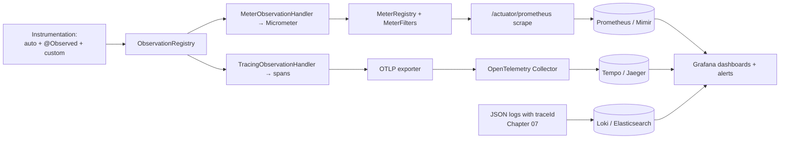
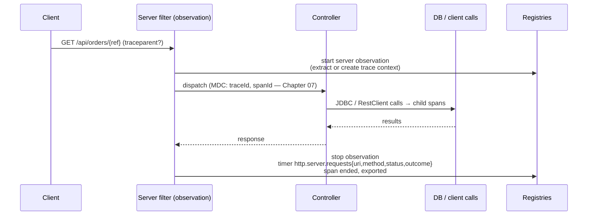
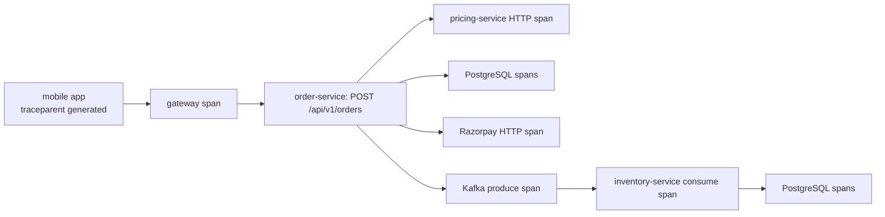

# 27 · Observability

## 1. Introduction & Why It Matters

It's 9:15 p.m. during a sale. Support reports "checkout is slow for some customers". You have 26 services and 180 pods. Which of these can you answer in under two minutes?

- Is it slow for *everyone*, or only in Mumbai, only on Android, only for UPI payments?
- Which hop is slow: our order service, pricing, the database, or Razorpay?
- Did it start at 21:03 with the deploy, or at 20:47 with the traffic spike?
- How much of our monthly error budget has this burned?
- Is the degradation path working — are we serving cached prices, or failing?

With logs alone: no. With dashboards nobody maintained: no. With **metrics for aggregates, traces for causality, logs for detail and a shared correlation id**: yes, in about ninety seconds.

Spring Boot gives you most of this out of the box — Actuator, Micrometer metrics, the Observation API, Micrometer Tracing with OpenTelemetry, and automatic instrumentation of HTTP, JDBC pools, caches, Kafka and more. What Boot cannot give you is **the decisions**: which SLIs matter, what tags to allow, what to alert on, and what a responder should do when the alert fires.

This chapter covers both: the mechanics (endpoints, meters, observations, tracing, exporters) and the judgement (cardinality budgets, SLOs and burn-rate alerts, business metrics, runbooks, cost control).

### Who should read which section

| Band | Focus |
|---|---|
| B1 · 0–2 yrs | Parts 1, 2, 4 — Actuator, built-in metrics, health |
| B2 · 2–5 yrs | Parts 2, 5 — custom metrics, tags, health indicators, tracing setup |
| B3 · 5–8 yrs | Parts 3, 5, 6 — Observation API, cardinality, sampling, exemplars |
| B4 · 8–12 yrs | Parts 6, 8 — SLOs, alerting, dashboards, cost |
| B5 · 12–15+ yrs | Parts 8, 9 — observability strategy and incident culture |

---

## 2. Core Concepts

### 2.1 The three signals (plus one)

| Signal | Answers | Cost driver | Retention |
|---|---|---|---|
| **Metrics** | How much, how often, how fast — in aggregate | Cardinality (tag combinations) | Long (months) |
| **Traces** | Where did the time go for this request, across services | Sampling rate × span count | Short (days) |
| **Logs** | What exactly happened in this case | Volume × verbosity (Chapter 07) | Medium, tiered |
| **Profiles** (continuous profiling) | Which code burned the CPU | Sampling | Short |

Rule: **alert on metrics, debug with traces, confirm with logs.**

### 2.2 Actuator

| Endpoint | Use |
|---|---|
| `health` (+ groups `liveness`, `readiness`) | Kubernetes probes, dependency status |
| `info` | Build version, git commit (Chapter 01) |
| `metrics`, `prometheus` | Metric scraping |
| `loggers` | Change log levels at runtime (Chapter 07) |
| `startup` | Slow beans at startup (Chapter 03) |
| `env`, `configprops` | Effective configuration (sanitized, Chapter 06) |
| `conditions`, `beans`, `mappings` | Why is this bean/endpoint here (Chapter 05) |
| `threaddump`, `heapdump` | Incident forensics |
| `httpexchanges`, `scheduledtasks`, `caches`, `flyway`, `sbom` | Targeted diagnostics |

```yaml title="application.yml"
management:
  server:
    port: 9090                      # separate port; not exposed publicly
  endpoints:
    web:
      exposure:
        include: health,info,prometheus,loggers,startup,metrics
  endpoint:
    health:
      probes:
        enabled: true
      show-details: when-authorized
```

### 2.3 Micrometer meter types

| Type | Use | Example |
|---|---|---|
| **Counter** | Monotonic count | `grocery.orders.placed` |
| **Timer** | Duration + count (+ histogram) | `http.server.requests` |
| **Gauge** | Current value | `grocery.outbox.pending` |
| **DistributionSummary** | Non-time distribution | order value in ₹ |
| **LongTaskTimer** | In-flight long operations | reindex job duration |

Built-in instrumentation you get for free: `http.server.requests`, `http.client.requests`, `jvm.*`, `process.*`, `system.*`, `hikaricp.*`, `cache.*`, `kafka.*`, `spring.data.repository.invocations`, `tomcat.*`, `logback.events`, `executor.*`, `resilience4j.*`.

### 2.4 Cardinality — the one rule that matters

A metric's cost is the number of **distinct tag combinations** (time series). `http.server.requests{uri, method, status, outcome, exception}` with 40 URIs × 4 methods × 8 statuses ≈ 1,280 series — fine. Add `customerId` and you have millions, and your monitoring bill (and Prometheus) fall over.

| Allowed as a tag | Never a tag |
|---|---|
| endpoint/URI **template**, method, status, outcome | order id, customer id, SKU, mobile number |
| service, environment, region, version | free-text error messages |
| dependency name, cache name, queue name | timestamps, UUIDs, full URLs with ids |
| bounded enums (payment method, channel) | anything unbounded |

High-cardinality data belongs in **traces and logs**, which are indexed for exactly that.

### 2.5 The Observation API

One instrumentation call produces **metrics and a trace span** (and optionally logs):

```java title="The Observation API (snippet)"
Observation.createNotStarted("grocery.checkout", registry)
    .lowCardinalityKeyValue("channel", "mobile")     // → metric tag
    .highCardinalityKeyValue("orderRef", ref)        // → span attribute only
    .observe(() -> doCheckout());
```

`ObservationHandler`s turn observations into timers, spans and log events. `@Observed` does the same via AOP when `management.observations.annotations.enabled=true`.

### 2.6 Tracing

| Concept | Meaning |
|---|---|
| Trace | One request's journey, identified by `traceId` |
| Span | One operation (HTTP call, DB query, Kafka consume) with parent/child links |
| Propagation | W3C `traceparent` header (and `tracestate`), Kafka headers |
| Sampling | Head-based probability in the app, or tail-based in a collector |
| Exemplars | Links from a metric bucket to an example trace |

Spring integrates via **Micrometer Tracing** with an OpenTelemetry (or Brave) bridge, exporting OTLP to a collector → Tempo/Jaeger/vendor.

### 2.7 Health indicators

Boot auto-configures indicators for DataSource, Redis, Kafka, Mongo, disk space, Elasticsearch, and more; you add domain ones. Aggregation: any `DOWN` makes the group `DOWN`.

**The rule from Chapters 03 and 26**: liveness = internal only; readiness = "can this pod serve?"; dependency status is visible but doesn't necessarily remove the pod from rotation.

### 2.8 SLIs, SLOs and error budgets

| Term | Grocery example |
|---|---|
| **SLI** | Fraction of checkout requests answered < 2 s without a 5xx |
| **SLO** | 99.5% over 30 days |
| **Error budget** | 0.5% ≈ 3.6 hours/month of "bad" |
| **Burn rate** | How fast the budget is being consumed |

Alert on **burn rate**, not on every error: a multi-window, multi-burn-rate alert (e.g. 14.4× over 1 h **and** 6× over 6 h) pages when the budget is genuinely at risk and stays quiet for one-off blips.

---

## 3. How It Works Internally

### 3.1 From code to dashboards



The collector is where **tail sampling**, redaction and fan-out to multiple backends happen — keeping that logic out of 26 services.

### 3.2 An HTTP request, fully observed



The `uri` tag uses the **template** (`/api/orders/{ref}`), not the actual path — that's what keeps cardinality bounded.

### 3.3 Meter filters

`MeterFilter`s run before a meter is registered: deny, rename, add common tags, cap tag values, or configure histograms/SLO buckets. This is your **cardinality safety net** — a filter that caps the number of values per tag stops one bad commit from creating a million series.

---

## 4. Hands-On Code — Level 1 (Beginner)

### 4.1 Actuator and Prometheus

```kotlin title="build.gradle.kts"
implementation("org.springframework.boot:spring-boot-starter-actuator")
implementation("io.micrometer:micrometer-registry-prometheus")
```

```yaml title="application.yml"
management:
  endpoints:
    web:
      exposure:
        include: health,info,prometheus
  endpoint:
    health:
      probes:
        enabled: true
  metrics:
    tags:
      application: ${spring.application.name}      # (1)!
  prometheus:
    metrics:
      export:
        enabled: true
```

1. Common tags on every metric (5.1 shows the programmatic version with more tags).

```bash title="Terminal"
curl -s localhost:8080/actuator/prometheus | grep http_server_requests | head -5
```

```text title="Example"
http_server_requests_seconds_count{application="order-service",method="GET",outcome="SUCCESS",status="200",uri="/api/orders/{ref}"} 1423
http_server_requests_seconds_sum{...} 61.2
```

### 4.2 A first custom metric

```java title="in/grocery/order/metrics/OrderMetrics.java"
package in.grocery.order.metrics;

import io.micrometer.core.instrument.Counter;
import io.micrometer.core.instrument.MeterRegistry;
import java.math.BigDecimal;
import org.springframework.stereotype.Component;

@Component
public class OrderMetrics {

    private final MeterRegistry meters;
    private final Counter placed;

    public OrderMetrics(MeterRegistry meters) {
        this.meters = meters;
        this.placed = Counter.builder("grocery.orders.placed")                  // (1)!
                .description("Orders successfully placed")
                .register(meters);
    }

    public void orderPlaced(String channel, String paymentMethod, BigDecimal total) {
        meters.counter("grocery.orders.placed", "channel", channel, "paymentMethod", paymentMethod)
              .increment();                                                      // (2)!
        meters.summary("grocery.orders.value.rupees").record(total.doubleValue());   // (3)!
    }
}
```

1. Dot-separated names; Micrometer translates to the backend's convention (`grocery_orders_placed_total` in Prometheus).
2. **Bounded tags only**: channel (web/android/ios) and payment method (UPI/CARD/COD) have a handful of values each.
3. A distribution summary gives you average and percentile order values — a business metric engineers and finance both use.

### 4.3 A custom health indicator

```java title="in/grocery/payment/health/RazorpayHealthIndicator.java"
package in.grocery.payment.health;

import org.springframework.boot.actuate.health.Health;
import org.springframework.boot.actuate.health.HealthIndicator;
import org.springframework.stereotype.Component;

@Component("razorpay")
public class RazorpayHealthIndicator implements HealthIndicator {

    private final CircuitBreakerRegistry breakers;

    @Override
    public Health health() {
        var state = breakers.circuitBreaker("razorpay").getState();
        return switch (state) {
            case CLOSED -> Health.up().withDetail("breaker", state).build();
            case HALF_OPEN -> Health.up().withDetail("breaker", state).build();
            default -> Health.status("DEGRADED")                                 // (1)!
                    .withDetail("breaker", state)
                    .withDetail("impact", "Payments unavailable; checkout returns 503")
                    .build();
        };
    }
}
```

1. A custom status that is **not** `DOWN`: the pod keeps serving (Chapter 26), but humans see the impact immediately. Map custom statuses to HTTP codes with `management.endpoint.health.status.http-mapping` if needed, and keep this indicator **out of** the readiness group.

### 4.4 Checking metrics exist

```java title="OrderMetricsTest.java"
@SpringBootTest
class OrderMetricsTest {

    @Autowired OrderMetrics metrics;
    @Autowired MeterRegistry registry;

    @Test
    void ordersPlacedCounterIsRecorded() {
        metrics.orderPlaced("android", "UPI", new BigDecimal("578.00"));

        assertThat(registry.get("grocery.orders.placed")
                .tags("channel", "android", "paymentMethod", "UPI")
                .counter().count()).isEqualTo(1.0);                              // (1)!
    }
}
```

1. Metrics that dashboards and alerts depend on deserve tests — a renamed metric silently breaks an alert, which you discover during the next incident.

---

## 5. Hands-On Code — Level 2 (Intermediate) & Level 3 (Advanced)

### 5.1 Level 2 — Platform metric configuration

```java title="in/grocery/platform/observability/MetricsConfig.java"
package in.grocery.platform.observability;

import io.micrometer.core.instrument.MeterRegistry;
import io.micrometer.core.instrument.config.MeterFilter;
import io.micrometer.core.instrument.distribution.DistributionStatisticConfig;
import java.time.Duration;
import org.springframework.boot.actuate.autoconfigure.metrics.MeterRegistryCustomizer;
import org.springframework.context.annotation.Bean;
import org.springframework.context.annotation.Configuration;

@Configuration(proxyBeanMethods = false)
public class MetricsConfig {

    @Bean
    MeterRegistryCustomizer<MeterRegistry> commonTags(
            @Value("${spring.application.name}") String app,
            @Value("${grocery.env:local}") String env,
            @Value("${GROCERY_REGION:ap-south-1}") String region,
            org.springframework.boot.info.BuildProperties build) {
        return registry -> registry.config().commonTags(                          // (1)!
                "application", app, "env", env, "region", region, "version", build.getVersion());
    }

    @Bean
    MeterFilter cardinalityGuard() {
        return MeterFilter.maximumAllowableTags("http.server.requests", "uri", 200,   // (2)!
                MeterFilter.deny());
    }

    @Bean
    MeterFilter sloHistograms() {
        return new MeterFilter() {
            @Override
            public DistributionStatisticConfig configure(io.micrometer.core.instrument.Meter.Id id,
                                                         DistributionStatisticConfig config) {
                if (id.getName().startsWith("http.server.requests")
                        || id.getName().startsWith("grocery.checkout")) {
                    return DistributionStatisticConfig.builder()
                            .percentilesHistogram(true)                                // (3)!
                            .serviceLevelObjectives(
                                    Duration.ofMillis(200).toNanos(),
                                    Duration.ofMillis(500).toNanos(),
                                    Duration.ofSeconds(1).toNanos(),
                                    Duration.ofSeconds(2).toNanos())
                            .build().merge(config);
                }
                return config;
            }
        };
    }

    @Bean
    MeterFilter denyNoisyMeters() {
        return MeterFilter.deny(id -> id.getName().startsWith("tomcat.sendfile"));      // (4)!
    }
}
```

1. Every metric carries application, environment, region and version — the tags dashboards slice by, and the ones that let you spot "only v1.42 pods are slow".
2. **Cardinality guard**: after 200 distinct `uri` values, new ones are dropped. Protects against a mis-templated path leaking ids into metrics.
3. Histograms enable accurate percentile and SLO queries in Prometheus; explicit SLO buckets make burn-rate alerting cheap.
4. Trim metrics nobody uses — storage and scrape cost are real.

### 5.2 Level 2 — Tracing setup

```kotlin title="build.gradle.kts"
implementation("io.micrometer:micrometer-tracing-bridge-otel")
implementation("io.opentelemetry:opentelemetry-exporter-otlp")
```

```yaml title="application.yml"
management:
  tracing:
    sampling:
      probability: 0.1                    # (1)!
  otlp:
    tracing:
      endpoint: http://otel-collector:4318/v1/traces
  observations:
    annotations:
      enabled: true                       # (2)!
  metrics:
    distribution:
      percentiles-histogram:
        http.server.requests: true
spring:
  kafka:
    listener:
      observation-enabled: true           # (3)!
    template:
      observation-enabled: true
logging:
  pattern:
    correlation: "[${spring.application.name:},%X{traceId:-},%X{spanId:-}] "   # (4)!
```

1. 10% head sampling. Errors and slow requests are usually kept by **tail sampling** in the collector (6.3) — configure that rather than raising this to 100%.
2. Enables `@Observed`, `@Timed`, `@Counted` aspects.
3. Trace context flows through Kafka headers (Chapter 23), so a trace spans producer → consumer.
4. Logs carry `traceId` (Chapter 07) — the join key between all three signals.

### 5.3 Level 2 — Business observations

```java title="in/grocery/order/delegate/OrderDelegate.java (observed)"
@Observed(name = "grocery.checkout",                                              // (1)!
          contextualName = "place-order",
          lowCardinalityKeyValues = {"flow", "standard"})
public OrderView place(PlaceOrderCommand command) { ... }
```

For richer control, use the API directly:

```java title="in/grocery/order/service/CheckoutObservation.java"
package in.grocery.order.service;

import io.micrometer.observation.Observation;
import io.micrometer.observation.ObservationRegistry;
import org.springframework.stereotype.Component;

@Component
public class CheckoutObservation {

    private final ObservationRegistry registry;

    public <T> T observe(PlaceOrderCommand command, java.util.function.Supplier<T> work) {
        return Observation.createNotStarted("grocery.checkout", registry)
                .lowCardinalityKeyValue("channel", command.channel())              // (1)!
                .lowCardinalityKeyValue("paymentMethod", command.paymentMethod().name())
                .highCardinalityKeyValue("orderRef", command.orderRef())            // (2)!
                .highCardinalityKeyValue("customerId", command.customerId())
                .observe(work);
    }
}
```

1. **Low cardinality → metric tags**: you can graph checkout latency by channel and payment method.
2. **High cardinality → span attributes only**: you can find *this* customer's slow checkout in Tempo, without a million time series.

That distinction is the single most useful thing the Observation API gives you.

### 5.4 Level 3 — What to measure per layer

| Layer | Metric | Alert on |
|---|---|---|
| HTTP server | `http.server.requests` (rate, errors, p99 by uri) | SLO burn rate |
| HTTP clients | `http.client.requests` by dependency | error rate, p99 |
| Database | `hikaricp.connections.{active,pending,usage}` | pending > 0 sustained |
| JPA/queries | `spring.data.repository.invocations` | p99 per repository method |
| Cache | `cache.gets{result}` | hit ratio drop |
| Kafka | consumer lag, `grocery.kafka.dlt` | lag growth, any DLT |
| Outbox | `grocery.outbox.pending` | > 1,000 or rising |
| Executors | `executor.queued`, `executor.rejected` | queue depth, any rejection |
| Resilience | breaker transitions, `grocery.degraded` | any OPEN, degradation rate |
| JVM | heap, GC pause, threads | GC pause p99, heap after GC |
| Business | orders/min, GMV, payment success %, checkout conversion | deviation from baseline |

!!! tip "Business metrics detect what technical metrics miss"
    A deploy that breaks the "Place order" button produces *fewer* errors and *lower* latency — everything looks great except `grocery.orders.placed` falling off a cliff. Alert on a sustained drop against the same hour last week.

### 5.5 Level 3 — Health groups that mean something

```yaml title="application.yml"
management:
  endpoint:
    health:
      group:
        readiness:
          include: readinessState, db, redis                       # (1)!
          show-details: always
        liveness:
          include: livenessState                                    # (2)!
      show-details: when-authorized
  health:
    redis:
      enabled: true
    defaults:
      enabled: true
```

1. Without PostgreSQL or Redis this pod cannot serve → take it out of rotation. Note that if *every* pod loses the database, removing them all doesn't help — that's why the dependency list must be minimal and deliberate.
2. Liveness never includes dependencies (Chapters 03, 26).

```java title="in/grocery/platform/observability/OutboxHealthIndicator.java"
@Component("outbox")
class OutboxHealthIndicator implements HealthIndicator {

    @Override
    public Health health() {
        long pending = outbox.countPending();
        long oldestSeconds = outbox.oldestPendingAgeSeconds();
        return oldestSeconds < 120
                ? Health.up().withDetail("pending", pending).build()
                : Health.status("DEGRADED")                                       // (1)!
                        .withDetail("pending", pending)
                        .withDetail("oldestPendingSeconds", oldestSeconds)
                        .build();
    }
}
```

1. Visible to humans and to a dashboard query; **not** in the readiness group, because a stuck relay shouldn't remove serving capacity.

### 5.6 Level 3 — Instrumenting a custom component

```java title="in/grocery/search/indexer/IndexerMetrics.java"
package in.grocery.search.indexer;

import io.micrometer.core.instrument.Gauge;
import io.micrometer.core.instrument.LongTaskTimer;
import io.micrometer.core.instrument.MeterRegistry;
import io.micrometer.core.instrument.Timer;
import java.util.concurrent.atomic.AtomicLong;
import org.springframework.stereotype.Component;

@Component
public class IndexerMetrics {

    private final AtomicLong lagSeconds = new AtomicLong();
    private final Timer bulkTimer;
    private final LongTaskTimer reindexTimer;

    public IndexerMetrics(MeterRegistry meters) {
        Gauge.builder("grocery.search.index.lag.seconds", lagSeconds, AtomicLong::get)      // (1)!
             .description("Age of the most recent event applied to the index")
             .register(meters);
        this.bulkTimer = Timer.builder("grocery.search.bulk")
                .publishPercentileHistogram()
                .register(meters);
        this.reindexTimer = LongTaskTimer.builder("grocery.search.reindex")                 // (2)!
                .register(meters);
    }

    public void recordLag(long seconds) { lagSeconds.set(seconds); }
    public <T> T timeBulk(java.util.function.Supplier<T> work) { return bulkTimer.record(work); }
    public <T> T timeReindex(java.util.function.Supplier<T> work) { return reindexTimer.record(work); }
}
```

1. A gauge reads a live value — hold the source (`AtomicLong`) strongly, or the gauge silently reports NaN when it's garbage collected. (Classic bug.)
2. `LongTaskTimer` reports the duration of **in-flight** work — a reindex running for 40 minutes is visible while it runs, not only when it finishes.

---

## 6. Hands-On Code — Level 4 (Expert / Production)

### 6.1 SLOs and burn-rate alerts

```yaml title="slo/order-service.yaml (documented SLOs)"
service: order-service
slos:
  - name: checkout-availability
    sli: "successful (non-5xx) POST /api/v1/orders responses / total"
    objective: 99.5%
    window: 30d
  - name: checkout-latency
    sli: "POST /api/v1/orders responses faster than 2s / total"
    objective: 99%
    window: 30d
  - name: order-events-freshness
    sli: "outbox rows relayed within 60s / total"
    objective: 99.9%
    window: 7d
```

```yaml title="prometheus/rules/order-service.yaml"
groups:
  - name: order-service-slo
    rules:
      - record: job:checkout_errors:ratio_rate5m                                      # (1)!
        expr: |
          sum(rate(http_server_requests_seconds_count{application="order-service",uri="/api/v1/orders",status=~"5.."}[5m]))
          /
          sum(rate(http_server_requests_seconds_count{application="order-service",uri="/api/v1/orders"}[5m]))

      - alert: CheckoutErrorBudgetBurningFast
        expr: |
          job:checkout_errors:ratio_rate5m > (14.4 * 0.005)
          and
          job:checkout_errors:ratio_rate1h > (14.4 * 0.005)                            # (2)!
        for: 2m
        labels:
          severity: page
        annotations:
          summary: "Checkout burning error budget 14x (order-service)"
          runbook: "https://runbooks.grocery.in/order-service/checkout-errors"         # (3)!
          dashboard: "https://grafana.grocery.in/d/order-service"

      - alert: CheckoutErrorBudgetBurningSlow
        expr: |
          job:checkout_errors:ratio_rate30m > (6 * 0.005)
          and
          job:checkout_errors:ratio_rate6h > (6 * 0.005)
        for: 15m
        labels:
          severity: ticket                                                              # (4)!
```

1. Recording rules keep alert expressions readable and cheap.
2. **Multi-window, multi-burn-rate**: two windows must agree, which kills false pages from 30-second blips while still catching a real outage in minutes.
3. Every alert links a **runbook** and a dashboard. An alert without a runbook is a 2 a.m. puzzle.
4. Slow burn creates a ticket, not a page — the budget is at risk but nothing is on fire.

### 6.2 Dashboards that answer questions

A service dashboard, top to bottom:

| Row | Panels |
|---|---|
| **SLO** | Availability and latency SLI vs objective, error budget remaining, burn rate |
| **Traffic (RED)** | Requests/s by endpoint, error rate, latency p50/p95/p99 |
| **Dependencies** | `http.client.requests` per dependency (rate, errors, p99), breaker state, degradation counters |
| **Resources (USE)** | CPU, heap after GC, GC pause, Hikari active/pending, executor queues |
| **Async** | Kafka lag, DLT rate, outbox pending, scheduled job durations |
| **Business** | Orders/min vs last week, payment success %, checkout conversion |
| **Deploys** | Version annotations overlaid on every graph |

The deploy annotation row is what turns "when did this start?" from an archaeology exercise into a glance.

### 6.3 Collector configuration: sampling and redaction

```yaml title="otel-collector.yaml (excerpt)"
processors:
  tail_sampling:                                                                    # (1)!
    decision_wait: 10s
    policies:
      - name: errors
        type: status_code
        status_code: { status_codes: [ERROR] }
      - name: slow
        type: latency
        latency: { threshold_ms: 1000 }
      - name: baseline
        type: probabilistic
        probabilistic: { sampling_percentage: 5 }
  attributes/redact:                                                                # (2)!
    actions:
      - key: http.request.header.authorization
        action: delete
      - key: customer.mobile
        action: delete
  resource:
    attributes:
      - key: deployment.environment
        value: prod
        action: upsert
exporters:
  otlp/tempo: { endpoint: tempo:4317 }
  prometheusremotewrite: { endpoint: http://mimir/api/v1/push }
```

1. **Tail sampling**: keep every error and slow trace, plus 5% of the rest. Head sampling alone forces a choice between cost and keeping the traces you actually need.
2. Redaction in one place rather than in 26 services — and a second line of defence behind the application's own PII discipline (Chapter 07).

### 6.4 Tracing across the whole checkout



What this gives a responder in one view: which hop consumed the 3.8 seconds, whether the Kafka consumer picked the event up, and the `traceId` to paste into the log search for the exact SQL and error.

**Requirements** for that picture to exist: clients built from Boot's builders (Chapter 19), `observation-enabled` on Kafka template and listeners (Chapter 23), context propagation to async work (Chapters 07, 25), and consistent `traceparent` propagation at the gateway.

### 6.5 Instrumenting an incident-ready service — checklist in code

```java title="src/test/java/in/grocery/order/ObservabilityContractTest.java"
@SpringBootTest(webEnvironment = RANDOM_PORT)
@Import(ContainersConfig.class)
class ObservabilityContractTest {

    @Autowired MeterRegistry registry;
    @Autowired TestRestTemplate rest;

    @Test
    void requiredMetersExistAfterTraffic() {
        rest.getForEntity("/api/v1/orders/ORD-1", String.class);

        List.of("http.server.requests", "jvm.memory.used", "hikaricp.connections.active",
                "grocery.orders.placed", "grocery.outbox.pending")
            .forEach(name -> assertThat(registry.find(name).meters())                     // (1)!
                    .as("meter %s must exist", name).isNotEmpty());
    }

    @Test
    void uriTagUsesTemplateNotActualPath() {
        rest.getForEntity("/api/v1/orders/ORD-12345", String.class);

        assertThat(registry.get("http.server.requests").tags("uri", "/api/v1/orders/{ref}").timer())
                .isNotNull();                                                              // (2)!
    }

    @Test
    void healthGroupsAreConfigured() {
        assertThat(rest.getForEntity("/actuator/health/readiness", String.class).getStatusCode())
                .isEqualTo(HttpStatus.OK);
        assertThat(rest.getForEntity("/actuator/health/liveness", String.class).getStatusCode())
                .isEqualTo(HttpStatus.OK);
    }
}
```

1. Alerts depend on these names; a rename must fail the build, not an incident.
2. Guards the cardinality rule at the place it usually breaks — a hand-built URI or a `String.format` path.

### 6.6 Cost control

| Lever | Effect |
|---|---|
| Cardinality guards and tag review | The biggest single factor in metrics cost |
| Drop unused meters (`MeterFilter.deny`) | Fewer series scraped and stored |
| Scrape interval (15 s → 30 s) | Halves storage for slow-moving metrics |
| Retention tiers (raw 15 d, downsampled 13 mo) | Long-term trends without raw cost |
| Tail sampling instead of 100% traces | Keeps what matters, drops the rest |
| Log level and retention tiers (Chapter 07) | Usually the largest bill |

Review the top 20 metrics by series count quarterly; a single forgotten tag is usually 80% of the growth.

---

## 7. Spring Boot 3 vs 4 & Migration

| Topic | Boot 3.5 | Boot 4.x |
|---|---|---|
| Actuator | Full endpoint set | Same (module packages move — verify) |
| Micrometer | 1.14/1.15 | 1.15+ (verify) |
| Observation API | ✅ | ✅ |
| Tracing bridge | `micrometer-tracing-bridge-otel` / `-brave` | Same; OpenTelemetry starter available (verify name) |
| OTLP export | `management.otlp.tracing.*`, metrics OTLP registry | Same (verify property names) |
| Annotation aspects | `management.observations.annotations.enabled` | Same (verify) |
| Prometheus | `micrometer-registry-prometheus` | Same; native histograms (verify support) |

### Migration checklist

- [ ] Verify metric **names and tags** are unchanged after the upgrade — dashboards and alerts break silently otherwise.
- [ ] Re-check Actuator endpoint packages if you have custom endpoints or security matchers (`EndpointRequest`).
- [ ] Confirm tracing bridge and exporter versions line up with the collector.
- [ ] Re-run the observability contract test (6.5) in staging before rolling out.
- [ ] Re-validate PII redaction rules after Jackson/serialization changes.

---

## 8. Production Playbook

### Best practices

1. **Alert on metrics, debug with traces, confirm with logs** — one `traceId` joins all three.
2. **Common tags** (application, env, region, version) on every metric; **cardinality guards** as a safety net.
3. **Low-cardinality keys for metrics, high-cardinality for spans** (Observation API).
4. **SLOs with multi-window burn-rate alerts**; every alert links a runbook and dashboard.
5. **Business metrics alongside technical ones** — they catch failures that look healthy.
6. **Health groups**: liveness internal, readiness minimal, degradation visible but non-fatal.
7. **Tail sampling and redaction in the collector**, not in 26 services.
8. **Deploy annotations** on dashboards.
9. **Test your observability**: meter names, URI templates, health groups.
10. **Review cost and cardinality quarterly**.

### Anti-patterns

❌ Unbounded tags (order id, customer id, SKU, raw URI) — the classic monitoring-bill explosion.

❌ Alerting on every 5xx instead of on budget burn — pager fatigue, then ignored pages.

❌ Alerts without runbooks or owners.

❌ Dashboards built once for a demo and never maintained; nobody trusts them during an incident.

❌ 100% trace sampling in production "to be safe" — cost with no added insight over tail sampling.

❌ Liveness probes that check dependencies — synchronized restarts during an outage.

❌ Logging what a metric should count (`log.info("cache miss")` at 50k/s).

❌ Exposing Actuator publicly, or `show-details: always` with secrets in `env`.

❌ Measuring only technical signals and missing "orders dropped 60%".

### Troubleshooting

| Symptom | Cause | Fix |
|---|---|---|
| Prometheus scrape times out / high memory | Cardinality explosion | Find top series by name; add cardinality guards; remove bad tags |
| Gauge reports NaN | The measured object was garbage collected | Hold a strong reference |
| `uri` tag shows raw ids | Non-templated path or manual URI building | Use path templates; assert in a test |
| No traces across services | Propagation broken (client not from Boot's builder, gateway strips headers) | Use injected builders; allow `traceparent` |
| Traces stop at Kafka | Observations not enabled on template/listener | `observation-enabled: true` |
| `traceId` missing in logs | No correlation pattern / no tracing on classpath | Chapter 07 pattern, tracing bridge |
| Metrics missing after upgrade | Renamed meters/tags | Contract test; check release notes |
| Health always UP while broken | No dependency indicators, or wrong group | Add indicators; review groups |
| Alert storm during deploys | No deploy awareness, short windows | Multi-window burn rate, deploy annotations, maintenance windows |
| Monitoring bill doubled | New tag, new service, retention change | Quarterly cardinality review |

### Production checklist

- [ ] Actuator on a separate port, secured, probes enabled
- [ ] Common tags + cardinality guards + SLO histograms configured
- [ ] Tracing with OTLP to a collector doing tail sampling and redaction
- [ ] Logs carry `traceId` (Chapter 07)
- [ ] SLOs defined per critical journey with burn-rate alerts
- [ ] Every alert: owner, runbook, dashboard link
- [ ] Business metrics dashboarded and alerted
- [ ] Observability contract test in CI
- [ ] Cardinality and cost reviewed quarterly

---

## 9. Interview Questions & Answers

### B1 · 0–2 years

??? question "B1 · What does Spring Boot Actuator give you?"
    **Short answer:** Production endpoints — health (with liveness/readiness groups), info, metrics/Prometheus, loggers, startup, env, mappings, thread dump — for monitoring and diagnostics.

??? question "B1 · What is Micrometer?"
    **Short answer:** A vendor-neutral metrics facade: you record counters, timers and gauges, and a registry exports them to Prometheus, OTLP or a vendor backend.

??? question "B1 · Counter vs gauge vs timer?"
    **Short answer:** Counter only increases (events); gauge reports a current value (queue depth); timer records durations and counts.

??? question "B1 · Why shouldn't you tag a metric with a customer id?"
    **Short answer:** Each tag value creates a new time series; unbounded values explode storage and query cost. High-cardinality data belongs in traces and logs.

??? question "B1 · What is a trace?"
    **Short answer:** The record of one request's path across services, made of spans linked by a shared `traceId`, showing where time was spent.

### B2 · 2–5 years

??? question "B2 · How do metrics, traces and logs work together?"
    **Short answer:** Metrics detect and alert (aggregates), traces localize the problem (which hop), logs explain the specific case. `traceId` in logs and exemplars on metrics join them.

??? question "B2 · How do you add a custom health indicator, and should it affect readiness?"
    **Short answer:** Implement `HealthIndicator` and register it as a bean. Include it in readiness only if the pod genuinely cannot serve without that dependency; otherwise expose it as detail/degraded status.

??? question "B2 · What does the Observation API add over plain Micrometer?"
    **Short answer:** One instrumentation point produces both a metric and a span (and log context), with an explicit split between low-cardinality keys (tags) and high-cardinality keys (span attributes).

??? question "B2 · How is trace context propagated?"
    **Short answer:** W3C `traceparent`/`tracestate` headers on HTTP (added automatically by Boot-built clients) and headers on Kafka/Rabbit messages when observations are enabled.

??? question "B2 · Why keep `uri` as a template in `http.server.requests`?"
    **Short answer:** Otherwise every id becomes a new time series. Templates keep cardinality bounded and make aggregates meaningful.

??? question "B2 · How do you change a log level without redeploying?"
    **Short answer:** POST to `/actuator/loggers/<logger>` with the desired level (secured, Chapter 07).

### B3 · 5–8 years

??? question "B3 · What are SLIs, SLOs and error budgets, and how do you alert on them?"
    **Short answer:** SLI = measured quality (e.g. fast, non-5xx checkout fraction); SLO = target over a window; error budget = allowed failure. Alert on **burn rate** with multiple windows (fast burn pages, slow burn tickets) instead of on individual errors.

??? question "B3 · Head vs tail sampling?"
    **Short answer:** Head sampling decides at the start (cheap, may discard the trace you need); tail sampling decides in the collector after seeing the whole trace, so you can keep all errors and slow traces plus a small baseline.

??? question "B3 · How do you control metric cardinality in practice?"
    **Short answer:** Tag allow-lists in review, `MeterFilter.maximumAllowableTags`, denying unused meters, URI templates asserted by tests, and periodic reviews of top series by name.

??? question "B3 · What's the difference between a Timer and a LongTaskTimer?"
    **Short answer:** A `Timer` records completed durations; a `LongTaskTimer` reports currently running tasks and their elapsed time — useful for jobs that run for minutes and would otherwise be invisible until they finish.

??? question "B3 · Why can a gauge report NaN?"
    **Short answer:** Micrometer holds a weak reference to the measured object; if nothing else references it, it's garbage collected and the gauge has nothing to read. Keep a strong reference in a field.

### B4 · 8–12 years

??? question "B4 · Design observability for a 26-service platform."
    **Short answer:** Platform library with common tags, cardinality guards, SLO histograms, tracing bridges and health conventions; OTLP to a central collector doing tail sampling and redaction; per-service dashboards from a template with deploy annotations; SLOs per critical journey with burn-rate alerts and runbooks; contract tests for metric names; quarterly cost/cardinality review.

??? question "B4 · An incident is called. What's your first two minutes?"
    **Short answer:** SLO dashboard (what's failing, how fast the budget is burning), deploy annotations (did something change), dependency panels (which client calls are erroring/slow), breaker and degradation counters, then a representative trace, then logs by `traceId`.

??? question "B4 · How do you decide what to alert on?"
    **Short answer:** Only on symptoms users feel (SLO burn, business-metric drops) and on conditions that will become user-visible soon (queue lag, outbox backlog, saturation). Everything else is a dashboard. Every alert must have an owner, a runbook and a tested response.

### B5 · 12–15+ years

??? question "B5 · How does observability change engineering culture?"
    **Short answer:** It moves debate from opinion to evidence: SLOs align product and engineering on acceptable failure; error budgets make reliability work fundable; post-incident reviews start from data; and teams instrument as part of "done" rather than after the second outage.

??? question "B5 · Build or buy?"
    **Short answer:** Instrument with open standards (Micrometer/OpenTelemetry) so the backend is replaceable. Buy managed backends unless scale makes them uneconomic and you have the operational maturity to run them. Never couple application code to a vendor SDK.

### Scenario questions

??? example "Scenario · Everything is green but revenue dropped 40%"
    A deploy broke the Android checkout button; requests never arrived, so error rate fell and latency improved. Fixes: alert on `grocery.orders.placed` deviating from the same hour last week (and per channel), add funnel metrics (cart → checkout → payment), and include business panels on every service dashboard.

??? example "Scenario · Prometheus falls over after a release"
    A new endpoint built URIs with `String.format` so order ids leaked into the `uri` tag — millions of series. Fixes: cardinality guard (`maximumAllowableTags`), a contract test asserting URI templates, and a review rule that no metric tag may come from request data without an allow-list.

### Coding exercise

!!! example "Exercise · Instrument the payment flow"
    Add: a timer `grocery.payment.attempt` tagged by gateway, method and outcome (SUCCESS/DECLINED/UNAVAILABLE); a counter for declines by reason (bounded set); a gauge for pending settlements; an `@Observed` span around the capture flow with `orderRef` as a high-cardinality key. Write tests asserting the meter names/tags and that `orderRef` is not a metric tag.

??? success "Solution"
    ```java title="PaymentMetrics.java"
    package in.grocery.payment.metrics;

    import io.micrometer.core.instrument.Gauge;
    import io.micrometer.core.instrument.MeterRegistry;
    import io.micrometer.core.instrument.Timer;
    import java.util.Set;
    import java.util.concurrent.atomic.AtomicLong;
    import org.springframework.stereotype.Component;

    @Component
    public class PaymentMetrics {

        private static final Set<String> KNOWN_REASONS =
                Set.of("insufficient_funds", "card_declined", "payment_failed", "timeout");   // (1)!

        private final MeterRegistry meters;
        private final AtomicLong pendingSettlements = new AtomicLong();

        public PaymentMetrics(MeterRegistry meters, SettlementRepository settlements) {
            this.meters = meters;
            Gauge.builder("grocery.settlements.pending", pendingSettlements, AtomicLong::get)
                 .register(meters);                                                            // (2)!
        }

        public <T> T recordAttempt(String gateway, String method, java.util.function.Supplier<T> call) {
            Timer.Sample sample = Timer.start(meters);
            String outcome = "SUCCESS";
            try {
                return call.get();
            } catch (PaymentDeclinedException declined) {
                outcome = "DECLINED";
                meters.counter("grocery.payment.declines", "reason", normalize(declined.reason())).increment();
                throw declined;
            } catch (DependencyException unavailable) {
                outcome = "UNAVAILABLE";
                throw unavailable;
            } finally {
                sample.stop(Timer.builder("grocery.payment.attempt")
                        .tag("gateway", gateway).tag("method", method).tag("outcome", outcome)
                        .publishPercentileHistogram()
                        .register(meters));
            }
        }

        private static String normalize(String reason) {
            return KNOWN_REASONS.contains(reason) ? reason : "other";                          // (3)!
        }

        public void updatePendingSettlements(long count) { pendingSettlements.set(count); }
    }
    ```

    1. Bounded reason set — gateways invent new codes, and each one would otherwise be a new time series.
    2. Strong reference kept in a field (otherwise NaN).
    3. Everything unknown collapses to `other`; the exact reason still appears in logs and spans.

    ```java title="PaymentCaptureService.java (observed)"
    @Observed(name = "grocery.payment.capture", contextualName = "capture-payment")
    public PaymentResult capture(String orderRef, String paymentId) {
        return observationRegistry.getCurrentObservation() == null
                ? doCapture(orderRef, paymentId)
                : withOrderRef(orderRef, () -> doCapture(orderRef, paymentId));     // high-cardinality on the span
    }
    ```

    ```java title="PaymentMetricsTest.java"
    @Test
    void recordsOutcomeTags() {
        assertThatThrownBy(() -> metrics.recordAttempt("RAZORPAY", "UPI", () -> {
            throw new PaymentDeclinedException("insufficient_funds");
        })).isInstanceOf(PaymentDeclinedException.class);

        assertThat(registry.get("grocery.payment.attempt")
                .tags("gateway", "RAZORPAY", "method", "UPI", "outcome", "DECLINED").timer().count()).isEqualTo(1);
        assertThat(registry.get("grocery.payment.declines").tag("reason", "insufficient_funds").counter().count())
                .isEqualTo(1.0);
    }

    @Test
    void unknownDeclineReasonIsCollapsed() {
        assertThatThrownBy(() -> metrics.recordAttempt("RAZORPAY", "CARD", () -> {
            throw new PaymentDeclinedException("bank_gateway_error_42");
        })).isInstanceOf(PaymentDeclinedException.class);

        assertThat(registry.get("grocery.payment.declines").tag("reason", "other").counter().count()).isEqualTo(1.0);
    }

    @Test
    void orderRefIsNeverAMetricTag() {
        metrics.recordAttempt("RAZORPAY", "UPI", () -> "ok");
        assertThat(registry.get("grocery.payment.attempt").timer().getId().getTags())
                .noneMatch(tag -> tag.getKey().equals("orderRef"));                             // (1)!
    }
    ```

    1. The cardinality rule, enforced by a test — cheap insurance against an innocent-looking future commit.

---

## Key Takeaways

- **Metrics alert, traces localize, logs explain** — joined by `traceId`.
- **Cardinality is the budget**: low-cardinality keys for metrics, high-cardinality for spans; guards as a safety net.
- The **Observation API** gives metrics and traces from one instrumentation point.
- **SLOs with multi-window burn-rate alerts** replace noisy per-error alerting.
- **Business metrics** catch failures that look technically healthy.
- **Liveness internal, readiness minimal**, degradation visible but non-fatal.
- **Tail sampling and redaction in the collector**; deploy annotations on dashboards.
- **Test your observability**, and review its cost.

## Further Reading

- Spring Boot Reference — *Actuator*, *Observability*, *Metrics*, *Tracing*
- Micrometer documentation — concepts, meter filters, Observation API
- OpenTelemetry documentation — collector processors, sampling, semantic conventions
- Google SRE Book / Workbook — *Service Level Objectives*, *Alerting on SLOs*

---

[:material-arrow-left: 26 Resilience](26-resilience.md) · [28 Integration & Contract Testing :material-arrow-right:](28-integration-contract-testing.md)
