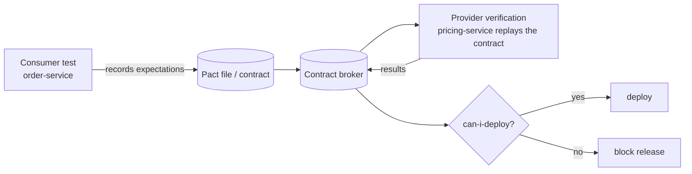
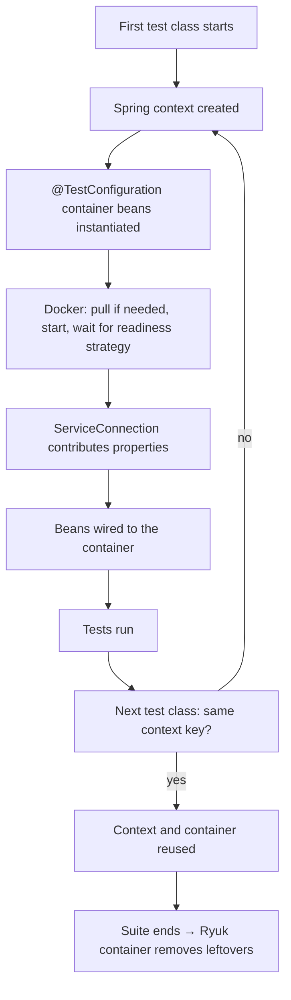
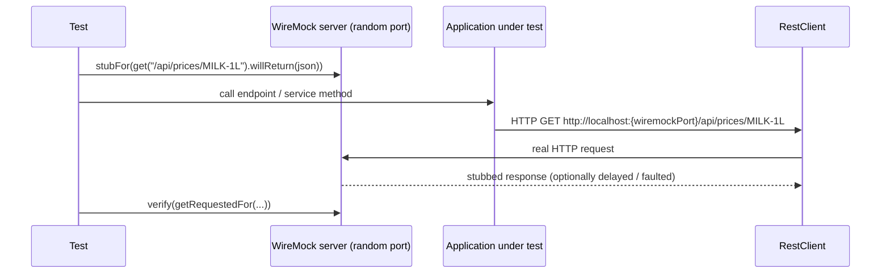
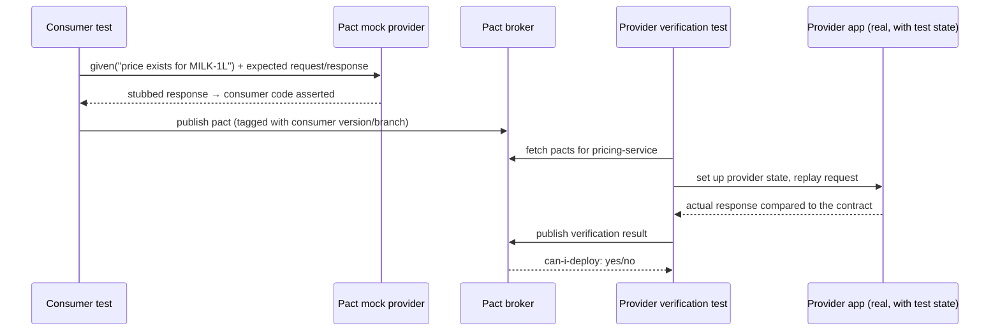
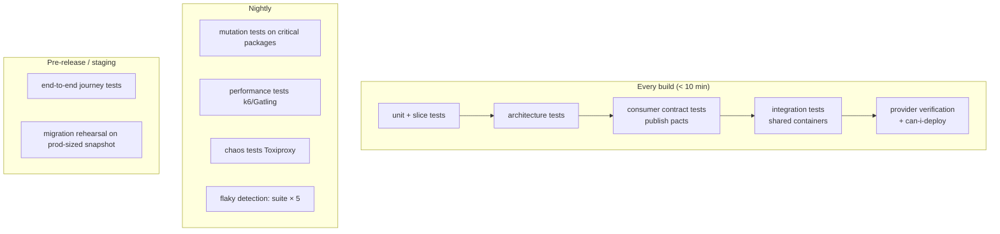

# 28 · Integration & Contract Testing

## 1. Introduction & Why It Matters

Chapter 15 built the fast half of the suite: unit tests and slices, thousands of them, running in two minutes. They prove that each piece behaves — and they cannot catch the failures that actually take the grocery platform down:

- A Flyway migration that works on an empty schema and locks `customer_order` for four minutes on production-sized data.
- An `@Query` that passes against H2 and returns the wrong rows on PostgreSQL.
- A Kafka consumer whose deserializer rejects the producer's new field — discovered in production, not in either team's test suite.
- A cart-service release that renames `deliveryFee` while the Flutter app still reads it (Chapter 20).
- A dependency that goes slow rather than down, and a circuit breaker that was never exercised (Chapter 26).
- An architecture rule ("no remote calls inside transactions") that everyone agreed to and nobody enforces.

Integration and contract tests cover exactly this space: **real infrastructure**, **real protocols**, and **agreements between teams**. This chapter builds them: Testcontainers at suite scale, WireMock for HTTP dependencies including latency and faults, consumer-driven contracts with Pact and Spring Cloud Contract (for HTTP *and* Kafka events), ArchUnit as executable architecture, Spring Modulith verification, mutation testing where correctness matters most, and the CI orchestration that keeps all of it under ten minutes.

### Who should read which section

| Band | Focus |
|---|---|
| B1 · 0–2 yrs | Parts 1, 2, 4 — what an integration test is, Testcontainers basics |
| B2 · 2–5 yrs | Parts 2, 5 — WireMock, containers per technology, ArchUnit |
| B3 · 5–8 yrs | Parts 3, 5, 6 — contract testing, event contracts, suite performance |
| B4 · 8–12 yrs | Parts 6, 8 — platform test architecture, CI gates, can-i-deploy |
| B5 · 12–15+ yrs | Parts 8, 9 — testing strategy across teams |

---

## 2. Core Concepts

### 2.1 What each test level proves

| Level | Proves | Doesn't prove |
|---|---|---|
| Unit | Business rules | Wiring, SQL, serialization |
| Slice | One layer's wiring and contract | Cross-layer behaviour, real infrastructure |
| **Integration** | The service works against **real** PostgreSQL/Kafka/Redis | That other services agree with you |
| **Contract** | Two services agree on a message/API shape | End-to-end business flow |
| End-to-end | A journey across services works | Anything at scale or under failure |
| Performance/chaos | Behaviour under load and failure | Correctness |

### 2.2 Testcontainers

Real dependencies in Docker, started from the test JVM.

| Feature | Use |
|---|---|
| `@ServiceConnection` | Auto-wires `spring.datasource.*`, `spring.kafka.*`, etc. from the container |
| `@DynamicPropertySource` | Manual property wiring for anything not covered |
| `@TestConfiguration` container beans | Containers shared via the context cache (Chapter 15) |
| `withReuse(true)` + `testcontainers.reuse.enable` | Container survives between local runs |
| `SpringApplication.from(...).with(...)` | Run the app locally against containers (`bootTestRun`) |
| `spring-boot-docker-compose` | Boot starts a `compose.yaml` for development |

**Never** substitute H2 for PostgreSQL in tests that exercise SQL: different types, different locking, different error codes (Chapter 12).

### 2.3 Stubbing HTTP dependencies

| Tool | Use |
|---|---|
| `MockRestServiceServer` (`@RestClientTest`) | Fast unit-level client tests (Chapter 15) |
| **WireMock** | Real HTTP over a port: latency, faults, stateful scenarios, recording |
| Toxiproxy | Network-level latency/partition between app and a real dependency (Chapter 26) |
| Pact stubs / SCC stub runner | Stubs **generated from contracts** — cannot drift from the provider |

### 2.4 Consumer-driven contract testing

The problem: `order-service` (consumer) and `pricing-service` (provider) each have green suites, and still break each other.



| Approach | Who writes the contract | Notes |
|---|---|---|
| **Pact** (consumer-driven) | The **consumer**, in its own test | Broker + `can-i-deploy` gate; strong for many consumers |
| **Spring Cloud Contract** (producer-driven) | The **provider**, as Groovy/YAML | Generates provider tests **and** consumer stubs |

Both work for HTTP and for messages (Kafka/Rabbit). Pick one per organization — running both is confusing.

### 2.5 Event contracts

Events are APIs (Chapter 23). Three complementary guards:

1. **Golden-file tests** on the serialized payload — catches accidental renames in the producer.
2. **Schema registry compatibility** (Avro/JSON Schema) — blocks incompatible schema registration.
3. **Consumer contract tests** — each consumer states what it needs; the producer verifies it still provides it.

### 2.6 Architecture tests

ArchUnit turns "we agreed to do it this way" into a failing build:

| Rule (from earlier chapters) | Chapter |
|---|---|
| Controller → Delegate → Service → Repository layering | 01, 08 |
| No field injection | 02 |
| `@Transactional` only in services, only on public methods | 16 |
| No remote calls inside transactions | 16 |
| No entities in controllers / no `new ObjectMapper()` | 11, 13 |
| `@Transactional` + `@TransactionalEventListener` must be `REQUIRES_NEW` | 03 |

`FreezingArchRule` records existing violations so a rule can be introduced on a legacy codebase and only **new** violations fail.

### 2.7 Mutation testing

Line coverage says code ran; **mutation testing** (PIT) says the tests would notice if it were wrong. It mutates bytecode (flip a condition, change a return) and reports mutations that no test killed. Expensive — run it nightly on the packages where correctness costs money (pricing, tax, payments, stock).

### 2.8 The cost model

| Test kind | Typical duration | Where it runs |
|---|---|---|
| Unit | < 5 ms | Every build |
| Slice | ~100 ms | Every build |
| Integration (containers) | 1–10 s | Every build (separate task) |
| Contract (consumer) | ~100 ms | Every build |
| Contract (provider verification) | seconds | Every build + on broker webhooks |
| End-to-end | minutes | Pipeline stage / staging |
| Performance, mutation | minutes–hours | Nightly |

---

## 3. How It Works Internally

### 3.1 Testcontainers lifecycle and the context cache



Two consequences that decide suite speed (Chapter 15): containers declared as **beans in a shared configuration** are started once for the whole suite; containers declared as `static @Container` fields in each class are started per class unless the class is also sharing a context.

### 3.2 WireMock in a Spring test



Because it's real HTTP, this exercises the client's timeouts, connection pool, retries, error translation and observability — none of which `MockRestServiceServer` touches.

### 3.3 Contract verification (Pact)



The contract is **generated from the consumer's real expectations**, so it can't drift from what the consumer actually parses.

---

## 4. Hands-On Code — Level 1 (Beginner)

### 4.1 A first integration test

```kotlin title="build.gradle.kts (integrationTest source set — Chapter 15)"
dependencies {
    "integrationTestImplementation"("org.springframework.boot:spring-boot-starter-test")
    "integrationTestImplementation"("org.springframework.boot:spring-boot-testcontainers")
    "integrationTestImplementation"("org.testcontainers:postgresql")
    "integrationTestImplementation"("org.testcontainers:kafka")
    "integrationTestImplementation"("org.wiremock:wiremock-standalone:3.x")
}
```

```java title="src/integrationTest/java/in/grocery/order/OrderApiIntegrationTest.java"
package in.grocery.order;

import static org.assertj.core.api.Assertions.assertThat;

import in.grocery.platform.test.ContainersConfig;
import java.util.Map;
import org.junit.jupiter.api.Test;
import org.springframework.beans.factory.annotation.Autowired;
import org.springframework.boot.test.context.SpringBootTest;
import org.springframework.boot.test.web.client.TestRestTemplate;
import org.springframework.context.annotation.Import;
import org.springframework.http.HttpStatus;

@SpringBootTest(webEnvironment = SpringBootTest.WebEnvironment.RANDOM_PORT)
@Import(ContainersConfig.class)                                                   // (1)!
class OrderApiIntegrationTest {

    @Autowired TestRestTemplate rest;

    @Test
    void placesAnOrderAgainstRealPostgres() {
        var response = rest.postForEntity("/api/v1/orders", placeOrderRequest(), Map.class);

        assertThat(response.getStatusCode()).isEqualTo(HttpStatus.CREATED);
        assertThat(response.getHeaders().getLocation()).isNotNull();               // (2)!
    }
}
```

1. The shared container configuration from Chapter 15 — one PostgreSQL (and Kafka) for the whole suite.
2. Real HTTP, real Flyway migrations, real SQL, real serialization.

### 4.2 Shared containers

```java title="src/integrationTest/java/in/grocery/platform/test/ContainersConfig.java"
package in.grocery.platform.test;

import org.springframework.boot.test.context.TestConfiguration;
import org.springframework.boot.testcontainers.service.connection.ServiceConnection;
import org.springframework.context.annotation.Bean;
import org.testcontainers.containers.PostgreSQLContainer;
import org.testcontainers.kafka.KafkaContainer;
import org.testcontainers.containers.GenericContainer;

@TestConfiguration(proxyBeanMethods = false)
public class ContainersConfig {

    @Bean
    @ServiceConnection
    PostgreSQLContainer<?> postgres() {
        return new PostgreSQLContainer<>("postgres:17-alpine").withReuse(true);    // (1)!
    }

    @Bean
    @ServiceConnection
    KafkaContainer kafka() {
        return new KafkaContainer("apache/kafka:3.9.0").withReuse(true);
    }

    @Bean
    @ServiceConnection(name = "redis")                                              // (2)!
    GenericContainer<?> redis() {
        return new GenericContainer<>("redis:7-alpine").withExposedPorts(6379).withReuse(true);
    }
}
```

1. Started once per suite (via the context cache) and reused across local runs when `testcontainers.reuse.enable=true` is set in `~/.testcontainers.properties`.
2. For images without a dedicated module, `@ServiceConnection` can often be pointed at the right connection details by name — **verify** support for your Boot/Testcontainers versions; otherwise use `@DynamicPropertySource`.

### 4.3 Stubbing a dependency with WireMock

```java title="src/integrationTest/java/in/grocery/order/PricingStub.java"
package in.grocery.order;

import com.github.tomakehurst.wiremock.WireMockServer;
import com.github.tomakehurst.wiremock.client.WireMock;
import org.springframework.boot.test.context.TestConfiguration;
import org.springframework.context.annotation.Bean;
import org.springframework.test.context.DynamicPropertyRegistry;

@TestConfiguration(proxyBeanMethods = false)
public class PricingStub {

    @Bean(destroyMethod = "stop")
    WireMockServer pricingWireMock(DynamicPropertyRegistry registry) {              // (1)!
        WireMockServer server = new WireMockServer(
                com.github.tomakehurst.wiremock.core.WireMockConfiguration.options().dynamicPort());
        server.start();
        registry.add("grocery.pricing.base-url", server::baseUrl);                  // (2)!
        return server;
    }
}
```

1. `DynamicPropertyRegistry` can be injected into `@Bean` methods in recent Boot versions — **verify**; otherwise use the static `@DynamicPropertySource` form.
2. The application's pricing client now points at WireMock.

```java title="Using the stub"
@Test
void usesPricingServiceResponse() {
    pricingWireMock.stubFor(WireMock.get(WireMock.urlPathEqualTo("/api/prices/MILK-1L"))
            .withQueryParam("pincode", WireMock.equalTo("560102"))
            .willReturn(WireMock.okJson("""
                    {"sku":"MILK-1L","price":66.00,"mrp":68.00}
                    """)));

    var response = rest.postForEntity("/api/v1/orders", placeOrderRequest(), Map.class);

    assertThat(response.getStatusCode()).isEqualTo(HttpStatus.CREATED);
    pricingWireMock.verify(WireMock.getRequestedFor(WireMock.urlPathEqualTo("/api/prices/MILK-1L")));   // (1)!
}
```

1. Verify the **request** too: headers (auth, correlation id), query parameters and body are part of the integration.

---

## 5. Hands-On Code — Level 2 (Intermediate) & Level 3 (Advanced)

### 5.1 Level 2 — WireMock for the failure paths

```java title="PricingFailureTest.java"
@Test
void slowPricingIsCutOffByTheClientTimeout() {
    pricingWireMock.stubFor(get(urlPathMatching("/api/prices/.*"))
            .willReturn(okJson(priceJson()).withFixedDelay(5_000)));                 // (1)!

    long start = System.nanoTime();
    var response = rest.postForEntity("/api/v1/orders", placeOrderRequest(), Map.class);

    assertThat(Duration.ofNanos(System.nanoTime() - start)).isLessThan(Duration.ofSeconds(3));   // (2)!
    assertThat(response.getStatusCode()).isIn(HttpStatus.CREATED, HttpStatus.SERVICE_UNAVAILABLE);
}

@Test
void connectionResetIsTranslated() {
    pricingWireMock.stubFor(get(urlPathMatching("/api/prices/.*"))
            .willReturn(aResponse().withFault(Fault.CONNECTION_RESET_BY_PEER)));      // (3)!

    var response = rest.postForEntity("/api/v1/orders", placeOrderRequest(), Map.class);

    assertThat(response.getBody()).containsEntry("code", "DEPENDENCY_UNAVAILABLE");   // (4)!
}

@Test
void statefulScenarioCoversRetry() {
    pricingWireMock.stubFor(get(urlPathMatching("/api/prices/.*"))
            .inScenario("flaky").whenScenarioStateIs(STARTED)
            .willReturn(serverError()).willSetStateTo("recovered"));                  // (5)!
    pricingWireMock.stubFor(get(urlPathMatching("/api/prices/.*"))
            .inScenario("flaky").whenScenarioStateIs("recovered")
            .willReturn(okJson(priceJson())));

    assertThat(rest.postForEntity("/api/v1/orders", placeOrderRequest(), Map.class).getStatusCode())
            .isEqualTo(HttpStatus.CREATED);                                            // retry succeeded
}
```

1. **Latency, not exceptions** — the failure mode that actually happens (Chapter 26).
2. Assert the deadline: this is the client's timeout budget (Chapter 19) under test.
3. Network faults, not just HTTP statuses.
4. The platform error contract (Chapter 10) verified end to end.
5. Stateful scenarios prove retry logic without sleeping or mocking internals.

### 5.2 Level 2 — Architecture tests as a shared ruleset

```java title="libs/grocery-archtests/src/main/java/in/grocery/archtests/GroceryArchRules.java"
package in.grocery.archtests;

import static com.tngtech.archunit.lang.syntax.ArchRuleDefinition.fields;
import static com.tngtech.archunit.lang.syntax.ArchRuleDefinition.methods;
import static com.tngtech.archunit.lang.syntax.ArchRuleDefinition.noClasses;

import com.tngtech.archunit.lang.ArchRule;
import org.springframework.transaction.annotation.Transactional;

public final class GroceryArchRules {

    public static final ArchRule NO_FIELD_INJECTION = fields()                          // (1)!
            .should().notBeAnnotatedWith(org.springframework.beans.factory.annotation.Autowired.class)
            .because("constructor injection only (Chapter 02)");

    public static final ArchRule TRANSACTIONS_IN_SERVICES = methods()
            .that().areAnnotatedWith(Transactional.class)
            .should().beDeclaredInClassesThat().resideInAnyPackage("..service..", "..outbox..")
            .andShould().bePublic()
            .because("transaction boundaries live in services (Chapter 16)");

    public static final ArchRule NO_ENTITIES_IN_WEB = noClasses()
            .that().resideInAPackage("..web..")
            .should().dependOnClassesThat().areAnnotatedWith(jakarta.persistence.Entity.class)
            .because("controllers expose DTOs, not entities (Chapter 13)");

    public static final ArchRule NO_RAW_OBJECT_MAPPER = noClasses()
            .should().callConstructorWhere(target ->
                    target.getTargetOwner().getName().endsWith("ObjectMapper"))
            .because("use the Boot-configured mapper (Chapter 11)");

    private GroceryArchRules() {}
}
```

1. Published as a small library so all 26 services share one ruleset.

```java title="src/test/java/in/grocery/order/ArchitectureTest.java"
@AnalyzeClasses(packages = "in.grocery.order", importOptions = ImportOption.DoNotIncludeTests.class)
class ArchitectureTest {

    @ArchTest static final ArchRule noFieldInjection = GroceryArchRules.NO_FIELD_INJECTION;
    @ArchTest static final ArchRule transactions = GroceryArchRules.TRANSACTIONS_IN_SERVICES;
    @ArchTest static final ArchRule noEntitiesInWeb = GroceryArchRules.NO_ENTITIES_IN_WEB;

    @ArchTest
    static final ArchRule legacyLayering = FreezingArchRule.freeze(                     // (1)!
            Architectures.layeredArchitecture().consideringOnlyDependenciesInLayers()
                    .layer("Web").definedBy("..web..")
                    .layer("Delegate").definedBy("..delegate..")
                    .layer("Service").definedBy("..service..")
                    .layer("Repository").definedBy("..repository..")
                    .whereLayer("Web").mayNotBeAccessedByAnyLayer()
                    .whereLayer("Service").mayOnlyBeAccessedByLayers("Delegate")
                    .whereLayer("Repository").mayOnlyBeAccessedByLayers("Service"));
}
```

1. **Freezing** records current violations in a file; only new ones fail. That's how a rule gets introduced to an existing codebase without a two-week refactor first.

### 5.3 Level 3 — Consumer-driven contracts with Pact

**Consumer side** (`order-service` consuming pricing):

```java title="src/test/java/in/grocery/order/contract/PricingConsumerPactTest.java"
package in.grocery.order.contract;

import au.com.dius.pact.consumer.MockServer;
import au.com.dius.pact.consumer.dsl.PactDslWithProvider;
import au.com.dius.pact.consumer.junit5.PactConsumerTestExt;
import au.com.dius.pact.consumer.junit5.PactTestFor;
import au.com.dius.pact.core.model.RequestResponsePact;
import au.com.dius.pact.core.model.annotations.Pact;
import org.junit.jupiter.api.Test;
import org.junit.jupiter.api.extension.ExtendWith;

@ExtendWith(PactConsumerTestExt.class)
@PactTestFor(providerName = "pricing-service")
class PricingConsumerPactTest {

    @Pact(consumer = "order-service")
    RequestResponsePact priceExists(PactDslWithProvider builder) {
        return builder
                .given("a price exists for MILK-1L in 560102")                          // (1)!
                .uponReceiving("a price lookup")
                .path("/api/prices/MILK-1L")
                .query("pincode=560102")
                .method("GET")
                .willRespondWith()
                .status(200)
                .headers(java.util.Map.of("Content-Type", "application/json"))
                .body(new au.com.dius.pact.consumer.dsl.PactDslJsonBody()
                        .stringType("sku", "MILK-1L")                                    // (2)!
                        .decimalType("price", 66.00)
                        .decimalType("mrp", 68.00))
                .toPact();
    }

    @Test
    @PactTestFor(pactMethod = "priceExists")
    void clientParsesPriceResponse(MockServer mockServer) {
        PricingApi api = pricingClient(mockServer.getUrl());                             // real client, real parsing
        var price = api.price("MILK-1L", "560102");

        assertThat(price.price()).isEqualByComparingTo("66.00");                         // (3)!
    }
}
```

1. **Provider state**: a precondition the provider must set up before replaying this interaction.
2. **Type matchers, not exact values** — the contract says "a string called `sku`", not "exactly MILK-1L", so the provider isn't pinned to test data.
3. The assertion runs our **real client code**, so the contract captures what we actually parse.

**Provider side** (`pricing-service` verifying):

```java title="src/test/java/in/grocery/pricing/contract/PricingProviderPactTest.java"
@Provider("pricing-service")
@PactBroker(url = "${PACT_BROKER_URL}", authentication = @PactBrokerAuth(token = "${PACT_BROKER_TOKEN}"))
@SpringBootTest(webEnvironment = RANDOM_PORT)
@Import(ContainersConfig.class)
class PricingProviderPactTest {

    @LocalServerPort int port;
    @Autowired PriceRepository prices;

    @BeforeEach
    void target(PactVerificationContext context) {
        context.setTarget(new HttpTestTarget("localhost", port));
    }

    @TestTemplate
    @ExtendWith(PactVerificationInvocationContextProvider.class)
    void verifyContracts(PactVerificationContext context) {
        context.verifyInteraction();                                                     // (1)!
    }

    @State("a price exists for MILK-1L in 560102")
    void priceExists() {
        prices.upsert("MILK-1L", "BLR", new BigDecimal("66.00"), new BigDecimal("68.00"));  // (2)!
    }
}
```

1. Replays every consumer's pact against the **real running provider** and publishes results to the broker.
2. Provider states are small, explicit fixtures — the contract's only coupling to data.

**The gate** (Chapter 20's breaking-change protection, for services):

```bash title="Terminal"
pact-broker can-i-deploy \
  --pacticipant pricing-service --version "$GIT_SHA" \
  --to-environment production                                                             # (1)!
```

1. Fails the pipeline if any consumer's contract would break — the release is blocked *before* deployment, not after an incident.

### 5.4 Level 3 — Contract testing for Kafka events

```java title="src/test/java/in/grocery/inventory/contract/OrderPlacedConsumerPactTest.java"
@ExtendWith(PactConsumerTestExt.class)
@PactTestFor(providerName = "order-service", providerType = ProviderType.ASYNCH)          // (1)!
class OrderPlacedConsumerPactTest {

    @Pact(consumer = "inventory-service")
    MessagePact orderPlaced(MessagePactBuilder builder) {
        return builder
                .expectsToReceive("an OrderPlaced event")
                .withContent(new PactDslJsonBody()
                        .stringType("eventId")
                        .stringMatcher("orderRef", "ORD-[A-Z0-9]+", "ORD-1")
                        .stringType("pincode", "560102")
                        .minArrayLike("lines", 1)                                          // (2)!
                            .stringType("sku", "MILK-1L")
                            .integerType("quantity", 2)
                        .closeArray())
                .toPact();
    }

    @Test
    @PactTestFor(pactMethod = "orderPlaced")
    void consumerHandlesEvent(List<Message> messages) {
        OrderPlacedEvent event = mapper.readValue(messages.get(0).contentsAsBytes(), OrderPlacedEvent.class);
        consumer.onOrderPlaced(event);                                                     // (3)!
        then(stockService).should().reserve(any(), eq("MILK-1L"), eq(2), eq("560102"));
    }
}
```

1. Message pacts: the contract is the **payload**, not an HTTP exchange.
2. The consumer declares what it needs: at least one line with `sku` and `quantity`. The producer may add fields freely (Chapter 23's evolution rules) — the contract only breaks if something the consumer needs disappears or changes type.
3. Runs the **real consumer** against the contract payload, including deserialization.

On the producer side, verification asserts that `order-service` can produce a message matching each consumer's expectations for a given state — complementing schema-registry compatibility rather than replacing it.

### 5.5 Level 3 — Spring Cloud Contract (the producer-driven alternative)

```groovy title="src/test/resources/contracts/pricing/shouldReturnPrice.groovy"
Contract.make {
    description "should return a price for a known SKU"
    request {
        method GET()
        url("/api/prices/MILK-1L") { queryParameters { parameter("pincode", "560102") } }
    }
    response {
        status OK()
        headers { contentType(applicationJson()) }
        body(sku: "MILK-1L", price: 66.00, mrp: 68.00)
        bodyMatchers { jsonPath('$.price', byType()) }
    }
}
```

The plugin generates provider tests from these contracts and publishes **stubs** to a repository; consumers use `@AutoConfigureStubRunner` to run against stubs that are guaranteed to match the provider's verified behaviour.

| Choose Pact when | Choose Spring Cloud Contract when |
|---|---|
| Many consumers, consumer needs drive the API | Provider owns the contract and publishes stubs |
| Polyglot consumers (JS, Flutter, Java) | JVM-centric estate |
| You want `can-i-deploy` deployment gating | You want generated stubs in the consumer's build |

### 5.6 Level 3 — Modulith and mutation testing

```java title="ModuleStructureTest.java"
@Test
void modulesRespectTheirBoundaries() {
    ApplicationModules modules = ApplicationModules.of(OrderApplication.class);
    modules.verify();                                                                    // (1)!
    new Documenter(modules).writeDocumentation();                                        // (2)!
}
```

1. Spring Modulith checks that modules only access each other's exposed APIs (Chapter 37).
2. Generates module diagrams and a component canvas — architecture documentation that can't go stale.

```kotlin title="build.gradle.kts (mutation testing)"
plugins { id("info.solidsoft.pitest") version "1.15.0" }

pitest {
    targetClasses.set(listOf("in.grocery.*.service.*", "in.grocery.*.domain.*"))          // (1)!
    excludedClasses.set(listOf("*Configuration", "*Properties"))
    mutationThreshold.set(70)                                                             // (2)!
    junit5PluginVersion.set("1.2.1")
    timestampedReports.set(false)
}
```

1. Only where correctness is expensive: pricing, tax, stock, payments.
2. Nightly gate, not per-commit — a full mutation run takes minutes to hours.

A typical finding: `if (subtotal.compareTo(freeAbove) >= 0)` mutated to `>` survives, revealing that no test covers the exact-threshold case (₹499.00) — the boundary a customer will hit first.

---

## 6. Hands-On Code — Level 4 (Expert / Production)

### 6.1 The platform testing architecture



Shared building blocks live in a `grocery-test-support` library: `ContainersConfig`, WireMock stub factories per dependency, `TestOrders`/`TestProducts` builders (Chapter 15), `UniqueIds`, ArchUnit rules and Pact helpers. New services get the whole setup by adding one dependency.

### 6.2 Stub libraries: the dependency's own stubs

```java title="libs/pricing-client-stubs/src/main/java/in/grocery/pricing/stubs/PricingStubs.java"
package in.grocery.pricing.stubs;

import com.github.tomakehurst.wiremock.WireMockServer;
import static com.github.tomakehurst.wiremock.client.WireMock.*;

/** Published by the pricing team; consumed by every service that calls pricing. */
public final class PricingStubs {

    public static void priceExists(WireMockServer server, String sku, String pincode, String price) {
        server.stubFor(get(urlPathEqualTo("/api/prices/" + sku))
                .withQueryParam("pincode", equalTo(pincode))
                .willReturn(okJson("""
                        {"sku":"%s","price":%s,"mrp":%s}
                        """.formatted(sku, price, price))));
    }

    public static void serviceUnavailable(WireMockServer server) {
        server.stubFor(get(urlPathMatching("/api/prices/.*")).willReturn(serviceUnavailable()));
    }

    public static void slow(WireMockServer server, int delayMs) {
        server.stubFor(get(urlPathMatching("/api/prices/.*"))
                .willReturn(okJson("""{"sku":"X","price":1.00,"mrp":1.00}""").withFixedDelay(delayMs)));
    }
}
```

The provider publishes the stubs it guarantees; consumers stop hand-writing JSON that drifts from reality. (With Spring Cloud Contract, this artifact is generated automatically.)

### 6.3 Keeping the suite fast

| Technique | Effect |
|---|---|
| Shared containers via context cache (Chapter 15) | Minutes → seconds per class |
| `withReuse(true)` locally | No container startup between runs |
| Parallel test classes (`junit.jupiter.execution.parallel.mode.classes.default=concurrent`) | 2–4× wall clock |
| Unique test data instead of truncation | Enables parallelism |
| Separate `test` and `integrationTest` tasks run concurrently in CI | Fast feedback first |
| Docker layer caching + image pre-pull in CI | Removes pull time |
| Fail fast on the fast suite | Don't spend 8 minutes to learn a unit test broke |

```yaml title=".github/workflows/ci.yml (excerpt)"
jobs:
  fast:
    steps:
      - run: ./gradlew test --configuration-cache            # (1)!
  integration:
    needs: fast
    services: {}
    steps:
      - run: docker pull postgres:17-alpine & docker pull apache/kafka:3.9.0 & wait   # (2)!
      - run: ./gradlew integrationTest
      - run: ./gradlew pactPublish
      - run: ./scripts/can-i-deploy.sh                       # (3)!
```

1. Unit + slice + architecture + consumer contracts — under two minutes.
2. Pre-pull images in parallel while the build starts.
3. The deployment gate: contracts verified against what's currently in production.

### 6.4 Migration rehearsal

```java title="src/integrationTest/java/in/grocery/order/MigrationRehearsalTest.java"
@Tag("prod-snapshot")                                                                     // (1)!
@Testcontainers
class MigrationRehearsalTest {

    @Container
    static PostgreSQLContainer<?> pg = new PostgreSQLContainer<>("postgres:17-alpine")
            .withCopyFileToContainer(MountableFile.forHostPath("build/snapshot.dump"), "/tmp/snapshot.dump");

    @Test
    void migrationsCompleteWithinBudgetOnProductionSizedData() throws Exception {
        restoreSnapshot(pg);                                                              // (2)!

        long start = System.nanoTime();
        Flyway.configure().dataSource(pg.getJdbcUrl(), pg.getUsername(), pg.getPassword())
              .load().migrate();
        Duration elapsed = Duration.ofNanos(System.nanoTime() - start);

        assertThat(elapsed).isLessThan(Duration.ofMinutes(2));                             // (3)!
        assertThat(longestLockHeld(pg)).isLessThan(Duration.ofSeconds(5));                 // (4)!
    }
}
```

1. Tagged so it runs in the pre-release pipeline, not on every commit.
2. An **anonymized** production snapshot (Chapter 14) — the only way to learn that an `ALTER` takes four minutes before it takes four minutes in production.
3. A budget, enforced.
4. And the lock-duration check that prevents the "small migration, 4-minute outage" scenario.

### 6.5 End-to-end journeys (few, high-value)

```java title="src/e2eTest/java/in/grocery/e2e/HappyPathJourneyTest.java"
@Tag("e2e")
class HappyPathJourneyTest {

    @Test
    void customerCanBrowseAddToCartAndCheckout() {
        var session = api.loginWithOtp("9876543210");                                     // (1)!
        var product = api.search(session, "atta").firstResult();
        var cart = api.addToCart(session, product.sku(), 2);
        var order = api.checkout(session, cart.id(), paymentStub.successfulUpi());         // (2)!

        await().atMost(Duration.ofSeconds(30)).untilAsserted(() -> {                       // (3)!
            assertThat(api.order(session, order.ref()).status()).isEqualTo("PAID");
            assertThat(api.orderHistory(session)).extracting("orderRef").contains(order.ref());
        });
    }
}
```

1. Runs against a deployed **staging** environment, exercising the gateway, auth, and all services.
2. The payment gateway is the one thing stubbed (a sandbox account) — everything else is real.
3. Asynchronous propagation (Kafka → inventory → status) is part of the journey.

Keep these few (5–10 per platform), owned by the platform team, and treat failures as release blockers. The same scripts become **synthetic monitoring** in production (Chapter 27) — the highest-value reuse in this chapter.

### 6.6 Flaky test management

```yaml title=".github/workflows/nightly.yml (flake detection)"
      - name: Run suite five times
        run: |
          for i in 1 2 3 4 5; do
            ./gradlew test integrationTest --rerun-tasks || true
            cp -r build/test-results "results-$i"
          done
      - run: ./scripts/flaky-report.sh results-*        # (1)!
```

1. Any test with mixed outcomes is reported, tagged `@Tag("flaky")`, excluded from the gate, and ticketed with an owner and a due date (Chapter 15's policy). A flaky rate above 1% stops feature work.

---

## 7. Spring Boot 3 vs 4 & Migration

| Topic | Boot 3.5 | Boot 4.x |
|---|---|---|
| Testcontainers support | `spring-boot-testcontainers`, `@ServiceConnection` | Same (module names — verify) |
| Test slices | `boot.test.autoconfigure.*` | Technology test modules (verify packages) |
| `@MockBean` | Deprecated | Removed → `@MockitoBean` (Chapter 15) |
| Docker Compose support | `spring-boot-docker-compose` | Same (verify) |
| Pact JVM | 4.6.x | Verify JUnit 5/6 compatibility |
| Spring Cloud Contract | 4.x train | Train aligned with Boot 4 (verify) |
| ArchUnit | 1.x | Same |
| PIT | 1.15+ | Verify JUnit platform plugin version |

### Migration checklist

- [ ] Update test slice imports and starters (the largest mechanical change).
- [ ] Verify Pact/Spring Cloud Contract versions support your JUnit version before upgrading Boot.
- [ ] Re-run contract verification against **both** old and new service versions during the rollout.
- [ ] Re-check container images and `@ServiceConnection` coverage for your dependencies.
- [ ] Re-baseline suite timings; context-cache behaviour can shift with module changes.

---

## 8. Production Playbook

### Best practices

1. **Real infrastructure in integration tests** — Testcontainers, never H2 for SQL behaviour.
2. **Share containers and contexts**; unique data instead of truncation so classes can run in parallel.
3. **WireMock for dependency behaviour**, including latency, faults and stateful scenarios.
4. **Contract tests between every producer/consumer pair**, with a `can-i-deploy` gate.
5. **Events are contracts too** — golden files, schema compatibility, consumer contracts.
6. **ArchUnit for agreed rules**, frozen where legacy code exists.
7. **Mutation testing nightly** on money-critical packages.
8. **Few, owned end-to-end journeys**, reused as synthetic monitors.
9. **Rehearse migrations** on production-sized data with time and lock budgets.
10. **Track and fix flakiness** as a first-class defect.

### Anti-patterns

❌ H2 (or an in-memory broker) standing in for the real thing — green tests, red production.

❌ A container per test class — a ten-minute suite and a bored team.

❌ Truncating tables between tests — forces serial execution and hides ordering bugs.

❌ Hand-written stubs that drift from the provider's real responses.

❌ End-to-end tests as the main safety net — slow, flaky, and they fail without telling you why.

❌ Contract tests that pin exact values instead of types — every provider test-data change breaks the consumer's build.

❌ Chasing coverage percentages instead of testing the paths that cost money.

❌ Quarantining flaky tests and never fixing them.

❌ Running everything on every commit until developers start skipping CI.

### Troubleshooting

| Symptom | Cause | Fix |
|---|---|---|
| Suite slow, many "Starting Application" lines | Context/container per class | Shared `@TestConfiguration`, consistent annotations (Chapter 15) |
| Containers left running | Ryuk disabled or JVM killed | Re-enable Ryuk; `docker ps` cleanup in CI |
| Tests pass locally, fail in CI | Reuse hiding state, different images, timezone/locale | Disable reuse in CI, pin image tags, set TZ/locale |
| WireMock stub never matched | URL/query/header mismatch | `server.findAllUnmatchedRequests()`, near-miss diagnostics |
| Pact verification fails on data | Contract pinned exact values | Use type matchers and provider states |
| `can-i-deploy` blocks a safe release | Missing verification results for the new version | Publish pacts and results with the correct version/branch |
| Flaky async assertions | `Thread.sleep`, short timeouts | Awaitility with generous max and fast polling |
| ArchUnit rule unmaintainable on legacy | All-or-nothing rule | `FreezingArchRule` |
| Mutation run takes hours | Whole codebase targeted | Target critical packages; nightly only |

### Production checklist

- [ ] Integration tests run against real PostgreSQL/Kafka/Redis
- [ ] Shared container configuration; suite runs classes in parallel
- [ ] WireMock coverage for each dependency's success, slow, fault and 4xx paths
- [ ] Consumer contracts published; provider verification + `can-i-deploy` gate
- [ ] Event payload golden files and schema compatibility checks
- [ ] ArchUnit ruleset shared across services
- [ ] Nightly mutation and performance runs on critical paths
- [ ] Migration rehearsal on a production-sized snapshot before risky releases
- [ ] Flaky detection job and quarantine policy with owners

---

## 9. Interview Questions & Answers

### B1 · 0–2 years

??? question "B1 · What is an integration test in a Spring Boot service?"
    **Short answer:** A test that starts the application (or a large part of it) and exercises it against real infrastructure — database, broker, HTTP — instead of mocks.

??? question "B1 · Why use Testcontainers instead of H2?"
    **Short answer:** H2 differs from PostgreSQL in SQL dialect, types, locking and error codes, so tests can pass while production fails. Testcontainers runs the real database in Docker.

??? question "B1 · What does `@ServiceConnection` do?"
    **Short answer:** Wires Spring Boot's connection properties (datasource, Kafka, Redis) to a Testcontainers container automatically — no manual property plumbing.

??? question "B1 · What is WireMock for?"
    **Short answer:** Stubbing an HTTP dependency with a real server, so the client's timeouts, retries and error handling are exercised — including delays and network faults.

??? question "B1 · What is a contract test?"
    **Short answer:** A test that verifies two services agree on the shape of a request/response or message, so a change in one can't silently break the other.

### B2 · 2–5 years

??? question "B2 · How do you keep an integration suite fast?"
    **Short answer:** Share containers and Spring contexts, run test classes in parallel, use unique data instead of cleanup, split fast and slow suites, cache/pre-pull images, and enable container reuse locally.

??? question "B2 · How do you test that a client times out correctly?"
    **Short answer:** WireMock with a fixed delay (or Toxiproxy latency), then assert both the resulting error mapping and that the call returned within the expected budget.

??? question "B2 · Pact vs Spring Cloud Contract?"
    **Short answer:** Pact is consumer-driven with a broker and `can-i-deploy` gating, good for many/polyglot consumers. Spring Cloud Contract is producer-driven and generates provider tests plus consumer stubs. Choose one per organization.

??? question "B2 · How do you test Kafka integration?"
    **Short answer:** Testcontainers with a real broker, publish and assert with Awaitility, plus message contract tests and golden-file payload tests for the event shape.

??? question "B2 · What does ArchUnit add over code review?"
    **Short answer:** Agreed rules become executable and continuous — layering, injection style, transaction placement — so violations fail the build instead of depending on a reviewer noticing.

??? question "B2 · Why use type matchers in contracts?"
    **Short answer:** Pinning exact values couples the contract to the provider's test data; type matchers assert the **shape** (string, number, array of at least one) which is what the consumer actually depends on.

### B3 · 5–8 years

??? question "B3 · How does consumer-driven contract testing prevent breaking changes?"
    **Short answer:** Consumers record their real expectations as pacts; the provider's build replays every consumer's pact against the running provider and publishes results; the `can-i-deploy` gate blocks a provider release that would break any consumer currently in production.

??? question "B3 · How do contract tests and schema registries complement each other for events?"
    **Short answer:** The registry enforces structural compatibility of the schema; contract tests capture what consumers actually read and how they behave. A change can be schema-compatible and still break a consumer's semantics.

??? question "B3 · How do you introduce architecture rules to a legacy codebase?"
    **Short answer:** `FreezingArchRule` snapshots existing violations so only new ones fail, then burn down the frozen list over time.

??? question "B3 · What does mutation testing tell you that coverage doesn't?"
    **Short answer:** Whether tests would **detect** a wrong implementation. High coverage with weak assertions leaves mutants alive — typically at boundaries (`>=` vs `>`) and in error branches.

??? question "B3 · Why rehearse migrations against production-sized data?"
    **Short answer:** Timing and locking behaviour depend on data volume; an `ALTER` that's instant on an empty table can hold `ACCESS EXCLUSIVE` for minutes on 40M rows (Chapter 14). The rehearsal converts a production surprise into a pipeline failure.

### B4 · 8–12 years

??? question "B4 · Design the test strategy for a 26-service platform."
    **Short answer:** Fast unit/slice tests per service; integration tests on real infrastructure with shared containers; contract tests between every pair with broker gating; event golden files and schema checks; shared ArchUnit rules and test-support library; nightly mutation, performance, chaos and flake detection; a handful of owned end-to-end journeys reused as synthetic monitors; migration rehearsals before risky releases.

??? question "B4 · CI takes 40 minutes and people bypass it. What do you do?"
    **Short answer:** Measure per-task and per-class time; split fast/slow jobs running in parallel; fix context/container sharing; parallelize classes; cache dependencies and images; move mutation/performance to nightly; delete redundant end-to-end tests; set and defend a budget (fast < 2 min, full < 10 min).

??? question "B4 · How do you prevent contract testing from becoming bureaucracy?"
    **Short answer:** Contracts generated from real consumer code (not hand-written documents), automated publishing and verification in CI, one broker as the source of truth, `can-i-deploy` as the only manual-feeling step, and clear ownership so a failing verification has an obvious owner.

### B5 · 12–15+ years

??? question "B5 · What's the right role for end-to-end tests?"
    **Short answer:** Small in number, for critical business journeys, owned centrally, and reused as production synthetic monitors. They validate integration of the whole system; contract and integration tests do the bulk of the work because they're faster, more precise and less flaky.

??? question "B5 · How do you know your test strategy is working?"
    **Short answer:** Escaped-defect rate and change-failure rate trending down, mean time to detect falling, flake rate < 1%, CI duration stable, and post-incident reviews rarely concluding "no test could have caught this".

### Scenario questions

??? example "Scenario · A pricing release broke checkout in three services"
    Pricing changed `price` from a JSON number to a string. Every service's own suite was green because all used hand-written stubs. Fixes: consumer-driven contracts with a broker, `can-i-deploy` gating, provider-published stub libraries, and the JSON golden-file tests from Chapter 11.

??? example "Scenario · Integration suite is green but production fails on every deploy night"
    Tests ran against an empty database; the release included a migration that locked a large table, and connection pools were sized differently in CI. Fixes: migration rehearsal on a production-sized snapshot with time and lock budgets, plus a staging load test using production-like configuration.

### Coding exercise

!!! example "Exercise · Contract-protect the inventory reservation flow"
    `order-service` calls `POST /api/reservations` on `inventory-service` and consumes `StockChanged` events from it. Write (1) a consumer Pact for the HTTP call including a 409 out-of-stock case, (2) a message pact for `StockChanged`, (3) the provider verification skeleton with provider states, and (4) an integration test using WireMock that proves the 409 maps to the platform error contract.

??? success "Solution"
    ```java title="InventoryConsumerPactTest.java (HTTP, both cases)"
    @Pact(consumer = "order-service")
    RequestResponsePact reservationSucceeds(PactDslWithProvider builder) {
        return builder.given("stock is available for MILK-1L at BLR-HSR")
                .uponReceiving("a reservation request")
                .path("/api/reservations").method("POST")
                .body(new PactDslJsonBody()
                        .stringType("orderRef", "ORD-1")
                        .stringType("sku", "MILK-1L")
                        .integerType("quantity", 2)
                        .stringType("hub", "BLR-HSR"))
                .willRespondWith().status(201)
                .body(new PactDslJsonBody().stringType("reservationId", "RSV-1"))
                .toPact();
    }

    @Pact(consumer = "order-service")
    RequestResponsePact reservationOutOfStock(PactDslWithProvider builder) {
        return builder.given("no stock for MILK-1L at BLR-HSR")
                .uponReceiving("a reservation request that cannot be fulfilled")
                .path("/api/reservations").method("POST")
                .body(new PactDslJsonBody().stringType("sku", "MILK-1L").integerType("quantity", 2))
                .willRespondWith().status(409)
                .headers(Map.of("Content-Type", "application/problem+json"))
                .body(new PactDslJsonBody()
                        .stringValue("code", "OUT_OF_STOCK")                       // (1)!
                        .integerType("availableQuantity", 0))
                .toPact();
    }
    ```

    1. The **error contract** is part of the agreement (Chapter 10) — consumers switch on `code`, so it's pinned exactly while other fields use type matchers.

    ```java title="StockChangedConsumerPactTest.java (message)"
    @Pact(consumer = "order-service")
    MessagePact stockChanged(MessagePactBuilder builder) {
        return builder.expectsToReceive("a StockChanged event")
                .withContent(new PactDslJsonBody()
                        .stringType("eventId")
                        .stringType("sku", "MILK-1L")
                        .stringType("hub", "BLR-HSR")
                        .integerType("available", 12))
                .toPact();
    }
    ```

    ```java title="InventoryProviderPactTest.java (provider states)"
    @State("stock is available for MILK-1L at BLR-HSR")
    void stockAvailable() { stock.upsert("BLR-HSR", "MILK-1L", 50); }

    @State("no stock for MILK-1L at BLR-HSR")
    void noStock() { stock.upsert("BLR-HSR", "MILK-1L", 0); }
    ```

    ```java title="OutOfStockIntegrationTest.java (WireMock)"
    @Test
    void outOfStockFromInventoryBecomes409ForTheCustomer() {
        inventoryWireMock.stubFor(post(urlPathEqualTo("/api/reservations"))
                .willReturn(aResponse().withStatus(409)
                        .withHeader("Content-Type", "application/problem+json")
                        .withBody("""
                                {"type":"https://errors.grocery.in/out-of-stock","code":"OUT_OF_STOCK",
                                 "status":409,"availableQuantity":0}
                                """)));

        var response = rest.postForEntity("/api/v1/orders", placeOrderRequest(), Map.class);

        assertThat(response.getStatusCode()).isEqualTo(HttpStatus.CONFLICT);
        assertThat(response.getBody())
                .containsEntry("code", "OUT_OF_STOCK")                             // (1)!
                .containsKey("traceId");
    }
    ```

    1. Proves the whole chain: inventory's error → our client's translation (Chapter 19) → our error contract (Chapter 10) → the customer's app.

---

## Key Takeaways

- **Integration tests use real infrastructure**; share containers and contexts or the suite becomes unusable.
- **WireMock tests the failure modes that matter** — latency, faults, stateful retries — not just happy JSON.
- **Contract tests with a broker and `can-i-deploy`** stop cross-service breakage before deployment.
- **Events are contracts**: golden files + schema compatibility + consumer contracts.
- **ArchUnit makes agreed rules executable**; freeze to adopt them on legacy code.
- **Mutation testing** finds weak assertions where correctness costs money.
- **Rehearse migrations** on production-sized data with time and lock budgets.
- **Few, owned end-to-end journeys**, reused as synthetic monitors.

## Further Reading

- Testcontainers documentation; Spring Boot Reference — *Testing › Testcontainers*, *Docker Compose support*
- WireMock documentation — stubbing, faults, scenarios, verification
- Pact documentation — consumer-driven contracts, broker, `can-i-deploy`; Spring Cloud Contract Reference
- ArchUnit User Guide; Spring Modulith Reference; PIT mutation testing documentation

---

[:material-arrow-left: 27 Observability](27-observability.md) · [29 Packaging & Deployment :material-arrow-right:](29-packaging-deployment.md)
