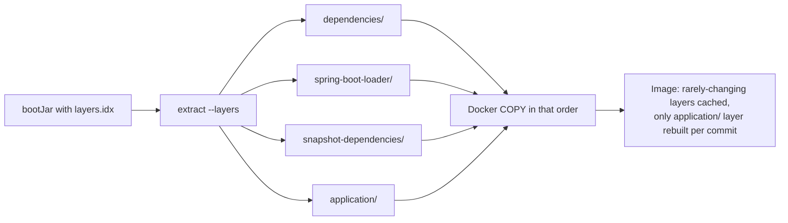
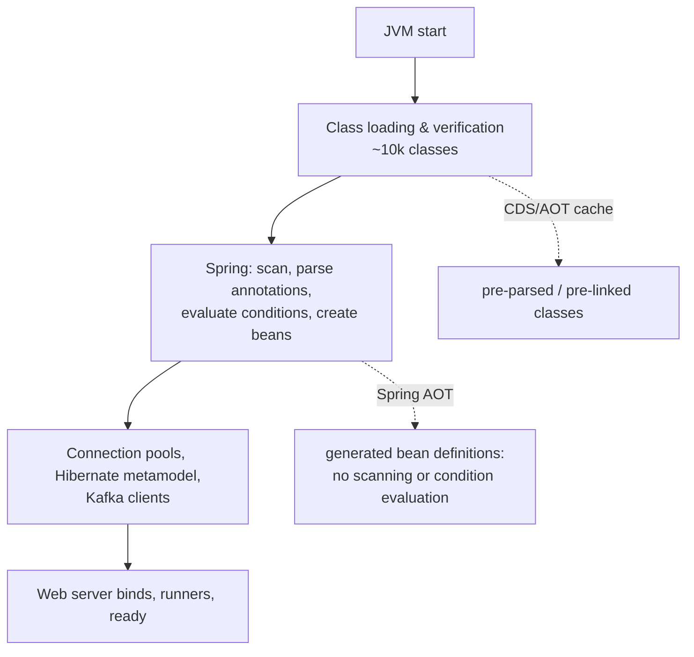
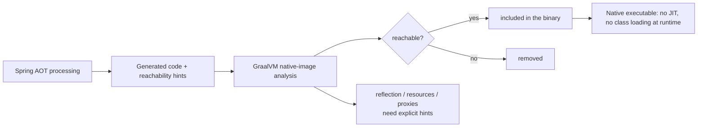
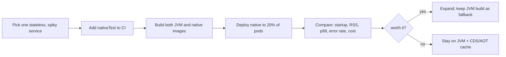

# 29 · Packaging, Containers & Deployment

## 1. Introduction & Why It Matters

The code is written, tested and observable. Now it has to become an **image** that starts fast, is small enough to pull quickly, runs as a non-root user with a current JRE, carries a bill of materials, and can be rolled back by digest at 9 p.m. during a sale.

The decisions here have unglamorous but expensive consequences:

- A naively built image copies the fat JAR as one layer: every deploy pushes and pulls 300 MB instead of 2 MB.
- A 40-second startup times out the readiness probe during a scale-up, so autoscaling makes the incident worse.
- A container without `MaxRAMPercentage` sizing sees the host's memory, sizes a 24 GB heap, and gets OOM-killed by Kubernetes at 2 GB.
- An image built six months ago ships a JRE with three CVEs, and nobody knows which services are affected because there's no SBOM.
- `latest` tags make "roll back to what was running yesterday" an archaeology exercise.

This chapter covers packaging and deployment mechanics: layered executable JARs, Dockerfiles that use them properly, Cloud Native Buildpacks, JVM tuning for containers, **CDS and the JDK AOT cache** for fast startup, **Spring AOT and GraalVM native images** (with an honest cost/benefit), SBOMs, scanning and signing, and the image-promotion pipeline that turns all of it into a safe release.

### Who should read which section

| Band | Focus |
|---|---|
| B1 · 0–2 yrs | Parts 1, 2, 4 — executable JAR, first Dockerfile, buildpacks |
| B2 · 2–5 yrs | Parts 2, 5 — layers, JVM container settings, image hygiene |
| B3 · 5–8 yrs | Parts 3, 5, 6 — CDS/AOT cache, startup profiling, native images |
| B4 · 8–12 yrs | Parts 6, 8 — image pipeline, supply chain, base-image policy |
| B5 · 12–15+ yrs | Parts 8, 9 — platform strategy, native vs JVM economics |

---

## 2. Core Concepts

### 2.1 The artifacts

| Artifact | What it is |
|---|---|
| **Executable JAR** (`bootJar`) | Your classes + dependencies + a launcher; `java -jar app.jar` |
| **Layered JAR** | The same JAR with a `layers.idx` grouping content by change frequency |
| **Container image** | OS + JRE + your application, addressable by tag and **digest** |
| **CDS archive / AOT cache** | Pre-parsed class data (and, with AOT, pre-linked classes) that speeds startup |
| **Native image** | An ahead-of-time compiled binary with no JVM startup at all |
| **SBOM** | The inventory of what's inside (Chapter 01) |

### 2.2 Layers

```text title="Example"
BOOT-INF/layers.idx
- "dependencies"            ← changes rarely (weeks)
- "spring-boot-loader"      ← changes on Boot upgrades
- "snapshot-dependencies"   ← changes often if you use snapshots
- "application"             ← changes every commit (your code, ~2 MB)
```

Extracting these into separate Docker layers means a code-only deploy pushes and pulls **megabytes**, not hundreds of them. Boot 3.3+ provides `java -Djarmode=tools -jar app.jar extract --layers` (older versions used `-Djarmode=layertools`) — **verify** for your version.

### 2.3 Two ways to build an image

| | Dockerfile | Cloud Native Buildpacks (`bootBuildImage`) |
|---|---|---|
| Control | Total | Opinionated, configured by env vars |
| Maintenance | You patch base images | `rebase` swaps the OS layer without rebuilding |
| Extras | You add them | SBOM, memory calculator, CDS/AOT support, non-root by default |
| Learning curve | Familiar | New vocabulary (builder, buildpack, rebase) |
| Typical choice | Platforms with strict base-image policy | Teams wanting batteries included |

Both are legitimate. What matters is that the result is small, layered, non-root, reproducible and scanned.

### 2.4 JVM settings that matter in containers

| Setting | Why |
|---|---|
| `-XX:MaxRAMPercentage=75` | Heap sized from the **container limit**, leaving room for metaspace, threads, direct buffers |
| `-XX:+ExitOnOutOfMemoryError` | Die fast so Kubernetes restarts, instead of limping |
| `-XX:+HeapDumpOnOutOfMemoryError -XX:HeapDumpPath=/dumps` | Post-mortem evidence |
| GC choice | G1 default; SerialGC for tiny containers; Generational ZGC for large heaps/low pause |
| `-XX:ActiveProcessorCount` | Only if CPU limits confuse sizing; the JVM honours cgroup limits by default |
| JFR (`-XX:StartFlightRecording`) | Always-on low-overhead profiling for incidents |

Non-heap memory (metaspace, thread stacks, direct buffers, native) is why 75% is a starting point, not a rule — measure RSS.

### 2.5 Startup optimizations, in order of effort

| Technique | Typical gain | Cost |
|---|---|---|
| Trim dependencies / auto-configurations | 5–20% | Free (and good hygiene) |
| **CDS archive** | 20–40% | A training run at build time |
| **JDK AOT cache** (Leyden, JDK 24+) | More than CDS | A training run; newer JDK |
| **Spring AOT on the JVM** (`spring.aot.enabled`) | 10–20% | AOT-processed build |
| Lazy initialization | Varies | Failures move to first request |
| **GraalVM native image** | ~10× (ms instead of seconds) | Long builds, reflection config, no JIT peak, tooling limits |

### 2.6 When native images pay

| Native is attractive | Native is a poor trade |
|---|---|
| Serverless / scale-to-zero | Long-running services with steady load |
| Very high pod density (memory per pod matters) | CPU-heavy workloads (JIT wins at peak) |
| Short-lived CLI jobs | Heavy reflection/dynamic proxies, agents |
| Fast scale-up during spikes | Teams without capacity for build/debug complexity |

For the grocery platform: the gateway and a few stateless, spiky services are candidates; order/payment/inventory stay on the JVM with CDS.

### 2.7 Supply chain

| Step | Tool |
|---|---|
| SBOM generation | CycloneDX Gradle plugin (Chapter 01); buildpacks also emit one |
| Vulnerability scanning | Trivy / Grype in CI and in the registry |
| Signing & attestation | cosign (keyless), SLSA provenance |
| Base image policy | One approved, regularly patched base; automated rebuild/rebase |
| Immutable references | Deploy by **digest**, not tag |

---

## 3. How It Works Internally

### 3.1 Layered image build



Docker caches layers by content hash; ordering from least- to most-frequently-changing maximizes cache hits on build, push and pull.

### 3.2 Startup work and where CDS/AOT help



CDS and the AOT cache attack **class loading**; Spring AOT attacks **context creation**; native image eliminates both by doing everything at build time.

### 3.3 Native image: build-time closed world



Anything discovered only at runtime (reflection on a class name from configuration, a dynamic proxy, a resource read by pattern) must be declared through **reachability metadata** or `RuntimeHints` — this is where native migrations spend their time.

---

## 4. Hands-On Code — Level 1 (Beginner)

### 4.1 The executable JAR

```bash title="Terminal"
./gradlew bootJar
ls -lh build/libs/order-service.jar        # one file, ~60 MB
java -jar build/libs/order-service.jar
```

```kotlin title="build.gradle.kts (from Chapter 01's conventions)"
tasks.named<BootJar>("bootJar") {
    archiveFileName = "${project.name}.jar"     // stable name for Dockerfiles
}
tasks.named<Jar>("jar") { enabled = false }     // no confusing -plain jar
```

### 4.2 A first Dockerfile — and why it's wrong

```dockerfile title="Dockerfile (naive)"
FROM eclipse-temurin:25-jre
COPY build/libs/order-service.jar /app.jar
ENTRYPOINT ["java", "-jar", "/app.jar"]
```

Problems: one 60 MB layer changes on every commit; runs as **root**; a full JDK-sized base; no memory settings; no health-friendly signal handling if you use the shell form.

### 4.3 A layered Dockerfile

```dockerfile title="Dockerfile"
# ---- extract layers ----
FROM eclipse-temurin:25-jre AS builder
WORKDIR /build
COPY build/libs/order-service.jar app.jar
RUN java -Djarmode=tools -jar app.jar extract --layers --destination extracted    # (1)!

# ---- runtime ----
FROM eclipse-temurin:25-jre
RUN useradd --system --uid 10001 grocery                                          # (2)!
WORKDIR /app
COPY --from=builder /build/extracted/dependencies/ ./
COPY --from=builder /build/extracted/spring-boot-loader/ ./                       # (3)!
COPY --from=builder /build/extracted/snapshot-dependencies/ ./
COPY --from=builder /build/extracted/application/ ./
USER 10001
ENV JAVA_TOOL_OPTIONS="-XX:MaxRAMPercentage=75 -XX:+ExitOnOutOfMemoryError \
    -XX:+HeapDumpOnOutOfMemoryError -XX:HeapDumpPath=/dumps"                      # (4)!
ENTRYPOINT ["java", "-jar", "app.jar"]                                            # (5)!
```

1. Boot 3.3+ `jarmode=tools`; older versions use `-Djarmode=layertools -jar app.jar extract`. **Verify** for your Boot version.
2. **Non-root** with a fixed UID (matches Kubernetes `runAsUser`).
3. Layer order = change frequency: dependencies first, your code last.
4. `JAVA_TOOL_OPTIONS` is picked up without changing the entrypoint — handy for per-environment overrides.
5. Exec form so the JVM is PID 1 and receives SIGTERM directly (graceful shutdown, Chapter 03).

```bash title="Terminal"
docker build -t grocery/order-service:$(git rev-parse --short HEAD) .
docker run --rm -p 8080:8080 --memory=1g grocery/order-service:abc1234
```

Rebuild after a code change: only the `application/` layer is rewritten — a few megabytes.

### 4.4 Buildpacks: no Dockerfile at all

```kotlin title="build.gradle.kts"
tasks.named<BootBuildImage>("bootBuildImage") {
    imageName = "registry.grocery.in/grocery/${project.name}:${project.version}"
    environment = mapOf(
        "BP_JVM_VERSION" to "25",
        "BP_JVM_CDS_ENABLED" to "true"            // (1)!
    )
    publish = false
}
```

1. Paketo buildpacks can create a CDS archive during build — **verify** the exact variable names for your buildpack version.

```bash title="Terminal"
./gradlew bootBuildImage
```

You get a layered, non-root image with a JVM memory calculator, an SBOM and `rebase` support — without writing or maintaining a Dockerfile.

---

## 5. Hands-On Code — Level 2 (Intermediate) & Level 3 (Advanced)

### 5.1 Level 2 — Container-aware JVM settings

```yaml title="k8s/order-service-deployment.yaml (excerpt)"
spec:
  containers:
    - name: order-service
      image: registry.grocery.in/grocery/order-service@sha256:9f2a...      # (1)!
      resources:
        requests: { cpu: "500m", memory: "768Mi" }
        limits:   { memory: "1Gi" }                                        # (2)!
      env:
        - name: JAVA_TOOL_OPTIONS
          value: >-
            -XX:MaxRAMPercentage=70
            -XX:+ExitOnOutOfMemoryError
            -XX:+HeapDumpOnOutOfMemoryError -XX:HeapDumpPath=/dumps
            -XX:StartFlightRecording=disk=true,maxsize=200M,maxage=1h,dumponexit=true,filename=/dumps/app.jfr
      securityContext:
        runAsNonRoot: true
        runAsUser: 10001
        readOnlyRootFilesystem: true                                        # (3)!
        allowPrivilegeEscalation: false
        capabilities: { drop: ["ALL"] }
      volumeMounts:
        - { name: dumps, mountPath: /dumps }
        - { name: tmp, mountPath: /tmp }                                    # (4)!
      terminationGracePeriodSeconds: 40                                     # (5)!
```

1. **Digest, not tag** — the deployed bits are unambiguous and rollback is exact.
2. No CPU limit (only a request) is a common choice to avoid throttling; memory limit is required because the JVM sizes itself from it.
3. Read-only root filesystem with explicit writable mounts — a cheap, large security win.
4. The JVM writes to `/tmp` (JFR, temp files); mount an `emptyDir`.
5. Longer than `spring.lifecycle.timeout-per-shutdown-phase` (Chapters 03, 25).

!!! danger "Sizing from the wrong number"
    Without a memory limit (or with `-Xmx` hardcoded from a laptop), the JVM sizes its heap from the **node's** memory and gets OOM-killed at the container limit. `MaxRAMPercentage` + a container limit is the correct pairing; leave ~25–30% for non-heap.

### 5.2 Level 2 — Image hygiene

```dockerfile title="Dockerfile (hardened additions)"
FROM eclipse-temurin:25-jre AS builder
# ... extraction as before ...

FROM eclipse-temurin:25-jre
LABEL org.opencontainers.image.source="https://github.com/grocery/order-service" \
      org.opencontainers.image.revision="${GIT_SHA}" \
      org.opencontainers.image.version="${APP_VERSION}"                    # (1)!
RUN useradd --system --uid 10001 grocery && mkdir /dumps && chown 10001 /dumps
WORKDIR /app
COPY --from=builder --chown=10001:10001 /build/extracted/dependencies/ ./
COPY --from=builder --chown=10001:10001 /build/extracted/spring-boot-loader/ ./
COPY --from=builder --chown=10001:10001 /build/extracted/snapshot-dependencies/ ./
COPY --from=builder --chown=10001:10001 /build/extracted/application/ ./
USER 10001
EXPOSE 8080 9090
ENTRYPOINT ["java", "-jar", "app.jar"]
```

1. OCI labels link the image back to its commit — the first thing you want during an incident.

```text title=".dockerignore"
*
!build/libs/*.jar
```

Keeping the build context tiny makes builds faster and stops secrets (`.env`, `.git`) from leaking into layers.

| Base image | Trade-off |
|---|---|
| `eclipse-temurin:25-jre` | Familiar, glibc, good tooling |
| `-alpine` | Small, musl libc — verify library compatibility |
| Distroless / `-jre-ubi-minimal` | Minimal attack surface; no shell (harder debugging) |

### 5.3 Level 3 — CDS: measurable startup gains

```dockerfile title="Dockerfile with CDS"
FROM eclipse-temurin:25-jre AS builder
WORKDIR /build
COPY build/libs/order-service.jar app.jar
RUN java -Djarmode=tools -jar app.jar extract --destination extracted           # (1)!

WORKDIR /build/extracted
RUN java -XX:ArchiveClassesAtExit=/build/app.jsa \
         -Dspring.context.exit=onRefresh \
         -jar app.jar                                                            # (2)!

FROM eclipse-temurin:25-jre
WORKDIR /app
COPY --from=builder /build/extracted/ ./
COPY --from=builder /build/app.jsa /app/app.jsa
USER 10001
ENTRYPOINT ["java", "-XX:SharedArchiveFile=/app/app.jsa", "-jar", "app.jar"]     # (3)!
```

1. The **non-layered** extraction (`extract` without `--layers`) produces the exploded application layout that CDS training needs.
2. **Training run**: starts the context and exits at refresh (`spring.context.exit=onRefresh`), recording the classes loaded. It must run with the same classpath as production.
3. Production uses the archive. Expect roughly 20–40% faster startup with no behaviour change.

!!! warning "Verify"
    CDS support in Spring Boot (the `spring.context.exit` property, `jarmode=tools` and the recommended layout) arrived in Boot 3.3 and has evolved; JDK 24+ adds the **AOT cache** (`-XX:AOTMode=record/create`, `-XX:AOTCache=app.aot`) which supersedes plain CDS with bigger gains. Check the Boot reference and your JDK's documentation, and **measure** rather than assuming.

```bash title="Measuring"
for i in 1 2 3 4 5; do
  docker run --rm grocery/order-service:cds 2>&1 | grep "Started OrderApplication"
done
# Started OrderApplication in 1.42 seconds (vs 2.31 without CDS)
```

Startup time is a **budget** (Chapter 05): track it per service in CI and fail the build if it regresses by more than, say, 30%.

### 5.4 Level 3 — Spring AOT on the JVM

```bash title="Terminal"
./gradlew bootJar -Pspring.aot.enabled=true      # or the processAot task, depending on setup
```

AOT processing generates bean definitions at build time, so the runtime skips classpath scanning and condition evaluation. It also **freezes** the context: profile-dependent bean graphs and runtime `@Conditional` decisions are resolved at build time, so an AOT-processed application must be built per profile combination if those differ. Confirm behaviour for your version before enabling it broadly.

### 5.5 Level 3 — GraalVM native image

```kotlin title="build.gradle.kts"
plugins { id("org.graalvm.buildtools.native") version "0.10.x" }

graalvmNative {
    binaries {
        named("main") {
            buildArgs.add("--enable-monitoring=heapdump,jfr")     // (1)!
            buildArgs.add("-H:+ReportExceptionStackTraces")
        }
    }
}
```

1. Native images can still produce heap dumps and JFR recordings — insist on this, or incident debugging becomes guesswork.

```java title="in/grocery/order/NativeHints.java"
package in.grocery.order;

import org.springframework.aot.hint.RuntimeHints;
import org.springframework.aot.hint.RuntimeHintsRegistrar;
import org.springframework.context.annotation.ImportRuntimeHints;

@ImportRuntimeHints(NativeHints.OrderHints.class)
public class NativeHints {

    static class OrderHints implements RuntimeHintsRegistrar {
        @Override
        public void registerHints(RuntimeHints hints, ClassLoader classLoader) {
            hints.resources().registerPattern("db/migration/*.sql");            // (1)!
            hints.reflection().registerType(OrderPlacedEvent.class,
                    builder -> builder.withMembers(
                            org.springframework.aot.hint.MemberCategory.INVOKE_DECLARED_CONSTRUCTORS,
                            org.springframework.aot.hint.MemberCategory.INVOKE_DECLARED_METHODS));   // (2)!
        }
    }
}
```

1. Resources loaded by pattern (Flyway migrations, message bundles) must be declared or they vanish from the binary.
2. Types deserialized reflectively (Kafka payloads, JSON DTOs) need reflection hints — `@RegisterReflectionForBinding` is the concise alternative.

```bash title="Terminal"
./gradlew nativeCompile          # minutes, GBs of RAM
./build/native/nativeCompile/order-service
# Started OrderApplication in 0.089 seconds
```

**The trade-offs, honestly:**

| Aspect | JVM | Native |
|---|---|---|
| Startup | 1–3 s (0.8–2 s with CDS/AOT cache) | 50–150 ms |
| Memory (RSS) | 400–700 MB | 100–200 MB |
| Peak throughput | Higher (JIT optimizes hot paths) | Typically lower |
| Build time | ~1 min | 3–15 min, high RAM |
| Debugging | Mature tooling | Improving, still harder |
| Libraries | Everything works | Reflection/agents/dynamic loading need hints or don't work |
| Testing | Normal | `nativeTest` needed to catch missing hints |

Run `nativeTest` in CI for any service you ship natively — a missing hint fails at **runtime**, often on a rarely used path.

---

## 6. Hands-On Code — Level 4 (Expert / Production)

### 6.1 The image pipeline

```mermaid
flowchart LR
    A[CI: build + test] --> B[bootJar]
    B --> C[image build<br/>Dockerfile or buildpacks]
    C --> D[SBOM: CycloneDX]
    D --> E[Scan: Trivy/Grype<br/>fail on HIGH/CRITICAL fixable]
    E --> F[Sign: cosign keyless<br/>+ SLSA provenance]
    F --> G[Push to registry<br/>tag: git sha + semver]
    G --> H[Deploy to staging by digest]
    H --> I[Smoke + contract gate<br/>can-i-deploy]
    I --> J[Promote same digest to prod]
    J --> K[Record digest in release notes]
```



The essential property: **the same digest** flows from staging to production. Rebuilding for production means deploying something that was never tested.

```yaml title=".github/workflows/image.yml (excerpt)"
      - name: Build image
        run: ./gradlew bootBuildImage --imageName=$REGISTRY/$SERVICE:$GIT_SHA

      - name: Generate SBOM
        run: ./gradlew cyclonedxBom

      - name: Scan
        run: trivy image --severity HIGH,CRITICAL --ignore-unfixed --exit-code 1 \
                 $REGISTRY/$SERVICE:$GIT_SHA                                   # (1)!

      - name: Sign
        run: cosign sign --yes $REGISTRY/$SERVICE@$DIGEST                      # (2)!

      - name: Attach SBOM attestation
        run: cosign attest --yes --predicate build/reports/bom.json --type cyclonedx \
                 $REGISTRY/$SERVICE@$DIGEST
```

1. `--ignore-unfixed` keeps the gate actionable: fail only on vulnerabilities with a fix available; track the rest.
2. Keyless signing binds the image to the workflow identity; the cluster's admission policy can require it.

### 6.2 Base image policy

| Rule | Detail |
|---|---|
| One approved base per runtime | `eclipse-temurin:25-jre` (plus a distroless variant for hardened workloads) |
| Rebuild weekly | Automated pipeline rebuilds all service images against the patched base |
| Buildpack estate uses `rebase` | Swaps the OS layer without a full rebuild — minutes for 26 services |
| Fail builds on stale bases | Reject images whose base is older than 30 days |
| Track per-service | Dashboard: base age, critical CVEs, image size, startup time |

```bash title="Rebase with buildpacks"
pack rebase registry.grocery.in/grocery/order-service:1.42.0 --publish      # (1)!
```

1. Only the run-image layers change; application layers are untouched, so the app is byte-identical. This is buildpacks' strongest operational argument.

### 6.3 Startup and size budgets

```kotlin title="build-logic (budget check)"
tasks.register("checkStartupBudget") {
    doLast {
        val seconds = measureStartup()                                         // (1)!
        val budget = (project.findProperty("startupBudgetSeconds") as String?)?.toDouble() ?: 5.0
        if (seconds > budget) {
            throw GradleException("Startup $seconds s exceeds budget $budget s")
        }
    }
}
```

1. Start the image, parse the `Started ... in X seconds` line, average over three runs. Keep it in the nightly pipeline (it needs Docker and a few minutes).

| Service | Image size | Startup (JVM) | Startup (CDS) | Notes |
|---|---|---|---|---|
| order-service | 210 MB | 2.3 s | 1.4 s | JPA + Kafka + Redis |
| catalog-service | 190 MB | 1.9 s | 1.2 s | JDBC + search client |
| gateway | 150 MB | 1.4 s | 0.9 s | Native candidate |
| notification-service | 180 MB | 1.7 s | 1.1 s | — |

Tracking these numbers per release makes regressions (a new starter pulling in 40 MB and 800 ms) visible immediately.

### 6.4 Deployment mechanics

```yaml title="k8s/order-service-deployment.yaml (rollout)"
spec:
  replicas: 6
  strategy:
    type: RollingUpdate
    rollingUpdate:
      maxSurge: 2
      maxUnavailable: 0                                                      # (1)!
  template:
    metadata:
      annotations:
        kubectl.kubernetes.io/restartedAt: "{{ .Values.configHash }}"        # (2)!
    spec:
      containers:
        - name: order-service
          readinessProbe:
            httpGet: { path: /actuator/health/readiness, port: 9090 }
            periodSeconds: 5
            failureThreshold: 3
          livenessProbe:
            httpGet: { path: /actuator/health/liveness, port: 9090 }
            initialDelaySeconds: 30                                           # (3)!
          lifecycle:
            preStop:
              exec: { command: ["sh", "-c", "sleep 5"] }                      # (4)!
```

1. Never fewer than the current replicas during a rollout — capacity is preserved during a sale.
2. A hash of the ConfigMap/Secret forces a rollout when configuration changes (Chapter 06: config changes are deployments).
3. Liveness must not fire during slow startup; alternatively use a `startupProbe`.
4. A brief pause so the load balancer stops sending new requests before the container begins draining (Chapters 03, 30).

**Rollback** is then trivial and exact:

```bash title="Terminal"
kubectl set image deployment/order-service order-service=$REGISTRY/order-service@sha256:previous-digest
```

### 6.5 Native image in production — a bounded experiment



Rules for the experiment: keep the JVM image building (so rollback is a deploy, not a rewrite), run `nativeTest` on every commit, and decide with **numbers** (pod density, scale-up latency, cost per request) rather than enthusiasm.

### 6.6 Deployment checklist per release

| Check | Automated? |
|---|---|
| Same digest promoted from staging | ✅ pipeline |
| Contracts verified (`can-i-deploy`) | ✅ (Chapter 28) |
| Migrations rehearsed and backward compatible | ✅ (Chapter 14) |
| Startup and size budgets respected | ✅ nightly |
| Image scanned and signed; SBOM attached | ✅ |
| Config changes reviewed via GitOps | ✅ (Chapter 06) |
| Rollout strategy preserves capacity | ✅ manifest review |
| Rollback digest recorded in release notes | ✅ |
| Dashboards annotated with the deploy | ✅ (Chapter 27) |

---

## 7. Spring Boot 3 vs 4 & Migration

| Topic | Boot 3.5 | Boot 4.x |
|---|---|---|
| Layer extraction | `jarmode=tools` (3.3+); `layertools` deprecated | `jarmode=tools` (verify) |
| CDS support | `spring.context.exit=onRefresh`, documented CDS workflow (3.3+) | Same + JDK AOT cache integration (verify) |
| Spring AOT | `processAot`, `spring.aot.enabled` | Same |
| GraalVM support | Mature (3.x) | Mature; hint APIs stable (verify) |
| Buildpacks | `bootBuildImage` with Paketo | Same; new env vars for AOT/CDS (verify) |
| Java baseline | 17 (25 recommended here) | 17 (25 recommended) |
| SBOM | CycloneDX plugin; `/actuator/sbom` (3.3+) | Same |

### Migration checklist

- [ ] Replace `layertools` with `jarmode=tools` in Dockerfiles.
- [ ] Re-measure startup and image size after the upgrade; adjust budgets.
- [ ] Re-generate CDS archives/AOT caches (they are JDK- and classpath-specific — an upgrade invalidates them).
- [ ] Re-run `nativeTest` for native services; hints may need updates for Jackson 3 and moved packages.
- [ ] Verify buildpack builder version supports your JDK.
- [ ] Re-scan images; a new base may introduce or fix CVEs.

---

## 8. Production Playbook

### Best practices

1. **Layered images** with change-frequency ordering; small build context.
2. **Non-root, read-only root filesystem, dropped capabilities**, fixed UID.
3. **Size the JVM from the container limit** (`MaxRAMPercentage`), with OOM exit and heap dumps.
4. **Deploy by digest**; promote the same artifact from staging to production.
5. **SBOM + scan + sign** every image; enforce at admission.
6. **One approved base image**, rebuilt/rebased weekly, with an age gate.
7. **CDS or the JDK AOT cache** for startup; budget and track startup time.
8. **Native images only where the numbers justify them**, with `nativeTest` in CI and a JVM fallback.
9. **Rollouts preserve capacity** (`maxUnavailable: 0`) and honour graceful shutdown.
10. **Record the rollback digest** with every release.

### Anti-patterns

❌ One-layer images — slow pushes/pulls, no cache reuse.

❌ Running as root, or writable root filesystems.

❌ `latest` tags, or deploying by tag instead of digest.

❌ `-Xmx` copied from a laptop, or no memory limit at all.

❌ Building a separate image for production — you deploy untested bits.

❌ Shipping the JDK when a JRE suffices; shipping DevTools (Chapter 05).

❌ Secrets baked into image layers (they persist in history even if deleted later).

❌ Adopting native images for a JIT-friendly, long-running service because startup sounds nice.

❌ Ignoring startup time until autoscaling can't keep up.

### Troubleshooting

| Symptom | Cause | Fix |
|---|---|---|
| Pod OOM-killed with a small heap | Non-heap growth (metaspace, threads, direct buffers) | Lower `MaxRAMPercentage`, cap threads, check native memory (NMT) |
| Heap 24 GB in a 1 GB container | No memory limit / old JVM | Set limits; modern JVMs honour cgroups |
| Deploys push 300 MB every time | No layering / wrong COPY order | Extract layers; order by change frequency |
| Startup slower after an upgrade | New auto-configurations, stale CDS archive | `/actuator/startup` (Chapter 03), regenerate archive |
| Native binary fails at runtime | Missing reflection/resource hints | `nativeTest`, tracing agent, explicit `RuntimeHints` |
| Scan fails on unfixable CVEs | No triage policy | `--ignore-unfixed` + tracked exceptions with expiry |
| Rollback deploys the wrong build | Mutable tags | Deploy and roll back by digest |
| Requests fail during rollout | No preStop/graceful shutdown; `maxUnavailable > 0` | Chapters 03, 30 settings |
| Image works locally, fails in cluster | Arch mismatch (arm64 vs amd64), missing env | Multi-arch builds, verify base |

### Production checklist

- [ ] Layered, non-root, minimal-base images with OCI labels
- [ ] JVM sized from container limits; JFR and heap dumps configured
- [ ] SBOM generated, image scanned and signed; admission enforces signatures
- [ ] Base image policy with weekly rebuild/rebase and an age gate
- [ ] Startup and image-size budgets tracked per service
- [ ] Digest-based promotion and rollback documented
- [ ] `nativeTest` in CI for any natively built service
- [ ] Rollout strategy and probes reviewed per service

---

## 9. Interview Questions & Answers

### B1 · 0–2 years

??? question "B1 · What is a Spring Boot executable JAR?"
    **Short answer:** A JAR containing your classes, all dependencies in `BOOT-INF/lib`, and a launcher (`JarLauncher`) that sets up a nested-JAR classloader and calls your `main`.

??? question "B1 · Why layer a Docker image?"
    **Short answer:** Layers are cached by content; putting rarely-changing dependencies in earlier layers and your code last means a code change rebuilds and transfers only a few MB.

??? question "B1 · Why run containers as non-root?"
    **Short answer:** It limits the damage of a compromise and is required by most cluster security policies.

??? question "B1 · How do you tell the JVM how much memory it may use in a container?"
    **Short answer:** Set a container memory limit and use `-XX:MaxRAMPercentage` so the heap is derived from it, leaving room for non-heap memory.

??? question "B1 · What are buildpacks?"
    **Short answer:** A tool (`./gradlew bootBuildImage`) that builds an optimized, layered, non-root container image from your application without a Dockerfile.

### B2 · 2–5 years

??? question "B2 · Why deploy by digest instead of tag?"
    **Short answer:** Tags are mutable; a digest is the exact image content. Digest deployment makes promotion and rollback unambiguous and reproducible.

??? question "B2 · Dockerfile or buildpacks?"
    **Short answer:** Dockerfile for full control and strict base-image policies; buildpacks for batteries-included images with SBOMs, memory calculation and `rebase` for OS patching. Both must yield layered, non-root, scanned images.

??? question "B2 · What does `jarmode=tools extract --layers` do?"
    **Short answer:** Extracts the JAR into layer directories (dependencies, loader, snapshot dependencies, application) so a Dockerfile can copy them as separate layers.

??? question "B2 · How do you keep base images patched?"
    **Short answer:** One approved base, automated weekly rebuilds (or `pack rebase` for buildpack images), an age gate in CI, and a dashboard of base age and CVEs per service.

??? question "B2 · Why is `-XX:+ExitOnOutOfMemoryError` useful in Kubernetes?"
    **Short answer:** The process dies immediately on OOM so the pod restarts cleanly, instead of limping in a degraded state that health checks may not catch.

### B3 · 5–8 years

??? question "B3 · How does CDS improve startup, and what are its constraints?"
    **Short answer:** A training run records loaded classes into an archive of pre-parsed class data, which the JVM maps at startup instead of parsing again — typically 20–40% faster. The archive is tied to the JDK version and classpath, so it must be regenerated on any upgrade, and the training run must match production's classpath.

??? question "B3 · What does Spring AOT do on the JVM (not native)?"
    **Short answer:** Generates bean definitions and hints at build time, so startup skips classpath scanning and condition evaluation. It also fixes the context at build time, so profile/conditional differences must be considered.

??? question "B3 · When would you choose GraalVM native images?"
    **Short answer:** Scale-to-zero/serverless, very spiky scale-up, or high pod density where memory dominates. Not for steady, CPU-heavy, long-running services where JIT peak performance and build/debug simplicity matter more.

??? question "B3 · What breaks in native images and how do you find it?"
    **Short answer:** Reflection, dynamic proxies, resource loading by pattern, agents and dynamic class loading. Find them with `nativeTest`, the GraalVM tracing agent, and explicit `RuntimeHints`/`@RegisterReflectionForBinding`.

??? question "B3 · How do you diagnose a pod OOM-killed despite a small heap?"
    **Short answer:** Look at non-heap: metaspace, thread stacks (thread count × stack size), direct byte buffers, native libraries, JFR. Use Native Memory Tracking, reduce `MaxRAMPercentage`, cap pools, and measure RSS rather than heap.

### B4 · 8–12 years

??? question "B4 · Design the image pipeline for 26 services."
    **Short answer:** Shared build conventions producing layered images; SBOM, scan (fail on fixable HIGH/CRITICAL), sign with provenance; push tagged by commit; deploy to staging by digest; gate on contracts and smoke tests; promote the **same digest** to production; weekly base rebuild/rebase; dashboards for base age, size, startup and CVEs.

??? question "B4 · How do you justify native images economically?"
    **Short answer:** Compare pod density and scale-up latency against build time, engineering effort and reduced peak throughput. Native wins when memory per instance and cold-start dominate cost (spiky, stateless); it loses for steady high-throughput services. Decide per service with measurements.

??? question "B4 · What's your policy for image vulnerabilities?"
    **Short answer:** Fail builds on fixable HIGH/CRITICAL; track unfixable ones with expiry dates and compensating controls; rebuild weekly so fixes land automatically; scan in the registry continuously (new CVEs appear after the build); use SBOMs to find affected services in minutes.

### B5 · 12–15+ years

??? question "B5 · How do packaging choices affect reliability?"
    **Short answer:** Startup time determines how fast you can scale during an incident; image size determines how fast a rollback reaches nodes; digest-based promotion determines whether you can trust what's running; base-image hygiene determines your exposure window. These are reliability decisions disguised as build configuration.

??? question "B5 · Would you standardize on one packaging approach platform-wide?"
    **Short answer:** Yes for the pipeline (SBOM, scan, sign, digest promotion, budgets) — that's where consistency pays. Allow a controlled exception for native builds where measurements justify them, with a JVM fallback maintained.

### Scenario questions

??? example "Scenario · Autoscaling can't keep up during a flash sale"
    New pods took 40 s to become ready: a cold JVM start plus a cache warm-up in an `ApplicationRunner` (Chapter 03). Fixes: CDS/AOT cache to cut startup, warm only the top-N entries before readiness, pre-scale ahead of the sale, raise `maxSurge`, and track startup as a budget in CI.

??? example "Scenario · A critical CVE in the JRE; which services are affected?"
    Without SBOMs this is a week of archaeology. With them: query the SBOM attestations for the affected package, rebuild/rebase all matching images in one pipeline run, and redeploy by new digest — hours, not days.

### Coding exercise

!!! example "Exercise · Production image for catalog-service"
    Produce a Dockerfile that: extracts layers, creates a CDS archive during build, runs as UID 10001 on a read-only filesystem, sizes the JVM from the container limit, enables JFR to `/dumps`, and exposes 8080 (app) and 9090 (management). Then write the CI steps for SBOM, scan and signing, and a Kubernetes snippet deploying by digest with correct probes and graceful shutdown.

??? success "Solution"
    ```dockerfile title="Dockerfile"
    FROM eclipse-temurin:25-jre AS builder
    WORKDIR /build
    COPY build/libs/catalog-service.jar app.jar
    RUN java -Djarmode=tools -jar app.jar extract --destination extracted
    WORKDIR /build/extracted
    RUN java -XX:ArchiveClassesAtExit=/build/app.jsa -Dspring.context.exit=onRefresh \
             -Dspring.profiles.active=cds-training -jar app.jar || true            # (1)!

    FROM eclipse-temurin:25-jre
    LABEL org.opencontainers.image.source="https://github.com/grocery/catalog-service"
    RUN useradd --system --uid 10001 grocery && mkdir /dumps && chown 10001 /dumps
    WORKDIR /app
    COPY --from=builder --chown=10001:10001 /build/extracted/ ./
    COPY --from=builder --chown=10001:10001 /build/app.jsa /app/app.jsa
    USER 10001
    EXPOSE 8080 9090
    ENV JAVA_TOOL_OPTIONS="-XX:SharedArchiveFile=/app/app.jsa \
        -XX:MaxRAMPercentage=70 -XX:+ExitOnOutOfMemoryError \
        -XX:+HeapDumpOnOutOfMemoryError -XX:HeapDumpPath=/dumps \
        -XX:StartFlightRecording=disk=true,maxsize=200M,maxage=1h,dumponexit=true,filename=/dumps/app.jfr"
    ENTRYPOINT ["java", "-jar", "app.jar"]
    ```

    1. The training profile points at no real infrastructure and exits at refresh; `|| true` tolerates a non-zero exit from the training run. **Verify** the exact flags for your Boot/JDK combination — and on JDK 24+ prefer the AOT cache workflow.

    ```yaml title=".github/workflows/image.yml (steps)"
      - run: ./gradlew bootJar cyclonedxBom
      - run: docker build -t $REG/catalog-service:$GIT_SHA .
      - run: trivy image --severity HIGH,CRITICAL --ignore-unfixed --exit-code 1 $REG/catalog-service:$GIT_SHA
      - run: docker push $REG/catalog-service:$GIT_SHA
      - run: |
          DIGEST=$(docker inspect --format='{{index .RepoDigests 0}}' $REG/catalog-service:$GIT_SHA)
          cosign sign --yes "$DIGEST"
          cosign attest --yes --predicate build/reports/bom.json --type cyclonedx "$DIGEST"
          echo "IMAGE_DIGEST=$DIGEST" >> $GITHUB_ENV                                # (1)!
    ```

    1. The digest is the release artifact — it goes into the manifest, the release notes and the rollback instructions.

    ```yaml title="k8s/catalog-service.yaml (excerpt)"
    spec:
      strategy: { type: RollingUpdate, rollingUpdate: { maxSurge: 2, maxUnavailable: 0 } }
      template:
        spec:
          terminationGracePeriodSeconds: 40
          securityContext: { runAsNonRoot: true, runAsUser: 10001, fsGroup: 10001 }
          containers:
            - name: catalog-service
              image: registry.grocery.in/grocery/catalog-service@sha256:REPLACED_BY_PIPELINE
              ports: [{ containerPort: 8080 }, { containerPort: 9090 }]
              resources: { requests: { cpu: 500m, memory: 640Mi }, limits: { memory: 896Mi } }
              securityContext: { readOnlyRootFilesystem: true, allowPrivilegeEscalation: false,
                                 capabilities: { drop: ["ALL"] } }
              startupProbe:   { httpGet: { path: /actuator/health/readiness, port: 9090 },
                                failureThreshold: 20, periodSeconds: 3 }              # (1)!
              readinessProbe: { httpGet: { path: /actuator/health/readiness, port: 9090 }, periodSeconds: 5 }
              livenessProbe:  { httpGet: { path: /actuator/health/liveness, port: 9090 }, periodSeconds: 10 }
              lifecycle: { preStop: { exec: { command: ["sh", "-c", "sleep 5"] } } }
              volumeMounts: [{ name: dumps, mountPath: /dumps }, { name: tmp, mountPath: /tmp }]
    ```

    1. A `startupProbe` gives slow starts room without making the liveness probe lenient forever — the cleanest way to handle variable startup time (Chapter 30 goes further).

---

## Key Takeaways

- **Layered images** with change-frequency ordering make deploys and rollbacks fast.
- **Non-root, read-only, minimal base, dropped capabilities** — cheap, large security wins.
- **Size the JVM from the container limit**, exit on OOM, capture heap dumps and JFR.
- **Promote one digest** from staging to production; roll back by digest.
- **SBOM + scan + sign** on every image, with a weekly base-image rebuild or rebase.
- **CDS / the JDK AOT cache** buy real startup gains cheaply; track startup as a budget.
- **Native images** are a measured choice for spiky, stateless services — with `nativeTest` and a JVM fallback.
- Packaging decisions are **reliability decisions**.

## Further Reading

- Spring Boot Reference — *Packaging Executable Archives*, *Container Images* (layers, buildpacks, CDS, AOT), *GraalVM Native Images*
- GraalVM Native Image documentation — reachability metadata, tracing agent
- Cloud Native Buildpacks / Paketo documentation — builders, bindings, `rebase`
- OpenJDK JEPs on Ahead-of-Time Class Loading & Linking (Project Leyden)

---

[:material-arrow-left: 28 Integration & Contract Testing](28-integration-contract-testing.md) · [30 Kubernetes & Cloud-Native :material-arrow-right:](30-kubernetes-cloud-native.md)
