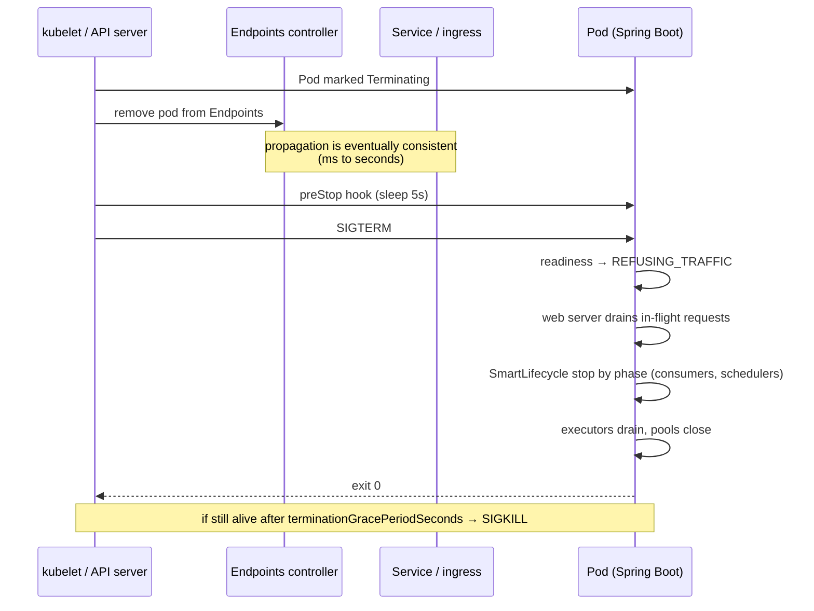
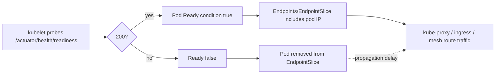
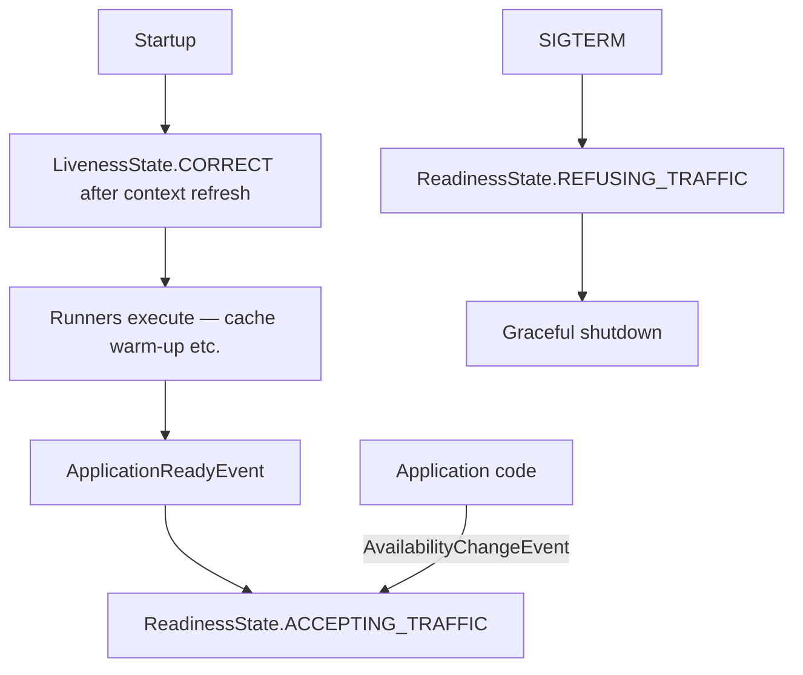
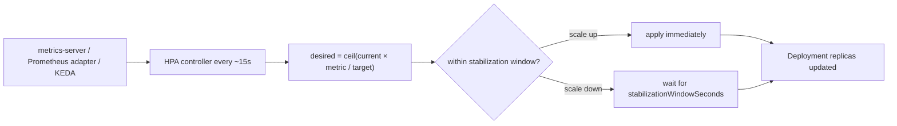
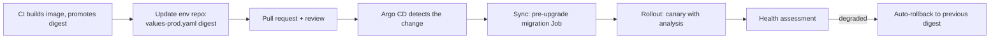
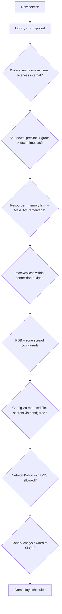

# 30 · Kubernetes & Cloud-Native Operation

## 1. Introduction & Why It Matters

Chapter 29 produced an image. This chapter runs it: 26 services, six to sixty pods each, across three availability zones, with deploys during a Diwali sale and no maintenance window.

Kubernetes will happily run a badly configured Spring Boot service — and then surprise you:

- A readiness probe that checks the database means **every** pod drops out when PostgreSQL blips, turning a degraded dependency into a total outage.
- A liveness probe with a short `initialDelaySeconds` kills pods during a slow start, so the deployment never converges.
- No `PodDisruptionBudget`, so a node drain evicts all six order-service pods at once.
- An HPA scales from 6 to 40 pods, each with a 20-connection pool, and PostgreSQL rejects connections (Chapter 12).
- `terminationGracePeriodSeconds: 30` with a 45-second shutdown drain means SIGKILL mid-transaction (Chapter 03).
- A ConfigMap change takes effect on new pods only, so half the fleet runs the old value for days.

None of these are Kubernetes bugs; they're contract mismatches between the platform and the application. This chapter covers that contract end to end: probes mapped to Boot's health groups, the exact shutdown sequence, resources and JVM memory, configuration and secrets, scaling (including on Kafka lag), disruption budgets and spread, deployment strategies with canary analysis on SLOs, GitOps, network policy, and the game days that prove it all works.

### Who should read which section

| Band | Focus |
|---|---|
| B1 · 0–2 yrs | Parts 1, 2, 4 — probes, resources, a working manifest |
| B2 · 2–5 yrs | Parts 2, 5 — config/secrets, rollouts, HPA basics |
| B3 · 5–8 yrs | Parts 3, 5, 6 — shutdown sequence, scaling signals, canary analysis |
| B4 · 8–12 yrs | Parts 6, 8 — platform chart, capacity policy, disruption handling |
| B5 · 12–15+ yrs | Parts 8, 9 — platform strategy, mesh vs application, cost |

---

## 2. Core Concepts

### 2.1 The application ↔ platform contract

| Platform expects | Spring Boot provides | Chapter |
|---|---|---|
| Fast, honest readiness signal | `/actuator/health/readiness` | 03, 27 |
| Liveness that means "restart me" | `/actuator/health/liveness` | 03, 26 |
| Graceful shutdown on SIGTERM | `server.shutdown=graceful` + lifecycle timeouts | 03, 25 |
| Configuration from the environment | Config data, config trees | 06 |
| Logs on stdout as JSON | Structured logging | 07 |
| Metrics endpoint | `/actuator/prometheus` | 27 |
| Bounded memory behaviour | `MaxRAMPercentage`, OOM exit | 29 |
| Stateless pods | No local state; sessions in Redis | 17, 22 |

### 2.2 Probes

| Probe | Question | Failure action | Include dependencies? |
|---|---|---|---|
| **startup** | Has it finished booting? | Keep waiting (then restart) | No |
| **readiness** | Should traffic come here **now**? | Remove from Service endpoints | Only those without which the pod cannot serve |
| **liveness** | Is this process unrecoverable? | Restart the container | **Never** |

!!! danger "The liveness trap"
    If liveness checks PostgreSQL and PostgreSQL has a 60-second blip, Kubernetes restarts every pod of every service simultaneously — turning a recoverable incident into a cold-start stampede against a database already under stress. Liveness is about **this process**: deadlock, corrupted internal state, unrecoverable error.

### 2.3 The shutdown sequence



Two rules that avoid dropped requests:

1. **`preStop` sleep** (≈5 s) covers the window where endpoints removal hasn't propagated yet but SIGTERM has arrived.
2. **`terminationGracePeriodSeconds` > preStop + `spring.lifecycle.timeout-per-shutdown-phase` + margin** (Chapters 03, 25).

### 2.4 Resources and QoS

| Class | How | Behaviour |
|---|---|---|
| **Guaranteed** | requests == limits (CPU and memory) | Last to be evicted; CPU throttling if the limit is hit |
| **Burstable** | requests < limits, or only requests | Common for JVM services |
| BestEffort | nothing set | Evicted first — never in production |

| Setting | Guidance |
|---|---|
| Memory request ≈ limit | The JVM sizes from the limit; wildly different values waste capacity or invite eviction |
| Memory limit | **Required**; pair with `MaxRAMPercentage` (Chapter 29) |
| CPU request | From observed usage (p95) + headroom |
| CPU limit | Often omitted for latency-sensitive JVM services to avoid CFS throttling; if set, be generous |

!!! warning "CPU throttling looks like a slow application"
    A 500m CPU limit throttles the JVM in 100 ms slices; GC and JIT spikes hit the quota and p99 latency jumps with no obvious cause. Check `container_cpu_cfs_throttled_seconds_total` before blaming the code.

### 2.5 Configuration and secrets

| Source | Mechanism | Chapter |
|---|---|---|
| Non-secret env config | ConfigMap **mounted as a file**, imported with `spring.config.import` | 06 |
| Secrets | Secret mounted as files, read as a **config tree** | 06, 18 |
| Bootstrap only | Env vars (`SPRING_PROFILES_ACTIVE`, `SPRING_CONFIG_IMPORT`) | 06 |
| External secret stores | External Secrets Operator / CSI driver syncing Vault → Secret | 06 |

**Config changes are deployments**: annotate the pod template with a hash of the config so a change triggers a rollout (Chapter 06). Runtime reload (`@RefreshScope`, Spring Cloud Kubernetes reload) creates pods with divergent state and is rarely worth it.

### 2.6 Scaling

| Signal | Tool | Good for |
|---|---|---|
| CPU / memory | HPA + metrics-server | Simple CPU-bound services |
| Requests per second, p99 latency | HPA + Prometheus Adapter | Web services |
| **Kafka consumer lag** | KEDA | Consumers and indexers (Chapter 23) |
| Queue depth (Rabbit/Redis) | KEDA | Workers (Chapter 24) |
| Schedule (sale windows) | KEDA cron / manual `minReplicas` | Predictable peaks |

!!! danger "Scaling multiplies your connection budget"
    Every new pod brings its own database pool, HTTP pools and Kafka consumers. `maxReplicas × poolSize` must fit the database's `max_connections` (Chapter 12) and the partition count (Chapter 23). Set `maxReplicas` from that budget, not from optimism.

### 2.7 Disruptions

| Control | Purpose |
|---|---|
| `PodDisruptionBudget` | Limit voluntary disruptions (node drains, upgrades) |
| `topologySpreadConstraints` | Spread pods across zones/nodes |
| Pod anti-affinity | Avoid co-locating all replicas |
| `priorityClassName` | Critical services evict others, not vice versa |
| Node pools / taints | Isolate batch workloads from request-serving ones |

### 2.8 Deployment strategies

| Strategy | Mechanism | Cost |
|---|---|---|
| **Rolling** (default) | `maxSurge`/`maxUnavailable` | Simple; both versions live briefly |
| **Blue-green** | Two deployments, switch the Service | Double capacity; instant rollback |
| **Canary** | Small share of traffic, automated metric analysis (Argo Rollouts/Flagger) | Best risk control; needs good SLIs (Chapter 27) |

All of them require **backward-compatible schema and APIs** (Chapters 14, 20) — deployment mechanics can't rescue an incompatible change.

---

## 3. How It Works Internally

### 3.1 Readiness and traffic routing



The propagation delay between "not ready" and "no traffic" is why the `preStop` sleep exists, and why readiness should flip **before** the server stops accepting connections (Boot does this automatically on shutdown).

### 3.2 Boot's availability state and probes



Warm-up in an `ApplicationRunner` therefore delays readiness automatically (Chapter 03) — no custom probe logic needed.

### 3.3 HPA control loop



Scale-up is fast, scale-down is deliberately slow (default 5-minute stabilization) to avoid flapping. For JVM services with multi-second startup (Chapter 29), scale-up speed is bounded by **startup time**, which is why CDS/AOT matters operationally.

---

## 4. Hands-On Code — Level 1 (Beginner)

### 4.1 Application side

```yaml title="application-prod.yml"
server:
  port: 8080
  shutdown: graceful
spring:
  lifecycle:
    timeout-per-shutdown-phase: 25s
management:
  server:
    port: 9090                                   # (1)!
  endpoints:
    web:
      exposure:
        include: health,info,prometheus
  endpoint:
    health:
      probes:
        enabled: true                            # (2)!
      group:
        readiness:
          include: readinessState, db
        liveness:
          include: livenessState
```

1. Management on a separate port so probes and metrics are never exposed through the public ingress (Chapter 17).
2. Creates `/actuator/health/liveness` and `/actuator/health/readiness`.

### 4.2 A correct Deployment

```yaml title="k8s/order-service/deployment.yaml"
apiVersion: apps/v1
kind: Deployment
metadata:
  name: order-service
spec:
  replicas: 6
  strategy:
    type: RollingUpdate
    rollingUpdate: { maxSurge: 2, maxUnavailable: 0 }              # (1)!
  selector:
    matchLabels: { app: order-service }
  template:
    metadata:
      labels: { app: order-service, version: "1.42.0" }
      annotations:
        prometheus.io/scrape: "true"
        prometheus.io/port: "9090"
        configHash: "{{ .Values.configHash }}"                     # (2)!
    spec:
      terminationGracePeriodSeconds: 45                            # (3)!
      securityContext: { runAsNonRoot: true, runAsUser: 10001, fsGroup: 10001 }
      containers:
        - name: order-service
          image: registry.grocery.in/grocery/order-service@sha256:9f2a...
          ports:
            - { name: http, containerPort: 8080 }
            - { name: management, containerPort: 9090 }
          env:
            - { name: SPRING_PROFILES_ACTIVE, value: "prod" }
            - { name: SPRING_CONFIG_IMPORT,
                value: "optional:file:/etc/grocery/application.yml,optional:configtree:/var/run/secrets/grocery/" }
            - { name: JAVA_TOOL_OPTIONS, value: "-XX:MaxRAMPercentage=70 -XX:+ExitOnOutOfMemoryError" }
          resources:
            requests: { cpu: "500m", memory: "1Gi" }
            limits: { memory: "1Gi" }                              # (4)!
          startupProbe:
            httpGet: { path: /actuator/health/readiness, port: management }
            periodSeconds: 3
            failureThreshold: 20                                   # (5)!
          readinessProbe:
            httpGet: { path: /actuator/health/readiness, port: management }
            periodSeconds: 5
            failureThreshold: 3
          livenessProbe:
            httpGet: { path: /actuator/health/liveness, port: management }
            periodSeconds: 10
            failureThreshold: 6                                    # (6)!
          lifecycle:
            preStop:
              exec: { command: ["sh", "-c", "sleep 5"] }           # (7)!
          volumeMounts:
            - { name: config, mountPath: /etc/grocery, readOnly: true }
            - { name: secrets, mountPath: /var/run/secrets/grocery, readOnly: true }
      volumes:
        - { name: config, configMap: { name: order-service-config } }
        - { name: secrets, secret: { secretName: order-service-secrets } }
```

1. Never lose capacity during a rollout.
2. A hash of the ConfigMap/Secret content — changing config triggers a rollout (Chapter 06).
3. > preStop (5 s) + shutdown phase timeout (25 s) + margin.
4. Memory request == limit gives predictable JVM sizing and better scheduling.
5. Up to 60 s to start before the liveness probe takes over.
6. Tolerant liveness — restarts only for genuine hangs.
7. Covers the endpoint-propagation delay.

### 4.3 Service and PDB

```yaml title="k8s/order-service/service.yaml"
apiVersion: v1
kind: Service
metadata:
  name: order-service
spec:
  selector: { app: order-service }
  ports:
    - { name: http, port: 80, targetPort: http }
---
apiVersion: policy/v1
kind: PodDisruptionBudget
metadata:
  name: order-service
spec:
  minAvailable: 80%                                                # (1)!
  selector:
    matchLabels: { app: order-service }
```

1. A node drain can take at most 20% of the pods at a time — the difference between a rolling node upgrade and an outage.

### 4.4 Verifying the contract

```bash title="Terminal"
kubectl exec deploy/order-service -- curl -s localhost:9090/actuator/health/readiness
# {"status":"UP","components":{"db":{"status":"UP"},"readinessState":{"status":"UP"}}}

kubectl delete pod -l app=order-service --grace-period=45      # (1)!
# watch: no 5xx in the ingress logs, no dropped requests
```

1. The simplest useful game day: delete pods under load and watch for errors (Level 4 formalizes this).

---

## 5. Hands-On Code — Level 2 (Intermediate) & Level 3 (Advanced)

### 5.1 Level 2 — Configuration and secrets

```yaml title="k8s/order-service/configmap.yaml"
apiVersion: v1
kind: ConfigMap
metadata:
  name: order-service-config
data:
  application.yml: |                                                  # (1)!
    grocery:
      order:
        auto-cancel-unpaid-after: 15m
        stock-reservation-ttl: 20m
    spring:
      datasource:
        url: jdbc:postgresql://orders-db-rw:5432/orders
        hikari:
          maximum-pool-size: 20
    logging:
      level:
        in.grocery: info
```

1. One mounted YAML file rather than dozens of env vars: reviewable, supports maps and lists, no env-var name mangling (Chapter 06).

```yaml title="k8s/order-service/external-secret.yaml"
apiVersion: external-secrets.io/v1beta1
kind: ExternalSecret
metadata:
  name: order-service-secrets
spec:
  refreshInterval: 1h
  secretStoreRef: { name: vault-backend, kind: ClusterSecretStore }
  target:
    name: order-service-secrets
    creationPolicy: Owner
  data:
    - secretKey: grocery/payment/razorpay/key-secret                  # (1)!
      remoteRef: { key: grocery/prod/razorpay, property: key_secret }
    - secretKey: spring/datasource/password
      remoteRef: { key: grocery/prod/orders-db, property: password }
```

1. The **key layout matches the config tree**: mounted at `/var/run/secrets/grocery/`, the file `grocery/payment/razorpay/key-secret` becomes the property `grocery.payment.razorpay.key-secret` (Chapter 06). Rotation in Vault propagates to the Secret; a rollout picks it up.

### 5.2 Level 2 — Autoscaling a web service

```yaml title="k8s/order-service/hpa.yaml"
apiVersion: autoscaling/v2
kind: HorizontalPodAutoscaler
metadata:
  name: order-service
spec:
  scaleTargetRef: { apiVersion: apps/v1, kind: Deployment, name: order-service }
  minReplicas: 6                                                     # (1)!
  maxReplicas: 24                                                    # (2)!
  metrics:
    - type: Resource
      resource: { name: cpu, target: { type: Utilization, averageUtilization: 65 } }
    - type: Pods
      pods:
        metric: { name: http_server_requests_seconds_count_rate1m }  # (3)!
        target: { type: AverageValue, averageValue: "120" }
  behavior:
    scaleUp:
      stabilizationWindowSeconds: 0
      policies: [{ type: Percent, value: 100, periodSeconds: 30 }]   # (4)!
    scaleDown:
      stabilizationWindowSeconds: 300
      policies: [{ type: Percent, value: 20, periodSeconds: 60 }]    # (5)!
```

1. A floor that covers baseline traffic plus zone loss.
2. **Derived from the connection budget**: 24 × 20 = 480 connections; with three services sharing the cluster, that must fit `max_connections` (Chapter 12).
3. Requests per second per pod via the Prometheus adapter — a better scaling signal than CPU for I/O-bound services.
4. Double quickly when load rises.
5. Shrink slowly to avoid flapping and cold-start churn.

### 5.3 Level 2 — Scaling consumers on Kafka lag

```yaml title="k8s/search-indexer/keda-scaledobject.yaml"
apiVersion: keda.sh/v1alpha1
kind: ScaledObject
metadata:
  name: search-indexer
spec:
  scaleTargetRef: { name: search-indexer }
  minReplicaCount: 2
  maxReplicaCount: 6                                                  # (1)!
  cooldownPeriod: 300
  triggers:
    - type: kafka
      metadata:
        bootstrapServers: kafka:9092
        consumerGroup: search-indexer
        topic: grocery.catalog.product-changed.v1
        lagThreshold: "5000"                                          # (2)!
        offsetResetPolicy: earliest
```

1. **Never more than the partition count** (6) — extra consumers idle (Chapter 23).
2. Scale out when lag exceeds 5,000 messages; lag is the signal that matters for consumers, not CPU.

### 5.4 Level 3 — Zone spread and disruption

```yaml title="k8s/order-service/deployment.yaml (excerpt)"
spec:
  template:
    spec:
      priorityClassName: grocery-critical                             # (1)!
      topologySpreadConstraints:
        - maxSkew: 1
          topologyKey: topology.kubernetes.io/zone
          whenUnsatisfiable: ScheduleAnyway                           # (2)!
          labelSelector: { matchLabels: { app: order-service } }
        - maxSkew: 1
          topologyKey: kubernetes.io/hostname
          whenUnsatisfiable: ScheduleAnyway
          labelSelector: { matchLabels: { app: order-service } }
```

1. Checkout-critical services outrank batch jobs when the cluster is full.
2. Prefer even spread across zones and nodes, but don't leave pods Pending if a zone is full — availability beats perfect balance during an incident.

Combined with the PDB from 4.3, a zone outage costs at most a third of capacity, and node upgrades never take more than 20% at a time.

### 5.5 Level 3 — Canary deployment with automated analysis

```yaml title="k8s/order-service/rollout.yaml (Argo Rollouts)"
apiVersion: argoproj.io/v1alpha1
kind: Rollout
metadata:
  name: order-service
spec:
  replicas: 10
  strategy:
    canary:
      canaryService: order-service-canary
      stableService: order-service-stable
      trafficRouting:
        istio:
          virtualService: { name: order-service, routes: [primary] }
      steps:
        - setWeight: 5                                                # (1)!
        - pause: { duration: 5m }
        - analysis:
            templates: [{ templateName: slo-check }]                  # (2)!
        - setWeight: 25
        - pause: { duration: 10m }
        - analysis:
            templates: [{ templateName: slo-check }]
        - setWeight: 50
        - pause: { duration: 10m }
        - setWeight: 100
---
apiVersion: argoproj.io/v1alpha1
kind: AnalysisTemplate
metadata:
  name: slo-check
spec:
  metrics:
    - name: error-rate
      interval: 1m
      count: 5
      successCondition: result[0] < 0.005                             # (3)!
      failureLimit: 1
      provider:
        prometheus:
          address: http://prometheus:9090
          query: |
            sum(rate(http_server_requests_seconds_count{
              application="order-service",status=~"5..",version="{{args.canary-version}}"}[2m]))
            /
            sum(rate(http_server_requests_seconds_count{
              application="order-service",version="{{args.canary-version}}"}[2m]))
    - name: p99-latency
      successCondition: result[0] < 2.0
      provider:
        prometheus:
          query: |
            histogram_quantile(0.99, sum(rate(http_server_requests_seconds_bucket{
              application="order-service",version="{{args.canary-version}}"}[2m])) by (le))
```

1. 5% of traffic first — enough to see errors, small enough that they don't matter.
2. **Automated analysis against the SLIs from Chapter 27.** Failing the check rolls back automatically, without a human noticing at 2 a.m.
3. The same error-budget threshold used for alerting — one definition of "good", used for both alerting and release gating.

This is where Chapter 27's `version` common tag pays off: without it, you cannot compare canary and stable.

### 5.6 Level 3 — Migrations, init containers and jobs

```yaml title="k8s/order-service/migrate-job.yaml (Helm pre-upgrade hook — Chapter 14)"
apiVersion: batch/v1
kind: Job
metadata:
  name: order-service-migrate-{{ .Release.Revision }}
  annotations:
    "helm.sh/hook": pre-upgrade,pre-install
    "helm.sh/hook-weight": "-5"                                       # (1)!
    "helm.sh/hook-delete-policy": before-hook-creation,hook-succeeded
spec:
  backoffLimit: 2
  activeDeadlineSeconds: 900
  template:
    spec:
      restartPolicy: Never
      containers:
        - name: migrate
          image: registry.grocery.in/grocery/order-service@sha256:9f2a...    # (2)!
          args: ["--spring.profiles.active=prod,migrate"]
          envFrom: [{ secretRef: { name: order-service-migration-credentials } }]
```

1. Runs before the deployment upgrade; failure blocks the release.
2. **The same image** being deployed — migrations and code are always in sync.

!!! tip "Init container vs Job"
    An init container runs per pod (N migrations attempts, serialized by Flyway's lock); a Job runs once with privileged credentials. Use the Job for anything non-trivial, and keep the app's database user without DDL rights (Chapter 14).

### 5.7 Level 3 — Network policy

```yaml title="k8s/order-service/networkpolicy.yaml"
apiVersion: networking.k8s.io/v1
kind: NetworkPolicy
metadata:
  name: order-service
spec:
  podSelector: { matchLabels: { app: order-service } }
  policyTypes: [Ingress, Egress]
  ingress:
    - from:
        - podSelector: { matchLabels: { app: api-gateway } }          # (1)!
        - namespaceSelector: { matchLabels: { name: monitoring } }
          ports: [{ port: 9090 }]
      ports: [{ port: 8080 }]
  egress:
    - to: [{ podSelector: { matchLabels: { app: pricing-service } } }]
      ports: [{ port: 8080 }]
    - to: [{ podSelector: { matchLabels: { app: postgres } } }]
      ports: [{ port: 5432 }]
    - to: [{ podSelector: { matchLabels: { app: kafka } } }]
      ports: [{ port: 9092 }]
    - to: [{ namespaceSelector: {} , podSelector: { matchLabels: { k8s-app: kube-dns } } }]
      ports: [{ port: 53, protocol: UDP }]                            # (2)!
```

1. Only the gateway may call this service's HTTP port; only the monitoring namespace may scrape the management port. Defence in depth behind token validation (Chapter 18).
2. **Always allow DNS** in egress policies — the most common cause of "everything broke when we added NetworkPolicy".

---

## 6. Hands-On Code — Level 4 (Expert / Production)

### 6.1 A platform Helm library chart

Twenty-six services should not each maintain 300 lines of YAML.

```yaml title="charts/grocery-service/values.yaml (library chart defaults)"
image:
  repository: registry.grocery.in/grocery
  digest: ""                                                          # (1)!
replicaCount: 3
resources:
  requests: { cpu: 300m, memory: 768Mi }
  limits: { memory: 768Mi }
java:
  options: "-XX:MaxRAMPercentage=70 -XX:+ExitOnOutOfMemoryError -XX:+HeapDumpOnOutOfMemoryError -XX:HeapDumpPath=/dumps"
probes:
  startupFailureThreshold: 20
  readinessPath: /actuator/health/readiness
  livenessPath: /actuator/health/liveness
shutdown:
  preStopSleepSeconds: 5
  terminationGracePeriodSeconds: 45
pdb:
  minAvailable: 80%
spread:
  zones: true
networkPolicy:
  enabled: true
  allowedIngress: [api-gateway]
```

```yaml title="charts/order-service/values.yaml (service overrides only)"
replicaCount: 6
resources:
  requests: { cpu: 500m, memory: 1Gi }
  limits: { memory: 1Gi }
networkPolicy:
  allowedEgress: [pricing-service, inventory-service, postgres, kafka, redis]
hpa:
  enabled: true
  minReplicas: 6
  maxReplicas: 24
```

1. Filled by the pipeline with the promoted digest (Chapter 29).

The library chart encodes every lesson in this handbook — graceful shutdown timings, probe configuration, security context, PDB, spread, management port, scrape annotations — so a new service gets them by default rather than by remembering.

### 6.2 GitOps



Properties that matter operationally:

| Property | Benefit |
|---|---|
| Desired state in Git | "What is running?" is a `git log`, not a `kubectl` archaeology session |
| Review on config change | Chapter 06's rule enforced by the tool |
| Drift detection | Manual `kubectl edit` is reverted and reported |
| Rollback = revert commit | Same path as any code change |

### 6.3 Capacity and cost

| Question | Method |
|---|---|
| Are requests right-sized? | VPA in recommendation mode; compare with p95 usage over two weeks |
| Do limits cause throttling? | `container_cpu_cfs_throttled_seconds_total` per pod |
| What does one service cost? | Cost allocation by namespace/label (Kubecost or cloud billing tags) |
| Can we use spot nodes? | Yes for stateless, non-critical (indexers, batch) with PDBs and tolerations |
| What's the sale-day plan? | Pre-scale `minReplicas`, raise pool budgets, verify DB headroom, freeze risky deploys |

```yaml title="Pre-scaling for a sale (KEDA cron trigger)"
  triggers:
    - type: cron
      metadata:
        timezone: Asia/Kolkata
        start: "0 17 * * *"                                            # (1)!
        end: "0 23 * * *"
        desiredReplicas: "16"
```

1. Scale up at 5 p.m. IST, before the evening peak — pre-scaling beats reacting, especially with multi-second JVM startup.

### 6.4 Game days

| Exercise | What it proves | Expected result |
|---|---|---|
| `kubectl delete pod` under load | Graceful shutdown, preStop timing | Zero 5xx |
| Drain a node | PDB, spread, scheduling | Capacity maintained |
| Kill a zone (cordon + drain) | Multi-AZ resilience | Degraded capacity, no outage |
| Stop PostgreSQL for 60 s | Readiness/liveness correctness | Pods stay alive, recover automatically |
| Scale a dependency to zero | Circuit breakers, degradation (Chapter 26) | Degraded responses, no cascade |
| Roll back by digest | Rollback path and speed | < 2 minutes |
| Fill the disk / hit memory limit | OOM behaviour, restart | Clean restart with a heap dump |

```bash title="Pod deletion test under load"
k6 run --vus 200 --duration 5m scripts/checkout.js &
for i in $(seq 1 10); do
  kubectl delete pod -l app=order-service --field-selector 'status.phase=Running' \
    --grace-period=45 --wait=false | head -1
  sleep 20
done
wait
# assert in k6 output: http_req_failed rate == 0
```

If this test produces errors, the shutdown configuration is wrong — and you will otherwise discover that during a deploy at peak traffic.

### 6.5 Service mesh — what to delegate

| Concern | Mesh | Application |
|---|---|---|
| mTLS between services | ✅ | — |
| Traffic splitting for canary | ✅ | — |
| Connection-level timeouts, outlier ejection | ✅ | — |
| **Semantic retries** (is this idempotent?) | ❌ | ✅ (Chapters 19, 26) |
| Circuit-breaking with business-aware fallbacks | ❌ | ✅ |
| Error translation, idempotency keys | ❌ | ✅ |
| Distributed tracing | Both (mesh adds hops; app adds context) | ✅ |

**Never enable retries in both.** Pick one layer, document it, and verify with a chaos test (Chapter 26) that retry counts are what you expect.

### 6.6 The platform checklist per service



---

## 7. Spring Boot 3 vs 4 & Migration

| Topic | Boot 3.5 | Boot 4.x |
|---|---|---|
| Probes / availability states | `management.endpoint.health.probes.enabled`, groups | Same (module packages — verify) |
| Graceful shutdown | Default since 3.4 | Default |
| Config trees / `spring.config.import` | ✅ | ✅ |
| Spring Cloud Kubernetes | 3.x train | Train aligned with Boot 4 (verify) |
| Actuator on separate port | `management.server.port` | Same |
| Startup time | Baseline | Similar; CDS/AOT cache options improve it (Chapter 29) |

### Migration checklist

- [ ] Re-verify health group configuration and endpoint paths after upgrading.
- [ ] Re-measure startup time; adjust `startupProbe.failureThreshold` if it changed.
- [ ] Confirm shutdown timings still fit `terminationGracePeriodSeconds`.
- [ ] Re-run the pod-deletion game day in staging after the upgrade.
- [ ] Check any Spring Cloud Kubernetes usage against the new release train.

---

## 8. Production Playbook

### Best practices

1. **Liveness internal, readiness minimal**, startup probe for slow boots.
2. **preStop sleep + grace period > drain timeouts** — verified by a pod-deletion test under load.
3. **Memory limit + `MaxRAMPercentage`**; avoid CPU limits on latency-sensitive services or set them generously.
4. **`maxUnavailable: 0`** and a **PDB**; spread across zones and nodes.
5. **Config as mounted files, secrets as config trees**, rollout on config hash.
6. **Scale on the right signal** (RPS, lag), with `maxReplicas` from the connection budget.
7. **Canary with automated SLO analysis** for risky services; rolling for the rest.
8. **GitOps**: desired state in Git, rollback = revert, drift detected.
9. **NetworkPolicy** with DNS allowed; least-privilege ingress/egress.
10. **Game days** on a schedule, especially before peak season.

### Anti-patterns

❌ Liveness probes that check dependencies — synchronized restarts during an outage.

❌ Readiness probes that never fail (always `200`) — traffic to broken pods.

❌ `terminationGracePeriodSeconds` shorter than the app's drain time — SIGKILL mid-work.

❌ No PDB — a node drain takes out the service.

❌ `latest` images or tag-based deploys (Chapter 29).

❌ Autoscaling without a connection budget — the database becomes the casualty.

❌ Runtime config reload creating divergent pods instead of a rollout.

❌ Retries in both the mesh and the application.

❌ `kubectl edit` in production (drift, lost on the next sync).

❌ Treating game days as optional.

### Troubleshooting

| Symptom | Cause | Fix |
|---|---|---|
| CrashLoopBackOff on startup | Liveness fires before boot completes | Add `startupProbe`, raise `initialDelaySeconds` |
| 502/504 during deploys | No preStop; grace period too short; `maxUnavailable > 0` | Fix shutdown contract; test with pod deletion |
| All pods unready during a DB blip | Dependency in readiness (or liveness) | Minimal readiness; degrade instead (Chapter 26) |
| OOMKilled | Heap sized from node, or non-heap growth | `MaxRAMPercentage`, memory limit, check RSS (Chapter 29) |
| p99 spikes, CPU looks fine | CFS throttling from CPU limits | Inspect throttling metric; raise/remove limit |
| Pods Pending | Requests too large, no capacity, strict spread constraints | Right-size requests; `ScheduleAnyway` |
| Database connection errors after scaling | `maxReplicas × pool` exceeds `max_connections` | Lower `maxReplicas`/pool; PgBouncer (Chapter 12) |
| Consumer lag grows though pods scaled | More pods than partitions | Scale partitions, not replicas (Chapter 23) |
| Config change had no effect | ConfigMap updated without rollout | Config hash annotation |
| Everything breaks after NetworkPolicy | DNS egress blocked | Allow `kube-dns` |

### Production checklist

- [ ] Probes configured per the contract; verified in staging
- [ ] Shutdown timings consistent app ↔ pod; pod-deletion test green under load
- [ ] Memory limits + JVM percentage; throttling monitored
- [ ] PDB, spread constraints, priority class set
- [ ] Config and secrets mounted; rollout on config change
- [ ] HPA/KEDA signals and `maxReplicas` within resource budgets
- [ ] Canary analysis wired to SLO queries for critical services
- [ ] NetworkPolicies in place with DNS allowed
- [ ] GitOps with drift detection and digest-based rollback
- [ ] Game day calendar, including a pre-sale rehearsal

---

## 9. Interview Questions & Answers

### B1 · 0–2 years

??? question "B1 · What's the difference between readiness and liveness probes?"
    **Short answer:** Readiness decides whether the pod receives traffic; liveness decides whether the container is restarted. Readiness may consider essential dependencies; liveness should only reflect this process's own health.

??? question "B1 · Which Spring Boot endpoints back those probes?"
    **Short answer:** `/actuator/health/readiness` and `/actuator/health/liveness`, enabled with `management.endpoint.health.probes.enabled=true`.

??? question "B1 · Why set a memory limit on a JVM container?"
    **Short answer:** The JVM sizes its heap from the container limit (with `MaxRAMPercentage`); without a limit it may size from the node's memory and get OOM-killed.

??? question "B1 · What does `terminationGracePeriodSeconds` do?"
    **Short answer:** How long Kubernetes waits after SIGTERM before SIGKILL. It must exceed the application's graceful-shutdown time plus any preStop hook.

??? question "B1 · What is a PodDisruptionBudget?"
    **Short answer:** A limit on how many pods may be down due to voluntary disruptions (node drains, upgrades), protecting availability during maintenance.

### B2 · 2–5 years

??? question "B2 · Why is a `preStop` sleep recommended?"
    **Short answer:** Endpoint removal is eventually consistent; without a brief pause, SIGTERM can arrive while the load balancer is still sending traffic, producing errors during every rollout.

??? question "B2 · How do you deliver configuration and secrets to a Spring Boot pod?"
    **Short answer:** ConfigMap mounted as a YAML file imported via `spring.config.import`, secrets mounted as files read as a config tree, and env vars only for bootstrap settings like the active profile.

??? question "B2 · Why does a ConfigMap change not take effect?"
    **Short answer:** Mounted files update, but the application read them at startup. Trigger a rollout with a config-hash annotation; treat config changes as deployments.

??? question "B2 · How do you scale a Kafka consumer?"
    **Short answer:** KEDA on consumer lag, with `maxReplicaCount` capped at the partition count — extra pods idle.

??? question "B2 · What do `maxSurge` and `maxUnavailable` control?"
    **Short answer:** How many extra pods may be created and how many existing pods may be unavailable during a rolling update. `maxUnavailable: 0` preserves capacity.

??? question "B2 · Why avoid CPU limits for JVM services?"
    **Short answer:** CFS throttling within 100 ms windows causes latency spikes during GC/JIT bursts. Use requests for scheduling and omit (or generously set) limits for latency-sensitive services.

### B3 · 5–8 years

??? question "B3 · Walk through what happens when a pod is deleted."
    **Short answer:** Pod marked Terminating and removed from EndpointSlices (propagation is async) → preStop hook → SIGTERM → Boot flips readiness to refusing, drains in-flight requests, stops lifecycle components by phase, drains executors, closes pools → exit; SIGKILL if the grace period expires.

??? question "B3 · Why must autoscaling limits consider the database?"
    **Short answer:** Each pod carries connection pools; `maxReplicas × poolSize × services` must fit `max_connections`. Autoscaling without that budget can take the database down precisely under load.

??? question "B3 · How do you implement a canary with automated rollback?"
    **Short answer:** Progressive traffic shifting (Argo Rollouts/Flagger) with analysis templates querying SLI metrics for the canary version; failing thresholds abort and roll back. Requires a `version` tag on metrics and stable SLO definitions.

??? question "B3 · Init container or Job for migrations?"
    **Short answer:** Job (as a pre-upgrade hook) for anything non-trivial — one execution, privileged credentials, clear failure handling; init containers run per pod and serialize on Flyway's lock, delaying every pod's start.

??? question "B3 · How do mesh and application resilience overlap?"
    **Short answer:** The mesh handles transport concerns (mTLS, connection timeouts, outlier ejection, traffic splitting); the application handles semantics (idempotency-aware retries, fallbacks, error translation). Retries must be enabled in exactly one layer.

### B4 · 8–12 years

??? question "B4 · How do you standardize Kubernetes configuration for 26 services?"
    **Short answer:** A platform Helm library chart encoding probes, shutdown timings, security context, resources, PDB, spread, network policy and scrape annotations, with per-service value overrides; GitOps for delivery; conformance checks in CI; game days to validate.

??? question "B4 · Plan a Diwali sale from a platform perspective."
    **Short answer:** Pre-scale `minReplicas` on a schedule, verify connection and partition budgets, raise database/cache capacity in advance, freeze risky deploys, rehearse rollback, run game days beforehand, watch SLO burn dashboards, and have degradation switches (Chapter 26) ready.

??? question "B4 · How do you reduce Kubernetes cost without hurting reliability?"
    **Short answer:** Right-size requests from observed p95 (VPA recommendations), remove over-provisioned limits, use spot nodes for stateless non-critical workloads with PDBs, improve bin packing, scale down aggressively off-peak, and reduce startup time so scale-down is safe.

### B5 · 12–15+ years

??? question "B5 · What belongs to the platform team versus service teams?"
    **Short answer:** Platform owns the chart, base images, probes/shutdown contract, network policy templates, CI/CD, observability stack and cluster operations; service teams own their configuration values, SLOs, degradation behaviour and runbooks. The interface is the library chart plus documented contracts.

??? question "B5 · When is Kubernetes the wrong choice?"
    **Short answer:** Small estates where a managed PaaS covers the need, teams without operational capacity for cluster upgrades and incident response, or workloads better served by serverless. Kubernetes pays off with many services, heterogeneous scaling and a platform team to run it.

### Scenario questions

??? example "Scenario · Every deploy produces a spike of 502s"
    No `preStop` hook and `maxUnavailable: 25%`: pods received traffic after SIGTERM and capacity dropped during the rollout. Fixes: `preStop` sleep 5 s, grace period above the drain timeout, `maxUnavailable: 0`, and a pod-deletion test under load in CI.

??? example "Scenario · PostgreSQL restarts and the whole platform goes down for 20 minutes"
    Readiness *and* liveness included the database, so all pods were restarted simultaneously; when the database returned, hundreds of cold JVMs opened connections at once and exhausted it. Fixes: liveness internal only, readiness minimal, degradation where possible (Chapter 26), staggered restarts, connection budget enforced, and a game day that repeats the scenario.

### Coding exercise

!!! example "Exercise · Production manifest for search-indexer"
    The indexer consumes Kafka (6 partitions), writes to OpenSearch, takes ~8 s to start and ~20 s to drain. Produce a Deployment with correct probes and shutdown settings, a KEDA ScaledObject on consumer lag (max 6), a PDB, zone spread, and a NetworkPolicy allowing only Kafka, OpenSearch, PostgreSQL and DNS.

??? success "Solution"
    ```yaml title="deployment.yaml"
    spec:
      replicas: 2
      strategy: { type: RollingUpdate, rollingUpdate: { maxSurge: 1, maxUnavailable: 0 } }
      template:
        spec:
          terminationGracePeriodSeconds: 40                       # preStop 5 + drain 25 + margin
          topologySpreadConstraints:
            - { maxSkew: 1, topologyKey: topology.kubernetes.io/zone,
                whenUnsatisfiable: ScheduleAnyway, labelSelector: { matchLabels: { app: search-indexer } } }
          containers:
            - name: search-indexer
              image: registry.grocery.in/grocery/search-indexer@sha256:...
              env:
                - { name: SPRING_PROFILES_ACTIVE, value: prod }
                - { name: JAVA_TOOL_OPTIONS, value: "-XX:MaxRAMPercentage=70 -XX:+ExitOnOutOfMemoryError" }
              resources: { requests: { cpu: 400m, memory: 768Mi }, limits: { memory: 768Mi } }
              startupProbe:
                httpGet: { path: /actuator/health/readiness, port: 9090 }
                periodSeconds: 2
                failureThreshold: 15                              # (1)!
              readinessProbe:
                httpGet: { path: /actuator/health/readiness, port: 9090 }
                periodSeconds: 5
              livenessProbe:
                httpGet: { path: /actuator/health/liveness, port: 9090 }
                periodSeconds: 10
                failureThreshold: 6
              lifecycle: { preStop: { exec: { command: ["sh", "-c", "sleep 5"] } } }
    ```

    1. 30 s of headroom for an 8 s start — generous, because a slow start must not be mistaken for a hang.

    ```yaml title="scaledobject.yaml"
    spec:
      scaleTargetRef: { name: search-indexer }
      minReplicaCount: 2
      maxReplicaCount: 6                                          # (1)!
      cooldownPeriod: 300
      advanced:
        horizontalPodAutoscalerConfig:
          behavior:
            scaleDown: { stabilizationWindowSeconds: 600 }        # (2)!
      triggers:
        - type: kafka
          metadata:
            bootstrapServers: kafka:9092
            consumerGroup: search-indexer
            topic: grocery.catalog.product-changed.v1
            lagThreshold: "5000"
    ```

    1. Partition count — the hard ceiling on useful parallelism.
    2. Slow scale-down: every scale event triggers a consumer-group rebalance (Chapter 23), so flapping is expensive.

    ```yaml title="pdb.yaml + networkpolicy.yaml"
    apiVersion: policy/v1
    kind: PodDisruptionBudget
    spec: { minAvailable: 1, selector: { matchLabels: { app: search-indexer } } }
    ---
    apiVersion: networking.k8s.io/v1
    kind: NetworkPolicy
    spec:
      podSelector: { matchLabels: { app: search-indexer } }
      policyTypes: [Ingress, Egress]
      ingress:
        - from: [{ namespaceSelector: { matchLabels: { name: monitoring } } }]
          ports: [{ port: 9090 }]                                 # (1)!
      egress:
        - to: [{ podSelector: { matchLabels: { app: kafka } } }]
          ports: [{ port: 9092 }]
        - to: [{ podSelector: { matchLabels: { app: opensearch } } }]
          ports: [{ port: 9200 }]
        - to: [{ podSelector: { matchLabels: { app: postgres } } }]
          ports: [{ port: 5432 }]
        - to: [{ namespaceSelector: {}, podSelector: { matchLabels: { k8s-app: kube-dns } } }]
          ports: [{ port: 53, protocol: UDP }]                    # (2)!
    ```

    1. No HTTP ingress at all — the indexer serves no traffic, only metrics scraping.
    2. DNS, always.

---

## Key Takeaways

- The platform/application **contract** is probes, shutdown, config, logs, metrics and bounded memory — Spring Boot provides all of it if configured deliberately.
- **Liveness internal, readiness minimal, startup probe for slow boots.**
- **preStop + grace period > drain time**, proven by a pod-deletion test under load.
- **Memory limits with `MaxRAMPercentage`**; watch CPU throttling.
- **PDB + zone spread + `maxUnavailable: 0`** keep maintenance boring.
- **Scale on the right signal**, with `maxReplicas` bounded by connection and partition budgets.
- **Canary with automated SLO analysis** turns risky releases into cheap experiments.
- **GitOps** makes "what's running?" and "roll it back" trivial; **game days** prove the rest.

## Further Reading

- Spring Boot Reference — *Deploying to Kubernetes*, *Application Availability*, *Graceful Shutdown*
- Kubernetes documentation — Pod lifecycle, probes, PodDisruptionBudget, topology spread, HPA behaviour
- KEDA documentation — scalers (Kafka, Rabbit, cron); Argo Rollouts / Flagger — progressive delivery
- Spring Cloud Kubernetes Reference (when you need in-cluster discovery/config beyond plain manifests)

---

[:material-arrow-left: 29 Packaging & Deployment](29-packaging-deployment.md) · [31 Reactive Spring :material-arrow-right:](31-reactive-spring.md)
