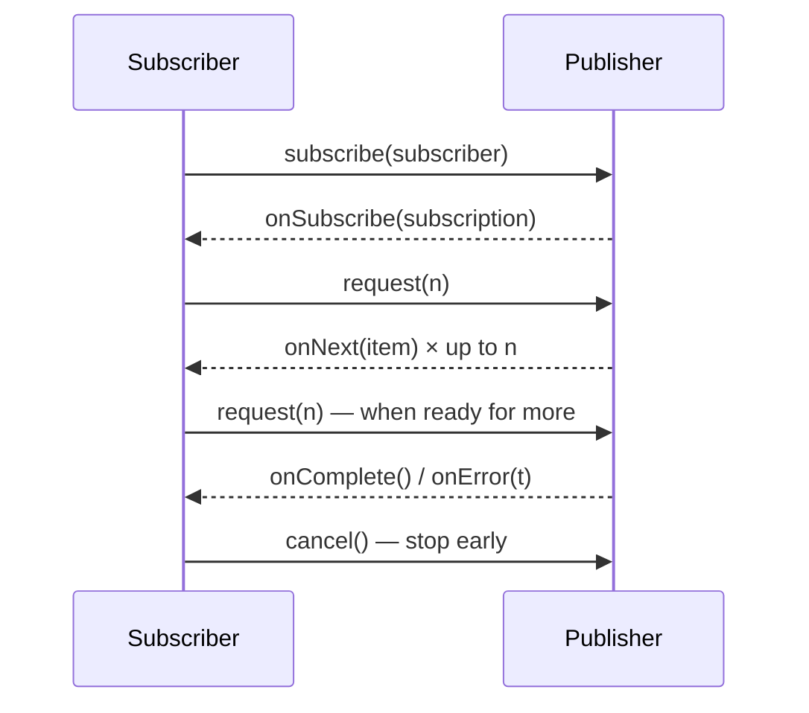
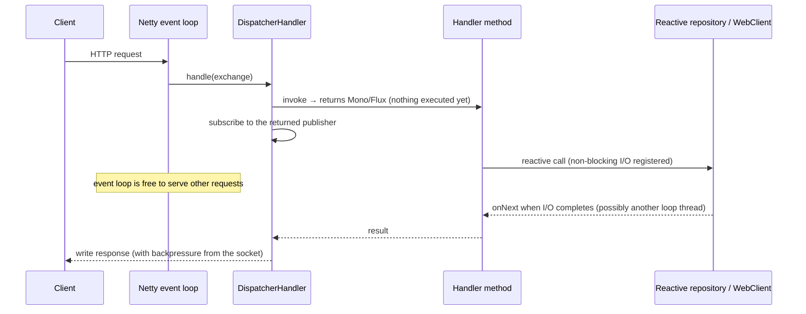
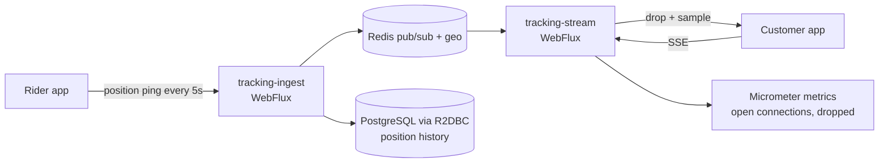
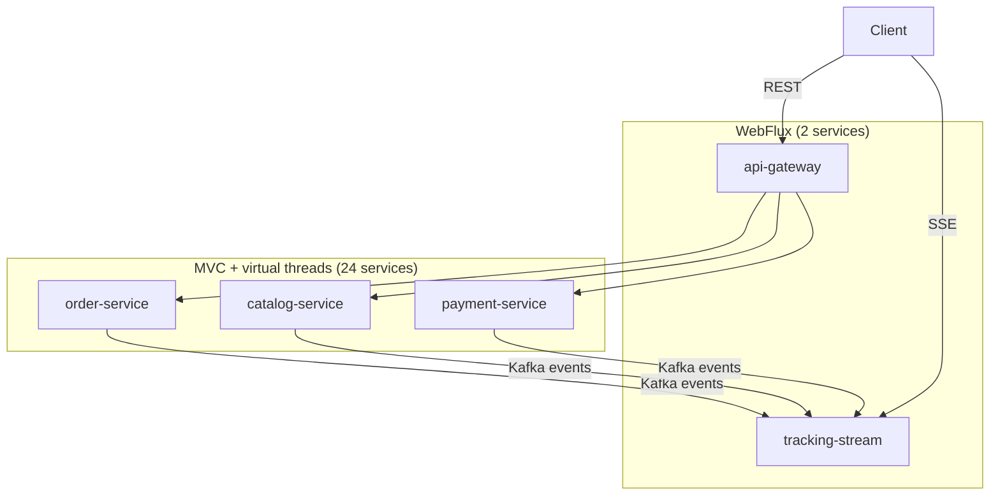
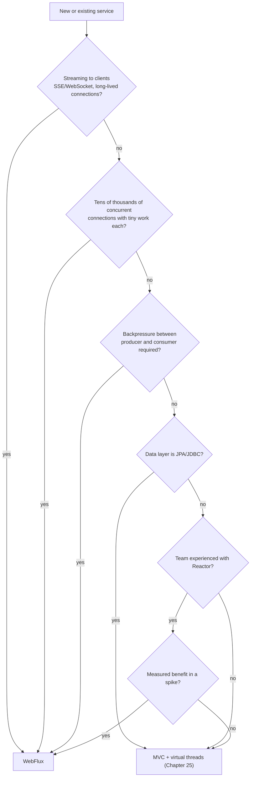

# 31 · Reactive Spring

## 1. Introduction & Why It Matters

Between 2018 and 2023, "reactive" was the answer to scalability in the Spring world: WebFlux, Reactor, R2DBC, non-blocking everything. Then Java 21 shipped **virtual threads** (Chapter 25), and blocking code became cheap to scale. So does reactive still matter?

Yes — but for narrower, sharper reasons than before:

- **Streaming with backpressure.** The delivery-tracking feed pushes rider positions to 40,000 open browser connections. The producer is faster than some consumers; someone must slow down. Backpressure is a first-class Reactive Streams concept and has no equivalent in plain blocking code.
- **Very high connection counts with little work per connection.** Server-sent events, WebSockets, long-polling: the cost is memory per connection, not threads.
- **Composition of concurrent calls** with declarative timeouts, retries, and cancellation propagation — when one leg fails, the rest are cancelled automatically.
- **Reactive data stores** that are reactive end to end (Redis, MongoDB, Kafka via Reactor Kafka).

Equally important is knowing when **not** to use it: for ordinary request/response services with JPA, Spring MVC on virtual threads gives you most of the scalability with none of the debugging difficulty.

This chapter covers Reactor and WebFlux properly — operators, schedulers, backpressure, error handling, context propagation, R2DBC, testing and debugging — and then gives an honest decision guide, plus the hybrid architecture the grocery platform actually uses.

### Who should read which section

| Band | Focus |
|---|---|
| B1 · 0–2 yrs | Parts 1, 2, 4 — Mono/Flux, a first WebFlux endpoint |
| B2 · 2–5 yrs | Parts 2, 5 — operators, error handling, WebClient, testing |
| B3 · 5–8 yrs | Parts 3, 5, 6 — schedulers, backpressure, context, R2DBC |
| B4 · 8–12 yrs | Parts 6, 8 — when to adopt, hybrid architecture, operations |
| B5 · 12–15+ yrs | Parts 8, 9 — strategy after virtual threads |

---

## 2. Core Concepts

### 2.1 Reactive Streams in one picture



The `request(n)` call is **backpressure**: the consumer states how much it can handle, so a fast producer cannot overwhelm it. Everything else in Reactor is built on this four-method protocol.

### 2.2 Reactor types

| Type | Meaning |
|---|---|
| `Mono<T>` | 0 or 1 element, then complete or error |
| `Flux<T>` | 0..N elements, then complete or error |

**Nothing happens until you subscribe.** A `Mono` returned but never subscribed is a no-op — the single most common beginner bug. In WebFlux, the framework subscribes for you when you return the publisher from a handler.

### 2.3 Operators you actually need

| Operator | Use |
|---|---|
| `map` | Synchronous transform |
| `flatMap` | Async transform, **interleaved** (concurrent) |
| `concatMap` | Async transform, **ordered**, one at a time |
| `flatMapSequential` | Concurrent execution, ordered results |
| `zip` | Combine results of parallel publishers |
| `then`, `thenReturn` | Sequence, discarding the previous value |
| `switchIfEmpty`, `defaultIfEmpty` | Handle "no result" |
| `filter`, `take`, `distinct` | Stream shaping |
| `timeout` | Bound the wait |
| `retryWhen` | Retry with backoff (Chapter 26 rules still apply) |
| `onErrorResume`, `onErrorReturn`, `onErrorMap` | Error handling / translation |
| `doOnNext`, `doOnError`, `tap` | Side effects: logging, metrics |
| `cache` | Share and replay a `Mono`'s result |

!!! warning "`flatMap` has a concurrency limit"
    `flatMap(f)` runs up to 256 inner publishers concurrently by default. That's an accidental bulkhead — sometimes too many for a fragile dependency, sometimes too few for throughput. Set it explicitly: `flatMap(f, 20)`.

### 2.4 Schedulers

| Scheduler | Threads | Use |
|---|---|---|
| `Schedulers.parallel()` | CPU-count, fixed | CPU work |
| `Schedulers.boundedElastic()` | Elastic, capped | **Wrapping blocking calls** |
| `Schedulers.single()` | One | Serialized work |
| `Schedulers.immediate()` | Caller's | Testing, no switch |

`subscribeOn` decides where the **subscription (and source)** runs; `publishOn` switches the thread for **downstream** operators. In WebFlux you usually need neither: the event loop handles everything, and you only switch for blocking work.

!!! danger "Never block the event loop"
    WebFlux runs on a handful of Netty event-loop threads (typically CPU count). One blocking JDBC call there stalls **all** requests on that loop. If you must call blocking code, wrap it: `Mono.fromCallable(this::jdbcCall).subscribeOn(Schedulers.boundedElastic())`. Use **BlockHound** in tests to detect accidental blocking.

### 2.5 WebFlux

| Feature | Notes |
|---|---|
| Programming models | Annotated controllers (same annotations as MVC) or functional `RouterFunction` |
| Server | Reactor Netty by default; Jetty/Undertow/Tomcat possible |
| Return types | `Mono<T>`, `Flux<T>`, `Flux<ServerSentEvent<T>>`, `ResponseEntity<Mono<T>>` |
| Streaming | `text/event-stream` (SSE) or `application/x-ndjson` |
| Filters | `WebFilter` instead of servlet `Filter` |
| Errors | `@ControllerAdvice` works; `ProblemDetail` supported (Chapter 10) |
| Security | `SecurityWebFilterChain` with `@EnableWebFluxSecurity` |
| Test client | `WebTestClient` |

### 2.6 Backpressure strategies for streaming

| Strategy | Behaviour | Use for |
|---|---|---|
| `onBackpressureBuffer(n)` | Buffer up to n, then error/drop | Bursty but bounded |
| `onBackpressureDrop()` | Discard when the consumer is slow | **Live positions** — stale data is worthless |
| `onBackpressureLatest()` | Keep only the newest | Dashboards, gauges |
| `limitRate(n)` | Prefetch in batches | Database/stream reads |
| `sample(Duration)` | Emit at most one per interval | Throttling high-frequency updates |

### 2.7 R2DBC

Reactive relational access: `ReactiveCrudRepository`, `R2dbcEntityTemplate`, `DatabaseClient`, a reactive transaction manager and a reactive connection pool. It is **not JPA**: no lazy loading, no dirty checking, no automatic joins across aggregates — closer to Spring Data JDBC (Chapter 12) in mapping power.

### 2.8 Reactive versus virtual threads

| Dimension | MVC + virtual threads | WebFlux + Reactor |
|---|---|---|
| Programming model | Imperative, familiar | Declarative pipelines |
| Debugging | Normal stack traces | Assembly-time vs runtime traces, `checkpoint()` |
| Blocking libraries (JDBC/JPA) | Fine | Must be isolated or replaced |
| Streaming with backpressure | Manual | Built in |
| Memory per connection | Higher (stack per virtual thread) | Lower |
| Throughput (request/response) | Comparable | Comparable |
| Ecosystem maturity | Everything works | Reactive variants needed |
| Team cost | Low | Real, ongoing |

**Default to MVC + virtual threads**; reach for WebFlux when streaming, backpressure or very high connection counts are intrinsic to the problem.

---

## 3. How It Works Internally

### 3.1 Assembly time vs subscription time


This two-phase nature explains both the "nothing happened" bug and why stack traces are confusing: the **assembly** location (where the chain was built) differs from the **execution** location.

### 3.2 A WebFlux request



The key property: between issuing I/O and receiving the result, **no thread is parked**. That is what allows tens of thousands of concurrent connections with a handful of threads.

### 3.3 Backpressure to the socket

For SSE and streaming responses, the TCP send buffer and the client's read speed propagate upstream as `request(n)` demand. A slow mobile client therefore slows the source — which is either exactly what you want (paged data) or a memory risk (live feeds), which is why an explicit strategy (2.6) is mandatory for infinite streams.

---

## 4. Hands-On Code — Level 1 (Beginner)

### 4.1 Setup

```kotlin title="build.gradle.kts"
implementation("org.springframework.boot:spring-boot-starter-webflux")
testImplementation("io.projectreactor:reactor-test")
```

!!! warning "Don't mix web starters"
    With both `spring-boot-starter-web` and `-webflux` on the classpath, Boot starts a **servlet** application and WebFlux endpoints don't behave as expected. Pick one per service (`spring.main.web-application-type` can force it, but separate services are cleaner).

### 4.2 A first endpoint

```java title="in/grocery/tracking/web/TrackingController.java"
package in.grocery.tracking.web;

import java.time.Duration;
import org.springframework.http.MediaType;
import org.springframework.web.bind.annotation.GetMapping;
import org.springframework.web.bind.annotation.PathVariable;
import org.springframework.web.bind.annotation.RestController;
import reactor.core.publisher.Flux;
import reactor.core.publisher.Mono;

@RestController
class TrackingController {

    private final DeliveryTrackingService tracking;

    TrackingController(DeliveryTrackingService tracking) {
        this.tracking = tracking;
    }

    @GetMapping("/api/v1/deliveries/{orderRef}")
    Mono<DeliveryView> current(@PathVariable String orderRef) {              // (1)!
        return tracking.currentPosition(orderRef);
    }

    @GetMapping(path = "/api/v1/deliveries/{orderRef}/stream",
                produces = MediaType.TEXT_EVENT_STREAM_VALUE)                 // (2)!
    Flux<DeliveryView> stream(@PathVariable String orderRef) {
        return tracking.positions(orderRef)
                .sample(Duration.ofSeconds(2));                               // (3)!
    }
}
```

1. Same annotations as MVC; the return type makes it reactive.
2. Server-sent events: the connection stays open and the browser receives updates.
3. At most one update every two seconds — the rider pings every second, but the customer's map doesn't need that.

### 4.3 Operators in practice

```java title="in/grocery/tracking/service/DeliveryTrackingService.java"
package in.grocery.tracking.service;

import java.time.Duration;
import org.springframework.stereotype.Service;
import reactor.core.publisher.Flux;
import reactor.core.publisher.Mono;

@Service
public class DeliveryTrackingService {

    private final ReactiveRiderPositionRepository positions;
    private final ReactiveOrderRepository orders;

    public Mono<DeliveryView> currentPosition(String orderRef) {
        return orders.findByOrderRef(orderRef)                                  // (1)!
                .switchIfEmpty(Mono.error(new OrderNotFoundException(orderRef)))
                .flatMap(order -> positions.latestFor(order.riderId())          // (2)!
                        .map(position -> DeliveryView.of(order, position))
                        .defaultIfEmpty(DeliveryView.pending(order)))
                .timeout(Duration.ofSeconds(2))                                 // (3)!
                .onErrorMap(java.util.concurrent.TimeoutException.class,
                        e -> DependencyException.timeout("tracking-store", e)); // (4)!
    }

    public Flux<DeliveryView> positions(String orderRef) {
        return orders.findByOrderRef(orderRef)
                .flatMapMany(order -> positions.stream(order.riderId())         // (5)!
                        .map(position -> DeliveryView.of(order, position)));
    }
}
```

1. Reactive repository returns `Mono<Order>` — empty if not found.
2. `flatMap` chains an async call; `map` would give `Mono<Mono<...>>`.
3. Every external call gets a timeout (Chapter 26) — declarative here.
4. Translate to the platform exception so Chapter 10's handler produces the standard problem body.
5. `flatMapMany`: `Mono` → `Flux` when one lookup opens a stream.

### 4.4 Testing with `StepVerifier`

```java title="DeliveryTrackingServiceTest.java"
@Test
void emitsPositionsForAnOrder() {
    given(orders.findByOrderRef("ORD-1")).willReturn(Mono.just(order("R-9")));
    given(positions.stream("R-9")).willReturn(Flux.just(pos(12.97, 77.59), pos(12.98, 77.60)));

    StepVerifier.create(service.positions("ORD-1"))                             // (1)!
            .expectNextMatches(v -> v.lat() == 12.97)
            .expectNextMatches(v -> v.lat() == 12.98)
            .verifyComplete();
}

@Test
void unknownOrderErrors() {
    given(orders.findByOrderRef("NOPE")).willReturn(Mono.empty());

    StepVerifier.create(service.currentPosition("NOPE"))
            .expectError(OrderNotFoundException.class)                          // (2)!
            .verify();
}
```

1. `StepVerifier` subscribes and asserts the exact sequence of signals.
2. Asserting the **error signal**, not a thrown exception — errors travel in the stream.

---

## 5. Hands-On Code — Level 2 (Intermediate) & Level 3 (Advanced)

### 5.1 Level 2 — Functional endpoints

```java title="in/grocery/tracking/web/TrackingRoutes.java"
package in.grocery.tracking.web;

import static org.springframework.web.reactive.function.server.RequestPredicates.GET;
import static org.springframework.web.reactive.function.server.RouterFunctions.route;

import org.springframework.context.annotation.Bean;
import org.springframework.context.annotation.Configuration;
import org.springframework.http.MediaType;
import org.springframework.web.reactive.function.server.RouterFunction;
import org.springframework.web.reactive.function.server.ServerResponse;

@Configuration(proxyBeanMethods = false)
class TrackingRoutes {

    @Bean
    RouterFunction<ServerResponse> trackingRoutes(TrackingHandler handler) {
        return route(GET("/api/v1/deliveries/{orderRef}"), handler::current)      // (1)!
                .andRoute(GET("/api/v1/deliveries/{orderRef}/stream"), handler::stream);
    }
}
```

1. Routes as data: composable, testable without a container, no annotation scanning. Annotated controllers remain perfectly valid in WebFlux — this is a style choice, not a requirement.

### 5.2 Level 2 — WebClient with resilience

```java title="in/grocery/tracking/client/EtaClient.java"
package in.grocery.tracking.client;

import java.time.Duration;
import org.springframework.stereotype.Component;
import org.springframework.web.reactive.function.client.WebClient;
import reactor.core.publisher.Mono;
import reactor.util.retry.Retry;

@Component
public class EtaClient {

    private final WebClient client;

    public EtaClient(WebClient.Builder builder) {                                 // (1)!
        this.client = builder.baseUrl("http://maps-service:8080").build();
    }

    public Mono<EtaView> eta(String from, String to) {
        return client.get()
                .uri("/api/eta?from={from}&to={to}", from, to)
                .retrieve()
                .onStatus(status -> status.is5xxServerError(),
                        response -> Mono.error(DependencyException.unavailable("maps", null)))   // (2)!
                .bodyToMono(EtaView.class)
                .timeout(Duration.ofSeconds(1))                                                  // (3)!
                .retryWhen(Retry.backoff(2, Duration.ofMillis(100))                              // (4)!
                        .jitter(0.5)
                        .filter(DependencyException.class::isInstance))
                .onErrorResume(e -> Mono.just(EtaView.approximate(from, to)));                   // (5)!
    }
}
```

1. Boot's builder brings codecs, metrics and tracing (Chapter 19's rule applies here too).
2. Translate at the boundary.
3. Timeouts are non-negotiable, reactive or not.
4. `retryWhen` with exponential backoff and jitter, filtered to transient failures only (Chapter 26).
5. Degrade rather than fail — the fallback from Chapter 26, expressed as an operator.

### 5.3 Level 2 — Concurrent composition

```java title="Fan-out with zip"
public Mono<DeliveryPage> page(String orderRef) {
    Mono<Order> order = orders.findByOrderRef(orderRef);
    Mono<RiderProfile> rider = order.flatMap(o -> riders.profile(o.riderId()));
    Mono<EtaView> eta = order.flatMap(o -> etaClient.eta(o.hubCode(), o.pincode()));

    return Mono.zip(order, rider, eta)                                            // (1)!
            .map(tuple -> DeliveryPage.of(tuple.getT1(), tuple.getT2(), tuple.getT3()))
            .timeout(Duration.ofSeconds(2));                                      // (2)!
}
```

1. `rider` and `eta` run **concurrently**; `zip` waits for all.
2. If one leg fails or times out, the others are **cancelled automatically** — the cancellation propagation that's tedious to write by hand with futures.

Note the subtlety: `order` is subscribed twice (once for `rider`, once for `eta`). Add `.cache()` to `order` so the database is queried once — a classic reactive gotcha.

### 5.4 Level 3 — Backpressure for a live feed

```java title="in/grocery/tracking/service/PositionStream.java"
package in.grocery.tracking.service;

import java.time.Duration;
import org.springframework.stereotype.Component;
import reactor.core.publisher.Flux;

@Component
public class PositionStream {

    private final ReactiveRedisOperations<String, RiderPosition> redis;

    /** Live positions for one rider, safe for slow mobile clients. */
    public Flux<RiderPosition> forRider(String riderId) {
        return redis.listenToChannel("rider:" + riderId)                          // (1)!
                .map(message -> message.getMessage())
                .onBackpressureDrop(dropped ->                                     // (2)!
                        meters.counter("grocery.tracking.dropped").increment())
                .sample(Duration.ofSeconds(2))                                     // (3)!
                .timeout(Duration.ofMinutes(15))                                   // (4)!
                .doOnCancel(() -> meters.counter("grocery.tracking.cancelled").increment());
    }
}
```

1. Reactive Redis pub/sub — a push source with no natural backpressure.
2. **Drop, don't buffer**: for live positions, the newest value is the only valuable one, and buffering for a slow client is a memory leak with extra steps.
3. Rate-limit per connection.
4. Close abandoned connections; mobile clients disappear without closing sockets.

| Feed type | Strategy |
|---|---|
| Live positions, prices, dashboards | `onBackpressureDrop` / `onBackpressureLatest` + `sample` |
| Paged data export | `limitRate` — the consumer's demand controls the source |
| Financial events (must not lose) | Don't stream to the client; persist and let them poll/replay |

### 5.5 Level 3 — R2DBC

```kotlin title="build.gradle.kts"
implementation("org.springframework.boot:spring-boot-starter-data-r2dbc")
runtimeOnly("org.postgresql:r2dbc-postgresql")
```

```yaml title="application.yml"
spring:
  r2dbc:
    url: r2dbc:postgresql://tracking-db:5432/tracking
    username: ${DB_USER}
    password: ${DB_PASSWORD}
    pool:
      initial-size: 10
      max-size: 20                       # (1)!
      max-acquire-time: 2s
```

1. **The pool is still finite** — reactive doesn't create database capacity (Chapter 12's budget applies unchanged).

```java title="in/grocery/tracking/repository/RiderPositionRepository.java"
public interface RiderPositionRepository extends ReactiveCrudRepository<RiderPositionRow, Long> {

    @Query("select * from rider_position where rider_id = :riderId order by recorded_at desc limit 1")
    Mono<RiderPositionRow> latestFor(String riderId);                              // (1)!

    @Query("select * from rider_position where hub_code = :hub and recorded_at > :since")
    Flux<RiderPositionRow> recentForHub(String hub, Instant since);                // (2)!
}
```

1. No JPA: explicit SQL, no lazy loading, no dirty checking (Chapter 12's model).
2. Streaming results — rows flow as they arrive rather than materializing a list.

```java title="Transactions"
@Transactional                                                                     // (1)!
public Mono<Void> recordPing(RiderPing ping) {
    return positions.save(RiderPositionRow.from(ping))
            .then(hubs.touchLastSeen(ping.hubCode()))
            .then();
}
```

1. Works with a `ReactiveTransactionManager`; the transaction context travels in the **Reactor Context**, not a `ThreadLocal`. Mixing JDBC and R2DBC transactions in one method does **not** give atomicity — pick one per service.

!!! warning "R2DBC is a commitment"
    A service using R2DBC cannot use JPA. Reporting queries, Hibernate mappings, second-level cache and the entire JPA ecosystem (Chapter 13) are unavailable. For services whose value is CRUD over a rich model, that's a poor trade; for a write-heavy telemetry store, it's fine.

### 5.6 Level 3 — Context, security and MDC

```java title="in/grocery/tracking/web/CorrelationWebFilter.java"
@Component
public class CorrelationWebFilter implements WebFilter {                            // (1)!

    @Override
    public Mono<Void> filter(ServerWebExchange exchange, WebFilterChain chain) {
        String requestId = java.util.Optional
                .ofNullable(exchange.getRequest().getHeaders().getFirst("X-Request-Id"))
                .orElse(java.util.UUID.randomUUID().toString());
        exchange.getResponse().getHeaders().add("X-Request-Id", requestId);
        return chain.filter(exchange)
                .contextWrite(ctx -> ctx.put("requestId", requestId));               // (2)!
    }
}
```

1. `WebFilter`, not a servlet `Filter`.
2. The **Reactor Context** is the reactive replacement for `ThreadLocal`: it travels with the subscription, not the thread.

For logging, Micrometer's context propagation bridges Reactor Context ↔ MDC so `traceId` appears in logs (Chapters 07, 27) — enable it rather than writing manual MDC plumbing, which is famously error-prone in reactive code.

```java title="Security in WebFlux"
@Bean
SecurityWebFilterChain springSecurityFilterChain(ServerHttpSecurity http) {
    return http
            .authorizeExchange(exchanges -> exchanges                                // (1)!
                    .pathMatchers("/api/v1/deliveries/*/stream").authenticated()
                    .anyExchange().authenticated())
            .oauth2ResourceServer(o -> o.jwt(Customizer.withDefaults()))
            .csrf(ServerHttpSecurity.CsrfSpec::disable)
            .build();
}

// current user inside a reactive chain:
ReactiveSecurityContextHolder.getContext()
        .map(ctx -> ctx.getAuthentication().getName())                               // (2)!
```

1. `ServerHttpSecurity`, `authorizeExchange`, `pathMatchers` — the reactive equivalents of Chapter 17's API.
2. The security context lives in the Reactor Context too.

### 5.7 Level 3 — Debugging and blocking detection

```java title="Test setup"
@BeforeAll
static void installBlockHound() {
    BlockHound.install(builder -> builder
            .allowBlockingCallsInside("java.util.UUID", "randomUUID"));               // (1)!
}
```

1. **BlockHound** fails the test when a blocking call happens on a non-blocking thread — the only reliable way to find the JDBC call someone added to a WebFlux path.

```java title="Debugging techniques"
ReactorDebugAgent.init();                     // dev/test: reconstructs assembly stack traces   // (1)!

mono.checkpoint("eta-lookup")                 // production-friendly marker                      // (2)!
    .doOnError(e -> log.error("ETA lookup failed", e));
```

1. Cheap enough for development; `Hooks.onOperatorDebug()` is the heavier, global alternative — avoid it in production.
2. `checkpoint()` adds a named marker to the traceback without the cost of full debug mode.

---

## 6. Hands-On Code — Level 4 (Expert / Production)

### 6.1 The tracking service, end to end

The grocery platform's one genuinely reactive service: live delivery tracking for up to 40,000 concurrent customer connections.



```java title="in/grocery/tracking/web/TrackingStreamController.java"
package in.grocery.tracking.web;

import java.time.Duration;
import org.springframework.http.MediaType;
import org.springframework.http.codec.ServerSentEvent;
import org.springframework.security.core.annotation.AuthenticationPrincipal;
import org.springframework.security.oauth2.jwt.Jwt;
import org.springframework.web.bind.annotation.GetMapping;
import org.springframework.web.bind.annotation.PathVariable;
import org.springframework.web.bind.annotation.RestController;
import reactor.core.publisher.Flux;

@RestController
class TrackingStreamController {

    private final DeliveryTrackingService tracking;
    private final io.micrometer.core.instrument.MeterRegistry meters;
    private final java.util.concurrent.atomic.AtomicInteger openStreams = new java.util.concurrent.atomic.AtomicInteger();

    TrackingStreamController(DeliveryTrackingService tracking,
                             io.micrometer.core.instrument.MeterRegistry meters) {
        this.tracking = tracking;
        this.meters = meters;
        io.micrometer.core.instrument.Gauge
                .builder("grocery.tracking.streams.open", openStreams, java.util.concurrent.atomic.AtomicInteger::get)
                .register(meters);                                                        // (1)!
    }

    @GetMapping(path = "/api/v1/deliveries/{orderRef}/stream",
                produces = MediaType.TEXT_EVENT_STREAM_VALUE)
    Flux<ServerSentEvent<DeliveryView>> stream(@PathVariable String orderRef,
                                               @AuthenticationPrincipal Jwt jwt) {
        return tracking.authorizedPositions(orderRef, jwt.getSubject())                    // (2)!
                .map(view -> ServerSentEvent.builder(view)
                        .id(String.valueOf(view.recordedAt().toEpochMilli()))
                        .event("position")
                        .retry(Duration.ofSeconds(5))                                      // (3)!
                        .build())
                .mergeWith(heartbeat())                                                    // (4)!
                .doOnSubscribe(s -> openStreams.incrementAndGet())
                .doFinally(signal -> {                                                     // (5)!
                    openStreams.decrementAndGet();
                    meters.counter("grocery.tracking.stream.ended", "signal", signal.name()).increment();
                });
    }

    private Flux<ServerSentEvent<DeliveryView>> heartbeat() {
        return Flux.interval(Duration.ofSeconds(20))
                .map(i -> ServerSentEvent.<DeliveryView>builder().comment("keep-alive").build());
    }
}
```

1. **Open connection count is the key capacity metric** for a streaming service — not requests per second.
2. Ownership check inside the reactive chain (Chapter 17's rule, reactive form).
3. Tells the browser how long to wait before reconnecting — SSE reconnects automatically.
4. Heartbeats keep proxies and load balancers from closing idle connections (a very common cause of "the map freezes after 60 seconds").
5. `doFinally` runs on completion, error **and cancellation** — the only reliable place to release per-connection resources.

### 6.2 Capacity for streaming services

| Factor | Consideration |
|---|---|
| Memory per connection | Netty buffers + per-subscription state; measure with a load test, budget ~10–50 KB |
| File descriptors | `ulimit -n` and container limits must exceed max connections |
| Idle timeouts | Ingress, load balancer and `server.netty.idle-timeout` must all exceed the heartbeat interval |
| Event loop threads | CPU count; one blocking call ruins everything (BlockHound) |
| Backpressure strategy | Explicit per stream (5.4) |
| Scale-out | Connections are sticky for their lifetime; a rollout disconnects clients — SSE auto-reconnect makes that acceptable, WebSockets need reconnect logic |

```yaml title="application.yml — tracking-stream"
server:
  netty:
    idle-timeout: 5m                                                                  # (1)!
  shutdown: graceful
spring:
  lifecycle:
    timeout-per-shutdown-phase: 20s                                                   # (2)!
```

1. Longer than the 20 s heartbeat, shorter than a forgotten tab's lifetime.
2. On shutdown, open streams are closed; clients reconnect to another pod (Chapter 30's rollout settings apply).

### 6.3 Reactive in a mostly-imperative platform



Rules the platform applies:

| Rule | Reason |
|---|---|
| WebFlux only for streaming and the gateway | The two cases where it clearly wins |
| No JPA in reactive services | R2DBC or no relational store at all |
| Shared DTOs, platform error format, observability conventions | A client can't tell which stack served it (Chapters 10, 27) |
| BlockHound in every reactive service's tests | Prevents the classic regression |
| Blocking clients (`RestClient`) in MVC services, `WebClient` in reactive ones | Don't mix models inside a service |

!!! tip "`WebClient` in an MVC service is fine"
    Using `WebClient` from a blocking service (and calling `.block()`) is a common, supported pattern — but with virtual threads, `RestClient` (Chapter 19) is simpler and observably equivalent. Prefer it unless you need streaming responses.

### 6.4 Migration decision guide



The honest summary after virtual threads: **most services should be MVC**. Reactive earns its complexity in streaming and connection-dense workloads, and there it earns it decisively.

### 6.5 Testing reactive services

```java title="TrackingStreamControllerTest.java"
@WebFluxTest(TrackingStreamController.class)                                           // (1)!
class TrackingStreamControllerTest {

    @Autowired WebTestClient client;
    @MockitoBean DeliveryTrackingService tracking;

    @Test
    void streamsPositionsAsServerSentEvents() {
        given(tracking.authorizedPositions("ORD-1", "C-1"))
                .willReturn(Flux.just(view(12.97, 77.59), view(12.98, 77.60)));

        client.mutateWith(SecurityMockServerConfigurers.mockJwt().jwt(j -> j.subject("C-1")))
                .get().uri("/api/v1/deliveries/ORD-1/stream")
                .accept(MediaType.TEXT_EVENT_STREAM)
                .exchange()
                .expectStatus().isOk()
                .returnResult(DeliveryView.class)
                .getResponseBody()
                .as(StepVerifier::create)                                               // (2)!
                .expectNextMatches(v -> v.lat() == 12.97)
                .expectNextMatches(v -> v.lat() == 12.98)
                .thenCancel()
                .verify(Duration.ofSeconds(5));
    }
}
```

1. The reactive slice — `WebTestClient` instead of `MockMvc` (package may differ on Boot 4 — verify).
2. Combining `WebTestClient` with `StepVerifier` gives precise control over an infinite stream: assert, then cancel.

```java title="Virtual time for time-based operators"
@Test
void samplesAtMostOnceEveryTwoSeconds() {
    StepVerifier.withVirtualTime(() -> service.positions("ORD-1"))                      // (1)!
            .thenAwait(Duration.ofSeconds(10))
            .expectNextCount(5)
            .thenCancel()
            .verify();
}
```

1. **Virtual time**: a 10-second window is asserted in milliseconds. Without it, testing `sample`, `interval` or `retryWhen` backoff means real waiting — the main source of slow, flaky reactive tests.

---

## 7. Spring Boot 3 vs 4 & Migration

| Topic | Boot 3.5 | Boot 4.x |
|---|---|---|
| WebFlux | ✅ | ✅ |
| Reactor | 3.6/3.7 | 3.7+ (verify) |
| R2DBC | Spring Data R2DBC 3.x | 4.x (verify) |
| API versioning | Convention | Built-in for WebFlux too (Chapter 20, verify) |
| Context propagation | Micrometer `context-propagation` | Same |
| Test slice | `@WebFluxTest` | Moved to the WebFlux test module (verify) |
| Jackson codecs | Jackson 2 | Jackson 3 (Chapter 11) |

### Migration checklist

- [ ] Verify Reactor and reactive driver versions align with Boot 4.
- [ ] Re-run BlockHound-enabled tests after upgrading (new blocking paths can appear in libraries).
- [ ] Check `@WebFluxTest` and security test configurer packages.
- [ ] Re-test SSE behaviour end to end (codec changes can alter framing).
- [ ] Confirm context propagation still bridges `traceId` into logs.

---

## 8. Production Playbook

### Best practices

1. **Choose deliberately**: WebFlux for streaming, backpressure and connection-dense workloads; MVC + virtual threads otherwise.
2. **Never block the event loop**; wrap unavoidable blocking in `boundedElastic` and prove it with **BlockHound**.
3. **Explicit backpressure strategy** on every infinite stream — usually drop or latest.
4. **Timeouts, retries with jitter, and fallbacks** as operators (Chapter 26 semantics unchanged).
5. **Bound `flatMap` concurrency** explicitly.
6. **Reactor Context, not ThreadLocal**; bridge to MDC with context propagation.
7. **Heartbeats and idle timeouts** for SSE/WebSocket; measure **open connections**.
8. **`doFinally`** for per-connection cleanup (cancellation included).
9. **Don't mix JPA and R2DBC** in one service.
10. **Virtual time in tests**; `StepVerifier` for signal-level assertions.

### Anti-patterns

❌ Adopting WebFlux for "performance" on a JPA-backed CRUD service — complexity without benefit.

❌ Blocking calls (JDBC, `RestTemplate`, `Thread.sleep`, `.block()`) inside a reactive chain.

❌ Forgetting to subscribe — the code silently does nothing.

❌ Unbounded `onBackpressureBuffer` on a live feed — a slow client becomes an OOM.

❌ Subscribing to the same `Mono` several times without `cache()` — duplicate database calls.

❌ `Hooks.onOperatorDebug()` in production (large overhead).

❌ `ThreadLocal`-based MDC/security assumptions carried over from MVC.

❌ Mixing `spring-boot-starter-web` and `-webflux` in one service.

❌ Streaming data that must not be lost without a persistent, replayable source.

### Troubleshooting

| Symptom | Cause | Fix |
|---|---|---|
| Nothing happens | No subscription | Return the publisher, or subscribe explicitly |
| All requests stall | Blocking call on an event loop | BlockHound; `boundedElastic`; remove blocking libraries |
| Memory grows with connected clients | Buffering backpressure strategy | `onBackpressureDrop`/`latest`, `sample` |
| Duplicate database calls | Same `Mono` subscribed multiple times | `.cache()` |
| SSE stream freezes after ~60 s | Proxy/LB idle timeout | Heartbeat comments, align idle timeouts |
| Stack traces are useless | Assembly vs runtime | `checkpoint()`, `ReactorDebugAgent` in dev |
| `traceId` missing in logs | Context not bridged | Micrometer context propagation |
| Transaction not applied | Blocking transaction manager, or mixed JDBC/R2DBC | Use `ReactiveTransactionManager` consistently |
| Connections refused at scale | File descriptor limits | Raise `ulimit -n`, container limits |
| Tests slow/flaky with delays | Real time in `sample`/`retryWhen` | `StepVerifier.withVirtualTime` |

### Production checklist

- [ ] Reactive used only where it's justified, documented per service
- [ ] BlockHound enabled in tests
- [ ] Backpressure strategy chosen per stream
- [ ] Timeouts, bounded `flatMap`, retries with jitter
- [ ] Heartbeats + aligned idle timeouts across ingress/LB/app
- [ ] Open-connection gauge and dropped-message counters
- [ ] Context propagation verified (traceId in logs)
- [ ] `doFinally` cleanup on every long-lived stream
- [ ] Load test at target connection count with memory measured

---

## 9. Interview Questions & Answers

### B1 · 0–2 years

??? question "B1 · What are `Mono` and `Flux`?"
    **Short answer:** Reactor publishers: `Mono` emits at most one element, `Flux` emits zero to many, each followed by a completion or error signal.

??? question "B1 · Why does my reactive code not run?"
    **Short answer:** Nothing happens until subscription. In WebFlux, return the publisher from the handler so the framework subscribes; elsewhere, subscribe explicitly.

??? question "B1 · `map` vs `flatMap`?"
    **Short answer:** `map` applies a synchronous function; `flatMap` applies a function returning a publisher and flattens the result — use it for asynchronous calls.

??? question "B1 · What is backpressure?"
    **Short answer:** The consumer telling the producer how many elements it can handle (`request(n)`), so a fast producer can't overwhelm a slow consumer.

??? question "B1 · When should a team use WebFlux instead of MVC?"
    **Short answer:** For streaming to clients, backpressure requirements, or very large numbers of concurrent connections. Otherwise MVC with virtual threads is simpler.

### B2 · 2–5 years

??? question "B2 · What happens if you block inside a WebFlux handler?"
    **Short answer:** You block one of the few event-loop threads, stalling all requests on that loop. Wrap unavoidable blocking in `Mono.fromCallable(...).subscribeOn(Schedulers.boundedElastic())` and detect violations with BlockHound.

??? question "B2 · `subscribeOn` vs `publishOn`?"
    **Short answer:** `subscribeOn` affects where the subscription and source execute (one per chain, position-independent); `publishOn` switches the thread for operators downstream of it.

??? question "B2 · How do you handle errors in a reactive chain?"
    **Short answer:** `onErrorResume` (fallback publisher), `onErrorReturn` (fallback value), `onErrorMap` (translate), `retryWhen` (retry with backoff) — errors are signals, not thrown exceptions.

??? question "B2 · How do you test reactive code?"
    **Short answer:** `StepVerifier` for signal sequences, `WebTestClient` for endpoints, `withVirtualTime` for time-based operators, and BlockHound to catch blocking calls.

??? question "B2 · What is R2DBC and how does it differ from JPA?"
    **Short answer:** Reactive relational access with non-blocking drivers. No lazy loading, no dirty checking, no JPA ecosystem — closer to Spring Data JDBC with reactive types.

??? question "B2 · How do you stream data to a browser?"
    **Short answer:** Return `Flux<ServerSentEvent<T>>` with `produces = text/event-stream` (or NDJSON), add heartbeats, set a backpressure strategy and an idle timeout.

### B3 · 5–8 years

??? question "B3 · Explain assembly time vs subscription time."
    **Short answer:** Building the operator chain (assembly) creates a blueprint; nothing executes until subscription, when the subscription and demand propagate upstream and signals flow downstream. This is why stack traces need `checkpoint()`/debug agents to be meaningful.

??? question "B3 · How do you choose a backpressure strategy?"
    **Short answer:** By data semantics. Live values (positions, prices): drop or keep latest. Bounded bursts: buffer with a limit. Paged/replayable data: `limitRate` and let demand drive the source. Never buffer unbounded on infinite streams.

??? question "B3 · How does context propagation work in Reactor?"
    **Short answer:** The Reactor Context is attached to the subscription and written with `contextWrite`, flowing upstream; Micrometer's context-propagation library bridges it to and from `ThreadLocal`s (MDC, tracing, security) at scheduler boundaries.

??? question "B3 · Do virtual threads make WebFlux obsolete?"
    **Short answer:** No — they remove the *scalability-only* argument. WebFlux remains superior for streaming with backpressure, cancellation propagation and very high connection counts at low memory. For request/response services, MVC on virtual threads is simpler and comparable.

??? question "B3 · What are the pitfalls of mixing blocking and reactive?"
    **Short answer:** Blocking on event loops (fatal), transaction managers that don't match the data access model, `ThreadLocal`-based context lost across schedulers, and `.block()` inside a reactive chain causing deadlocks in constrained pools.

### B4 · 8–12 years

??? question "B4 · How would you decide whether to adopt WebFlux for a service?"
    **Short answer:** Requirements first (streaming, backpressure, connection density), data layer second (JPA rules it out effectively), team capability third, and a measured spike fourth. Without a clear requirement, choose MVC with virtual threads.

??? question "B4 · How do you operate a service with 40,000 open SSE connections?"
    **Short answer:** Measure memory per connection and file descriptors; align idle timeouts across ingress, load balancer and app; send heartbeats; apply drop-based backpressure and sampling; gauge open connections as the capacity metric; accept reconnects on rollout and verify client reconnect logic.

??? question "B4 · What's the cost of a mixed reactive/imperative estate?"
    **Short answer:** Two sets of libraries, idioms, debugging skills, security and test configurations. Contain it: reactive only where justified, shared contracts (error format, observability), and platform libraries that work for both.

### B5 · 12–15+ years

??? question "B5 · What did the industry get wrong about reactive?"
    **Short answer:** Treating it as a general performance upgrade rather than a programming model for streams and backpressure. Many teams paid the complexity cost for services whose bottleneck was the database. Virtual threads corrected the default; reactive remains the right tool for a smaller, well-defined set of problems.

??? question "B5 · Would you rewrite an existing WebFlux service to MVC?"
    **Short answer:** Only with a concrete driver — maintenance pain, hiring, or a need for JPA. A working, well-understood reactive service is not a defect. Apply the decision guide to new services and to major rewrites, not as a blanket migration.

### Scenario questions

??? example "Scenario · The tracking service OOMs when riders go through a tunnel"
    Positions were pushed into `onBackpressureBuffer()` with no limit; mobile clients on poor networks stopped consuming, buffers grew per connection, and the pod died. Fix: `onBackpressureDrop` with a dropped counter, `sample(2s)`, a per-connection idle timeout, and a load test at target connection count with memory measured.

??? example "Scenario · A new WebFlux service has worse latency than the MVC one it replaced"
    A JDBC-backed repository was called directly inside the reactive chain, blocking event-loop threads. Fix: BlockHound in tests (would have failed immediately), move to R2DBC or wrap in `boundedElastic`, and re-evaluate whether the service needed WebFlux at all.

### Coding exercise

!!! example "Exercise · Live price feed"
    Build `GET /api/v1/prices/stream?skus=A,B,C` as an SSE endpoint that emits price updates from Redis pub/sub, at most one update per SKU every 3 seconds, drops updates for slow clients (with a counter), sends heartbeats every 20 s, closes idle streams after 10 minutes, and authorizes the caller. Write tests using virtual time.

??? success "Solution"
    ```java title="PriceStreamController.java"
    @RestController
    class PriceStreamController {

        private final PriceStreamService prices;
        private final MeterRegistry meters;

        @GetMapping(path = "/api/v1/prices/stream", produces = MediaType.TEXT_EVENT_STREAM_VALUE)
        Flux<ServerSentEvent<PriceUpdate>> stream(@RequestParam List<String> skus,
                                                  @AuthenticationPrincipal Jwt jwt) {
            if (skus.size() > 50) {
                return Flux.error(new TooManySkusException(skus.size()));                 // (1)!
            }
            return prices.updatesFor(skus)
                    .groupBy(PriceUpdate::sku)                                             // (2)!
                    .flatMap(group -> group.sample(Duration.ofSeconds(3)), 50)             // (3)!
                    .onBackpressureDrop(dropped ->
                            meters.counter("grocery.price.stream.dropped").increment())
                    .map(update -> ServerSentEvent.builder(update).event("price")
                            .retry(Duration.ofSeconds(5)).build())
                    .mergeWith(Flux.interval(Duration.ofSeconds(20))
                            .map(i -> ServerSentEvent.<PriceUpdate>builder().comment("ping").build()))
                    .timeout(Duration.ofMinutes(10))                                       // (4)!
                    .onErrorResume(TimeoutException.class, e -> Flux.empty())              // (5)!
                    .doFinally(signal -> meters.counter("grocery.price.stream.ended",
                            "signal", signal.name()).increment());
            }
    }
    ```

    1. Bound the request — an unbounded SKU list is a resource attack (Chapter 20's rule, streaming edition).
    2. Group by SKU so sampling is **per SKU**, not global.
    3. Explicit concurrency bound on `flatMap`.
    4. Close abandoned streams.
    5. A timeout on an infinite stream is a normal completion, not an error the client should see.

    ```java title="PriceStreamControllerTest.java"
    @Test
    void samplesPerSkuAndDropsForSlowClients() {
        given(prices.updatesFor(List.of("A", "B")))
                .willReturn(Flux.interval(Duration.ofMillis(500))
                        .map(i -> new PriceUpdate(i % 2 == 0 ? "A" : "B", "10.00", Instant.now())));

        StepVerifier.withVirtualTime(() -> controller.stream(List.of("A", "B"), jwt()))   // (1)!
                .thenAwait(Duration.ofSeconds(12))
                .expectNextCount(8)                                                        // (2)!
                .thenCancel()
                .verify();
    }
    ```

    1. Twelve seconds of stream asserted instantly.
    2. Two SKUs × one update per 3 s over 12 s ≈ 8 events (plus heartbeats, depending on assembly) — adjust the assertion to the exact composition; the point is that sampling is verified deterministically.

---

## Key Takeaways

- Reactive Streams is about **backpressure**; Reactor is its implementation and WebFlux its web layer.
- **Nothing runs until subscription**, and **never block the event loop** — BlockHound enforces it.
- **Choose a backpressure strategy explicitly** for every infinite stream; drop or keep-latest for live data.
- Timeouts, bounded `flatMap`, jittered retries and fallbacks are the same discipline as Chapter 26, expressed as operators.
- **Reactor Context replaces ThreadLocal**; bridge it for logs, tracing and security.
- **R2DBC is a commitment** — no JPA in that service.
- After virtual threads, **MVC is the default**; reactive wins for streaming and connection-dense workloads.
- Test with **`StepVerifier`, `WebTestClient` and virtual time**.

## Further Reading

- Spring Framework Reference — *Web on Reactive Stack* (WebFlux, WebClient, functional endpoints, testing)
- Project Reactor Reference — operators, schedulers, backpressure, context, debugging
- Spring Data R2DBC Reference; R2DBC specification
- BlockHound documentation; Micrometer context propagation

---

[:material-arrow-left: 30 Kubernetes & Cloud-Native](30-kubernetes-cloud-native.md) · [32 GraphQL, gRPC, WebSocket & SSE :material-arrow-right:](32-graphql-grpc-websocket-sse.md)
