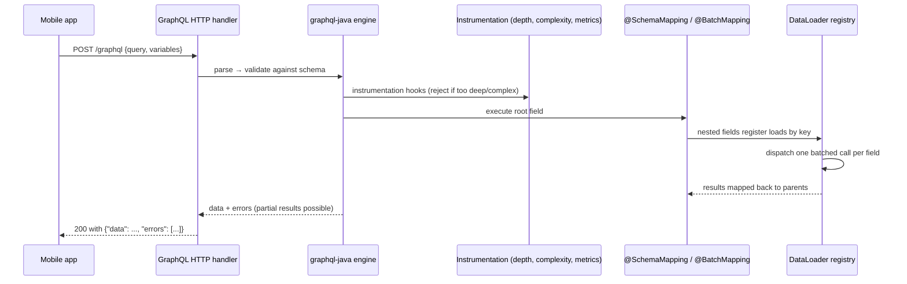
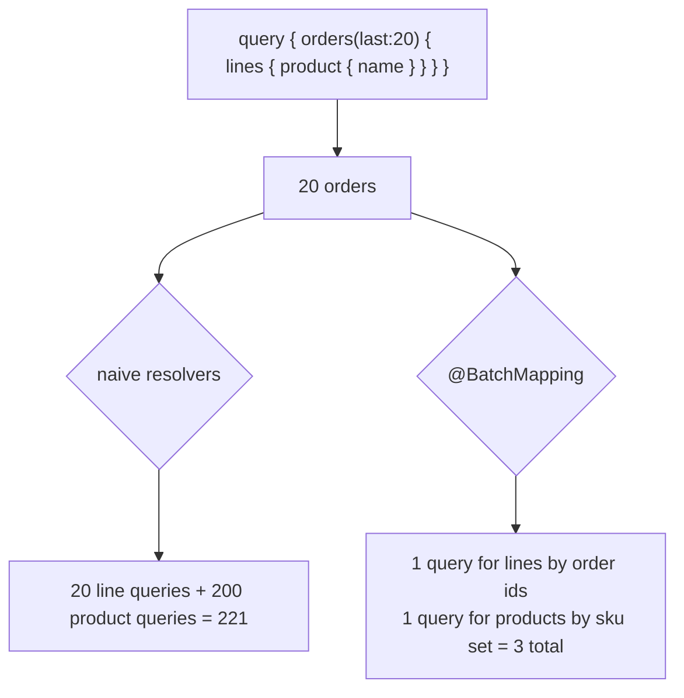
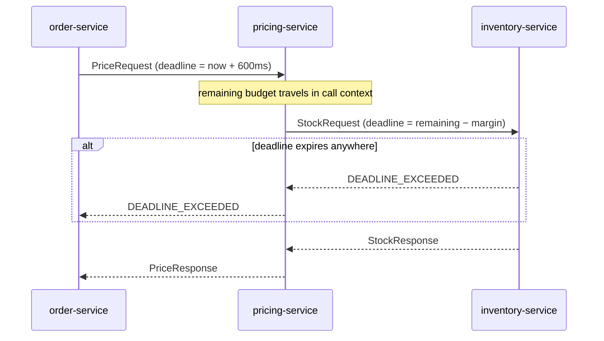
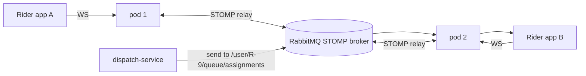
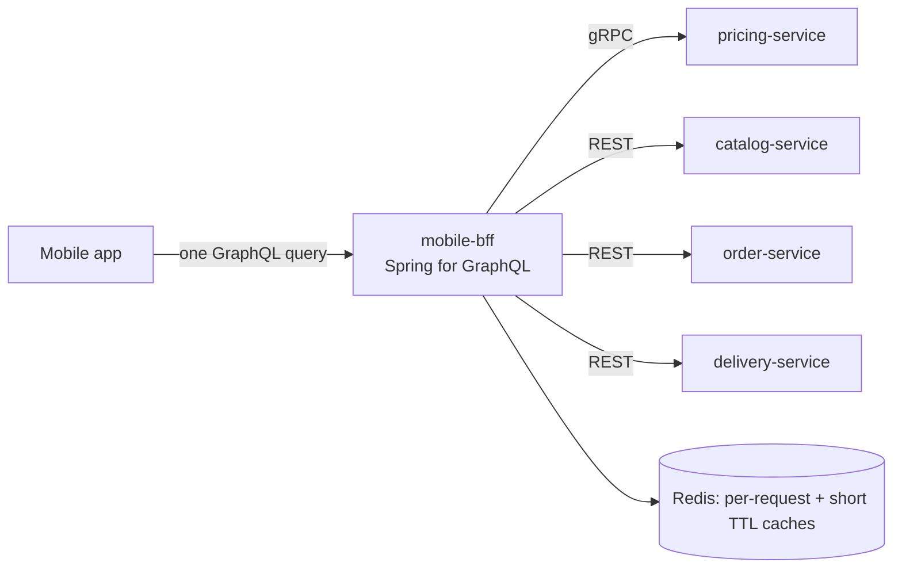
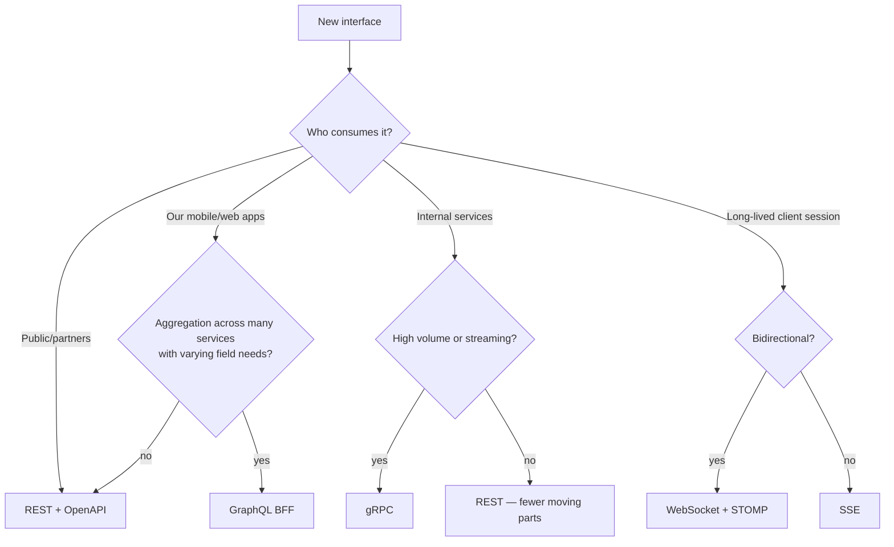

# 32 · GraphQL, gRPC, WebSocket & SSE

## 1. Introduction & Why It Matters

REST (Chapters 08, 20) carries most of the grocery platform's traffic, and should. But four problems fit it badly:

- **The mobile home screen** needs banners, categories, a personalized "buy again" list, cart badge counts and delivery-slot availability. Over REST that's six round trips on a 3G connection in Coimbatore, each returning fields the screen ignores. One **GraphQL** query returns exactly what the screen needs, in one round trip — and the next app version can change its needs without a backend release.
- **Internal pricing calls** run at 60,000 requests per second between services in the same cluster. JSON over HTTP/1.1 spends most of its cost on serialization and connection overhead. **gRPC** with protobuf over HTTP/2 cuts payload size and latency, and gives a typed contract with generated clients.
- **The rider app** needs bidirectional communication: the server pushes assignments, the rider accepts or rejects, and both sides need to know the connection is alive. That's **WebSocket**, not request/response.
- **Order tracking for customers** is server-push only, over mobile networks, through proxies. **SSE** (Chapter 31) is simpler than WebSocket and reconnects automatically.

This chapter covers all four in Spring: schema-first GraphQL with batch loading, depth and complexity limits, persisted queries and error handling; gRPC with deadlines, interceptors and proto evolution; WebSocket with STOMP, user destinations and a broker relay for scaling; and SSE for the cases where it beats WebSocket. It ends with a decision guide so each protocol is a choice, not a fashion.

### Who should read which section

| Band | Focus |
|---|---|
| B1 · 0–2 yrs | Parts 1, 2, 4 — what each protocol is, a first GraphQL query |
| B2 · 2–5 yrs | Parts 2, 5 — resolvers, batch loading, gRPC services, STOMP |
| B3 · 5–8 yrs | Parts 3, 5, 6 — N+1, limits, deadlines, scaling WebSocket |
| B4 · 8–12 yrs | Parts 6, 8 — BFF architecture, protocol governance |
| B5 · 12–15+ yrs | Parts 8, 9 — API strategy across clients and services |

---

## 2. Core Concepts

### 2.1 Choosing a protocol

| Need | Protocol |
|---|---|
| Public, cacheable, widely consumable API | **REST** (Chapters 08, 20) |
| Many clients with different field needs; aggregation across resources | **GraphQL** |
| High-volume internal RPC with typed contracts | **gRPC** |
| Bidirectional, low-latency, stateful client sessions | **WebSocket** |
| Server → client push only | **SSE** |
| Fire-and-forget, decoupled in time | **Messaging** (Chapters 23, 24) |

### 2.2 GraphQL in five points

1. **One endpoint** (`POST /graphql`), one schema, queries describe the exact shape of the response.
2. **Schema-first in Spring**: `.graphqls` files are the contract; `@Controller` methods bind to fields.
3. **Resolvers can nest**, which creates **N+1** by default — solved with `@BatchMapping`/DataLoader.
4. **HTTP caching doesn't apply** (everything is a POST to one URL) — use persisted queries, CDN on GET variants, or server-side caching (Chapter 21).
5. **Every query is potentially expensive**: depth, complexity and rate limits are mandatory, not optional.

| Spring for GraphQL piece | Role |
|---|---|
| `@QueryMapping` / `@MutationMapping` | Root fields |
| `@SchemaMapping` | A field on a type (`Order.lines`) |
| `@BatchMapping` | Batched resolution for a field across parents (kills N+1) |
| `@Argument`, `@ContextValue`, `@AuthenticationPrincipal` | Inputs and context |
| `@SubscriptionMapping` | Streaming fields over WebSocket/SSE |
| `DataFetcherExceptionResolver` | Error mapping |
| `GraphQlTester` | Testing |

### 2.3 gRPC in five points

1. **Protobuf IDL** defines messages and services; code is generated for every language.
2. **HTTP/2**: multiplexed streams, header compression, one long-lived connection.
3. Four call types: **unary**, **server-streaming**, **client-streaming**, **bidirectional**.
4. **Deadlines**, not timeouts: a deadline propagates across hops, so the whole call chain gives up together.
5. **Status codes** (`NOT_FOUND`, `DEADLINE_EXCEEDED`, `RESOURCE_EXHAUSTED`) replace HTTP statuses; rich error details travel in trailers.

!!! warning "Verify"
    Spring's gRPC story has moved: community starters (`net.devh:grpc-spring-boot-starter`) were the norm for Boot 3, and the **Spring gRPC** project provides first-class support aligned with Boot 4. Confirm which is available for your version before choosing dependencies — the service code below is nearly identical either way.

### 2.4 Proto evolution rules

| Change | Safe? |
|---|---|
| Add a field with a **new** number | ✅ |
| Rename a field (same number) | ✅ on the wire, ❌ for generated code |
| Change a field's type | ❌ |
| Reuse a deleted field's number | ❌ — always `reserved` |
| Add an enum value | ✅ (consumers must tolerate unknown) |
| Add an RPC | ✅ |

Same discipline as Chapters 20 and 23: additive changes only; breaking changes mean a new service version.

### 2.5 WebSocket and STOMP

Raw WebSocket is a byte pipe. **STOMP** over WebSocket adds a messaging model: destinations, subscriptions, acknowledgements — so Spring can route messages like it routes HTTP requests.

| Piece | Role |
|---|---|
| `@MessageMapping` | Handle a message sent to a destination |
| `@SendTo` / `@SendToUser` | Route the return value to a topic/user |
| `SimpMessagingTemplate` | Push from anywhere in the application |
| Simple broker | In-memory; fine for one instance |
| **Broker relay** (RabbitMQ/ActiveMQ STOMP) | Required for multiple instances |
| `SockJS` | Fallback for environments blocking WebSocket |

**Scaling**: WebSocket connections are stateful and sticky. Multiple instances need either sticky routing plus a shared broker relay, or the relay alone to fan messages out to whichever instance holds the connection.

### 2.6 SSE vs WebSocket

| | SSE | WebSocket |
|---|---|---|
| Direction | Server → client | Bidirectional |
| Protocol | Plain HTTP | Upgrade handshake |
| Reconnect | Automatic (`Last-Event-ID`) | You implement it |
| Proxies/CDNs | Usually fine (watch buffering) | Sometimes blocked |
| Binary | No (text) | Yes |
| Per-connection cost | Low | Low |

Rule: if the client only **receives**, use SSE.

---

## 3. How It Works Internally

### 3.1 A GraphQL request



Two things surprise REST developers: a GraphQL response is **200 even on errors** (errors live in the body), and a single response can be **partially successful**.

### 3.2 N+1 and batch loading



Same root cause as Chapter 13's JPA N+1, same fix shape: collect keys, one query per level.

### 3.3 gRPC call with a deadline



The deadline is **absolute and propagated** — unlike HTTP timeouts, which each hop configures independently and which Chapter 19 had to reconcile manually with a budget.

### 3.4 WebSocket across instances



Without the relay, a message published on pod 1 never reaches a rider connected to pod 2 — the single most common WebSocket scaling bug.

---

## 4. Hands-On Code — Level 1 (Beginner)

### 4.1 GraphQL: schema and first query

```kotlin title="build.gradle.kts"
implementation("org.springframework.boot:spring-boot-starter-graphql")
testImplementation("org.springframework.graphql:spring-graphql-test")
```

```graphql title="src/main/resources/graphql/schema.graphqls"
type Query {
  order(ref: ID!): Order
  myOrders(first: Int = 10, after: String): OrderConnection!     # (1)!
}

type Order {
  ref: ID!
  status: OrderStatus!
  placedAt: String!
  subtotal: String!                                               # (2)!
  deliveryFee: String!
  total: String!
  lines: [OrderLine!]!
}

type OrderLine {
  sku: ID!
  quantity: Int!
  unitPrice: String!
  product: Product                                                # (3)!
}

type Product { sku: ID!, name: String!, imageUrl: String, brand: String }

enum OrderStatus { PLACED, PAID, PACKED, OUT_FOR_DELIVERY, DELIVERED, CANCELLED }

type OrderConnection { edges: [OrderEdge!]!, pageInfo: PageInfo! }
type OrderEdge { node: Order!, cursor: String! }
type PageInfo { hasNextPage: Boolean!, endCursor: String }
```

1. Cursor pagination (Chapter 20) expressed in the schema.
2. Money as **strings** — the same rule as REST (Chapter 11); GraphQL's `Float` would be a rounding bug waiting to happen.
3. A field that crosses into another service — the N+1 risk (5.2).

```java title="in/grocery/bff/graphql/OrderGraphQlController.java"
package in.grocery.bff.graphql;

import org.springframework.graphql.data.method.annotation.Argument;
import org.springframework.graphql.data.method.annotation.QueryMapping;
import org.springframework.security.core.annotation.AuthenticationPrincipal;
import org.springframework.security.oauth2.jwt.Jwt;
import org.springframework.stereotype.Controller;

@Controller
class OrderGraphQlController {

    private final OrderQueryService orders;

    OrderGraphQlController(OrderQueryService orders) {
        this.orders = orders;
    }

    @QueryMapping
    OrderView order(@Argument String ref, @AuthenticationPrincipal Jwt jwt) {      // (1)!
        return orders.findForCustomer(ref, jwt.getSubject());                      // (2)!
    }
}
```

1. Method name matches the schema field; `@Argument` binds arguments.
2. **Ownership is enforced in the resolver** exactly as in REST (Chapter 17) — GraphQL doesn't change authorization, it just gives more surface to forget it on.

```yaml title="application.yml"
spring:
  graphql:
    graphiql:
      enabled: true          # (1)!
    schema:
      printer:
        enabled: true
```

1. The in-browser IDE — invaluable in development, **disabled in production**.

### 4.2 Testing GraphQL

```java title="OrderGraphQlControllerTest.java"
@GraphQlTest(OrderGraphQlController.class)                                          // (1)!
class OrderGraphQlControllerTest {

    @Autowired GraphQlTester tester;
    @MockitoBean OrderQueryService orders;

    @Test
    void returnsRequestedFieldsOnly() {
        given(orders.findForCustomer("ORD-1", "C-1")).willReturn(sampleOrder());

        tester.document("""
                query { order(ref: "ORD-1") { ref status total } }
                """)
              .execute()
              .path("order.total").entity(String.class).isEqualTo("578.00")          // (2)!
              .path("order.status").entity(String.class).isEqualTo("PAID");
    }
}
```

1. A GraphQL slice — no HTTP server needed.
2. `GraphQlTester` navigates the response by path.

### 4.3 SSE, the simplest push

```java title="MVC (servlet) version — Chapter 31 covers the WebFlux form"
@GetMapping(path = "/api/v1/orders/{ref}/events", produces = MediaType.TEXT_EVENT_STREAM_VALUE)
SseEmitter events(@PathVariable String ref) {
    SseEmitter emitter = new SseEmitter(Duration.ofMinutes(10).toMillis());          // (1)!
    orderEvents.subscribe(ref, event -> {
        try {
            emitter.send(SseEmitter.event().name("status").id(event.id()).data(event));
        } catch (IOException e) {
            emitter.completeWithError(e);                                             // (2)!
        }
    });
    emitter.onCompletion(() -> orderEvents.unsubscribe(ref));
    emitter.onTimeout(emitter::complete);
    return emitter;
}
```

1. Always bound the lifetime.
2. A write failure means the client is gone — clean up, don't leak the subscription.

!!! tip "Proxies buffer SSE"
    Nginx and some CDNs buffer responses, so events arrive in bursts or never. Send `X-Accel-Buffering: no` (nginx) and disable buffering on the ingress for streaming paths.

---

## 5. Hands-On Code — Level 2 (Intermediate) & Level 3 (Advanced)

### 5.1 Level 2 — Nested resolvers

```java title="in/grocery/bff/graphql/OrderFieldsController.java"
@Controller
class OrderFieldsController {

    private final ProductClient products;

    @SchemaMapping(typeName = "Order")                                                // (1)!
    List<OrderLineView> lines(OrderView order) {
        return order.lines();
    }

    @SchemaMapping(typeName = "OrderLine")                                            // (2)!
    ProductView product(OrderLineView line) {
        return products.byId(line.sku());          // ❌ one HTTP call per line
    }
}
```

1. Resolves `Order.lines` from the already-loaded parent — free.
2. Resolves `Product` per line — **N+1 across the network**. The fix is next.

### 5.2 Level 2 — Batch loading

```java title="in/grocery/bff/graphql/ProductBatchController.java"
package in.grocery.bff.graphql;

import java.util.List;
import java.util.Map;
import java.util.function.Function;
import java.util.stream.Collectors;
import org.springframework.graphql.data.method.annotation.BatchMapping;
import org.springframework.stereotype.Controller;

@Controller
class ProductBatchController {

    private final ProductClient products;

    @BatchMapping(typeName = "OrderLine", field = "product")                          // (1)!
    Map<OrderLineView, ProductView> product(List<OrderLineView> lines) {
        List<String> skus = lines.stream().map(OrderLineView::sku).distinct().toList();
        Map<String, ProductView> bySku = products.byIds(skus).stream()                // (2)!
                .collect(Collectors.toMap(ProductView::sku, Function.identity()));
        return lines.stream()
                .filter(line -> bySku.containsKey(line.sku()))
                .collect(Collectors.toMap(Function.identity(), line -> bySku.get(line.sku())));
    }
}
```

1. Spring collects all `OrderLine` parents at this level and calls the method **once**.
2. One bulk call (Chapter 20's bulk endpoint) instead of 200. Deduplicate keys — the same SKU often appears in several orders.

```java title="Proving it in a test"
@Test
void resolvesProductsInOneBatch() {
    tester.document("""
            query { myOrders(first: 20) { edges { node { lines { product { name } } } } } }
            """).execute();

    then(products).should(times(1)).byIds(any());                                     // (1)!
}
```

1. The assertion that matters: **one** call regardless of result size. Without it, N+1 returns the moment someone adds a field.

### 5.3 Level 2 — Limits, errors and security

```java title="in/grocery/bff/graphql/GraphQlHardeningConfig.java"
package in.grocery.bff.graphql;

import graphql.analysis.MaxQueryComplexityInstrumentation;
import graphql.analysis.MaxQueryDepthInstrumentation;
import graphql.execution.instrumentation.Instrumentation;
import org.springframework.context.annotation.Bean;
import org.springframework.context.annotation.Configuration;

@Configuration(proxyBeanMethods = false)
class GraphQlHardeningConfig {

    @Bean
    Instrumentation maxDepth() {
        return new MaxQueryDepthInstrumentation(10);                                  // (1)!
    }

    @Bean
    Instrumentation maxComplexity() {
        return new MaxQueryComplexityInstrumentation(500);                            // (2)!
    }
}
```

1. Stops recursive queries (`order { lines { product { relatedProducts { ... } } } }`) from becoming a denial of service.
2. Complexity weights fields and list sizes. Both limits are **mandatory** for a public GraphQL endpoint.

```java title="in/grocery/bff/graphql/GraphQlExceptionResolver.java"
@Component
class GraphQlExceptionResolver extends DataFetcherExceptionResolverAdapter {

    @Override
    protected GraphQLError resolveToSingleError(Throwable ex, DataFetchingEnvironment env) {
        if (ex instanceof DomainException domain) {                                   // (1)!
            return GraphqlErrorBuilder.newError(env)
                    .errorType(ErrorType.BAD_REQUEST)
                    .message(domain.getMessage())
                    .extensions(Map.of("code", domain.errorCode().name()))            // (2)!
                    .build();
        }
        if (ex instanceof AccessDeniedException) {
            return GraphqlErrorBuilder.newError(env).errorType(ErrorType.FORBIDDEN)
                    .message("Not allowed").build();
        }
        return null;                                                                   // (3)!
    }
}
```

1. Reuse the domain exceptions from Chapter 10.
2. The same **stable error codes** clients already switch on — one error vocabulary across REST and GraphQL.
3. Returning null falls back to the default handler, which hides internal details — never leak stack traces or messages.

```java title="Field-level authorization"
@SchemaMapping(typeName = "Order")
@PreAuthorize("hasRole('OPS')")                                                        // (1)!
String internalNotes(OrderView order) { ... }
```

1. Method security (Chapter 17) applies to resolvers; sensitive fields need it because a client can request any field in the schema.

### 5.4 Level 3 — Persisted queries and caching

```yaml title="application.yml"
spring:
  graphql:
    http:
      path: /graphql
```

```java title="Persisted query support (sketch)"
@Bean
PersistedQuerySupport persistedQuerySupport(PersistedQueryRegistry registry) {          // (1)!
    return new PersistedQuerySupport(registry);
}
```

1. Clients send a **hash** instead of the query text; the server resolves it from a registry built at client-build time. Benefits: smaller requests, an allow-list of permitted queries (no arbitrary query execution), and the ability to serve them over GET so CDNs can cache. **Verify** the exact API and registry types for your Spring for GraphQL version.

| Caching layer | How it applies to GraphQL |
|---|---|
| CDN/HTTP | Only with persisted queries over GET |
| DataLoader per-request cache | Automatic within one request |
| Server-side cache (Chapter 21) | Cache the **data sources**, not the GraphQL response |
| Client cache (Apollo/Relay) | Normalized by entity id — expose stable `id` fields |

### 5.5 Level 3 — gRPC service

```protobuf title="src/main/proto/pricing/v1/pricing.proto"
syntax = "proto3";
package grocery.pricing.v1;
option java_multiple_files = true;
option java_package = "in.grocery.pricing.grpc.v1";

service PricingService {
  rpc GetPrice(GetPriceRequest) returns (PriceResponse);                    // (1)!
  rpc GetPrices(GetPricesRequest) returns (stream PriceResponse);           // (2)!
}

message GetPriceRequest {
  string sku = 1;
  string pincode = 2;
}

message GetPricesRequest {
  repeated string skus = 1;
  string pincode = 2;
}

message PriceResponse {
  string sku = 1;
  string price_rupees = 2;        // decimal as string — never float        // (3)!
  string mrp_rupees = 3;
  reserved 4;                                                               // (4)!
  reserved "discount_percent";
  PriceSource source = 5;
}

enum PriceSource {
  PRICE_SOURCE_UNSPECIFIED = 0;                                             // (5)!
  PRICE_SOURCE_BASE = 1;
  PRICE_SOURCE_ZONE = 2;
  PRICE_SOURCE_PROMOTION = 3;
}
```

1. Unary: request/response.
2. Server-streaming: results flow as they're computed — useful for large SKU lists.
3. Money as a string (or a dedicated `Money` message with units and nanos). `double` in a price field is a defect.
4. A removed field's number and name are **reserved forever** so no future field reuses them.
5. Proto3 enums must have a zero value named `_UNSPECIFIED` — it's what old clients see for new values.

```java title="in/grocery/pricing/grpc/PricingGrpcService.java"
package in.grocery.pricing.grpc;

import io.grpc.Status;
import io.grpc.stub.StreamObserver;
import in.grocery.pricing.grpc.v1.*;

@GrpcService                                                                  // (1)!
public class PricingGrpcService extends PricingServiceGrpc.PricingServiceImplBase {

    private final PricingService pricing;

    @Override
    public void getPrice(GetPriceRequest request, StreamObserver<PriceResponse> responseObserver) {
        try {
            var price = pricing.priceFor(request.getSku(), request.getPincode());
            if (price == null) {
                responseObserver.onError(Status.NOT_FOUND                     // (2)!
                        .withDescription("No price for " + request.getSku())
                        .asRuntimeException());
                return;
            }
            responseObserver.onNext(PriceResponse.newBuilder()
                    .setSku(price.sku())
                    .setPriceRupees(price.price().toPlainString())
                    .setMrpRupees(price.mrp().toPlainString())
                    .setSource(PriceSource.PRICE_SOURCE_ZONE)
                    .build());
            responseObserver.onCompleted();                                    // (3)!
        } catch (DependencyException e) {
            responseObserver.onError(Status.UNAVAILABLE.withCause(e).asRuntimeException());
        }
    }

    @Override
    public void getPrices(GetPricesRequest request, StreamObserver<PriceResponse> responseObserver) {
        if (request.getSkusCount() > 500) {                                    // (4)!
            responseObserver.onError(Status.INVALID_ARGUMENT
                    .withDescription("At most 500 SKUs per request").asRuntimeException());
            return;
        }
        pricing.priceAll(request.getSkusList(), request.getPincode())
               .forEach(p -> responseObserver.onNext(toResponse(p)));
        responseObserver.onCompleted();
    }
}
```

1. Annotation name depends on the starter (`@GrpcService` in both the community starter and Spring gRPC) — **verify** the import.
2. Status codes are the error contract; map domain outcomes deliberately (`NOT_FOUND`, `INVALID_ARGUMENT`, `FAILED_PRECONDITION`, `RESOURCE_EXHAUSTED`, `UNAVAILABLE`).
3. Exactly one `onCompleted()` or `onError()` per call — forgetting it leaks the stream until the deadline.
4. Bound batch sizes, as with REST bulk endpoints.

### 5.6 Level 3 — gRPC client with deadlines and interceptors

```java title="in/grocery/order/grpc/PricingGrpcClient.java"
@Component
public class PricingGrpcClient {

    private final PricingServiceGrpc.PricingServiceBlockingStub stub;                  // (1)!

    public PricingGrpcClient(PricingServiceGrpc.PricingServiceBlockingStub stub) {
        this.stub = stub;
    }

    public PriceView price(String sku, String pincode) {
        try {
            var response = stub
                    .withDeadlineAfter(600, TimeUnit.MILLISECONDS)                      // (2)!
                    .getPrice(GetPriceRequest.newBuilder().setSku(sku).setPincode(pincode).build());
            return PriceView.of(response);
        } catch (StatusRuntimeException e) {
            throw switch (e.getStatus().getCode()) {                                    // (3)!
                case NOT_FOUND -> new PriceNotFoundException(sku);
                case DEADLINE_EXCEEDED -> DependencyException.timeout("pricing", e);
                case RESOURCE_EXHAUSTED -> DependencyException.rateLimited("pricing", null);
                default -> DependencyException.unavailable("pricing", e);
            };
        }
    }
}
```

1. Blocking stub — fine on virtual threads (Chapter 25); async and reactive stubs exist for streaming.
2. **Per-call deadline**, propagated downstream automatically.
3. Translate status codes into the platform exceptions (Chapters 10, 19) so callers see one vocabulary.

```java title="Auth and tracing interceptor"
@GrpcGlobalClientInterceptor                                                            // (1)!
public class ServiceTokenInterceptor implements ClientInterceptor {

    @Override
    public <Q, S> ClientCall<Q, S> interceptCall(MethodDescriptor<Q, S> method,
                                                 CallOptions options, Channel next) {
        return new ForwardingClientCall.SimpleForwardingClientCall<>(next.newCall(method, options)) {
            @Override
            public void start(Listener<S> listener, Metadata headers) {
                headers.put(Metadata.Key.of("authorization", Metadata.ASCII_STRING_MARSHALLER),
                        "Bearer " + tokens.serviceToken());                              // (2)!
                super.start(listener, headers);
            }
        };
    }
}
```

1. Interceptor registration differs by starter — **verify**.
2. Client-credentials token (Chapter 18) on every call; tracing headers are usually added by the gRPC instrumentation automatically.

### 5.7 Level 3 — WebSocket for the rider app

```java title="in/grocery/dispatch/ws/WebSocketConfig.java"
package in.grocery.dispatch.ws;

import org.springframework.context.annotation.Configuration;
import org.springframework.messaging.simp.config.MessageBrokerRegistry;
import org.springframework.web.socket.config.annotation.EnableWebSocketMessageBroker;
import org.springframework.web.socket.config.annotation.StompEndpointRegistry;
import org.springframework.web.socket.config.annotation.WebSocketMessageBrokerConfigurer;

@Configuration
@EnableWebSocketMessageBroker
class WebSocketConfig implements WebSocketMessageBrokerConfigurer {

    @Override
    public void configureMessageBroker(MessageBrokerRegistry registry) {
        registry.setApplicationDestinationPrefixes("/app");                             // (1)!
        registry.enableStompBrokerRelay("/topic", "/queue")                             // (2)!
                .setRelayHost("rabbitmq").setRelayPort(61613)
                .setClientLogin(System.getenv("STOMP_USER"))
                .setClientPasscode(System.getenv("STOMP_PASSWORD"))
                .setUserDestinationBroadcast("/topic/unresolved-user")                   // (3)!
                .setUserRegistryBroadcast("/topic/user-registry");
        registry.setUserDestinationPrefix("/user");
    }

    @Override
    public void registerStompEndpoints(StompEndpointRegistry registry) {
        registry.addEndpoint("/ws/rider")
                .setAllowedOriginPatterns("https://rider.grocery.in")                    // (4)!
                .withSockJS();
    }
}
```

1. Client → server messages go to `/app/**` and are routed to `@MessageMapping` methods.
2. **Broker relay**, not the simple broker — required for more than one pod (3.4).
3. These broadcast destinations let user-specific messages find the pod holding that user's session.
4. Origin restrictions — WebSocket handshakes are not protected by CORS in the usual way.

```java title="in/grocery/dispatch/ws/RiderChannelController.java"
@Controller
class RiderChannelController {

    private final SimpMessagingTemplate messaging;
    private final AssignmentService assignments;

    @MessageMapping("/assignment/{assignmentId}/accept")                                 // (1)!
    public void accept(@DestinationVariable String assignmentId, Principal principal) {
        assignments.accept(assignmentId, principal.getName());                            // (2)!
    }

    /** Called from the dispatch flow (Chapter 24) to push an assignment. */
    public void pushAssignment(String riderId, AssignmentView assignment) {
        messaging.convertAndSendToUser(riderId, "/queue/assignments", assignment);        // (3)!
    }
}
```

1. Destination variables work like path variables.
2. The `Principal` comes from the authenticated handshake/CONNECT frame — authorize every message, not just the connection.
3. **User destination**: delivered to whichever pod holds that rider's session, via the relay.

```java title="Authenticating the handshake"
@Override
public void configureClientInboundChannel(ChannelRegistration registration) {
    registration.interceptors(new ChannelInterceptor() {
        @Override
        public Message<?> preSend(Message<?> message, MessageChannel channel) {
            StompHeaderAccessor accessor = MessageHeaderAccessor.getAccessor(message, StompHeaderAccessor.class);
            if (StompCommand.CONNECT.equals(accessor.getCommand())) {
                String token = accessor.getFirstNativeHeader("Authorization");
                accessor.setUser(jwtAuthentication(token));                                // (1)!
            }
            return message;
        }
    });
}
```

1. Validate the JWT (Chapter 18) on CONNECT and attach the principal for the session's lifetime. A long-lived socket outlives a short-lived token — decide the policy: re-authenticate periodically, or close the connection at token expiry.

---

## 6. Hands-On Code — Level 4 (Expert / Production)

### 6.1 The mobile BFF



```graphql title="The home-screen query (one round trip)"
query HomeScreen($pincode: String!) {
  banners(pincode: $pincode) { id imageUrl deepLink }
  categories(limit: 12) { id name iconUrl }
  buyAgain(limit: 10) { sku name imageUrl price(pincode: $pincode) }
  cartSummary { itemCount total }
  deliverySlots(pincode: $pincode, days: 2) { start end available }
}
```

```java title="in/grocery/bff/graphql/HomeScreenController.java (concurrency)"
@QueryMapping
CompletableFuture<List<BannerView>> banners(@Argument String pincode) {                 // (1)!
    return CompletableFuture.supplyAsync(() -> catalog.banners(pincode), bffExecutor);
}

@QueryMapping
CompletableFuture<List<ProductView>> buyAgain(@Argument int limit, @AuthenticationPrincipal Jwt jwt) {
    return CompletableFuture.supplyAsync(() -> orders.frequentlyBought(jwt.getSubject(), limit), bffExecutor);
}
```

1. Root fields returning `CompletableFuture` execute **concurrently**; on virtual threads (Chapter 25) this is cheap, and a bulkhead-bounded executor keeps downstream pressure sane (Chapter 26).

**BFF rules the platform applies:**

| Rule | Reason |
|---|---|
| The BFF owns no data and no business rules | It aggregates; rules live in services (Chapter 37) |
| Every downstream call has timeout + breaker + fallback | Chapter 26; one slow dependency must not kill the home screen |
| Partial results are allowed | A failed `banners` returns an error entry, the screen still renders |
| Persisted queries only in production | No arbitrary queries from the internet |
| Depth, complexity, and per-client rate limits | Chapter 20's limits, GraphQL flavour |
| One error vocabulary with REST | Chapter 10's `code` in `extensions` |

### 6.2 Observability for GraphQL and gRPC

| Signal | GraphQL | gRPC |
|---|---|---|
| Latency | Per **operation name** (never per query text — cardinality, Chapter 27) | Per method |
| Errors | By `errorType` and `code` extension | By status code |
| Field cost | Data-fetcher timings for hot fields | — |
| Batch efficiency | Calls per request to each downstream | — |
| Deadline exceeded | — | Alert: it means budgets are wrong |

```java title="Tagging by operation name"
@Bean
ObservationRegistryCustomizer<ObservationRegistry> graphQlTags() {
    return registry -> registry.observationConfig().observationFilter(context -> {
        if (context instanceof ExecutionRequestObservationContext graphql) {
            context.addLowCardinalityKeyValue(KeyValue.of("operation",
                    graphql.getCarrier().getOperationName() == null ? "anonymous"
                            : graphql.getCarrier().getOperationName()));                 // (1)!
        }
        return true;
    });
}
```

1. **Require** clients to name their operations (`query HomeScreen { ... }`); anonymous queries become one useless bucket. Verify the context class for your version.

### 6.3 Rider WebSocket at scale

| Concern | Setting |
|---|---|
| Connections | 8,000 riders, one socket each, spread over 6 pods |
| Sticky routing | Ingress session affinity **or** rely on the relay + user registry broadcast |
| Heartbeats | STOMP heartbeat 10 s each way; detects dead sockets fast |
| Message size limits | `setMessageSizeLimit` — cap inbound frames |
| Backpressure | `setSendBufferSizeLimit`, `setSendTimeLimit`; close slow consumers |
| Reconnect | App retries with jitter; server tolerates duplicate accepts (idempotent, Chapter 23) |
| Rollout | Connections drop on every deploy; client must reconnect and re-subscribe |
| Auth expiry | Re-authenticate on reconnect; server closes sessions on token expiry |

```java title="Transport limits"
@Override
public void configureWebSocketTransport(WebSocketTransportRegistration registration) {
    registration.setMessageSizeLimit(32 * 1024)
                .setSendBufferSizeLimit(512 * 1024)
                .setSendTimeLimit(10_000);                                                // (1)!
}
```

1. A rider on a train in a tunnel stops reading; without these limits the server buffers until memory runs out — the WebSocket version of Chapter 31's backpressure lesson.

### 6.4 Protocol governance



Platform decisions recorded in ADRs: REST for public APIs and most internal calls; one GraphQL BFF for mobile; gRPC for pricing/inventory hot paths; WebSocket for the rider app; SSE for customer tracking.

### 6.5 Testing across protocols

```java title="gRPC service test"
@SpringBootTest
class PricingGrpcServiceTest {

    @Test
    void returnsNotFoundForUnknownSku() {
        var stub = PricingServiceGrpc.newBlockingStub(inProcessChannel);                  // (1)!

        assertThatThrownBy(() -> stub.getPrice(GetPriceRequest.newBuilder().setSku("NOPE").build()))
                .isInstanceOfSatisfying(StatusRuntimeException.class,
                        e -> assertThat(e.getStatus().getCode()).isEqualTo(Status.Code.NOT_FOUND));
    }

    @Test
    void respectsDeadlines() {
        var stub = PricingServiceGrpc.newBlockingStub(inProcessChannel).withDeadlineAfter(50, MILLISECONDS);
        given(pricing.priceFor(any(), any())).willAnswer(slow(500));

        assertThatThrownBy(() -> stub.getPrice(request()))
                .isInstanceOfSatisfying(StatusRuntimeException.class,
                        e -> assertThat(e.getStatus().getCode()).isEqualTo(Status.Code.DEADLINE_EXCEEDED));   // (2)!
    }
}
```

1. An in-process channel keeps gRPC tests fast and deterministic.
2. Deadline behaviour tested explicitly — the gRPC equivalent of Chapter 28's timeout tests.

```java title="WebSocket test"
@Test
void riderReceivesAssignment() throws Exception {
    var client = new WebSocketStompClient(new StandardWebSocketClient());
    client.setMessageConverter(new MappingJackson2MessageConverter());
    var session = client.connectAsync("ws://localhost:" + port + "/ws/rider",
            headers(bearer(riderToken("R-9"))), new StompSessionHandlerAdapter() {}).get(5, SECONDS);

    var received = new CompletableFuture<AssignmentView>();
    session.subscribe("/user/queue/assignments", new StompFrameHandlerAdapter(received));

    dispatch.pushAssignment("R-9", assignment("ORD-1"));

    assertThat(received.get(5, SECONDS).orderRef()).isEqualTo("ORD-1");                    // (1)!
}
```

1. End to end over a real socket — the only way to catch broken destination prefixes, converters or authentication.

---

## 7. Spring Boot 3 vs 4 & Migration

| Topic | Boot 3.5 | Boot 4.x |
|---|---|---|
| Spring for GraphQL | 1.3/1.4 | Next version (verify) |
| gRPC | Community starter (`net.devh`) | **Spring gRPC** project support (verify availability/name) |
| WebSocket/STOMP | Spring Framework 6.2 | Framework 7 (verify package moves) |
| SSE | MVC `SseEmitter`, WebFlux `Flux<ServerSentEvent>` | Same |
| Jackson | 2 | 3 — affects GraphQL/STOMP converters (Chapter 11) |
| Observability | GraphQL and gRPC observations | Same (verify context classes) |

### Migration checklist

- [ ] Decide the gRPC dependency strategy early; migrating starters touches annotations and configuration.
- [ ] Re-verify GraphQL instrumentation and persisted-query APIs after upgrading.
- [ ] Re-test STOMP message converters after the Jackson move.
- [ ] Re-run protocol-level tests (GraphQlTester, in-process gRPC, real WebSocket) rather than trusting compilation.
- [ ] Check that proto-generated code targets a compatible protobuf runtime.

---

## 8. Production Playbook

### Best practices

1. **Pick the protocol by need**, record it in an ADR, and keep the list short.
2. **GraphQL: batch everything** (`@BatchMapping`), with a test asserting call counts.
3. **GraphQL: depth, complexity, persisted queries, per-client rate limits** — always.
4. **One error vocabulary** across REST, GraphQL and gRPC (`code` in extensions, mapped status codes).
5. **gRPC: deadlines on every call**, propagated; alert on `DEADLINE_EXCEEDED`.
6. **Proto and schema evolution is additive**; reserve removed field numbers.
7. **WebSocket: broker relay, heartbeats, transport limits, authenticated CONNECT**, idempotent message handling.
8. **SSE when push-only**, with heartbeats and buffering disabled on proxies.
9. **Observability tagged by operation/method**, never by query text.
10. **BFF owns no business rules** and degrades partially.

### Anti-patterns

❌ Exposing GraphQL publicly without depth/complexity limits or persisted queries.

❌ Naive nested resolvers (N+1 across the network) — the default failure mode.

❌ Anonymous GraphQL operations, making metrics and rate limits useless.

❌ Putting business logic in the BFF, creating a second source of truth.

❌ gRPC without deadlines — the whole point of the model wasted.

❌ Reusing a proto field number, or changing a field's type.

❌ `float`/`double` for money in proto or GraphQL.

❌ WebSocket with the simple broker across multiple pods — messages vanish.

❌ Authenticating only the handshake and never re-checking; or ignoring token expiry on long-lived sockets.

❌ Using WebSocket where SSE would do (push-only) — twice the client complexity.

### Troubleshooting

| Symptom | Cause | Fix |
|---|---|---|
| GraphQL query slow, downstream flooded | N+1 resolvers | `@BatchMapping`, assert call counts in tests |
| 200 with `errors` and null fields | Partial failure | Map exceptions deliberately; decide nullability in the schema |
| GraphQL responses uncacheable | POST to one endpoint | Persisted queries + GET, or cache data sources |
| Metrics cardinality explosion | Tagging by query text | Tag by operation name |
| gRPC `UNAVAILABLE` under load | Channel/connection limits, no load balancing | Tune channels; use round-robin/xDS; check server concurrency |
| gRPC `DEADLINE_EXCEEDED` everywhere | Budget too small, or a slow hop | Recheck the chain's budget (Chapter 19) |
| Old clients crash after a proto change | Non-additive change | Additive only; reserve numbers; version the service |
| WebSocket messages lost across pods | Simple broker | Broker relay + user destination broadcast |
| Sockets die after 60 s | Proxy idle timeout | STOMP heartbeats; align ingress timeouts |
| SSE events arrive in bursts | Proxy buffering | `X-Accel-Buffering: no`, disable ingress buffering |

### Production checklist

- [ ] Protocol choice recorded per interface
- [ ] GraphQL: batch loaders, depth/complexity limits, persisted queries, named operations
- [ ] GraphQL field-level authorization reviewed
- [ ] gRPC: deadlines, interceptors for auth/tracing, status mapping, bounded batch sizes
- [ ] Proto/schema evolution rules enforced in review
- [ ] WebSocket: relay, heartbeats, transport limits, authenticated sessions, idempotent handlers
- [ ] SSE: heartbeats, timeouts, proxy buffering disabled
- [ ] Observability per operation/method; alerts on deadline/error rates
- [ ] Protocol-level tests (GraphQlTester, in-process gRPC, real WebSocket client)

---

## 9. Interview Questions & Answers

### B1 · 0–2 years

??? question "B1 · What problem does GraphQL solve?"
    **Short answer:** Clients fetch exactly the fields they need in one request, instead of several REST calls returning over- or under-fetched data — useful when many clients have different needs.

??? question "B1 · What is gRPC?"
    **Short answer:** An RPC framework using protobuf for typed messages over HTTP/2, with generated clients and servers, supporting unary and streaming calls.

??? question "B1 · SSE or WebSocket for order tracking?"
    **Short answer:** SSE — the client only receives updates, and it reconnects automatically over plain HTTP.

??? question "B1 · How do you expose a GraphQL query in Spring?"
    **Short answer:** Define the field in a `.graphqls` schema and implement a `@QueryMapping` method in a `@Controller`, binding inputs with `@Argument`.

??? question "B1 · Why does GraphQL return 200 even for errors?"
    **Short answer:** Errors are part of the response body (`errors` array) because a query can be partially successful.

### B2 · 2–5 years

??? question "B2 · What is the N+1 problem in GraphQL and how do you fix it?"
    **Short answer:** Nested field resolvers run once per parent, producing many downstream calls. Fix with `@BatchMapping`/DataLoader so all keys at one level are fetched in a single batched call.

??? question "B2 · Why are depth and complexity limits necessary?"
    **Short answer:** A single crafted query can otherwise request deeply nested or enormous result sets and exhaust the server — GraphQL moves cost control from the API design to runtime limits.

??? question "B2 · What are gRPC deadlines and why prefer them to timeouts?"
    **Short answer:** A deadline is an absolute point in time propagated through the call chain, so every hop gives up together and no work continues after the caller has given up.

??? question "B2 · How do you scale WebSocket across multiple instances?"
    **Short answer:** Replace the simple broker with a STOMP broker relay (RabbitMQ/ActiveMQ) and configure user-destination and user-registry broadcasts so user-specific messages reach the right pod.

??? question "B2 · How do you evolve a protobuf message safely?"
    **Short answer:** Add fields with new numbers, never change types or reuse numbers, reserve removed numbers and names, and give enums an `_UNSPECIFIED` zero value.

??? question "B2 · How do you test GraphQL and gRPC?"
    **Short answer:** `GraphQlTester`/`@GraphQlTest` for queries and error mapping (plus batch-call-count assertions); in-process channels for gRPC including deadline and status-code behaviour.

### B3 · 5–8 years

??? question "B3 · How do you secure a GraphQL API?"
    **Short answer:** Authenticate as usual; enforce ownership in resolvers; apply method security on sensitive fields; limit depth/complexity; use persisted queries as an allow-list in production; rate-limit per client; disable introspection and GraphiQL publicly.

??? question "B3 · How does caching work with GraphQL?"
    **Short answer:** HTTP caching doesn't apply to POST-to-one-endpoint; use persisted queries over GET for CDN caching, per-request DataLoader caching, and server-side caching of the underlying data sources rather than of GraphQL responses.

??? question "B3 · When is gRPC worth it over REST internally?"
    **Short answer:** High call volume, strict latency budgets, streaming, or a desire for generated typed clients across languages. For modest internal traffic, REST is simpler to debug, observe and evolve.

??? question "B3 · What are the operational pitfalls of WebSocket?"
    **Short answer:** Sticky, stateful connections; message loss without a relay; proxy idle timeouts; unbounded send buffers for slow consumers; authentication that outlives token validity; and full reconnect storms on deploys.

??? question "B3 · How do you keep observability useful across these protocols?"
    **Short answer:** Tag by low-cardinality identifiers — GraphQL operation name, gRPC method, STOMP destination pattern — never by query text or user ids, and alert on protocol-specific signals (deadline exceeded, error types, dropped sockets).

### B4 · 8–12 years

??? question "B4 · Design a BFF for mobile."
    **Short answer:** One GraphQL service owning no data, aggregating REST/gRPC calls concurrently with timeouts, breakers and partial-failure handling; batch loaders everywhere; persisted queries and limits; shared error codes with REST; separate deployment and scaling from core services; contract tests with the app teams.

??? question "B4 · How do you govern protocol choice across 26 services?"
    **Short answer:** A documented decision tree, ADRs per interface, platform libraries for each sanctioned protocol (error mapping, auth, observability), review for new protocol adoption, and a bias toward REST unless a specific need justifies more.

??? question "B4 · How would you migrate a hot internal REST call to gRPC?"
    **Short answer:** Define the proto from the existing contract, run both endpoints in parallel, move one consumer behind a flag, compare latency/error metrics and cost, then migrate the rest and retire the REST endpoint after telemetry shows zero use.

### B5 · 12–15+ years

??? question "B5 · What are the hidden costs of GraphQL?"
    **Short answer:** Runtime cost control (limits, persisted queries), a new caching model, schema governance across teams, observability and rate limiting that don't come free from HTTP, and the risk of a BFF accumulating business logic. It pays off with several clients and heavy aggregation, not as a default REST replacement.

??? question "B5 · How do you avoid protocol sprawl?"
    **Short answer:** Make REST the default, require a documented reason (and an owner) for anything else, provide platform support for the sanctioned few, and periodically review whether each non-REST interface still earns its complexity.

### Scenario questions

??? example "Scenario · The GraphQL BFF takes down pricing every morning"
    A new app version requested `price` on every product in a 100-item list, and the resolver called pricing per item — 100 calls per request, thousands per second. Fixes: `@BatchMapping` with a bulk pricing call, a call-count test, complexity limits, per-client rate limits, and a circuit breaker with cached prices (Chapter 26).

??? example "Scenario · Riders stop receiving assignments after scaling to three pods"
    The simple in-memory broker was still configured: messages published on one pod never reached riders connected to another. Fixes: STOMP broker relay with user-destination broadcast, a test with two application instances, and an alert on assignment acknowledgement rate.

### Coding exercise

!!! example "Exercise · Add delivery slots to the BFF"
    Expose `deliverySlots(pincode: String!, days: Int = 2): [DeliverySlot!]!` in GraphQL. It calls delivery-service, must batch when requested for several pincodes in one query, must return an error entry (not a failure) when delivery-service is down, and must be limited to 7 days. Write tests for batching, the limit and the failure path.

??? success "Solution"
    ```graphql title="schema.graphqls"
    extend type Query {
      deliverySlots(pincode: String!, days: Int = 2): [DeliverySlot!]!
    }
    type DeliverySlot { start: String!, end: String!, available: Boolean!, feeRupees: String! }
    ```

    ```java title="DeliverySlotController.java"
    @Controller
    class DeliverySlotController {

        private final DeliveryClient delivery;
        private final MeterRegistry meters;

        @QueryMapping
        List<DeliverySlotView> deliverySlots(@Argument String pincode, @Argument int days) {
            if (days < 1 || days > 7) {
                throw new InvalidRequestException("days must be between 1 and 7");        // (1)!
            }
            try {
                return delivery.slots(pincode, days);
            } catch (DependencyException e) {
                meters.counter("grocery.bff.degraded", "field", "deliverySlots").increment();
                throw new PartialFailureException("Delivery slots unavailable", e);        // (2)!
            }
        }

        @BatchMapping(typeName = "Product", field = "deliveryEstimate")                    // (3)!
        Map<ProductView, String> deliveryEstimate(List<ProductView> products,
                                                  @ContextValue String pincode) {
            var estimates = delivery.estimatesFor(
                    products.stream().map(ProductView::sku).distinct().toList(), pincode);
            return products.stream()
                    .filter(p -> estimates.containsKey(p.sku()))
                    .collect(Collectors.toMap(Function.identity(), p -> estimates.get(p.sku())));
        }
    }
    ```

    1. Bound the request in the resolver; the schema default handles the common case.
    2. Resolved by the exception resolver (5.3) into an `errors` entry with a `code`, leaving the rest of the query's data intact.
    3. Batched across products so a 100-item list is one call.

    ```java title="DeliverySlotControllerTest.java"
    @Test
    void rejectsTooManyDays() {
        tester.document("""query { deliverySlots(pincode:"560102", days: 30) { start } }""")
              .execute()
              .errors().satisfy(errors ->
                      assertThat(errors.get(0).getExtensions()).containsEntry("code", "INVALID_REQUEST"));
    }

    @Test
    void batchesEstimatesAcrossProducts() {
        tester.document("""query { buyAgain(limit: 20) { sku deliveryEstimate } }""").execute();
        then(delivery).should(times(1)).estimatesFor(any(), any());                         // (1)!
    }

    @Test
    void returnsPartialDataWhenDeliveryIsDown() {
        willThrow(DependencyException.unavailable("delivery", null)).given(delivery).slots(any(), anyInt());

        tester.document("""query { cartSummary { itemCount } deliverySlots(pincode:"560102") { start } }""")
              .execute()
              .errors().expect(e -> "DEPENDENCY_UNAVAILABLE".equals(e.getExtensions().get("code")))
              .verify()
              .path("cartSummary.itemCount").hasValue();                                    // (2)!
    }
    ```

    1. One batched call regardless of list size.
    2. **Partial success**: the cart summary still renders while delivery slots report an error — the behaviour that makes a BFF resilient rather than a single point of failure.

---

## Key Takeaways

- **Choose per need**: REST by default, GraphQL for client-driven aggregation, gRPC for hot internal paths, WebSocket for bidirectional sessions, SSE for push-only.
- **GraphQL's defaults are dangerous**: batch every nested field, cap depth and complexity, use persisted queries, name operations.
- **gRPC's superpower is deadlines** — absolute and propagated; its discipline is additive proto evolution.
- **WebSocket needs a broker relay**, heartbeats, transport limits and authenticated, idempotent message handling.
- **SSE is the simpler answer** whenever the client only receives.
- **One error vocabulary and one observability convention** across protocols.
- A **BFF aggregates and degrades**; it never owns business rules.

## Further Reading

- Spring for GraphQL Reference — controllers, batch mapping, subscriptions, security, testing
- graphql-java documentation — instrumentation, complexity and depth analysis
- Spring gRPC / gRPC-Java documentation — deadlines, interceptors, error model, load balancing
- Spring Framework Reference — *WebSocket Support* (STOMP, broker relay, user destinations)

---

[:material-arrow-left: 31 Reactive Spring](31-reactive-spring.md) · [33 Spring Batch & Integration :material-arrow-right:](33-batch-integration.md)
