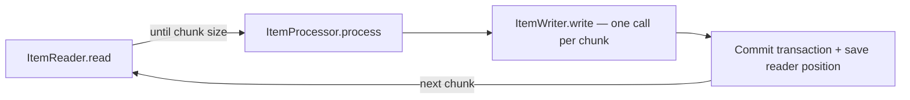
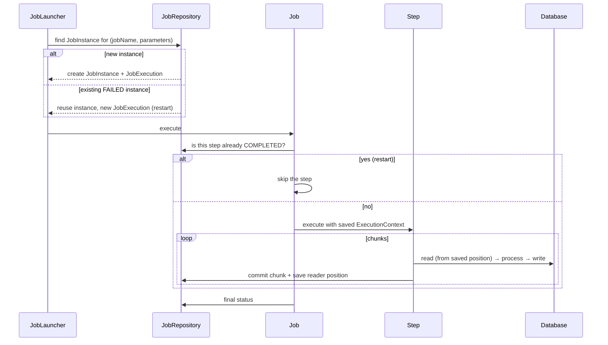
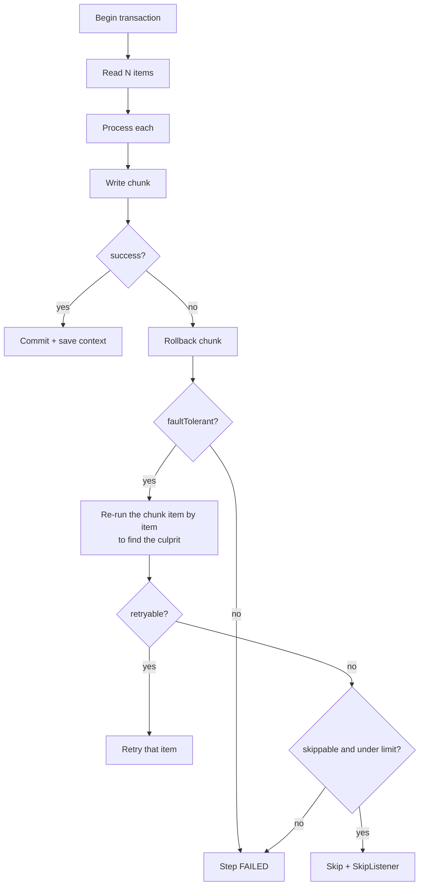
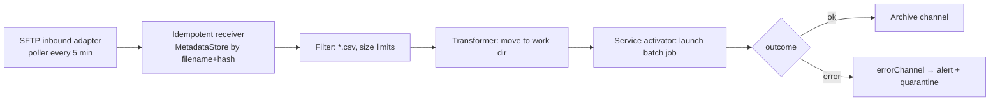
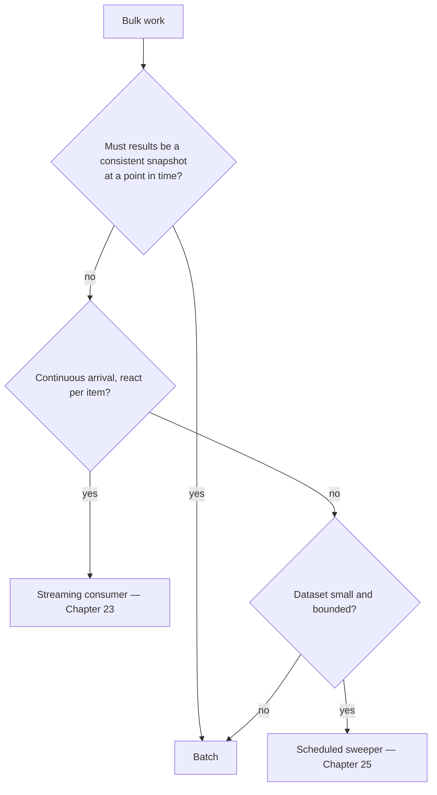

# 33 · Spring Batch & Spring Integration

## 1. Introduction & Why It Matters

Not everything is a request. The grocery platform runs a second, quieter system behind the API:

- **Weekly seller settlement**: 14,000 sellers, ~2.8 million order lines, commission and TDS calculations, a payout file for the bank, and a settlement report per seller. It must be restartable — failing at seller 9,000 cannot mean redoing 9,000.
- **Catalog feed ingestion**: sellers drop CSV files on SFTP, up to 400,000 rows each, with malformed rows that must be rejected individually rather than failing the file.
- **Razorpay reconciliation**: a daily settlement file matched against our payment records; mismatches become finance tickets.
- **Monthly GST reports**: aggregate, format, archive, and never produce a partial file.

Writing these as a `@Scheduled` method with a `for` loop works until the day it doesn't: a network blip at row 380,000 leaves the job half-applied with no idea where to resume, no record of what was skipped, and no way to re-run just the failed portion.

**Spring Batch** exists for exactly this: chunk-oriented processing with transactional boundaries, a job repository that records every execution, restartability, skip and retry policies, and partitioning for parallelism. **Spring Integration** covers the adjacent problem — moving data between systems (SFTP, files, JMS, HTTP, Kafka) with the Enterprise Integration Patterns, including polling, filtering, routing, aggregating and idempotent receipt.

This chapter builds both: a production settlement job, a resilient file-ingestion flow, and the operational wiring — Kubernetes CronJobs, metrics, alerts and tests.

### Who should read which section

| Band | Focus |
|---|---|
| B1 · 0–2 yrs | Parts 1, 2, 4 — jobs, steps, readers/writers |
| B2 · 2–5 yrs | Parts 2, 5 — chunking, skip/retry, listeners, file flows |
| B3 · 5–8 yrs | Parts 3, 5, 6 — restartability, partitioning, idempotency |
| B4 · 8–12 yrs | Parts 6, 8 — batch platform, operations, capacity |
| B5 · 12–15+ yrs | Parts 8, 9 — when batch, when streaming, when neither |

---

## 2. Core Concepts

### 2.1 Spring Batch domain model

| Concept | Meaning |
|---|---|
| **Job** | A named batch process composed of steps |
| **Step** | One phase: chunk-oriented (read/process/write) or a tasklet (do one thing) |
| **JobParameters** | Inputs that **identify** an execution (`runDate`, `sellerBatch`) |
| **JobInstance** | A job + its identifying parameters — one logical run |
| **JobExecution / StepExecution** | An attempt at that instance, with status and counts |
| **JobRepository** | Persistence for all of the above (your database) |
| **ExecutionContext** | Key-value state saved per execution — how restart knows where to resume |
| **JobLauncher / JobOperator** | Start, restart, stop, query |

Restart works because of two facts: a `JobInstance` is identified by its parameters, and readers save their position in the `ExecutionContext` at every chunk commit.

### 2.2 Chunk-oriented processing



The chunk size is the transaction boundary: 500 items read and processed, written once, committed once. Small chunks mean more commits and slower throughput; large chunks mean more work lost on failure and longer locks (Chapter 16).

### 2.3 Readers, processors, writers

| Reader | Use |
|---|---|
| `JdbcPagingItemReader` | **Preferred** for SQL: restartable, safe with parallelism |
| `JdbcCursorItemReader` | Single-threaded streaming; holds a connection open |
| `JpaPagingItemReader` | When you need entities (beware of the persistence context) |
| `FlatFileItemReader` | CSV/fixed-width, with `LineMapper` and `FieldSetMapper` |
| `MultiResourceItemReader` | Many files as one stream |
| `KafkaItemReader` | Consume a topic range as a batch |

| Writer | Use |
|---|---|
| `JdbcBatchItemWriter` | Batched JDBC inserts/updates (Chapter 12) |
| `FlatFileItemWriter` | Output files (payout files, reports) |
| `CompositeItemWriter` | Write to several destinations |
| `ClassifierCompositeItemWriter` | Route items to different writers |

Processors transform, enrich or **filter** (returning `null` drops the item).

### 2.4 Failure handling

| Policy | Meaning |
|---|---|
| **Skip** | Tolerate bad items up to a limit (`skipLimit`), record them |
| **Retry** | Retry transient failures within the step |
| **Fault tolerance** | `faultTolerant()` enables both, with rollback and re-processing of the chunk item by item |
| **Listeners** | `SkipListener`, `ItemReadListener`, `StepExecutionListener` for reporting |
| **Restart** | Re-launch the same `JobInstance`; completed steps are skipped, the failing step resumes |

!!! warning "Skips are a business decision"
    "Skip up to 1,000 malformed rows" must be agreed with the business, and every skipped row must land in a rejects file with a reason. A silent skip is data loss.

### 2.5 Parallelism

| Technique | Scope |
|---|---|
| **Multi-threaded step** | Several threads over one reader — reader must be thread-safe; **breaks restartability** unless handled carefully |
| **Parallel flow** | Independent steps run concurrently |
| **Partitioning** | Split the data into partitions (by seller, date, id range), each with its own `StepExecution` — restartable and the usual choice |
| **Remote partitioning / chunking** | Partitions or chunks processed by other JVMs via messaging |

### 2.6 Spring Integration essentials

| Concept | Meaning |
|---|---|
| **Message** | Payload + headers |
| **Channel** | Direct (synchronous), Queue (buffered), PublishSubscribe, Executor |
| **Endpoint** | Transformer, filter, router, splitter, aggregator, service activator |
| **Adapter** | Inbound/outbound connectors: file, SFTP, JDBC, JMS, Kafka, HTTP, mail |
| **Gateway** | `@MessagingGateway` — a plain Java interface hiding the flow |
| **Poller** | How often an inbound adapter checks for work |
| **IntegrationFlow** | The Java DSL that wires the above |
| **Idempotent receiver** | A `MetadataStore`-backed filter that drops duplicates |

### 2.7 Batch or Integration or neither?

| Need | Tool |
|---|---|
| Process a large dataset with restart, skip, reporting | **Spring Batch** |
| Move/transform data between systems and protocols | **Spring Integration** |
| React to events one at a time, continuously | **Kafka consumer** (Chapter 23) |
| Sweep a table every minute | **`@Scheduled` + `SKIP LOCKED`** (Chapter 25) |
| One-off script | A CLI runner (Chapter 05) |

The platform uses all five. The mistake is using Batch for a 200-row sweep, or a hand-rolled loop for a 3-million-row settlement.

---

## 3. How It Works Internally

### 3.1 Job execution and restart



The `JobRepository` is why all this works — and why it needs its own tables in your database (created by Flyway, Chapter 14).

### 3.2 Chunk transaction and fault tolerance



The item-by-item replay after a chunk failure is why **processors and writers must be idempotent or side-effect-free**: an item may be processed more than once.

### 3.3 An integration flow



Spring Integration gives polling, retry, routing and error channels for free; the heavy data processing is delegated to Spring Batch.

---

## 4. Hands-On Code — Level 1 (Beginner)

### 4.1 Setup

```kotlin title="build.gradle.kts"
implementation("org.springframework.boot:spring-boot-starter-batch")
testImplementation("org.springframework.batch:spring-batch-test")
```

```sql title="db/migration/V80__spring_batch_schema.sql"
-- Copy the official schema-postgresql.sql from spring-batch-core, under version control.
create table batch_job_instance ( ... );
create table batch_job_execution ( ... );
-- ... (batch_job_execution_params, batch_step_execution, *_context, sequences)
```

```yaml title="application.yml"
spring:
  batch:
    jdbc:
      initialize-schema: never      # (1)!
    job:
      enabled: false                # (2)!
```

1. Batch tables are schema, and schema goes through Flyway (Chapter 14) — never auto-created in production.
2. Don't run jobs on application startup; jobs are launched explicitly (Level 4 uses CronJobs).

### 4.2 A first job

```java title="in/grocery/settlement/batch/SimpleSettlementJobConfig.java"
package in.grocery.settlement.batch;

import javax.sql.DataSource;
import org.springframework.batch.core.Job;
import org.springframework.batch.core.Step;
import org.springframework.batch.core.job.builder.JobBuilder;
import org.springframework.batch.core.repository.JobRepository;
import org.springframework.batch.core.step.builder.StepBuilder;
import org.springframework.batch.item.database.JdbcPagingItemReader;
import org.springframework.batch.item.database.builder.JdbcPagingItemReaderBuilder;
import org.springframework.context.annotation.Bean;
import org.springframework.context.annotation.Configuration;
import org.springframework.transaction.PlatformTransactionManager;

@Configuration(proxyBeanMethods = false)
class SimpleSettlementJobConfig {

    @Bean
    Job sellerSettlementJob(JobRepository jobRepository, Step calculateStep) {
        return new JobBuilder("sellerSettlementJob", jobRepository)              // (1)!
                .start(calculateStep)
                .build();
    }

    @Bean
    Step calculateStep(JobRepository jobRepository, PlatformTransactionManager txManager,
                       JdbcPagingItemReader<OrderLineRow> reader,
                       SettlementProcessor processor,
                       JdbcBatchItemWriter<SettlementRow> writer) {
        return new StepBuilder("calculateStep", jobRepository)                   // (2)!
                .<OrderLineRow, SettlementRow>chunk(500, txManager)              // (3)!
                .reader(reader)
                .processor(processor)
                .writer(writer)
                .build();
    }

    @Bean
    JdbcPagingItemReader<OrderLineRow> settlementReader(DataSource dataSource) {
        return new JdbcPagingItemReaderBuilder<OrderLineRow>()
                .name("settlementReader")                                        // (4)!
                .dataSource(dataSource)
                .selectClause("select ol.id, ol.seller_id, ol.sku, ol.quantity, ol.line_total")
                .fromClause("from order_line ol join customer_order o on o.id = ol.order_id")
                .whereClause("where o.status = 'DELIVERED' and o.delivered_at between :from and :to")
                .sortKeys(java.util.Map.of("id", org.springframework.data.domain.Sort.Direction.ASC))   // (5)!
                .pageSize(500)
                .rowMapper(new OrderLineRowMapper())
                .build();
    }
}
```

1. Spring Batch 5+ style: `JobBuilder` with the repository injected (the old `JobBuilderFactory` is gone).
2. Steps take the repository **and** a transaction manager explicitly.
3. Chunk size 500: the commit interval.
4. The reader **name** is the key under which its position is saved — required for restart.
5. A **deterministic sort key** is mandatory for paging readers: without it, pages overlap or skip rows.

### 4.3 Processor and writer

```java title="in/grocery/settlement/batch/SettlementProcessor.java"
@Component
class SettlementProcessor implements ItemProcessor<OrderLineRow, SettlementRow> {

    private final CommissionCalculator commissions;

    @Override
    public SettlementRow process(OrderLineRow line) {
        if (line.lineTotal().signum() == 0) {
            return null;                                                          // (1)!
        }
        var commission = commissions.forSeller(line.sellerId(), line.sku(), line.lineTotal());
        return new SettlementRow(line.sellerId(), line.id(), line.lineTotal(),
                commission.amount(), commission.tds(), line.lineTotal()
                        .subtract(commission.amount()).subtract(commission.tds()));
    }
}
```

1. Returning `null` **filters** the item out — it is neither written nor an error.

```java title="Writer"
@Bean
JdbcBatchItemWriter<SettlementRow> settlementWriter(DataSource dataSource) {
    return new JdbcBatchItemWriterBuilder<SettlementRow>()
            .dataSource(dataSource)
            .sql("""
                 insert into seller_settlement_line
                   (seller_id, order_line_id, gross_amount, commission, tds, net_amount, run_date)
                 values (:sellerId, :orderLineId, :gross, :commission, :tds, :net, :runDate)
                 on conflict (order_line_id, run_date) do nothing
                 """)                                                              // (1)!
            .beanMapped()
            .build();
}
```

1. **Idempotent write**: a chunk replayed after a failure (3.2) or a restarted job cannot create duplicates.

### 4.4 Launching and testing

```java title="SellerSettlementJobTest.java"
@SpringBatchTest                                                                   // (1)!
@SpringBootTest
@Import(ContainersConfig.class)
class SellerSettlementJobTest {

    @Autowired JobLauncherTestUtils jobLauncherTestUtils;

    @Test
    void settlesDeliveredOrders() throws Exception {
        seedDeliveredOrders(120);

        var params = new JobParametersBuilder()
                .addString("runDate", "2026-09-20")
                .addString("from", "2026-09-13").addString("to", "2026-09-19")
                .toJobParameters();

        JobExecution execution = jobLauncherTestUtils.launchJob(params);

        assertThat(execution.getExitStatus()).isEqualTo(ExitStatus.COMPLETED);
        assertThat(execution.getStepExecutions().iterator().next().getWriteCount()).isEqualTo(120);   // (2)!
    }
}
```

1. `@SpringBatchTest` provides `JobLauncherTestUtils` and `JobRepositoryTestUtils`.
2. Assert **counts**, not just status — a job that reads zero rows also "succeeds".

---

## 5. Hands-On Code — Level 2 (Intermediate) & Level 3 (Advanced)

### 5.1 Level 2 — File ingestion with skips and a rejects file

```java title="in/grocery/catalog/batch/CatalogImportJobConfig.java"
@Bean
Step importStep(JobRepository jobRepository, PlatformTransactionManager txManager,
                FlatFileItemReader<SellerProductLine> reader,
                CatalogValidatingProcessor processor,
                ItemWriter<SellerProductRow> writer,
                RejectsSkipListener skipListener) {
    return new StepBuilder("importStep", jobRepository)
            .<SellerProductLine, SellerProductRow>chunk(1000, txManager)
            .reader(reader)
            .processor(processor)
            .writer(writer)
            .faultTolerant()                                                          // (1)!
            .skip(FlatFileParseException.class)
            .skip(ValidationException.class)
            .skipLimit(1000)                                                          // (2)!
            .retry(TransientDataAccessException.class)
            .retryLimit(3)
            .listener(skipListener)                                                   // (3)!
            .build();
}

@Bean
@StepScope                                                                            // (4)!
FlatFileItemReader<SellerProductLine> catalogReader(
        @Value("#{jobParameters['inputFile']}") Resource inputFile) {
    return new FlatFileItemReaderBuilder<SellerProductLine>()
            .name("catalogReader")
            .resource(inputFile)
            .linesToSkip(1)
            .delimited().delimiter(",")
            .names("sku", "title", "brand", "mrp", "sellingPrice", "gstRate", "packSize")
            .fieldSetMapper(new SellerProductLineMapper())
            .build();
}
```

1. Fault tolerance turns a failing chunk into per-item handling.
2. Tolerate up to 1,000 bad rows in a 400,000-row file; beyond that the file itself is suspect and the job fails.
3. Every skip is recorded (next snippet).
4. `@StepScope` lets the reader take a **job parameter** — the file path for this run.

```java title="in/grocery/catalog/batch/RejectsSkipListener.java"
@Component
@StepScope
class RejectsSkipListener implements SkipListener<SellerProductLine, SellerProductRow> {

    private final RejectsFileWriter rejects;
    private final MeterRegistry meters;

    @Override
    public void onSkipInRead(Throwable t) {
        rejects.write("PARSE_ERROR", t.getMessage());                                  // (1)!
        meters.counter("grocery.catalog.import.skipped", "phase", "read").increment();
    }

    @Override
    public void onSkipInProcess(SellerProductLine item, Throwable t) {
        rejects.write(item.sku(), "VALIDATION: " + t.getMessage());                     // (2)!
        meters.counter("grocery.catalog.import.skipped", "phase", "process").increment();
    }

    @Override
    public void onSkipInWrite(SellerProductRow item, Throwable t) {
        rejects.write(item.sku(), "WRITE: " + t.getMessage());
        meters.counter("grocery.catalog.import.skipped", "phase", "write").increment();
    }
}
```

1. The rejects file goes back to the seller: "row 4,812: price must be positive". That's the feature, not a log line.
2. Validation reuses the Chapter 09 constraints, applied in the processor.

### 5.2 Level 2 — Multi-step jobs and flow control

```java title="Job with validation, import, summary and notification"
@Bean
Job catalogImportJob(JobRepository jobRepository,
                     Step validateFileStep, Step importStep, Step summaryStep, Step notifyStep) {
    return new JobBuilder("catalogImportJob", jobRepository)
            .validator(new CatalogJobParametersValidator())                             // (1)!
            .start(validateFileStep)
                .on("FAILED").to(notifyStep)                                            // (2)!
            .from(validateFileStep)
                .on("*").to(importStep)
            .next(summaryStep)
            .next(notifyStep)
            .end()
            .build();
}
```

1. Fail fast when required parameters are missing — better than discovering it 40 minutes in.
2. Conditional flow: a structurally invalid file skips the import and goes straight to notifying the seller.

```java title="A tasklet step"
@Bean
Step summaryStep(JobRepository jobRepository, PlatformTransactionManager txManager,
                 ImportSummaryService summaries) {
    return new StepBuilder("summaryStep", jobRepository)
            .tasklet((contribution, chunkContext) -> {                                  // (1)!
                var execution = chunkContext.getStepContext().getStepExecution().getJobExecution();
                summaries.write(execution.getJobParameters().getString("sellerId"),
                        execution.getExecutionContext());
                return RepeatStatus.FINISHED;
            }, txManager)
            .build();
}
```

1. Tasklets are for single actions: archive a file, refresh a materialized view, send a summary.

### 5.3 Level 3 — Restartability, done properly

```java title="Job parameters that identify a run"
var params = new JobParametersBuilder()
        .addString("runDate", runDate.toString())            // identifying          // (1)!
        .addString("sellerBatch", batchId)                   // identifying
        .addString("triggeredBy", user, false)               // non-identifying      // (2)!
        .toJobParameters();
```

1. Same identifying parameters → same `JobInstance` → a **restart**, resuming where it stopped.
2. Non-identifying parameters (marked `false`) can differ between attempts without creating a new instance.

| Requirement | Why |
|---|---|
| Deterministic reader ordering | Otherwise resumption skips or repeats rows |
| Idempotent writes (`on conflict do nothing`, natural keys) | Chunks are replayed on failure |
| No global mutable state between chunks | The step may resume in a new JVM |
| `allowStartIfComplete(false)` (default) for expensive steps | Don't redo completed work |
| Save custom position in `ExecutionContext` | For custom readers |

```java title="A restart test — the one that matters"
@Test
void resumesFromWhereItFailed() throws Exception {
    seedDeliveredOrders(1_000);
    failWriterAtItem(600);                                                             // (1)!

    var params = params("2026-09-20");
    JobExecution first = jobLauncherTestUtils.launchJob(params);
    assertThat(first.getStatus()).isEqualTo(BatchStatus.FAILED);
    long writtenFirst = writeCount(first);

    allowWriterToSucceed();
    JobExecution second = jobLauncherTestUtils.launchJob(params);                      // (2)!

    assertThat(second.getStatus()).isEqualTo(BatchStatus.COMPLETED);
    assertThat(settlementRepository.count()).isEqualTo(1_000);                         // (3)!
    assertThat(writeCount(second)).isLessThan(1_000 - writtenFirst + 500);             // (4)!
}
```

1. Inject a failure mid-run.
2. Same parameters → restart, not a fresh instance.
3. **Exactly 1,000 rows** — no duplicates from the replayed chunk.
4. The second run did substantially less work — proof that resumption actually happened.

### 5.4 Level 3 — Partitioning

```java title="in/grocery/settlement/batch/PartitionedSettlementConfig.java"
@Bean
Step partitionedCalculateStep(JobRepository jobRepository, Step calculateStep,
                              Partitioner sellerPartitioner, TaskExecutor batchTaskExecutor) {
    return new StepBuilder("partitionedCalculateStep", jobRepository)
            .partitioner("calculateStep", sellerPartitioner)                            // (1)!
            .step(calculateStep)
            .gridSize(8)                                                                // (2)!
            .taskExecutor(batchTaskExecutor)
            .build();
}

@Bean
Partitioner sellerPartitioner(JdbcClient jdbc) {
    return gridSize -> {
        List<String> sellerIds = jdbc.sql("select id from seller where active = true").query(String.class).list();
        var partitions = new HashMap<String, ExecutionContext>();
        var chunks = partitionEvenly(sellerIds, gridSize);                              // (3)!
        for (int i = 0; i < chunks.size(); i++) {
            var context = new ExecutionContext();
            context.put("sellerIds", chunks.get(i));
            partitions.put("partition-" + i, context);
        }
        return partitions;
    };
}

@Bean
@StepScope
JdbcPagingItemReader<OrderLineRow> partitionedReader(
        DataSource dataSource,
        @Value("#{stepExecutionContext['sellerIds']}") List<String> sellerIds) {         // (4)!
    return new JdbcPagingItemReaderBuilder<OrderLineRow>()
            .name("partitionedSettlementReader")
            .dataSource(dataSource)
            .selectClause("select ...")
            .fromClause("from order_line ol join customer_order o on o.id = ol.order_id")
            .whereClause("where ol.seller_id in (:sellerIds) and o.status = 'DELIVERED'")
            .parameterValues(java.util.Map.of("sellerIds", sellerIds))
            .sortKeys(java.util.Map.of("id", Sort.Direction.ASC))
            .pageSize(500)
            .rowMapper(new OrderLineRowMapper())
            .build();
}
```

1. Each partition gets its own `StepExecution` — so each is individually restartable.
2. Eight concurrent partitions. **Check the database**: 8 partitions × a pooled connection each must fit the pool and the database's capacity (Chapter 12).
3. Partition by seller so that all of one seller's lines stay together — settlement is per seller, and splitting a seller across partitions would break the aggregation.
4. Partition input arrives via the step execution context.

!!! tip "Partition by a natural business key"
    Partitioning by id ranges is simplest but can produce wildly uneven work (one seller with 400,000 lines). Partition by seller and balance the groups by recent line counts.

### 5.5 Level 3 — Spring Integration: SFTP feed pickup

```kotlin title="build.gradle.kts"
implementation("org.springframework.boot:spring-boot-starter-integration")
implementation("org.springframework.integration:spring-integration-sftp")
implementation("org.springframework.integration:spring-integration-file")
```

```java title="in/grocery/catalog/integration/SellerFeedFlow.java"
package in.grocery.catalog.integration;

import java.io.File;
import java.time.Duration;
import org.springframework.context.annotation.Bean;
import org.springframework.context.annotation.Configuration;
import org.springframework.integration.dsl.IntegrationFlow;
import org.springframework.integration.dsl.Pollers;
import org.springframework.integration.handler.advice.IdempotentReceiverInterceptor;
import org.springframework.integration.sftp.dsl.Sftp;

@Configuration(proxyBeanMethods = false)
class SellerFeedFlow {

    @Bean
    IntegrationFlow sellerFeedInbound(SessionFactory<SftpClient.DirEntry> sftp,
                                      CatalogJobLauncher jobLauncher,
                                      IdempotentReceiverInterceptor idempotency) {
        return IntegrationFlow
                .from(Sftp.inboundAdapter(sftp)
                                .remoteDirectory("/incoming/catalog")
                                .localDirectory(new File("/work/catalog"))
                                .filter(new SftpSimplePatternFileListFilter("*.csv"))     // (1)!
                                .deleteRemoteFiles(false)
                                .preserveTimestamp(true),
                        e -> e.poller(Pollers.fixedDelay(Duration.ofMinutes(5))
                                .maxMessagesPerPoll(5)                                    // (2)!
                                .errorChannel("feedErrorChannel")))
                .filter(File.class, file -> file.length() > 0 && file.length() < 200_000_000,
                        e -> e.discardChannel("quarantineChannel"))                        // (3)!
                .handle(jobLauncher::launchCatalogImport, e -> e.advice(idempotency))      // (4)!
                .channel("archiveChannel")
                .get();
    }

    @Bean
    IdempotentReceiverInterceptor idempotentFeedReceiver(MetadataStore metadataStore) {
        var selector = new MetadataStoreSelector(
                message -> "feed:" + ((File) message.getPayload()).getName(),               // (5)!
                message -> String.valueOf(((File) message.getPayload()).lastModified()),
                metadataStore);
        var interceptor = new IdempotentReceiverInterceptor(selector);
        interceptor.setDiscardChannelName("duplicateChannel");
        return interceptor;
    }
}
```

1. Only CSVs; other files are ignored rather than crashing the flow.
2. Bounded work per poll — five large files at once is enough.
3. Empty or absurdly large files are quarantined for a human, not processed.
4. The handler launches the **batch job**; Integration moves data, Batch processes it.
5. **Idempotent receiver**: the same filename with the same timestamp is processed once, even if the adapter re-reads it after a crash. Back the `MetadataStore` with JDBC or Redis so it survives restarts and is shared across pods.

```java title="Error channel"
@Bean
IntegrationFlow feedErrors() {
    return IntegrationFlow.from("feedErrorChannel")
            .handle(message -> {                                                           // (1)!
                var error = (MessagingException) message.getPayload();
                meters.counter("grocery.feed.errors").increment();
                alerts.raise("seller-feed-error", error.getMessage());
                quarantine.move(error.getFailedMessage());
            })
            .get();
}
```

1. Every flow needs an error channel; without one, failures disappear into a poller's logs.

### 5.6 Level 3 — Gateways: hiding the flow

```java title="in/grocery/catalog/integration/FeedGateway.java"
@MessagingGateway                                                                          // (1)!
public interface FeedGateway {

    @Gateway(requestChannel = "manualFeedChannel")
    ImportResult importNow(File file);
}
```

1. Business code calls `feedGateway.importNow(file)` — a plain method. The messaging machinery stays behind the interface, which keeps Spring Integration from leaking into the domain (Chapter 37's boundary thinking).

---

## 6. Hands-On Code — Level 4 (Expert / Production)

### 6.1 The settlement job, production shape


```java title="in/grocery/settlement/batch/ReconciliationStep.java"
@Bean
Step reconcileStep(JobRepository jobRepository, PlatformTransactionManager txManager,
                   SettlementRepository settlements, JdbcClient jdbc) {
    return new StepBuilder("reconcileStep", jobRepository)
            .tasklet((contribution, chunkContext) -> {
                String runDate = runDateOf(chunkContext);
                BigDecimal lineSum = settlements.sumNetAmount(runDate);
                BigDecimal payoutSum = settlements.sumPayouts(runDate);
                if (lineSum.compareTo(payoutSum) != 0) {                                    // (1)!
                    throw new SettlementMismatchException(
                            "Lines total %s but payouts total %s for %s".formatted(lineSum, payoutSum, runDate));
                }
                contribution.getStepExecution().getExecutionContext()
                        .put("settlementTotal", lineSum.toPlainString());                   // (2)!
                return RepeatStatus.FINISHED;
            }, txManager)
            .build();
}
```

1. **Fail the job rather than pay out wrong numbers.** Money jobs need an internal consistency check before producing an artifact anyone acts on.
2. Recorded in the execution context so the summary and alerts can report it.

```java title="Publishing the result (never a direct call to other services)"
@Bean
Step publishStep(JobRepository jobRepository, PlatformTransactionManager txManager, OutboxWriter outbox) {
    return new StepBuilder("publishStep", jobRepository)
            .tasklet((contribution, chunkContext) -> {
                String runDate = runDateOf(chunkContext);
                outbox.append("settlement", runDate, "SettlementCompleted",
                        new SettlementCompleted(runDate, totalOf(chunkContext)));            // (1)!
                return RepeatStatus.FINISHED;
            }, txManager)
            .build();
}
```

1. The outbox (Chapter 23) — the job's database transaction and the event stay atomic, and downstream services get the news with at-least-once delivery.

### 6.2 Running batch jobs in Kubernetes

```yaml title="k8s/settlement-cronjob.yaml"
apiVersion: batch/v1
kind: CronJob
metadata:
  name: seller-settlement
spec:
  schedule: "30 23 * * 6"                                                                    # (1)!
  timeZone: "Asia/Kolkata"
  concurrencyPolicy: Forbid                                                                  # (2)!
  startingDeadlineSeconds: 3600
  successfulJobsHistoryLimit: 7
  failedJobsHistoryLimit: 14
  jobTemplate:
    spec:
      backoffLimit: 0                                                                        # (3)!
      activeDeadlineSeconds: 14400
      template:
        spec:
          restartPolicy: Never
          containers:
            - name: settlement
              image: registry.grocery.in/grocery/settlement-service@sha256:...               # (4)!
              args:
                - "--spring.profiles.active=prod,batch"
                - "--spring.batch.job.name=sellerSettlementJob"                              # (5)!
                - "--runDate=$(RUN_DATE)"
              env:
                - name: RUN_DATE
                  value: "{{ now | date \"2006-01-02\" }}"
              resources:
                requests: { cpu: "2", memory: "3Gi" }
                limits: { memory: "3Gi" }
```

1. Saturday 23:30 **IST** — Kubernetes CronJobs support `timeZone` (1.27+); otherwise schedules run in UTC.
2. Never two settlement runs at once.
3. **No automatic retry**: a failed money job needs a human to look before restarting, and Spring Batch's restart is smarter than a fresh pod anyway.
4. The same image as the service (Chapter 29) — code and job logic never diverge.
5. Boot's `JobLauncherApplicationRunner` runs the named job and exits with a meaningful exit code.

```java title="Exit codes matter"
@Bean
ExitCodeGenerator batchExitCodeGenerator(JobExplorer explorer) {
    return () -> explorer.getLastJobExecution(...) .getStatus() == BatchStatus.COMPLETED ? 0 : 1;   // (1)!
}
```

1. A non-zero exit marks the Kubernetes Job failed, which is what alerting keys off. A job that logs an error and exits 0 is invisible.

### 6.3 Observability for batch

| Metric | Meaning | Alert |
|---|---|---|
| `spring.batch.job` (timer, tags: name, status) | Job duration and outcome | Any FAILED |
| `spring.batch.step` | Step duration | p95 growth over weeks |
| `spring.batch.item.read` / `.process` / `.write` | Throughput | Sudden drops |
| `grocery.catalog.import.skipped` | Rejected rows | Spike or > threshold |
| Business totals (settlement amount) | Correctness signal | Deviation vs last week |
| Job **not started** | Missed schedule | No execution by T+30 min |

```java title="Missed-run detection"
@Scheduled(cron = "0 0 2 * * SUN", zone = "Asia/Kolkata")
@SchedulerLock(name = "settlement-watchdog")                                                  // (1)!
void alertIfSettlementDidNotRun() {
    var last = jobExplorer.getJobInstances("sellerSettlementJob", 0, 1);
    if (last.isEmpty() || startedBefore(last.get(0), Duration.ofHours(6))) {
        alerts.page("settlement-missed", "No settlement run in the last 6 hours");            // (2)!
    }
}
```

1. ShedLock (Chapter 25) so only one pod checks.
2. **The silent failure is the dangerous one**: a CronJob that never fires produces no failed job and no alert unless you look for absence.

### 6.4 Batch platform conventions

| Convention | Rationale |
|---|---|
| One job per business outcome, named `<domain><Purpose>Job` | Findable in the repository and dashboards |
| Identifying parameters always include `runDate` | Restartable, and re-running a day is explicit |
| All writes idempotent (natural keys / `on conflict`) | Chunk replay and restarts are safe |
| Rejects always written to a file with reasons | Data quality is a deliverable |
| Money jobs end with a reconciliation step | Never produce an unchecked artifact |
| Results published via the outbox | No direct calls from batch to services |
| Batch runs in a separate pod with its own resources | Long jobs must not disturb request serving |
| Every job has a runbook: how to restart, how to skip, who to call | 2 a.m. clarity |

### 6.5 Choosing batch vs streaming



Settlement is batch (a weekly snapshot with a reconciliation guarantee). Search indexing is streaming (Chapter 22). Auto-cancelling unpaid orders is a sweeper. Getting this right saves far more effort than optimizing the wrong choice.

### 6.6 Testing batch jobs

```java title="What to test"
@Test void stepProcessesAndWritesExpectedCounts() { /* launchStep("calculateStep") */ }        // (1)!
@Test void malformedRowsAreSkippedAndReported() { /* skipCount, rejects file content */ }
@Test void jobRestartsFromFailurePointWithoutDuplicates() { /* 5.3 */ }
@Test void reconciliationFailsTheJobOnMismatch() { /* seed inconsistency → FAILED */ }         // (2)!
@Test void partitionsCoverAllSellersExactlyOnce() { /* union of partitions == all sellers */ } // (3)!
@Test void parametersValidatorRejectsMissingRunDate() { }
```

1. `JobLauncherTestUtils.launchStep("name")` tests one step in isolation — much faster than the whole job.
2. The guard rail deserves its own test; it is the one that prevents a wrong payout.
3. A partitioner bug that drops a seller is invisible in a green job — assert coverage explicitly.

```java title="Integration test with a realistic file"
@Test
void importsA50kRowFileWithinBudget() throws Exception {
    Path file = generateCsv(50_000, 120);                                                      // (1)!

    var execution = jobLauncherTestUtils.launchJob(params(file));

    assertThat(execution.getStatus()).isEqualTo(BatchStatus.COMPLETED);
    assertThat(skipCount(execution)).isEqualTo(120);
    assertThat(duration(execution)).isLessThan(Duration.ofMinutes(2));                          // (2)!
}
```

1. 50,000 rows including 120 deliberately malformed ones.
2. A **throughput budget**, like the startup and migration budgets in Chapters 29 and 14 — performance regressions in batch are otherwise discovered on a Saturday night.

---

## 7. Spring Boot 3 vs 4 & Migration

| Topic | Boot 3.5 / Batch 5 | Boot 4.x / Batch 6 |
|---|---|---|
| Builders | `JobBuilder`/`StepBuilder` with repository + tx manager | Same (verify signature changes) |
| `@EnableBatchProcessing` | Optional; Boot auto-configures | Same — adding it can **disable** auto-configuration (verify) |
| Job repository schema | Provided DDL per database | Verify schema changes between Batch 5 and 6 |
| `JobParameters` types | Typed parameters (Batch 5 changes) | Verify converter behaviour |
| Spring Integration | 6.x | 7.x (verify package/DSL changes) |
| Observability | `spring.batch.*` meters | Same (verify names) |

!!! danger "Batch schema upgrades are database migrations"
    A major Spring Batch upgrade may change the job repository schema. Plan it as a migration (Chapter 14), test restart of an in-flight job across versions, and prefer letting all jobs complete before upgrading.

### Migration checklist

- [ ] Review Batch 6 release notes for repository schema and API changes; migrate the schema via Flyway.
- [ ] Re-verify job parameter conversion (typed parameters changed in Batch 5).
- [ ] Re-run restart tests after the upgrade — this is the behaviour most likely to break silently.
- [ ] Check Spring Integration DSL compatibility and adapter package moves.
- [ ] Re-validate metric names used by dashboards and alerts.

---

## 8. Production Playbook

### Best practices

1. **Chunk size tuned deliberately** (hundreds to low thousands), balancing throughput against work lost on failure.
2. **Paging readers with a deterministic sort key**; `@StepScope` for parameterized readers.
3. **Idempotent writes** so chunk replay and restarts can't duplicate.
4. **Skips are bounded, recorded and reported** back to the data's owner.
5. **Restartability tested**, not assumed.
6. **Partition by a business key**, sized against database capacity.
7. **Money jobs reconcile before producing artifacts**, and publish via the outbox.
8. **Run as Kubernetes CronJobs** with `Forbid` concurrency, meaningful exit codes and no blind retries.
9. **Alert on failure *and* absence**; track business totals as a correctness signal.
10. **Spring Integration moves data; Spring Batch processes it** — with an idempotent receiver and an error channel.

### Anti-patterns

❌ A `@Scheduled` loop over three million rows — no restart, no skip handling, no visibility.

❌ Non-deterministic reader ordering with paging — silently skipped or duplicated rows.

❌ Unbounded `skipLimit` (or skips with no rejects file) — quiet data loss.

❌ Chunk size 1 (glacial) or 100,000 (long locks, huge rollbacks).

❌ Multi-threaded steps over a non-thread-safe reader, breaking restart.

❌ Calling other services directly from a job instead of publishing events.

❌ Jobs that exit 0 on failure — invisible to Kubernetes and alerting.

❌ Running heavy jobs in the request-serving pods.

❌ Auto-creating the batch schema in production.

❌ Using Spring Integration where a five-line Kafka consumer would do.

### Troubleshooting

| Symptom | Cause | Fix |
|---|---|---|
| Restart reprocesses everything | New `JobInstance` (parameters differed) | Keep identifying parameters stable |
| Duplicate rows after restart | Non-idempotent writes | Natural keys / `on conflict do nothing` |
| Rows missing with paging reader | No/duplicate sort key, or data changing mid-run | Unique sort key; snapshot or filter by a fixed window |
| Job hangs | Long transaction, lock contention, external call in a chunk | Smaller chunks; move remote calls out (Chapter 16) |
| `OutOfMemoryError` | Huge chunk, accumulating processor state, JPA persistence context growth | Reduce chunk size; clear the context; use JDBC readers |
| Partitions uneven, one runs for hours | Range partitioning over skewed data | Partition by business key with balanced groups |
| Skips silently swallow bad data | No `SkipListener` | Rejects file + metrics + threshold alert |
| Job didn't run at all | CronJob misconfiguration, timezone, cluster maintenance | Absence alerting (6.3) |
| Two runs collided | `concurrencyPolicy: Allow` | `Forbid` + ShedLock for in-app schedules |
| Integration flow stops processing | Poller error with no error channel; stuck lock in the metadata store | Error channel; inspect/clear metadata store entries |

### Production checklist

- [ ] Batch schema under Flyway; `initialize-schema: never`
- [ ] Jobs launched explicitly (`spring.batch.job.enabled: false`), never on startup
- [ ] Identifying parameters include a run date; restart tested
- [ ] Idempotent writes verified by a restart test
- [ ] Skips bounded with a rejects file and alerting
- [ ] Reconciliation step for financial jobs
- [ ] Results published via the outbox
- [ ] CronJob with `Forbid`, resource limits, correct exit codes
- [ ] Metrics, failure alerts **and** missed-run alerts
- [ ] Runbook per job (restart, skip, escalation)

---

## 9. Interview Questions & Answers

### B1 · 0–2 years

??? question "B1 · What problem does Spring Batch solve?"
    **Short answer:** Processing large volumes reliably: chunked transactions, restart after failure, skip and retry policies, execution history and reporting — none of which a plain loop provides.

??? question "B1 · What is a chunk?"
    **Short answer:** A group of items read and processed, then written and committed together. The chunk size is the transaction boundary.

??? question "B1 · What are `JobParameters` for?"
    **Short answer:** They identify a job instance (e.g. `runDate`), which is how Spring Batch knows whether a launch is a new run or a restart.

??? question "B1 · What does returning `null` from an `ItemProcessor` do?"
    **Short answer:** Filters the item — it is not written and is not an error.

??? question "B1 · What is Spring Integration used for?"
    **Short answer:** Moving and transforming messages between systems using Enterprise Integration Patterns — polling files/SFTP, routing, filtering, aggregating, adapting protocols.

### B2 · 2–5 years

??? question "B2 · How does restart work?"
    **Short answer:** The same identifying parameters resolve to the same `JobInstance`; completed steps are skipped and the failing step resumes from the reader position saved in the `ExecutionContext` at the last chunk commit.

??? question "B2 · How do you choose a chunk size?"
    **Short answer:** Large enough to amortize commit cost (hundreds to low thousands), small enough to limit work lost on failure, lock duration and memory. Measure with a realistic dataset.

??? question "B2 · Cursor or paging reader?"
    **Short answer:** Paging for restartability and parallelism (with a deterministic unique sort key); cursor for single-threaded streaming where holding a connection open is acceptable.

??? question "B2 · How do you handle malformed rows in a file import?"
    **Short answer:** `faultTolerant()` with `skip(...)` and a `skipLimit`, plus a `SkipListener` writing every rejection with a reason to a rejects file, and metrics/alerts on skip counts.

??? question "B2 · How do you run a batch job in Kubernetes?"
    **Short answer:** As a CronJob running the same image in job mode (`spring.batch.job.name`), with `concurrencyPolicy: Forbid`, resource limits, a proper exit code and alerting on failure and absence.

??? question "B2 · When would you use Spring Integration instead of plain code?"
    **Short answer:** For protocol adapters and EIP-shaped flows — SFTP polling, filtering, routing, aggregation, retry and error channels — where hand-written equivalents would be substantial and fragile.

### B3 · 5–8 years

??? question "B3 · What makes a batch job safely restartable?"
    **Short answer:** Deterministic reader ordering, idempotent writes, no dependence on mutable global state, identifying parameters kept stable, and readers that persist their position. Prove it with a fail-mid-run-then-restart test asserting exact final counts.

??? question "B3 · Compare multi-threaded steps and partitioning."
    **Short answer:** A multi-threaded step shares one reader across threads (fast, but the reader must be thread-safe and restartability suffers). Partitioning splits data into independent `StepExecution`s, each restartable — the safer default, and the basis for remote partitioning.

??? question "B3 · Why must processors and writers tolerate re-processing?"
    **Short answer:** On chunk failure in fault-tolerant mode, Spring Batch replays the chunk item by item to isolate the offender, so items can be processed more than once. Side effects must be idempotent.

??? question "B3 · How do you prevent a batch job from destabilizing the online system?"
    **Short answer:** Run it in separate pods with its own resources and connection pool, limit partition concurrency against database capacity, schedule off-peak, keep transactions short, and use read replicas for read-heavy phases (Chapter 12).

??? question "B3 · What is an idempotent receiver in Spring Integration?"
    **Short answer:** An interceptor backed by a `MetadataStore` that discards messages already seen (keyed by, say, filename plus timestamp) — the integration-flow equivalent of the inbox pattern (Chapter 23).

### B4 · 8–12 years

??? question "B4 · Design the weekly settlement job for 14,000 sellers."
    **Short answer:** Partitioned by seller, idempotent writes keyed by `(order_line_id, run_date)`, chunked at ~500, a reconciliation step that fails the job on mismatch, a payout file produced only after reconciliation, results published via the outbox, run as a CronJob with `Forbid`, with metrics on totals and alerts on failure, absence and deviation from last week.

??? question "B4 · Batch, streaming, or a sweeper — how do you decide?"
    **Short answer:** Batch when a consistent point-in-time snapshot and reporting/restart guarantees matter; streaming when items arrive continuously and can be handled independently; sweepers for small bounded datasets on a schedule. Most platforms need all three, chosen per use case.

??? question "B4 · How do you operate dozens of batch jobs?"
    **Short answer:** Shared conventions (naming, parameters, idempotency, rejects, outbox), a job catalog with owners and runbooks, uniform dashboards and alerts including missed runs, standard CronJob templates, and periodic reviews of duration trends against their windows.

### B5 · 12–15+ years

??? question "B5 · Is batch processing obsolete in an event-driven architecture?"
    **Short answer:** No. Reconciliation, regulatory reporting, settlements and bulk corrections need point-in-time consistency, restartability and auditable artifacts that stream processing doesn't naturally provide. Events and batch coexist: events keep things current, batch proves they're correct.

??? question "B5 · What's the biggest risk in financial batch jobs?"
    **Short answer:** Silent wrongness — a job that completes successfully with bad numbers. Mitigate with reconciliation steps, business-total monitoring against expectations, dual controls on payout files, immutable audit records and rehearsed restart procedures.

### Scenario questions

??? example "Scenario · Settlement failed at 78% and the restart paid some sellers twice"
    Writes used plain inserts, so the replayed chunk and the restarted step duplicated rows. Fixes: unique key `(order_line_id, run_date)` with `on conflict do nothing`, a restart test asserting exact row counts, a reconciliation step comparing line totals against payouts, and a correction run for the affected sellers.

??? example "Scenario · A seller's 400,000-row feed fails after 40 minutes every night"
    One malformed row aborted the whole job because fault tolerance wasn't enabled, and the reader wasn't restartable (no unique sort key). Fixes: `faultTolerant()` with skips and a rejects file returned to the seller, a paging reader with a unique sort key, a throughput budget test with a 50,000-row file, and alerting on skip counts.

### Coding exercise

!!! example "Exercise · Razorpay reconciliation job"
    Daily, read the gateway settlement CSV, match each row against our `payment` table by `payment_id`, mark matched payments reconciled, and write mismatches (missing on either side, amount differences) to a report. Must be restartable, idempotent, skip malformed rows up to 100, and fail if more than 1% of rows are unmatched.

??? success "Solution"
    ```java title="ReconciliationJobConfig.java"
    @Bean
    Job reconciliationJob(JobRepository jobRepository, Step matchStep, Step assessStep) {
        return new JobBuilder("razorpayReconciliationJob", jobRepository)
                .validator(parameters -> requireNonBlank(parameters, "settlementDate", "inputFile"))
                .start(matchStep)
                .next(assessStep)                                                     // (1)!
                .build();
    }

    @Bean
    Step matchStep(JobRepository jobRepository, PlatformTransactionManager txManager,
                   FlatFileItemReader<GatewayRow> reader, ReconciliationProcessor processor,
                   ItemWriter<ReconciliationResult> writer, MismatchSkipListener skips) {
        return new StepBuilder("matchStep", jobRepository)
                .<GatewayRow, ReconciliationResult>chunk(500, txManager)
                .reader(reader).processor(processor).writer(writer)
                .faultTolerant()
                .skip(FlatFileParseException.class).skipLimit(100)
                .listener(skips)
                .build();
    }
    ```

    1. Assessment is a **separate step** so the 1% rule is evaluated once over the whole run, not per chunk.

    ```java title="ReconciliationProcessor.java"
    @Component
    class ReconciliationProcessor implements ItemProcessor<GatewayRow, ReconciliationResult> {

        private final PaymentRepository payments;

        @Override
        public ReconciliationResult process(GatewayRow row) {
            var payment = payments.findByGatewayPaymentId(row.paymentId());
            if (payment.isEmpty()) {
                return ReconciliationResult.missingLocally(row);                       // (1)!
            }
            if (payment.get().amountPaise() != row.amountPaise()) {
                return ReconciliationResult.amountMismatch(row, payment.get());
            }
            return ReconciliationResult.matched(row, payment.get());
        }
    }
    ```

    1. Mismatches are **results**, not exceptions — they belong in the report, and the job continues.

    ```java title="ReconciliationWriter.java (idempotent)"
    @Bean
    ItemWriter<ReconciliationResult> reconciliationWriter(JdbcClient jdbc, MismatchReportWriter report) {
        return results -> {
            for (var result : results) {
                jdbc.sql("""
                        insert into payment_reconciliation (payment_id, settlement_date, outcome, detail)
                        values (:paymentId, :date, :outcome, :detail)
                        on conflict (payment_id, settlement_date) do update
                          set outcome = excluded.outcome, detail = excluded.detail
                        """)                                                            // (1)!
                    .params(result.asParams()).update();
                if (result.isMismatch()) {
                    report.write(result);                                               // (2)!
                }
            }
        };
    }
    ```

    1. Upsert keyed by `(payment_id, settlement_date)` — restart- and replay-safe.
    2. The mismatch report is regenerated from the table at the end of the run, so a restart doesn't produce a duplicated file.

    ```java title="AssessStep — the 1% rule"
    @Bean
    Step assessStep(JobRepository jobRepository, PlatformTransactionManager txManager, JdbcClient jdbc) {
        return new StepBuilder("assessStep", jobRepository)
                .tasklet((contribution, chunkContext) -> {
                    String date = dateOf(chunkContext);
                    long total = jdbc.sql("select count(*) from payment_reconciliation where settlement_date = :d")
                            .param("d", date).query(Long.class).single();
                    long mismatched = jdbc.sql("""
                            select count(*) from payment_reconciliation
                            where settlement_date = :d and outcome <> 'MATCHED'
                            """).param("d", date).query(Long.class).single();
                    double ratio = total == 0 ? 0 : (double) mismatched / total;
                    meters.gauge("grocery.reconciliation.mismatch.ratio", ratio);       // (1)!
                    if (ratio > 0.01) {
                        throw new ReconciliationThresholdExceededException(mismatched, total);
                    }
                    return RepeatStatus.FINISHED;
                }, txManager)
                .build();
    }
    ```

    1. The ratio is a **business health metric** even when the job passes; a slow upward drift is an early warning that something in the payment flow is diverging.

    ```java title="Tests"
    @Test void matchesPaymentsAndMarksReconciled() { }
    @Test void mismatchesAreReportedButDoNotFailTheStep() { }
    @Test void jobFailsWhenMismatchRatioExceedsOnePercent() { }
    @Test void restartDoesNotDuplicateReconciliationRows() { }
    @Test void malformedRowsAreSkippedUpToTheLimit() { }
    ```

---

## Key Takeaways

- **Spring Batch is for bulk work that must be restartable, auditable and tolerant of bad data** — chunks, job repository, skip/retry, partitioning.
- **Restartability depends on three things**: stable identifying parameters, deterministic reader ordering, idempotent writes. Test it.
- **Skips must be bounded and reported**; a rejects file is a deliverable.
- **Partition by business key**, sized against database capacity.
- **Financial jobs reconcile before producing artifacts** and publish results via the outbox.
- **Spring Integration moves data** (SFTP, files, protocols) with idempotent receipt and error channels; Batch processes it.
- **Run as CronJobs** with `Forbid`, real exit codes, and alerts on failure **and absence**.
- Choose deliberately between **batch, streaming and sweepers**.

## Further Reading

- Spring Batch Reference — domain model, configuring steps, fault tolerance, scaling and partitioning, testing
- Spring Boot Reference — *Batch Applications* (job launching, exit codes, schema)
- Spring Integration Reference — Java DSL, channel adapters, idempotent receiver, error handling
- *Enterprise Integration Patterns* (Hohpe & Woolf) — the vocabulary Spring Integration implements

---

[:material-arrow-left: 32 GraphQL, gRPC, WebSocket & SSE](32-graphql-grpc-websocket-sse.md) · [34 Performance Engineering :material-arrow-right:](34-performance-engineering.md)
