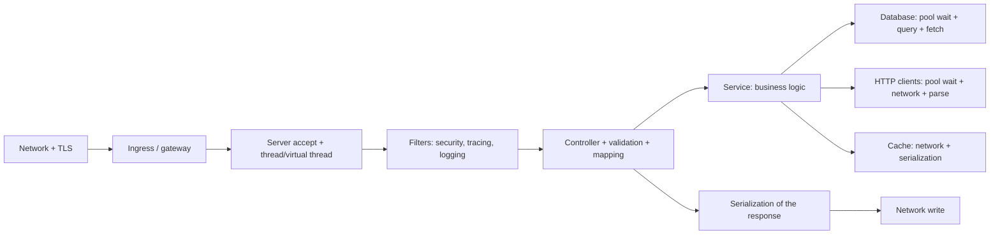
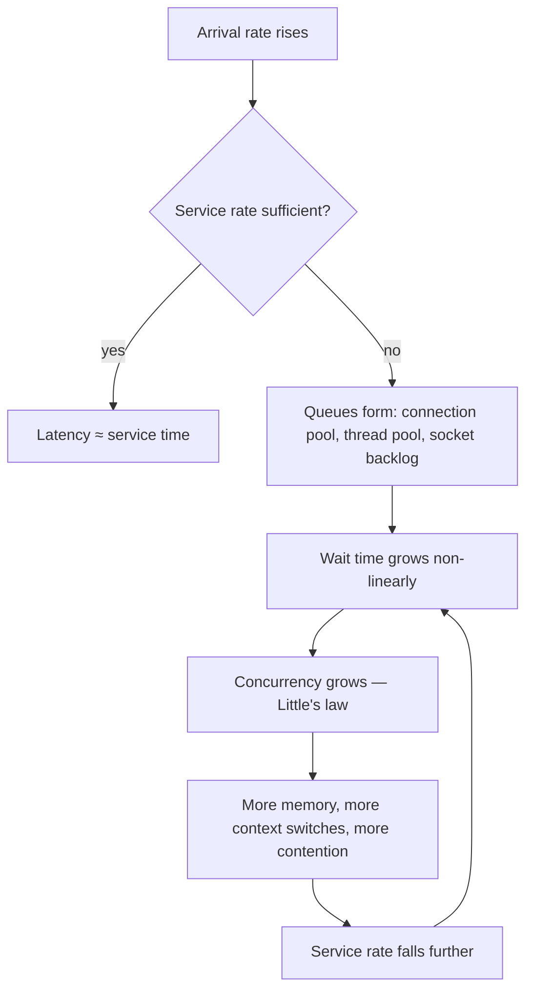
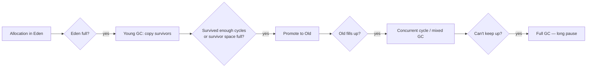
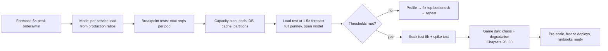
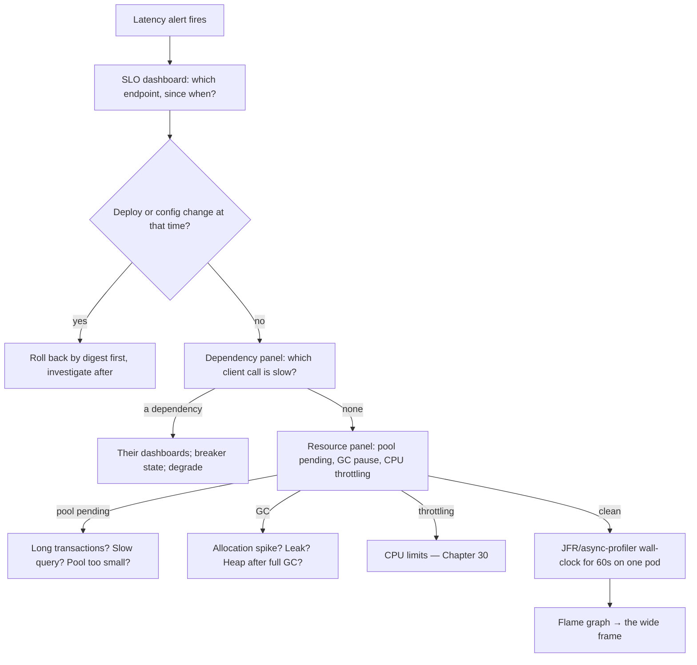

# 34 · Performance Engineering

## 1. Introduction & Why It Matters

Two weeks before Diwali, someone asks: "can we handle 5× traffic?" The honest answer is a number, not a feeling — and producing that number is what performance engineering does.

Most performance work in the wild is guesswork: a developer suspects the JSON serializer, spends three days optimizing it, and ships a 2% improvement while the real cost was an N+1 query (Chapter 13) and a missing index (Chapter 12). The discipline that avoids this is boring and reliable:

1. **Define the target** — a latency budget per endpoint and a throughput goal.
2. **Measure under realistic load** — with an open-model load test, not a laptop benchmark.
3. **Find the bottleneck** — profiler and flame graph, not intuition.
4. **Fix the top item**, then re-measure. The bottleneck moves; the second-biggest problem is now the biggest.
5. **Guard the gain** — a performance test in CI so it doesn't quietly regress.

This chapter covers that loop concretely: latency budgets and Little's law, load testing (including the coordinated-omission trap that makes most load tests lie), JFR and async-profiler with flame graphs, JVM memory and GC analysis, heap dumps and leak hunting, the Spring-specific bottlenecks that account for most real incidents, JMH for the rare micro-benchmark, capacity planning and sale-day readiness.

### Who should read which section

| Band | Focus |
|---|---|
| B1 · 0–2 yrs | Parts 1, 2, 4 — percentiles, a first load test, obvious bottlenecks |
| B2 · 2–5 yrs | Parts 2, 5 — profiling, GC basics, common Spring problems |
| B3 · 5–8 yrs | Parts 3, 5, 6 — flame graphs, allocation, leak analysis, tail latency |
| B4 · 8–12 yrs | Parts 6, 8 — capacity planning, budgets, regression gates |
| B5 · 12–15+ yrs | Parts 8, 9 — performance as an organizational practice |

---

## 2. Core Concepts

### 2.1 Measure the right numbers

| Metric | Why |
|---|---|
| **p50 / p95 / p99 / p99.9** | Averages hide everything; a 40 ms average with a 3 s p99 means thousands of angry customers |
| **Throughput** (req/s) at a given latency | "Fast" is meaningless without load |
| **Concurrency** | The link between the two (2.2) |
| **Error rate under load** | Degradation often appears as errors before latency |
| **Saturation** (queue depth, pool waits) | The leading indicator — it rises before latency does |

RED for services (Rate, Errors, Duration), USE for resources (Utilization, Saturation, Errors) — the two checklists from Chapter 27, used here as a diagnostic order.

### 2.2 Little's law

**L = λ × W**: concurrency = throughput × latency.

- 2,000 req/s at 50 ms → 100 requests in flight.
- Those 100 requests each hold a database connection for 20 ms → 40 connections needed (Chapter 12).
- If latency doubles to 100 ms at the same arrival rate, concurrency doubles to 200 — which is why **latency growth causes resource exhaustion**, not the other way round.

This one formula sizes thread pools, connection pools, bulkheads and partition counts.

### 2.3 Utilization and the latency cliff

Queueing theory, simplified: as utilization approaches 100%, queue length (and latency) grows non-linearly.

| Utilization | Relative queue wait |
|---|---|
| 50% | 1× |
| 70% | ~2.3× |
| 80% | ~4× |
| 90% | ~9× |
| 95% | ~19× |

Which is why capacity plans target **60–70%** at peak, not 95%. The last 30% is headroom for spikes, deploys and losing a zone.

### 2.4 Latency budgets

```text title="Example"
Checkout p99 target: 2000 ms
  gateway + network            120 ms
  auth (token validation)       10 ms
  pricing (2 attempts × 600)  1200 ms worst case  ← the dominant risk
  inventory                    500 ms
  database transactions        200 ms
  serialization + overhead      50 ms
```

Budgets make trade-offs explicit: if pricing worst-case doesn't fit, either its timeout shrinks, its retry disappears, or it moves out of the synchronous path (Chapters 19, 26).

### 2.5 Load test types

| Type | Question |
|---|---|
| **Smoke** | Does it work at all under a trickle? |
| **Load** | Does it meet the target at expected peak? |
| **Stress** | Where does it break, and how? |
| **Spike** | Can it survive a sudden 10× (flash sale, push notification)? |
| **Soak** | Does it degrade over 8 hours (leaks, fragmentation, log growth)? |
| **Breakpoint** | What is the maximum throughput per pod, for capacity math? |

!!! danger "Coordinated omission"
    A closed-model test (N virtual users, each sending the next request after the previous completes) **stops sending requests when the system is slow**, so it never measures the queueing that real users experience. Use an **open model** (constant or ramping arrival rate) so requests keep arriving regardless of response time. This one setting is the difference between a load test that predicts production and one that flatters it.

### 2.6 Profiling tools

| Tool | Use | Overhead |
|---|---|---|
| **JFR** (Java Flight Recorder) | Always-on production profiling: CPU, allocation, locks, GC, I/O | ~1–2% |
| **async-profiler** | CPU, allocation, lock and wall-clock flame graphs; no safepoint bias | ~1–3% |
| **Heap dumps + MAT/JOL** | Leak analysis, retained sizes | Pause to capture |
| **Micrometer metrics** | Continuous, aggregate (Chapter 27) | Negligible |
| **`EXPLAIN (ANALYZE, BUFFERS)`** | Where the database actually spends time | — |
| **JMH** | Micro-benchmarks of small, hot code | Offline only |

**Sampling profilers** (JFR, async-profiler) show where time goes with low overhead; **instrumenting** profilers distort the very hot paths you're measuring.

### 2.7 Flame graphs

```text title="Example"
width  = share of samples (time or allocations)
stacked = call depth
```

Read them top-down for "what is running" and look for **wide plateaus**: a single wide frame is the bottleneck. A flat, evenly-divided graph usually means the bottleneck is *not* CPU — it's I/O, locks or a downstream service (check wall-clock mode).

### 2.8 GC in one table

| Collector | Best for | Trade-off |
|---|---|---|
| **G1** (default) | General server workloads | Balanced pauses (target `MaxGCPauseMillis`) |
| **Generational ZGC** | Large heaps, low pause requirements | More CPU/memory overhead |
| Parallel | Batch throughput (Chapter 33) | Long pauses |
| Serial | Tiny containers | Single-threaded |

**Tune allocation before tuning GC.** Most "GC problems" are allocation-rate problems: the fix is producing less garbage, not a new flag.

---

## 3. How It Works Internally

### 3.1 Where a request's time goes



In practice, for a typical Spring service: **G and H dominate**, J matters for large payloads, and everything else is noise — which is why profiling before optimizing matters so much.

### 3.2 Latency under saturation



That feedback loop is why an overloaded system doesn't degrade gracefully by itself — and why load shedding (Chapter 26) exists.

### 3.3 GC and allocation



Key signals: **allocation rate** (MB/s), **promotion rate** (how much survives — high means objects live too long, often a cache or a big request buffer), and **pause time distribution**. Rising heap-after-full-GC over hours is the leak signature.

---

## 4. Hands-On Code — Level 1 (Beginner)

### 4.1 A first load test (open model)

```javascript title="perf/checkout.js (k6)"
import http from 'k6/http';
import { check, sleep } from 'k6';

export const options = {
  scenarios: {
    checkout: {
      executor: 'ramping-arrival-rate',          // (1)!
      startRate: 50,
      timeUnit: '1s',
      preAllocatedVUs: 200,
      maxVUs: 2000,                              // (2)!
      stages: [
        { target: 200, duration: '2m' },
        { target: 600, duration: '5m' },
        { target: 600, duration: '10m' },        // steady state
        { target: 0,   duration: '2m' },
      ],
    },
  },
  thresholds: {
    'http_req_duration{endpoint:checkout}': ['p(99)<2000', 'p(95)<800'],   // (3)!
    'http_req_failed': ['rate<0.001'],
  },
};

export default function () {
  const token = __ENV.TOKEN;
  const params = { headers: { Authorization: `Bearer ${token}` }, tags: { endpoint: 'checkout' } };

  const cart = http.post(`${__ENV.BASE}/api/v1/carts/${__ENV.CART}/items`,
      JSON.stringify({ sku: 'MILK-1L', quantity: 2 }), params);
  check(cart, { 'cart 200': (r) => r.status === 200 });

  const order = http.post(`${__ENV.BASE}/api/v1/orders`,
      JSON.stringify({ cartId: __ENV.CART, pincode: '560102' }),
      { ...params, headers: { ...params.headers, 'Idempotency-Key': `${__VU}-${__ITER}` } });   // (4)!
  check(order, { 'order 201': (r) => r.status === 201 });

  sleep(1);
}
```

1. **Arrival-rate executor** — the open model that avoids coordinated omission.
2. VUs are allowed to grow when the system slows; the arrival rate stays fixed, which is what real traffic does.
3. Thresholds turn the test into a **pass/fail gate**, not a report someone reads.
4. Realistic headers matter: idempotency keys, auth, correlation ids all cost something (Chapters 04, 18).

### 4.2 Reading the result

```text title="Example"
     http_req_duration{endpoint:checkout}
       p(50)=142ms  p(95)=690ms  p(99)=2.41s   ← threshold breached
     http_req_failed................: 0.04%
     dropped_iterations.............: 0        ← the load generator kept up
```

The p99 breach is the question; the p50 is fine, which means **something occasional is slow** — GC, a pool wait, a cold cache or a slow dependency. That's a profiling job, not a guessing job.

### 4.3 Turning on JFR

```bash title="Terminal"
# Always-on in production (Chapter 29 sets this in JAVA_TOOL_OPTIONS)
-XX:StartFlightRecording=disk=true,maxsize=200M,maxage=1h,dumponexit=true,filename=/dumps/app.jfr

# Ad hoc, on a running pod
kubectl exec order-service-abc -- jcmd 1 JFR.start name=triage settings=profile duration=120s \
    filename=/dumps/triage.jfr                                                   # (1)!
kubectl cp order-service-abc:/dumps/triage.jfr ./triage.jfr                      # (2)!
```

1. `settings=profile` gives richer sampling than the default at slightly higher cost — fine for two minutes.
2. Open in JDK Mission Control: hot methods, allocation by class, lock contention, GC pauses, and slow socket reads — all correlated in time.

### 4.4 The cheapest wins first

Before any tuning, check the list that explains most Spring performance incidents:

| Check | How |
|---|---|
| N+1 queries | Query-count test (Chapter 13); `spring.jpa.properties.hibernate.generate_statistics` |
| Missing index | `EXPLAIN (ANALYZE, BUFFERS)` on the slow query (Chapter 12) |
| No pagination | Any endpoint returning an unbounded list |
| Pool exhaustion | `hikaricp.connections.pending` > 0 (Chapter 12) |
| Chatty HTTP | Calls per request to each dependency (Chapter 19) |
| DEBUG logging in production | `logging.level` (Chapter 07) |
| Serializing huge payloads | Response size histogram |
| Remote calls inside transactions | Chapter 16 |

---

## 5. Hands-On Code — Level 2 (Intermediate) & Level 3 (Advanced)

### 5.1 Level 2 — Profiling with async-profiler

```bash title="Terminal"
# CPU flame graph for 60 seconds
./profiler.sh -d 60 -e cpu -f /dumps/cpu.html $(pgrep -f order-service)          # (1)!

# Allocation profile (who creates the garbage)
./profiler.sh -d 60 -e alloc -f /dumps/alloc.html 1                              # (2)!

# Wall-clock: where wall time goes, including waiting
./profiler.sh -d 60 -e wall -t -f /dumps/wall.html 1                             # (3)!

# Lock contention
./profiler.sh -d 60 -e lock -f /dumps/lock.html 1
```

1. CPU mode answers "what burns CPU".
2. Allocation mode answers "what creates garbage" — usually more actionable than GC tuning.
3. **Wall-clock mode is the one people forget**: when the service is slow but CPU is at 20%, the time is spent waiting, and only wall-clock profiling shows where.

A real finding from a checkout profile:

```text title="Example"
[wall] 62% in JdbcTemplate.query → PgConnection.receiveResponse   ← waiting on the database
[cpu]  18% in ObjectMapper.writeValue                              ← serializing a 400 KB response
[alloc] 41% char[] from StringBuilder in a logging call            ← string concatenation at DEBUG
```

Three fixes, in order of value: index the query, paginate the response, and use parameterized logging (Chapter 07). None of them is a JVM flag.

### 5.2 Level 2 — Database-side measurement

```sql title="Find the expensive statements"
select calls, mean_exec_time, total_exec_time, rows, query
from pg_stat_statements
order by total_exec_time desc
limit 20;                                                                          -- (1)
```

```sql title="Understand one of them"
explain (analyze, buffers, verbose)
select o.* from customer_order o
where o.customer_id = 'C-1' and o.status = 'DELIVERED'
order by o.placed_at desc limit 20;                                                -- (2)
```

1. `total_exec_time` (not mean) finds what actually costs the system: a 3 ms query called 2 million times beats a 400 ms query called twice.
2. Look for sequential scans on large tables, rows removed by filter, and `Buffers: read` (disk) versus `hit` (cache).

### 5.3 Level 2 — Memory and GC analysis

```bash title="Is it a leak?"
kubectl exec order-service-abc -- jcmd 1 GC.heap_info                              # (1)!
# Repeat over an hour: heap used *after* full GC trending upward = leak
kubectl exec order-service-abc -- jcmd 1 GC.heap_dump /dumps/heap.hprof            # (2)!
```

1. Cheap, repeatable. Transient spikes are normal; a rising floor is not.
2. Heap dumps pause the JVM and are large — take one from a **single** pod, ideally one already removed from rotation.

In Eclipse MAT, the workflow is always: **Leak Suspects report → dominator tree → path to GC roots**. Typical culprits in Spring applications:

| Leak | Cause |
|---|---|
| Unbounded `ConcurrentHashMap` cache | No eviction (Chapter 21's `maximumSize`) |
| `ThreadLocal` not cleared | Pooled threads retain per-request objects |
| Growing listener/observer lists | Registration without deregistration |
| Session data | Large objects in HTTP sessions |
| Large `ExecutionContext`/batch state | Accumulating per-chunk state (Chapter 33) |
| Classloader retention | Hot reload/DevTools in the wrong environment (Chapter 05) |

```java title="The leak that hides in plain sight"
private final Map<String, PriceView> priceCache = new ConcurrentHashMap<>();        // ❌ (1)!
```

1. It works beautifully for a week, then the pod OOMs. Use Caffeine with `maximumSize` and a TTL (Chapter 21), or Redis.

### 5.4 Level 3 — Allocation reduction where it matters

```java title="Before: 41% of allocations"
log.debug("Pricing " + sku + " for pincode " + pincode + " with rules " + rules);    // (1)!
```

```java title="After"
log.debug("Pricing {} for pincode {} with rules {}", sku, pincode, rules);           // (2)!
```

1. String concatenation happens **even when DEBUG is disabled** — the arguments are evaluated and joined before the call.
2. Parameterized logging defers formatting until the level check passes (Chapter 07).

Other high-yield patterns:

| Pattern | Fix |
|---|---|
| Boxing in hot loops (`Map<String, Integer>` counters) | Primitive maps, or accumulate then box once |
| Rebuilding the same immutable objects per request | Cache them as constants |
| Copying large collections defensively in hot paths | Return unmodifiable views |
| Serializing fields nobody reads | Trim DTOs (Chapter 11) |
| Regex compiled per call | `static final Pattern` |

!!! warning "Don't micro-optimize the 2%"
    Allocation work pays off when the profiler shows a **wide** allocation frame. Rewriting a stream into a loop because "streams are slow" without a profile is how teams spend a sprint gaining nothing and adding bugs.

### 5.5 Level 3 — GC tuning, carefully

```bash title="Measure first"
-Xlog:gc*:file=/dumps/gc.log:time,uptime,level,tags:filecount=5,filesize=20M       # (1)!
```

Micrometer already exposes `jvm.gc.pause`, `jvm.gc.memory.allocated` and `jvm.gc.memory.promoted` (Chapter 27) — graph those before touching flags.

| Symptom | Likely cause | Action |
|---|---|---|
| Frequent young GCs, short pauses | High allocation rate | Reduce allocation (5.4) |
| Rising promotion rate | Objects surviving too long: caches, large per-request buffers | Fix lifetimes, cap caches |
| Long mixed/full GCs | Heap too small, fragmentation, humongous objects | More heap, reduce large arrays, consider ZGC |
| p99 spikes matching GC pauses | Pause-sensitive workload | Generational ZGC; smaller heap per pod, more pods |
| Heap grows until OOM | Leak | Heap dump, not flags |

```bash title="If (and only if) the data supports it"
-XX:+UseZGC -XX:+ZGenerational        # large heap, pause-sensitive (verify flags for your JDK)
-XX:MaxGCPauseMillis=100              # G1 target — a goal, not a guarantee
```

1. GC logs remain the ground truth; keep them on disk with rotation, like JFR.

### 5.6 Level 3 — Tail latency

p99 is rarely "the code is slow". The usual contributors, in the order worth checking:

| Cause | Evidence | Fix |
|---|---|---|
| Connection pool waits | `hikaricp.connections.pending` | Size pools (Chapter 12), shorten transactions |
| GC pauses | `jvm.gc.pause` p99 aligned with request p99 | Allocation, collector choice |
| CPU throttling | `container_cpu_cfs_throttled_seconds_total` | Remove/raise CPU limits (Chapter 30) |
| Cold caches after deploy | Hit-rate dip after rollout | Warm-up (Chapter 21) |
| JIT warm-up | First-minute latency | CDS/AOT (Chapter 29), traffic ramping |
| Retries | Duplicate downstream calls | One retry layer, budget (Chapter 26) |
| Lock contention | `lock` profile, `LongTaskTimer` | Reduce critical sections |
| Slow dependency p99 | `http.client.requests` p99 | Timeouts, bulkheads, degradation |
| Noisy neighbours | Node-level metrics | Resource requests, anti-affinity |

```java title="Making tail latency visible per dependency"
Timer.builder("grocery.dependency.call")
     .tag("dependency", "pricing")
     .publishPercentileHistogram()
     .serviceLevelObjectives(Duration.ofMillis(200), Duration.ofMillis(600))        // (1)!
     .register(meters);
```

1. SLO buckets make "how often did pricing exceed its budget?" a cheap query rather than an estimate (Chapter 27).

### 5.7 Level 3 — JMH, for the rare case it's warranted

```java title="src/jmh/java/in/grocery/pricing/GstCalculationBenchmark.java"
@BenchmarkMode(Mode.AverageTime)
@OutputTimeUnit(TimeUnit.NANOSECONDS)
@State(Scope.Benchmark)
@Fork(value = 2, jvmArgs = {"-Xms1g", "-Xmx1g"})                                    // (1)!
@Warmup(iterations = 5, time = 1)
@Measurement(iterations = 10, time = 1)
public class GstCalculationBenchmark {

    private GstCalculator calculator;
    private List<OrderLine> lines;

    @Setup
    public void setup() {
        calculator = new GstCalculator(rates());
        lines = sampleLines(50);
    }

    @Benchmark
    public BigDecimal calculateGst(Blackhole blackhole) {                            // (2)!
        BigDecimal total = calculator.totalTax(lines);
        blackhole.consume(total);
        return total;
    }
}
```

1. Forks isolate JIT state; warm-up lets the JIT compile before measurement.
2. `Blackhole` prevents dead-code elimination — without it the JIT may delete the computation entirely and report impossibly fast results.

**When JMH is appropriate**: comparing two implementations of a genuinely hot, CPU-bound routine (tax calculation over large carts, a parser, a hash). **When it isn't**: anything dominated by I/O, or "which is faster, stream or loop" questions that don't appear in a profile.

---

## 6. Hands-On Code — Level 4 (Expert / Production)

### 6.1 Sale-day readiness programme



```text title="Capacity math, written down"
Forecast peak: 3,000 orders/min = 50 orders/s
Checkout path per order: 1 cart write, 1 pricing call, 1 inventory call, 1 payment call, 3 DB tx

order-service:
  measured breakpoint: 180 req/s per pod at p99 < 800ms (2 vCPU, 1 GiB)
  target utilization 65% → 117 req/s per pod
  checkout req/s at peak ≈ 50 × 4 (cart, quote, order, poll) = 200 req/s
  pods = ceil(200 / 117) = 2 → minimum 6 for zone loss + headroom      ← replicas: 6

database:
  connections = pods × pool(20) = 120 (order) + 80 (catalog) + ...  = 340 < max_connections 500  ✅
  writes/s at peak ≈ 150 → within measured 1,200/s headroom          ✅

Kafka:
  order events 50/s × 5 consumers; partitions 12 ✅
Redis:
  price cache 2,000 gets/s, p99 0.6 ms at 3× load ✅
```

The value isn't the numbers — it's that each one is **measured, written down, and rechecked** when something changes.

### 6.2 Performance regression gate

```yaml title=".github/workflows/nightly-perf.yml (excerpt)"
      - name: Deploy to perf environment
        run: ./scripts/deploy-perf.sh "$IMAGE_DIGEST"                                # (1)!

      - name: Run checkout scenario
        run: k6 run --out json=results.json perf/checkout.js

      - name: Compare against baseline
        run: |
          python scripts/compare_perf.py results.json baselines/checkout.json \
            --max-p95-regression 15 --max-p99-regression 20                          # (2)!
```

1. Same digest as the release candidate (Chapter 29) against production-like data volumes.
2. Fail on a **relative** regression: absolute thresholds drift with environment noise, while "15% slower than last week" is a real signal. Update baselines deliberately, with a comment explaining why.

| What to guard | Budget |
|---|---|
| Checkout p95 / p99 | 800 ms / 2 s |
| Product page p95 | 300 ms |
| Search p95 | 400 ms |
| Startup time (Chapter 29) | 5 s |
| Batch throughput (Chapter 33) | 50k rows / 2 min |
| Image size | 250 MB |

### 6.3 Incident-time performance triage



The first branch matters most: **most latency regressions are changes**, and rolling back is faster than diagnosing.

### 6.4 The fixes that actually moved the needle

A record from the platform's own tuning cycles, roughly in order of impact:

| Problem | Fix | Result |
|---|---|---|
| N+1 on order lines | `@EntityGraph` + query-count test (Chapter 13) | p99 2.4 s → 380 ms |
| Missing composite index on `(customer_id, placed_at)` | Index + `EXPLAIN` verification | Order history 1.1 s → 40 ms |
| Pricing called per cart line | Bulk endpoint (Chapter 20) | 22 calls → 1 per checkout |
| Unbounded product list endpoint | Pagination + size cap | 400 KB → 18 KB responses |
| Remote call inside a transaction | Moved outside (Chapter 16) | Pool pending → 0 |
| DEBUG logging in production | Level fixed; parameterized logging | 15% CPU reclaimed |
| Cold cache after every deploy | Warm-up before readiness (Chapter 21) | Post-deploy spike removed |
| CPU limits causing throttling | Limits removed on latency-sensitive services | p99 −220 ms |
| Synchronous notification in checkout | Moved to outbox/async (Chapters 23, 25) | −150 ms p50 |

Not one of them was a JVM flag. That's the pattern, not a coincidence.

### 6.5 Performance as a practice

| Practice | Cadence |
|---|---|
| Latency budget per critical endpoint | Defined once, reviewed quarterly |
| Nightly perf run with regression gate | Every night |
| Breakpoint test per service | Quarterly and before peak season |
| Soak test | Before peak season, and after major runtime upgrades |
| Capacity model refresh | Quarterly, and on traffic-pattern changes |
| Profiling during load tests | Every load test, not only when it fails |
| "Top 5 slow queries" review | Monthly with the database owner |
| Post-incident performance actions | Tracked like any other defect |

---

## 7. Spring Boot 3 vs 4 & Migration

| Topic | Boot 3.5 | Boot 4.x |
|---|---|---|
| Baseline throughput | — | Similar; gains come from the JDK and your code |
| Virtual threads | Java 21+ | Same; bottleneck moves to dependencies (Chapter 25) |
| Startup | CDS supported | CDS + JDK AOT cache (Chapter 29) |
| Jackson | 2 | 3 — re-measure serialization-heavy paths (Chapter 11) |
| Micrometer histograms | ✅ | ✅ (verify metric names) |
| GC defaults | JDK-dependent | Generational ZGC matured in recent JDKs |

### Migration checklist

- [ ] Re-run the full load suite before and after the upgrade on the same data and hardware.
- [ ] Compare allocation profiles (Jackson 3 and Framework changes shift them).
- [ ] Re-measure startup and batch throughput budgets.
- [ ] Re-check pool sizing if virtual threads are newly enabled.
- [ ] Refresh performance baselines deliberately, with a note explaining the change.

---

## 8. Production Playbook

### Best practices

1. **Budget first**: latency targets per endpoint, derived from user expectations, decomposed across dependencies.
2. **Open-model load tests** with thresholds as pass/fail gates.
3. **Profile before optimizing**; use wall-clock mode when CPU looks idle.
4. **Fix the top item, then re-measure** — bottlenecks move.
5. **Reduce allocation before tuning GC**; tune GC only with data.
6. **Watch saturation** (pool pending, queue depth) as the leading indicator.
7. **Target 60–70% utilization** at peak; the rest is headroom.
8. **Guard gains** with a nightly regression gate on relative change.
9. **Capacity math written down** and rechecked when anything changes.
10. **Triage starts with "what changed?"**, and rollback beats diagnosis during an incident.

### Anti-patterns

❌ Optimizing without a profile ("I think it's the serializer").

❌ Closed-model load tests that hide queueing (coordinated omission).

❌ Reporting averages; ignoring p99 and p99.9.

❌ Load testing against an empty database or a single pod, then extrapolating.

❌ GC flag tuning as a first response to latency problems.

❌ Micro-benchmarks of code that never appears in a profile.

❌ Adding caching to hide an unindexed query (now you have two problems, and a cold-start cliff).

❌ Running at 90% utilization "for efficiency".

❌ Performance work with no regression guard — the gain is gone in two sprints.

❌ Using production as the load-test environment without controls.

### Troubleshooting

| Symptom | First checks | Typical cause |
|---|---|---|
| p99 high, p50 fine | GC pauses, pool pending, CPU throttling, retries | Saturation or pauses, not code |
| Throughput plateaus below target | Pool sizes, downstream limits, CPU saturation | A bounded resource (Little's law) |
| Latency rises steadily over hours | Heap after full GC, cache size, connection counts | Leak or unbounded growth |
| CPU low, latency high | Wall-clock profile | Waiting on I/O, locks or a dependency |
| Slow only after deploy | Cold caches, JIT warm-up, config change | Warm-up, CDS/AOT |
| Fast in staging, slow in production | Data volume, network, noisy neighbours, config differences | Test with production-sized data |
| Database CPU pegged | `pg_stat_statements`, missing indexes, N+1 | Query problems, not app problems |
| Memory OK but pods OOM-killed | Non-heap (metaspace, threads, direct buffers) | Chapter 29's sizing |
| Load generator is the bottleneck | `dropped_iterations`, generator CPU | Scale the generator, distribute it |

### Production checklist

- [ ] Latency budget documented per critical endpoint
- [ ] Load, stress, spike and soak scenarios exist and run on a schedule
- [ ] Load tests use an open model with thresholds
- [ ] JFR always on; async-profiler available for triage
- [ ] GC logs and JVM metrics collected and graphed
- [ ] Breakpoint numbers per service feed a written capacity model
- [ ] Nightly performance regression gate with maintained baselines
- [ ] Triage runbook linked from latency alerts
- [ ] Pre-peak programme: capacity, soak, game day, pre-scale, deploy freeze

---

## 9. Interview Questions & Answers

### B1 · 0–2 years

??? question "B1 · Why look at p99 instead of the average?"
    **Short answer:** Averages hide the slow tail. With 2,000 requests/s, a 1% slow tail is 20 users per second having a bad experience — and the tail is what drives timeouts and retries.

??? question "B1 · What is a latency budget?"
    **Short answer:** A target for an endpoint, split across its dependencies and internal work, so every component knows how much time it may consume.

??? question "B1 · Name three common causes of slow Spring endpoints."
    **Short answer:** N+1 queries, missing database indexes, and unpaginated responses. Chatty HTTP calls and long transactions are close behind.

??? question "B1 · What does a profiler tell you that metrics don't?"
    **Short answer:** Which code paths consume time or memory. Metrics say *that* something is slow; the profiler says *where*.

??? question "B1 · What is JFR?"
    **Short answer:** Java Flight Recorder — a low-overhead, built-in profiler that records CPU, allocation, locks, GC and I/O events, suitable for always-on production use.

### B2 · 2–5 years

??? question "B2 · What is Little's law and how do you use it?"
    **Short answer:** Concurrency = throughput × latency. It sizes thread and connection pools, explains why rising latency exhausts resources, and converts a throughput target into a capacity number.

??? question "B2 · What is coordinated omission?"
    **Short answer:** A closed-model load test stops sending requests while waiting for slow responses, so it under-reports latency. Use an arrival-rate (open model) executor so load continues regardless of response time.

??? question "B2 · How do you find a memory leak?"
    **Short answer:** Track heap used **after full GC** over time; if the floor rises, take a heap dump and analyze the dominator tree and paths to GC roots. Common causes: unbounded caches, uncleaned ThreadLocals, growing listener lists.

??? question "B2 · How do you decide whether to tune GC?"
    **Short answer:** Only after looking at allocation rate, promotion rate and pause distribution. Most GC symptoms are allocation problems; reduce garbage first, and change collectors only with supporting data.

??? question "B2 · Why can adding a cache make things worse?"
    **Short answer:** It hides the real problem (an unindexed query), adds a cold-start cliff, invites staleness bugs and creates a new failure mode. Fix the query first; cache afterwards if reuse justifies it.

??? question "B2 · What's the difference between CPU and wall-clock profiling?"
    **Short answer:** CPU profiling shows where processing time goes; wall-clock shows where *elapsed* time goes, including blocking. When CPU is low and latency high, wall-clock is the mode you need.

### B3 · 5–8 years

??? question "B3 · Walk through diagnosing a p99 regression."
    **Short answer:** Check what changed (deploy/config) and roll back if so; otherwise look at dependency latency, then saturation signals (pool pending, queue depth, GC pause, CPU throttling); if those are clean, capture a 60-second wall-clock profile and read the flame graph for a wide frame.

??? question "B3 · Why does latency explode near 100% utilization?"
    **Short answer:** Queueing: wait time grows non-linearly with utilization, and rising latency increases concurrency (Little's law), which increases contention and reduces service rate — a feedback loop. Hence 60–70% targets and load shedding.

??? question "B3 · How do you read a flame graph?"
    **Short answer:** Width is share of samples; look for wide plateaus rather than deep stacks. An even, flat distribution usually means the bottleneck isn't CPU — switch to wall-clock or lock profiling.

??? question "B3 · When is JMH the right tool?"
    **Short answer:** For small, CPU-bound routines that a profiler has shown to be hot, comparing implementations — with warm-up, forks and `Blackhole` to avoid JIT artifacts. Never for I/O-bound code or code that never appears in a profile.

??? question "B3 · How do virtual threads change performance work?"
    **Short answer:** Thread count stops being the limit, so bottlenecks move to downstream resources — connection pools, dependency capacity, API quotas. Pool sizing and bulkheads become the tuning surface (Chapters 25, 26).

### B4 · 8–12 years

??? question "B4 · How do you prepare a platform for 5× traffic?"
    **Short answer:** Forecast and decompose per service; measure per-pod breakpoints; build a written capacity model covering pods, connections, partitions and cache; load test the full journey at 1.5× forecast with thresholds; profile and fix iteratively; soak and spike test; run game days; pre-scale and freeze deploys.

??? question "B4 · How do you stop performance from regressing?"
    **Short answer:** Budgets per endpoint, a nightly load test with relative-regression thresholds, startup and batch budgets, profiling during load tests, and treating regressions as defects with owners rather than "we'll look at it later".

??? question "B4 · A team asks to double the connection pool to fix latency. Response?"
    **Short answer:** Check `pending` and query durations first. Pool waits usually mean slow queries or long transactions; doubling the pool moves contention into the database, where it's worse. Fix the query, shorten the transaction, then size the pool against database capacity (Chapter 12).

### B5 · 12–15+ years

??? question "B5 · How do you build performance into engineering culture?"
    **Short answer:** Budgets as part of design; load tests and profiles as normal deliverables; regression gates in CI; capacity models owned and reviewed; incident reviews that produce performance actions; and visible dashboards so the organization sees the cost of decisions rather than discovering it during a sale.

??? question "B5 · When is 'good enough' the right answer?"
    **Short answer:** When latency is within budget and headroom is adequate at forecast peak, further optimization has negative return compared with features or reliability work. Performance effort belongs where user-visible budgets are threatened or costs scale badly — not everywhere.

### Scenario questions

??? example "Scenario · Checkout p99 is 2.4 s but CPU is 20%"
    A wall-clock profile showed 62% of time waiting on a single query missing a composite index, plus pool waits behind it. Fixes: add `(customer_id, status, placed_at)`, verify with `EXPLAIN (ANALYZE, BUFFERS)`, add a query-count test, re-run the load test — p99 fell to 380 ms and pool pending returned to zero.

??? example "Scenario · Pods OOM after eight hours, never in a load test"
    The load test ran for ten minutes; the soak test (added afterwards) reproduced it in three hours. A `ConcurrentHashMap` price cache had no eviction. Fixes: Caffeine with `maximumSize` and TTL, heap-after-GC monitoring, and an 8-hour soak test added to the pre-peak programme.

### Coding exercise

!!! example "Exercise · Diagnose and fix a slow endpoint"
    `GET /api/v1/customers/{id}/orders?page=0&size=20` takes 1.8 s at p95 under load. Produce: a load test isolating it, the profiling commands you'd run, the database analysis, the likely fixes, and the regression guard you'd add.

??? success "Solution"
    ```javascript title="perf/order-history.js"
    export const options = {
      scenarios: { history: {
        executor: 'constant-arrival-rate', rate: 150, timeUnit: '1s',
        duration: '5m', preAllocatedVUs: 100, maxVUs: 800,
      }},
      thresholds: { 'http_req_duration': ['p(95)<300'], 'http_req_failed': ['rate<0.001'] },
    };
    export default function () {
      http.get(`${__ENV.BASE}/api/v1/customers/${randomCustomer()}/orders?page=0&size=20`,   // (1)!
               { headers: { Authorization: `Bearer ${__ENV.TOKEN}` } });
    }
    ```

    1. **Random customers**, not one repeated id — otherwise the database and caches serve one hot row and the test proves nothing.

    ```bash title="Profile during the run"
    ./profiler.sh -d 60 -e wall -t -f wall.html 1          # where does elapsed time go?
    ./profiler.sh -d 60 -e alloc -f alloc.html 1           # garbage from serialization?
    kubectl exec pod -- jcmd 1 JFR.start settings=profile duration=120s filename=/dumps/t.jfr
    ```

    ```sql title="Database analysis"
    select calls, mean_exec_time, total_exec_time, query from pg_stat_statements
    where query ilike '%customer_order%' order by total_exec_time desc limit 5;

    explain (analyze, buffers)
    select o.* from customer_order o where o.customer_id = $1
    order by o.placed_at desc limit 20 offset 0;
    ```

    **Findings and fixes (the usual shape):**

    | Finding | Fix |
    |---|---|
    | Seq scan on `customer_order` (8M rows) | Index `(customer_id, placed_at desc)` |
    | Each order triggers a query for its lines (N+1) | `@EntityGraph` / projection, plus a query-count test (Chapter 13) |
    | Response includes full line details nobody displays | Slim the DTO; separate detail endpoint (Chapter 11) |
    | `count(*)` for total pages on every page | Cursor pagination, or drop the exact total (Chapter 20) |
    | Pool `pending` > 0 during the test | Falls to zero once the query is fast — no pool change needed |

    ```java title="Regression guard"
    @Test
    void orderHistoryUsesBoundedQueries() {
        var count = QueryCountAssertions.measure(() -> service.history("C-1", PageRequest.of(0, 20)));
        assertThat(count.selects()).isLessThanOrEqualTo(2);                                   // (1)!
    }
    ```

    ```yaml title="And in the nightly gate"
      - run: k6 run perf/order-history.js        # thresholds: p95 < 300ms
      - run: python scripts/compare_perf.py results.json baselines/order-history.json --max-p95-regression 15
    ```

    1. The query-count test catches the N+1 returning long before the nightly load test would — fast feedback for a cheap assertion.

---

## Key Takeaways

- **Budget, measure, profile, fix the top item, re-measure, guard** — in that order.
- **Little's law** connects throughput, latency and concurrency; it sizes everything.
- **Latency explodes above ~80% utilization** — plan for 60–70% at peak.
- **Open-model load tests** or your numbers are optimistic fiction.
- **Wall-clock profiling** when CPU is idle but latency is high.
- **Reduce allocation before tuning GC**; heap-after-full-GC trending up means a leak, not a flag.
- The **real fixes are usually indexes, N+1s, pagination, transaction scope and logging** — not JVM tuning.
- **Guard every gain** with a regression gate and a written capacity model.

## Further Reading

- *Systems Performance* (Brendan Gregg) — USE method, flame graphs, methodology
- JDK Mission Control / JFR documentation; async-profiler documentation
- k6 / Gatling documentation — executors, thresholds, open vs closed models
- PostgreSQL documentation — `EXPLAIN`, `pg_stat_statements`, planner behaviour
- JMH samples — correct micro-benchmark construction

---

[:material-arrow-left: 33 Spring Batch & Integration](33-batch-integration.md) · [35 Microservices & Spring Cloud :material-arrow-right:](../part-3-enterprise/35-microservices-spring-cloud.md)
